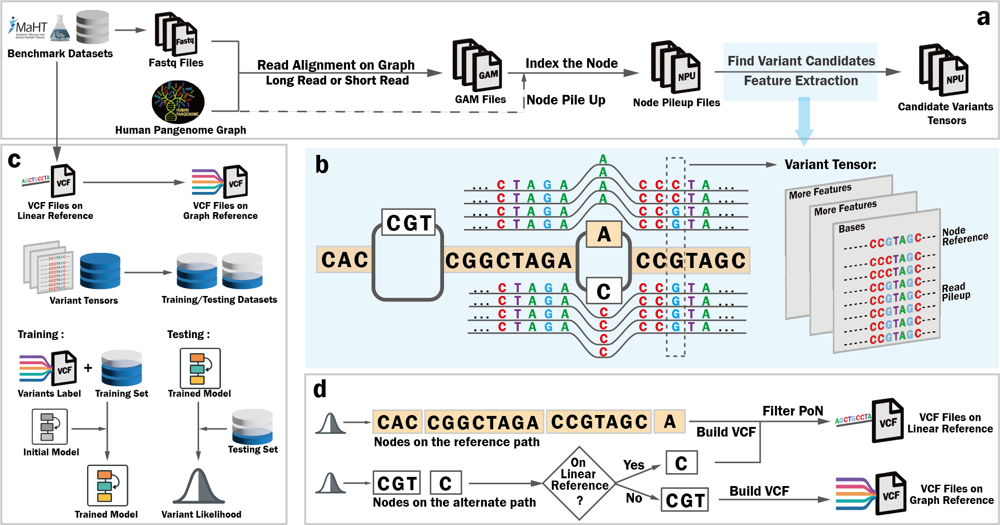

# Pansoma

Pansoma calls somatic variants from tumor-only sequencing reads aligned to a pangenome graph. The indexed-GAM
pipeline turns a sorted, indexed GAM into one `(8, 200, 101)` int8 tensor per candidate site, merges the tensors per
chromosome and labels them against truth sets. The models in `machine_learning/` train on these tensors and predict
from them.



## Repository layout

```text
Pansoma/
├── indexed_gam_pipeline_v4/         the tensor pipeline (README.md: every command and option, tensor format)
│   ├── tensor_postprocessing/       per-chromosome merge and truth labels
│   ├── tools/                       one-time graph preparation, audits, run comparison; tools/jobs/ Slurm jobs
│   └── tests/                       unit tests and goldens
├── machine_learning/
│   ├── pansoma_net_v2/              model for the indexed-gam-candidate tensors
│   │   └── jobs/                    this cluster's Slurm job scripts: local copies, git-ignored (jobs/README.txt)
│   └── pansoma_net/                 earlier model for the 5/6-channel .dat/.idx tensors, kept for older
│                                    checkpoints / data
├── scripts/
│   ├── visualize_tensor.py          tensor shard -> PNG
│   ├── filter_panel_of_normals.py   tag or drop calls found in the ClairS-TO default PoNs
│   └── use_vg.sh                    put vg v1.77.0 first on PATH on this cluster
├── ris/                             job scripts and notes for pansoma_net_v2 on WashU RIS compute1 (LSF)
├── tests/                           tests of scripts/visualize_tensor.py
├── analysis/                        dated analysis records (<topic>_<date>/: notes, scripts, tables), the label rules
│                                    (truth_labels.md) and a step-by-step guide (tensor_generation_and_training.md)
└── figures/
```

Large files (FASTQ, GAM/GAI, GBZ/GFA, VCF, BAM, `.npy` shards) stay outside git.

## Workflow

### 1. Align reads to the graph and sort the GAM

On this cluster, `source scripts/use_vg.sh` first. It selects `/scratch/jshen/bin/vg_v1.77.0`.

Short reads (paired-end Illumina):

```bash
vg giraffe -Z graph.gbz -m graph.min -d graph.dist \
  -f read_1.fq.gz -f read_2.fq.gz -b default -t 12 -p > sample.gam
```

Long reads (PacBio HiFi: `-b hifi`; ONT R10: `-b r10`) need the long-read minimizer and zipcode indexes:

```bash
vg giraffe -Z graph.gbz -m graph.longread.withzip.min -z graph.longread.zipcodes -d graph.dist \
  -f long_reads.fq.gz -b hifi -t 12 -p > sample.gam
```

The pipeline reads a sorted GAM with its GAI index. `gam_sort.sh` runs `vg gamsort -i` (temporary files on the
node's `/tmp`) and publishes `sample.sorted.gam` + `.gai` only after a check; `VERIFY=1` also compares `vg stats -a`
with the input. A long-read GAM also gets the per-record index `.gri`, so a fetch reads only the records its batch
uses (v4 README, sections 1 and 4):

```bash
VERIFY=1 sbatch -J gam_sort -o gam_sort.log indexed_gam_pipeline_v4/tools/jobs/gam_sort.sh sample.gam
sbatch -J gri -o gri.log indexed_gam_pipeline_v4/tools/jobs/build_record_index.sh sample.sorted.gam   # long reads
```

See the [`vg giraffe` best practices](https://github.com/vgteam/vg/wiki/Giraffe-best-practices) for more options.

### 2. Prepare the graph (once per graph)

The graph index, the GRCh38 reference path and the chromosome block table are built with
`indexed_gam_pipeline_v4/tools` (v4 README, section 4). They already exist for HPRC v1.1 d9
(`/scratch/jshen/data/pansoma_v2_tensors/graph_index`), HPRC v2.1 d46
(`/scratch/jshen/data/pansoma_v2_tensors/graph_index_hprc-v2.1-d46`) and the GRCh38-only vg autoindex graph
(`/scratch/jshen/data/Linear_Reference_VG_Indexes/graph_index`). For another graph, one job makes them all, the GFA
(with the GBZ's node IDs, next to the GBZ) and the per-chromosome component lists included; a step whose output
exists is skipped:

```bash
sbatch -J graph_prep -o graph_prep.log indexed_gam_pipeline_v4/tools/jobs/graph_prep.sh graph.gbz OUTDIR [GRCh38.fasta]
```

For a GBZ whose reference is generic paths (a GRCh38-only vg autoindex graph), set `REFERENCE_SAMPLE=_gbwt_ref`.

### 3. Tensors and labels

`run discover` selects the target nodes. `orchestrate prepare` / `run --no-finalize` build a whole genome on one
Slurm node, and `finalize`, a job of its own, merges the tensors per chromosome and writes the truth labels. The
commands and the settings used for PacBio HiFi, ONT-UL, Illumina and fiberseq are in
[indexed_gam_pipeline_v4/README.md](indexed_gam_pipeline_v4/README.md) (sections 1 and 5). The label rules are in
[tensor_postprocessing/README.md](indexed_gam_pipeline_v4/tensor_postprocessing/README.md) and
[analysis/truth_labels.md](analysis/truth_labels.md). A step-by-step guide in Chinese, from a GAM to a trained
model: [analysis/tensor_generation_and_training.md](analysis/tensor_generation_and_training.md).

Render a tensor (needs matplotlib and Pillow; without `-o` or `--output-dir` the PNG goes to
`tensor_figures/<shard name>/` in the repository, which git ignores):

```bash
python scripts/visualize_tensor.py TENSORS/SNV/chr1_shard_00000_data.npy -i 0 -o chr1_0.png
```

### 4. Model

Training and prediction on the merged, labelled sets: [machine_learning/pansoma_net_v2/README.md](machine_learning/pansoma_net_v2/README.md).
The same README covers the calls: `pansoma_net_v2.graph_vcf` (predictions → VCF in graph node coordinates),
`linear_vcf` (→ GRCh38 VCF) and `vcfeval` (the PoN filter below, with the rule of each kind, then `rtg vcfeval`
against the truth VCF).

### 5. Panel of normals filter

Four indexed GRCh38 PoNs (bgzip + tabix), in this order: gnomAD (`af-only-gnomad.hg38.vcf.gz`), dbSNP
(`Homo_sapiens_assembly38.dbsnp138.vcf.gz`), 1000G (`1000g_pon.hg38.vcf.gz`) and CoLoRSdb
(`CoLoRSdb.GRCh38.v1.1.0.deepvariant.glnexus.vcf.gz`). Tag calls that occur in them:

```bash
PON=/scratch/jshen/data/Pansoma/panel_of_normal_VCFs
python -u scripts/filter_panel_of_normals.py calls.vcf.gz calls.pon-tagged.vcf.gz \
  --pon $PON/af-only-gnomad.hg38.vcf.gz $PON/Homo_sapiens_assembly38.dbsnp138.vcf.gz \
        $PON/1000g_pon.hg38.vcf.gz $PON/CoLoRSdb.GRCh38.v1.1.0.deepvariant.glnexus.vcf.gz
```

Every record is kept, and each match gets `FILTER=PanelOfNormals` and a `PANSOMA_PON` INFO field. Add
`--drop-matched` to leave matched records out. A call matches a PoN record with its position, REF and ALT, under
the rule of its kind:

- SNV: gnomAD and CoLoRSdb when that ALT's AF is ≥ 0.0001; dbSNP unless the record is flagged somatic (`SAO=2`);
  1000G any match (like ClairS-TO's panels).
- INDEL (an ALT of another length than REF): gnomAD and CoLoRSdb only. The AF floor depends on the ALT: ≥ 0.01
  when it changes the length of a homopolymer of ≥ 8 bases on the reference, ≥ 0.0001 otherwise. Somatic
  homopolymer INDELs are often population alleles at AF 0.001–0.05 and need the higher floor (the SNV rule would
  remove 71–83 % of the truth INDELs); other somatic INDELs rarely are, and the lower floor removes more germline
  (`analysis/tensor_recall_20260930/pon/indel_rules`). The two thresholds were chosen on chr1 calls with one tumor
  left out, in both directions (HG008T ↔ COLO829T;
  `analysis/reviewer_response_20261011/experiments/E17c_pon_rule_offchr1/heldout.md`). The homopolymer is read from the reference FASTA: `--fasta`, or
  the input VCF's `##reference=file://...` line (linear_vcf writes it).

Calls and PoNs must be in GRCh38 coordinates (`chr1` and `1` naming are both recognized).

## Tests

```bash
python -m indexed_gam_pipeline_v4.native compile                       # once per checkout and Python version
python -m unittest discover -s indexed_gam_pipeline_v4/tests -t .      # and again with PANSOMA_DECODER=python
(cd machine_learning && python -m unittest discover -s pansoma_net_v2/tests -t .)
MPLBACKEND=Agg python -m unittest tests.test_tensor_visualization
```

The pipeline tests that need vg or the native graph-index builder, and their settings: v4 README, section 9. The
visualizer tests need a Python whose matplotlib loads with its NumPy (and Pillow); the base anaconda environment's
matplotlib does not, so run them with another environment.

## Earlier code

Earlier code is in the git history only:

- the `.dat/.idx` pipeline (`scripts/find_unperfect_nodes.py`, `build_dat_idx.py`, `generate_testing_tensors.py`,
  `label_tensors.py`, `pansoma_workflow.py`, `cpp/fast_writer.cpp`, `docker/`, `docs/`, `configs/`)
- the `src/pangenome_ml_data_generation` package seeds
- `experiments/legacy/`, the scripts copied from the old `pangenome_ML_data_generation` repository

They were removed on 2026-09-28. Their last tree is the parent of the commit that removed them:
`git log --diff-filter=D -1 -- scripts/build_dat_idx.py`. The earlier indexed-GAM pipeline versions were removed
in 09f93a7 (v1), 3925042 (v2) and 89e6a8c (v3). `scripts/build_chr_node_filters.sh`, which made the
per-chromosome component lists of the HPRC v1.1 d9 chr index (`tools.graph_prep components` makes the same lists),
was removed later: `git log --diff-filter=D -1 -- scripts/build_chr_node_filters.sh`.

## License

See [LICENSE](LICENSE).
