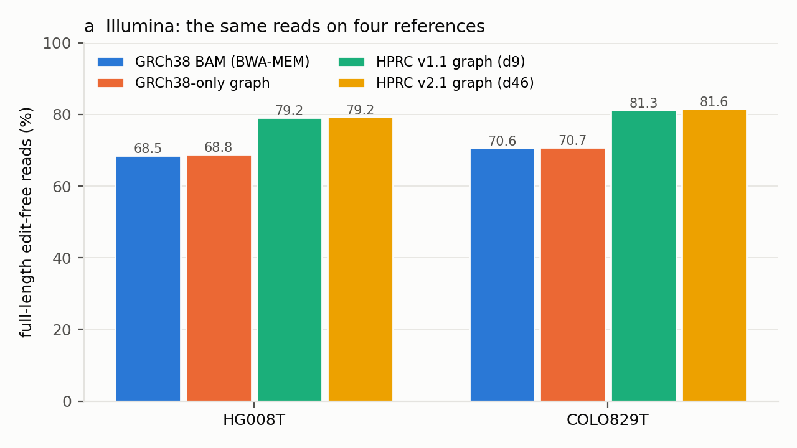
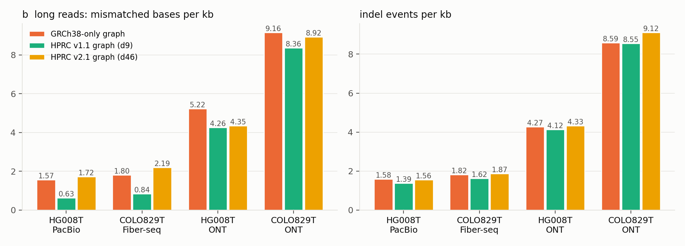
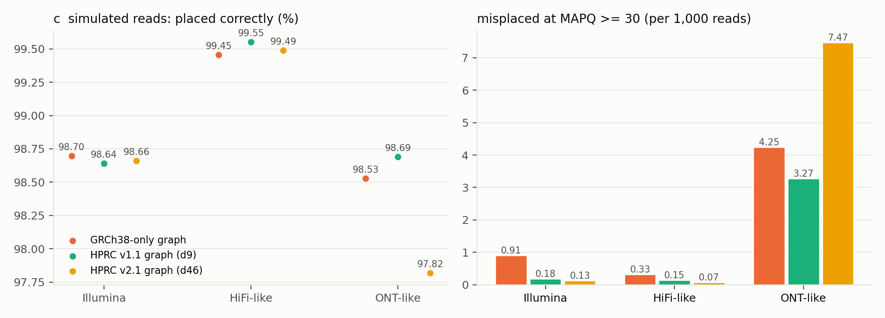

### R2.7 Alignment statistics overstated

**状态：已解决**: 审稿人要的 read 数和比例现在两个肿瘤 × 三个平台都有了（E11a `compare.py` 10-15 18:36 重跑：HG008T 和 COLO829T 的 Illumina 窗口样本含 v2.1，HG008T ONT 的 v1.1 / v2.1 全量扫描，COLO829T Fiber-seq / ONT 的三个图臂全量扫描和 GRCh38 BAM 窗口臂），Response 的 [待补] 已填；E11b 的模拟 reads 给了 "更多 perfect 不等于更正确" 的直接测量（Illumina 正确放置率三臂一样，MAPQ ≥ 30 的错误放置 0.093 % → 0.019 % / 0.013 %），也写进了 Response。2026-10-15 晚 E11b 的 ONT 模拟也出了（v2.1 上 ONT 错放约两倍，Response 的 Correctness 一条已写成例外），COLO829T v1.1 GAM 的 giraffe 版本也由 E22 定到范围。剩下的只是文字：改第 292–294 行、换 Supplementary Fig. 4、表注里的比对软件版本（COLO829T ONT BAM 的 minimap2 版本查不到就写 "not recorded"）。

**Comment（要点）。**

- 第 292–294 行说 graph 上 perfect reads 更多、soft clipping 更少，对照 Supplementary Fig. 4 看有些夸大。
- 要给出 read 数或比例。

**Response.**

We agree that lines 292–294 overstated the effect, and have rewritten them. Supplementary Fig. 4 is replaced by counts
and proportions for the same reads on four references (the GRCh38 BAM, a GRCh38-only graph, and the HPRC v1.1 and v2.1
graphs), for both tumors and all three platforms (Supplementary Table and Figure below). In summary:

- *Illumina:* full-length edit-free alignments of the same reads rise by about 10 percentage points on the HPRC graphs
  (HG008T 69% to 79%, COLO829T 71% to 81–82%). The GRCh38 BAM and the GRCh38-only graph give the same rate (HG008T
  68.5% and 68.8%, COLO829T 70.6% and 70.7%), so the gain comes from the graph's content, not from the aligner.
- *Long reads* are rarely edit-free end to end. On HPRC v1.1 their mismatched bases per kb fall (HiFi 1.57 to 0.63, ONT
  5.22 to 4.26), while indel rates, soft clipping and unmapped reads change little. HPRC v2.1 aligns nearly every HiFi
  read, but places the additional ones in difficult regions at lower mapping quality.
- *More edit-free alignments are not more correct alignments.* On reads simulated from the HG008-N assembly, the share
  placed correctly is the same on every reference (Illumina 98.6–98.7%), while confident misplacements fall for short
  reads and HiFi; ONT reads are the exception on v2.1 (R3.6).

*Published benchmarks agree.* On the 10%-filtered HPRC release 1 graph (the filter of our v1.1 graph), 78.1–78.9% of
Illumina reads aligned perfectly, against 68.7% with BWA-MEM on GRCh38, at a slight cost in mapping confidence (Hickey et
al., 2024), and Giraffe-based calling made 34% fewer small-variant errors than GRCh38-based workflows (Liao et al.,
2023). Giraffe is as accurate as linear mappers on simulated short reads (Sirén et al., 2021) and, on the HPRC release
2 graph with the same d46 filter as our v2.1 graph, mapped simulated HiFi reads with the highest true-positive rate and
the fewest confident errors, with similar or slightly better variant calls than linear mappers (Chang et al., 2025,
preprint).

The revised text says that the graph mainly removes edits at alleles that the sample shares with HPRC haplotypes.

**Supplementary (R2.7).**

*a,* Illumina reads in 48 GRCh38 windows (24 random, 24 at segmental duplications): the share aligned end to end with no
mismatch, indel or soft clip.

*b,* Long reads (a 10% genome-wide sample of read names, the same reads on every graph): mismatched bases and indel
events per aligned kb. The higher HiFi and Fiber-seq rates on v2.1 come from the reads it newly aligns (unmapped 2.6–3.4%
on v1.1, 0.01% on v2.1), mostly in difficult regions.

*c,* Reads simulated from the HG008-N assembly (Illumina 5,000,000; HiFi-like and ONT-like 40,000 each): the share placed
within 50 bp of the true origin, and the misplaced reads with MAPQ ≥ 30 per 1,000 reads.

Supplementary Table (same samples as *a* and *b*; MAPQ as reported by each aligner, so not comparable between the BAM and
the graphs):

| dataset | reference | unmapped % | MAPQ 60 % | soft-clipped reads % | edit-free reads % | mismatched bases / kb | indel events / kb |
|---|---|---:|---:|---:|---:|---:|---:|
| HG008T Illumina | GRCh38 BAM (BWA-MEM) | 0.00 | 88.2 | 2.8 | 68.50 | 4.73 | 0.21 |
| HG008T Illumina | GRCh38-only graph | 0.00 | 86.9 | 2.2 | 68.85 | 4.63 | 0.21 |
| HG008T Illumina | HPRC v1.1 graph (d9) | 0.00 | 86.2 | 1.9 | 79.15 | 3.69 | 0.05 |
| HG008T Illumina | HPRC v2.1 graph (d46) | 0.00 | 86.3 | 1.9 | 79.24 | 3.67 | 0.05 |
| COLO829T Illumina | GRCh38 BAM (BWA-MEM) | 0.00 | 86.5 | 3.3 | 70.57 | 3.93 | 0.20 |
| COLO829T Illumina | GRCh38-only graph | 0.00 | 85.6 | 2.6 | 70.72 | 3.95 | 0.21 |
| COLO829T Illumina | HPRC v1.1 graph (d9) | 0.00 | 85.1 | 2.6 | 81.25 | 2.97 | 0.04 |
| COLO829T Illumina | HPRC v2.1 graph (d46) | 0.00 | 85.5 | 2.4 | 81.61 | 2.94 | 0.04 |
| HG008T PacBio HiFi | GRCh38-only graph | 2.79 | 95.9 | 2.6 | 0.15 | 1.57 | 1.58 |
| HG008T PacBio HiFi | HPRC v1.1 graph (d9) | 2.64 | 95.9 | 2.0 | 1.39 | 0.63 | 1.39 |
| HG008T PacBio HiFi | HPRC v2.1 graph (d46) | 0.01 | 83.3 | 3.8 | 1.42 | 1.72 | 1.56 |
| COLO829T Fiber-seq | GRCh38-only graph | 3.37 | 93.1 | 3.3 | 0.18 | 1.80 | 1.82 |
| COLO829T Fiber-seq | HPRC v1.1 graph (d9) | 3.23 | 93.3 | 2.6 | 1.50 | 0.84 | 1.62 |
| COLO829T Fiber-seq | HPRC v2.1 graph (d46) | 0.01 | 79.3 | 5.0 | 1.54 | 2.19 | 1.87 |
| HG008T ONT | GRCh38-only graph | 7.86 | 95.2 | 30.4 | 1.32 | 5.22 | 4.27 |
| HG008T ONT | HPRC v1.1 graph (d9) | 7.75 | 95.0 | 29.9 | 2.54 | 4.26 | 4.12 |
| HG008T ONT | HPRC v2.1 graph (d46) | 8.01 | 94.2 | 29.6 | 2.50 | 4.35 | 4.33 |
| COLO829T ONT | GRCh38-only graph | 13.53 | 93.9 | 99.0 | 0.00 | 9.16 | 8.59 |
| COLO829T ONT | HPRC v1.1 graph (d9) | 13.23 | 93.5 | 99.0 | 0.01 | 8.36 | 8.55 |
| COLO829T ONT | HPRC v2.1 graph (d46) | 13.61 | 89.5 | 99.0 | 0.01 | 8.93 | 9.12 |

Data: `supplementary/R2.7/alignment_stats.tsv`, `supplementary/R2.7/simulated_placement.tsv` (made by
`supplementary/R2.7/make_figures.py` from `experiments/E11a_alignment_stats/results/*.json` and
`experiments/E11b_simulated_alignment/results/summary.tsv`).

*Methods.*
1. *Alignments.* Each dataset's tumor reads were aligned with vg Giraffe to the GRCh38-only graph and to the HPRC v1.1
   (d9) and v2.1 (d46) graphs (versions as in R3.m1); the GRCh38 BAMs are the data providers' BWA-MEM 0.7.17 alignments
   (HG008T: GIAB; COLO829T: SMaHT, Sentieon 202308.01 with duplicate marking, indel realignment and base recalibration).
2. *Same reads.* Reads are selected by a hash of the read name, so every reference sees the same reads. Illumina: 10% of
   the reads in the 48 windows (± 1 kb) that any reference places there; long reads: 10% of all read names, whole files
   scanned.
3. *Measures.* Edit-free: mapped with no mismatch, indel or soft clip. Mismatched bases and indel events per kb of
   aligned bases, from each alignment's edits; unmapped, soft-clipped and MAPQ shares per read.
4. *Simulation.* Reads drawn from one-to-one segments of the HG008-N assembly on chr1 and chr20, with known GRCh38
   origin (Illumina 2 × 150 bp, 0.2% substitutions; HiFi-like ~15 kb, 0.1% errors; ONT-like with the pbsim3 R10.4
   model), aligned to each graph and projected to GRCh38. Correct: the right chromosome and a read end within 50 bp of
   the truth.

*References.*
- Sirén J. et al. Pangenomics enables genotyping of known structural variants in 5202 diverse genomes. *Science* 374,
  abg8871 (2021).
- Liao W.-W. et al. A draft human pangenome reference. *Nature* 617, 312–324 (2023).
- Hickey G. et al. Pangenome graph construction from genome alignments with Minigraph-Cactus. *Nat. Biotechnol.* 42,
  663–673 (2024).
- Chang X. et al. Rapid, accurate long- and short-read mapping to large pangenome graphs with vg Giraffe. Research
  Square preprint, doi:10.21203/rs.3.rs-7747403/v1 (2025; not peer reviewed).

**证据（内部）。**

- 2026-10-19 COLO829T Illumina 的 GRCh38 BAM 臂（用户问图 a 为什么 COLO829T 没有 GRCh38 列，给了本地 BAM
  `/scratch/qfu/COLO829T_WGS/SMHTCOLO829T-X-X-M45-A001-uwsc-SMAFIZO17Q9I-sentieon_bwamem_202308.01_GRCh38.aligned.sorted.bam`，
  410 GB，有 `.bai`）：
  - 同一批 reads：qfu 从这个 BAM 转出的 FASTQ（`bam2fastq.sh`：`samtools collate | samtools fastq`）有 2,479,603,422 reads，等于
    `compare.py` 里 COLO829T Illumina GAM 的总 read 数；GAM 用的 FASTQ（`/scratch/jshen/data/COLO829T/illumina/SMHTCOLO829T_Illumina_WGS_R{1,2}.fastq.gz`）
    read name 同格式（`LH00266:46:22GM3HLT3:...`）。抽查：window w00 里 d9 窗口样本的 1,007 个 mapped read name，1,006 个在 BAM 同一窗口
    fetch 到。
  - `@PG`：Sentieon 202308.01 的 `bwa mem` 0.7.17-r1188（8 个 lane），然后 Dedup（只标记，scan 不过滤 0x400，和 HG008T 一样）、
    Realigner（`-k` known sites 的 indel realignment）、BQSR（ReadWriter `-q recal_data.table`）、samtools merge 1.17；参考 195 条 contig，
    没有 `_alt` / decoy / HLA，有 chrEBV（GRCh38 no-alt analysis set）。HG008T Illumina BAM 是 GIAB 的 bwa mem 0.7.17，没有 realignment →
    Methods 第 1 条写了两者的流程差别。
  - 跑法：`experiments/E11a_alignment_stats/wtasks.tsv` 加第 11 行（short、core、`MOD 10 KEEP 1`），`sbatch --array=11 -x maotai
    tmp/reviewer_cpu_20261013/E11a_alignment_stats/window_array.sh` → 446070_11（guinness，50 s，RSS 0.96 GB，`complete: true`，
    1,173,977 行，whole-file unmapped 7,299,140 条）；`compare.py COLO829T_Illumina`（446071，1 min 21 s）重写
    `results/COLO829T_Illumina.json` 和 `results/tables.md`（另外五个 JSON 没动）；`make_figures.py` 重画图 a 和 `alignment_stats.tsv`。
  - 结果（W per_arm，edit-free %）：GRCh38 BAM 70.57、GRCh38-only 70.72、v1.1 81.25、v2.1 81.61（图臂的数和 10-15 一样；read universe
    1,267,256 → 1,292,211，多出来的是 BAM 放到窗口里、图臂都放在别处的 reads）。同一批 reads（`W.pairs`）：GRCh38-only vs BAM 1,130,147 条
    70.94 / 70.94 %，placement 一致 99.34 %（MAPQ ≥ 30 两边 99.997 %）；d9 vs BAM 1,100,983 条 71.06 → 81.70 %，d46 vs BAM 1,105,045 条
    71.11 → 81.85 %；变成 perfect 的 reads 94.1 % / 94.0 % 走 off-ref node。和 HG008T（BAM 68.50、GRCh38-only 68.85，配对 69.18 / 69.18）
    同一个结论。BAM 的 soft clip 3.28 % 对 GRCh38-only 2.63 %、MAPQ 60 86.5 对 85.6 %（不同 aligner 的 MAPQ，不比较）。
  - Response 第一条改成 "(HG008T 68.5% and 68.8%, COLO829T 70.6% and 70.7%)"。原来写的 "68.9%" 是 68.846 四舍五入错了（图标的是 68.8）。

- 2026-10-19 用户要求加已有文献佐证 HPRC pangenome graph 对比对的帮助：Response 加 "*Published benchmarks agree.*" 一段，Supplementary 末尾加 *References*。核实：
  - Hickey et al. 2024（*Nat Biotechnol* 42:663–673，doi:10.1038/s41587-023-01793-w，PMC10638906，WebFetch 全文）："On average, 78.1% and 78.9% of reads aligned perfectly for the GRCh38-based and CHM13-based pangenomes, respectively"（对照 BWA-MEM / GRCh38 68.7 %，Illumina 约 30×，HG001 / HG002 / HG005）；"Mapping to the pangenomes resulted in a slight drop in mapping confidence, from about 94.9% to 94.1% of reads"（MAPQ > 0）；"All mapping experiments were performed on filtered HPRC graphs with a minimum allele frequency of 10%, meaning that nodes supported by fewer than nine haplotypes were removed"；"This filter increases accuracy for short-read mapping and variant calling"。这是 HPRC release 1（90 条 haplotype）的 MC 图，我们的 v1.1 d9 是同一种过滤 → "the 10%-filtered HPRC release 1 graph (the filter of our v1.1 graph)"。和我们 E11a 的 Illumina 数（BAM 68.5 % → v1.1 79.2 %）几乎一样。
  - Liao et al. 2023（R1.2 证据 2026-10-16 已核实，PMC10172123）：摘要 "reduced small variant discovery errors by 34%"（相对 GRCh38-based workflows，d9 过滤图 + Giraffe）。
  - Sirén et al. 2021（R1.2 证据，PMC9365333）：Giraffe 在已知来源的模拟 reads 上 "as accurate as the most accurate previously published mappers"。
  - Chang et al. 2025（Research Square 预印本 rs.3.rs-7747403/v1，PMC12633584，未经同行评审，WebFetch 全文）：HPRC release 2、"more than 450 human haplotypes"，主比较图 "HPRC-d46"（Minigraph-Cactus + allele frequency filtering，就是我们 v2.1 d46 那一类）；HiFi："it had the highest true positive rate for HiFi reads when mapping to the allele frequency-filtered HPRC-d46 graph"、"the fewest incorrectly mapped reads with a mapping quality (MAPQ) of 60"；ONT："Giraffe's accuracy was similar to that of other mappers"；变异：摘要 "Its alignments produce similar or improved small and structural variant calling results"，Discussion "the improvements in variant calling demonstrated are currently modest" → Response 写 "similar or slightly better variant calls"，并注明 preprint。
  - 和我们 E11b 的差别：Chang 的 ONT 是 "similar"，我们 ONT-like 模拟（pbsim3，读长准确率约 96 %，vg 1.77）在 v2.1 上错放更多（R3.6），Response 第三条的 ONT 例外保留。

- 2026-10-19 按用户要求重写（"response 不需要太多细节，应该是个总结的 Results；在 response 下面再开一个部分作为 supplementary，加图片和 data，以及简单的 methods"；旧版备份在 session scratchpad `R2.7_before_20261019.md`）。Response 只留三条总结 + 一句改写；细节进新的 "**Supplementary (R2.7).**" 部分（三张图、表、数据文件、方法）。`assemble_point_by_point.py` 同日改成：Response 到 "**Supplementary" 为止（字数不含它），letter 在 Response 后面单列 Supplementary，图的路径从 `../supplementary/` 改成 `supplementary/`。
  - 图和表：`supplementary/R2.7/make_figures.py`（用 `/wanglab/jshen/anaconda3/envs/sambcfenv/bin/python`；base anaconda 的 matplotlib 和 NumPy 2.3 不兼容）读 E11a `results/{set}.json`（Illumina 用 W 窗口样本的 `per_arm`，长读长用 G 全基因组 10 % 样本的 `per_arm`）和 E11b `results/summary.tsv`。配色：dataviz 默认调色板前四个（蓝 / 橙 / 青 / 黄 = GRCh38 BAM / GRCh38-only / v1.1 / v2.1），`validate_palette.js` light 全部 PASS（CVD ΔE 9.1、normal 22.9），青、黄对比度 < 3:1 → 每根柱都有数值标签，另有 TSV。
  - Response 数字：Illumina edit-free（W per_arm）HG008T BAM 68.50 / GRCh38-only 68.85 / v1.1 79.15 / v2.1 79.24，COLO829T 70.72 / 81.25 / 81.61 → "69% to 79%"、"71% to 81–82%"、"68.5% and 68.9%"。（原来 Response 用的是配对 reads 的 69.12 → 79.36，同一结论。）长读长 mismatch / kb（G per_arm）：HiFi 1.57 → 0.63，ONT（HG008T）5.22 → 4.26；v2.1 HiFi / Fiber-seq unmapped 0.01 %、MAPQ 60 83.3 / 79.3 %（v1.1 95.9 / 93.3 %）→ "aligns nearly every HiFi read ... at lower mapping quality"；"in difficult regions" 见 E11a 表的 SMaHT 分层（extreme 区 v2.1 unmapped 0.03 % vs 28.15 %，MAPQ 60 22.5 % vs 46.3 %）。
  - 模拟（E11b summary.tsv）：correct within 50 bp Illumina 98.698 / 98.642 / 98.659 %；MAPQ ≥ 30 错放每千条 Illumina 0.91 → 0.18 / 0.13，HiFi 0.33 → 0.15 / 0.07，ONT 4.25 → 3.27 / 7.47。（旧 Response 的 "0.093 % → 0.019 % / 0.013 %" 是 E11b README 的写法，分母略不同；图和表按全部模拟 reads 算。）
  - 方法第 2 条：E11a README "Fixed GRCh38 windows"（48 个 core 窗口：24 个 500 kb 随机 + 24 个 100 kb segdup 中心，flank 1 kb，`MOD 10, KEEP 1`）和 G 样本（`crc32(name) % 100 < 10`，整个 GAM 扫描）；第 4 条：E11b README Method 1–5。

- 2026-10-15 E1.6/E9h/E22/E11b-ONT（本条用到 E11b-ONT 和 E22 check 2；Response 456 → 482 词）：
  - Correctness 一条加了 ONT 的例外（`experiments/E11b_simulated_alignment/results/tables.md` "## ont: overall"，collect 407748，19:39）：wrong / placed GRCh38-only 0.773 %、d9 0.614 %、d46 1.483 %；wrong at MAPQ ≥ 30 0.433 / 0.335 / 0.764 %；d46 多出来的错放几乎全在 SMaHT extreme 区（详见 R3.6 证据和 E11b README Interpretation 7）。HiFi 和 Illumina 的方向不变（HiFi wrong / placed 0.495 / 0.328 / 0.383 %），所以最后一句改成 "on simulated short and HiFi reads"。Correctness 一条的括号从 "Illumina reads simulated ..." 改成 "reads simulated ..."（现在有两个平台）。
  - 表注的 giraffe 版本（E22 check 2，`experiments/E22_truth_and_version_checks/README.md`、`vg_fingerprint.tsv`）：COLO829T v1.1 GAM 没有日志，GAM 里嵌的 `PARAMS_JSON` 指纹把版本定到 Fiber-seq 1.64.1–1.66.0、ONT 1.64.0–1.66.0、Illumina ≤ 1.62（Illumina 的 GAM 没有 `PARAMS_JSON`，2025-05 唯一的 d9 minimizer index 是 v9 格式，≥ 1.63 读不了；具体版本恢复不了）。表注可以写这些范围，不必写 "not recorded"。HG008T 的 v1.1 是 1.66.0（日志），v2.1 1.77。

- 2026-10-15 终稿一致性（Response 511 → 456 词）：
  - 移到证据的细节（数没变，出处 `experiments/E11a_alignment_stats/results/tables.md`、`vg_stats_crosscheck.md`、`analysis/branch_node_alignments_20261002/README.md`）：HG008T Illumina v1.1 窗口样本的 read 数 "(1,277,850 reads)"；窗口组成 "24 random and 24 centred on segmental duplications"（Response 写 "half at segmental duplications"）；whole-file 计数的 "mates counted separately"；"Within the same node length, visits to non-reference and to GRCh38 nodes are about equally often edit-free (1 bp: 98.5% vs 97.9%)"（node 层面，见下面 "Node 层面" 一条）；COLO829T Fiber-seq 的三个图臂数 "(5.62%, 5.43%, 0.03% unmapped; 92.38%, 92.63%, 76.87% at MAPQ 60)"（Response 只写 "follows the same pattern"，数在 R3.6 第 2 点）；E11b 的 "chr1 and chr20"（R3.6 第 3 点有）；GRCh38 BAM 的 aligner 列表 "(GRCh38 BAMs: BWA-MEM, pbmm2 or minimap2; graphs: vg giraffe)"（表注写，版本见还缺什么；Giraffe 版本的总表在 R3.m1）。
  - E11b 的数核对过 `experiments/E11b_simulated_alignment/results/tables.md`（98.698 / 98.642 / 98.659 %，MAPQ ≥ 30 错放 0.093 / 0.019 / 0.013 %）；E11a 的数在 `results/tables.md` 里都能找到。
- HG008T Illumina d9：`/scratch/jshen/data/HG008_GIAB/vg_giraffe_GAM/Liss_lab_BCM_Illumina-WGS_20240313/HG008-T_p23_BCM_IlluminaWGS_20240313.vg.stats`：Total alignments 2974694440，Total aligned 2932326192，Total perfect 2286270813，`max 60 (2626084493 reads)`，Insertions 17762998 read events，Deletions 22692983 read events，Softclips 85507213 read events。
- HG008T Illumina GRCh38-only：`/scratch/jshen/data/HG008_GIAB/raw_sequencing_data/Liss_lab_BCM_Illumina-WGS_20240313/vg_linear_hg38/HG008T_BCM_IlluminaWGS_hg38_linear_vg.gam.stats.txt`：Total alignments 2974694440，aligned 2929783717，perfect 2009031268，`max 60 (2628588329 reads)`，Insertions 49909068、Deletions 52666034、Softclips 93004309 read events。
- `vg stats` 的 "read events" 是 edit 事件数，不是 read 数（例：COLO829T ONT d9 "Substitutions: 2107426682 bp in 1674490568 read events"，Illumina 的 substitution bp 与 events 相等），所以 Response 写 "insertion / deletion / soft-clip events"，不写 "reads with an insertion"（checker 改）。
- 百分比（76.86 / 67.54 perfect，1.42 / 1.51 unmapped，2.92 / 3.17 和 COLO829T ONT 173.44 / 173.45 soft-clip events per 100 mapped reads，PacBio d9 perfect 1.39）：`experiments/E11a_alignment_stats/results/vg_stats_crosscheck.md`。
- Node 层面：`analysis/branch_node_alignments_20261002/README.md` s1 表，HG008T_PacBio：node visits 3,931,468,159，branch 313,140,918 (8.0 %)，perfect on branch 98.0 %，GRCh38 nodes 92.4 %。按长度分档（同 README "Perfect fraction of visits by node length" 表）：HG008T_PacBio 1 bp branch 98.5 %（267 M visits）vs GRCh38 97.9 %；README 原话 "a visit's chance of an edit grows with node length, so compare within a length bin"。98.0 vs 92.4 主要是节点长度造成的（branch visit 大多在 1 bp 节点上），只引这一对数字正是审稿人说的那种夸大，Response 已加分档的对比（checker 改）。
- PacBio MAPQ，三个 graph 臂：`/scratch/jshen/data/reviewer_experiments_20261013/E11a_alignment_stats/scans/HG008T_PacBio.{linear,d9,d46}.summary.json`（`complete: true`，job 387166_0–2 COMPLETED）：with_path 13,624,706 / 13,644,710 / 14,012,552（records 14,014,144），`mapq_hist_with_path[60]` 13,064,032 / 13,081,945 / 11,675,897。
- PacBio MAPQ，GRCh38 BAM：`/scratch/jshen/data/HG008_GIAB/raw_sequencing_data/Liss_lab_PacBio_Revio_20240125/HG008_PacBio_bam_stats.txt`（samtools stats 1.18）：raw total sequences 14014144，reads unmapped 1055，`MAPQ 60` 行 13,289,473，primary mapped 14,013,089。
- 94.84 / 95.88 / 95.88 / 83.32 % 和 0.01 / 2.78 / 2.64 / 0.01 % 是我用上面两条的计数算的（两位小数）。
- HG008T ONT（checker 加进 Response 的 MAPQ 条）：3.89 % = 141,830 / 3,642,157；7.88 % = (3,642,157 − 3,355,051) / 3,642,157；7.77 % = (3,642,157 − 3,359,067) / 3,642,157（与 `vg_stats_crosscheck.md` 的 7.77 一致）；MAPQ 60 的 95.02 % = 3,191,911 / 3,359,067。来源同下一行：
- 原始计数：GRCh38 BAM `HG008_ONT_bam_stats.txt` unmapped 141,830 / 3,642,157，MAPQ 60 3,235,858 / 3,500,327（92.44 %）；GRCh38-only graph `scans/HG008T_ONT.linear.summary.json` with_path 3,355,051，MAPQ 60 3,193,314（95.18 %）；d9 `HG008_ONT_gam_stats.txt` aligned 3,359,067，`max 60 (3191911 reads)`。d46 ONT scan 还没跑完。
- vg 版本：`experiments/E3_reference_arms/README.md` 表和 caveat 4（linear vg giraffe 1.66，d9 unverified，d46 vg giraffe 1.77）。E3 README 的 "d9 unverified" 已过时：HG008T 三个 d9 GAM 的 giraffe 日志在 `/scratch/jshen/Log_info/`（R3.1 证据），2026-10-15 本文件又核了一遍：`vg_longread_gam_AFHPRC.279410.out`（PacBio）、`hg008t_ont_align_AFHPRC.279553.out`（ONT）、`hg008t_giraffe_Liss_lab_BCM_Illumina-WGS_20240313_AF-HPRC.268637.out`（Illumina）都是 `vg version v1.66.0 "Navetta"`；linear 的 `HG008T_longread_vg_linear_gam_379046_{0,1}.out` 也是 v1.66.0。原来写的 "唯一的 log ... 只有四行 'Guessing that ...'"（`.../vg_giraffe_GAM/.../log/HG008-T_p23_BCM_IlluminaWGS_20240313.log`）是 GAM 目录里的那份，不是 Slurm 日志。COLO829T 的 d9 GAM（2025 年做的）版本仍未核实。
- GRCh38 BAM 的比对软件（新，`samtools view -H` 的 `@PG` 行，samtools 用 `/wanglab/jshen/anaconda3/envs/sambcfenv/bin/samtools`）：
  - HG008T Illumina `HG008-T_Illumina_195x_GRCh38-GIABv3.bam`：`PN:bwa VN:0.7.17-r1188 CL:bwa mem -t 20 ...`；
  - HG008T PacBio `HG008-T_PacBio-HiFi-Revio_20240125_116x_GRCh38-GIABv3.bam`：`PN:pbmm2 VN:1.10.0 (commit v1.10.0) CL:pbmm2 align ... --preset HIFI ... --unmapped`；
  - HG008T ONT `HG008-T_GRCh38_GIABv3_ONT-UL-R10.4.1-dorado_0.8.1_sup.5mC_5hmC_54x_20241216.bam`：`PN:minimap2 VN:2.26-r1175 CL:minimap2 -t 25 -y -x map-ont ...`；
  - COLO829T fiberseq `SMHTCOLO829T-X-X-M45-B004-uwsc-MERGED-pbmm2_1.13.0_GRCh38.aligned.sorted.bam`：`PN:pbmm2 VN:1.13.0 (commit v1.13.0-2-gbcd99f5)`；
  - COLO829T ONT `COLO829T_ONT_merged.bam`：`PN:minimap2 VN:2.26-r1175`（三条 `ID:minimap2*` 都是 2.26；header 里另有一条 `ID:aligner PN:minimap2 VN:2.24-r1122`，和 basecaller `dorado 0.4.2+bb2a133` / `guppy 6.5.7+ca6d6af` 并列，来源不明，可能是上游流程；Response 暂写 2.26，见还缺什么）。
  - 三个 HG008T BAM 的参考都是 GIAB v3 的 `GRCh38_GIABv3_no_alt_analysis_set_maskedGRC_decoys_MAP2K3_KMT2C_KCNJ18`（bwa / pbmm2 的 CL 里可见）。COLO829T Illumina 不在 E11a 的 GRCh38 BAM 臂里，没查。（已过时：2026-10-19 加了，Sentieon bwa mem 0.7.17-r1188，见本节第一条。）
- E11a 同一批 reads 的结果（`experiments/E11a_alignment_stats/README.md` Results §1–4 和 `results/tables.md`，`compare.py`
  10-13 23:00 在 login node 跑的；10-15 查过 `scans/`、`windows/` 没有新输出）：
  - Illumina W（48 窗口，10 % 抽样）：d9 vs GRCh38-only，两边都放在窗口里的 1,277,850 条，perfect 69.12 → 79.36 %，soft clip
    2.05 → 1.83 %（`tables.md` 第 329 行）；GRCh38-only vs GRCh38 BAM 1,296,578 条，perfect 69.18 / 69.18 %，soft clip 2.30 → 1.97 %
    （第 330 行）。变成 perfect 的 130,826 条：86.02 % 原来只有 mismatch，中位数 1 个 mismatch 碱基，94.15 % 走 off-ref node，
    placement 一致 99.74 %（第 335 行）。
  - PacBio G（10 % 抽样，1,402,384 条）：perfect 0.15 / 1.39 / 1.42 %（GRCh38-only / d9 / d46），mismatch bp per kb 1.57 / 0.63 /
    1.72，indel events per kb 1.58 / 1.39 / 1.56，soft clip（% of mapped reads）2.65 / 2.00 / 3.75（`tables.md` 第 21–22 行和 README §1）。
    d46 的全基因组 mismatch 率比 d9 高，是因为它把 GRCh38-only / d9 上 unmapped 的 reads 比上了，主要在 SMaHT extreme 区、MAPQ 低
    （README Interpretation 5）；Response 写成 "The extra reads v2.1 aligns lie mostly in difficult regions, at low MAPQ"。
  - E11a README 的 Caveats 原来写 "the aligners of the HG008T BAMs are not recorded here"；2026-10-15 用 `module load samtools/1.18`
    的 `samtools view -H` 重新核了三个 HG008T BAM 的 `@PG`（BWA-MEM 0.7.17-r1188、pbmm2 1.10.0、minimap2 2.26-r1175），并把 E11a
    README 的 Caveats 改了（同时写上 HG008T 的 giraffe 版本：GRCh38-only 和 d9 1.66.0，d46 1.77）。
- 2026-10-15 Response 的改动：加了同一批 Illumina reads 那一条（BAM 和 GRCh38-only 一样、增益来自图的内容、99.74 % 位置不变）
  和 PacBio 的 per-kb 数；去掉了 "3.93 billion node visits / 8.0 % branch / 98.0 % vs 92.4 %" 那组 node 层面的数（只留按节点长度分档
  的 98.5 % vs 97.9 %，免得重复审稿人说的那种夸大）；aligner 版本只在表注里写（版本号在上面 `@PG` 一条）；[待补] 改成只列还缺的
  arm。
- 2026-10-15 一致性：
  - Illumina 的 perfect / edit-free 数全套只用一个来源：E11a 的窗口样本（`results/tables.md` §3 / README §3，`results/HG008T_Illumina.json`
    的 `W.pairs.d9_vs_linear`：`perfect_A_pct` 69.1225、`perfect_B_pct` 79.3602，1,277,850 条；`linear_vs_grch38_bam` 69.1838 / 69.1824，
    1,296,578 条；本次重读 JSON 核过）。原来第一条的整份 GAM `vg stats`（2,286,270,813 = 76.86 % vs 2,009,031,268 = 67.54 %，
    `results/vg_stats_crosscheck.md`）从 Response 拿掉，只留在证据（上面第 1–3 条）：两个数相差约 1.6–2.5 个点，口径不同：窗口样本只含两边都放在
    48 个窗口里的 reads（24 个随机、24 个以 segdup 为中心；unmapped 不在里面），整份文件含全部 reads（包括 unmapped）；原因没有拆开算。
    增益（+10.2 vs +9.3 个点）方向和大小一致。R1.3 / R3.6 也改用窗口样本。
  - 整份文件的 unmapped（1.42 / 1.51 %）和 MAPQ 60 计数是另一组指标，仍用整份文件，第二条写明 "whole files"。
  - giraffe 版本：HG008T 的 GRCh38-only 和 v1.1 GAM 都是 vg 1.66.0（日志核实，见上面 vg 版本一条），v2.1 是 1.77；只剩 COLO829T v1.1 未核实。

- 2026-10-15 结果并入（E11a 全部 arm、E11b）：
  - E11a `experiments/E11a_alignment_stats/results/tables.md`（`compare.py` 10-15 18:25–18:36 重跑，六个 `results/*.json`；README 的 Status 段还是 10-13 的，没更新）。
    - Illumina W（48 窗口，10 % 抽样，"Same reads, both arms place them in the window"）：HG008T d9 vs GRCh38-only 1,277,850 条 69.12 → 79.36 %，d46 vs GRCh38-only 1,277,730 条 69.07 → 79.41 %；COLO829T d9 1,102,189 条 71.02 → 81.66 %，d46 1,107,463 条 71.01 → 81.73 %。soft clip（same reads）HG008T 2.05 → 1.83 / 2.04 → 1.84；COLO829T 2.49 → 2.29 / 2.49 → 2.30。COLO829T Illumina 没有 GRCh38 BAM 臂（E11a 从没计划；2026-10-19 补上，见本节第一条）。
    - Illumina 整份文件 unmapped（W 段 "Unmapped records of the whole file"）：HG008T GRCh38-only 1.51 %、d9 1.42 %、d46 1.41 %；COLO829T 0.99 / 0.63 / 0.94 %（Response 只写 HG008T）。
    - 长读长 G（全基因组 name-hash 10 % 抽样，graph arms）：perfect % GRCh38-only / d9 / d46：HG008T PacBio 0.15 / 1.39 / 1.42，HG008T ONT 1.32 / 2.54 / 2.50，COLO829T Fiber-seq 0.18 / 1.50 / 1.54，COLO829T ONT 0.00 / 0.01 / 0.01。mismatch bp / kb：1.57 / 0.63 / 1.72；5.22 / 4.26 / 4.35；1.80 / 0.84 / 2.19；9.16 / 8.36 / 8.92。indel events / kb：1.58 / 1.39 / 1.56；4.27 / 4.12 / 4.33；1.82 / 1.62 / 1.87；8.59 / 8.55 / 9.12（ONT 在 v2.1 上 indel 率反而高一点，Response 只写 "change less" 和 PacBio 的例子）。soft clip % of mapped：2.65 / 2.00 / 3.75；30.37 / 29.89 / 29.61；3.26 / 2.58 / 4.96；99.03 / 99.03 / 99.04（COLO829T ONT 几乎每条 read 都有 soft clip，三臂一样；原因没查，Response 没写这一套）。
    - 整份 GAM（G 段 "Whole GAM (every record, exact)"）unmapped % 和 MAPQ 60 % of mapped：HG008T PacBio 2.78 / 2.64 / 0.01，95.88 / 95.88 / 83.32；HG008T ONT 7.88 / 7.77 / 8.04，95.18 / 95.02 / 94.16；COLO829T Fiber-seq 5.62 / 5.43 / 0.03，92.38 / 92.63 / 76.87；COLO829T ONT 13.53 / 13.23 / 13.62，93.85 / 93.46 / 89.57。HG008T ONT BAM 3.89 % 是上面 samtools stats 那条算的。COLO829T ONT BAM 整份文件 unmapped 1,070,571 条（W 段），总 read 数不在表里，所以没算百分比；W 窗口里 GRCh38 BAM unmapped 1.24 % 对图臂 5.10–6.96 %，方向和 HG008T ONT 一样。
    - 长读长 W（148 窗口）里 GRCh38-only vs GRCh38 BAM 的 perfect 都一样（HG008T PacBio 0.18 / 0.18，COLO829T Fiber-seq 0.18 / 0.18，HG008T ONT 1.09 / 1.08），BAM 的 soft clip 高（PacBio 5.40 vs 2.16，Fiber-seq 8.28 vs 2.68，HG008T ONT 34.93 vs 28.37）：pbmm2 / minimap2 和 giraffe 的 soft clip 口径不同，Response 不比较 BAM 的 soft clip。
  - E11b `experiments/E11b_simulated_alignment/results/tables.md` 和 README 的 RESULTS 段（10-15 17:57）：从 HG008-N v6.2 组装（不在任何一张 HPRC 图里）chr1 + chr20 一对一比对的片段模拟。
    - Illumina 5,000,000 条：correct（50 bp 内）98.698 / 98.642 / 98.659 %；wrong / placed 1.235 / 0.983 / 0.927 %；wrong at MAPQ ≥ 30 4,538（0.093 %）/ 904（0.019 %）/ 631（0.013 %）；perfect 63.69 / 72.94 / 73.06 %；perfect but wrong 1.063 / 0.910 / 0.877 % of perfect。同一批 reads：只在 GRCh38-only 上 confident wrong 的 3,906（vs d9）/ 4,093（vs d46），只在图上的 272 / 186。
    - HiFi 40,000 条：correct 99.455 / 99.552 / 99.490 %，wrong at MAPQ ≥ 30 13（0.033 %）/ 6（0.015 %）/ 3（0.008 %），数太少，Response 没写。ONT 模拟的结果不在 tables.md 里（10-15 13:35 d46 HiFi + ONT 还在跑；之后的 collect 只写了 illumina 和 hifi），R3.6 要的话再查。（已过时：ONT 在 19:39 已出，见本节开头 "2026-10-15 E1.6/E9h/E22/E11b-ONT" 一条。）
    - 局限（E11b README）：d9 臂用的是 vg 1.65.0（生产 GAM 是 1.66.0）；truth 只含一对一比对的区域，最难的区域代表性不足；没有 CHM13 臂（用户 10-13 取消）。按 SMaHT 区域，extreme 区错误放置最多（wrong at MAPQ ≥ 30：1.502 / 0.317 / 0.213 %），easy 区几乎为 0。
  - Response 改动：[待补] 换成 v2.1 / ONT / COLO829T 的数；Illumina 那条加了 v2.1 和 COLO829T；长读长加了四个数据集的 mismatch / kb；MAPQ 条加了 COLO829T Fiber-seq 和 v2.1 的 ONT；新加 E11b 的 Correctness 一条；最后一句改成 "on simulated reads the graphs mainly reduce confident misplacements (R3.6)"。Response 约 510 词（原来 423）。

**还缺什么。**

- 已完成，删掉（2026-10-15）：E11a 的 HG008T ONT d9 / d46 扫描、HG008T Illumina d46 和 COLO829T 全部 arm，`compare.py` 已重跑；Response 的 [待补] 已填。
- [文字] 改写第 292–294 行；把 Supplementary Fig. 4 换成计数表（E11a `results/tables.md` 的 G / W 主表和分层表，两个肿瘤 × 三个平台）；[待核实] Supplementary Fig. 4 原来画的是哪些数据集、哪个参考。
- [文字] 表注写上各臂的比对软件和版本：GRCh38 BAM 已核实（HG008T BWA-MEM 0.7.17 / pbmm2 1.10.0 / minimap2 2.26；COLO829T Illumina Sentieon 202308.01 bwa mem 0.7.17，Fiber-seq pbmm2 1.13.0），HG008T 的 giraffe 已核实（GRCh38-only 和 v1.1 vg 1.66.0，v2.1 1.77）。COLO829T v1.1 GAM 的 giraffe 版本已由 E22 定到范围（Fiber-seq 1.64.1–1.66.0、ONT 1.64.0–1.66.0、Illumina ≤ 1.62，2026-10-15；E11b 的 d9 臂用的 1.65.0 是 E11b 自己选的，不是生产版本），表注照写范围；COLO829T ONT BAM 的 header 同时有 minimap2 2.24 和 2.26，需向数据来源（SMaHT）确认，查不到同样写明。
- [文字] E11a README 的 Status / Results 段还是 10-13 的，结果段要按 18:36 的 `tables.md` 更新（E11a 的事，不影响本条 Response）。
