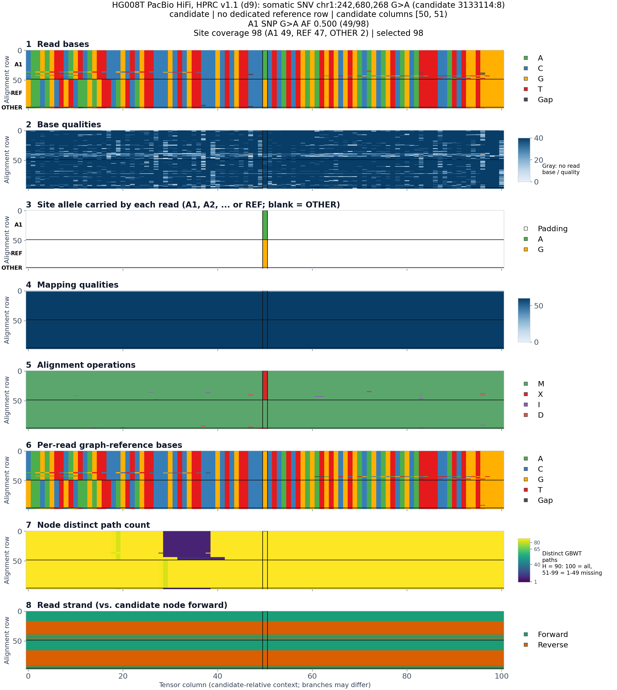
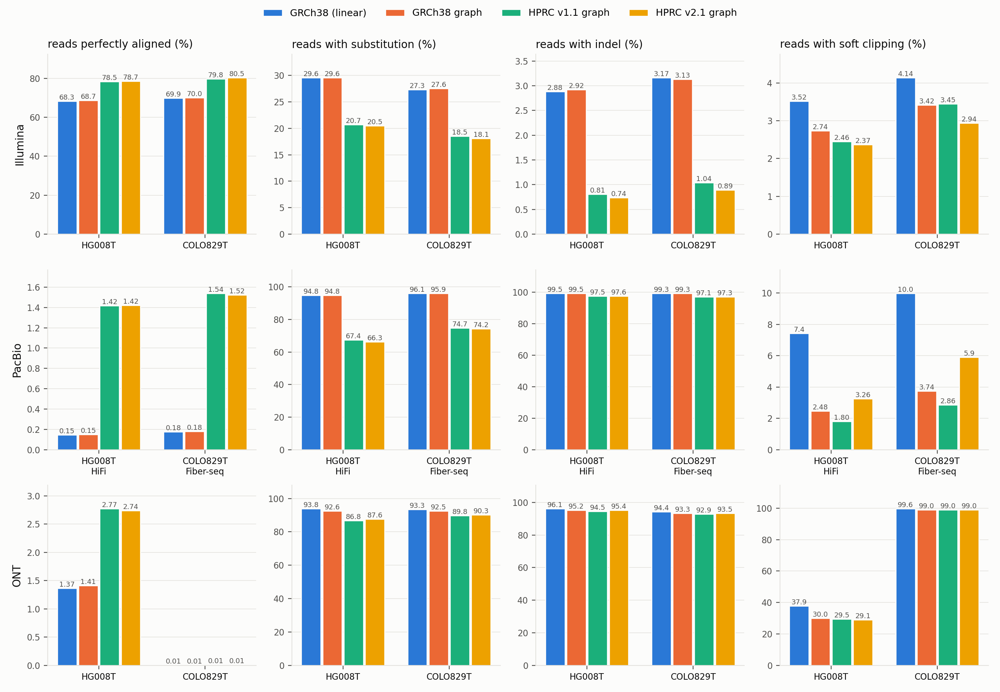
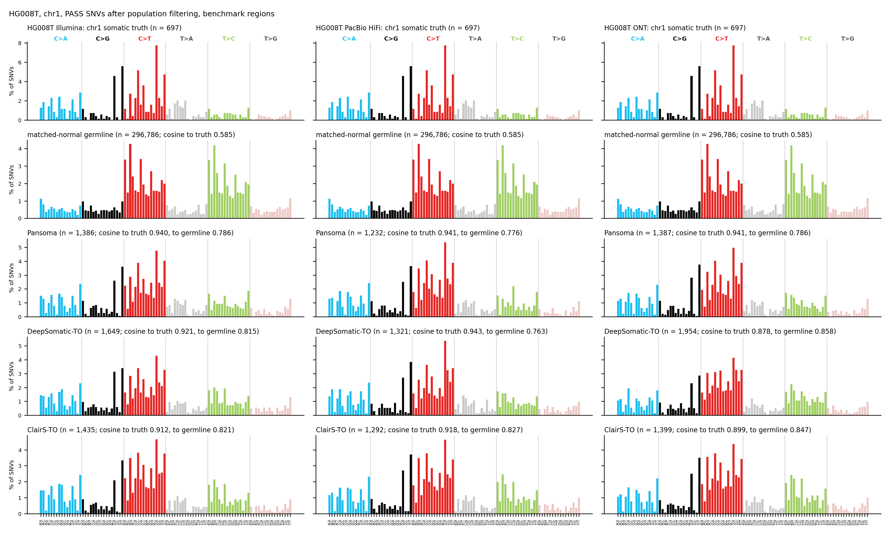
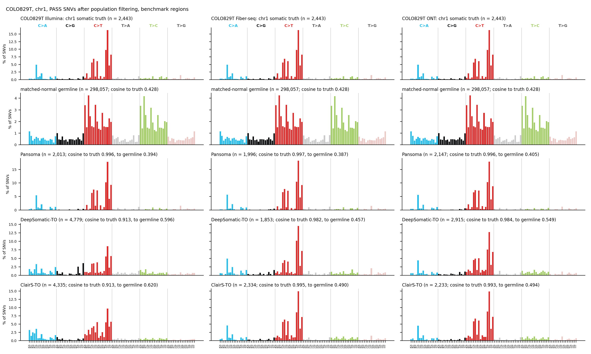
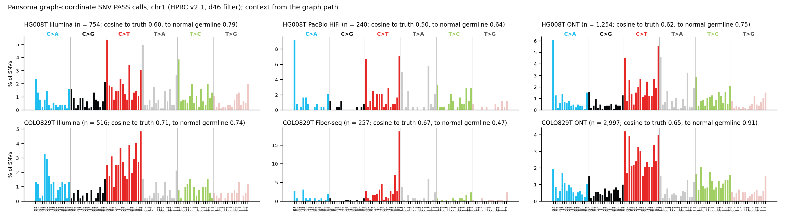

# Pansoma：NBT 审稿意见逐条回应（2026-10-15 版，查漏补缺之后）

这份文件把每条意见的 **状态**（已解决 / 部分解决 / 待解决）、**更新后的英文 Response** 和 **证据** 放在一起。

- **数据来源**：2026-10-12 的 RIS 结果（`analysis/benchmark_7fc7396_20261012`）和本地实验（`experiments/`）。
- **比 10-13 版多了什么**：
  - 全部 in-sample 和 40 个跨样本 chr1 call set 的本地重预测（tequila GPU），和 RIS 结果的 F1 差 ≤ 0.002；
  - 在这些 call set 上补的分析：E3b、E16、E17a、E17c、E18、E4b、E10、E19、E2.4、E1.6、E9h、E22、E11b；
  - 三轮 response 修订：措辞、一致性、篇幅。
- **单条原文**：`points/<R-ID>.md`。第 6 节是按顺序拼起来的全文。
- **回复信草稿**：`response_letter_20261015.md`，只含 Comment 和英文 Response。
- **和其他文件的关系**：`response_to_reviewers_detailed.md`（10-12 详版）仍是实验设计的出处；简版 `response_to_reviewers.md` 没有同步。

状态的定义：
- **已解决**：数字都来自已完成的分析，只剩改稿。
- **部分解决**：主要论点有数据支撑，部分数字或实验还缺。
- **待解决**：关键证据还没有。

数字默认指 chr1（test chromosome），PoN 后，benchmark BED 内；例外的地方都标明了。

## 1. 状态总表

**已解决 7 条，部分解决 25 条，待解决 0 条。**

"还缺什么" 一栏里的标记：**GPU** = 要你在 RIS 上跑；**同步** = 要你提供数据或路径；**决定** = 要你拍板；**CPU** = 我这边还能补。

| Point | 问题 | 状态 | 关键证据（chr1，PoN 后） | 还缺什么 |
|---|---|---|---|---|
| R1.1 | "pangenome-native" 证据不足 | 部分解决 | Response 按三点重写（10-16）：path-following tensors（E1.7：57–76% 的 somatic SNV、92–97% 的 somatic INDEL 窗口跨出自身 node）、ch6 + 推理时 ablation、三参考 ablation（10-16 压短，只留设计和总数，细节移到 R1.2）；E1.1：去掉 ch6 信息后 germline 误判增加 3.4–7.6 倍，ch6 单独的 AUC 0.83–0.92；E3 / E16：HPRC 比 GRCh38-only 高 +0.028 到 +0.292（10-19 起用三 seed 均值），12 个配对区间都不含 0（10-19 加上 COLO829T v1.1）；去 ch6 重训（10-19 RIS）：SNV PoN 后 12 个里 11 个变低，中位 0.03，d46 上六个都低于 with-ch6 三个 seed 的 best F1 范围；E9h：rescue 找回的 off-ref key 中 63–87% 有 reads 支持 | — |
| R1.2 | 泛基因组组成、单倍型数、v2.1 | 部分解决 | 三参考 ablation 的主体（10-16 从 R1.1 移来）：GRCh38-only 上 76–82% 的 germline 成为 candidate，HPRC 上 7–13%；HPRC 比 GRCh38-only 高 +0.028 到 +0.292（三 seed 均值，10-19），12 个配对区间都不含 0；d46 和 d9 在五套上的差都在 seed 范围内（三 seed 均值 −0.018 到 +0.015），COLO829T Illumina 的 matched d9（4 GPU）三个 seed 都偏低，FP 集中在 chr1 两段（−0.163）；E7：吸收多少由频率阈值决定（10-16 v2.1 轴：10% 过滤下 16 到 463 条 haplotype，HG008 somatic INDEL 0.18–0.21）；E11a / E11b：ONT 在 v2.1 上更差。Response 10-16 重写成约 350 词：mapping ambiguity 引文献（Giraffe、HPRC、Minigraph-Cactus），并指出其他 tumor-only caller 也用 PoN；10-19 吸收段改用 E5c（六套 d46 全部跑完）：任一 tensor allele 算有 tensor，v2.1 上 24–42% 的 truth INDEL 丢掉 candidate，85–96% 的丢失位点 ALT reads 走图 alt 节点（整段 43–59%，部分 + 残余 edit 30–52%），76–86% 本来就被 PoN 标，PoN 后净损失 3.5–7.0%，主要是部分走 alt 节点的 | 决定：主图、centromere 窗口（含 COLO829T Illumina d9 的 FP 段）怎么处理 |
| R1.3 | 困难区域；ONT 的歧义 | 部分解决 | E10：GRCh38-only 在 extreme 区域的 FP 更多；E9a / E9c：ONT 的 graph-coordinate calls 主要是人群 allele 和 germline；E11b：ONT 在 v2.1 上放错更多；10-20 分 SMaHT 区的配对 bootstrap（E16 `e16_strata.py`）：HG008T easy 区 6 对都含 0，COLO829T easy 区 +0.053 到 +0.154，extreme 区 precision 增益 12 对里 10 对不含 0；E10b（10-20，GIAB v3.5 分层）：SNV 在 GIAB 所有困难区域 12 / 12 对提升（11 对显著，COLO829T Illumina v1.1 用 epoch 6），各困难分层没有显著变差；INDEL 在 homopolymer 区 Illumina 提升、长读长 precision 下降 | 决定：GIAB 分层是否下载、rescue 默认值 |
| R1.4 | 图吸收已有的 somatic | 部分解决 | 10-20 改成技术性反驳（不是 fatal：tumor-only 用 population 信息换 precision 的固有 trade-off，Pansoma 只是把一部分压制提前到 candidate 生成；ClairS-TO 默认 PoN 标掉更多 truth INDEL；没有在 pangenome 比对上做 somatic calling 的现成 caller）；E5b：被吸收的 truth 中 95.5–100% 本来就会被 PoN 标掉；E1.6：三个参考臂 INDEL 都叫出 24–27%；E9h；E8c（10-20）：DeepSomatic-TO / ClairS-TO 在吸收位点上 PASS 882 对里只有 7 对，PoN 后 0 | E6 / E25 不做（10-20），写成 future work |
| R1.5 | HapMap mixture 和数据泄漏 | 部分解决 | 没有泄漏：原稿 HapMap 跑在去掉 6 个 donor 的 `mgi_non_HG005.d9` 上（用户 10-20 确认），Response 改成直接反驳；COLO829T dilution（fiberseq 干净），LOH 解释了 P75 / P50 的低谷 | 决定：HapMap 去留（重跑 OOM 失败）；GPU：BQ 伪影修好后重训 |
| R1.6 | sensitivity 低 | 部分解决 | E1.6 漏斗：HG008T SNV 叫出 82–85%；COLO829T 有 17–18% 低于 0.08 的 AF 下限；PoN 的 INDEL 上限 0.35；10-20 第一段改成同一协议下的对比（HG008T 差距小，COLO829T DeepSomatic-TO Illumina 领先，INDEL Pansoma 最高） | - |
| R1.7 | 训练规模、肿瘤多样性 | 部分解决 | E21；E12a：HG008T 模型在 COLO829T / HCC1395 / H1437 / H2009 上 0.63–0.94；COLO829T 模型带 UV 偏好；E13（10-19 RIS）：训练数据 10% → 100% 时 F1 从 0.574 升到 0.607，后一半只多 0.010；8.7 M / 50.4 M / 199.6 M 分别是 0.616 / 0.604–0.611 / 0.603 | E12b 修正后重新预测完成（10-20，ONT 已补：HCC1395T 0.658，HG008T 0.587）；GPU：normbq checkpoint 的跨样本预测、LOLO |
| R1.8 | 训练集怎么构建 | **已解决** | 标签规则和代码出处；E21 覆盖所有 set；E9h | 只剩改稿 |
| R1.m1 | 补充 benchmark（HCC1395、CASTLE） | 部分解决 | E12a：在 HCC1395 和 CASTLE 三株上的跨样本结果；E22：H1437 truth 约 30% 是 LOH 带进来的 germline，HCC1954 的 truth 没问题；E12b + HCC1395T 比较器（10-20）：SNV 和 DeepSomatic-TO 打平（Illumina）或低 0.014–0.030（长读长），INDEL DeepSomatic-TO 领先 | GPU：LOLO；用户：为什么没加 HCC1937 / Hs578T |
| R1.m2 | tensor 窗口在 node 边界截断 | **已解决** | 跨 node 的 tensor 已实现；E1.1；10-20 Supplementary Fig. R1.m2（一个 somatic SNV 的 tensor：ALT reads 走 10–12 条 haplotype 的分支节点，REF reads 走 89 条的） | 只剩改稿 |
| R2.1 | 为什么纳入 HapMap | 部分解决 | E8b 核实的事实；dilution 作替代 | 决定：HapMap 去留 |
| R2.2 | truth set 怎么来的 | 部分解决 | E8b 按原始文献核实；E22：H1437 的 LOH germline，HCC1954 的 truth 没问题 | 决定：HG008 v0.2 还是 v0.3、rule (a)、H1437 怎么处理 |
| R2.3 | recall 偏低；漏检位点上的 normal | 部分解决 | E1.6：各阶段的损失；normal 的组装证据 | 同步：和 DeepSomatic 的差距（等比较器结果） |
| R2.4 | 低 VAF | 部分解决 | E2.4：按 VAF 分档的 recall，purity 系列（低于下限的比例从 16% 升到 27%） | GPU：BQ 伪影修好后重训；决定：E15 低 AF 配置、用哪个第二肿瘤 |
| R2.5 | 精度提升从哪来 | 部分解决 | E4b / E10 / E19：graph 臂少了 germline candidate，GRCh38-only 多了着丝粒附近和 extreme 区域的 FP；附近 germline 越多，SNV 增益越大；去 ch6 重训和三 seed 已完成（10-19，HPRC − GRCh38-only 均值 +0.028 到 +0.292） | — |
| R2.6 | PoN | 部分解决 | E8b：资源组成；E17c：SNV 规则就是 chr2–22 选出的；INDEL 换成留出肿瘤选出的规则（HP ≥ 8: AF ≥ 0.01，其余 ≥ 1e-4；用户 10-16 决定，pipeline 已改） | 已重算（10-16，44 个本地 INDEL call set 按新规则重新打分，R1.2 / R1.4 / R1.6 / R1.8 / R2.6 / R3.1 / R3.2 / R3.9 / R3.10 / R3.m2 已换数）；COLO829T v1.1 单样本 INDEL：10-19 用 RIS 的 matched lr 1e-4 run 在本地出了 valbest（R3.1 / R3.10 已填） |
| R2.7 | 比对统计夸大 | **已解决** | E11a 全量数据（10-19）：两个肿瘤 × 三个平台 × 四个参考，chr1–22 全部 reads 的 perfectly aligned / substitution / indel / soft clipping 读数和比例；原文那句逐条改写（soft clipping 的说法删掉）；不再用模拟 reads | 只剩改稿 |
| R2.m | Minor 1–8 | 部分解决 | 大部分只是改图改字；E18 补了 SBS96 | 决定：第 5 条 "truth overlapping" 的原意；同步：比较器的 SBS96 |
| R3.1 | 参考层面的 ablation | 部分解决 | Response 10-19 改成设计 + 三点结果（HPRC 全面优于 GRCh38-only；v2.1 对 v1.1 PoN 前 +0.079 到 +0.222、PoN 后在 seed 范围内；增益来自比对和 candidate 生成），300 词以内；E3 / E16 / E3b：关掉 rescue 后 12/12 个 run 都高于 GRCh38-only（10-19 用 matched d9 补上 COLO829T v1.1）；着丝粒是一项 caveat；CHM13 是一项 limitation；vg 版本已核实（E22）；10-19 RIS 三 seed：HPRC − GRCh38-only 均值 +0.028 到 +0.292，36 个同 seed 比较 35 个为正；去 ch6 后仍高于 GRCh38-only 均值（+0.011 到 +0.299）；10-20 RIS b662f00：COLO829T Illumina v1.1 用 epoch 6 / 5 / 6（用户决定，在 chr1 上选），d46 − d9 六套都在 seed 范围内（−0.015 到 +0.021），validation 选的 epoch 8 低 0.164 | 决定：vg 1.77 对照；E3b / E16 / E9a 的 COLO829T Illumina v1.1 行还是 epoch 8 的 seed 0（`--norm train`；epoch 6 的 run 已在本地，`--norm dataset` d46 seed 0 没同步） |
| R3.2 | 被去掉的 candidate 由什么组成 | 部分解决 | 三类 candidate × 三个参考臂；E4b：FP 的组成；E5b；去 ch6 重训已完成（10-19）；10-19 Response 按外部建议改写成 "selective reduction"，加了按图分层的 FP：HG008T 图里的 germline FP 129 → 4（少 97 %），不在图里的 2,036 → 1,794–1,944（少 5–12 %）；79 % / 73 % 改用新定义 | CPU：E4b 换成 matched d9 run（可选） |
| R3.3 | graph 坐标 variant 的验证 | 部分解决 | E9c / E9d（9 个 run）；E9h：57–79% 的 off-ref key 有 reads 支持 | 决定：rescue 默认值、graph PoN 怎么用；同步：COLO829T 的 tumor 组装 |
| R3.4 | 指标不含 graph 坐标 call；"about 2%"；CHM13 | 部分解决 | "about 2%" 实际是 8–68%；E9a 投影；E3b 关掉 rescue 后的完整输出；E9b CHM13（10-20）：36.7–63.1 % 有 CHM13 allele，32.9–61.9 % 两张参考都没有 | 决定：rescue 默认值 |
| R3.5 | mutational signature | 部分解决 | E18：COLO829T 余弦 0.996–0.997（SBS7a），HG008T 0.94–0.96；比较器（E8，10-19 填入）COLO829T 0.913–0.995、HG008T 0.878–0.943；10-19 按用户要求只改两点：Figure 4a 并排 truth 和三个 caller 的 SBS96（PoN 后、chr1、三平台分开），Supplement 给 graph-coordinate 的 SBS96（Fiber-seq 以外五套更像 germline，COLO829T Fiber-seq 偏肿瘤、UV 42 %） | Figure 4 改版（文字） |
| R3.6 | perfect 不等于 correct | 部分解决 | E11b：Illumina 上 MAPQ ≥ 30 放错从 0.093% 降到 0.019% / 0.013%；ONT 在 v2.1 上更差（如实写出）；E11a；CHM13-only 对照（10-20）：CHM13 单独变化很小（Illumina perfect 63.7 → 64.8 %，HPRC 73 %），增益主要来自人群 haplotype | 决定：E11c 做不做、vg 版本对照 |
| R3.7 | 重新归类 FN 要谨慎 | **已解决** | 单倍型组装证据 | 只剩改稿 |
| R3.8 | tumor-only 和 mosaicism | **已解决** | 统一写成 tumor-only；10-19 改成 "has not been trained or validated for"，加 low VAF ≠ mosaicism、purity dilution（R2.4）、四株新细胞系名单 | 改稿（标题由用户定） |
| R3.9 | 稳定性、统计不确定性 | 部分解决 | E16：所有 run 的区间和配对差；10-20 按用户三点重写：d9 / d46 三 seed（`--norm dataset`）每个 seed 的 P / R / F1 和 mean ± SD（F1 SD 0.001–0.040）；ΔP / ΔR / ΔF1 配对区间，HPRC − GRCh38-only ΔF1 12 / 12 不含 0，Pansoma v2.1 − DeepSomatic-TO SNV 6 / 6、− ClairS-TO 6 / 6 为正（2 对不含 0）；三类 label 取代固定 0.5；COLO829T Illumina v1.1 在 seed 表里用 epoch 6 / 5 / 6，epoch 8 并列 | GPU：INDEL 和跨样本模型的多 seed；CPU：val R0.95 / argmax 的 rtg 表 |
| R3.10 | 低 VAF 和 INDEL 的结论 | 部分解决 | E17a：INDEL 分层；E3b：validation best-F1 阈值；E2.4 | 决定：INDEL 的 operating point；GPU：BQ 伪影修好后重训；同步：比较器 |
| R3.m1 | 参数不一致 | 部分解决 | 参数只剩一套，从 checkpoint 能复现；vg 版本已核实；Normalisation 按 f344bca 重写（报的模型都是 `--norm train`；BQ 按数据集是可选） | 等 normbq、最终模型和 INDEL 阈值定了再出参数表 |
| R3.m2 | 比较器设置 | 部分解决 | E8b 核实了版本和训练数据；打分脚本已就绪 | 同步：你已有结果的路径和元数据 |
| R3.m3 | 泛基因组参考的组成 | **已解决** | E8b；E7 的近亲检查（共享罕见 SNV v1.1 ≤ 8.2%、v2.1 ≤ 2.9%，10-16 补了 v2.1）；CHM13 是 reference path | 只剩改稿 |
| R3.m4 | 术语和语言 | **已解决** | — | 只剩改稿 |

## 2. 这次查漏补缺的主要结果

1. **参考臂比较（E3、E16、E3b）**
   - SNV 在 PoN 后，HPRC 两张图在 6/6 套数据上都高于 GRCh38-only：三个 seed 的均值高 +0.028 到 +0.292（2026-10-19 RIS；单 seed 是 +0.038 到 +0.319）。12 个 HPRC − GRCh38-only 配对的 block-bootstrap 区间都不含 0（单 run）。
   - d46 和 d9 很接近：HG008T 上单 run 时 d46 低 0.015–0.021，区间刚好不含 0；但三个 seed 的均值差只有 −0.011 到 +0.015，在 seed 范围内。
   - 把所有输出都算进去，最坏情况（BED 外，开 rescue，graph-coordinate calls 全算 FP）下，12 个比较里有 4 个反转，都是长读长。
   - 关掉 rescue 后，12 个 HPRC run 不限 BED 都高于 GRCh38-only；BED 内只有 HG008T ONT 的 v2.1 低 0.004。
2. **GRCh38-only 多出来的 FP 不全是 germline（E4b、E10、E19）**
   - COLO829T Illumina 的 2,221 个 FP 里，有 1,888 个在 chr1:121–126 Mb（着丝粒附近）。去掉这一段后，v2.1 仍领先 +0.020 到 +0.209。
   - HPRC 臂剩下的 FP 主要是病人自己的私有 germline，HG008T 上占 82.7–97.9%。
   - 附近 germline 越多，图的 SNV 优势越大，HG008T 上 2+ 档的 F1 差是 0.107–0.204，来自 precision。INDEL 在这一档上图反而吃亏。
3. **ch6 的作用（E1.1，18 个模型）**
   - 只用 ch6 区分 somatic 和 germline，AUC 在 d9 上是 0.83–0.87，在 d46 上是 0.885–0.915，在 linear 上是 0.5。
   - 把 ch6 设成 H 后，germline 误判增加 3.4–7.6 倍。
   - 同时 ch6 压制 off-ref somatic，d9 和 d46 上都是这样。
4. **graph-coordinate calls（E9a、E9c、E9d、E9h）**
   - 9 个 run 里，能精确投影到 GRCh38 的只有 2.8–19.1%，投影后在 9 个 run 里一共多出 6 个 TP。
   - 按优先顺序分类：人群 allele 占 49.8–91.4%；只看组装，tumor-only 占 1.1–5.2%。
   - 组装推出的 off-ref key 里，57–79% 有 reads 支持是真的 somatic。模型不开 rescue 时每套只叫出 0–4 个；开 rescue 后在这些 key 上叫出 32–80 个，其中 63–87%（22–66 个）是真的（全常染色体）。rescue 的取舍因此很明确：在 chr1 上，每个 run 多找回 2–8 个真的 off-ref somatic，同时带进上百到上千个 graph-coordinate PASS call。
5. **比对正确性（E11a、E11b）**
   - Illumina 模拟 reads：MAPQ ≥ 30 但放错的比例，GRCh38-only 是 0.093%，v1.1 / v2.1 是 0.019% / 0.013%。HPRC 图上的 perfect alignment 更多，也更正确。
   - ONT 模拟 reads：v1.1 略好，v2.1 更差（放错 1.483%，GRCh38-only 是 0.773%），和真实 ONT 数据（E11a）一致。
   - 跨越 SV 的 reads，HPRC 图上能放回 GRCh38 的反而略少。
6. **跨样本（E12a，初步）**
   - HG008T 的 d46 模型：在 COLO829T 上 0.630–0.754，在 HCC1395T 上 0.689–0.790，在 H1437T / H2009T 上 0.787–0.937。
   - COLO829T 的模型主要输在阈值迁移，还会把 UV 偏好带到别的肿瘤上（E18：在 HG008T 上 T>C 的 recall 只有 0.016–0.129）。
   - 所有模型在 HCC1954T 上的 precision 都只有 0.22–0.37。E22 显示它的 truth 没问题，所以这是模型把病人的 germline 叫成了 somatic。
7. **truth 的问题（E22）**
   - H1437 的 truth 里约 30% 的 SNV 很可能是 germline：正常对照在 chr9q 等区域发生 LOH 丢掉了它们。这解释了 H1437 只有约 70% 的 tensor 覆盖率。H2009 有同样的问题，约 5%。
   - chr1 上受影响很小。
8. **PoN 规则是否在测试集上调过（E17c）**
   - 只用 chr2–22 选 SNV 规则，选出的就是现行规则。
   - INDEL 换成留出肿瘤的选法（在一个肿瘤上选、在另一个上评估），两个方向选出的都是一个相邻规则（HP ≥ 8：0.01，否则 1e-4）。用它，每个留出的 call set 都不变差，平均高 +0.002 / +0.005。所以现行规则没有在 chr1 上占便宜。
9. **INDEL 的 operating point（E3b）**
   - 用 validation best-F1 阈值时，HG008T 长读长大幅提升：PacBio d9 从 0.089 到 0.226，ONT d46 从 0.015 到 0.151。
   - Illumina 略降；COLO829T 上几乎不出 call。没有一个阈值规则在所有数据上都好。
10. **其他**
    - **recall 漏斗（E1.6）**：
      - HG008T SNV 叫出 82–85%，主要损失在阈值；
      - COLO829T SNV 有 17–18% 低于 0.08 的 AF 下限，没有 tensor；
      - INDEL 约三分之二的 truth 本身就是人群 allele。
    - **SBS96（E18）**：Pansoma 的 call 和 truth 谱的余弦相似度，COLO829T 是 0.996–0.997，HG008T 是 0.94–0.96。
    - **VAF 分档（E2.4）**：P100 到 P25，低于下限的 truth 比例从 16.1% 升到 26.9%。
    - **CHM13**：两张 HPRC 图里都有一条不过滤的 CHM13 reference path。所以 GRCh38-only 和 HPRC 的对比里，"参考更完整" 和 "人群多样性" 混在一起，已写成 limitation。
    - **vg 版本**：HG008T 的 GRCh38-only 和 d9 都是 vg 1.66.0；COLO829T d9 的 Illumina GAM 是 ≤ 1.62，长读长是 1.64–1.66。
    - **HapMap**：去掉 donor 的重跑在 10-15 因为内存不够（OOM）失败了，没有重新提交。

## 3. 要你做的

### 3.1 GPU（RIS）

| 优先级 | job | 量 | 回应 |
|---|---|---|---|
| ~~P0~~ 已完成（10-19，538012c） | **matched d9 重训**：HG008T PacBio / ONT SNV 用 4 GPU；COLO829T 三套 SNV 用 7fc7396 recipe；COLO829T 三套 INDEL 用 lr 1e-4。这样也补上了本地没有的 COLO829T d9 臂 | 8 run | R3.1、R1.2、R2.5、R3.2 |
| ~~P0~~ 已完成（10-19） | **去掉 ch6 重训**：`experiments/E1.1_ch6_counterfactual/gpu_nopc_commands.sh` | 27 run | R1.1、R2.5、R3.1 |
| P0 | **`--norm dataset` 的跨样本模型**（f344bca 改成只对 BQ 按数据集；RIS 10-19 在重训 8 个 normbq，先等结果）：HG008T 和 COLO829T 的 d46 × 三平台；HCC1395T 和 CASTLE 的 in-sample 参照模型；leave-one-line-out（LOLO） | 6–8 + 3 run，之后加 LOLO | R1.7、R1.m1、R3.9 |
| ~~P0~~ 已完成（10-19，SNV 三个 seed） | **多 seed**：三个臂的主 SNV 模型各加 2 个 seed | 约 36 run | R3.9、R3.1 |
| P1 | 修好 BQ 伪影后重训 purity joint 模型，每个 purity 用自己的阈值（你在做） | 6 run | R1.5、R2.4、R3.10 |
| ~~P1~~ 已完成（10-19） | learning curve 和模型大小（E13，命令在 E21 README §6） | 10 run | R1.7 |
| P2 | E9f：用组装 / reads 核实过的 off-ref key 作为训练标签重训。E9h 说明这些 key 大多是真的 somatic，所以比 10-13 时更值得做 | 3 run | R3.3、R3.4 |

推理在 tequila GPU 上跑，checkpoint 传过来就行。

### 3.2 数据或路径

- ~~**COLO829T d9 的单样本 run**~~：10-19 已用 matched d9 重训（seed 0）代替，E3b / E16 / E9a 补上了。COLO829T Illumina 如果改用 `h90`，要同步它的 test_chr1。
- **比较器**：ClairS-TO / DeepSomatic 结果的路径和元数据。拿到后用 `experiments/E8_comparators/score_comparator.py` 按同一协议重新打分，结果会自动进 E16 / E18。

## 4. 要你决定的事

1. **SNV off-ref rescue 是否默认开启。** response 里写成两种都报。E9h 之后，开启的好处和代价都有数字了，见 §2 第 4 条。
2. ~~**INDEL PoN 规则**~~：已决定（2026-10-16）：换成留出肿瘤选出的规则（HP ≥ 8: AF ≥ 0.01，其余 AF ≥ 1e-4），以后都用它；pipeline 已改（71cb51a），本地 44 个 INDEL call set 已按新规则重算，responses 已换数；COLO829T v1.1 单样本 INDEL 10-19 已用 matched run 补上。
3. **INDEL 的 operating point**：用 recall-0.9 validation 阈值还是 validation best-F1 阈值，结果好坏参半；test-tuned best F1 只作上界。
4. **主图和主评估**：主图用 d9 还是 d46（两者很接近，d9 略高）；主结果是否用跨样本，in-sample 只作上界。
5. **HapMap**：直接去掉，还是把内存提到约 40G 重跑 donor-free 图后放进 Supplement。
6. **下载**：GIAB stratification（R1.3）、COLO829T tumor 组装（R3.3）、SEQC2 titration（R2.4）。（HPRC v2.1 wave VCF 10-16 用户同意并已下载，E7 v2.1 轴已完成。）
7. **对照实验做不做**：用 vg 1.77 的版本对照；CHM13+GRCh38-only 图（已暂停，现在写成 limitation）。
8. **新功能做不做**：E24、E25 / E6、E9f。
9. **truth**：
   - HG008 用 v0.2 还是 v0.3；
   - rule (a) 是否也用到 HG008T / COLO829T；
   - H1437 是否排除 normal 发生 LOH 的区段，或者干脆不用 H1437。
10. **术语**：用 "population filtering resources" 替换 "panel of normals"（R3.m4）。
11. **清理**：E8 中途留下的中间数据，约 5.7 GB，删不删。

## 5. 实验文件夹（`experiments/`）

| ID | 内容 | 回应 |
|---|---|---|
| E3_reference_arms | 三臂表；complete-output 上界 | R3.1、R1.1、R1.2、R2.5 |
| E3b_rescue_off_and_indel_threshold | 关掉 rescue；INDEL 的 validation best-F1 阈值 | R3.4、R3.1、R1.6、R3.10、R3.m1 |
| E1.1_ch6_counterfactual | ch6 counterfactual（18 个模型）；d46 组装 key；AUC | R1.1、R1.m2、R2.5、R3.3 |
| E1.6_recall_funnel | recall 漏斗 | R1.6、R2.3 |
| E1.7_window_node_span | tensor 窗口跨 node 的比例 | R1.1、R1.m2 |
| E2.4_vaf_bins | 按 VAF 分档的 recall；purity 系列 | R2.4、R3.10 |
| E4b_fp_decomposition | PoN 后 FP 的组成 | R3.2、R2.5、R2.6 |
| E5b_absorbed_d46 | 被图吸收的 truth；linear 能否叫回 | R1.4、R3.2 |
| E7_graph_composition | in-silico 图组成（v1.1 89 条、v2.1 463 条 haplotype）；近亲检查（两版） | R1.2、R3.m3 |
| E8b_literature_facts | 文献和资源事实 | 多条 |
| E8_comparators | 比较器在 Pansoma 协议下重新打分（HG008T、COLO829T 用户已有 run；HCC1395T 10-19/20 在 tequila 新跑） | R3.m2、R1.6、R1.m1 |
| E9a_unplaced_projection | graph-coordinate calls 投影到 GRCh38 | R3.4、R1.3 |
| E9c_offref_filter_validation | graph PoN 和组装验证 | R3.3、R3.4 |
| E9h_offref_key_reads | 用 reads 核实 off-ref key | R1.1、R3.3、R3.4 |
| E10_region_strata | SMaHT 区域和重复区分层 | R1.3 |
| E10b_giab_strata | GIAB v3.5 分层（10-20 下载），HPRC 图对 linear graph 的配对 bootstrap | R1.3 |
| E11a_alignment_stats | 四个参考上的比对统计：全量 chr1–22 计数（`full/`，R2.7）；同一批 reads 的窗口 / 抽样对比 | R2.7、R3.6 |
| E11b_simulated_alignment | 模拟 reads 的比对正确性（Illumina / HiFi / ONT） | R3.6、R1.3 |
| E12a_cross_sample | 40 个跨样本 run，包括 CASTLE | R1.7、R1.m1、R3.9 |
| E16_bootstrap | block-bootstrap 区间；配对差 | R3.9、R3.1 |
| E17a_indel_strata | INDEL 分层 | R3.10 |
| E17c_pon_rule_offchr1 | 不用 chr1 选 PoN 规则；留出肿瘤 | R2.6 |
| E18_sbs96 | SBS96 | R3.5、R1.7 |
| E19_germline_density | 按附近 germline 密度分层 | R2.5 |
| E21_training_composition | 训练集组成 | R1.7、R1.8 |
| E22_truth_and_version_checks | CASTLE truth 的 germline 问题；COLO829T 的 vg 版本 | R2.2、R2.6、R1.m1、R3.1 |
| call_level_common | 共用代码 | — |

数据都在 `/scratch/jshen/data/reviewer_experiments_20261013/`，job 脚本和日志在 `tmp/reviewer_cpu_20261013/`。

## 6. 逐条回应

每条的格式：状态 / Comment（要点）/ Response（英文）/ 证据（内部）/ 还缺什么。

---

## 6.1 Reviewer 1

### R1.1 "Pangenome-native" is not supported

**状态：部分解决**: E1.1 已在全部 18 个 SNV 模型上完成（12 个 HPRC 图模型 + 6 个 GRCh38-only 对照），证明分类器在用 ch6（这是 "在用"，不是 "有益"），d46 的组装 off-ref key 和 18 个 run 的 ch6-only AUC 也已补齐；E3 给出同 reads、同 tensor 代码下 HPRC 相对 GRCh38-only 的 end-to-end 增益（BED 内、unplaced 不计分），2026-10-15 起有了 E16 的配对 block-bootstrap 区间（BED 内 9 对 SNV 全部不含 0；GRCh38-only 的 FP 有很大一部分在 chr1:121–126 Mb（按 FP 分块事后选的窗口，没有注释来源，Response 不再引用，等用户决定））和 E3b 的 "不用 rescue" 结果（complete-output F1：no BED 9 个图 run 都高于 GRCh38-only，BED 内 8 / 9，HG008T ONT v2.1 0.533 vs 0.537）。2026-10-15 晚 E9h 做完了组装 off-ref key 的 read-level 核实：按严格测试每套 57–79 % 的 key 是 read-supported somatic，模型叫出其中 0–4 个，rescue 叫回 22–66 个（Response 已改）。还缺：去 ch6 重训臂（GPU RIS），用它把 "candidate 定义" 和 "ch6 通道" 的贡献分开；COLO829T v1.1 单样本 run 的 E3b / E16（不在 tequila re-predict 里）。

**Comment（要点）。**

- The pangenome is used mainly at vg Giraffe alignment; the downstream representation is a local pileup, so the method resembles DeepVariant, DeepSomatic or ClairS.
- Neither the input nor the network models graph edges, bubbles / superbubbles, cross-node context or long-range haplotype structure.
- Replacing linear coordinates with node IDs is not enough; haplotype and path information is discarded.
- Request: substantial additional evidence, or a re-design, showing measurable benefit from pangenome-specific information beyond alignment.

**Response.**

We agree that "fully exploit the richness of pangenome data" overstated the original design and that node identifiers alone do not make a method pangenome-native; the phrase is removed and Pansoma is now described as pangenome-aware. We do not agree that the pangenome is used mainly at alignment, so that the method resembles DeepSomatic or ClairS: those callers work on reads aligned to GRCh38, whereas Pansoma generates candidates, builds tensors and calls variants on the graph, and its classifier reads haplotype information that only the graph provides. The reviewer's criterion, a measurable benefit from pangenome information beyond alignment, can be tested directly, and the revision does so.

1. *Path-following tensors.* In the first version a tensor was confined to the node carrying the candidate, so short nodes truncated the read context (R1.m2). Each tensor row now follows its read's walk through the graph: the 101-column window around a candidate extends across every node the read traverses, on reference and alternative nodes alike, and each column records the base of the node the read passes there (channel 5). The context is therefore no longer bounded by node length: on chr1, the window of 57–76% of somatic SNV candidates and 92–97% of somatic INDEL candidates reaches beyond the candidate's own node on the HPRC graphs.

2. *A graph-native channel, with ablation tests.* Channel 6 gives, for every column, the number of haplotype paths through the node the read traverses, relative to the graph's haplotype count, which only a pangenome provides. Alone, the site's path count separates somatic from germline chr1 SNV tensors with an AUC of 0.831–0.865 on the HPRC v1.1 graph (d9 filter) and 0.885–0.915 on the HPRC v2.1 graph (d46 filter), against 0.500 on a GRCh38-only graph. Ablating channel 6 at inference (training-mean or all-haplotype value) in the 12 HPRC SNV models lowers somatic average precision from 0.199–0.352 to 0.044–0.087 (HG008T) and from 0.639–0.829 to 0.329–0.520 (COLO829T); setting it to the all-haplotype count lets 3.4–7.6 times as many germline tensors pass the threshold. Retraining without channel 6 on both HPRC graphs, with the alignments unchanged, confirms this: chr1 somatic average precision falls from 0.199–0.353 to 0.065–0.089 on HG008T (COLO829T, v2.1: from 0.755–0.829 to 0.484–0.592), and SNV F1 after population filtering falls in 11 of 12 models (median 0.03, at most 0.31); on v2.1, where the models with channel 6 have three training seeds, all six models without it fall below that seed range by test-tuned best F1. Population filtering removes most of these extra germline calls, so channel 6 and the filter partly overlap. Channel 6 also suppresses somatic SNVs on off-reference nodes; we report every SNV result with and without an off-reference rescue (R3.3, R3.4).

3. *Three-reference ablation.* To measure what the pangenome itself contributes, the same reads were aligned to a GRCh38-only graph and to the frequency-filtered HPRC v1.1 and v2.1 graphs, and models were trained and tested on each. After population filtering both HPRC graphs lead on all six datasets (SNV F1 +0.028 to +0.292, means over three training seeds), mainly because most germline variants never become candidates; R1.2 gives the full comparison and its caveats.

Pansoma does not model bubbles, competing branches or long-range haplotypes explicitly; the revised text states this as a limitation.

**证据（内部）。**

- 2026-10-20 按用户要求加反驳（用户：Reviewer 1 的 response 不能全盘接受，有些观点要 rebuttal）：保留 "pangenome-aware" 的让步，加一句不同意
  "the pangenome is used mainly at alignment, so the method resembles DeepSomatic or ClairS"（它们用 GRCh38 上的 reads；Pansoma 在图上生成
  candidate、建 tensor、出 call，classifier 读只有图才有的 haplotype 信息），并把审稿人自己的标准（beyond alignment 的可测收益）点出来；
  第 2 条 retraining 一句加 "with the alignments unchanged"（ch6 消融是同一批比对，正是 beyond alignment 的检验）。数字没变。旧版备份
  `R1.1_before_rebuttal_20261020.md`（session scratchpad）。
- 2026-10-19 RIS 全部结果（RIS 总结 `analysis/benchmark_7fc7396_20261012/reviewer_gpu_7fc7396_20261016/`（538012c；`tables.md`、`summary.json`；chr1、BED 内、PoN 后、PASS = recall-0.9 validation 阈值，INDEL 用 71cb51a 规则），"No ch6"、"Seeds" 表）：
  - "11 of 12 ... median 0.03, at most 0.31" 不变。SNV PASS 变化从 −0.311 到 +0.009，中位 −0.026；唯一升高的是 HG008T ONT d46（+0.009）。
  - 新加的一句：d46 上 with-ch6 有三个 seed，no-ch6 的 best F1 0.541 / 0.600 / 0.601 / 0.589 / 0.779 / 0.677，对应 with-ch6 的 best 范围 0.611–0.613 / 0.607–0.622 / 0.604–0.616 / 0.730–0.786 / 0.782–0.791 / 0.732–0.739，六个都在范围下面。按 PASS 只有五个在范围下面（HG008T ONT 0.584 在 0.575–0.598 之内），所以 Response 写 "by test-tuned best F1"。
  - 第 3 点 "+0.038 to +0.319"（seed 0）换成三 seed 均值 "+0.028 to +0.292"，和 R1.2 / R3.1 一致（推导见 R3.1 证据）。
- 2026-10-16/17 去 ch6 重训（`--drop-planes path_count`，E1.1 `gpu_nopc_commands.sh`，用户在 RIS 跑）出来了，填了原来的 [待补]（`experiments/E26_ris_gpu_reruns_20261017/README.md`、`tables.md`（RIS 2026-10-17 同步的 89 个 run；chr1、BED 内、PASS = recall-0.9 validation 阈值、PoN 后；INDEL 是 `_pon71cb51a` 新规则） §1）：
  - AP（chr1、per tensor、PoN 前）：HG008T 有 ch6 0.199 / 0.233 / 0.232（d9 Illumina / PacBio / ONT）、0.310 / 0.353 / 0.328（d46）→ 去掉后 0.075 / 0.078 / 0.065、0.089 / 0.075 / 0.071；COLO829T d46 0.818 / 0.829 / 0.755 → 0.582 / 0.592 / 0.484（COLO829T d9 的有 ch6 run `*_SNV_h90` 没有本地 test metrics）。
  - PoN 后 PASS SNV F1 的变化：d9 −0.043 / −0.041 / −0.033 / −0.019 / −0.006 / −0.012，d46 −0.042 / −0.011 / +0.009 / −0.311 / −0.007 / −0.062（HG008T Illumina / PacBio / ONT，COLO829T Illumina / fiberseq / ONT）→ 12 个里 11 个下降，中位数 −0.026，最大 −0.311（COLO829T Illumina d46，AP 0.818 → 0.582）。INDEL 变化小（PASS −0.030 到 +0.016，best −0.051 到 +0.013），Response 没写。
  - 注意第二个 seed 的 PASS F1 变化本身可达 ±0.08（E26 §3），所以中位数 0.03 的损失在 seed 噪声范围内；AP 的下降（HG008T 降到原来的 1/3 以下）远超 seed 的变化（≤ 0.039）。

- 2026-10-16 按用户要求把第 3 点（三个参考的 ablation）压短，重点移到 R1.2（R1.2 Response 新加的 "*Pangenome versus GRCh38-only.*" 一段）。这里只留设计和一个总数：+0.038 到 +0.319 = E3 `tables.md` §1 的 d9 − linear（+0.059 到 +0.311）和 d46 − linear（+0.038 到 +0.319）合起来，BED 内、PASS、PoN 后。"mainly because most germline variants never become candidates" 对应 76–82 % 对 7–13 %（详版 R1.2 表）和 E3 README 的 Mechanism 一段。原来第 3 点里的 bootstrap、centromere、INDEL、complete-output、CHM13 几句都移到了 R1.2，出处仍是下面各条。
- 2026-10-16 按用户要求改写 Response 结构（三点：1. path-following tensors 跨 node；2. ch6 是 graph-native 信息 + ablation；3. 三个参考的 ablation）。新数字：E1.7（`experiments/E1.7_window_node_span/window_span.tsv`）：chr1 somatic SNV 窗口超出自身 node 的比例 HG008T PacBio d9 399/703 = 56.8 %、d46 533/706 = 75.5 %、COLO829T Fiber-seq d46 1,456/2,025 = 71.9 %（→ 57–76 %）；somatic INDEL 465/507 = 91.7 %、496/515 = 96.3 %、102/105 = 97.1 %（→ 92–97 %）；GRCh38-only graph 是 32 bp node，100 %。其余数字未变，出处同下。"ablation tests" 指的是推理时的 ch6 ablation（E1.1）；重训去掉 ch6 的 ablation 还没做（[待补]，GPU）。旧版 Response 备份在 session scratchpad。

- 2026-10-15 E1.6/E9h/E22/E11b-ONT（本条用到 E9h；Response 465 → 481 词）：
  - off-reference 一句按 E9h 改写（`experiments/E9h_offref_key_reads/README.md` "Answer"、`tables.md` §0 / §2 / §3 h50_strict）。read-supported somatic = `tumor_only`：key 的 A1（ALT）reads 的共识序列在 HG008-T v3.2 组装里有、在 HG008-N v6.2 两个 haplotype 里都没有；用 "h50 strict"（整个 101 列 tensor 作 query，hit 里不允许 indel；README 说 "This is the version to cite"）。
  - "57–79% per dataset"：tumor-only / key 数 72 / 112（PacBio d9，64.3 %）、51 / 89（ONT d9，57.3 %）、93 / 135（Illumina d46，68.9 %）、65 / 82（PacBio d46，79.3 %）、50 / 67（ONT d46，74.6 %），另 HG008T Illumina d9 115 / 184（62.5 %，没有 E1.1 打分）（百分比是我按计数算的，全部常染色体）。
  - "the models call 0–4 of them"：base（PASS 阈值 t）在 tumor-only key 上 0 / 0 / 3 / 1 / 4（§0）。原来的 "0 of 112 and 1 of 89 ... 1–4 of 67–135" 是全部 key 上的数（E1.1 §5），换成 read-supported 子集上的数。
  - "rescue recovers 22–66"：`site10_high` argmax 在 tumor-only key 上 22 / 29 / 66 / 33 / 32；"63–87% of its calls on these sites are read-supported"：rescue 在全部 key 上叫出的里 tumor-only 22 / 32、29 / 46、66 / 80、33 / 38、32 / 40（68.8 / 63.0 / 82.5 / 86.8 / 80.0 %，我算的；协调者 10-15 更正为 63–87 %，已按 `tables.md` §0 核对）。chr1 上 rescue 叫回的 tumor-only key 3 / 4 / 8 / 2 / 4（§3 "chr1 rescue argmax"），都是 tensor 层面（argmax，没算 AF floor）。
  - 下面 §5 第 4 条（"旧的 read-level 检查 ... 只有 30 个 ... A1 reads 只出现在 HG008-T 组装里"）已被 E9h 取代：那是 `offref_negatives_20260929` 的方法（61 bp query、hit 允许 1 bp indel），看不到重复长度的变化。这些事件大多是 assembly frame 里的 INDEL（256 个事件里 181 个）、64–73 % 的 key 在 ≥ 7 bp homopolymer 里；同样的 HG008T Illumina d9 key 用 h30 earlier 是 32 / 184 tumor-only（复现旧的 30），用 h50 strict 是 115 / 184。对照：事件自己的 T context（按构造是 somatic）h50 strict 判 tumor-only 218 / 256，h30 earlier 只有 49 / 256；N context（germline）h50 strict 判 normal 253 / 256、tumor-only 1 / 256（E9h §5）。所以 Response 现在可以说这些 key 大多有 read 支持；全部 key 仍叫 "assembly-derived"。
  - E9h 的限制（README Caveats）：tumor_only 是每个 key 一个共识 haplotype 的判断，A1 block 里 somatic 和 germline reads 混在一起时跟多数；`neither` 8–17 个 / 套不算支持；rescue 的 22–66 是 tensor 层面，PASS 还要过 AF floor。

- 2026-10-15 终稿一致性（Response 532 → 465 词）：
  - 阈值术语（全套统一）："the threshold with the best validation F1" → "the validation best-F1 threshold"（E3b valbest）；"the test-tuned best point" → "test-tuned best F1 (upper bound)"；默认 PASS 叫 "the recall-0.9 validation threshold"。
  - centromere 一句压缩：原来的 "121–126 Mb: 1,888 of 2,221 COLO829T Illumina false positives, at most 17 for any v2.1 run" 移到这里（E16 README §2），Response 只留 "+0.020 to +0.209"；1,888 / 2,221 写在 R3.1 / R2.5 / R1.3 的 Response 里。
  - complete-output 一句和 R1.3 / R2.5 / R3.1 / R3.4 统一：worst case（no BED，rescue 开）四个 / 十二个 SNV 比较反转；rescue 关后九个本地 HPRC run 在 no BED 下都在前，BED 内只有 HG008T ONT v2.1 低 0.004（0.533 vs 0.537，E3b §1 / E3 §1）。原来的 "the SNV advantage is lost in four comparisons with or without the BED" 不准确：BED 内（E9a §3，rescue 开）还多一个反转 HG008T Illumina d46（0.419 vs 0.470），共五个。
  - off-reference 抑制一句：rescue 叫回的 "32 and 46 of the v1.1 keys at tensor level" 移到 R1.m2 / R1.8 / R3.4（那里有数），这里只写 "partly recovers"。
  - "same reads and code"、"graph-coordinate calls not scored" 两个限定删掉（R3.1 有），CHM13 一句压成括号，意思不变。
- 76–82 % / 7–13 %：`response_to_reviewers_detailed.md` R1.2 表（2026-10-12，各套 `tensors/truth_recall.json` 的 `tensor_representative` 比例）。Matched-normal germline：linear 0.757–0.822，v1.1 d9 0.077–0.131，v2.1 d46 0.072–0.124。简版写的 "8–12% on HPRC v1.1" 和这张表不一致（v1.1 是 0.077–0.131），以详版表为准。
- ch5 / ch6 定义：`indexed_gam_pipeline_v4/README.md` channel 表（ch5 graph base；ch6 path count，按 `--haplotypes` H 编码，H → 100）。各套 H：linear 17、d9 90、d46 464（`pansoma_v2_tensors/HG008T_PacBio_d46/tensors/SNV/manifest.json` `"haplotypes": 464`）。
- E1.1：`experiments/E1.1_ch6_counterfactual/results/tables.md` 和 `summary.json`（collect.py 2026-10-13 15:32；`summary.json` 的 `done` 有 18 个 run，`pending` 为空）。
  - 18 个 run：HG008T d9 × 3、HG008T d46 × 3、COLO829T d46 × 3、COLO829T d9 × 3，加 6 个 linear。COLO829T 的 d9 是 purity-joint 模型 `COLO829_*_SNV_joint_7fc7396_gpu4`（在 P100 set 上测，PASS 阈值是四个 purity 合起来定的），不是 E3 §1 里的 `COLO829_*_SNV_h90`。所以 E1.1 里 COLO829T d9 的数字和 E3 的 d9 数字不能直接对照。Response 原来写 "the final SNV models"，对 COLO829T d9 不准确，已改成注明 joint 模型。
  - joint 模型的 Illumina / ONT 训练数据包括 P75 / P50 / P25 dilution，这两个平台的 dilution 有 read-source BQ artefact（用户 2026-10-13 的判断；fiberseq 干净）。E1.1 是在 P100 上、同一个模型的各 mode 之间比较，所以结论（方向和倍数）不受影响；但 `COLO829_Illumina_joint` / `COLO829_ONT_joint` 的绝对 AP / F1 不要拿去和别的模型比。
  - 各 mode 的 somatic AP（§4）：
    - HG008T base 0.1986 / 0.2333 / 0.2316（d9 Illumina / PacBio / ONT）、0.3121 / 0.3523 / 0.3264（d46）。`all_H` 0.0712 / 0.0870 / 0.0706、0.0621 / 0.0723 / 0.0612。`train_mean` 0.0601 / 0.0525 / 0.0437、0.0527 / 0.0661 / 0.0513。合起来 0.044–0.087。
    - COLO829T base 0.8199 / 0.8291 / 0.7546（d46 Illumina / fiberseq / ONT）、0.6926 / 0.7135 / 0.6392（d9 joint）。`all_H` 0.5158 / 0.5149 / 0.4049、0.4866 / 0.5149 / 0.3472。`train_mean` 0.5046 / 0.5197 / 0.4213、0.4817 / 0.5116 / 0.3293。合起来 0.329–0.520。
    - `shuffle`：HG008T 0.0277–0.0428，COLO829T 0.1921–0.3079。
  - germline ≥ t 相对 base 的倍数（`all_H`）：HG008T d9 3.58 / 3.50 / 3.79，d46 6.75 / 6.83 / 6.64；COLO829T d46 7.57 / 6.72 / 7.39，d9 joint 3.45 / 3.41 / 4.19。范围 3.41–7.57。
    - `train_mean` 的倍数在 HG008T ONT d9 上是例外（0.27）：这个模型在 `train_mean` 下几乎什么都不叫（somatic 65 / 663 ≥ t，PoN 后 F1 0.145）。所以 Response 里的倍数只引 `all_H`。
  - `site0_low`（只改 site 列，设为 off-reference test tensor 的 site code 中位数 LOW = 22–36）：somatic ≥ t 在 12 个图模型上是 0–56 个（56 是 COLO829T ONT d9 joint，1,984 个里；HG008T 六个是 0 / 0 / 0 / 1 / 0 / 0）。
  - per-tensor PoN 后 F1，base → `all_H`：HG008T d9 0.589 → 0.573、0.621 → 0.566、0.596 → 0.533；d46 0.560 → 0.511、0.605 → 0.561、0.579 → 0.516；COLO829T d46 0.784 → 0.791、0.785 → 0.760、0.743 → 0.705；d9 joint 0.675 → 0.682、0.782 → 0.778、0.706 → 0.664。差值 −0.063 到 +0.007。`shuffle` 损失大得多（PoN 后 0.212–0.551）。
  - linear 6 个 run：8 个 mode 的所有数字和 base 完全一样（ch6 恒为 100，LOW = 100）。
  - §5 组装 off-ref somatic SNV（HG008T，d9，全部常染色体，都不是训练标签；key 来自 `pansoma_net_v2_runs/assembly_offref_20260929/offref_somatic.tsv`，即 HG008-N 组装上的 truth somatic 事件，giraffe 放到 d9 的 off-reference 节点）。格式是 "≥ t / argmax somatic / n"：
    - base：PacBio 0 / 0 / 112，ONT 1 / 1 / 89。
    - `all_H`：61 / 44 / 112，49 / 49 / 89。
    - `site10_high`：45 / 32 / 112，45 / 46 / 89。按 E1.1 README，`site10_high` 就是 predict 的 off-reference rescue 变换；predict 对 off-ref tensor 用 argmax（`predict.py` 第 31–39 行，`graph_vcf.py` 的 `offref_call`），所以 rescue 后是 32 / 112 和 46 / 89。
    - d46 的组装 key（`asm_d46_classify.py`）：10-13 时 §5 只有两个 d9 run；2026-10-15 13:15 `asm_scores.py` 已跑完（job 405223，tequila GPU），`tables.md` §5（13:18 重新生成）多了三行 d46，格式同上：`HG008_Illumina_d46` base 4 / 1 / 135，`site10_high` 86 / 80 / 135；`HG008_PacBio_d46` 1 / 0 / 82 → 45 / 38 / 82；`HG008_ONT_d46` 4 / 2 / 67 → 43 / 40 / 67。E1.1 README 还写 "not computed"，Response 只用 d9 的 112 / 89（没改）。
    - 这些 tensor 不一定带 somatic reads：旧的 read-level 检查（`pansoma_net_v2_runs/offref_negatives_20260929/overrides.tsv`，HG008T Illumina d9）里，exact key 的组装 SNV tensor 只有 30 个（17 train + 13 held out）的 A1 reads 只出现在 HG008-T 组装里，123 个在 HG008-N 组装里也有（"normal"），33 个两边都没有（"neither"）。PacBio / ONT 的 112 / 89 个没做这个检查。所以 Response 里不再写 "true somatic" 和 "assembly-validated"，改成 "truth SNVs whose allele lies on an off-reference node ... and has a tensor"；rescue 后 "calls 32 and 46" 里有多少是真的 somatic read 证据，还不知道。
  - §6 只看 ch6（`profile_auc.json`，不用模型，只跑了 3 个 run）：site code 的 AUC 0.837（HG008T PacBio d9）、0.890（PacBio d46）、0.892（ONT d46）。site code 中位数 somatic 100，germline 96（d9）/ 79（d46）。
  - §2：E1.1 的 base mode 对 RIS 的 GPU bf16 `predict`（同 checkpoint、同 test tensor、同阈值），somatic AP 差 ≤ 0.0047（最大是 COLO829T fiberseq linear 0.2832 / 0.2879，其次 COLO829T Illumina joint 0.6926 / 0.6971）。注意 E1.1 的 base 只有 4 个 run 是 CPU fp32（`HG008_PacBio`、`HG008_ONT`、`HG008_PacBio_d46`、`HG008_ONT_d46`，AP 0.2333 / 0.2331、0.2316 / 0.2323、0.3523 / 0.3528、0.3264 / 0.3283），其余 14 个是 tequila GPU bf16（E1.1 README "How the runs were done" 第 3 条；`collect.py` 的 §2 标题 "CPU fp32 here" 不准，README 已注明）。
  - §2 per-tensor PoN 和 rtg：图模型上 TP 差 ≤ 8，FP 在 12 个里有 11 个差 ≤ 52（例外：COLO829T ONT d9 joint 399 对 595）。linear 上 rtg 的 FP 多很多：HG008T 837 / 713 / 692 对 1,091 / 973 / 904，COLO829T Illumina 211 对 2,216，ONT 1,063 对 2,575。
    - 可能的原因（未核实）：per-tensor 评估只用 confident region = somatic BED ∩ germline BED（`machine_learning/pansoma_net_v2/data.py` 的 `eval_label`；`COLO829T_Illumina_linear/tensors/SNV/labels.manifest.json` 的 `confident_region`）。rtg 只用 somatic BED。linear 上 germline BED 外的 germline candidate 在 per-tensor 里被排除，在 rtg 里算 FP。
    - 所以 E1.1 的 "after PoN" F1 只能在同一个模型的各 mode 之间比较。臂间比较（R3.1）只用 rtg 的数字（E3）。
  - 早上从 log 里取的数字（base AP 0.2333 / 0.3523，`site0_low` 中位 p 0.016 / 0.003，`all_H` germline 17,327 / 17,256，`shuffle` AP 0.0321 / 0.0277）和 `tables.md` 一致。
- End-to-end：`experiments/E3_reference_arms/tables.md` §1（PoN 后、BED 内、PASS；rtg 不算 unplaced call）。SNV d9 − linear 是 +0.059 到 +0.311，d46 − linear 是 +0.038 到 +0.319。no BED、unplaced 全算 FP 的 worst-case bound（E3 §2）下，HG008T ONT 和 COLO829T fiberseq（d9）/ ONT（d46）不再高于 linear，见 R3.1；所以 Response 里加了 "in the truth BED, unplaced calls not scored"。"identical recipe" 只对 linear 和 d46 完全成立；12 个 d9 模型里有 8 个训练设置不同（E3 README Caveats 1），Response 改成 "identical reads and tensor code"，细节放 R3.1。INDEL best F1：linear 0.199 / 0.173 / 0.082 / 0.069 / 0.092 / 0.019，d9 0.264 / 0.260 / 0.140 / 0.195 / 0.120 / 0.071，d46 0.249 / 0.269 / 0.155 / 0.163 / 0.129 / 0.085。
- 两份来源不一致：E3 README（10-13 10:17）按 PASS F1 写 "INDEL: no pangenome advantage after the PoN, except on Illumina"；benchmark README（commit 0049e36，history 改写前是 d4f898c）改为按 best F1 比，linear 在全部 6 套 INDEL 上都低。这里按较新的 benchmark README 写，PASS F1 的差异放在 R3.1 里说明。INDEL best F1 是 test-tuned 上界，held-out 规则还没定。
- 2026-10-15 查漏补缺（只改措辞，数字没变）：
  - 加了 in-sample（chr2–22 训练、同一肿瘤 chr1 测试）和 "one training run each"（一个 seed），见 R3.9。
  - 加了 worst case 一句 "lost in 4 of 12 graph–dataset comparisons, all on long reads"：E3 `tables.md` §2，no BED、unplaced 全算 FP：HG008T ONT d9 0.342 / d46 0.354 vs linear 0.365；COLO829T fiberseq d9 0.636 vs 0.680；COLO829T ONT d46 0.369 vs 0.418。其余 8 个 graph–dataset 对比仍高于 linear。
  - 删了 "Channel 6 alone ... AUC 0.84–0.89"（字数；R1.m2 和 R1.2 里有）。
  - 删了 Response 里的 E24 内部占位；"unplaced calls" 统一成 "graph-coordinate calls"；图的写法统一成 "HPRC v1.1 graph (d9 filter)" / "HPRC v2.1 graph (d46 filter)"。
  - 对 "or a re-design"：Response 用证据回答、不做 re-design，最后一句明确写成 limitation。
- 2026-10-15 一致性（跨点统一，数字没变）：
  - 112 / 89 个 key 写成 "assembly-derived"（不写 "assembly-verified"：这些 key 来自组装，但 tensor 没有逐个做 read-level 核实，见上面 §5 第 4 条），和 R3.3 / R3.4 / R1.4 / R1.8 / R1.m2 一致。
  - rescue 一句改成中性的 "we report every SNV result with and without it"（和 R3.3 / R3.4 一致）。
  - 加了 CHM13 的限定：两张 HPRC GBZ 里 CHM13 都是 REFERENCE sense 的 path（`/scratch/jshen/bin/vg`（1.77）`paths -M -S CHM13`：d9 109 段、d46 93 段，全部 REFERENCE；GRCh38 179 / 195 段，也全是 REFERENCE），不受 9 / 90、46 / 464 频率过滤影响（E8b H3 "filter does not apply to the reference"）。所以 GRCh38-only vs HPRC 同时混着 CHM13 的序列（reference completeness）和 population haplotypes，R3.1 / R3.6 也这样写。
- "ch6 和 PoN 信息重叠" 还有一条旧证据：详版 R1.1 评估里的 nopc ablation（`analysis/v1_vs_v2_20260929`），旧 build 去掉 ch6 后 PoN 后打平。这次 Response 改用 E1.1 的新数字，不再引旧 build。
- 2026-10-15 结果并入（数字都抄自下面的文件）：
  - E16 配对 block bootstrap（`experiments/E16_bootstrap/tables.md` §2，chr1，BED 内，PASS + PoN 后，1-Mb block，2,000 次重抽，seed 20261015）：SNV 图 − linear 的 9 对 dF1 和 95 % 区间：HG008T Illumina d9 +0.116 [+0.062, +0.171]、d46 +0.101 [+0.050, +0.152]；PacBio d9 +0.108 [+0.046, +0.187]（*）、d46 +0.090 [+0.028, +0.172]；ONT d9 +0.059 [+0.034, +0.091]（*）、d46 +0.038 [+0.010, +0.069]；COLO829T Illumina d46 +0.316 [+0.116, +0.453]、fiberseq d46 +0.099 [+0.062, +0.141]、ONT d46 +0.319 [+0.208, +0.417]。P(dF1 > 0) 都是 0.998–1.000。（*）= d9 是 1 GPU、linear 4 GPU，不是 matched 臂（E16 表注）。COLO829T 的 v1.1 单样本 run（`*_h90`）不在 tequila re-predict 里，所以只有 9 对；另有 COLO829T fiberseq joint d9 − linear +0.100 [+0.061, +0.141]（§3，joint 模型，不是 matched 臂，没写进 Response）。Response 的 "excludes zero in all nine pairs tested" 来自这里。
  - E3b rescue on / off（`experiments/E3b_rescue_off_and_indel_threshold/tables.md` §1，eval_nobed 行，complete-output F1 = 2TP / (2TP + FP + FN + U)）：rescue 关掉时 HG008T Illumina d9 0.5741、d46 0.5532；PacBio 0.6116、0.5961；ONT 0.5786、0.5237；COLO829T Illumina d46 0.7801、fiberseq d46 0.7651、ONT d46 0.7210。GRCh38-only 的同口径数（E3 `tables.md` §2，F1 unplaced = FP 列）：HG008T 0.197 / 0.359 / 0.365，COLO829T 0.468 / 0.680 / 0.418。9 对都是图高。E3 §2 的 4 个反转（rescue 开）里 HG008T ONT d9（0.342）、d46（0.354）、COLO829T ONT d46（0.369）在 E3b 里关掉 rescue 后是 0.5786 / 0.5237 / 0.7210；第 4 个 COLO829T fiberseq d9（0.636 vs 0.680）是 `COLO829_fiberseq_SNV_h90`，没有 re-predict，没测。所以 Response 不写 "all four reversals disappear"（Response 的最终写法见下面 "BED 内 / 外" 一条）。rescue 关掉后仍有少量 graph-coordinate PASS（E3b §1 "rescue OFF" 列 6–162 个，算在 complete-output 的 FP 里）。E16 §6：`__norescue` 和标准 call set 在 rtg 里完全相同（每次重抽差 0），rescue 只改 unplaced calls。
  - INDEL 在 best validation F1 阈值（valbest，chr2–22 validation blocks 上选的；E3b §2 eval_bed）：HG008T Illumina linear 0.080 vs d9 0.216 / d46 0.204；PacBio 0.036 vs 0.226 / 0.199；ONT 0.047 vs 0.116 / 0.151；COLO829T Illumina linear 0.030 vs d46 0.044，fiberseq linear 没有 call（"-"）vs 0.090，ONT 0.000 vs 0.027。六套都是图高，所以 Response 加了 "and the threshold with the best validation F1"。注意 COLO829T 的 valbest 只有 2–8 个 TP（E3b §2：3 / 2、8 / 38、2 / 17），没有 E16 的 valbest 臂间配对区间，只能当方向。COLO829T v1.1 INDEL（`*_INDEL_small`）没有 valbest。recall-0.9 阈值下长读长四套仍是 linear 高（E3 §1），见 R1.4 / R3.1。
  - E1.1 d46 组装 key（`experiments/E1.1_ch6_counterfactual/results/tables.md` §5，"p ≥ t / argmax / n"）：base `HG008_Illumina_d46` 4 / 1 / 135、`HG008_PacBio_d46` 1 / 0 / 82、`HG008_ONT_d46` 4 / 2 / 67 → Response "1–4 of 67–135"（p ≥ t，和 d9 的 0 / 112、1 / 89 同一口径）；`all_H` 97 / 135、59 / 82、49 / 67（E1.1 README "49 / 67 ... 97 / 135"；这个 "49–97" 为了字数没进 Response，在 R1.m2）；`site10_high`（rescue）argmax 80 / 135、38 / 82、40 / 67 （"38–80"，为了字数最后没进 Response；Response 的 rescue 只写 v1.1 的 32 / 46）。
  - centromere（`experiments/E16_bootstrap/README.md` §2 "Where the linear false positives are"，18:43 版；README 自己说是 login node 上对 rtg fp / tp / fn 文件的检查、不在 `tables.md` 里，所以 Response 的数是 "E16 README 的计数"，没有重数）：linear 的 FP 在 chr1:121–126 Mb（centromere 和两侧），BED 内 COLO829T Illumina 1,888 / 2,221、ONT 1,346 / 2,575、fiberseq 254 / 521、HG008T Illumina 227 / 1,089、PacBio 209 / 969、ONT 80 / 904；d46 run 在那里最多 17 个 FP，d9 是 0。去掉 121–126 Mb 后（点估计、BED 内、没有区间）d46 − linear：+0.316 → +0.109（COLO829T Illumina）、+0.319 → +0.209（ONT）、+0.099 → +0.061（fiberseq）、+0.101 → +0.055（HG008T Illumina）、+0.090 → +0.039（PacBio）、+0.038 → +0.020（ONT）→ Response "+0.020 to +0.209"。这是协调者 10-15 晚提醒加的限定：GRCh38-only 的差距有一部分来自 centromere / extreme 区的 artefact call，去掉以后 v2.1 仍领先。
  - BED 内 / 外的 complete-output（协调者要求每个比较写清 BED 口径）：E3 §2（no BED）rescue 开时输 4 / 12（HG008T ONT d9 0.342、d46 0.354 vs 0.365；COLO829T fiberseq d9 0.636 vs 0.680；COLO829T ONT d46 0.369 vs 0.418），全是长读长。BED 内（`experiments/E9a_unplaced_projection/README.md` Interpretation 5 和 `results/tables.md` "placed + all unplaced as FP" 列，re-prediction 的 9 个 run）输 4 / 9：HG008T Illumina d46 0.419 vs 0.470、HG008T ONT d9 0.345 / d46 0.358 vs 0.537、COLO829T ONT 0.369 vs 0.418。BED 内 HG008T Illumina d46 也输，是因为 linear 在 HG008T BED 外的 FP 不算（E16 README：linear 整条 chr1 FP 4,332 / 1,935 / 1,940，BED 内 1,089 / 904 / 969），而 unplaced calls 不管在不在 BED 都算 FP。所以 Response 写 "lost in four comparisons with or without the BED"，不再写 "all on long reads"。rescue 关掉（E3b §1）：no BED 9 / 9 领先；BED 内 8 / 9，HG008T ONT d46 0.5334 vs linear 0.537（E3 §1 BED 内 PASS F1）→ "eight of nine within the BED"。
  - E1.1 §6 ch6-only AUC 现在 18 个 run 都有（`profile_auc.json` 10-15 13:18）：site code AUC HG008T d9 0.831 / 0.837 / 0.839，COLO829T joint（v1.1）0.848 / 0.863 / 0.865，d46 0.885–0.915（HG008T 0.885 / 0.890 / 0.892，COLO829T 0.905 / 0.911 / 0.915），GRCh38-only 6 个都是 0.500。没进本条 Response（字数），R1.2 / R1.m2 用。

**还缺什么。**

- （已完成 2026-10-19，538012c）去 ch6 重训的 27 个 run 已经写进 Response 第 2 点；no-ch6 每个只有一个 seed。
- （已完成）E16 的 COLO829T d9 − linear 配对区间 （2026-10-19 用 matched d9 seed 0 补上了：E3b / E16 / E9a，见证据同日一条；COLO829T Illumina 如果改用 `h90`（RIS 在跑单 GPU seed 1 / 2），要同步它的 test_chr1 后重跑）。
- （已完成，2026-10-15）E16 配对区间（9 对 SNV 都不含 0）、E3b rescue-off（no BED 9 个图 run 都高于 GRCh38-only，BED 内 8 / 9）、E1.1 `profile_auc.py` 18 个 run、d46 组装 key 打分，都已进证据；d46 组装 key 的数已写进 Response（"1–4 of 67–135"）。[用户决定] 如果不要 d46 的数，删掉 "1–4 of 67–135 on v2.1"（rescue 的 38–80 为了字数已不在 Response 里）。HG008T Illumina d9 的组装 key（`--assembly`）仍没做（可选）。
- （已完成，2026-10-15 终稿一致性）Response 压到约 465 词：centromere 的 1,888 / 2,221、rescue 的 32 / 46 移到证据或别的条目，complete-output 一句和 R3.4 统一。
- [CPU 本地] 核实 linear 臂上 per-tensor PoN 和 rtg 的 FP 差异（上面的 germline BED 假设）。这影响的是 E1.1 内部 "after PoN" 数字的解读，不影响 Response 里的 rtg 数字。
- [文字] E1.1 README 现在已有 Results / Status 段（15:45 版）。新的 Supplementary Table 用 `tables.md` §4（AP、germline ≥ t、PoN 后 F1，注明 PoN 后 F1 是 per-tensor 估计、不是 rtg）。`collect.py` §2 的标题 "CPU fp32 here" 要改。
- [用户决定] 是否做 E24（locus / bubble-aware tensor，改 pipeline，约 2–3 周）。Response 现在按不做写（最后一句只写 limitation）；如果做，在最后一段加一句 locus mode 的结果，作为对 "or a re-design" 的直接回应。
- [文字] Methods / Abstract：删 "fully exploit"，"pangenome-native" 改为 "pangenome-aware"，写清 ch5 / ch6 的定义和 H 的编码，以及 off-reference rescue 的规则（和 R3.4 一致）。

### R1.2 Composition and size of the pangenome

**状态：部分解决**: d9 / d46 的对比已经齐了（candidate 层面六套，训练后 chr1 十二套，in-sample、一个 seed），2026-10-15 起 HG008T 的 d46 − d9 有了 E16 的配对 block-bootstrap 区间（SNV 三对 −0.015 到 −0.021，区间刚好不含 0；INDEL 三对区间含 0）；E1.1 给出了 haplotype 数对 ch6 和 germline 识别的影响（ch6-only AUC 18 个 run 都有：v1.1 0.831–0.865、v2.1 0.885–0.915），E7（v1.1 轴）给出了 in-silico 曲线和对 d9 / d46 实测损失的校准，E5b 给出了图里没有的 INDEL 为什么也丢 candidate 的分类，E11a 现在两个肿瘤 × 三平台都有（mapping ambiguity 在六套上同一个方向），E11b 给了已知来源的模拟 reads（Illumina 和 HiFi 图上 misplaced 更少；2026-10-15 晚的 ONT 结果对 v2.1 不利：v2.1 上 ONT 错放约两倍，几乎全在 SMaHT extreme 区，正是审稿人担心的 "HPRC2 更多 mapping ambiguity"，Response 已照实写）。还缺：matched d9 重训（d46 ≈ d9 的结论目前只有 HG008T Illumina SNV 和 HG008T 三套 INDEL 是只差图）。E7 的 v2.1 单倍型轴 2026-10-16 已完成（10 % 过滤下 16 到 463 条 haplotype，HG008 somatic INDEL 吸收 0.18–0.21，不随条数变多）。2026-10-16 Response 按用户要求重写成约 350 词（三参考 → GRCh38-only 对比 → v1.1 / v2.1 → mapping ambiguity 引文献 → 吸收 vs PoN）。

**Comment（要点）。**

- No systematic analysis of how the number and diversity of haplotypes, haplotype walks and alternative paths affect node pileups and germline identification.
- The graph decides which alleles are represented, and so which variants are suppressed before the classifier.
- With HPRC2 (many more haplotypes): better population representation, but possibly more mapping ambiguity and more absorbed somatic mutations that overlap population alleles.

**Response.**

We compared three graph references with the same reads, tensor code and labels: a GRCh38-only graph, the HPRC v1.1 graph (90 haplotypes; d9 filter: non-reference nodes on at least 9 haplotypes) and the HPRC v2.1 graph (464 haplotypes; d46 filter) (R3.1, R3.m3).

*Pangenome versus GRCh38-only.* The HPRC graphs produce 84–91% fewer germline candidates (germline variants of the matched normal that become candidate tensors), because reads carrying a germline allele already in the graph follow its path without a mismatch. After population filtering both lead on all six datasets: SNV F1 +0.028 to +0.292 (benchmark BED, means over three training seeds; single-run paired block-bootstrap intervals exclude zero in all twelve pairs), and indel F1 is also higher.

*v1.1 versus v2.1.* The larger v2.1 graph produces a further 6–11% fewer germline candidates and keeps candidates for as many somatic alleles. Its gain is mainly before population filtering (SNV F1 +0.079 to +0.154, through precision); afterwards the two graphs are equal on all six datasets (three-seed means of PASS F1 differ by −0.015 to +0.021 and of test-tuned best F1 by at most 0.012; COLO829T Illumina v1.1 at epochs 5–6, R3.1), and indel F1 differs by at most 0.006.

*Mapping ambiguity.* Graph alignment with Giraffe is as accurate as linear mapping and reduces reference bias (Sirén et al., 2021). On the same 10%-filtered HPRC v1.1 graph, Giraffe-based calling made 34% fewer small-variant errors than GRCh38, with the largest gains in difficult regions (challenging medically relevant genes, regions where GRCh38 is erroneous, L1HS repeats), and mapping to GRCh38 left 6.6–8.5 times more reads unmapped in VNTRs (Liao et al., 2023).

*Absorbed somatic alleles.* The concern holds for indels. Relative to GRCh38-only, v2.1 leaves 24–42% of HG008T and COLO829T truth indels without a candidate; at 85–96% of these loci the alternative reads follow graph nodes, entirely (43–59%) or with one remaining mismatch or indel (30–52%), mostly in repeats. Population filtering removes 76–86% of these indels anyway, so the net loss is 3.5–7.0% of truth indels. Population filtering itself removes 53–63% of truth indels, and comparable panels are the standard germline filter of tumor-only callers (Mutect2, ClairS-TO, DeepSomatic), so the graph adds little to a loss that every tumor-only caller shares (R1.4).

**证据（内部）。**

- 2026-10-20 用户决定 COLO829T Illumina v1.1 用 epoch 6 / 5 / 6（RIS b662f00，`reviewer_gpu_7fc7396_20261016/README.md` "d9 against d46 ... three seeds"
  表；pansoma-9f 的 R3.1 第 2 点解释了 epoch 选择）→ "v1.1 versus v2.1" 改成六套都相等：PoN 后三 seed 均值 d46 − d9 PASS −0.015 / +0.021 / +0.011 /
  +0.012 / +0.009 / −0.011（HG008T Illumina / PacBio / ONT，COLO829T Illumina / fiberseq / ONT；`--norm dataset` 的 normbq 模型），best F1 +0.004 /
  −0.001 / −0.001 / +0.012 / +0.007 / −0.008 → "at most 0.012"。删掉 "On COLO829T Illumina, v1.1 is 0.163 lower ..."。PoN 前的 "+0.079 to +0.222"
  里的 +0.222 是 COLO829T Illumina 用 epoch 8 的 d9；按 epoch 6 / 5 / 6 重算（本地 `ris_7fc7396_20261012`：d9 `COLO829_Illumina_SNV_d9_normbq_sweep_e06`、
  `_s1_sweep_e05`、`_s2_sweep_e06` 的 raw F1 0.5315 / 0.5181 / 0.5463，均值 0.532，raw P 均值 0.419；d46 `COLO829_Illumina_SNV_d46_normds/vcf_chr1`
  （PASS 0.7825 = RIS 表 seed 0 的 0.782）、`_d46_normbq_s1`、`_s2` 的 raw F1 0.6831 / 0.6021 / 0.6467，均值 0.644，raw P 均值 0.578）→ +0.112（P
  +0.159）。其余五套的 PoN 前差值不变（+0.130 / +0.154 / +0.145 / +0.124 / +0.079，R3.1 证据），所以 "+0.079 to +0.154"。
- 2026-10-20 措辞：用户 10-19 要求 Response 不再用 "edit" 这类说法（读者不一定知道 edit 是什么，pansoma-1c 转达），改成 "perfectly aligned"（两端对齐、没有错配、indel 和 soft clip）或 "mismatch / indel"。本条改了："entirely (43–59%) or with a residual edit (30–52%)" → "entirely (43–59%) or with one remaining mismatch or indel (30–52%)"。数字没变。
- 2026-10-19 PoN 前 v2.1 − v1.1 的 SNV F1 换成三 seed 均值（+0.079 到 +0.222；推导见 R3.1 证据同日 "三点" 一条）；原来的 "+0.105 to +0.132" 是 seed 0、COLO829T 用旧 d9 run。
- 2026-10-19 "all nine pairs tested" → "all twelve pairs"（加上 COLO829T v1.1 三对，E16；见 R3.1 证据同日一条）。
- 2026-10-19 按用户要求压字数（462 → 见 assemble 输出；用户 10-16 要求约 350 词；旧版在 session scratchpad `R1.2.before_trim_20261019.md`）：数字没改。删掉的细节："including 29 European individuals absent from v1.1"（R3.m3 有）、"84–90% and 85–91%" 合成 "84–91%"、"SNVs within 0.4 percentage points, indels −0.4 to +4.3 points"、INDEL "0.018 before"、COLO829T Illumina d9 的 "1,340–1,900 false calls"（R3.1 有），以及吸收段的 "mostly loci where the reads follow a graph allele with a residual edit"（E5c 证据仍在下面）。
- 2026-10-19 换成 RIS 三个 seed（RIS 总结 `analysis/benchmark_7fc7396_20261012/reviewer_gpu_7fc7396_20261016/`（538012c；`tables.md`、`summary.json`；chr1、BED 内、PoN 后、PASS = recall-0.9 validation 阈值，INDEL 用 71cb51a 规则）；推导见 R3.1 证据同日一条）：
  - "+0.028 to +0.292"：HPRC − GRCh38-only 的三 seed 均值（PASS）；原来的 "+0.038 to +0.319" 是 seed 0。
  - "equal within the training-seed range on five datasets (−0.018 to +0.015)"：d46 − d9 matched 的三 seed 均值 −0.011 / +0.015 / +0.002 / +0.012 / −0.018（HG008T Illumina / PacBio / ONT，COLO829T fiberseq / ONT），每一个都小于两臂的 seed 极差。
  - COLO829T Illumina：d9 matched 的 PASS 是 0.572 / 0.626 / 0.566，PoN 后 FP 1,815 / 1,340 / 1,900，d46 均值 0.751，所以 +0.163。原来的 "v2.1 still recalls slightly more somatic SNVs on five of six datasets, but on HG008T at slightly lower precision" 是 seed 0 的细节，删掉了。
  - Response 增加约 12 词。
- 2026-10-19 吸收一段按用户要求（2026-10-16："有 tensor" 算任一 tensor allele 等于 truth；看丢失位点的 reads 是整段还是部分走图的 alt 节点）用 E5c 重写（旧版备份在 session scratchpad `R1.2.before_e5c_20261019.md`；`experiments/E5c_d46_loss_reads/README.md`、`tables.md`，六套 d46 全部跑完）。出处：
  - "24–42%"：GRCh38-only 上有 tensor（representative 或 non-representative）、d46 上没有的 truth INDEL 占全部 truth：HG008T 41.5 / 42.1 / 29.4 %，COLO829T 32.0 / 29.7 / 23.9 %（Illumina / PacBio 或 Fiber-seq / ONT；各 set 的 `tensors/somatic.recall.tsv`，chr1–22，全部记录）。
  - "85–96%"：E5c `tables.md` 逐位点分类 I1 + I2 85.3–95.8 %（"43–59%" / "30–52%"：I1 43.2–59.2 %、I2 30.2–52.4 %）；只算 ≥ 3 条 ALT read 的位点时，多数 ALT read 走 alt 节点的占 86.9–97.1 %。
  - "repeat indels make up most of them"：丢失的 INDEL 里 HP ≥ 7 + STR 占 HG008T 81–88 %、COLO829T 61–75 %（E5c 按 repeat 的表），这两类 94.0–99.6 % 是 I1 + I2。
  - "76–86%"：丢失 INDEL 里被现行 PoN 标的比例 HG008T 85.4 / 83.1 / 85.8 %、COLO829T 80.7 / 76.5 / 75.9 %（E5b 用新规则重算的 truth 标签）；"3.5–7.0%"：扣掉 d46 才有的 tensor 后、PoN 不标的净损失 HG008T 5.8 / 7.0 / 3.5 %、COLO829T 6.0 / 6.9 / 5.4 %。
  - "mostly loci where the reads follow a graph allele with a residual edit"：丢失且 PoN 不标的 INDEL 里 I2 HG008T 80–82 %、COLO829T 50–57 %，I1 只有 6–9 %。这部分在 repeat 里的占比 HG008T 78–85 %、COLO829T 只有 40–55 %（`DATA/per_locus.tsv.gz` 现算），所以没写 "in repeats"。
  - 对照（两边都有 tensor 的 100 个 INDEL）：做出 truth edit 本身的 77–98 %，说明方法能区分。
  - 原来的 "17–18% ... spells them"、"0.2–0.7%" 只算了 ALT 被图 spell 出来且 representative 的情况，低估了丢失（用户指出）。"53–63%" 不变（E5b 口径，新规则）。
- 2026-10-16 新 INDEL PoN 规则下核对 "Indel F1 differs by at most ... 0.006 after filtering"：HG008T d46 − d9 PASS F1（PoN 后、BED 内）+0.003 / +0.006 / −0.000（Illumina 0.2507 → 0.2534，PacBio 0.0917 → 0.0980，ONT 0.0151 → 0.0147），仍是最多 0.006；COLO829T 那三个差值来自 RIS 的 d9 单样本 run，本地不能按新规则重算 [待补]。
- 2026-10-16 按新 INDEL PoN 规则重算（E5b s5 用新的 truth 标签重跑）：d46 上吸收的 INDEL（三平台并集）被标 HG008T 1,418 / 1,467 = 96.7 %、COLO829T 341 / 347 = 98.3 %（`experiments/E5b_absorbed_d46/tables.md` §6）→ "96.7–98.3%"；全部 truth INDEL 被标 HG008T 5,326 / 8,496 = 62.7 %、COLO829T 1,005 / 1,912 = 52.6 % → "53–63%"；d46 吸收且不被标的占 truth INDEL 0.2–0.7 %（§5.5）不变。吸收这一段等 E5c 的结果出来后还要按 "任一 tensor" 的口径重写（用户 2026-10-16）。
- 2026-10-16 晚按用户意见改 "Pangenome versus GRCh38-only" 和 "v1.1 versus v2.1" 两段（旧版备份在 session scratchpad
  `R1.2_before_20261016_evening.md`）：
  1. 76–82 % / 7–13 %（matched-normal germline allele 变成 candidate tensor 的比例）看不懂 → 直接写 v1.1 / v2.1 相对 GRCh38-only 少了多少
     germline candidate。按各套 `pansoma_v2_tensors/<set>{_linear,,_d46}/tensors/truth_recall.json` 的 germline
     `status.tensor_representative`（全部常染色体；germline allele 5,061,892（HG008T）/ 5,062,184（COLO829T））重算：
     | set | GRCh38-only | v1.1 d9 | v2.1 d46 | d9 少 | d46 少 | d46 比 d9 少 |
     |---|---:|---:|---:|---:|---:|---:|
     | HG008T Illumina | 3,832,002 | 389,473 | 363,126 | 89.8 % | 90.5 % | 6.8 % |
     | HG008T PacBio | 3,944,126 | 535,138 | 477,689 | 86.4 % | 87.9 % | 10.7 % |
     | HG008T ONT | 3,921,144 | 585,985 | 541,470 | 85.1 % | 86.2 % | 7.6 % |
     | COLO829T Illumina | 4,005,187 | 414,143 | 384,191 | 89.7 % | 90.4 % | 7.2 % |
     | COLO829T fiberseq | 4,162,510 | 592,644 | 546,880 | 85.8 % | 86.9 % | 7.7 % |
     | COLO829T ONT | 4,131,874 | 664,537 | 625,217 | 83.9 % | 84.9 % | 5.9 % |
     → "84–90% and 85–91% fewer"（90.5 % 进到 91）、"a further 6–11% fewer"。比例和详版表（0.757–0.822 / 0.077–0.131 / 0.072–0.124）一致。
     "because reads carrying a germline allele already in the graph follow its path without a mismatch"：discovery 只看 edit（`tensor_generation_and_training.md` 第 1 步），走 alt 路径的 read 没有 edit；和 R1.1 第 3 点 "most germline variants never become candidates" 一致。
  2. "(−0.012 to −0.005)" 看不懂（是 d46 − d9 的 germline candidate 比例差）→ 换成上面的 "6–11% fewer"。同样格式的 somatic 差值也改成百分点：
     详版 R1.2 表 d46 − d9：SNV +0.004 / +0.002 / +0.003 / 0 / 0 / −0.001（"within 0.4 percentage points"），INS +0.038 / +0.028 / +0.005 / +0.042 /
     +0.043 / +0.014，DEL +0.021 / +0.008 / −0.002 / +0.025 / +0.011 / −0.004（"indels −0.4 to +4.3 points"）。
  3. in silico 一句（E7，10 % 过滤下 16–463 个 haplotype 0.18–0.21 等）按用户要求删掉；数和出处还在下面 "in silico" 一条。
  4. 用户要求写明 v2.1 的提升主要在 PoN 之前、PoN 之后差别不大。数字（`analysis/benchmark_7fc7396_20261012/linear_grch38_7fc7396_20261012/summary.json`
     的 `eval_bed`，chr1、BED 内、PASS（validation recall-0.9 阈值）、rtg vcfeval；E3 `tables.md` §1 / §3 同源）：
     - PoN 前 SNV F1 d9 → d46：HG008T 0.188 → 0.295、0.191 → 0.310、0.182 → 0.287；COLO829T 0.571 → 0.685、0.555 → 0.683、0.494 → 0.626
       （+0.105 到 +0.132，六套都高；precision HG008T 0.10–0.11 → 0.17–0.19，COLO829T 0.38–0.47 → 0.56–0.65 → "through precision"）。
     - PoN 后 SNV F1 d46 − d9：HG008T −0.015 / −0.016 / −0.021，COLO829T +0.005 / −0.002 / +0.031（E3 §1）。PoN 后 recall d46 − d9：
       HG008T +0.021 / +0.011 / +0.033，COLO829T +0.004 / −0.010 / +0.006 → "recalls slightly more somatic SNVs on five of six datasets"；
       HG008T precision −0.023 / −0.024 / −0.034 → "on HG008T at slightly lower precision"（E16：HG008T d46 − d9 区间 [−0.030, −0.001]、
       [−0.030, −0.005]、[−0.039, −0.004]，刚好不含 0，一个 seed）。
     - 用户原话 "PoN 之后区别不大了, 但是总体仍有微量提升"：F1 上不成立（六套平均 −0.003，HG008T 三套都低），所以 Response 只写 recall 的小幅提升
       和 HG008T 的 precision 代价，没有写 "overall still slightly better"。
     - INDEL d46 − d9：PoN 前 +0.018 / +0.005 / −0.001 / +0.006 / +0.000 / −0.001，PoN 后 +0.003 / +0.006 / −0.000 / −0.006 / +0.005 / −0.001
       → "differs by at most 0.018 before and 0.006 after filtering"。

- 2026-10-16 按用户意见改 mapping ambiguity 一段：删掉我们自己的模拟（E11b）那句（用户：那是 vg alignment 的事，不是 Pansoma 要回答的；E11b 仍在 R1.3 / R3.6），改用文献里对 difficult regions 的分析。Liao et al. 2023（Nature 617:312–324，PMC10172123 全文核实）：
  - 用的图：Methods "Allele-filtered graphs, used for short-read mapping, were produced ... by removing all nodes traversed by fewer than 9 haplotype paths (minimum AF = 10%)"，图名 `clip.d9.m1000.D10M.m1000`，Giraffe 来自 vg v1.37.0 → 和我们的 v1.1 d9 同一种过滤，Response 写 "the same 10%-filtered HPRC v1.1 graph that we use"（我们用的是 HPRC 发布的 d9 GBZ；是不是同一个文件没核实，过滤规则相同）。
  - "resulted in an average 34% reduction in false-positive and false-negative errors"（Supplementary Fig. 38）。
  - difficult regions："In challenging medically relevant genes, the increase in performance was even larger"（CMRG SNP F1 0.985 对其他方法 < 0.976，INDEL 0.961 对 < 0.958）；"regions with errors in GRCh38 and large L1HS sequences benefitted the most from the pangenomic approach"（Supplementary Figs. 15–16）。
  - VNTR（"Improved tandem repeat representation"，模拟 short reads，GRCh38 用 BWA-MEM，MC 图用 Giraffe）：GRCh38 "the rate of unmapped reads was 6.6–8.5 times greater"；FN 少 2.1 倍；copy number 估计 80 % 的 locus 更好（48,085 / 60,386）。
  - Hickey et al. 2024 从这句里去掉了：正文没核实到 difficult region 的分析（只核实了 HPRC 资源页说 10 % 过滤提高 Giraffe-DeepVariant 的准确度）。上面 2026-10-16 第一条里关于 Liao / Hickey 的 [待核实] 已由本条取代。
- 2026-10-16 按用户要求重写 Response（约 350 词；旧版备份在 session scratchpad `R1.2.before_20261016_rewrite.md`）。结构：三个参考 → Pangenome versus GRCh38-only → v1.1 versus v2.1 → mapping ambiguity（文献 + 我们的模拟）→ 吸收（用我们的数据 + 和 PoN 对比 + 其他 tumor-only caller 也用 PoN）。centromere 一句按用户要求删掉（区间 121–126 Mb 是 E16 按 1-Mb FP 分块事后选的窗口，没有注释来源，等用户决定怎么处理）。每个数的出处：
  - 三个参考的定义、29 个 EUR：同下面旧证据（E8b H2 / H5，R3.m3）。
  - 76–82 % / 7–13 %、+0.038 到 +0.319、九对 bootstrap：同下面 "2026-10-16 按用户要求，三个参考的 ablation 的重点从 R1.1 移到这里" 一条。"indel F1 is also higher"：E3b `tables.md` §2 valbest 六套图高，test-tuned best F1 linear 六套都低（benchmark README）。
  - v1.1 vs v2.1：candidate 比例变化 germline −0.012 到 −0.005、somatic SNV −0.001 到 +0.004、somatic INS +0.005 到 +0.043、DEL −0.004 到 +0.025（合写成 indels −0.004 到 +0.043），出处见下面 "四个变化范围" 一条（详版 R1.2 表）。SNV F1 −0.021 到 +0.031：E3 `tables.md` §1。为了字数去掉了 "v1.1 ahead on HG008T by 0.015–0.021 (E16 区间刚好不含 0)" 和 INDEL best F1 −0.033 到 +0.015，R3.1 的 Response 里有。
  - in silico（2026-10-16 v2.1 轴出来后替换了 v1.1 的那句）：E7 `v2.1/curves.tsv` / `v2.1/tables.md` B、C，scope bed，pool all，HG008。f = 10 %：somatic INDEL k16 21.3、k32 17.9、k64 18.9、k89 20.0、k128 19.5、k256 19.0、k463 18.8 % → 0.18–0.21；germline SNV 85.1 / 84.9 / 86.5 / 87.0 / 87.1 / 87.1 / 87.1 % → 0.85–0.87；d = 1：somatic INDEL k16 36.5 → k463 71.8 % → "0.37 to 0.72"。v1.1 原来的数（k16–89 时 0.23–0.26）在 E7 README 和 `curves.tsv`。实测校准（没进 Response，字数）：d46 的 germline SNV 损失在 v2.1 携带数 35–45 时 17.0 %、46–57 时 98.4 %（HG008T PacBio，`v2.1/tables.md` G），predicted 的 germline SNV 损失占 97.8–98.0 %（F）。
  - 文献（2026-10-16 网上核实）：
    - Sirén J. et al. Pangenomics enables genotyping of known structural variants in 5202 diverse genomes. Science 374, abg8871 (2021)：Giraffe 在已知来源的模拟 reads 上 "as accurate as the most accurate previously published mappers"，图里 allele 越多 reference allele bias 越小（PMC9365333）。
    - Liao W.-W. et al. A draft human pangenome reference. Nature 617, 312–324 (2023)：摘要 "reduced small variant discovery errors by 34%" 相对 GRCh38-based workflows（short reads）。
    - Hickey G. et al. Pangenome graph construction from genome alignments with Minigraph-Cactus. Nat Biotechnol 42, 663–673 (2024)。HPRC 的资源页（hpp_pangenome_resources `hprc-v1.0-mc.md`）写 minaf.0.1 图（去掉少于 9 条 haplotype 的 node，即 d9 这一类）"recommended when using with DeepVariant"，"accuracy is improved if all alleles with frequency < 10% are removed from the graph before indexing"。[待核实] Liao 2023 的 34 % 用的是不是这个过滤图、Hickey 2024 正文里有没有同样的结论：只核实了资源页，没读两篇正文。若不确定，可以把 "frequency-filtered" 改成只引资源页的说法。
    - Tumor-only caller 的 population 过滤：DeepSomatic（Park et al., Nat Biotechnol 2025, doi 10.1038/s41587-025-02839-x）tumor-only 文档 `--use_default_pon_filtering=true`："filtered using the default PON vcf that contains variant calls from dbSNP, gnomAD and 1000 genomes"（google/deepsomatic `docs/deepsomatic-case-study-wgs-tumor-only.md`）；ClairS-TO（Chen et al., Nat Commun 2025, doi 10.1038/s41467-025-64547-z）用 gnomAD、dbSNP、1000G、CoLoRSdb 四个 PoN（2026-10-20 已核实：HKU-BAL/ClairS-TO README，默认 "tags variants if they exist in provided panels of normals"：gnomAD r2.1 AF ≥ 0.001 和 dbSNP b138 non-somatic 要求 allele 匹配，1000G PoN 全部位点和 CoLoRSdb AF ≥ 0.001 不要求；`--panel_of_normals`、`--disable_nonsomatic_tagging` 可改）；Mutect2 tumor-only 用 germline resource 和 PoN（2026-10-20 已核实：GATK `Mutect2.java` 类文档，tumor-only 要 "a PoN and germline resource"，示例命令 `--germline-resource af-only-gnomad.vcf.gz --panel-of-normals pon.vcf.gz`）。正式引用：Mutect2 用 Benjamin D. et al. Calling somatic SNVs and indels with Mutect2. bioRxiv (2019), doi 10.1101/861054；ClairS-TO 用 Chen et al., Nat Commun 2025 加软件文档。
  - 模拟 reads：E11b `results/tables.md`，wrong / placed Illumina GRCh38-only 1.235 %、d9 0.983 %、d46 0.927 %；HiFi 0.495 / 0.328 / 0.383 %；ONT 0.773 / 0.614 / 1.483 %，d46 多出的 282 个里 274 个在 SMaHT extreme（见下面旧证据）。
  - 吸收（E5b，d46，chr1-22，全部 truth）：
    - "17–18 %"：`tables.md` §6 / README §5.3，absorbed on >= 1 platform（no candidate on d46、linear 有 tensor、ALT 被 d46 spell）HG008T 1,467 / 8,496 = 17.3 %，COLO829T 347 / 1,912 = 18.1 %（我按计数算的）。SNV：140 / 8,690 = 1.6 %，54 / 42,035 = 0.1 % → "at most 2%"。
    - "62–80 % in homopolymers ≥ 7 bp"：`tables.md` §6（PoN 规则自己的 HP 判定：ALT 改变一个 ≥ 7 bp 的 homopolymer）HG008T 1,171 / 1,467 = 79.8 %，COLO829T 215 / 347 = 62.0 %。E7 的 in-silico 版本（v1.1，k 89，d 9）给的是 89.5 %（HG008）/ 70.9 %（COLO829），加上 STR 是 97.8 % / 91.1 %。
    - "96.5–98.0 % ... above the filter's frequency"：同一行的 PoN-tagged 1,416 / 1,467、340 / 347（7fc7396 的 INDEL PoN 规则：gnomAD / CoLoRSdb exact allele，HP ≥ 7 时 AF ≥ 0.01，否则 ≥ 0.001）。
    - "0.2–0.7 % of truth indels"：README §5.5，absorbed after PoN / truth INDEL，HG008T 0.4–0.7 %、COLO829T 0.2–0.4 %（每个平台），HCC1395T 0.0 %（为了字数没写 HCC1395T）。
    - "51–62 %"：README §5.3，truth INDEL PoN-tagged HG008T 5,245 / 8,496 = 61.7 %，COLO829T 983 / 1,912 = 51.4 %（SNV 10.5 % / 3.4 %；HCC1395T INDEL 7.3 %，§7）。注意这是我们的 PoN 规则；ClairS-TO / DeepSomatic 的 PoN 规则不同（频率阈值、是否 exact allele），所以 Response 写 "comparable population panels"，没写它们去掉了同样比例。
- 2026-10-16 按用户要求，三个参考的 ablation 的重点从 R1.1 移到这里（新的 "*Pangenome versus GRCh38-only.*" 一段；R1.1 第 3 点只留设计和总数）。数字和措辞都是 R1.1 原来第 3 点的，出处见 R1.1 证据：
  - 76–82 % / 7–13 %：详版 R1.2 表（2026-10-12，各套 `tensors/truth_recall.json` 的 `tensor_representative`），matched-normal germline linear 0.757–0.822，d9 0.077–0.131，d46 0.072–0.124。
  - +0.038 到 +0.319：E3 `tables.md` §1（BED 内、PASS、PoN 后），d9 − linear +0.059 到 +0.311，d46 − linear +0.038 到 +0.319。"nine pairs tested"：E16 `tables.md` §2，9 对 SNV 图 − linear 区间都不含 0（COLO829T d9 单样本 run 不在 re-predict 里，HG008T PacBio / ONT d9 是 1 GPU）。
  - +0.020 到 +0.209：E16 README §2 "Where the linear false positives are"，去掉 chr1:121–126 Mb 后 d46 − linear 的点估计（没有区间）。
  - INDEL：E3b `tables.md` §2 valbest，六套都是图高（COLO829T 只有 2–8 个 TP，只当方向）；test-tuned best F1 linear 在六套上都低（benchmark README）。
  - complete output：E3 §2（no BED，rescue 开）4 / 12 反转；E3b §1 rescue 关后 no BED 9 / 9 图领先（BED 内 8 / 9）。
  - CHM13：两张 HPRC GBZ 里 CHM13 是 REFERENCE path（`vg paths -M`，d9 109 段、d46 93 段）。
  - "channel 6" 指 E1.1（R1.1 第 2 点）；去 ch6 重训还没做，所以写 "combines"，不分开归因。
- 2026-10-15 E1.6/E9h/E22/E11b-ONT（本条用到 E11b-ONT 和 E22 check 2；Response 464 → 483 词）：
  - Mapping ambiguity 最后一句加了 ONT（`experiments/E11b_simulated_alignment/results/tables.md` "## ont: overall"，collect 407748，19:39；README Interpretation 7）：wrong / placed GRCh38-only 0.773 %、d9 0.614 %、d46 1.483 % → "1.48% against 0.77%; v1.1: 0.61%"；"about twice" = 1.483 / 0.773 = 1.92（我算的）；wrong at MAPQ ≥ 30 0.433 / 0.335 / 0.764 %。"mostly in extreme regions"：`eval/<arm>.ont.json` `strata.smaht_region`，wrong extreme 216 / 148 / 490，easy 88 / 93 / 94，d46 多出的 282 个里 274 个在 extreme（我按计数相减）。原来的 "Lower MAPQ did not mean more misplacement" 只对 Illumina 成立（HiFi 也成立），所以改成限定在 Illumina，再写 ONT 的反例。这直接回答审稿人第 3 点（"HPRC2 ... possibly more mapping ambiguity"）：对 ONT，v2.1 确实更歧义；对 Illumina / HiFi 不是。d46 臂用 vg 1.77（GRCh38-only 1.66、d9 1.65），版本和图分不开（Response 前半句已写 "aligned with a newer Giraffe release"）。E11a 的真实数据方向一致（Interpretation 6：真实 ONT reads 在 d46 上 confident 不一致 1,953 / 16,164，d9 1,019 / 4,356）。
  - E22 check 2（`experiments/E22_truth_and_version_checks/README.md`）：COLO829T v1.1 GAM 的 giraffe 版本由 GAM 里的 `PARAMS_JSON` 指纹定到 Fiber-seq 1.64.1–1.66.0、ONT 1.64.0–1.66.0、Illumina ≤ 1.62。下面 "'same aligner version as GRCh38-only' 改成 'on HG008T aligned with the same release'" 一条的理由（COLO829T d9 版本没核实）现在更具体：COLO829T Illumina 的 v1.1 和 GRCh38-only（1.66.0）确实不是同一版本，长读长可能是同一版本；"on HG008T" 的限定仍然对。

- 2026-10-15 终稿一致性（Response 531 → 464 词）：
  - 三个参考的列表压成一句（内容不变）；原来的 "(aligner versions in R3.1)" 改成 "(R3.1, R3.m3)"：Giraffe 版本现在列在 R3.m1（R3.1 的 Response 也改成指向 R3.m1），图的组成在 R3.m3。
  - Mapping ambiguity 一段移到证据的两句：(a) "v2.1, aligned with a newer release, leaves almost no HiFi read unmapped but gives MAPQ 60 to fewer of them (76.9–83.3% against 92.6–95.9%), so its MAPQ is not strictly comparable"（E11a；R3.6 / R2.7 的 Response 里有 MAPQ 60 的逐套数：HG008T PacBio 95.88 / 95.88 / 83.32 %，COLO829T Fiber-seq 92.38 / 92.63 / 76.87 %）；(b) "(on HG008T aligned with the same release as GRCh38-only)"（HG008T 的 GRCh38-only 和 v1.1 都是 vg 1.66.0，R3.1 / R3.m1 证据）。Response 只留 "aligned with a newer Giraffe release"。
  - 阈值术语（全套统一）：INDEL "at the test-tuned best point" → "test-tuned best F1 (upper bound)"。
  - AUC 一句去掉 "on the six v2.1 test sets"（数不变：E1.1 §6，d46 0.885–0.915，d9 / joint 0.831–0.865）。
  - 下面 "训练后 d46 − d9" 一条里 "held-out 规则还没定" 已过时：validation best-F1 阈值（valbest，E3b `tables.md` §2）已算出，HG008T INDEL d46 / d9：Illumina 0.204 / 0.216，PacBio 0.199 / 0.226，ONT 0.151 / 0.116；Response 没加（d46 − d9 在 valbest 下方向不一，和 best F1 的 "close" 一致），INDEL 默认阈值仍是用户决定。
- 四个变化范围是用详版 R1.2 表（`response_to_reviewers_detailed.md`，2026-10-12，各套 `tensors/truth_recall.json`）逐行相减得到的：
  - SNV：+0.004 / +0.002 / +0.003 / 0 / 0 / −0.001。
  - INS：+0.038 / +0.028 / +0.005 / +0.042 / +0.043 / +0.014。
  - DEL：+0.021 / +0.008 / −0.002 / +0.025 / +0.011 / −0.004。
  - germline：−0.005 / −0.012 / −0.009 / −0.006 / −0.009 / −0.007。
  - germline 原来写成 "−0.005 to −0.012"，顺序改成 −0.012 to −0.005。
  - 详版原文说 "v2.1 kept as many or more somatic alleles than v1.1"，这不准确：COLO829T ONT 的 SNV 0.893 → 0.892，HG008T ONT 的 DEL 0.526 → 0.524，COLO829T ONT 的 DEL 0.679 → 0.675 都略降。所以这里改写成范围。
- 29 个 EUR、v1.1 EUR 0：`experiments/E8b_literature_facts/README.md` H2、H5。
- ch6 随图变大更有信息（新，E1.1）：
  - `experiments/E1.1_ch6_counterfactual/results/tables.md` §1 和 §6（`profile_auc.json`）。germline test tensor 的 site code 中位数：HG008T d9 96 / 96 / 96，d46 80 / 79 / 79；COLO829T d9 joint 96 / 95 / 95，d46 80 / 76 / 74。somatic 全是 100。
  - 编码（`indexed_gam_pipeline_v4/candidates.py` `encode_count`）：H−49 ≤ count < H 时 code = 100 − (H − count)，即 "少了几条 haplotype"。所以 d9 的 95–96 = 90 条里少 4–5 条（4.4–5.6 %），d46 的 74–80 = 464 条里少 20–26 条（4.3–5.6 %）：按比例两张图一样，code 更低是因为 H 大了五倍、少的条数多了。早上的 Response 写 "germline tensors sit on nodes carried by fewer haplotypes"，按比例不对，已改成 "codes how many haplotypes miss a node ... about 4–6% of the haplotypes in both"；AUC 只有 HG008T PacBio 这一对 d9 / d46。
  - 只用 site code 区分 somatic / germline 的 AUC：HG008T PacBio d9 0.837，d46 0.890；HG008T ONT d46 0.892（d9 ONT 没算，`profile_auc.py` 只跑了 3 个 run）。
  - 模型对 ch6 的依赖（没写进 Response，因为 d9 / d46 的训练设置不完全对齐）：`all_H` 时 germline ≥ t 的倍数，d9 是 3.41–4.19（HG008T 3.58 / 3.50 / 3.79，COLO829T joint 3.45 / 3.41 / 4.19），d46 是 6.64–7.57。base 的 germline ≥ t，HG008T d9 4,864 / 4,951 / 5,147，d46 2,542 / 2,528 / 2,810。
  - 注意：E1.1 的 COLO829T d9 是 purity-joint 模型（P100 上测），HG008T PacBio / ONT d9 是 1 GPU；只有 HG008T Illumina 这一对是只差图。
- 训练后 d46 − d9：
  - SNV（PASS F1，PoN 后，BED 内）：−0.015 / −0.016 / −0.021 / +0.005 / −0.002 / +0.031（`E3_reference_arms/tables.md` §1）。
  - INDEL best F1：−0.015 / +0.009 / +0.015 / −0.033 / +0.009 / +0.013（`analysis/benchmark_7fc7396_20261012/hprc_v21_d46_7fc7396_20261012/README.md`）。INDEL best F1 是 test-tuned 上界，held-out 规则还没定。
  - raw SNV PASS F1 提高 0.10–0.13：同一 README，例如 HG008T PacBio 0.191 → 0.310。chr1 SNV tensor 数 HG008T PacBio 32,880 → 27,501。这一句从 Response 里删了（字数），放在 R3.1。
  - 注意：d46 − d9 只有在 HG008T Illumina SNV 和 HG008T 三套 INDEL 上是 "只差图"。其余几套的 d9 run 在 global batch（1 GPU 对 4 GPU）或 lr（COLO829T INDEL 用的 4e-4）上也不同。仅 1 → 4 GPU 这一项，就让 HG008T Illumina d9 降了 0.007。
- E7 曲线：`experiments/E7_graph_composition/curves.tsv`，scope `bed`，pool `all`（89 条非 GRCh38 单倍型）、`AFR` 和 `nonAFR`，`threshold_type rel`，每个 k 抽 20 次。源文件是 6 位小数，这里四舍五入到 3 位。
  - HG008 germline SNV，阈值 ≥ 1 条（rel 0.0）：k8 0.850796，k32 0.940044，k89 0.959909。
  - HG008 somatic INDEL，同阈值：k8 0.305994，k32 0.489827，k89 0.590319。INDEL_HP>=7 在 k89 是 0.709247。
  - rel 0.1（k89 时 d = 9，即 d9）：somatic INDEL k16 0.25924、k32 0.231243、k64 0.245172、k89 0.255893；germline SNV k16 0.844506、k89 0.869412。
  - k = 42、rel 0.0：germline SNV nonAFR 0.949734 对 AFR 0.916904；somatic INDEL nonAFR 0.462498 对 AFR 0.520572。AFR 是 46 条里抽 42 条、20 次抽样的均值；nonAFR 一共只有 42 条，所以是全部，`n_draws` = 1（没有抽样误差估计）。
  - somatic SNV 即使阈值为 1 条也很低：HG008 0.046003，COLO829 0.007208（k89）。
  - 图大小（`graph_size.tsv`，chr1-22，k89）：SNV 在阈值 1 条时 21,076,950 个，在 d9 时 6,869,974 个。
- E7 校准（s4，`experiments/E7_graph_composition/calibration.tsv`，2026-10-13 11:56 写出；早上的版本说 "还没产出"，不对）。scope `bed`，chr1-22。`predicted_in_d9` = 89 条单倍型里携带数 ≥ 9；`loss_d9_vs_linear` = linear 有 tensor、d9 没有的比例（分母是 linear 有 tensor 的 allele）：
  - germline SNV：predicted 0.8694（HG008）/ 0.8724（COLO829）；loss 0.8979–0.9019（HG008 三平台）/ 0.8908–0.9000（COLO829）；predicted 的那些里 loss 0.9929–0.9949 / 0.9881–0.9952。d46 的 loss 0.9059–0.9097（HG008）。
  - somatic INDEL：predicted 0.2559（HG008）/ 0.2228（COLO829）；loss HG008 0.4921 / 0.4519 / 0.3754（Illumina / PacBio / ONT），COLO829 0.3812 / 0.3485 / 0.3081；不在预测里的（`loss_d9_if_pred_out`）HG008 0.3195 / 0.3603 / 0.286，COLO829 0.2235 / 0.2406 / 0.2151。
  - 分层：HG008 somatic INDEL_STR 的 loss 0.7263–0.7638（predicted 0.2733），INDEL_HP>=7 0.3353–0.5006（predicted 0.311）。
  - somatic SNV：predicted 0.024（HG008）/ 0.0019（COLO829），loss 0.0333–0.0372 / 0.0054–0.0103。
  - E7 README 已写完（2026-10-13 23:03，s1–s7 DONE；`tables.md` 22:55）。README §6c 和这里一致：HG008 somatic INDEL loss d9 45.2 / 37.5 / 49.2 %（PacBio / ONT / Illumina），"if out" 36.0 / 28.6 / 31.9 %；germline SNV predicted 86.9 %，loss 89.8–90.2 %。"lose their candidate" 指没有 `tensor_representative`，partial 匹配不算。
- 净损失 0.2–0.6 % / 2.0–8.2 %：`experiments/E5b_absorbed_d46/tables.md` §1 最后一列（"tensor and not tagged"，linear − arm，按 truth 的百分比，chr1-22）。这是 tensor 层面的上限（没被 PoN tag、又有 tensor 的 truth），不是 call 层面的损失；Response 已改成 "net loss of somatic candidates ... that population filtering would keep"。
  - d9：SNV −0.2 到 −0.6 %，INDEL −2.0 到 −8.2 %。d46：SNV −0.2 到 −0.6 %，INDEL −2.0 到 −8.1 %。
  - E5b 现在是最终版（graph spelling 2026-10-13 22:47–22:52 完成，tables.md 不再标 PRELIMINARY）。Response 里不再单列这一句（字数；R1.4 有）。
- "probably repeat indels represented or aligned differently"（新，替换原来的 [待补: cause of this extra loss]）：`experiments/E5b_absorbed_d46/README.md` §5.2 / Interpretation 3。HG008T INDEL 相对 linear 丢掉、PoN 又不标的 481 / 581 / 299（d9）里，absorbed 只有 35 / 34 / 20，"no candidate, ALT not spelled" 274 / 339 / 145，"filtered"（AF / 读数 cut）153 / 125 / 84。E5b 把剩下的解释成 "a different representation / alignment of repeat INDELs on the graph (or partial absorption that the exact-spelling test cannot see)"，E7 Caveats 写 "None was tested here"，所以 Response 用 "probably"。
- Mapping ambiguity（新，替换原来的 [待补: MAPQ ... E11a]）：`experiments/E11a_alignment_stats/README.md` §1 和 Interpretation 3–5（HG008T PacBio，整个 GAM，每条 record）。unmapped 2.78 / 2.64 / 0.01 %（GRCh38-only / d9 / d46）；MAPQ 60 占 mapped 95.88 / 95.88 / 83.32 %；SMaHT extreme 区 MAPQ ≥ 30 lost / gained：d9 vs linear 6.39 / 3.05 %，d46 vs linear 13.97 / 1.45 %；easy 区 placement concordance 99.98 %，平均 MAPQ 59.92 → 59.26。E11a 的结论是 d46 的 MAPQ 变化 "a change in how MAPQ is scored (different vg version / graph), not misplacement"，d46 用 vg 1.77、linear 和 d9 用 1.66（E11a Caveats），所以 Response 写 "newer release, so its MAPQ is not strictly comparable"。"already on v1.1 (same aligner version as GRCh38-only)"：HG008T 的 GRCh38-only 和 d9 GAM 都是 giraffe 1.66.0（`experiments/E3_reference_arms/README.md` arm 表和 caveat 4，`points/R3.1.md`），d9 vs GRCh38-only 在 extreme 区也是 lost 6.39 % > gained 3.05 %，所以 "graph haplotypes add some ambiguity" 不靠 d46 的版本差（10-15 起写成 "added graph sequence (population haplotypes and the CHM13 reference path)"，见下面一致性一条）。Illumina d46、COLO829T 全部仍被 hold；HG008T ONT d9 10-15 已完成、d46 在跑（下面一致性一条）。
- 2026-10-15 一致性：
  - 两张 HPRC 图的 filter 定义加了 "or on the GRCh38 or CHM13 reference path"。核实（只读）：`/scratch/jshen/bin/vg`（1.77）`paths -M -S CHM13 -x` 两张 GBZ，CHM13 在 d9 是 109 段、d46 是 93 段，全部 REFERENCE sense；GRCh38 是 179 / 195 段，也是 REFERENCE。E8b H3（cactus 文档 "filter does not apply to the reference"）已改成两条 reference path 都不过滤。
  - "Graph haplotypes thus add some ambiguity" 改成 "The added graph sequence (population haplotypes and the CHM13 reference path)"：CHM13 的序列也在图里，GRCh38-only vs v1.1 的 MAPQ 差别不能全归给 haplotype。
  - E7 的 in-silico 模型把 CHM13 当作 89 条非 GRCh38 haplotype 里的普通一条（"predicted in d9" = ≥ 9 / 89 携带）；真实 d9 里 CHM13 是不过滤的 reference path，所以只有 CHM13 和少于 8 条别的 haplotype 携带的 allele 在真实图里、模型却预测 "不在"。E7 README §6b / Interpretation 说模型对 d9 内容的预测和实际差 ≤ 1.2 个点，影响应该很小，但 E7 README 没写这个原因（不在本次可改的文件里，见还缺什么）。
  - E11a 状态更新（squeue / sacct 2026-10-15 13:35）：HG008T ONT d9 scan（387166_5）13:20 COMPLETED，d46（387166_6）RUNNING；`compare.py` 还没重跑；HG008T Illumina d46 和 COLO829T 全部（387287_[2,6-10]、387288_*）仍 held。
- 2026-10-15 查漏补缺：Response 去掉了 "the haplotype-count channel ... about 4–6% of the haplotypes in both" 这句的前半（字数；只保留 AUC，不再说 germline code 为什么更低）；去掉了 "net loss 0.2–0.6 % / 2.0–8.2 %" 一句（R1.4 有）；加了 "same-tumor models, one training run each"；图名统一成 "HPRC v1.1 graph (d9 filter)" / "HPRC v2.1 graph (d46 filter)"。
- 2026-10-15 结果并入（数字都抄自下面的文件）：
  - Mapping ambiguity，六套（`experiments/E11a_alignment_stats/results/tables.md`，`compare.py` 10-15 18:36 版；README 还是 14:07 的旧版，写着 ONT / COLO829T held，以 tables.md 为准）。SMaHT extreme，"MAPQ>=30 gained / lost %"，d9 vs GRCh38-only graph（长读长用 G 样本）：HG008T PacBio 3.05 / 6.39，HG008T ONT 4.93 / 6.92，COLO829T fiberseq 3.40 / 6.26，COLO829T ONT 4.63 / 7.41 → Response "6.26–7.41% lose ... 3.05–4.93% gain"；d46 vs GRCh38-only lost 13.97 / 14.12 / 14.20 / 17.30 → "13.97–17.30%"。Illumina（W 窗口样本，extreme）d9 lost / gained：HG008T 4.61 / 2.11，COLO829T 5.43 / 1.98；d46 lost 4.14 / 4.58（所以 d46 的 MAPQ 掉得多是长读长的事，Illumina 在 d46 上不比 d9 差；Response 只写长读长）。整份 GAM：HiFi unmapped d9 2.64 %（HG008T PacBio）/ 5.43 %（COLO829T fiberseq），d46 0.01 / 0.03 %；MAPQ 60 占 mapped d9 95.88 / 92.63 %，d46 83.32 / 76.87 % → Response "76.9–83.3% against 92.6–95.9%"。ONT 在 d46 上 unmapped 没有降（HG008T 7.77 → 8.04 %，COLO829T 13.23 → 13.62 %），所以 "almost no read unmapped" 改成只说 HiFi。
  - 模拟 reads（`experiments/E11b_simulated_alignment/results/tables.md` "illumina: overall"，5,000,000 条，HG008-N v6.2 组装 chr1 + chr20 one-to-one 片段）：wrong / placed GRCh38-only 1.235 %、d9 0.983 %、d46 0.927 % → Response "1.24% ... 0.98% and 0.93%"；wrong at MAPQ ≥ 30 0.093 / 0.019 / 0.013 %（分母是 MAPQ ≥ 30 的 placed reads，见 R1.3 证据）；perfect but wrong 1.063 / 0.910 / 0.877 % of perfect。correct（50 bp）三臂差不多（98.698 / 98.642 / 98.659 %），图上多的是 "graph-mapped, not surjected"（17,436 / 19,340），所以 Response 只说 "misplace fewer"，不说 "more correct"。HiFi 40,000 条：wrong / placed 0.495 / 0.328 / 0.383 %，MAPQ ≥ 30 wrong 13 / 6 / 3 条。ONT 还没有结果（`results/tables.md` 只有 illumina / hifi 两节；README 的 Status 段还是 "inputs only" 的旧文字）。Caveats（E11b README）：d9 臂用的是 vg 1.65（生产 GAM 是 1.66）；两张 HPRC 图都含不过滤的 CHM13 reference path；one-to-one 片段只覆盖 55–81 % 的 SMaHT extreme。
  - d46 − d9 配对区间（`experiments/E16_bootstrap/tables.md` §2，BED 内）：SNV HG008T Illumina −0.015 [−0.030, −0.001]（matched），PacBio −0.018 [−0.030, −0.005]（*），ONT −0.021 [−0.039, −0.004]（*）；INDEL Illumina +0.003 [−0.009, +0.015]，PacBio +0.006 [−0.002, +0.015]，ONT −0.000 [−0.001, +0.001]。（*）d9 是 1 GPU。COLO829T 没有 d46 − d9 配对（d9 单样本 run 没 re-predict；fiberseq joint d9 对 d46 是 −0.001 [−0.014, +0.010]，§3，joint 不是 matched）。Response 原来写 "equivalent"，改成 "close" 并写出 HG008T 的方向。
  - ch6-only AUC（`experiments/E1.1_ch6_counterfactual/results/tables.md` §6，18 个 run）：site code v1.1（HG008T d9 + COLO829T joint）0.831–0.865，v2.1 0.885–0.915，GRCh38-only 0.500。替换了原来只有 HG008T PacBio 一对的 "0.890 against 0.837"。注意 COLO829T 的 v1.1 是 purity-joint 模型的 P100 test tensor（不是单样本 run），但 AUC 只用 tensor、不用模型，所以不受影响。
  - 旁证（没进 Response）：E19（`experiments/E19_germline_density/README.md` Interpretation 4）d46 − d9 没有随 germline 密度变化的规律（HG008T Illumina W = 50 bp dF1 −0.021 / −0.008 / 0.012）；E4b（`experiments/E4b_fp_decomposition/README.md` Interpretation 4、`tables.md` §4）d46 比 d9 多的 FP 主要是病人的 germline 同 allele（HG008T Illumina 655 vs 609，PacBio 619 vs 571）。
  - "same aligner version as GRCh38-only" 改成 "on HG008T aligned with the same release"：范围现在包括 COLO829T，而 COLO829T 的 d9 GAM 的 vg 版本没核实（R3.1 / R3.m1）。
  - 上面 "Mapping ambiguity（新...）" 一条里 "Illumina d46、COLO829T 全部仍被 hold" 已过时，以本条为准。

**还缺什么。**

- （已完成）E7 的 `s7_tables.py` 和 README（2026-10-13 23:03），Response 的校准数字已核对。剩下的只有图（`curves.tsv` 可直接画）。
- （已完成）E5b graph spelling（387428 / 387429 / 387430 COMPLETED 2026-10-13 22:47–22:52）。"图里没有的 somatic INDEL 也有 0.29–0.36 丢了 candidate" 现在按 E5b 的分类写（not spelled / filtered），但 "representation / alignment" 这个原因本身没有测。要的话，可以在 E5b 的 `lost_alleles.tsv.gz` 上抽几十个 "not spelled" 的位点看 read 在 d9 上怎么走（CPU，可选）。
- （已完成，2026-10-16）E7 的 v2.1 轴（job 417207），Response 的 in-silico 一句已换成 v2.1 的数（E7 README "HPRC v2.1 axis"）。
- （已完成 2026-10-20）文献引用核实：Liao 2023（10-16）；ClairS-TO 的 PoN（README）、Mutect2 的 germline resource + PoN（GATK 文档，Benjamin et al. 2019 bioRxiv），见证据里 "Tumor-only caller 的 population 过滤" 一条。
- [用户决定] centromere（chr1:121–126 Mb）：Response 已去掉，等用户决定怎么处理。
- （已完成，2026-10-15）E11a 六套（`compare.py` 18:36）和 E11b（Illumina / HiFi）已进 Response 的 "Mapping ambiguity"。[文字] E11a README（14:07）还写着 ONT / COLO829T held，要按 tables.md 更新（不在本次可改的文件里）。
- [文字]（E7 负责人）E7 README 的 Caveats 加一句：模型把 CHM13 当普通 haplotype 过滤，真实 GBZ 里 CHM13 是不过滤的 reference path（见证据 "2026-10-15 一致性"）。
- （已完成 2026-10-19，538012c）matched d9 重训，Response 已用三 seed 均值。
- [用户决定] COLO829T Illumina d9 在 4 GPU 下三个 seed 都偏低（假阳性集中在 chr1:121–126 和 143–144 Mb）：和 centromere 窗口一起定。Response 只写 "two segments of chr1"。
- （已完成，2026-10-15）`profile_auc.py` 18 个 run 都有，Response 已用 0.885–0.915 / 0.831–0.865。
- [用户决定] 主图选 d9 还是 d46（详版 §1.3）。结果打平时，这决定正文报哪张图。
- [文字] 把详版 R1.2 的六套 × 三臂 candidate 表做成 Supplementary Table，并改掉 "as many or more" 的说法。
- （已完成，2026-10-15 终稿一致性）Response 压到约 464 词：HiFi 的 MAPQ 60 数和 "same release" 的括号移到证据（见证据第一条），"Composition matters more than count" 保留。

### R1.3 Difficult regions and ONT ambiguity

**状态：部分解决**: 2026-10-15 的结果把三块都补上了。(1) 按区域的 alignment（E11a）现在两个肿瘤 × 三平台都有，方向一致：easy 区更干净、extreme 区 MAPQ 掉得比涨得多；E11b 的已知来源模拟 reads（Illumina、HiFi）说明 MAPQ 低不等于放错，图上 misplaced 反而更少。(2) 审稿人要的按区域分层 calling（E10，三个臂、六套 SNV）：GRCh38-only 的损失集中在 SMaHT extreme 区，它多出来的 FP 在 COLO829T 和 HG008T Illumina 上大多不是 germline / population allele（E4b），在 HG008T 长读长上 60–73 % 是病人 germline。(3) ONT graph-coordinate calls 的分类（E9a / E9c）从三个 d46 run 扩到全部 9 个图 SNV run（HG008T d9 + d46，COLO829T d46），结论不变（population / germline 为主，HG008T 每个 run tumor-only 1–4 个）；E3b 给了 rescue 关掉后的正式 complete-output F1（no BED 9 个图 run 都高于 GRCh38-only，BED 内 8 / 9）；GRCh38-only 的 FP 有很大一部分在 chr1:121–126 Mb（E16 README；事后选的窗口，没有注释来源，Response 已去掉）。2026-10-15 晚 E11b 的 ONT 模拟也出了，对 v2.1 不利，Response 第 1 条照实写了：v1.1 错放略少（0.614 % 对 0.773 %），v2.1 约两倍（1.483 %），几乎全在 SMaHT extreme 区，和 E11a 真实 ONT reads 在 v2.1 上 confident 不一致更多一致（审稿人问的 "noisy ONT reads 在更多 haplotype 上更歧义"，在 v2.1 上成立）。还缺：每个 stratum 的 bootstrap 区间（E16 只算了整体）、COLO829T v1.1 单样本 run 的 E9a / E9c（没 re-predict）。rescue：Response 按 "两种都报" 写。

**Comment（要点）。**

- 在重复、paralog、结构复杂和低 mappability 区域，pangenome 比对仍可能有歧义，ONT 这类高噪声 reads 尤其如此；haplotype 越多，竞争比对位置可能越多。
- 汇总统计（更多 perfect reads、更少 mismatch / indel / soft clip）不能说明改善发生在 pangenome 应该起作用的地方。
- ONT 的 graph-coordinate predictions 更多：是分辨率提高，还是额外的歧义？
- 需要按区域的 benchmark 和错误分析。

**Response.**

The region- and call-level analyses the reviewer asked for show that the HPRC graphs improve calling where the linear reference is hardest. Against the GRCh38-only (linear) graph with the same reads and pipeline, SNV F1 after population filtering rises in all 12 dataset–graph pairs in the GIAB union of difficult regions and in SMaHT's extreme regions (significantly in 11 of 12 in both, mostly through precision), and is never significantly lower in any difficult stratum. The graphs do add alignment ambiguity for ONT reads in extreme regions, and long-read INDEL calls in homopolymers lose precision, which we quantify below.

1. *Alignment by region* (same reads, six datasets, SMaHT region classes). In easy regions the graphs give cleaner alignments at the same locus: on the HPRC v1.1 graph (d9 filter), HG008T PacBio mismatched bases per kb fall from 1.02 to 0.16, and 99.93–99.99% of long reads keep their placement. In extreme regions they add ambiguity: on v1.1, 6.26–7.41% of long reads lose MAPQ ≥ 30 and 3.05–4.93% gain it; on the HPRC v2.1 graph (d46 filter), aligned with a newer aligner release, 13.97–17.30% lose it. For short reads, lower MAPQ is not more misplacement: of simulated HG008-N Illumina reads of known origin, v1.1 and v2.1 misplace 0.98% and 0.93% of placed reads against 1.24% on a GRCh38-only graph (R3.6). Simulated ONT reads differ: v1.1 misplaces slightly fewer (0.61% against 0.77%), but v2.1 about twice as many (1.48%), almost all in extreme regions, in line with the more frequent confident disagreements of real ONT reads on v2.1 (HG008T: 1,953 against 1,019 reads on v1.1).

2. *Calls by region* (chr1 SNVs, PASS after population filtering, benchmark regions; each HPRC graph against the GRCh38-only (linear) graph with the same reads and pipeline; paired 1-Mb block-bootstrap intervals in the Supplementary Table). On HG008T the arms are close in easy regions (F1 0.627–0.642 on GRCh38-only, 0.636–0.659 on the HPRC graphs; all six paired intervals include zero), whereas on COLO829T the HPRC graphs gain +0.053 to +0.154 there, through recall (all six exclude zero). In difficult regions (25 Mb of chr1) F1 changes by −0.005 to +0.259, significantly for COLO829T ONT on both graphs and HG008T PacBio on v1.1. With the GIAB v3.5 stratifications, SNV F1 rises in all 12 pairs in the union of difficult regions (46.8 Mb of chr1; +0.091 to +0.483) and significantly in 10–12 of 12 pairs in low-mappability, segmental-duplication and tandem-repeat regions, never significantly below. INDELs gain outside difficult regions (9 of 12) and with Illumina in homopolymers and tandem repeats, but lose precision there with long reads (HG008T PacBio F1 −0.065 / −0.056); every reference scores at most 0.24 INDEL F1 in these regions. In extreme regions the GRCh38-only graph makes 351–2,210 PASS calls per dataset at precision 0.056–0.253, against 102–382 at 0.161–0.764 on the HPRC graphs; the F1 gain excludes zero in 11 of 12 pairs, the exception being COLO829T Fiber-seq on v1.1 (wide interval; COLO829T Illumina v1.1 at epoch 6, R3.1). Placed ONT SNVs lose no more recall in extreme regions (HG008T, v2.1: 0.451 against 0.341–0.374), but on COLO829T their precision there is lower (v2.1: 0.452 against 0.693–0.764).

3. *ONT graph-coordinate calls.* Some calls lie on graph nodes that are not part of GRCh38, so they have only graph coordinates and cannot be scored against the GRCh38 truth sets. ONT produces the most of these (chr1, HG008T: 1,409 / 1,261 on v1.1 / v2.1, against 116–754 for Illumina and 211–244 for PacBio). Checked against the HPRC alleles and the patients' assemblies, most are population or germline alleles (49.8–91.4% match an HPRC allele, 4.2–45.4% are germline alleles of the patient), and only 1–4 per HG008T run are supported as somatic by the tumor assembly. The extra ONT calls therefore reflect alignment ambiguity, not higher resolution.

**证据（内部）。**

- 2026-10-20 COLO829T Illumina v1.1 换成 epoch 6（用户决定，RIS b662f00；pansoma-9f 提醒 "1,725 such calls at precision 0.076" 过时）：
  `experiments/E10b_giab_strata/colo_ill_d9_ep6.py`（job 449749）用 seed 0 epoch 6 的 run（`ris_7fc7396_20261012/COLO829_Illumina_SNV_d9_normbq_sweep_e06`，
  PASS F1 0.773）重算 SMaHT 和 GIAB 各分层，旧 epoch 8 的 run 复现了 E16 的数（easy +0.084、difficult −0.001、extreme +0.033，校验通过）。epoch 6：
  extreme 243 个 call，P 0.593，dF1 +0.503 [+0.213, +0.588]；difficult +0.029 [−0.011, +0.068]；GIAB all difficult +0.473 [+0.154, +0.559]，segdups +0.258。
  `summary_ep6.py` → `summary_ep6.md`：SMaHT extreme 12 / 12 > 0、11 个区间在 0 以上（例外 COLO829T fiberseq d9 +0.098 [−0.134, +0.350]）；SMaHT
  difficult 11 > 0、3 个显著；GIAB all difficult 12 > 0、11 个显著，dF1 +0.091 到 +0.483；low mappability 11、segdups 10、tandem repeats and homopolymers
  12（"10–12 of 12"）；所有 SNV 分层 CI below 0 = 0。HPRC extreme 的 "102–382 at 0.161–0.764" 不变（243 / 0.593 在范围内）。注意：epoch 6 是 `--norm
  dataset` 的 run，linear / d46 仍是 E16 用的 `--norm train` run（RIS：in-sample 两种 norm 相差 <= 0.007）。
- 2026-10-20 用户同意下载 GIAB v3.5 stratifications 并分析 → 新实验 `experiments/E10b_giab_strata/`（README、`strata.md` §1 汇总；`giab_strata.py`，job 449747；数据 `/scratch/jshen/data/GIAB_stratifications_v3.5/`，md5 已核）。开头改成以 GIAB union 为主；第 2 条加 GIAB 一句。数字：SNV all difficult regions 12 / 12 > 0，10 个区间在 0 以上，dF1 +0.054 到 +0.483；low mappability 10、segdups 9、tandem repeats and homopolymers 11（"9–11 of 12"），所有 SNV 分层 CI below 0 = 0；SMaHT extreme 10 / 12（E16 strata）。INDEL：not in any difficult region 9 / 12 在 0 以上；homopolymers >= 7 bp Illumina HG008T +0.080 / +0.083、COLO829T +0.041 / +0.056，HG008T PacBio -0.065 / -0.056，COLO829T fiber-seq -0.029 / -0.032，ONT -0.001 到 -0.007；INDEL F1 最高 0.238（HG008T Illumina d46，homopolymers）。
- 2026-10-20 用户看不懂第 3 条 → 换成更直白的版本（用户确认）：先解释 graph-coordinate call 是什么（落在非 GRCh38 节点、只有图坐标、不能和 GRCh38 truth 比），再给数量和成分。删掉的细节："COLO829T 1,675 / 4,566"、"2.8–19.1% can be written as a GRCh38 variant; ... six true positives ..."、"In exclusive priority order"、"(4–24 by the assemblies alone)"、"The HPRC-allele test is not specific: it tags 72 of 97 ..."（都在 R3.3 / R3.4 和下面的证据里）。保留的数（1,409 / 1,261、116–754、211–244、49.8–91.4 %、4.2–45.4 %、1–4）和原来的第 3 条相同，出处见下面 E9a 各条。
- 2026-10-20 用户："关于 ONT 的部分不用提 off-reference rescue（"The off-reference rescue is responsible for most of these calls and lowers complete-output ONT F1 in HG008T; without this rescue, the graph-based runs perform substantially better"）" → 第 3 条删掉 "Most are produced by the off-reference rescue; without it, 6–162 per run remain (R3.4)" 和 "With the rescue, HG008T ONT complete-output F1 ... 0.342 / 0.354 ... without it, 0.579 / 0.524 ... inside the benchmark regions ... 0.533 against 0.537 ... We report every SNV result with and without the rescue"，只留最后一句结论。这些数仍在 R3.3 / R3.4 和下面的证据里。
- 2026-10-20 用户："这个不是有提升么，为啥你说 We agree that aggregate ... "（指第一句 "We agree that aggregate statistics do not show where alignment improves"）→ 开头改成先给结论（按 reviewer-rebuttal-style：有数据支持就不先让步）。出处 `experiments/E16_bootstrap/strata.md` "HPRC - GRCh38-only, paired"：extreme dF1 区间不含 0 的 10 组（例外 COLO829T Illumina d9 +0.033 [-0.074, +0.091]、fiberseq d9 +0.098 [-0.134, +0.350]），dP 同样 10 组；difficult 见上一条；easy：COLO829T 六组 dF1 全部不含 0（+0.053 到 +0.154），HG008T 六组都含 0（-0.003 到 +0.020）。ONT extreme 的歧义：第 1 条（MAPQ、v2.1 上模拟 ONT reads 错放约两倍）和第 3 条。
- 2026-10-20 用户问 "我们不能确认在 difficult regions 的效果么"：第 2 条原来只写了 easy 和 extreme，补上 SMaHT difficult；用户强调对比对象是 linear graph → 括号里写明 "each HPRC graph against the GRCh38-only (linear) graph with the same reads and pipeline"。出处 `experiments/E16_bootstrap/strata.md` "HPRC - GRCh38-only, paired"（1-Mb block，2,000 次）：difficult dF1 HG008T Illumina +0.052 [-0.010, +0.114] / +0.030 [-0.031, +0.093]（d9 / d46），PacBio +0.056 [+0.012, +0.097] / +0.036 [-0.006, +0.079]，ONT +0.013 [-0.039, +0.061] / -0.005 [-0.053, +0.038]；COLO829T Illumina -0.001 [-0.080, +0.065] / +0.036 [-0.001, +0.074]，fiberseq +0.029 [-0.009, +0.066] / +0.022 [-0.014, +0.059]，ONT +0.258 [+0.214, +0.306] / +0.259 [+0.215, +0.306]。点估计 >= 0 的 10 组（HG008T ONT d46 -0.005、COLO829T Illumina d9 -0.001 是例外），区间不含 0 的 3 组，没有区间整体在 0 以下的。25 Mb = E10 §1 chr1 SMaHT difficult。HG008T difficult 只有 87 个 truth SNV（E10 §2），区间宽。
- 2026-10-20 [待补: per-stratum intervals] 做了：`experiments/E16_bootstrap/e16_strata.py`（`strata.md`、`strata_ci.tsv`、`strata_paired.tsv`）；和 E16 同样的 1-Mb block、2,000 次、seed 20261015，记录按 E10 的每条记录表（`call_level/E10/<run>__<vcf dir>.v2.tsv.gz`，eval_bed）分到 SMaHT easy / difficult / extreme。E10 在 2026-10-20 重跑（job 448088，2.5 min），补进 COLO829T v1.1（matched seed 0）等新 call set，所以现在是 18 个 SNV call set、12 对。
  - easy：HG008T HPRC − GRCh38-only F1 +0.020 [−0.000, +0.039]、+0.010 [−0.009, +0.028]（Illumina d9 / d46）、+0.017 [−0.000, +0.032]、+0.002（PacBio）、−0.001、−0.003（ONT）→ 6 对都含 0；COLO829T +0.084 / +0.092（Illumina）、+0.059 / +0.053（Fiber-seq）、+0.154 / +0.152（ONT），6 对都不含 0，dR +0.094 到 +0.166。
  - extreme：dP HG008T +0.102 / +0.106、+0.224 / +0.182、+0.162 / +0.087（都不含 0）；COLO829T Illumina d9 +0.020 [−0.088, +0.072]、d46 +0.708 [+0.446, +0.804]；Fiber-seq d9 +0.103 [−0.164, +0.491]、d46 +0.440；ONT d9 +0.464、d46 +0.396 → 10 / 12 不含 0。
  - HPRC 图 extreme PASS call 数（不含 COLO829T Illumina d9）102–382、precision 0.161–0.764（原来 9 个 run 是 102–281）；COLO829T Illumina d9（matched 4 GPU）1,725 个、precision 0.076（R1.2 的 4-GPU 异常，用户还没定用哪个 run）。GRCh38-only 的 351–2,210、0.056–0.253 不变。
  - "v2.1:" 加在 COLO829T ONT 那句：d9 时 ONT 的 extreme precision（0.520）不比 Fiber-seq（0.356）低。
- 2026-10-16 用户要求：centromere 一句先从 Response 去掉。chr1:121–126 Mb 不是注释的 centromere 区间：是 E16 刷新时一个 sub-agent 在 login node 上把 linear 臂的 rtg fp.vcf.gz 按 1-Mb 分块计数（COLO829T Illumina 最多的块 123 / 124 / 122 Mb），事后选的窗口，"centromere" 是凭常识起的名字，本地没有 centromere / cytoBand 注释。下面证据里的 1,888 / 2,221 和 +0.020 到 +0.209 只作内部记录，等用户决定（注释定义的 centromere 重算、改叫 FP 聚集窗口、或改用 SMaHT extreme）。
- 2026-10-15 E1.6/E9h/E22/E11b-ONT（本条用到 E11b-ONT 和 E22 check 2；Response 470 → 481 词）：
  - 第 1 条新加的 ONT 一句（`experiments/E11b_simulated_alignment/results/tables.md` "## ont: overall"，collect 407748，19:39；README Interpretation 7）：wrong / placed 0.773 / 0.614 / 1.483 %（GRCh38-only / d9 / d46）→ "0.77% ... 0.61% ... 1.48%"；wrong at MAPQ ≥ 30 0.433 / 0.335 / 0.764 %（没进本条 Response，R3.6 有）。"almost all in extreme regions"：`eval/<arm>.ont.json` `strata.smaht_region` 的 wrong 数 extreme 216 / 148 / 490，easy 88 / 93 / 94，difficult 3 / 3 / 5；d46 比 GRCh38-only 多的 282 个 wrong 里 274 个在 extreme（我按计数相减）；extreme 区 wrong / placed 12.919 / 9.080 / 30.284 %（`tables.md` "ont: by smaht region"）。
  - "real ONT reads on v2.1 ... (HG008T: 1,953 against 1,019 reads on v1.1)"：`experiments/E11a_alignment_stats/README.md` Interpretation 2 / 6，"discordant with MAPQ >= 30 in both"（和 GRCh38-only graph 的位置不一致、两边 MAPQ 都 ≥ 30），d46 1,953 of 315,825、d9 1,019 of 319,630（HG008T ONT，G 样本）；COLO829T ONT 16,164 / 4,356（Response 为了字数只写 HG008T）。E11a 那时说 "Which placement is correct is not known"；E11b 的模拟说明这些 d46 的不一致多半是错放（至少在模拟里）。
  - 原来的 "most of all for reads that span structural variants" 删了（R3.6 第 3 点有 51.0 / 46.0 % 对 71.7 %）；"For short reads" 是新加的限定，因为 ONT 在 v2.1 上低 MAPQ 确实伴随更多错放（d46 ONT MAPQ 10–59 档错误率 0.42–0.52，`tables.md` "ont: MAPQ calibration"）。
  - 为了字数：第 2 条 "What these false positives are is analysed in R3.2" 并成 "; R3.2"；第 3 条删掉 "and one call placed only to a GRCh38 interval matches a missed truth SNV"（R3.3 / R3.4 的 Response 有，E9a Caveat 4：COLO829T Illumina 1 / 250），加 "R3.4"；72 / 97 那句压缩并指向 R3.3（数不变，仍是 E9c §4 的 d46 gold，"assembly-derived" 全集口径，不是 E9h 的 read-supported 子集）。
  - E11b 的 d46 臂是 vg 1.77、GRCh38-only 1.66、d9 1.65，第 1 条前半句的 "aligned with a newer aligner release" 也适用于 ONT 那句（R3.6 Response 写了 "its newer Giraffe release may contribute"）。
  - E22 check 2（`experiments/E22_truth_and_version_checks/README.md`）：COLO829T v1.1 GAM 的 giraffe 版本由 GAM 里的 `PARAMS_JSON` 指纹定到范围：Fiber-seq 1.64.1–1.66.0、ONT 1.64.0–1.66.0、Illumina ≤ 1.62。下面 "第 1 条的 vg 版本和 F1" 一条里 "只有 COLO829T 的 d9 未核实" 以此为准。

- 2026-10-15 终稿一致性（Response 534 → 470 词）：
  - 移出 Response 的细节：E11b 的 "among placements with MAPQ ≥ 30, 0.019% and 0.013% against 0.093%" 和 "carry sequence absent from GRCh38"（在 R3.6 的 Response 里；2026-10-20 起 R2.7 改成全量数据，不再有这些数）；extreme 区的 F1（0.100–0.343 vs 0.200–0.637，E10）留在证据；linear 多出来的 FP 的成分（COLO829T / HG008T Illumina 主要是低 AF、不匹配 germline / population；HG008T 长读长 60–73 % 在 germline ≤ 10 bp 内，E4b）改成指向 R3.2；"The assembly test calls 145–149 of 150 placed HG008T true positives tumor-only" 只留在 R3.3（对照组）。
  - 第 3 点按全套统一写法：rescue "Most are produced by the off-reference rescue; without it, 6–162 per run remain (R3.4)"（E3b §1）；projection "six true positives across the nine runs (0–2 per run; three distinct truth SNVs)"（E9a README Interpretation 2）；BED 内外 "all nine HPRC runs re-called locally are above GRCh38-only; inside the benchmark regions HG008T ONT on v2.1 stays 0.004 below (0.533 against 0.537)"；"We report every SNV result with and without the rescue"。
  - HG008T ONT v2.1 rescue 开的 complete-output F1 用 RIS 的 0.354（E3 §2，和 R3.4 第 2 点的表同一来源；E3b 本地 re-predict 是 0.3548，原来写的 0.355），rescue 关的 0.579 / 0.524 是 E3b 本地数（RIS 没有 rescue 关的 run）。
  - E9 的类别范围（49.8–91.4 % population、4.2–45.4 % germline、HG008T tumor-only 每个 run 1–4 个 / 只看组装 4–24 个）和 E9c README §1 / Interpretation 1 一致，没改。
  - graph-coordinate 计数用 E3 §2（RIS）的 1,409 / 1,261 / 116 / 754 / 211 / 244 / 1,675 / 4,566，和 R3.4 第 1 点的比例同一来源；E9a 本地 re-predict 是 1,410 / 1,258 / 115 / 754 / 210 / 240（COLO829T d9 不在本地）。
- 原第 1 条，现已从 Response 删掉（node 层面，d9，2026-10-02）：`analysis/branch_node_alignments_20261002/README.md` s1 表：branch 上的 visit 占比 4.9 %（COLO829T_Illumina）– 8.7 %（HG008T_ONT），branch visit perfect 94.3 %（COLO829T_ONT）– 98.1 %（COLO829T_Illumina）；长度分档表：HG008T_PacBio 1 bp branch 98.5 % vs GRCh38 97.9 %；HG008T_Illumina 6–32 bp branch 88.0 % vs GRCh38 94.5 %，33–256 bp 79.5 % vs 89.7 %（COLO829T_Illumina 同样：89.5 % vs 95.3 %，81.8 % vs 90.9 %）。所以 detailed doc 里 "branch and GRCh38 nodes are about equally often perfect" 只对长读长成立，Illumina 的长节点不成立，Response 已改。
- 原第 2 条，现已从 Response 删掉、移到 R1.2（MAPQ，E11a 完整扫描，`complete: true`，job 387166_0–2 已 COMPLETED）：`/scratch/jshen/data/reviewer_experiments_20261013/E11a_alignment_stats/scans/HG008T_PacBio.{linear,d9,d46}.summary.json`：records 均为 14,014,144；with_path 13,624,706 / 13,644,710 / 14,012,552；`mapq_hist_with_path[60]` = 13,064,032 / 13,081,945 / 11,675,897；MAPQ > 5 之和 13,371,096 / 13,350,742 / 13,340,113。95.88 % / 95.88 % / 83.32 % 和 unmapped 2.78 % / 2.64 % / 0.01 % 是用这些计数算的（四舍五入到两位）。交叉核对：d9 的 MAPQ > 5 数 13,350,742 与 `branch_node_alignments_20261002` 的 "MAPQ>5 alignments" 完全一致，d9 的 MAPQ 60 数与 `HG008_PacBio_gam_stats.txt`（`max 60 (13081945 reads)`）一致。
- 第 1 条的 vg 版本和 F1（vg 版本混杂）：`experiments/E3_reference_arms/README.md` 的 caveat 4：linear vg 1.66、d9 "unverified"、d46 vg 1.77。E3 README 这一条已过时：HG008T 的 d9 GAM 已从 giraffe 日志核实是 vg 1.66.0（R3.1 证据；2026-10-15 本文件又核了 `/scratch/jshen/Log_info/` 里三个 d9 日志和两个 linear 日志，都是 `vg version v1.66.0 "Navetta"`），只有 COLO829T 的 d9 未核实。v1.1 vs v2.1 SNV PoN 后 F1 差 −0.021 到 +0.031：`experiments/E3_reference_arms/tables.md` §1 "d46 - d9" 列。
- 第 2 条（原第 3 条）：`analysis/tensor_recall_20260930/tables.md` §3 SNV 表 S1 行：HG008T PacBio 48、ONT 1、Illumina 55；COLO829T fiberseq 227、ONT 45、Illumina 237；README 第 144 行：S1 在 SMaHT Extreme（fiberseq 202/227、Illumina 208/237），COLO829T ONT S1 的 Extreme / Difficult / Easy = 38 / 3 / 4。Extreme 区 no candidate：fiberseq 367 (8.8 %)、ONT 194 (4.7 %)、Illumina 328 (7.9 %)，Easy 区 0.4 % / 0.9 % / 0.7 %（"COLO829T: status by SMaHT region" 表）。注意：这些是 2026-09-30 的 d9 tensor（10-03 ch6 重建之前），candidate 层面数字不受 ch6 编码影响，但 build 不同。HG008T 的同样结论另见 `analysis/hg008_somatic_miss_20260926/comparison_tables.md` §4（S1 48 / 1 / 55，全基因组常染色体）。
- 第 4 条（原第 5 条）计数（RIS）：`experiments/E3_reference_arms/tables.md` §2（7fc7396 RIS runs，chr1，无 BED）：HG008T SNV unplaced PASS Illumina 116 (d9) / 754 (d46)，PacBio 211 / 244，ONT 1,409 / 1,261；COLO829T ONT 1,675 / 4,566。
- 第 4 条的分类都在 re-prediction 上做（`/scratch/jshen/data/pansoma_net_v2_runs/reviewer_cpu_20261013/{HG008_PacBio,HG008_ONT,COLO829_ONT}_SNV_d46_7fc7396/`）：`vcf_chr1/*.SNV.linear.stats.json` 的 `unplaced_pass` = 240 / 1,258 / 4,569（RIS 的 E3 §2 是 244 / 1,261 / 4,566，re-prediction 的小差别）。Response 里两组数分开写：第一句是 RIS 计数，冒号后面的分类注明 "in re-predictions ... 240 / 1,258 / 4,569"。re-prediction 不都在 GPU 上（E9a README Data 表）：HG008T PacBio 是 job 387135（CPU，fp32），HG008T ONT 387379_1、COLO829T ONT 387379_2（tequila GPU，bf16）。状态行原来写 "都在 tequila GPU 上"，已改。
- 第 4 条投影（E9a，最终，job 387435_0–2 COMPLETED 15:39 / 15:45 / 15:50）：`experiments/E9a_unplaced_projection/results/tables.md`、`projection_by_run.tsv`、`metrics_by_run.tsv`、`summary.json`（16:00）。顺序 PacBio / ONT / COLO829T ONT：
  - class i（"written as a GRCh38 variant"，`project_unplaced.py` docstring；= detail exact 2 / 19 / 94 + branch_base_differs 17 / 24 / 34，后者是 call 落在 germline 差异的 branch 碱基上）19 (7.9 %) / 43 (3.4 %) / 128 (2.8 %)；class ii（只有 interval）221 (92.1 %) / 984 (78.2 %) / 1,334 (29.2 %)；class iii（没有 anchor）0 (0.0 %) / 231 (18.4 %) / 3,107 (68.0 %)，COLO829T 的 iii 里 no left anchor 2,836。
  - class ii 细分（`summary.json` 的 `details_pass`）：`alt_is_grch38_base` 89 / 517 / 608（HG008T ONT 的 517 / 1,258 是 GRCh38 碱基本身落在 branch node 上；为了字数没进 Response，R3.4 第 4 点可以用），`in_insertion` 108 / 383 / 589，`near_branch_indel` 24 / 84 / 116，`too_long` 0 / 0 / 21。注意：`tables.md` 第二张表的 "ii INDEL context" 列三行都是 0，和 `summary.json` 的 `ii:near_branch_indel` 对不上（四个 ii 子类加起来才等于 class ii 总数），E9a README Caveat 3 确认是 `collect.py` 的 key bug（读 `ii:indel_context_gap`，`project_unplaced.py` 写的是 `ii:near_branch_indel`），class ii 总数和所有指标不受影响；以 `summary.json` 为准。
  - "adding no true positive after filtering"：`metrics_by_run.tsv` 的 `bed_pon` 行，placed TP 582 / 599 / 1,690，`projected_rtg`（加上 class i，用 rtg 打分）TP 不变，FP 650 → 651、788 → 793、457 → 496。PoN 前不是 0：`bed_raw` 行 TP 607 → 608（PacBio）、627 → 628（ONT）、1,730 → 1,730；E9a README §3：这个 PoN 前的 class-i TP 在两个 HG008T run 里是同一个 truth SNV chr1:183,643,262 T>A（node 7923590，`branch_base_differs`），PoN 会标掉它。所以 Response 加了 "after filtering"。
  - "matching no missed truth SNV"：`class_ii_tp` / `class_ii_calls` 全 chr1（`nobed_*` 行）是 0 / 221、0 / 984、0 / 1,334（no BED，与本条的 F1 口径一致）；BED 内是 0 / 208、0 / 940、0 / 1,334。class ii TP 的定义（`evaluate_complete.py` docstring）：rtg 判为 FN 的 truth 落在 interval ±1 bp（`SLACK = 1`）内才算；`alt_is_grch38_base`（89 / 517 / 608）一律算 FP、不参与匹配。interval 里已经被 placed call 叫到的 truth 不算，所以不能写成 "contain no truth variant"。原来的 "the other 221 / 984 / 1,334" 对两个 ONT run 也不对：class i 以外的还有 class iii（0 / 231 / 3,107），现在单独写出来。
  - 投影后的 complete-output F1 约等于 worst case（BED 内，PoN 后）：placed 0.603 / 0.575 / 0.736；unplaced 全算 FP 0.537 / 0.358 / 0.369；投影（i 用 rtg、ii 按 interval、iii 算 FP）0.544 / 0.367 / 0.373。这组数没进 Response（R3.4 的范围），这里只用来说明投影救不回 F1。
  - CHM13 列全是 0：`chm13_pass` = `not_built`（用户放弃了 CHM13）。
- 第 4 条 graph PoN 和组装分类（E9c / E9d，最终）：`experiments/E9c_offref_filter_validation/tables.md`（16:07，`rcpu__*` 行）；job 387431_0–2、387432 / 387433、387434 都已 COMPLETED（16:07:50）。顺序 PacBio / ONT / COLO829T ONT：
  - §1（互斥，顺序 population > germline > tumor-only > unverifiable > unsupported）：population 214 (89.2 %) / 932 (74.1 %) / 1,495 (49.8 %)；germline 19 (7.9 %) / 242 (19.2 %) / 1,362 (45.4 %)；tumor-only 1 (0.4 %) / 3 (0.2 %) / 0 (0.0 %)，COLO829T not in normal 72 (2.4 %)；unverifiable 5 (2.1 %) / 70 (5.6 %) / 71 (2.4 %)；unsupported 1 (0.4 %) / 11 (0.9 %) / 0 (0.0 %)。COLO829T ONT 是 4,569 个里随机 3,000 个（`processed` 列）。COLO829T 没有 tumor assembly，只有 germline / not in normal / unverifiable（`README_methods.part` Method 第 4 条）。
  - 只看组装、不看优先顺序（E9c README §1 第二张表；`tables.md` §3 的 `unplaced_pass` 行）：germline 158 (65.8 %) / 724 (57.6 %) / 2,493 (83.1 %)；tumor-only 9 (3.8 %) / 22 (1.7 %)，其中被 graph PoN 标的 8 / 19；COLO829T not in normal 197 / 3,000，其中被标的 125。Response 的 "3.8 / 1.7% without the priority" 来自这里。COLO829T ONT 的 multi-copy context 有 1,594 / 3,000，germline 类里可能有 paralog 拷贝（E9c README Caveats）。
  - §3 对照（各 150 个随机）：ctrl_tp（placed、rtg 判 TP）组装分类 tumor_only 149 / 145，COLO829T not_in_normal 150；graph PoN 标了 0 / 1 / 0。ctrl_fp（PoN 后的 placed FP）germline 146 / 135 / 110（COLO829T 其余 40 是 not_in_normal）。Response 的 "145–149" / "135–146" 只指 HG008T 两个 run；COLO829T 没有 tumor assembly，对照只能说 "absent from the normal"，FP 里 germline 也只有 110 / 150。
  - §5 gold（chr1，d46）：有 tensor 的 gold key 11 / 9 / 2，unplaced PASS 3 / 5 / 1，graph PoN 标了 9 / 7 / 2，"PASS and tagged" 3 / 5 / 1，也就是 rescue 叫出的 gold 全部会被 graph PoN 去掉。Response 写 "on v2.1 chr1 it calls 5 of 9, all HPRC-tagged"。chr1 上的 gold 很少（每个 run 2–11 个，E9c Caveats），只能当旁证。
  - graph PoN 对 off-reference somatic 不特异（E9c `tables.md` §4、README §4，main rule，全常染色体）：d46 gold PacBio 90 / 119 (75.6 %)、ONT 72 / 97 (74.2 %) 被标；chr2-22 上整个 flank × AC grid 的最低值也有 45.7 % / 42.5 %（adaptive flank，AC ≥ 9）。README Interpretation 3："not specific for off-reference somatic variants"。所以 "population" 不能读成 "一定不是 somatic"，Response 写 "match an HPRC allele"，并给出 72 of 97。组装检查在 gold（按构造是 somatic）上也把 d46 PacBio 11 / 119、ONT 9 / 97 判成 germline，所以在 off-reference 位点上组装分类不如 placed 对照那么干净（Response 只说对照在 placed call 上成立）。
  - §2 校正后 F1（no BED，GRCh38 PoN 后）：placed 0.598 / 0.5633 / 0.7364；unplaced 全算 FP 0.5327 / 0.3548 / 0.369；去掉 graph PoN 标的 0.5901 / 0.4889 / 0.4911；再把 tumor-only 算 TP 0.5908 / 0.4906 / 0.4911。BED 版用 bubble interval 判断是否在 BED 内（计入的 unplaced 226 / 1,182 / 4,569），和 E9a 的 BED 口径不同，所以 BED 的 "all FP" 是 0.5401 / 0.3668 / 0.369，E9a 是 0.537 / 0.358 / 0.369。Response 用 no BED，与 R3.4 一致。
  - §7 重复背景（homopolymer ≥ 7 / STR / other）：PacBio 97 / 60 / 83；HG008T ONT 387 / 219 / 652，其中 population 322 / 185 / 425；COLO829T ONT 303 / 289 / 2,408（other 里 germline 1,276、population 1,075）。没进 Response（字数）。
  - §8 跨平台（d46，HG008T，同一 node:offset:allele）：共享 190 个 key，占 ONT 1,258 的 15.1 %、PacBio 240 的 79.2 %；ONT 这 190 个里 population 167、germline 16、tumor_only 1、unverifiable 6。为了字数没进 Response（R3.3 第 5 点用）。
  - graph PoN 用的是 HPRC v1.1 的 89 条 haplotype 加 in-graph walk（v2.1 的 full-graph VCF 不在本地，`README_methods.part` Data 一节）。
  - legacy COLO829T ONT d9（387265_9）也已 collect：2,515 个里 population 75.5 %、germline 17.8 %、not in normal 2.4 %、unverifiable 4.4 %。开发模型，没进 Response。
- 第 4 条 F1：with rescue 0.533 / 0.355 / 0.369 = E9c §2 no BED "F1 all FP" 0.5327 / 0.3548 / 0.369（re-prediction；RIS 的 E3 §2 是 0.533 / 0.354 / 0.369）；without rescue ≥ 0.596 / 0.524 / 0.721 和 GRCh38-only 0.359 / 0.365 / 0.418 来自 R3.4 证据（"不用 rescue：0.5961 / 0.5237 / 0.7210"，off-ref tensor 没算 AF floor，所以是下界）和 E3 §2 linear 行。原稿第 5 条的 "F1 0.342 / 0.354 vs 0.365" 和 "COLO829T ONT v2.1 0.369 vs 0.418" 删了，第 2 点在 R3.4 里有完整表。2026-10-13 晚复核：从 re-prediction 的 `test_chr1/*.predictions.ndjson.gz` 重数 `off_reference` 且 `p_somatic` ≥ 阈值（0.29122 / 0.23086 / 0.56769）的 tensor = 6 / 162 / 98（off-ref tensor 12,632 / 26,665 / 31,721，excluded 0），用 2TP / (2TP + FP + FN + U) 和 `metrics_by_run.tsv` `nobed_pon` placed 的 586 / 672 / 116、603 / 836 / 99、1,690 / 457 / 753 算出 0.5961 / 0.5237 / 0.7210，和 R3.4 一致。re-prediction 的 `metrics.json` `offref_rescue`：calls 240 / 1,258 / 4,569（= `unplaced_pass`），calls_before 3 / 48 / 262。
- 第 4 条 rescue 和 gold（E1.1）：`experiments/E1.1_ch6_counterfactual/results/tables.md` §5（单元格 = p_somatic >= t / argmax somatic / n (chr1: >= t / n)）：`HG008_ONT`（run `HG008_ONT_SNV_7fc7396`，d9，t = 0.449）base "1 / 1 / 89 (chr1 0 / 8)"，`site10_high`（= predict 的 rescue 变换）"45 / 46 / 89 (chr1 3 / 8)"；E1.1 README："argmax 32 / 112 and 46 / 89, i.e. the pipeline's own off-reference calls"。keys 来自 `pansoma_net_v2_runs/assembly_offref_20260929/offref_somatic.tsv`，所有常染色体，"None of them is a training label"。pipeline 对 off-ref SNV tensor 用 rescue 后的 argmax（`machine_learning/pansoma_net_v2/predict.py` docstring "Off-reference rescue"；`graph_vcf.py`："called by offref_call ... instead of the threshold"）。这是 tensor 层面的 argmax（没算 AF floor），Response 现在写 "at tensor level"，和 R3.4 一致。Response 原来的 "only 8 of them on chr1 (4 rescued)" 和 "162 off-reference tensors instead of 1,258"（`HG008T_ONT_d46.tensors.SNV.predictions.ndjson.gz` 自己数的）为了字数删了，后者在 R3.4 Response 里。
- Rescue = unplaced：`/scratch/jshen/data/pansoma_net_v2_runs/ris_7fc7396_20261012/HG008_ONT_SNV_7fc7396/test_chr1/HG008T_ONT.tensors.SNV.metrics.json` 的 `offref_rescue`：calls 1,409（= E3 §2 的 unplaced PASS），calls_before 30；HG008T ONT d46 calls 1,261、calls_before 48；COLO829T ONT d46 calls 4,566、calls_before 262。COLO829T ONT d9 的 1,675（`COLO829_ONT_SNV_h90`）metrics 不在本地，没核对。
- 数字不一致（用较新的）：简版 `response_to_reviewers.md` R1.3 写的是 105 (PacBio) / 595 (Illumina) / 855 (ONT) / 2,515 (COLO829T ONT)，来自 09-30 / 10-01 的 legacy `*_SNV_pow075_S_lr1e4_e20` d9 runs。7fc7396 的数字（211 / 116 / 1,409）见 `analysis/benchmark_7fc7396_20261012/hg008t_snv_indel_7fc7396_20261012/README.md`。E9c `README_methods.part` 写 "SNV runs reproduce the PacBio / ONT ones exactly"，和 legacy PacBio 105 vs 7fc7396 211 矛盾；现在 Response 只用 `rcpu__*` 行，不再引用 legacy 的 78.8 % / 83.8 %。
- Job 状态（2026-10-13 晚 sacct）：E9a 387435_0–2、E9c 387431_0–2、E9d 387432 / 387433、collect 387434 都 COMPLETED；legacy E9c 387265_2–7 仍 PENDING（held；其中 _3 / _4 是 HG008 ONT），_8 / _10 FAILED（11:49–11:50），_9（legacy COLO829T ONT）COMPLETED；E11b alignment 387342–387347 和 collect 387349 PENDING；E11a 387166_[5-6]、387287_[2,6-10]、387288_[12-…] PENDING。
- 2026-10-15 查漏补缺（Response 结构改了，数字都有出处）：
  - 新第 1 条换成 E11a 的分区域统计（`experiments/E11a_alignment_stats/README.md` §1 "Pairs by region"、§2–3 和 Interpretation 1–5）：HG008T PacBio SMaHT easy 区 mismatch bp / kb 1.020（GRCh38-only）→ 0.155（d9），placement concordant 99.98 %（d9 vs GRCh38-only）；SMaHT extreme 区 MAPQ ≥ 30 gained / lost 3.05 / 6.39 %（d9 vs GRCh38-only），1.45 / 13.97 %（d46 vs GRCh38-only）；HG008T Illumina segdup 窗口 MAPQ 0 11.56 %（GRCh38-only）→ 15.04 %（d9），MAPQ ≥ 30 lost / gained 4.25 / 1.54 %，perfect gained 10.92 %。E11a 自己的结论："The pangenome therefore does not reduce mapping ambiguity in segdups. It slightly increases it for short reads"。d46 用 vg 1.77（GRCh38-only 和 d9 是 1.66），所以 Response 给 v2.1 加了 "aligned with a newer aligner release"。
  - 原第 1 条的 d9 branch-node 统计（4.9–8.7 %、94.3–98.1 %、长度分档）和原第 2 条的全 GAM MAPQ 60（95.88 / 95.88 / 83.32 %）为了字数删了；MAPQ 60 那组数现在在 R1.2 的 "Mapping ambiguity"，branch-node 统计可以放 Supplementary。
  - 第 4 条删了 "0 / 231 / 3,107 have no anchor"（字数）；改成 "placed only to a GRCh38 interval"，不再暗示其余都是 interval。
  - "72 of 97 assembly-verified off-reference somatic SNVs" 改成 "truth somatic SNVs whose allele lies on an off-reference node"，和 R1.1 的措辞一致（这些 gold key 是 HG008-T truth 事件，组装只决定它们落在 off-reference node 上；tensor 有没有 somatic reads 没逐个核实）。
  - 加了一句 assembly 对照（145–149 / 150 placed TP 是 tumor-only），说明组装分类本身可靠、不可靠的是 HPRC-allele 那一步。
  - Response 里的 "[待补: rescue default (R3.4)]" 删了：这是决定，不是数字；Response 两种 F1 都报，决定后再改（见还缺什么）。
- 2026-10-15 一致性（跨点统一，数字没变）：
  - 第 4 条最后加了 "we report every SNV result with and without the off-reference rescue (R3.4)"，和 R1.1 / R2.5 / R3.1 / R3.3 / R3.4 同一句话。
  - "72 of 97 truth somatic SNVs" 改成 "72 of 97 assembly-derived truth somatic SNVs"（gold key 来自组装，tensor 没做 read-level 核实；全套统一用 "assembly-derived"，不用 "assembly-verified"）。
  - 第 1 条 Illumina 的数注明来源是 E11a 的窗口样本（48 个 GRCh38 窗口里 10 % 的 reads，24 个随机、24 个以 segdup 为中心，`results/tables.md` §3）。全套 Response 的 Illumina perfect-read 数统一用这个样本（R2.7 / R3.6 同）：全部窗口 69.12 → 79.36 %（+10.24，1,277,850 条），segdup 窗口 +10.92；整份 GAM 的 `vg stats`（67.54 → 76.86 %）只放证据。MAPQ 0 的 11.56 → 15.04 % 是 "windows: segdup" 这一层各臂的数（321,982 条 reads）。
  - 状态（squeue / sacct 2026-10-15 13:35）：E11a 387166_5（HG008T ONT d9 scan）13:20 COMPLETED、387166_6（d46）RUNNING，387287_[2,6-10]、387288_* 仍 held；E11b 387342 / 387345 / 387346 COMPLETED，387343 / 387347 RUNNING，387344 和 collect 387349 等依赖；E10（405326）等依赖；tequila GPU re-predict array 405185（`tmp/reviewer_cpu_20261013/tasks2.tsv`：29 个 in-sample / joint run，加 24 个到 CASTLE 三株的 cross-sample）在跑。
- 2026-10-15 结果并入（数字都抄自下面的文件；Response 重写成 3 条，原第 2 条 "ONT 在 difficult region 的 S1 计数"（48 / 1 / 55、227 / 45 / 237）为了字数移出 Response，证据见上面 "第 2 条（原第 3 条）"，可放 Supplementary）：
  - 第 1 条 alignment（`experiments/E11a_alignment_stats/results/tables.md`，`compare.py` 10-15 18:36；README 14:07 版还写 held，以 tables.md 为准）：SMaHT easy 区 placement concordant，d9 vs GRCh38-only graph：HG008T PacBio 99.98 %、HG008T ONT 99.97 %、COLO829T fiberseq 99.99 %、COLO829T ONT 99.93 % → "99.93–99.99%"（Illumina 窗口样本 100.00 %）。SMaHT extreme "MAPQ>=30 gained / lost %"，d9 vs GRCh38-only：3.05 / 6.39、4.93 / 6.92、3.40 / 6.26、4.63 / 7.41（同上顺序）→ "6.26–7.41% lose ... 3.05–4.93% gain"；d46 lost 13.97 / 14.12 / 14.20 / 17.30。Illumina W 窗口样本 extreme d9 lost / gained：HG008T 4.61 / 2.11、COLO829T 5.43 / 1.98（没进 Response）。"1.02 to 0.16" 不变（E11a README §1 easy 区 1.020 → 0.155）。原 Response 里 HG008T Illumina segdup 窗口 MAPQ 0 11.56 → 15.04 % 和 perfect gained 10.92 % 在 18:36 版 tables.md 里没变（d46 是 14.91 % / 10.23 %），为了字数移出 Response，R2.7 / R3.6 仍用。
  - 第 1 条模拟 reads（`experiments/E11b_simulated_alignment/results/tables.md` "illumina: overall"）：wrong / placed 1.235 / 0.983 / 0.927 %（GRCh38-only / d9 / d46）；wrong at MAPQ>=30 4,538 (0.093%) / 904 (0.019%) / 631 (0.013%)（分母是 MAPQ ≥ 30 的 placed reads：我按同一文件的 MAPQ calibration 表核过，linear 4,538 / (17,540 + 16,423 + 7,390 + 4,831,721) = 0.093 %，所以是 "among placements with MAPQ ≥ 30"，和 R3.6 的写法一致）；"by sv or insertion" 表：read spans an SV（≥ 50 bp）wrong / placed 71.670 / 51.015 / 46.047 %、MAPQ ≥ 30 wrong 2,350 / 316 / 239 条，">=10 read bases absent from GRCh38" wrong / placed 48.691 / 25.354 / 21.916 % → "largest gains for reads that span structural variants or carry sequence absent from GRCh38"。注意（R3.6 也写了）：SV 读段在图上 correct（50 bp）反而少（25.139 → 21.240 / 21.686 %），因为 linear 上它们多是 unmapped（11.262 % vs 0.833 / 1.358 %）；"gain" 指的是 placed 里的误放比例和高 MAPQ 误放数。离 HG008-N variant > 500 bp 的读段图上误放略多（wrong / placed 0.697 → 0.807 / 0.807 %），Response 没写（R3.6 有）。"by smaht region" extreme：wrong / placed 14.967 / 12.561 / 11.893 %，MAPQ ≥ 30 wrong 4,172 (1.502%) / 834 (0.317%) / 562 (0.213%)。correct（50 bp）整体三臂差不多（98.698 / 98.642 / 98.659 %），所以只写 "misplace fewer"。Caveats（E11b README）：d9 臂用 vg 1.65（生产 1.66）；两张 HPRC 图都含 CHM13 reference path；one-to-one 片段只覆盖 SMaHT extreme 的 55–81 %（结果是 extreme 区误放的下界）；ONT 还没有结果（`results/tables.md` 只有 illumina / hifi 两节）。
  - 第 2 条 calling 分层（`experiments/E10_region_strata/tables.md` §2，18:22，BED 内，PASS + PoN 后）：easy F1 HG008T linear 0.627 / 0.642 / 0.639（Illumina / PacBio / ONT），图 0.647 / 0.637（Illumina d9 / d46）、0.659 / 0.644（PacBio）、0.638 / 0.636（ONT）。COLO829T easy linear 0.714 / 0.747 / 0.620 对 d46 0.806 / 0.801 / 0.772（COLO829T 在 easy 区也是 linear 低，为了字数 Response 只写了 HG008T 的 easy）。extreme calls（P，F1）：linear HG008T 562（0.059，0.101）/ 458（0.090，0.149）/ 351（0.105，0.167），COLO829T 2,210（0.056，0.101）/ 494（0.253，0.343）/ 2,055（0.056，0.100）；图 HG008T d9 149（0.161）/ 102（0.314）/ 116（0.267），d46 206（0.165）/ 114（0.272）/ 213（0.192），F1 0.200 / 0.332 / 0.300、0.229 / 0.302 / 0.270；COLO829T d46 165（0.764，0.632）/ 199（0.693，0.637）/ 281（0.452，0.493）。extreme recall HG008T d46：Illumina 0.374、PacBio 0.341、ONT 0.451（d9 ONT 0.341）。E10 §4：HG008T BED 外 linear 3,246 / 974 / 1,033 个 PASS，图 26–52 个。SMaHT 分层是 GIAB stratification 的代用品（本地没有 GIAB，E10 Caveats）。
  - 第 2 条 FP 构成（`experiments/E4b_fp_decomposition/tables.md` §4，18:20）：linear 比图多出来的 FP 里 germline 类（1–3）占比：HG008T Illumina vs d9 0.305、vs d46 0.215；PacBio 0.733 / 0.712；ONT 0.635 / 0.603 → "60–73%"；COLO829T Illumina / fiberseq / ONT（vs d46）germline 类是负的（−89 / −29 / −34），多出来的主要是 "other"（+1,942 / +255 / +1,903，共多 1,953 / 253 / 2,118）。§5：linear "other" FP 的 median AF COLO829T 0.286 / 0.195 / 0.153、HG008T Illumina 0.230；在 germline truth BED 外的 "other" 1,928 / 1,994、202 / 326、1,454 / 2,100，HG008T Illumina 128 / 224。E4b README 13:55 版只有 HG008T Illumina 和 COLO829T Illumina 两对，长读长 HG008T 的 "60–73 % germline" 是 18:20 版 tables.md 才有的，和 README 的 "mostly not germline" 对长读长不成立，Response 分开写了。图臂的 FP：HG008T 同 allele germline 82.7–97.9 %（§1）、COLO829T 42.7–71.3 %（没进 Response，R2.5 用）。"low-allele-fraction calls in extreme regions = reads misplaced on GRCh38-only" 是 E4b / E10 的推断，没逐个 call 核实，所以 Response 只写现象，不写原因。
  - 第 3 条（E9a，`experiments/E9a_unplaced_projection/results/tables.md` 17:52，9 个图 SNV run）：class i 占 unplaced PASS：COLO829T Illumina 7.6 %、ONT 2.8 %、fiberseq 4.7 %；HG008T Illumina d9 19.1 %、d46 7.7 %；ONT d9 3.3 %、d46 3.4 %；PacBio d9 6.7 %、d46 7.9 % → "2.8–19.1%"。PoN 后 BED 内 TP placed → projected_rtg（`metrics_by_run.tsv` `bed_pon` 行）：COLO829T Illumina 1,745 → 1,746，ONT 1,690 → 1,690，fiberseq 1,728 → 1,728；HG008T Illumina d9 579 → 580、d46 594 → 596；ONT d9 576 → 577、d46 599 → 599；PacBio d9 577 → 578、d46 582 → 582 → 每个 run 0–2 个，共 6 个 TP、5 个 run；E9a README Interpretation 2（18:49 版）："class i adds 6 TPs in 5 runs, i.e. 3 distinct truth SNVs"（chr1:78,932,081 A>T 在四个 HG008T run 里，chr1:234,995,813 G>T，chr1:238,211,589 C>A）→ Response "six true positives ... (three distinct truth SNVs)"（原来三个 run 是 "no true positive"，九个 run 里不再成立，已改；协调者也提醒不能写 "adds no TP"）。class ii TP / calls：只有 COLO829T Illumina d46 是 1 / 250，其余都是 0 → "one call ... matches a missed truth SNV"。
  - 第 3 条（E9c / E9d，`experiments/E9c_offref_filter_validation/tables.md` 15:27，`rcpu__*` 9 行）：§1 互斥分类 population / germline / tumor-only：COLO829T Illumina 53.5 / 43.0 / 0（not in normal 3.1 %）、ONT 49.8 / 45.4 / 0（2.4 %，3,000 / 4,569 抽样）、fiberseq 77.8 / 10.5 / 0（5.8 %）；HG008T Illumina d9 82.6 / 16.5 / 1 个、d46 65.8 / 33.2 / 4 个；ONT d9 91.4 / 4.2 / 3 个、d46 74.1 / 19.2 / 3 个；PacBio d9 88.6 / 7.1 / 1 个、d46 89.2 / 7.9 / 1 个 → "49.8–91.4% ... 4.2–45.4% ... 1–4 calls"。§3 `unplaced_pass` 行只看组装的 tumor_only：4 / 24 / 16 / 22 / 11 / 9（HG008T Illumina d9 / d46、ONT d9 / d46、PacBio d9 / d46）→ "4–24"（原来的 "3.8 / 1.7%" 是两个 d46 长读长 run 的比例，九个 run 改写成个数）。§3 `ctrl_tp` tumor_only 147 / 149 / 146 / 145 / 147 / 149 of 150 → "145–149"。§8 跨平台：HG008T ONT d9 169 / 1,410（12.0 %）、d46 254 / 1,258（20.2 %）；PacBio d9 158 / 210（75.2 %）、d46 208 / 240（86.7 %）（一度写进 Response，协调者加了 centromere 限定后为了字数又拿掉，R3.3 可用）。§5 chr1 gold：HG008T 每个 run 7–12 个有 tensor 的 gold key，PASS 且被 graph PoN 标的 1–7 个（没进 Response）。
  - 第 3 条 F1（`experiments/E3b_rescue_off_and_indel_threshold/tables.md` §1，eval_nobed）：HG008T ONT d9 rescue 开 / 关 0.3423 / 0.5786（graph-coordinate PASS 1,410 / 26），d46 0.3548 / 0.5237（1,258 / 162）；COLO829T ONT d46 0.3690 / 0.7210（4,569 / 98）；GRCh38-only 0.365（HG008T ONT）、0.418（COLO829T ONT）（E3 §2）。九个图 run rescue 关掉后都高于 GRCh38-only（见 R1.1 证据）。三个 d46 run 原来写的下界 "at least 0.596 / 0.524 / 0.721" 和 E3b 的正式数 0.5961 / 0.5237 / 0.7210 相同，"at least" 删了。rescue 关掉以后仍有 26 / 162 / 98 个 graph-coordinate PASS，所以 "all from the off-reference rescue" 改成 "mostly"。
  - centromere（`experiments/E16_bootstrap/README.md` §2，18:43 版，README 自己在 login node 上数的、不在 tables.md）：BED 内 linear FP 在 chr1:121–126 Mb 的有 COLO829T Illumina 1,888 / 2,221、ONT 1,346 / 2,575、fiberseq 254 / 521，HG008T Illumina 227 / 1,089、PacBio 209 / 969、ONT 80 / 904；d46 最多 17 个，d9 0 个。去掉这段后 d46 − linear 仍为正（+0.020 到 +0.209，点估计，见 R1.1 证据）。E10 的 SMaHT extreme 层包括这段 centromere 两侧，所以第 2 条的 extreme 区 FP 有很大一部分是同一批 call。
  - "eight of nine within the BED"：E3b §1 eval_bed，rescue 关掉时 HG008T ONT d46 0.5334，低于 linear BED 内 0.537（E3 §1）；其余 8 个高于 linear（见 R1.1 证据 "BED 内 / 外" 一条）。
  - 上面 2026-10-13 的三 run 证据（E9a / E9c 的 PacBio / ONT / COLO829T ONT 数）仍然对，只是 Response 现在用九个 run 的范围。

**还缺什么。**

- （已完成 2026-10-20）每个 SMaHT stratum 的 block-bootstrap 区间（`E16_bootstrap/e16_strata.py`）。
- [数据同步] COLO829T v1.1 单样本 SNV run（`*_SNV_h90`）没 re-predict：E9a / E9c / E10 / E3b 都缺这三个 run（Response 的 "all nine" 不含它们）。 2026-10-19 更新：E9a 和 E3b 已用 matched d9 seed 0 补上（`reviewer_cpu_20261013/COLO829_*_SNV_7fc7396_ddp4_b1024`）；E9c / E10 还没跑这三个 run。
- [用户决定] HG008T 的分层用不用 GIAB stratification（本地没有，v3.5 tarball 1.3 GB）；不下载就在 Methods 写 SMaHT v2 easy / difficult / extreme + segdup（E10 就是这样做的）。
- [用户决定]（不影响 Response）SNV off-ref rescue 是否作为软件默认（与 R3.3 / R3.4 同一个决定）。E3b 已给出九个图 run 两边的数（见证据），Response 两种都报。
- [CPU 本地]（可选）E9c / E9d 的 COLO829T ONT 只处理了随机 3,000 / 4,569 个 unplaced PASS（seed 0）；要全量数就补跑剩下的 1,569 个。
- [文字] 简版 R1.3 换成 7fc7396 / 九个 run 的数字，删掉 "resolution" 的说法，改为 "added ambiguity, mostly population and germline alleles"；类别互斥、有优先顺序；graph PoN 是 "match an HPRC allele"，对 somatic 不特异；"equally often perfect" 限定为长读长。
- （已完成，2026-10-15 终稿一致性）Response 压到约 469 词：MAPQ ≥ 30 误放数移到 R3.6（2026-10-20：R2.7 已不含），FP 成分指向 R3.2（见证据）。

### R1.4 Candidate generation removes somatic variants already encoded in the graph

**状态：部分解决**: 机制承认，"fatal" 的定性按用户要求技术性反驳（2026-10-20：属于 tumor-only 用 population 信息换 precision 的固有 trade-off，Pansoma 只是把一部分 suppression 提前到 candidate 生成）。下面几项都已有数字：read 层面的吸收分类，和现行 PoN 的交叉表，和 GRCh38-only 臂在同一批 reads 上的 tensor 层面对比（E5b，chr1–22），ch6 在 classifier 里对 off-reference somatic 的压制（E1.1 §5，现在 d9 和 d46 都有）。相对 linear 丢掉、又没被 PoN 标的 truth INDEL 里，"被图吸收" 只占小部分（HG008T v1.1：481 / 581 / 299 个里 35 / 34 / 20 个；read 层面口径 49 / 74 / 40 个）。2026-10-15 新的：E5b 的 `linear_recovery.md` 已填（chr1 BED 内，GRCh38-only 臂在 PASS 上叫出了图丢掉、PoN 不标的 truth INDEL 的大部分，HG008T 18–28 / 18–31、COLO829T 4–12 / 10–13，但三臂 PASS TP 总数差不多）；E3b 给了 INDEL 在 validation best-F1 阈值（valbest）下的三臂结果（六套都是图高，但 COLO829T 只有 2–8 个 TP）。还缺：比较器在吸收位点上的表现（E5c，要用户给已有 ClairS-TO / DeepSomatic 结果的路径，不重跑）；COLO829T v1.1 INDEL（单样本和 joint 的 Illumina / ONT）的 linear_recovery 列和 valbest。branch candidate（E6 / E25）做不做要用户定。2026-10-15 晚又并入两组：E1.6 漏斗（INDEL 约三分之二的 truth 本身是 PoN 标的 population allele，最终叫出的比例在每个参考上都是 24–27 %）和 E9h（组装 off-ref somatic SNV key 每套 57–79 % 有 read 支持，模型只叫出 0–4 个）。

**Comment（要点）。**

- Candidates come only from mismatches / indels against the traversed node. A somatic allele that is already an alternative path, with tumor reads aligning perfectly to it, gives no candidate, tensor or call.
- Called a "fatal methodological issue".
- Supplementary Fig. 3 wrongly describes these false negatives as GRCh38 reference-bias artefacts.
- An allele on an alternative path is not necessarily germline: the same allele can be germline in one person and somatic in another.

**Response.**

We agree that the mechanism exists: an allele on a graph path is not necessarily germline, and tumor reads that align
perfectly to it give no candidate. We have withdrawn the reference-bias reading of Supplementary Fig. 3 and quantified
the loss. We respectfully disagree, however, that it is a fatal methodological issue. It is the sensitivity cost that
every tumor-only caller pays when it uses population information to remove germline variants. What differs in Pansoma
is where part of this suppression happens: at candidate generation, rather than at population filtering.

*The absorbed alleles are population alleles.* On the HPRC v2.1 graph (d46 filter), 1,467 HG008T and 347 COLO829T truth
INDELs (and 140 and 54 truth SNVs) get no candidate on at least one platform although a graph path spells their ALT (a
strict test, so a lower bound). Population filtering of the kind used by tumor-only callers tags 96.7–98.3% of these
INDELs and all of these SNVs (R2.6). The part specific to the graph, absorbed but not tagged, is 0.6% of HG008T and 0.3%
of COLO829T truth INDELs, and 1–2 INDELs per dataset in the scored region. The HPRC v1.1 graph (d9 filter) of the
original submission is similar (1.2% and 0.5% by a read-level test).

*Linear tumor-only callers lose the same alleles at filtering.* Our filter uses the four resources ClairS-TO uses by
default; ClairS-TO's own default rule tags even more truth INDELs (HG008T: 87.1% against our 62.7%). At the alleles the
HPRC v2.1 graph absorbs on chr1 (2–108 INDELs and 3–10 SNVs per dataset, HCC1395 included), DeepSomatic-TO and ClairS-TO
emit a record for many of the INDELs (3–100%), but their own filters pass 9 of 780 allele–caller pairs, and after
population filtering one (on v1.1: 7 of 882, and none). DeepSomatic's tumor-only models also give the network
population allele frequencies as an input channel, the role our haplotype-count channel plays.

*End to end, the trade-off favours the graph.* Against a GRCh38-only graph with the same reads and code (chr1–22), the
HPRC graphs give a tensor to 0.2–0.6% fewer truth SNVs and 1.7–7.7% fewer truth INDELs that filtering would keep, and
absorption explains only a small part of this (HG008T, v2.1: 38 / 31 / 19 of the 446 / 542 / 268 untagged INDELs lost). In exchange they
produce 84–91% fewer germline candidates (R1.2). After filtering, 24–27% of truth INDELs are called on every reference,
SNV F1 is higher on both HPRC graphs for all six datasets, and INDEL F1 on all six at the validation best-F1 threshold
(at the recall-0.9 threshold the GRCh38-only graph is higher on the four long-read datasets, where every reference
scores 0.133 or less; R3.1).

Pansoma is a variant caller on standard Giraffe alignments, not an aligner: absorption is a property of aligning reads
to a pangenome, and any caller working on such alignments inherits it. No existing somatic small-variant caller works
on pangenome alignments: Mutect2, DeepSomatic and ClairS-TO take reads aligned to a linear sequence, and pangenome
studies of somatic calling project the graph alignments onto GRCh38 or a personal assembly before calling (Fu et al.,
2026). We state the mechanism and the second use of the population prior by the haplotype-count
channel (off-reference somatic SNVs: 57–79% have read support, 0–4 are called; R1.1, R3.3) as limitations of
population-based tumor-only calling, and describe candidate generation on alternative paths as future work.

**证据（内部）。**

- 2026-10-20 用户："Only 4.4% and 6.8% ... carried only by other HPRC individuals 这个可以不用加" → 删掉病人组装那半句（2,478 / 497、4.4 % / 6.8 %、84–87 %），只留 v1.1 "is similar (1.2% and 0.5% by a read-level test)"。数据仍在 R3.7 和下面的证据里。
- 2026-10-20 用户问 "为什么不直接以 v2.1 为主?" → "absorbed alleles" 和 "linear callers" 两段改成 v2.1 在前、v1.1（原稿的图）在后。原因：原来
  R1.4 围绕原稿的 v1.1 写，读层面吸收分析（病人组装、"perfect bypass"）和 E8c 都只在 d9 上做过；v2.1 的对应数据是 E5b 的严格 spelling 测试。
  - v2.1 吸收（`experiments/E5b_absorbed_d46/tables.md` §3，三平台 union，新 INDEL PoN 规则）：HG008T INDEL absorbed on >= 1 platform 1,467
    （1,418 tagged，96.7 %；49 after PoN），SNV 140（100 %，0）；COLO829T INDEL 347（341，98.3 %；6），SNV 54（100 %，0）。49 / 8,496 = 0.58 %、
    6 / 1,912 = 0.31 % → "0.6% ... 0.3%"（分母是 §3 的 truth INDEL n，不拆 ALT）。chr1 BED（§8，d46 列括号）：HG008T 2 / 2 / 2，COLO829T
    1 / 1 / 1 → "1–2"。v1.1 的 "1.2% and 0.5%" 是读层面交叉表（113 / 9,362、10 / 2,059，拆 ALT），口径不同，所以写 "similar"。
  - "End to end" 一段的拆分换成 v2.1（E5b §2，HG008T INDEL d46，after PoN）：lost 446 / 542 / 268（Illumina / PacBio / ONT），其中 absorbed
    38 / 31 / 19（v1.1 是 35 / 30 / 16 of 461 / 550 / 276）。
  - 比较器（`experiments/E8c_comparators_absorbed/tables_d46.md`、`summary_d46.json`，`absorbed_comparators.py --graph d46`，2026-10-20）：
    吸收集合 = E5b `lost_alleles.tsv.gz` 里 chr1、`<platform>_d46` == N 且 `d46_spelled` == 1；加了 HCC1395T（10-19/20 tequila 新跑的比较器）。
    每套 INDEL 108 / 78 / 64（HG008T）、34 / 26 / 21（COLO829T）、4 / 3 / 2（HCC1395T）→ "2–108"；SNV 10 / 10 / 10、3 / 3 / 3、4 / 3 / 4 →
    "3–10"。INDEL any record：DeepSomatic-TO 81 / 42 / 36 / 68 / 62 / 57 / 100 / 100 / 100 %，ClairS-TO 45 / 3 / 6 / 65 / 27 / 29 / 75 / 33 / 50 % →
    "3–100%"。配对数 (50 SNV + 340 INDEL) × 2 = 780；PASS 9（全是 DeepSomatic-TO INDEL：HG008T Illumina 5、ONT 1，COLO829T Illumina 1，
    HCC1395T Illumina 2）；PASS + PoN 1（DeepSomatic-TO HG008T ONT INDEL）。v1.1 的 7 / 882、0 不变（`tables.md`）。
- 2026-10-20 按用户要求改成技术性反驳（用户："不能全盘接受 ... PoN 是 tumor-only 十分常见的做法，PoN 中也会出现这些问题 ...
  我们是 variant calling tool，不是 alignment tool paper"；附的要点：failure mode 存在，但不是 Pansoma 独有、也不是 fatal flaw，是
  tumor-only calling 用 population information 换 precision 的固有 sensitivity trade-off；Pansoma 的不同在于一部分 suppression 发生在
  candidate generation，传统方法发生在 PoN / population filtering）。旧 Response 备份在 session scratchpad `R1.4_before_rebuttal_20261020.md`。
  - 结构：承认机制 → 不同意 "fatal" → 吸收的是 population allele（数没变）→ linear tumor-only caller 在 filtering 丢同样的 allele → 端到端
    权衡对图有利 → Pansoma 是 caller 不是 aligner → limitation 和 future work。
  - 新加的事实（都已有出处）："Our filter uses the four resources ClairS-TO uses by default"（R2.6 第 1 段；E8b C6 / C9）；"ClairS-TO's own
    default rule tags even more truth INDELs (HG008T: 87.1% against our 62.7%)"：87.1 % 是 E8b 摘要（ClairS-TO 默认规则，1000G PoN 和
    CoLoRSdb 只按位置匹配）；62.7 % 是新 INDEL 规则下全部 truth INDEL 被标的比例（本条 2026-10-16 一条；E8b 写的 61.8 % 是旧规则，分母相同）。
    "DeepSomatic's tumor-only models also give the network population allele frequencies as an input channel"：E8b D12（Illumina 1000G
    DeepVariant calls AF > 0.05，PacBio / ONT CoLoRSdb AF > 0.05，作为额外 tensor channel）。
  - "SNV F1 is higher on both HPRC graphs for all six datasets"：R1.2（三个 seed 的均值，+0.028 到 +0.292）；INDEL F1 的说法照旧（valbest 六套都是图高，
    recall-0.9 阈值长读长四套 GRCh38-only 高，最高 0.133；R3.1）。"84–91% fewer germline candidates"：R1.2。
  - "No existing somatic small-variant caller works on pangenome alignments"（用户 10-20：不要写 "to our knowledge"，查不到就是没有）：
    2026-10-20 四次 web search（extended：pangenome graph somatic variant caller；variation graph / genome graph somatic；tumor-only somatic
    calling on pangenome alignments GAM vg giraffe）。找到的：Pansoma 自己；Lancet（tumor + normal reads 的局部 colored de Bruijn graph，
    输入是 linear BAM，不是 pangenome）；colorSV（somatic SV，co-assembly graph）；pan4somatic（Shuhua-Group 的 Nextflow 流程，Illumina 交给
    Mutect2、HiFi 交给 DeepSomatic，搜索摘要说还没正式发布、测试是 mock 的；GitHub 仓库 10-20 已 404）；companion paper Fu, Xin, Miao et al.
    bioRxiv 10.64898/2026.01.04.697580 v2（WebFetch 全文 Methods："The reads were then surjected to GRCh38 (for v1, v2 and v3 pangenome
    graphs)"，个人化图 surject 到推断的 HG005 组装；HapMap 用 "MuTect2 (v4.5.0.0) tumor-only mode"，COLO829 用 DeepSomatic tumor–normal）；
    NVIDIA Parabricks 的 pangenome-aware DeepVariant 是 germline。Mutect2 / DeepSomatic / ClairS-TO 都要 linear 参考上的 BAM / CRAM。
  - "candidate generation on alternative paths as future work"：E6 / E25 按不做处理（下面 [用户决定] 一条；如果用户决定做，这句要改）。
- 2026-10-20 措辞：用户 10-19 要求 Response 不再用 "edit" 这类说法（读者不一定知道 edit 是什么，pansoma-1c 转达），改成 "perfectly aligned"（两端对齐、没有错配、indel 和 soft clip）或 "mismatch / indel"。本条改了："reads that align to it without edit give no candidate" → "reads that align perfectly to it give no candidate"；"align without edit to an existing path" → "align perfectly to an existing path"。数字没变。
- 2026-10-20 [待补: ClairS-TO and DeepSomatic at the absorbed loci] 填上了（新实验 `experiments/E8c_comparators_absorbed/`，`absorbed_comparators.py`，`tables.md`）。吸收的 allele = graph-absorbed 两个分析里每个平台的 perfect bypass truth（HPRC v1.1 d9），只取 chr1（比较器只有 chr1）；比较器是用户已有的 tumor-only run（E8 重新打分，DeepSomatic 1.9.0，ClairS-TO 0.4.2 / 0.4.1），在 BED 内的 rtg tp-baseline 里查。
  - 每套 chr1 BED 内吸收的：SNV 12 / 14 / 14（HG008T Illumina / PacBio / ONT）、4 / 5 / 4（COLO829T Illumina / Fiber-seq / ONT）→ "4–14"；INDEL 136 / 102 / 74、34 / 23 / 19 → "19–136"。
  - 有记录（any FILTER）的 INDEL：DeepSomatic-TO 85 / 41 / 28 / 76 / 83 / 53 %，ClairS-TO 44 / 4 / 7 / 74 / 22 / 32 % → "4–85%"。
  - PASS：882 对（SNV 53 × 2 = 106，INDEL 388 × 2 = 776）里 7 对，DeepSomatic-TO HG008T Illumina INDEL 6 / 136、COLO829T Illumina INDEL 1 / 34；全部 truth 的 PASS 比例 SNV 56–91 %、INDEL 2–21 %（同一张表括号里的数）。PASS + 我们的 PoN：0。
  - 原来那句 "an earlier DeepSomatic tumor-only run labels 72 of 131 COLO829T Fiber-seq chr1 truth INDELs germline" 换掉了（更早的 run，现在有同口径的数）。
- 2026-10-16 按新 INDEL PoN 规则（HP ≥ 8: 0.01，其余 1e-4）重算：truth 重新打标（`tmp/reviewer_cpu_20261013/pon_hp8_20261016/truth/`），read 层面吸收的 crosstab 重跑（`pon_hp8_20261016/crosstab/crosstab.md`、`crosstab_colo.md`）：HG008T 吸收 INDEL 2,164 / 2,277 被标（95.0 %，旧 94.7 %），剩 113（9,362 的 1.2 %，旧 121、1.3 %）；COLO829T 420 / 430（97.7 %，旧 97.0 %），剩 10（2,059 的 0.5 %，旧 13、0.6 %）；SNV 不变；全部 truth INDEL 被标 HG008T 62.7 %、COLO829T 53.0 %。E5b 重跑（s5 / s6）：§1 净损失 INDEL d9 −4.6 / −5.7 / −1.7 %（HG008T）、−6.4 / −7.7 / −4.1 %（COLO829T），d46 −4.3 / −5.5 / −1.7、−5.9 / −7.6 / −4.4 → "1.7–7.7%"；§2 HG008T d9 lost after PoN 461 / 550 / 276，其中 absorbed 35 / 30 / 16；§5.5 d46 absorbed after PoN 0.4–0.7 %（HG008T）、0.2–0.3 %（COLO829T）→ 仍是 0.2–0.7 %；§5.6 chr1 BED absorbed 0–2 不变；`linear_recovery.md`：HG008T 丢失且不被标 25 / 24、28 / 29、16 / 18（d9 / d46），linear PASS 叫出 21 / 19、25 / 26、16 / 18 → "16–26 of 16–29"；COLO829T 不变（4–12 of 10–13）。r0.9 长读长最高 F1 是 HG008T PacBio linear 0.133（旧 0.125）。
- 2026-10-15 E1.6/E9h/E22/E11b-ONT（本条用到 E1.6 和 E9h；Response 465 → 485 词）：
  - "Its final INDEL recall is similar ..."（E1.6，`experiments/E1.6_recall_funnel/README.md` Results §3 / §4 和 Interpretation 3，`tables.md` §10 / §10e；chr1，BED 内，recall-0.9 阈值，三个平台的 per-run 记录相加）：truth INDEL 本身被 PoN 标的 HG008T 1,137 / 1,761（64.6 %）、COLO829T 243 / 393（61.8 %）→ "about two thirds"。GRCh38-only 上它们大多走到 PASS 再被 PoN 去掉（stage 3：HG008T 42.3 %、COLO829T 39.7 %），图臂上大多没有 tensor（stage 1：HG008T d9 56.0 %、d46 55.6 %，COLO829T d46 52.9 %；HG008T d9 stage 1 的 987 个里 815 个是 PoN 标的）→ "most of which it calls and filtering removes"。最终叫出（stage 4）HG008T 25.4 / 24.1 / 24.5 %（GRCh38-only / d9 / d46）、COLO829T 26.7 / 24.4 %（GRCh38-only / d46）→ "24–27% ... slightly more on GRCh38-only"。E1.6 的 per-run stage 4 和 `report.json` 的 rtg TP 在 32 个 call set 上完全一致（README Results §2）。
  - 这一句替换了原来的 "Its PASS true positives are similar in total (HG008T: 140–154 against 134–151)"（E5b `linear_recovery.md`，下面 "全部 truth INDEL 的 PASS TP" 一条；和 E1.6 的 stage 4 是同一组数：HG008T linear 154 / 153 / 140，d9 140 / 150 / 134，d46 141 / 151 / 139）。E1.6 的 untagged 漏斗（PoN 不标的 truth）里图臂的 "no tensor" 更高：HG008T 18.8 %（GRCh38-only）对 27.6 % / 27.7 %（d9 / d46），COLO829T 6.0 % 对 28.7 %（README Interpretation 3）；这是 PoN 之后的图特有 candidate 损失，和上面 E5b 的 tensor 层面 2.0–8.2 % 是同一现象（口径不同：E1.6 是 chr1 BED 内、按 platform 相加的记录），Response 用 E5b 的说法，没再加这组数。
  - 为了字数删了 "(274 / 339 / 145)" 和 "(153 / 125 / 84)"（E5b 表 2，下面 "表 2" 一条）。
  - 最后一段的 off-reference 一句按 E9h 改写（`experiments/E9h_offref_key_reads/README.md` "Answer"、`tables.md` §0，h50 strict）：read-supported somatic（A1 reads 的共识在 HG008-T 组装里、不在 HG008-N 里）72 / 112、51 / 89、93 / 135、65 / 82、50 / 67（PacBio d9、ONT d9、Illumina / PacBio / ONT d46），另 HG008T Illumina d9 115 / 184 → 57.3–79.3 %（我算的）→ "57–79%"；base 模型在这些 key 上的 PASS 0 / 0 / 3 / 1 / 4 → "only 0–4"。原来的 "0 of 112 (PacBio) and 1 of 89 (ONT) ... (v2.1: 1–4 of 67–135)" 是全部 key 上的数（E1.1 §5，下面 "ch6 对 off-reference somatic 的压制" 一条），read 层面的定义和 rescue 的 22–66 在 R1.1 / R3.3 / R3.4。全部 key 仍叫 "assembly-derived"。

- 2026-10-15 终稿一致性（Response 501 → 465 词）：
  - 阈值术语（全套统一，取代下面 "术语" 一条里的 "the recall-0.9 threshold" / "the threshold with the best validation F1"）："at each curve's best point (a test-tuned upper bound)" → "by test-tuned best F1 (upper bound)"；"the threshold with the best validation F1" → "the validation best-F1 threshold"；"the recall-0.9 threshold" → "the recall-0.9 validation threshold"。R3.10 的 "validation-chosen threshold" 已由 R3.10 那边统一。
  - 移到证据的细节：read 层面的 "1,853 of the HG008T INDELs change a homopolymer of ≥ 7 bp"（出处见下面 "1,853 … homopolymer ≥ 7 bp" 一条）；strict spelling 之外 "(49 / 74 / 40 by the read-level analysis)"（E5b 表 2b，见下面 "表 2b" 一条）；"per dataset and graph" 在 18–28 / 18–31 后面重复的一处删掉。
  - "(R3.1)" 从 "Against a GRCh38-only graph" 的小标题移到 INDEL F1 那句末尾（三臂 F1 的出处）；Read level 小标题加 "R3.7"（组装证据在 R3.7）。
  - DeepSomatic 一句压缩（72 / 131、COLO829T Fiber-seq chr1 不变）；off-reference 一句 "whose allele lies on an off-reference v1.1 node" → "on off-reference v1.1 nodes"（0 / 112、1 / 89、v2.1 1–4 / 67–135 不变，E1.1 §5）。
- read 层面吸收（d9，三平台 union）：
  - `analysis/graph_absorbed_somatic_20261001/README.md`："201 SNVs + 2,277 INDELs = 2,478 truth alleles"；"2,085 of the 2,478 (84.1%)"；"median HPRC frequency 0.17"；"110 (4.4%) are an HG008-N germline allele"。
  - `analysis/graph_absorbed_somatic_colo829t_20261005/README.md`："67 SNVs + 430 INDELs = 497 truth alleles (22.5% of all 1,912 chr1-22 truth"；"430 (86.5%)"；"Germline filtering: 34 (6.8%)"；"Overall INDEL absorption: 22.5% vs 26.8%"（HG008T 2,277 / 8,496 = 26.8 %）。
  - "1,853 … homopolymer ≥ 7 bp"：`analysis/graph_absorbed_somatic_20261001/README.md` "Repeat context" 表的 union 列（patient frame，即 HG008-N v6.2 event haplotype 上的序列）；GRCh38 frame 下是 1,688。
- 和现行 PoN（7fc7396 规则）的交叉表：`tmp/graph_absorbed_pon_20261012/crosstab.md`、`crosstab_colo.md`、`README.md`。
  - HG008T：absorbed SNV 199 / 201（99.0 %），INDEL 2,156 / 2,277（94.7 %）；all truth SNV 982 / 9,609（10.2 %），INDEL 5,783 / 9,362（61.8 %）；absorbed INDEL 里 patient_class HP>=7 = 1,853。
  - COLO829T：absorbed SNV 66 / 67（98.5 %），INDEL 417 / 430（97.0 %）；all truth SNV 3.6 %，INDEL 52.0 %。
  - 图特有损失："HG008T 2 SNV + 121 INDEL (1.3 % of 9,362 INDELs), COLO829T 1 SNV + 13 INDEL (0.6 %)"（分母是全部染色体、ALT 拆开后的 truth INDEL）。E5b 表 3 的分母不拆 ALT（HG008T 8,496，tagged 61.7 %），所以和这里的 61.8 % 差 0.1，Response 用交叉表的数。
- E5b 最终（graph spelling 已完成）：`experiments/E5b_absorbed_d46/tables.md`、`summary.json`、`t2_compare_d9.txt`。22:53 第一次生成；23:09 修了 `s5_tables.py` `pon_tags()` 的换行 bug（README Caveat 6）后重新生成，README 说 tables.md / summary.json 的数不受影响。2026-10-13 晚又对表 1、2、2b、3、5、7、8 逐项核对了一遍，和下面引用的一致；job 387428（s3 extract）/ 387429（s4 spell d46）/ 387430（s4 spell d9）COMPLETED 22:47 / 22:50 / 22:52。`s5_prelim.stderr.txt`（11:49，"no spell_d9.tsv.gz yet"）是早上 preliminary 那次的 log，已过时。类别定义见 `s5_tables.py` docstring：absorbed = 该臂 no_candidate 且 ALT 被该臂的图 path spell 出来；nocand_other = no_candidate 但不 spell；filtered = "a candidate below the AF / min-variant cut"；other_allele = tensor_non_representative_allele。
  - 表 1（chr1–22，全部 truth 记录，不限 BED；"tensor and not tagged" 的净差 = 丢的减去多出的，占全部 truth）：SNV −0.2 % 到 −0.6 %；HG008T INDEL −4.8 % / −4.4 %（Illumina，d9 / d46）、−6.0 % / −5.8 %（PacBio）、−2.0 % / −2.0 %（ONT）；COLO829T INDEL −6.8 % / −6.2 %、−8.2 % / −8.1 %、−4.6 % / −4.9 %。和 preliminary 版相同。
  - 表 2（每个平台，相对 linear 丢掉的 truth，按原因拆；"after PoN" = 没被 PoN 标的）：HG008T INDEL d9 lost after PoN 481 / 581 / 299（Illumina / PacBio / ONT），其中 absorbed 35 / 34 / 20，no candidate not spelled 274 / 339 / 145，filtered 153 / 125 / 84，other allele 19 / 83 / 50（四类加起来正好 481 / 581 / 299）；d46 是 464 / 571 / 290，absorbed 39 / 32 / 20，not spelled 280 / 361 / 146，filtered 123 / 95 / 60，other 22 / 83 / 64。COLO829T INDEL d9 133 / 159 / 114，absorbed 4 / 3 / 1；d46 124 / 157 / 116，absorbed 6 / 5 / 2。gained after PoN（HG008T INDEL d9）74 / 68 / 132，481 − 74 = 407 = 表 1 的 −407。
  - 表 2 的 PoN 比例：absorbed 一列 24 行全部在 95.5 %（HG008T ONT INDEL d9，441 个里 421）到 100.0 % 之间；"no candidate, ALT not spelled" 的 INDEL 行 HG008T 71.8–78.7 %、COLO829T 52.8–57.5 %（Response 写 52.8–78.7 %）；SNV 行 HG008T 73.2–87.4 %、COLO829T 只有 7.8–17.5 %（COLO829T 的 SNV 损失主要不是 population allele，Response 没展开）。
  - 表 2b（按 read 层面吸收集合拆，口径不同：union of platforms，09-30 tensor）：HG008T INDEL d9 lost after PoN 里在 read 层面集合中 49 / 74 / 40，其余 432 / 507 / 259。比表 2 的 graph-spelling 口径（35 / 34 / 20）大，因为 read 层面集合是三平台 union、不要求该平台 no_candidate。Response 用表 2，括号里给出表 2b 的 "read-level: 49 / 74 / 40"。
  - spelling 是严格测试，absorbed 是下界（E5b README Caveat 1–2）：要求 window anchor 之间精确的 GRCh38 + truth haplotype，漏掉 "with_germline" 和 "closest"（t1 的 300 个 read 层面吸收位点里 44 个算成了 "not spelled"）；vg find 的 250 bp subgraph 不完整，complete d9 edge table 能 spell 的 256 个里有 22 个（8.6 %）在 subgraph 上 spell 不出来（`t2_compare_d9.txt`：278 / 300 一致），所以 d9 的 absorbed 是下界，d46 没有同样的检查。部分 "not spelled" 其实是吸收。两种口径下吸收都只占 PoN 后损失的小部分（35 / 34 / 20 或 49 / 74 / 40，对 481 / 581 / 299），所以 Response 写 "absorbed by a strict spelling test (read-level: 49 / 74 / 40)"，结论不变。另外三个臂是同一批 reads 的不同 GAM（Caveat 4），"not spelled" 混了比对和 repeat 表示的差别。
  - 表 3（三平台 union）：HG008T INDEL absorbed on ≥ 1 platform d9 1,818（96.8 % tagged，59 after PoN）、d46 1,467（96.5 %，51）；COLO829T d9 382（98.4 %，6）、d46 347（98.0 %，7）。
  - 表 5（与 reads 无关，ALT 是否被图 path spell）：HG008T INDEL d9 2,319 (27.3 %)、d46 1,809 (21.3 %)，d46 spell 的 96.2 % tagged；COLO829T INDEL d46 398 (20.8 %)，97.7 %；HCC1395T INDEL d46 47 (2.9 %)，100.0 %。和 read 层面分析对照：HG008T read 层面吸收的 2,277 INDEL 里 1,839 个被这次的 d9 spelling 确认，COLO829T 430 里 382 个。`t2_compare_d9.txt`：sqlite 和 vg find 两种 spelling 方法在 300 个位点上 278 个一致。
  - 表 7 第二张（d46，no candidate 且 ALT 被 d46 spell，不和 linear 比）：INDEL absorbed after PoN 占 truth INDEL 的 HG008T 0.7 / 0.5 / 0.4 %、COLO829T 0.4 / 0.3 / 0.2 %、HCC1395T 0.0 %（Response 的 "on HPRC v2.1, by graph spelling, 0.2–0.7%"；HCC1395 没写进 Response）。
  - 表 8（chr1 BED，vcfeval 的范围）：相对 linear 丢掉且没被 PoN 标的 truth INDEL（括号里是其中 absorbed）：HG008T d9 27 (0) / 30 (1) / 18 (1)，d46 25 (2) / 31 (2) / 20 (2)；COLO829T d9 11 (1) / 13 (1) / 10 (0)，d46 11 (1) / 13 (1) / 10 (1)。即 chr1 测试范围里吸收造成的、PoN 也挡不住的损失每套 0–2 个。
  - `linear_recovery.md`（23:09）：所有格子都是 "pending"，"pending rtg outputs: 36"（三个臂 × 六套的 `pon_curve` / `pon_calls`，在 RIS 上）。只列出了 chr1 BED 内丢掉 / 吸收的 truth 数（例 HG008T Illumina lost on d9 250 个、其中 not PoN-tagged 27；absorbed on d9 114 个、0），叫没叫出来还没有。修 bug 后 COLO829T 的 absorbed n 是 26 / 23、21 / 21、16 / 18（Illumina / fiberseq / ONT，d9 / d46；22:53 版是 1 / 1、1 / 1、0 / 1，漏掉了所有被 PoN 标的），not PoN-tagged 一列（1 / 1、1 / 1、0 / 1）不变。
- d46 vs d9：E5b 表 1，truth INDEL 有 tensor 的数目 d46 在六套上都多（例 HG008T Illumina 3,555 → 3,821，COLO829T fiberseq 1,210 → 1,260）；表 4，去掉 PoN 后净差 HG008T INDEL +30 / +19 / +1，COLO829T +12 / +2 / −6。Response 为了字数删了 "v2.1 gives a candidate to more truth INDELs than v1.1" 这句。
- HCC1395：E5b 表 1，d46 truth INDEL 有 tensor 0.828 / 0.846 / 0.762（Illumina / PacBio / ONT），HG008T d46 0.450 / 0.497 / 0.429；PoN 标的 HCC1395T INDEL 119 / 1,625（7.3 %，表 7 第一张）。旁证：`experiments/E7_graph_composition/d9_content.tsv`（bed scope，`in_d9_vcf`）somatic INDEL 是 d9 allele 的比例 HG008 0.252、COLO829 0.2108、HCC1395 0.0327（写这条时 E7 还没有 README；E7 README 已在 2026-10-13 23:03 写完，这组数是它的 s5 输出，不再算初步）。
- end-to-end：`experiments/E3_reference_arms/tables.md` §1，INDEL best F1（PoN 后，BED 内）linear 0.199 / 0.173 / 0.082 vs d9 0.264 / 0.260 / 0.140 vs d46 0.249 / 0.269 / 0.155（HG008T）；COLO829T 0.069 / 0.092 / 0.019 vs 0.195 / 0.120 / 0.071 vs 0.163 / 0.129 / 0.085。PASS F1（同表）四套长读长都是 linear 高：HG008T PacBio 0.125 vs 0.089、ONT 0.022 vs 0.015，COLO829T fiberseq 0.040 vs 0.016、ONT 0.004 vs 0.003；Illumina 是 d9 高（0.241 vs 0.133、0.115 vs 0.032）。这些都是 BED 内、unplaced calls 不计分（E3 §2 的 complete-output bound 另算）。linear README：PoN 后 ceiling 0.284 / 0.301 / 0.238 vs d9 0.257 / 0.259 / 0.238。Response 原来写 "keeps these INDELs but makes every germline INDEL a candidate"，改成 "gives these INDELs a tensor but also makes the patient's germline INDELs candidates"：E5b 的 lost 是 tensor 层面的 ceiling（README Caveat 3），linear 臂真叫没叫出来要等 `linear_recovery.md`（Response 加了 [待补: ... E5b linear calls]）；germline INDEL 在 linear 上也要过 candidate 的 AF cut，"every" 说过头了。PASS F1 在四套长读长上 linear 高，但绝对值都很低（≤ 0.125；COLO829T ONT 0.004 vs 0.003 / 0.002）。
- ch6 对 off-reference somatic 的压制：`experiments/E1.1_ch6_counterfactual/results/tables.md` §5 和 `results/summary.json`（`assembly_keys`、`results.<mode>.assembly`）。
  - 对象：`pansoma_net_v2_runs/assembly_offref_20260929/offref_somatic.tsv` 里有 tensor 的 SNP key（HG008-N assembly 事件，somatic allele 被 giraffe 放在 d9 的非 GRCh38 节点上），全部常染色体；summary.json 里 112 / 89 个 key 的 `off_reference` 全是 true，都不是训练标签。
  - "p_somatic >= t / argmax somatic / n"：base `0 / 0 / 112`（HG008_PacBio，d9）、`1 / 1 / 89`（HG008_ONT，d9）；all_H `61 / 44 / 112`、`49 / 49 / 89`；train_mean `30 / 26 / 112`、`5 / 4 / 89`。
  - site10_high（README："`predict`'s off-reference rescue transform applied to every tensor"）：`45 / 32 / 112`、`45 / 46 / 89`。pipeline 对 off-reference SNV tensor 用 rescue 后的 argmax 叫（`machine_learning/pansoma_net_v2/predict.py` 的 "Off-reference rescue" 说明），所以 Response 写 rescue 叫出 32 / 46。
  - §5 只有 d9 的两个 run。和 R3.3 / R1.1 共用，这里只写一句；为了字数，"all autosomes, none a training label" 和 rescue 的 32 / 46 只留在 R3.3。E9c 的 d46 结果（graph PoN 标掉 chr1 gold 9/11、7/9、2/2）在 R1.3 / R3.3，不放这里。
- DeepSomatic：`analysis/tensor_recall_20260930/pon/indel_rules/README.md` §2b（v1.9.0 `PACBIO_TUMOR_ONLY`，默认 PoN，2025-08 的旧 run）：COLO829T chr1 INDEL 131 个里 GERMLINE 72（55.0 %），PASS 12（9.2 %）；"55 of those 72 are alleles our PoN rule tags"。README 的 caveat：fiberseq 不是 PacBio 模型的训练数据，绝对数要谨慎。按用户决定不重跑比较器，这里只引用已有 run，所以 Response 写 "an existing DeepSomatic tumor-only run"，不写成一般结论。
- DeepSomatic 一句原来写 "Linear tumor-only callers lose the same alleles"：这个 run 只说明 131 个 truth INDEL 里 72 个被标 GERMLINE（55 个我们的 PoN 也标），没说明它们就是图吸收的那批，所以改成 "also drop population-like alleles"；吸收位点上的比较是 E5c。
- 和详版的出入（以新来源为准）：
  - 详版 "99% of the absorbed SNVs"：实际 99.0 %（HG008T）/ 98.5 %（COLO829T），改成 98.5–99.0 %。
  - 详版 "4–10% of all truth SNVs"：实际 3.6 % / 10.2 %。
  - 详版 "71–80% of truth insertions … against 36–42%"：口径是 insertions；这里换成 E5b 的全部 INDEL（76–85 % vs 43–50 %）。
  - 详版只有 read 层面的 1.3 % / 0.6 %；E5b 的端到端对比（INDEL 2.0–8.2 %）更大，因为它包括所有原因。现在 E5b 也给了拆分：端到端损失里吸收只占小部分，主要是 "not spelled" 和 "filtered"。三个都写进 Response，没有隐藏端到端的数。
- 2026-10-15 查漏补缺（数字没变）：
  - HCC1395 一句（"76–85% reach a candidate on v2.1, against 43–50% for HG008T"、7.3 % tagged、2.9 % spelled）从 Response 删了（字数；它说明吸收取决于 truth 的重复区组成，和审稿人的问题关系较远；R1.6 的 INDEL 段里有同样的数）。证据仍在下面 "HCC1395" 一条。
  - 加了 "In the scored region (chr1, benchmark BED), 0–2 absorbed, untagged INDELs are lost per dataset and graph"：E5b 表 8（上面 "表 8" 一条）。这是对 "fatal" 最直接的回答：报告的测试指标里，图吸收、PoN 又不标的 truth INDEL 每套每图 0–2 个。
  - "assembly-verified HG008T somatic SNVs on off-reference v1.1 nodes" 改成 "HG008T truth SNVs whose allele lies on an off-reference v1.1 node"，和 R1.1 一致（这些 key 的 tensor 没有逐个做 read-level 核实，见 R1.1 证据）。"against 61 and 49 with the channel at every haplotype" 为了字数删了（R1.1 / R1.m2 有）。
  - 长读长 PASS F1 一句改成 "every arm scores 0.125 or less"（E3 `tables.md` §1：四套长读长 INDEL PASS F1 最高是 HG008T PacBio linear 0.125）。
  - "[可选, 用户决定: branch-candidate mode (E6 / E25)]" 从 Response 删了（决定，不是数字）。
- 2026-10-15 一致性：112 / 89 个 key 加了 "assembly-derived"（和 R1.1 / R3.3 / R3.4 统一；tensor 没做 read-level 核实，所以不写 "assembly-verified"）。数字没变。18 个 INDEL in-sample re-predict（下面还缺什么第 1 条的另一条路）已在 tequila GPU 上跑（array 405185，`tmp/reviewer_cpu_20261013/tasks2.tsv` 的 INDEL `insample_*` 行；COLO829T 的 d9 INDEL 单样本 run 不在里面）。
- 2026-10-15 结果并入（数字都抄自下面的文件）：
  - `experiments/E5b_absorbed_d46/linear_recovery.md`（18:00；chr1，BED 内，rtg baseline TP，"curve / PASS"，PASS = recall-0.9 阈值）。lost = 相对 linear 少了 tensor 的 truth INDEL（E5b 的 tensor 层面定义）：
    - HG008T lost on d9，not PoN-tagged 27 / 30 / 18（Illumina / PacBio / ONT），linear PASS 叫出 23 / 27 / 18；lost on d46 not tagged 25 / 31 / 20，linear PASS 20 / 28 / 20 → Response "18–28 of 18–31"。d9 / d46 自己对这些是 0 或 1–3 个（e.g. Illumina lost on d9：d46 叫出 2）。
    - COLO829T lost on d9 / d46 not tagged 11 / 13 / 10，linear PASS 4 / 12 / 7（两张图一样）→ "4–12 of 10–13"。
    - absorbed 且 not tagged：HG008T d9 0 / 1 / 1、d46 2 / 2 / 2，linear PASS 全部叫出（0 / 0、1 / 1、1 / 1；2 / 2 ×3）；COLO829T d9 1 / 1 / 0、d46 1 / 1 / 1，linear PASS 0 / 1 / 0、0 / 1 / 1。这就是 Response 的 "0–2 absorbed, untagged INDELs are lost"（和表 8 一致）。
    - 全部 truth INDEL（n 588 / 131，not tagged 209 / 50）的 PASS TP：HG008T linear 154 / 153 / 140，d9 140 / 150 / 134，d46 141 / 151 / 139 → "140–154 against 134–151"；COLO829T linear 29 / 39 / 37，d46 32 / 34 / 30，fiberseq d9（joint）36（没进 Response）。
    - COLO829T 的 "d9" 列用的是 purity-joint INDEL 模型（`COLO829_*_INDEL_joint_7fc7396`），Illumina 和 ONT 那两列还 pending（4 个 rtg 输出），fiberseq joint 已有。
    - "ranks somatic ones worse"：E3 `tables.md` §3 somatic AP，HG008T INDEL linear 0.021 / 0.023 / 0.011 对 d9 0.094 / 0.076 / 0.031、d46 0.123 / 0.102 / 0.037（R3.1 同一说法）。
  - valbest（`experiments/E3b_rescue_off_and_indel_threshold/tables.md` §2，eval_bed，PoN 后 F1）：HG008T linear 0.080 / 0.036 / 0.047（Illumina / PacBio / ONT），d9 0.216 / 0.226 / 0.116，d46 0.204 / 0.199 / 0.151；COLO829T linear 0.030 / 没有 call / 0.000，d46 0.044 / 0.090 / 0.027 → "lower on all six datasets ... at the threshold with the best validation F1"。COLO829T d46 的 valbest TP / FP 只有 3 / 2、8 / 38、2 / 17（recall 0.023 / 0.061 / 0.015），linear 2 / 1、0 / 0、0 / 6，所以 COLO829T 的方向只能当参考。recall-0.9 阈值下的 PASS F1 不变（E3 §1；E3b §2 同值）：长读长四套 linear 高（0.125 vs 0.089 / 0.095 等），"0.125 or less" 不变。E16 §5：valbest 对 recall-0.9 的配对区间（HG008T PacBio d9 +0.137 [+0.107, +0.166]、ONT d46 +0.136 [+0.108, +0.164]；Illumina d9 −0.025 [−0.054, +0.002]），没有 valbest 的臂间配对区间。
  - 术语：原来 Response 的 "validation-chosen threshold" 指的是 recall-0.9 阈值（validation recall 0.9），和 E3b 的 valbest 容易混；现在统一写 "the recall-0.9 threshold" 和 "the threshold with the best validation F1"（R3.10 的 Response 里 "validation-chosen threshold" 仍指 recall-0.9，见报告）。
  - d46 组装 key（`experiments/E1.1_ch6_counterfactual/results/tables.md` §5）：base p ≥ t 4 / 135（Illumina）、1 / 82（PacBio）、4 / 67（ONT）→ "v2.1: 1–4 of 67–135"。

**还缺什么。**

- （已完成，2026-10-15）E5b `linear_recovery.md`：HG008T 三平台三臂、COLO829T linear / d46 和 fiberseq joint d9 都有，Response 已用。剩下 COLO829T Illumina / ONT 的 joint d9 列（4 个 rtg 输出，[数据同步] 或 tequila re-predict），不影响 Response 的数。
- （已完成 2026-10-20）比较器的结果用 E8 重新打分的用户已有 run（chr1）。
- （已完成 2026-10-20，E8c）在吸收位点上数比较器的 any record / PASS / PASS + PoN（chr1，比较器只有 chr1）。
- （已完成，2026-10-15，15 个 run）INDEL 的 validation best-F1 阈值（valbest，chr2–22 validation blocks 上选 best F1）已由 E3b 算出，Response 已用。COLO829T v1.1 INDEL（`*_INDEL_small`）没有 valbest（本地没有 predictions）。[用户决定] 主文 INDEL 报 recall-0.9 还是 valbest（COLO829T 的 valbest 只有 2–8 个 TP，见证据）。
- [用户决定] graph-specific loss 主文报哪个数：read 层面 1.3 % / 0.6 %、d46 graph spelling 的 0.2–0.7 %，还是相对 linear 的端到端 INDEL 2.0–8.2 %（其中吸收只占小部分）。建议都报，Response 现在就是都报。
- （已定 2026-10-20）E6 / E25（branch candidate）先不做（用户："先不做了"）；Response 最后一句写成 future work（"describe candidate generation on alternative paths as future work"）。
- [文字] 撤回 Supplementary Fig. 3 的 reference-bias 解释；Discussion 加 limitation（alignment 时的吸收，加上 ch6 在 classifier 里压制 off-reference somatic，和 R3.3 的写法对齐）；简版 R1.4 换成上面的数字（98.5–99.0 %、3.6–10.2 %、端到端对比和 E5b 的原因拆分）。
- （已完成，2026-10-15 终稿一致性）Response 压到约 465 词：1,853 的 homopolymer 数和 read 层面的 49 / 74 / 40 移到证据；DeepSomatic 一句保留但压短（见证据第一条）。

### R1.5 HapMap mixture as a somatic benchmark, and data leakage

**状态：部分解决**: "HapMap 退出主结果、换成含真实 somatic 突变的 dilution" 这条主线已有 2026-10-12 RIS 上 COLO829T 三平台 purity joint model 的结果（fiberseq 没有 artefact，可以直接用），2026-10-15 又补了 fiberseq 各 purity 的 block-bootstrap 区间（E16）、低于 0.08 candidate floor 的 truth 比例（E2.4：P100 16.1 % → P25 26.9 %）和支持 LOH 解释的 FP 谱（E18：P75 / P50 的 FP 像 germline）；donor 在图里的事实已核实（E8b），E1.1 表明分类器确实用 ch6 压 germline allele（过 PoN 以后影响小得多）。但 Illumina / ONT dilution 带 read-source BQ artefact，分数偏乐观（要在 RIS 上修），HCC1395 dilution（E14c）没开始；donor-free 图上的 HapMap 重跑在 2026-10-15 09:11 discover 因内存失败（后续 job 取消），没有任何 HapMap 结果；HapMap 去留要用户定；原稿用的是 donor-free 图 `mgi_non_HG005.d9`（用户 2026-10-20 确认，Response 已写没有泄漏）。Response 按两种选择共同的部分写（主 benchmark 去掉 HapMap），(b) 的那句放在还缺什么。

**Comment（要点）。**

- HapMap 的 "somatic-like" positives 是少数个体（minor donors）的 germline allele；Pansoma 的前提是图会压掉 population germline allele，两者冲突，这个 benchmark 可能系统性地对 pangenome caller 不利，也不是获得性低 VAF 突变的合适检验。
- 数据泄漏：HPRC v1.1 含 6 个 donor 中的 4 个（HG00438、HG02257、HG02486、HG02622）；companion paper（Fu, Xin, Miao et al., bioRxiv 2026.01.04.697580）提过这个问题，但没有排除这些 donor。

**Response.**

We agree with the first point. On the second, there was no leakage: the submitted HapMap results were produced on a graph built without any of the six donors, with the same Minigraph-Cactus construction and d9 filter but from 40 HPRC year-1 individuals plus GRCh38 and CHM13 (82 haplotypes; HG00438, HG02257, HG02486, HG02622, HG002, HG005 and NA19240 excluded). The Methods now state this. The HAPMAP6 positives are germline alleles of the five minor donors (VAF 0.25–16.5%), not acquired mutations. Four of the donors are in the HPRC v1.1 graph and all six in the HPRC v2.1 graph (d46 filter), as our companion study noted, which is why the donor-free graph was used. Even with the donors in a graph, the overlap could not inflate the results: apart from the GRCh38 and CHM13 reference paths, our graphs keep only nodes on about 10% or more of their haplotypes, so a donor's private alleles are filtered out, and a donor allele the graph carries is absorbed and removes a positive. The donors' rare alleles are also found in CoLoRSdb, one of our population filtering resources, far more often than those of our cancer benchmarks' normals (chr20 SNVs: 14.5–25.9% against 4.0–7.9%). The benchmark therefore asks the caller to report alleles that its population prior, used by the trained model (R2.1), is designed to suppress.

We removed the HapMap mixture from the main benchmark and withdrew the HapMap-trained low-VAF model; no claim of the revised manuscript rests on HapMap results. Low-VAF performance is now measured on in-silico dilutions of COLO829T with COLO829BL on three platforms (nominal purity 75, 50 and 25%; measured 0.66 / 0.40 / 0.20 for Illumina and Fiber-seq, 0.70 / 0.44 / 0.22 for ONT). One model per platform and variant type is trained on chr2–22 of all four purities and tested on chr1 of each; the tumor itself is not held out.

- Fiber-seq SNV F1 after population filtering, at one recall-0.9 validation threshold pooled over all purities, is 0.779 / 0.687 / 0.665 / 0.720 at 100 / 75 / 50 / 25% purity (95% block-bootstrap interval at 50%: 0.648–0.682; 547–705 graph-coordinate calls per purity are not scored; R3.4). The share of truth SNVs that any model can reach falls from 0.821 to 0.711; on chr1, 16.1% of truth SNVs at full purity and 26.9% at 25% purity lie below the 0.08 candidate allele-fraction floor.
- The dip at 75 and 50% comes from the tumor's loss of heterozygosity: where the tumor lost the ALT copy of a germline heterozygous SNV, the admixed normal reads put that allele at (1 − purity)/2, inside the somatic allele-fraction range of those mixtures. The false positives at these two purities have a germline-like spectrum (cosine to the germline spectrum 0.788 and 0.768, against 0.536 at full purity).
- In the Illumina and ONT mixtures, tumor- and normal-derived reads differ in base quality, a cue that a real tumor lacks, so those scores are likely optimistic. For Illumina INDELs, removing the cue (per-read base-quality centring) lowers the dilutions' test-tuned best F1 (upper bound) to 0.133–0.146, below the 100% sample (0.182), as expected if the cue had inflated them [待补: Illumina SNVs and ONT after removing this cue].

[待补: dilutions of a second tumor not used in training (HCC1395)]

**证据（内部）。**

- 2026-10-20 用户确认原稿 HapMap 跑在 donor-free 图 `mgi_non_HG005.d9` 上（用户贴了 `/scratch/jshen/data/non_HG005_VG_Indexes/` 的
  目录，"没有泄露"）→ 第一段改成直接说没有泄漏。核对：`mgi_non_HG005.seqfile` 第 1 行的 guide tree 和第 2–84 行（83 行 = 40 个 individual
  × 2 haplotype + GRCh38 + CHM13 + `_MINIGRAPH_`；`cut -f1 | sed 's/\..*//' | sort -u` 43 个名字）：HG00438 / HG02257 / HG02486 /
  HG02622 / HG002 / HG005 / NA19240 都不在（"HG005" 只出现在 `_MINIGRAPH_` 那行的文件路径 `.../mgi_non_HG005/...` 里）；`bcftools query -l
  mgi_non_HG005.d9.raw.vcf.gz` 41 个 sample（CHM13 + 40，见下面 "Donor-free 图" 一条）。"same Minigraph-Cactus construction and d9 filter"：
  seqfile 有 `_MINIGRAPH_`（Minigraph-Cactus），文件名 `.d9`（filter 9，82 条 haplotype 里至少 9 条，约 11 %）。"The Methods now state this"
  是改稿要做的（下面还缺什么）。上一版 "cannot inflate" 的论证保留为 "Even with the donors in a graph" 一句。
- 2026-10-20 按用户要求加反驳：第一句从 "We agree with both points" 改成同意第一点、第二点同意事实不同意 "leakage" 的结论；加一句 "The overlap
  therefore cannot inflate Pansoma's results: on the HPRC v1.1 graph, which lacks the background donor HG005, a donor allele carried by the graph
  is absorbed and removes a positive, so the leakage lowers recall rather than raising it."。依据：E8b H1（v1.1 不含 HG002、HG005、NA19240）、
  H8（v1.1 含 4 个 minor donor）、M1（positives = minor donor 有、HG005 没有的 allele；FP 来自背景 HG005 的 germline，不受 v1.1 影响）。
  v2.1 含全部 6 个（含 HG005），所以这句只说 v1.1（原稿用的图）。如果用户确认原稿 HapMap 在 donor-free 图 `mgi_non_HG005.d9` 上跑（下面
  "原稿 HapMap 可能本来就跑在 donor-free 图上" 一条），最强的写法是直接说原稿没有泄漏。旧版备份 `R1.5_before_rebuttal_20261020.md`。
- 2026-10-17 BQ 伪影（`experiments/E26_ris_gpu_reruns_20261017/README.md` §5（`COLO829_Illumina_INDEL_joint_readnorm`，per-read BQ centring，新 INDEL 规则））：COLO829T Illumina 联合 INDEL 模型去掉 read-source BQ cue 后，test-tuned best F1 P100 / P75 / P50 / P25 = 0.182 / 0.146 / 0.133 / 0.133（原联合模型 0.167 / 0.312 / 0.330 / 0.233）；dilution 不再高于 P100，说明之前 P75 / P50 的高分来自这个 cue。PASS（recall-0.9 阈值）precision 在 P75–P25 只有 0.021–0.040，阈值不可用。Illumina SNV 和 ONT 的 readnorm 还没跑，[待补] 缩成这两项。

- 2026-10-15 终稿一致性（Response 463 → 455 词）：
  - 阈值术语：fiberseq 一条的 "at one validation threshold for all purities" 改成 "at one recall-0.9 validation threshold pooled over all purities"（joint 模型的阈值是四个 purity 合起来定的，E1.1 README "Models and data"）。
  - 压缩（数不变）："through the same pipeline" 删掉；measured purity 改成括号；"biased upward at low purity"（measured purity 在低 purity 时高于 nominal，0.20 / 0.22 对 25 %）移到这里，Methods 写 dilution 时再说明；"Accordingly," 删掉；graph 过滤一句改短（"nodes on about 10% or more of their haplotypes"），意思不变。
  - fiberseq P25 的 F1 用 RIS 的 0.720（benchmark summary）；E16 本地 re-predict 是 0.719 [0.702, 0.737]（`experiments/E16_bootstrap/tables.md` §1a），差 0.001，R3.10 证据用的是 E16 的 0.719，两者都对，Response 用 RIS 数。547–705 个 graph-coordinate calls 和 E16 §1a 最后一列一致（P75 547、P50 626、P25 688、P100 705）。
- Donor 在图里：`experiments/E8b_literature_facts/README.md` H8（v1.1 有 4/6；v2.1 d46 有 6/6，含 HG002 和 HG005），并在 §5 第 1 条更正了草稿里 "four of its six donors are in both HPRC graphs" 的说法；H1：v1.1 = 44 individuals + GRCh38 + CHM13 = 90 haplotypes，HG002、HG005、NA19240 被排除。
- 图只保留常见 allele（核对时加进 Response 第一段）：E8b H3（v1.1 d9 = `--filter 9`，去掉少于 9 / 90 个 haplotype 覆盖的 node；两条 reference path GRCh38 和 CHM13 都不过滤，2026-10-15 用 `vg paths -M` 核过，见 R1.1 证据）、H6（v2.1 d46 = 46 / 464，约 10 %）。donor 的 private allele（1–2 个 haplotype）不够 9 / 46，所以 "泄漏" 只影响接近这个门槛的 allele；常见的 positives 不管 donor 在不在图里都会被吸收。这一句是从 filter 定义推出来的，没有 HapMap positives 落在图 node 上的实际计数（见还缺什么）。
- 混合比例和 VAF 范围：E8b M1（83.5 % HG005、10 % HG02622、HG002 / HG02257 / HG02486 各 2 %、HG00438 0.5 %；positives VAF 0.25–16.5 %）；truth 来源 M2（Kong et al. graph truth v1.6，somatic 7,870,692 records，`pansoma_v2_tensors/HapMap_truth/README.txt`）；companion paper M4。
- CoLoRSdb：E8b §4.4（chr20 SNV，"rare matched %" = AC 1–2 的 allele / (不在库里的 + AC 1–2 的)）。HapMap 六个 donor（含 HG005）14.5–25.9 %，HG008-N、COLO829BL 和四个 CASTLE normal 4.0–7.9 %。
  - 核对时改过：原稿 Response 用的是 P11 的 "two to five times"。这是约数，按 §4.4 两端相除并不都落在 2–5 倍里，所以 Response 改成直接写 §4.4 的百分比。
  - 原文标的是 [inference]（consistent with membership），所以 Response 写 "found more often"，没有写 "contains"。
- Donor-free 图：E8b H10（`mgi_non_HG005.seqfile`，40 individuals + GRCh38 + CHM13 = 82 haplotypes）。我又用 `bcftools query -l /scratch/jshen/data/non_HG005_VG_Indexes/mgi_non_HG005.d9.raw.vcf.gz` 核了一遍：41 个 sample（CHM13 + 40 个），HG002 / HG00438 / HG005 / HG02257 / HG02486 / HG02622 / NA19240 都不在里面（0 个）。
- 原稿 HapMap 可能本来就跑在 donor-free 图上（新发现，E8b 没提，要用户确认）：
  - `tmp/hapmap_nonHG005_20261012/submit_prep.sh` 第 2–4 行写着 "the graph the old .dat/.idx run used"；
  - 旧训练数据准备脚本 `/scratch/jshen/Scripts/HapMap_train_data_preparation.sh` 第 22–33 行读的是 `*_mgi_non_HG005.dat/.idx`，第 67 行用的是 `hprc-v1.1-mc-grch38.nonHG005.d9.genomeAD.${chr}.json`；
  - `.dat` 文件的日期是 2025-10-23；
  - 同一目录下还有一个 `hprc-v1.1-mc-grch38.d9.genomeAD.chr1.HapMap_Merged.json`，所以原稿里每张 HapMap 图到底用的哪张图还不能确定。
- HapMap 重跑的状态（2026-10-13 的 squeue / sacct）：
  - graph_prep 387100 COMPLETED；
  - 8 个 sort 里 387086、387089 COMPLETED，387087 / 387088 / 387090 / 387091 / 387092 RUNNING，387093 PENDING；
  - tensor chain 387101–387105 都在 PENDING（Dependency）；
  - `pansoma_v2_tensors/HapMap_Illumina_nonHG005` 还不存在。
  - 2026-10-15 更新：`pansoma_v2_tensors/HapMap_Illumina_nonHG005/` 已建，里面只有 `discovery/`（05:25），说明 sort 已完、tensor chain 开始了；还没有 `run/` 和 `tensors/`。
  - 2026-10-15 13:35 再查（sacct）：discover 387101 在 09:11 FAILED（ExitCode 0:9，`--mem` 32G、MaxRSS 33.8 GB，按内存被 kill），prepare 387102 / run 387103 随之 CANCELLED，fallback 387104 COMPLETED，finalize 387105 FAILED。`discovery/` 是空的。所以 HapMap 重跑现在停在 discovery，要加内存重提（见还缺什么）。
- Dilution 结果：`analysis/benchmark_7fc7396_20261012/colo829t_purity_joint_7fc7396_20261012/tables.md`。
  - fiberseq SNV PoN F1 0.779 / 0.687 / 0.665 / 0.720。
  - ONT 0.677 / 0.654 / 0.639 / 0.666。
  - Illumina 0.675 / 0.840 / 0.833 / 0.804。Illumina P100 偏低是 pooled threshold 0.804 造成的，P100 的 chr1 best 是 0.784。
  - Ceiling 和 measured purity 来自同目录的 `purity.md`：fiberseq SNV with a tensor 0.821 → 0.711；measured purity 0.66 / 0.40 / 0.20（Illumina、fiberseq）、0.70 / 0.44 / 0.22（ONT）。`purity.md` 注明这个估计在低 purity 时偏高（tensor 要求 AF ≥ 0.08），Response 照抄写 "biased upward at low purity"。
  - 这些 F1 都在 PASS（joint checkpoint 的 validation recall-0.9 阈值，四个 purity 共用一个：fiberseq 0.549）。COLO829T 的 BED 覆盖整条染色体，in-BED 和 no-BED 一样。
  - Unplaced（核对时补的）：fiberseq 每个 purity 的 PASS calls 里没有 GRCh38 位置、rtg 不评的有 705 / 547 / 627 / 688 个（P100 / P75 / P50 / P25，`runs/COLO829_fiberseq_SNV_joint_7fc7396_gpu4/vcf_chr1_*.eval_bed.txt`）。把它们全算 FP 的话，PoN 后 precision 是 0.646 / 0.589 / 0.552 / 0.590（报的是 0.881 / 0.741 / 0.715 / 0.786）。所以 Response 加了 "547–705 calls per purity ... are not scored"。
  - In-sample：训练和测试是同一个肿瘤（chr2–22 训练，chr1 测试），而且 dilution 和 P100 共用 reads（README "Data" 段），所以这不是跨肿瘤的结果；Response 加了 "the tumor itself is not held out"。
- LOH dip：同目录 README §3（标题 "reproduced and explained"）。原稿 Response 写 "is biological"，核对时改成 "comes from the tumor's loss of heterozygosity"，和 README 的说法一致（README 的依据是 per-tensor 计数和 AF 峰的位置，不是另做的实验）。
  - fiberseq 在 PASS 阈值 0.549 下被判成 somatic 的 germline tensor：P75 4,538 个（AF 峰在 0.1–0.2，2,107 个），P50 4,470 个（峰在 0.2–0.3，1,776 个）。
  - (1 − purity)/2 = 0.125 / 0.25。
- BQ artefact：同目录 README §2 和 `bq_alt_ref.json` / `bq_relative_check.json`。
  - Illumina 的两个 read group 平均 BQ：tumor.sub 29.43，normal.sub 30.77（COLO829BL normal reads 的 BQ 更高）。
  - P25 时只用这一项区分 somatic 的 AUC：Illumina 0.706，ONT 0.689；fiberseq 只有 0.439–0.459，没有这个 cue。
  - README §2 的结论是 Illumina（和 ONT）dilution 的分数 "likely optimistic for a real low-purity tumor"；benchmark 总 README 同样写 "their scores are likely optimistic. fiberseq has no such cue"。Response 用的是 "likely optimistic"。
- "the trained model relies on" 这个 prior（Response 第一段，细节在 R2.1）：`experiments/E1.1_ch6_counterfactual/results/tables.md` §4。12 个图上的 SNV 模型（HG008T d9 ×3；HG008T 和 COLO829T 的 d46 各 ×3；COLO829T d9 purity joint ×3，在 P100 上测）在 all_H 模式（推理时把 ch6 每个有效 cell 改成 100）下，被判成 somatic 的 germline test tensor 是 base 的 3.41–7.57 倍（chr1，各模型自己的 PASS 阈值）。linear 模型的 ch6 是常数（H = 17，每个 cell 都是 100），没有这个效应。过 per-tensor PoN 以后 F1 的变化小得多（例如 COLO829_Illumina_d46 0.784 → 0.791），所以 "relies on" 说的是分类器本身，不是 PoN 之后的最终 call set（见 R2.1 证据）。这些模型都是 in-sample（同一肿瘤 chr2–22 训练、chr1 测试），不是 HapMap 上的结果。
- 两处来源不一致，都用了较新的数字：
  - 详细版 R1.5 的 fiberseq 数字 0.785 / 0.699 / 0.663 / 0.722 来自 10-06 的 tequila run；这里用 10-12 RIS run 的 0.779 / 0.687 / 0.665 / 0.720。
  - 详细版的 measured purity 0.65 / 0.38 / 0.17 是按 read 来源数的（benchmark README 里写作 "the reviewer notes"）；这里用 `purity.md` 按 AF 算的值。
- E14a（mixture 异常）已经有解释（LOH）；E14b（Illumina / ONT mixture 模型）在 RIS 上已经训完（6 个 joint run，tables.md 的 Training 表）。
- SEQC2 titration：E8b Q4–Q6（75 / 50 / 20 / 10 / 5 %，HiSeq 4000 一式三份）。本地只有 50 % 那一个 run（SRR7890936，约 148x）。
- 撤回的 HapMap 模型：详细版 R2.4 评估写 "旧的 low-VAF 模型是用 HapMap 训练的"；旧训练脚本是 `/scratch/jshen/Scripts/HapMap_SNV_train.sh`。
- 2026-10-15 查漏补缺（数字没变）：
  - 第一段的 `[待核实（用户）: ... mgi_non_HG005.d9 ...]` 改成不含文件名的短占位 "[待核实: which graph the submitted HapMap results used ...]"；事实细节留在上面 "原稿 HapMap 可能本来就跑在 donor-free 图上" 一条。
  - 两个 "[用户决定]" 段从 Response 删了：Response 只写两种选择共有的部分（"removed from the main benchmark ... no claim of the revised manuscript rests on HapMap results"）。第二个肿瘤改成短占位 "[待补: dilutions of a second tumor not used in training (HCC1395)]"，和 R2.1 / R2.4 / R3.10 的写法一致。
  - 加了 "as our companion study noted"（审稿人点名了 companion paper）。
  - BQ 一句原来写 "the normal reads have higher base quality than the tumor reads"：只有 Illumina 的方向有记录（normal.sub 30.77 vs tumor.sub 29.43），ONT 只有 AUC 0.689，方向没写。改成方向中性的 "tumor- and normal-derived reads differ in base quality"。
  - "calls ... without a GRCh38 position" 统一成 "graph-coordinate calls"；"fiber-seq" 统一成 "Fiber-seq"；"population filters" 改成 "population filtering resources"（R3.m4）。
- 2026-10-15 一致性：
  - 第一段的 "[待核实: which graph the submitted HapMap results used ...]" 删掉（内部核实项，不该在信里），留在还缺什么；Response 现在只写两种情况都成立的部分。
  - 图名第一次出现写成 "HPRC v1.1 graph (d9 filter)" / "HPRC v2.1 graph (d46 filter)"（和 R2.1 同一句式）。
  - 频率过滤一句加了 "Apart from their GRCh38 and CHM13 reference paths"：两张 GBZ 里 CHM13 和 GRCh38 都是 REFERENCE sense、不过滤（E8b H3 已改）。
  - E8b task 6（HapMap positives chr20，387253_6）已在 10-15 13:12 COMPLETED：`/scratch/jshen/data/reviewer_experiments_20261013/E8b_literature_facts/somatic_truth_in_resources.HapMap_positives_chr20.tsv`。SNV 129,857 个里 Pansoma 规则标 125,026（96.3 %，我按计数算），gnomAD AF ≥ 1e-2 的 93,049（71.7 %），dbSNP SAO=2 0；INDEL 41,174 个里标 16,182（39.3 %）。还没跑 `collect.sh`（E8b §4.5 的表里还没有这一行）。Response 没加这个数（见还缺什么）。
- 2026-10-15 结果并入（数字都抄自下面的文件）：
  - fiberseq joint 模型各 purity 的 block-bootstrap 区间（`experiments/E16_bootstrap/tables.md` §1a，BED 内，1-Mb block）：P100 0.779 [0.763, 0.796]、P75 0.687 [0.666, 0.706]、P50 0.665 [0.648, 0.682]、P25 0.719 [0.702, 0.737]（E16 用 2PR / (P + R) 算，P25 是 0.719；rtg 报告 / benchmark 表是 0.720，Response 仍用 benchmark 的 0.720）。P50 和 P25 的区间不重叠，所以 50 % 的 dip 不是抽样噪声；Response 只给了 P50 一个区间（字数）。注意这些区间不是配对的（每个 purity 一个 call set）。
  - 低于 candidate floor 的 truth（`experiments/E2.4_vaf_bins/tables.md` §6，chr1，BED 内，"known below floor"）：fiberseq P100（joint）394 / 2,443（16.1 %），P75 438（17.9 %），P50 538（22.0 %），P25 657（26.9 %）；单样本 COLO829T 三平台 15.1–16.1 %。§3：0–0.05 bin 在每个 purity 的 recall 都是 0。Response 加了 "16.1% ... 26.9%"。0.821 → 0.711（`purity.md`，全基因组 tensor 覆盖）和 chr1 的 below-floor 比例口径不同，Response 分成两句、不写因果。
  - LOH 的旁证（`experiments/E18_sbs96/tables.md` §2，joint 模型 fiberseq）：FP 谱对 germline 谱的 cosine P100 0.536、P75 0.788、P50 0.768、P25 0.641；"FP truth-like share" 69 % / 34 % / 35 % / 54 %。P75 / P50 的 FP 更像 germline，和 README §3 的 LOH 解释一致（P75 / P50 PASS 下被判 somatic 的 germline tensor 4,538 / 4,470）。Response 加了这一句。E2.4 §3（joint 各 purity 按 truth VAF bin 的 recall）没有进 Response。
  - HapMap：donor-free 重跑（`HapMap_Illumina_nonHG005`）在 2026-10-15 09:11 discover 失败（见上面 13:35 的 sacct 记录），后续 prepare / run 被取消，所以 2026-10-15 没有任何 HapMap tensor 或模型结果。Response 本来就不依赖 HapMap 结果，不用改。

**还缺什么。**

- [用户决定] HapMap 是 (a) 直接去掉，还是 (b) 在 donor-free 图 `mgi_non_HG005.d9` 上放进 Supplement。重跑（chain 387101–387105）的 discover 在 10-15 09:11 因内存（32 GB）失败，后面的 job 都没跑；选 (b) 的话要加内存重提 discover 和后续 job（[CPU 本地]，按 MaxRSS 33.8 GB + 20 % 约 41 GB），E23 才有 tensor、标签和模型。Response 现在对 (a) 和 (b) 都成立；选 (b) 的话，在第二段 "no claim ... rests on HapMap results" 后面加："The Supplement keeps a HapMap analysis only on a graph built without any of the six donors (40 HPRC individuals plus GRCh38 and CHM13), with these limits stated. [待补]"
- （已完成 2026-10-20）原稿 HapMap 用的是 donor-free 图 `mgi_non_HG005.d9`（用户确认），Response 第一段已改成 "there was no leakage"。[文字] Methods 写明 HapMap 用的图（40 个 HPRC year-1 individual + GRCh38 + CHM13，82 条 haplotype，d9，去掉 6 个 donor 和 NA19240）。
- [GPU RIS] 修掉 read-source BQ cue 以后，重训 Illumina / ONT 的 purity joint model（SNV + INDEL），重新报 per-purity 数字（E14b）。同时按每个 purity 自己的 validation blocks 定阈值，解决 Illumina P100 被 pooled threshold 压低的问题。
- [用户决定] 第二个肿瘤用哪种数据（Response 最后的 [待补] 就是这一项；如果两种都不做，把它换成一句 limitation："Low-purity results come from one tumor."）：E14c in-silico HCC1395 dilution（不用下载，约一周集群时间），还是 E14d SEQC2 湿实验 titration（DNA 先混再测序，按构造就没有 read-source cue [inference]；本地只有 50 % 一档，其他档要下载）。
- [GPU RIS] 如果选 (b)：HapMap_Illumina_nonHG005 的 tensor 做完以后再训练和测试（E23；用哪个模型也要用户定）。
- [CPU 本地] E8b §4.5 里 HapMap chr20 positives 被 PoN 标掉的比例，量化 "PoN 也会去掉 HapMap positives"。task 6（387253_6）已在 2026-10-15 13:12 完成（SNV 96.3 %、INDEL 39.3 % 被 Pansoma 规则标掉，见证据）；还要跑 E8b 的 `collect.sh` 汇进 §4.5。[用户决定] 要不要在 Response 第一段加一句（例如 "our population filtering tags 96.3% of the HapMap SNV positives on chr20"）。
- [CPU 本地]（可选，同 R2.1）数一下 HapMap positives 落在 d9 / d46 / `mgi_non_HG005.d9` 非 reference node 上的个数（例如 chr20），量化 donor 在图里到底多吸收了多少 positives。
- [文字] Methods 补 dilution 的构建方法和 measured purity；Response 里 donor 和图的对应要按 E8b H8 写（v2.1 是 6/6）。

### R1.6 Low sensitivity

**状态：部分解决**: Pansoma 自己的 recall 漏斗（truth 有 tensor → PASS → PoN 后）、PoN 对任何 caller 的 recall 上限和 INDEL 的限制都已有 7fc7396 benchmark 的最终数字；2026-10-15 又补了 COLO829T 低 VAF 损失的来源（E2.4：15.1–16.1 % 的 chr1 truth SNV 低于 0.08 candidate floor，有 tensor 时 0.05–0.2 的 recall 0.850–0.966）、INDEL 在 validation best-F1 阈值（valbest）下的 recall（E3b：F1 在长读长上升、recall 降到 0.073–0.158 / 0.015–0.061）和 CASTLE 三株的跨样本 recall（E12a，preliminary，旧 checkpoint）。2026-10-15 晚 E1.6 的 per-allele 漏斗出了（32 个本地 call set，三个参考，stage 和 rtg 完全对上；Response 加了一段）：HG008T SNV 叫出 81.8 / 82.8 / 84.9 %（GRCh38-only / v1.1 / v2.1），每个参考上最大的损失都是阈值；COLO829T 17–18 % 没有 tensor、主要是 0.08 AF floor；INDEL 约三分之二的 truth 本身被 PoN 标，最终叫出 24–27 %、各参考差不多。还缺：比较器在同一协议下的 recall（user 已有的 ClairS-TO / DeepSomatic 结果待 re-score），用 per-dataset normalization 重训的留出细胞系模型，以及表里和漏斗里 COLO829T v1.1 的 call-level 数（单样本 run 没 re-predict）。

**Comment（要点）。**

- F1 的提升来自 precision；Supplementary Fig. 1 和 Tables 2–3 里 COLO829T、HG008T 的 SNV recall 低于 ClairS-TO 和 DeepSomatic-TO。
- INDEL recall 只有约 4–22 %（COLO829T）和 13–19 %（HG008T）。
- tumor-only 没有 matched normal 或第二阶段来补回漏掉的 variant，所以 sensitivity 很重要，F1 不能替代它。

**Response.**

We agree that sensitivity is essential in tumor-only calling and that F1 cannot stand in for it. The revision reports
recall separately, with full precision–recall curves for every caller, and addresses it in three ways (details in the
Supplementary block below).

1. *A new pipeline with higher recall.* Tensors now follow each read's path across graph nodes and carry the number of
   haplotypes through every node, and the training sets label each candidate as somatic, germline (from the matched
   normal's truth) or other, with exact allele matches only. On chr1 after population filtering, recall rose from
   0.575–0.596 to 0.686–0.717 for COLO829T SNVs and from 0.759–0.828 to 0.826–0.831 for HG008T SNVs (three platforms
   each), and for INDELs from the 13–19% (HG008T) and 4–22% (COLO829T) of the original submission to 23–26% and 24–27%.
2. *Recall at equal precision.* Under the identical protocol (R3.m2), at each comparator's post-filter precision,
   Pansoma's SNV recall on HG008T is 0.858–0.891, against 0.806–0.889 for DeepSomatic-TO and ClairS-TO. It is lower
   only than DeepSomatic-TO's on Illumina (HG008T 0.871 against 0.889; COLO829T, v2.1: 0.791 against 0.835).
3. *Where recall is lost.* A per-allele funnel places each missed truth variant at its first loss. For HG008T SNVs the
   largest loss is the threshold; on COLO829T, 15–16% of truth SNVs are subclonal mutations below the 0.08 candidate
   allele-fraction floor. Most truth INDELs are population alleles: under the same population-filtering policy, the
   maximum attainable recall is 0.342 (HG008T) and 0.382 (COLO829T), and after that filtering the comparators reach
   0.015–0.183.

**Supplementary (R1.6).**

*Recall before and after the revision* (chr1, after population filtering, HPRC v1.1 graph with the d9 filter; original
submission: the chr1 results of the submitted models; revision: PASS at the recall-0.9 validation threshold):

| | HG008T SNV | COLO829T SNV | HG008T INDEL | COLO829T INDEL |
|---|---|---|---|---|
| original submission | 0.759–0.828 | 0.575–0.596 | 0.13–0.19 | 0.04–0.22 |
| revision | 0.826–0.831 | 0.686–0.717 | 0.228–0.256 | 0.237–0.267 |

*Where recall is lost* (chr1, benchmark regions, HPRC v1.1 graph, models trained on chr2–22 of the same tumor; ranges
over three platforms; HG008T INDEL candidates include partial allele matches):

| Recall | SNV HG008T | SNV COLO829T | INDEL HG008T | INDEL COLO829T |
|---|---|---|---|---|
| truth allele reaches a candidate | 0.944–0.951 | 0.812–0.816 | 0.539–0.702 | 0.397–0.458 |
| PASS | 0.855–0.862 | 0.705–0.736 | 0.359–0.431 | 0.321–0.420 |
| PASS, after population filtering | 0.826–0.831 | 0.686–0.717 | 0.228–0.256 | 0.237–0.267 |
| any threshold, after population filtering | 0.888–0.897 | 0.790–0.795 | 0.238–0.257 | 0.237–0.275 |
| maximum attainable under the same population-filtering policy (whole chr1 truth) | 0.913 | 0.966 | 0.342 | 0.382 |

- *Operating point.* PASS is the recall-0.9 validation threshold, set on held-out validation blocks before population
  filtering. Records down to p = 0.01 are kept as LowQual and population matches are tagged, not deleted, so users can
  move along the precision–recall curve.
- *Funnel.* On all three references (GRCh38-only, HPRC v1.1, HPRC v2.1 with the d46 filter), HG008T SNVs are called at
  81.8%, 82.8% and 84.9%, the threshold being the largest loss on every reference; candidate-stage losses are mostly
  graph alleles and repeat absorption that filtering would tag anyway (R1.4). On COLO829T, 17–18% of truth SNVs get no
  candidate, mostly subclonal mutations below the 0.08 allele-fraction floor (15.1–16.1% of chr1 truth SNVs), whereas
  recall at allele fraction 0.05–0.2 is 0.850–0.966 once a candidate exists (R2.3, R2.4).
- *INDELs.* 418 of the 635 HG008T chr1 truth INDELs (81 of 131 on COLO829T) are exact population alleles at the
  filtering frequencies, which sets the maximum attainable recall above; our post-filter recall at the recall-0.9
  validation threshold is close to the curve's maximum. A GRCh38-only graph gives more HG008T truth INDELs a candidate
  (0.75–0.87 against 0.54–0.70), but these are almost all population alleles, so 24–27% of truth INDELs are called on
  every reference and both tumors. At the validation best-F1 threshold, long-read INDEL F1 rises (HG008T PacBio, v1.1:
  0.092 to 0.227) while recall falls to 0.073–0.158 on HG008T (v1.1) and 0.015–0.061 on COLO829T (v2.1); we report both
  operating points. On HCC1395 (SEQC2), only 7.9% of truth INDELs are population-tagged and 0.76–0.85 reach a candidate
  (v2.1; HG008T: 0.43–0.50). The Abstract and Discussion state the INDEL limitation (R3.10).
- *Comparators* (R3.m2). At their own PASS, DeepSomatic-TO and ClairS-TO reach HG008T SNV recall 0.816–0.911 and
  0.845–0.859 (precision 0.167–0.359), and after the same population filtering 0.806–0.889 and 0.831–0.845, against
  Pansoma's 0.826–0.831; on COLO829T they reach 0.555–0.835 and Pansoma 0.686–0.717, DeepSomatic-TO on Illumina being the
  highest (R2.3). For INDELs their post-filter recall is 0.019–0.141 on HG008T and 0.015–0.183 on COLO829T.
- *Other tumors* (HPRC v2.1; R1.7, R1.m1). A model trained on four other lines keeps post-filter SNV recall at
  0.684–0.726 on the unseen HG008T, at higher precision than HG008T's own models; models trained on a single tumor lose
  recall on another mainly through the transferred threshold (COLO829T models on HCC1395 Illumina: recall 0.157 at
  precision 0.934).

**证据（内部）。**

- 2026-10-20 用户要求重写成三点（"一. 我们换了新的 pipeline (tensor format and training datasets added germline labels)，现在对于 recall 有了大幅
  提升；同时检测了为何 recall 比较低，简单展示数据，具体放到补充，response 简短"），并按用户贴的两条措辞意见改：不写 "population filtering alone
  limits any caller to 0.342"，改成 "under the same population-filtering policy, the maximum attainable recall is"；不拿 "F1 is highest on five of
  six datasets" 当主要反驳（已删），主要反驳是等 precision 的 recall 和完整 PR 曲线。旧版备份 `R1.6_before_restructure_20261020.md`（session
  scratchpad）。Response 只留三点，原来的表、漏斗、INDEL、比较器、其他肿瘤移到 "**Supplementary (R1.6).**"。
  - 原稿 recall（`/wanglab/jshen/scratch_jshen/Pansoma_testing_results_V2/` 里原稿模型的 chr1 rtg `summary.txt`，None 阈值行；truth 数和现在
    一样：HG008T SNV 702、INDEL 635，COLO829T SNV 2,443、INDEL 131）：HG008T SNV Illumina `HG008_GIAB/AF_HPRC/pansoma_HG008T_WGS_Chr1.somatic`
    R 0.8048，PacBio `..._PacBio_Chr1_SNV.somatic` 0.7593，ONT `..._ONT_SNV_chr1.somatic` 0.8276 → "0.759–0.828"；COLO829T SNV P100 过原稿 PoN
    （`filtered4PON.chr1.somatic`）Illumina 0.5956，PacBio 0.5767，ONT 0.5751 → "0.575–0.596"。INDEL 用审稿人从原稿 Supplementary Tables 2–3 引的
    "13–19 %"（HG008T）和 "4–22 %"（COLO829T）；旧文件里的 INDEL（HG008T PacBio 0.129、ONT 0.176；COLO829T Illumina 过 PoN 0.115）都在这个范围里。
    原稿的过滤是当时 v1 自己的 PoN（和现在的规则不同），所以 "rose" 是两套完整 pipeline 输出的对比，不是只换模型。另见 `analysis/v1_vs_v2_20260929`
    （同一 PoN 下 v1 发表模型 HG008T Illumina：max F1 P 0.541 R 0.793）。
  - 新的 recall 数和等 precision 的数都来自原来的 Response（E1.6、E8 重打分、R2.3），没有改。
- 2026-10-20 为了字数（681 词）把 "Other tumors" 一段压成两句，细节在 R1.7 / R1.m1：删掉的数（HG008T 模型在 COLO829T 上 recall 0.640 / 0.701 / 0.589 对 COLO829T 自己的 0.715 / 0.707 / 0.692，lung 0.773–0.930，COLO829T 模型在 H1437 / H2009 上 0.296–0.305、precision 0.908–0.973；多癌种模型在 COLO829T 上 0.564 / 0.446 / 0.308）出处见上面 E12a / E12b 两条。留下的 "0.684–0.726" 是 E12b multicancer4 在 HG008T 上三个平台的 recall，"0.157 at precision 0.934" 是 E12a COLO829T Illumina 模型在 HCC1395T Illumina chr1（E12b tables.md 的 cross-tumor 列）。
- 2026-10-20（中立性检查，用户要求 "中立的思考一下"）：第一段只引了 HG008T 的比较器数，补上 COLO829T（R2.3：比较器 0.555–0.835，Pansoma
  0.686–0.717，DeepSomatic-TO Illumina 0.835 明显领先；Pansoma F1 六套里五套最高）。"Other tumors" 一段的多癌种模型 recall 换成修正后的数并补上
  ONT（`experiments/E12b_multicancer_models/tables.md` / `summary.json`（`collect.py` 2026-10-20 重跑：多癌种模型全部换成 --norm dataset 修正后的 re-prediction `vcf_*_normfix`，48 个 report 都在；比较器列来自 E8 `score_comparator.py`，HCC1395T 是 10-19/20 在 tequila 上新跑的 DeepSomatic 1.9.0 / ClairS-TO 0.4.2（`tmp/reviewer_cpu_20261019/E8_hcc1395/`，score 目录 `.../E8_comparators/score/<caller>/HCC1395T_<platform>[_chr20]/`），HG008T / COLO829T 是 E8 重新打分的用户已有 run））：HG008T 0.684 / 0.720 / 0.726，COLO829T 0.564 / 0.446 / 0.308。
- 2026-10-20 按用户要求加反驳：第一段从 "We agree. ..." 改成同意 sensitivity 重要、F1 不能代替，但同一协议下差距小（HG008T SNV PoN 后 recall
  Pansoma 0.826–0.831，DeepSomatic-TO 0.806–0.889，ClairS-TO 0.831–0.845；等 precision 下只比 DeepSomatic Illumina 低），INDEL recall 低不是
  Pansoma 独有（population filtering 的上限 0.342 / 0.382；比较器 PoN 后 0.015–0.183，Pansoma 0.228–0.267）。数字全部来自本条下文已有的表和
  Comparators 段（E8 重打分）。旧版备份 `R1.6_before_rebuttal_20261020.md`。
- 2026-10-19 "[待补: retrained models]" 填了（`experiments/E12b_multicancer_models/README.md`、`tables.md`（multicancer4 / multicancer6，tequila 2026-10-16..19，jobs 417715-417777；chr1、BED 内、PoN 后；INDEL 新规则））：multicancer4 在 HG008T chr1 R 0.666 / 0.703（P 0.560 / 0.546），在 COLO829T chr1 R 0.527 / 0.447（P 0.825 / 0.886）；HG008T 自己的 d46 模型 P 0.429 / 0.472 → "at higher precision than the single-tumor models on HG008T"。ONT 的 chr1 测试受 predict 归一化问题影响（R1.7 证据同日一条），[待补: ONT]。

- 2026-10-16 "Comparators" 一段填数（`experiments/E8_comparators/README.md` §9、`tables.md`（collect.py 2026-10-16 20:26；chr1、BED 内、PoN = 现行规则，INDEL 是 HP ≥ 8: 0.01 / 其余 1e-4）；"Recall at matched precision" 一节）。
  - 自己的 PASS：DeepSomatic recall 0.911 / 0.816 / 0.891、precision 0.167 / 0.277 / 0.180；ClairS-TO 0.859 / 0.857 / 0.845、0.328 / 0.359 / 0.328（HG008T Illumina / PacBio / ONT）。PASS + PoN：DeepSomatic 0.889 / 0.806 / 0.869，ClairS-TO 0.845 / 0.844 / 0.831；Pansoma v1.1 0.831 / 0.828 / 0.826（上表那一行）。
  - 同 precision（Pansoma v1.1 的 PoN 曲线在比较器 PASS + PoN 的 precision 上）：对 ClairS-TO 0.858 / 0.859 / 0.884（比较器 0.845 / 0.844 / 0.831），对 DeepSomatic 0.871 / 0.864 / 0.891（0.889 / 0.806 / 0.869）。COLO829T 的 v1.1 单样本曲线不在本地，用 v2.1：Illumina 0.791（ClairS-TO 0.764、DeepSomatic 0.835），fiberseq 0.763 / 0.777（0.745 / 0.555），ONT 0.711 / 0.762（0.684 / 0.695）。所以只输给 DeepSomatic 的 Illumina（两个肿瘤都是）。
  - INDEL PASS + PoN recall：比较器 HG008T ClairS-TO 0.080 / 0.075 / 0.075、DeepSomatic 0.141 / 0.031 / 0.019；COLO829T 0.145 / 0.107 / 0.092、0.183 / 0.084 / 0.015。

- 2026-10-16 INDEL PoN 换成新规则（HP ≥ 8: 0.01，其余 1e-4）后，44 个本地 INDEL call set 原地重新打分（`tmp/reviewer_cpu_20261013/pon_hp8_20261016`，array 418042；旧结果保留为 `eval_bed.pon_hp7_1e-3`），本条 INDEL 数随之更新：PoN 标掉的 HG008T chr1 truth INDEL 413 → 418 / 635，上限 0.350 → 0.342（COLO829T 仍是 81 / 131、0.382）；HG008T d9 PoN 后曲线上限（"any threshold"）0.257 / 0.259 / 0.239 → 0.257 / 0.257 / 0.239（Illumina / PacBio / ONT，report.json `pon.ceiling`）→ 0.238–0.257；PacBio d9 r0.9 → valbest F1 0.092 → 0.227（旧 0.089 → 0.226），valbest recall 不变；HCC1395 truth INDEL 被标 128 / 1,625 = 7.9 %（旧 119，7.3 %；`pon_hp8_20261016/truth/HCC1395T.truth.pon.vcf.gz`）。"PASS, after population filtering" 的 recall 行不变（HG008T 0.238 / 0.256 / 0.228）。表里 COLO829T INDEL 两列来自 RIS 的 v1.1 单样本 run（`COLO829_*_INDEL_small`），本地没有，不能按新规则重算；COLO829T truth 被标的数没变（81），recall 应不受影响，曲线上限 0.237–0.275 是旧规则下的数 [待补: RIS 上按新规则重算]。漏斗的 "24–27%" 按新的 E1.6 §10e 重算仍是 24.1–26.7 %。
- 2026-10-15 E1.6/E9h/E22/E11b-ONT（本条用到 E1.6；Response 455 → 484 词）：
  - 表后面一段换成漏斗（`experiments/E1.6_recall_funnel/README.md`、`tables.md`；chr1，BED 内，每个 run 自己的 recall-0.9 阈值；stage 是第一个适用的损失：1 no tensor（没有 representative 恰好是 truth allele 的 tensor）/ 2 tensor 但 p < 阈值 / 3 PASS 但 call 被 PoN 标 / 4 rtg TP；README Results §2：32 个 call set 上 stage 4 / 1–3 / 3 / 1–2 和 `report.json` 的 TP / FN 完全一致）。三个平台的 per-run 记录相加（Caveat 6：同一个 truth 每个平台算一次）。
    - HG008T SNV（§10 / §10a）：called 81.8 / 82.8 / 84.9 %（GRCh38-only / d9 / d46，各 2,091 条），低于阈值 10.9 / 9.0 / 6.8 %，no tensor 2.1 / 5.2 / 4.6 %，PoN 5.2 / 3.0 / 3.7 % → "the threshold being the largest loss on every reference"（逐 run 也是，§0）。PoN 不标的 truth 里叫出 89.5 / 90.6 / 92.9 %（§10e，没进 Response）。图臂多出来的 stage-1 损失主要是 absorbed（35 / 30）和 no_candidate（58 / 53），stage 1 里 70 / 108（d9）、65 / 97（d46）本来就被 PoN 标 → "candidate-stage losses are mostly graph alleles and repeat absorption that filtering would tag anyway"（原来的 "graph SNP alleles and repeat absorption on HG008T, mostly alleles that filtering would tag anyway" 来自 09-30 的 tensor_recall，方向一致）。
    - COLO829T SNV：no tensor 17.3 / 18.0 %（GRCh38-only / d46；per run 16.7–18.1 %）→ "17–18%"；其中 af_floor 807 / 838（11.0 / 11.4 %），min_variants 253 / 308，no_candidate 208 / 163（§10e）→ "mostly subclonal mutations below the 0.08 allele-fraction floor"。"15.1–16.1%" 仍是 E2.4 §6 的 "known below floor"（下面 "2026-10-15 结果并入" 一条）；E1.6 §10c 按 truth VCF VAF 是 16.7 %（1,227 条），其中 92.7 / 93.3 % 没有 tensor。COLO829T d9 单样本 run 不在本地，所以漏斗只有 GRCh38-only / d46（另有 fiberseq joint d9 的补充行：no tensor 17.9 %、called 69.9 %）。原来的 "After the candidate stage, SNV recall depends mainly on the operating point" 由漏斗的阈值一句代替。
    - INDEL（§10 / §10e）：truth 本身被 PoN 标 HG008T 1,137 / 1,761（64.6 %），COLO829T 243 / 393（61.8 %）；called HG008T 25.4 / 24.1 / 24.5 %，COLO829T 26.7 / 24.4 % → "24–27% of truth INDELs are called on every reference and both tumors"。这句替换了 "so its post-filter maximum is only 0.238–0.301 against 0.238–0.259"（E8 的 curve ceiling，见下面 "GRCh38-only 臂" 一条；数没错，换成漏斗是因为它直接说明 GRCh38-only 多出来的 candidate 最后叫不出来）。GRCh38-only 上它们走到 PASS 再被 PoN 去掉（stage 3：42.3 % / 39.7 %），图上大多没有 tensor（stage 1：56.0 / 55.6 %、52.9 %）。PoN 不标的 INDEL truth 里叫出 HG008T 71.6 / 67.9 / 69.1 %、COLO829T 70.0 / 64.0 %（R3.10 用）。
    - 和表的关系：表是 d9（7fc7396 benchmark）；E1.6 的 HG008T d9 per-run called 83.1 / 82.8 / 82.6 %（579 / 577 / 576 of 697）= 表里 "PASS, after population filtering" 0.831 / 0.828 / 0.826。表里 "truth allele reaches a candidate" 0.945 / 0.944 / 0.951（659 / 658 / 663 of 697）和 E1.6 的 1 − no tensor（660 / 659 / 664）每个 run 差 1 条：口径不同（表来自 predict 的 truth report，E1.6 要求 representative exact key、按 rtg 的 baseline 记录计），没逐条查。
    - 限制（E1.6 Caveats）：INDEL 用 recall-0.9 阈值，不是 valbest；HG008T PacBio / ONT d9 SNV 是 1 GPU recipe；absorbed 是 E5b spelling 的下界；partial-match 的 PASS call 留在 stage 1。
  - HCC1395 一句的图名压成 "(v2.1; ...)"：v2.1 第一次出现现在在漏斗一段，写全了 "the HPRC v2.1 graph (d46 filter)"。

- 2026-10-15 终稿一致性（Response 467 → 455 词，不含表）：
  - 阈值术语（全套统一）："The PASS threshold is set on held-out validation blocks (validation recall 0.9)" → "PASS is the recall-0.9 validation threshold, set on held-out validation blocks"；"At the threshold with the best validation F1" → "At the validation best-F1 threshold"；"post-filter recall at PASS" → "at the recall-0.9 validation threshold"；表里的 "any threshold" 一行就是 test-tuned 的曲线最高点（上界），不改。
  - "Other tumors" 的限定 "(preliminary: HPRC v2.1 graph, one training run, earlier quality normalization, each target's benchmark BED; R1.7)" 压成 "(preliminary, HPRC v2.1 graph; R1.7)"：一个 training run、旧的 BQ / MAPQ normalization、各 target 自己的 BED 都写在 R1.7 的 Response 里（E12a README Caveats 1–3）。
  - 数没改：valbest recall HG008T v1.1 0.146 / 0.158 / 0.073、COLO829T v2.1 0.023 / 0.061 / 0.015（E3b `tables.md` §2 eval_bed）；跨样本 recall 和 E16 §4 的 dR 一致（例 HG008T Illumina → COLO829T 0.715 − 0.074 ≈ 0.640）。
- HG008T SNV / INDEL（d9，7fc7396）：`analysis/benchmark_7fc7396_20261012/hg008t_snv_indel_7fc7396_20261012/tables.md`。
  - SNV truth 有 tensor 659 / 658 / 663 of 697（0.945 / 0.944 / 0.951，Illumina / PacBio / ONT）；raw PASS R 0.862 / 0.857 / 0.855；PoN 后 PASS R 0.831 / 0.828 / 0.826（P 0.452 / 0.497 / 0.466）；PoN ceiling 0.888 / 0.888 / 0.897；PoN 标掉 61 of 702 chr1 truth SNV。
  - INDEL truth 有 tensor 317 / 413 / 408 of 588（0.539 / 0.702 / 0.694，predict 的 truth report，partial match 算在内）；raw PASS R 0.359 / 0.431 / 0.400；PoN 后 PASS R 0.238 / 0.256 / 0.228；PoN ceiling 0.257 / 0.259 / 0.238；PoN 标掉 413 of 635；chr1 best F1 0.264 / 0.260 / 0.140，对应 R 0.213 / 0.204 / 0.109。
- COLO829T（d9）：`analysis/reviewer_response_20261011/experiments/E8_comparators/tables.md` 的 Pansoma 行（来自 `benchmark_7fc7396_20261012/linear_grch38_7fc7396_20261012/summary.json`）。
  - SNV（`COLO829_*_SNV_h90`，10-03，1 GPU，同 SNV recipe）：truth 有 tensor 0.816 / 0.816 / 0.812（Illumina / fiberseq / ONT，`hprc_v21_d46_7fc7396_20261012/tables.md`）；raw PASS R 0.729 / 0.736 / 0.705；PoN 后 R 0.711 / 0.717 / 0.686（P 0.860 / 0.857 / 0.727）；PoN ceiling 0.795 / 0.792 / 0.790；PoN 标掉 84 of 2,443。
  - INDEL（`COLO829_*_INDEL_small`，10-06，lr 4e-4，用 7fc7396 PoN 重新打分）：truth 有 tensor 0.427 / 0.458 / 0.397（10-06 的 predict 不算 partial match，和 HG008T 不完全可比）；raw PASS R 0.382 / 0.420 / 0.321；PoN 后 0.267 / 0.244 / 0.237；PoN ceiling 0.275 / 0.244 / 0.237；PoN 标掉 81 of 131。
- PoN bound（"bound for any caller using the same filter"）：E8 `tables.md` 的 "PoN bound on recall" 列：HG008T SNV 0.913、COLO829T SNV 0.966、HG008T INDEL 0.350、COLO829T INDEL 0.382。
  - 计算方式（`E8_comparators/collect.py` L249，`linear_grch38_7fc7396_20261012/summary.json` 的 `truth_records` / `truth_pon_tagged`）：1 − tagged / truth records，truth 用整条 chr1（HG008T 702 SNV / 635 INDEL，eval_bed 和 eval_nobed 相同），不是 BED 内的 697 / 587；COLO829T 的 2,443 / 131 在两种 eval 里也相同。所以表里这一行标 "whole chr1 truth"，其余行是 BED 内。
- GRCh38-only 臂：`benchmark_7fc7396_20261012/README.md`（"truth with a tensor 0.75-0.87 vs 0.54-0.70 on HG008T"；`linear_grch38_7fc7396_20261012/tables.md`：0.827 / 0.872 / 0.748 vs d9 0.539 / 0.702 / 0.694）；PoN ceiling linear 0.284 / 0.301 / 0.238 vs d9 0.257 / 0.259 / 0.238（E8 `tables.md` 的 curve ceiling after PoN 列；`experiments/E3_reference_arms/README.md` 同）。
- "almost all population alleles" / "most of which population filtering would tag anyway"：`tmp/graph_absorbed_pon_20261012/README.md`，被图吸收（perfect bypass）的 HG008T truth 被 PoN 标掉 SNV 199 / 201、INDEL 2,156 / 2,277（94.7 %），三个平台的 union，chr1–22；`E5b_absorbed_d46/tables.md` §2：d9 比 linear 少了 tensor 的 HG008T SNV 293 / 333 / 317（Illumina / PacBio / ONT）里 PoN 标掉 87.7 % / 90.4 % / 90.2 %（chr1–22）。所以是 "most"，不是全部。
- HCC1395：`experiments/E5b_absorbed_d46/tables.md` §1，HCC1395T INDEL n 1,625（not tagged 1,506，即标掉 119）；同表 HG008T INDEL 8,496（3,251），COLO829T 1,912（929），chr1-22。有 tensor 的比例（d46，chr1–22，全部记录）：HCC1395T INDEL 1,346（0.828）/ 1,375（0.846）/ 1,239（0.762）（Illumina / PacBio / ONT），HG008T INDEL 3,821（0.450）/ 4,226（0.497）/ 3,642（0.429）→ Response 的 "0.76–0.85 ... (HG008T: 0.43–0.50)"。写这条时该文件还标 PRELIMINARY（graph spelling 当时还在跑，只影响 absorbed 列）；graph spelling 已在 2026-10-13 22:47–22:52 完成，tables.md 现在是最终版，§1 的 tensor / PoN 列没有变。E8b 的 Slurm 387253 原始输出 `/scratch/jshen/data/reviewer_experiments_20261013/E8b_literature_facts/somatic_truth_in_resources.HCC1395_SEQC2_v1.2.1.tsv` 也是 Pansoma 规则标 119 of 1,625（全部记录，没有 BED），一致。
- 跨样本（E12a，preliminary）：`experiments/E12a_cross_sample/tables.md` 和 `README.md`（d46，chr1，在 target 的 BED 内，PoN 后，阈值 = 模型自己在训练 tumor 上选的 validation R0.9 阈值；输出 `/scratch/jshen/data/pansoma_net_v2_runs/reviewer_cpu_20261013/xs__<model>__<set>/`）。
  - HG008T 模型 → COLO829T（Illumina / PacBio→fiberseq / ONT）：P 0.792 / 0.817 / 0.678，R 0.640 / 0.701 / 0.589，F1 0.708 / 0.754 / 0.630（best 0.717 / 0.764 / 0.639）；→ HCC1395T：R 0.778 / 0.624 / 0.628，F1 0.790 / 0.698 / 0.689。
  - COLO829T 模型 → HG008T：R 0.255 / 0.548 / 0.420，F1 0.359 / 0.557 / 0.487（best 0.554 / 0.597 / 0.579）；→ HCC1395T：R 0.157 / 0.646 / 0.515，Illumina 那行 thr 0.640、P 0.934、best F1 0.810。best F1 是 chr1 曲线上 test-tuned 的点（E12a `tables.md` 表头 "test-tuned, reference only"），Response 已这样标。
  - unplaced PASS calls（不进 rtg，不在 F1 里）：HG008T 模型 → COLO829T 225 / 550 / 1,388。
  - in-sample d46（`benchmark_7fc7396_20261012/hprc_v21_d46_7fc7396_20261012/tables.md`）：COLO829T PoN 后 R 0.715 / 0.707 / 0.692（F1 0.783 / 0.779 / 0.737）；HG008T R 0.852 / 0.839 / 0.859（F1 0.570 / 0.605 / 0.575）。
  - 限制（E12a README Caveats）：旧 checkpoint，BQ / MAPQ 用训练 tumor 的统计量 z-score（COLO829T Illumina BQ 中位数 30，HG008T 是 4 级 binned BQ）；一个 seed、一条测试染色体；HCC1395T 的 truth 是 short-read 来源，INDEL 不跨 target 比较；还没有 HCC1395T in-sample 模型。
- Pansoma 的 chr1 call VCF：tequila GPU 上重新 predict 的三个 d46 SNV run（`/scratch/jshen/data/pansoma_net_v2_runs/reviewer_cpu_20261013/{HG008_PacBio,HG008_ONT,COLO829_ONT}_SNV_d46_7fc7396/vcf_chr1/`，含 `eval_bed/vcfeval/pon_calls/{tp,fp,fn}.vcf.gz`）复现 RIS：`eval_bed/report.txt` PoN F1 0.603 / 0.575 / 0.736，RIS 0.605 / 0.575 / 0.737。
- 记录保留：`machine_learning/pansoma_net_v2/graph_vcf.py` docstring L33–46（LowQual；"Tensors with p_somatic < --min-score (default 0.01) that are not called are not written"，predict 标 excluded 的 tensor 也不写）；`scripts/filter_panel_of_normals.py`（默认保留记录加 FILTER，`--drop-matched` 才删）。旧稿 "No record is deleted after candidate generation" 太强（p < 0.01 的不写出），Response 已改成 "only records with p < 0.01 are left out"。
- 漏检原因：`analysis/tensor_recall_20260930/README.md` §2（HG008T SNV 的 S3 + S4 占 no-candidate 的 72–89 %；COLO829T 是 S1 Extreme 区域和 S2 低 VAF）；`tensor_recall_20260930/tables.md` §7：COLO829T fiberseq chr1 2,443 个 truth 里缺 380，其中 AF 过滤 271、no candidate 40（09-30 的 build AF 0.06，现在是 0.08，所以只能定性引用）。
- INDEL 的 PoN 规则差异：`experiments/E8b_literature_facts/README.md` §4.5，HG008T 全部 somatic INDEL 里 Pansoma 规则标 5,783（61.8 %），ClairS-TO 默认规则标 8,155（87.1 %）。
- 和旧稿的出入（用新数字）：详版 R1.6 表写 INDEL 有 candidate 36–59 %、PoN 后 23–25 %；简版写 COLO829T SNV R 0.72–0.73、"72–84 % of truth INDELs are exact population alleles"（09-30 的旧 PoN 规则）。7fc7396 规则下全染色体是 HG008T 61.8 %、COLO829T 52.0 %（`tmp/graph_absorbed_pon_20261012/README.md`）。
- 2026-10-15 查漏补缺（数字没变，Response 从约 535 词压到约 490 词，其中表约 100 词）：
  - 开头加了一句直接承认审稿人的事实：原稿 SNV recall 在两个肿瘤上都低于 ClairS-TO 和 DeepSomatic-TO，INDEL recall 低（审稿人引的是原稿 Supplementary Fig. 1 / Tables 2–3，我们没有新数字反驳它）。
  - 表的说明加了 "models trained on chr2–22 of the same tumor"（in-sample）。
  - "Other tumors" 段压缩，写明 preliminary（v2.1、一个 training run、旧 normalization）；"test-tuned best F1 0.810" 删了（R1.7 有）。
  - "post-filter ceiling" 统一成 "post-filter maximum"（就是 "any threshold, after population filtering" 那一行）；"fiberseq" 改成 "Fiber-seq"；"HCC1395T" 改成 "HCC1395"；HCC1395 一句改成百分比（119 / 1,625 = 7.3 %）。
- 2026-10-15 一致性：两张图第一次出现时加了 filter（"HPRC v1.1 graph with the d9 filter"、"HPRC v2.1 graph (d46 filter; ...)"），和全套写法一致。数字没变；INDEL 上限 0.350 / 0.382 和 R3.10 / R2.6（413 of 635）一致。
- 2026-10-15 结果并入（数字都抄自下面的文件）：
  - COLO829T 低 VAF（`experiments/E2.4_vaf_bins/tables.md` §6，chr1，BED 内）："known below floor"（AF < 0.08）COLO829T Illumina linear / d46 368（15.1 %），fiberseq linear / d46 394（16.1 %），ONT linear / d46 370（15.1 %）→ "15.1–16.1%"；§5 有 own-set tensor 时 0.05–0.1 / 0.1–0.2 bin 的 recall：linear Illumina 0.934 / 0.932，d46 Illumina 0.932 / 0.944、fiberseq 0.941 / 0.966、ONT 0.853 / 0.850 → "0.850–0.966"（E2.4 README Interpretation 1 同）。注意这些是 d46 / linear 的 call set，Response 表是 v1.1（d9），但 below-floor 是 truth 的 VAF，和臂无关；"once a candidate exists" 的 recall 是 d46 / linear 的。原来的 "regions without confident mapping" 删了（字数），E10：COLO829T extreme 区 234 个 truth，d46 tensor share 0.756–0.786。
  - INDEL valbest（`experiments/E3b_rescue_off_and_indel_threshold/tables.md` §2，eval_bed，PoN 后）：HG008T v1.1 recall 0.146 / 0.158 / 0.073（Illumina / PacBio / ONT；recall-0.9 时 0.238 / 0.256 / 0.228），F1 0.216 / 0.226 / 0.116（recall-0.9 时 0.241 / 0.089 / 0.015）；v2.1 recall 0.138 / 0.133 / 0.116，F1 0.204 / 0.199 / 0.151；COLO829T v2.1 recall 0.023 / 0.061 / 0.015，F1 0.044 / 0.090 / 0.027（TP 3 / 8 / 2）。所以 Response "HG008T PacBio, v1.1: 0.089 to 0.226 ... recall falls to 0.073–0.158 on HG008T (v1.1) and 0.015–0.061 on COLO829T (v2.1)"。Illumina 的 F1 在 valbest 下反而降（HG008T 0.241 → 0.216，COLO829T 0.109 → 0.044），所以 Response 只说 "long-read INDEL F1 rises"。E16 §5 valbest − recall-0.9 的配对区间：HG008T Illumina d9 −0.025 [−0.054, +0.002]（含 0）、d46 −0.039 [−0.073, −0.008]；PacBio d9 +0.137 [+0.107, +0.166]；ONT d46 +0.136 [+0.108, +0.164]。COLO829T v1.1 INDEL 没有 valbest。
  - INDEL 分层（`experiments/E17a_indel_strata/tables.md` §1、§4，没进 Response，R3.10 用）：HG008T chr1 BED 内 587 个 truth INDEL，PoN 标 379（recall 上限 0.354）；HP ≥ 7 435 个（294 个被 PoN 标），STR 65 个（54 个）；in-sample STR recall 0.00–0.12。COLO829T 131 个，HP ≥ 7 70 个（42），上限 0.382。这里的 0.354 是 BED 内的上限，Response 表里的 0.350 是整条 chr1（413 / 635），口径不同、都对。
  - 跨样本 CASTLE（`experiments/E12a_cross_sample/tables.md`，40 行；README "CASTLE lines" 段）：HG008T 模型 PoN 后 recall H1437T 0.866 / 0.817 / 0.773、H2009T 0.930 / 0.916 / 0.852（Illumina / PacBio / ONT）→ "0.773–0.930"；COLO829T Illumina 模型 recall H1437T 0.305（P 0.908）、H2009T 0.296（P 0.973）、HCC1395T 0.157（P 0.934）→ "0.296–0.305 ... precision 0.908–0.973"。HCC1954T 对所有模型都是低 precision（0.222–0.373），没进本条 Response（R1.7 / R1.m1）。旧 checkpoint、一个 seed，仍是 preliminary。
  - recall 的抽样不确定性（`experiments/E16_bootstrap/tables.md` §1a，没进 Response）：in-sample HG008T SNV recall 区间宽约 0.07（例 HG008T PacBio d9 0.828 [0.792, 0.860]），COLO829T 约 0.04（Illumina d46 0.714 [0.695, 0.734]）。
  - 按突变类别的 recall（`experiments/E18_sbs96/tables.md` §3，没进 Response，R3.5 / R1.7 用）：in-sample T>C 最低，COLO829T d46 0.332 / 0.397 / 0.272（Illumina / fiberseq / ONT），HG008T 图臂 0.468–0.645。
  - PoN 规则（`experiments/E17c_pon_rule_offchr1/README.md`）：SNV 规则在 chr2–22 上重选仍是现行规则（AF ≥ 1e-4 + dbSNP + 1000G），所以表里 SNV 的 "after population filtering" 和上限行不受 "规则在 chr1 上选" 的质疑影响；INDEL 规则在 chr2–22 上选的不同（HP ≥ 8: 0.05，else 1e-3），按 tumor 留出在 chr1 calls 上选的是邻近规则（HP ≥ 8: 0.01，else 1e-4），留出的 tumor 平均 PASS F1 +0.0021 / +0.0052。INDEL 的上限 0.350 / 0.382 是在现行规则下算的，规则换了会变（R2.6）。

**还缺什么。**

- [数据同步] user 提供已有 ClairS-TO / DeepSomatic 结果的路径，然后用 `E8_comparators/score_comparator.py` 按同一协议 re-score（E8 re-score；不重跑）：比较器的 PASS / PASS+PoN / 曲线 recall 和 matched-precision recall。
- （已完成，2026-10-15 19:51）E1.6 漏斗：32 个本地 call set（HG008T 三臂 × 三平台 × SNV / INDEL，COLO829T GRCh38-only / d46 × 三平台 × SNV / INDEL，加 fiberseq joint d9），按 SNV / INS / DEL、VAF bin、repeat 类别分层，Response 已用。剩下：[CPU 本地] 比较器拿到路径后加 truth → PASS → PoN 三档；（可选）跨样本 `xs__`、`__norescue`、INDEL `vcf_chr1_valbest` 的漏斗（E1.6 README 的 "Not included"，在 `call_sets()` 里加上即可）。Supplementary Table 用 `tables.md` §0 / §2。
- （大部分已完成，2026-10-15）HG008T 的 d9 / d46 / linear 和 COLO829T 的 d46 / linear in-sample chr1 call sets 都已 re-predict（E16 / E17a / E10 等都在用）；call 层面的 VAF bin（E2.4）已出。剩下 [数据同步] COLO829T 的 v1.1 单样本 SNV / INDEL run（表里的 COLO829T 列就是它们；本地 `ris_7fc7396_20261012/<run>/test_chr1/` 只有 metrics）。
- （已完成，2026-10-15）INDEL 的 validation best-F1 阈值（valbest）已由 E3b 算出，Response INDEL 段已写两个 operating point。[用户决定] 主文 INDEL 用哪个 operating point（和 R1.4 / R3.10 同一个决定）。
- [GPU RIS] E12 跨样本 / 留出细胞系模型（新默认 `--norm dataset`，commit f2a0e4e，原 cbc94a7）、leave-one-line-out、HCC1395T in-sample 模型，给留出细胞系的最终漏斗；E12a（旧 checkpoint）只算 preliminary。
- [GPU RIS] COLO829T d9 INDEL 按 7fc7396 recipe（lr 1e-4）重训，让 COLO829T INDEL 漏斗和 HG008T 同一 recipe、同一 partial-match 计数。
- [用户决定] 漏斗的主图（d9 还是 d46）和主评估（同一样本 chr1 还是留出细胞系）；E12a 的 preliminary 跨样本 recall 是现在就写进 Response（如上），还是等 `--norm dataset` 重训的模型。
- [文字] Abstract / Discussion 写明 SNV 和 INDEL 分开、INDEL 的限制和 PoN 上限；Methods 写 operating point 和 LowQual / FILTER 保留。
- （已完成，2026-10-15 终稿一致性）Response 约 455 词（不含表）：阈值术语统一，"Other tumors" 的限定压成指向 R1.7；HCC1395 一句保留（R3.10 没有 HCC1395 的 INDEL 上限）。

### R1.7 Training scale and tumor diversity

**状态：部分解决**: 参数量、每个模型每类的训练样本数（E21 T1，42 个 run 的 replay 现在全部一致）、overfit 和 early stopping、各细胞系的 mutation spectrum（E21 T7 现在含 HCC1395T 和 CASTLE 三株，E18 给了 SBS96 / COSMIC）都已有最终数字；"模型是不是 tumor-specific" 有了 preliminary 的直接证据（E12a 现在 40 个 cross-sample run，含 CASTLE 三株；E16 的配对区间：HG008T 模型在 COLO829T 上比 COLO829T 自己的模型低 0.024–0.106，区间都不含 0）。新的、要诚实写出的结果：COLO829T 训练的模型带着 UV 偏好（E18：在 HG008T 上 T>C recall 只有 0.016–0.129），HCC1954 对所有模型 precision 都低（0.22–0.37；FP 93–99 % 是 normal 的 germline allele）；2026-10-15 晚 E22 查了 truth，HCC1954 truth 没有 germline 问题，所以这是模型的 germline leakage，Response 已从 "open truth-set question" 改成直说；H1437 truth 约 30 % 是 normal 因 LOH 丢掉的 germline allele（chr1 上可忽略），解释了它约 70 % 的 tensor 覆盖。还缺：E12a 用的是旧 normalization 的 checkpoint、一个 seed；最终的 `--norm dataset` 模型、leave-one-line-out、HCC1395T in-sample 参照和 learning curve（E13）都是 RIS 上的 GPU job，还没有。

**Comment（要点）。**

- 约 200 M 参数的 ConvNeXt 主要用 COLO829（40–50 k truth variants）训练，数据量够不够？
- 报告确切参数量，以及每个平台、每种 variant type 的正 / 负训练样本数，并说明数据量撑得住模型容量。
- COLO829 是单一的 UV 主导的 melanoma，模型可能学到 tumor-specific 特征；DeepSomatic 用了多个细胞系并做了大量 augmentation。
- 把训练扩展到不同 mutational process 的肿瘤，并直接证明模型不是 tumor-specific。

**Response.**

We agree that one melanoma line was too narrow a basis, and we report the requested numbers.

*Model size.* The revised SNV network (ConvNeXt) has 50.4 M parameters, the INDEL network 8.7 M (Supplementary Methods); the original 199.6 M configuration overfitted (HG008T PacBio validation loss 0.51 to 2.16).

*Training examples.* Supplementary Table [待补: number] lists the examples per class for every model. On the pangenome graphs, SNV models see 7,098–7,274 (HG008T) or 33,472–34,110 (COLO829T) somatic, 256,583–381,159 germline and 67,735–1,620,829 non-variant examples; INDEL models see 3,121–3,761 (HG008T) and 971–1,141 (COLO829T) somatic examples. Every positive is an exact allele match, and each SNV positive is a different truth allele.

*Capacity.* With about 7,000 parameters per HG008T somatic SNV example, the network can fit its training set (final training loss 0.002–0.139), so generalisation rests on early stopping on held-out node blocks (best epochs 4–12 of 20). On HG008T PacBio (HPRC v2.1), F1 after population filtering rises from 0.574 with 10% of the training blocks to 0.597 with half and 0.607 with all (two replicates per fraction), and 8.7 M and 199.6 M networks reach 0.616 and 0.603, against 0.604–0.611 for 50.4 M over three seeds: accuracy gains little from more data and nothing from capacity.

*Tumor diversity.* COLO829T positives are 71% C>T, 65% at dipyrimidines (UV); HG008T positives are 41% C>T, 19% C>A and 8.4% C>G at TCW. We added two breast (HCC1395, HCC1954) and two lung adenocarcinoma lines (H1437, H2009), three platforms each, processed identically (R1.m1). They add APOBEC-like (HCC1395: 24–25% C>G) and tobacco-like processes (H1437, H2009: 42% and 38% C>A).

*Tumor specificity, a first direct test (preliminary).* We applied each HPRC v2.1 SNV model to chr1 of tumors it was not trained on, at the recall-0.9 validation threshold of its own training tumor (F1 after population filtering, benchmark BED, one training run; Supplementary Table [待补]):

- Models trained on HG008T (pancreatic; about 7,200 somatic examples) reach 0.708, 0.754 and 0.630 on COLO829T (Illumina, PacBio HiFi / Fiber-seq, ONT), 0.024–0.106 below COLO829T's own models (paired block-bootstrap intervals exclude zero), 0.689–0.790 on HCC1395 and 0.787–0.937 on the lung lines H1437 and H2009. Their true positives keep each target's spectrum (R3.5).
- Models trained on COLO829T reach 0.359, 0.557 and 0.487 on HG008T (its own models: 0.570, 0.605, 0.575). They lose partly through the transferred threshold (HCC1395 Illumina: recall 0.157 at precision 0.934; test-tuned best F1 0.810) and partly, it appears, through a UV preference: on HG008T they recall 0.493–0.841 of UV-context C>T but 0.016–0.129 of T>C (HG008T's own models: 0.905–0.925 and 0.613–0.645).
- On HCC1954 every model has low precision (0.22–0.37): 93–99% of the false positives are germline alleles of its matched normal, while its truth set shows no germline content, so the models let germline variants of this line through (R1.m1).

These models standardise base and mapping qualities by the training tumor's statistics. [待补: the same tests with base quality standardised per dataset (R3.m1)]

*Multi-tumor models* (one run each, HPRC v2.1, three platforms; Supplementary Table [待补]). Trained on HCC1395 (without chr1 and chr20) and the three CASTLE lines, a model reaches SNV F1 0.845 / 0.820 / 0.658 on HCC1395 chr1 (Illumina / PacBio / ONT), against at most 0.790 / 0.741 / 0.689 for a single-tumor model of another line, and 0.605 / 0.614 / 0.587 on the unseen HG008T, above HG008T's own models (0.570 / 0.603 / 0.575; higher precision, lower recall). On the unseen, UV-driven COLO829T it reaches 0.671 / 0.595 / 0.380 through lower recall; adding HG008T and COLO829T (without chr1) to training restores 0.755 / 0.774 / 0.737 (its own models: 0.783 / 0.779 / 0.736). [待补: leave-one-line-out of the CASTLE lines]

*Augmentation.* Joint COLO829T models add in-silico purity dilutions (75, 50, 25%; R1.5). [待补: Illumina SNVs and ONT after removing a read-source base-quality cue (R1.5; done for Illumina INDELs)]

**证据（内部）。**

- 2026-10-20 多癌种模型一段换成修正后的数并补上 ONT（`experiments/E12b_multicancer_models/tables.md` / `summary.json`（`collect.py` 2026-10-20 重跑：多癌种模型全部换成 --norm dataset 修正后的 re-prediction `vcf_*_normfix`，48 个 report 都在；比较器列来自 E8 `score_comparator.py`，HCC1395T 是 10-19/20 在 tequila 上新跑的 DeepSomatic 1.9.0 / ClairS-TO 0.4.2（`tmp/reviewer_cpu_20261019/E8_hcc1395/`，score 目录 `.../E8_comparators/score/<caller>/HCC1395T_<platform>[_chr20]/`），HG008T / COLO829T 是 E8 重新打分的用户已有 run））：HCC1395T chr1 multicancer4 0.845 / 0.820 / 0.658（Illumina / PacBio / ONT；
  修正前 0.837 / 0.804 / ONT 无效），另一株单肿瘤模型最高 0.790 / 0.741 / 0.689；HG008T（没见过）0.605 / 0.614 / 0.587，HG008T 自己的模型
  0.570 / 0.603 / 0.575；COLO829T（没见过）0.671 / 0.595 / 0.380，加入 HG008T、COLO829T 后（multicancer6）0.755 / 0.774 / 0.737，自己的模型
  0.783 / 0.779 / 0.736。去掉了 "preliminary" 和 "[待补: ONT after a normalisation fix at prediction]"；leave-one-line-out 仍是 [待补]。
- 2026-10-19 按用户要求压字数（旧版在 session scratchpad `R1.7.before_trim_20261019.md`）：Model size 两句合一；Capacity 的 E13 句压短（删 "within 0.009 of each other"、"by only 0.010 over the second half"，数字见下面 E13 一条）；COLO829T 那条和 Multi-tumor 段只改措辞，数字没变。
- 2026-10-19 E13 完成（RIS 总结 `analysis/benchmark_7fc7396_20261012/reviewer_gpu_7fc7396_20261016/`（538012c；`tables.md`、`summary.json`；chr1、BED 内、PoN 后、PASS = recall-0.9 validation 阈值，INDEL 用 71cb51a 规则），"E13" 表；HG008T PacBio d46 SNV，PASS F1，括号是 best）：
  - 训练 block 10 % 0.572 / 0.575（0.579 / 0.579），25 % 0.580 / 0.583，50 % 0.596 / 0.597，75 % 0.595 / 0.604，100 % 三个 seed 0.605 / 0.604 / 0.611（均值 0.607）。均值 0.574 → 0.597 → 0.607，50 % → 100 % +0.010；replicate 之间的差 0.003 / 0.003 / 0.001 / 0.009 → "within 0.009"。
  - 模型大小（全部 block）：8.7 M 0.616（0.632），199.6 M 0.603（0.608），50.4 M 三个 seed 0.604–0.611。原来 Model size 段的 "0.604, against 0.616" 出自 pansoma_net_v2 README 237–239 行（更早的 run），已删掉，改用 E13 同一 recipe 的数，放在 Capacity 段。
  - `--norm`：f344bca 把 `--norm dataset` 改成只对 BQ 按数据集（全部染色体）标准化，normbq 重训正在 RIS 上跑。按用户 10-19 的要求先用 `--norm train`：Tumor specificity 段的数字本来就是 `--norm train` 的 checkpoint（E12a），所以只把 "the final models do so per dataset" 改成 [待补]。
  - Multi-tumor 段的 ONT 仍是 [待补]。pansoma-3c 在 tequila GPU 上用 f344bca 重新预测 multicancer 的 test，Illumina / PacBio 可能会小幅变化，它出结果后会通知。
- 2026-10-19 多癌种模型（`experiments/E12b_multicancer_models/README.md`、`tables.md`（multicancer4 / multicancer6，tequila 2026-10-16..19，jobs 417715-417777；chr1、BED 内、PoN 后；INDEL 新规则））：
  - "0.837 / 0.804 on HCC1395 chr1"：multicancer4 Illumina / PacBio；"at most 0.790 / 0.741 for a single-tumor model of another line"：E12a HG008T 模型 Illumina 0.790、COLO829T fiber-seq 模型 PacBio 0.741（HG008T PacBio 模型 0.698）。HCC1395 的 chr2–19、21–22 在训练里，所以 chr1 是 "held-out chromosome of a training tumor"，就是原来 [待补] 里的 "HCC1395 in-sample reference"。
  - HG008T（multicancer4 没见过）：0.608 / 0.615（P 0.560 / 0.546，R 0.666 / 0.703）；HG008T 自己的 d46 模型（CPU re-prediction）0.570 / 0.603（R 0.852 / 0.835）→ "higher precision, lower recall"。
  - COLO829T（没见过）：0.643 / 0.594（R 0.527 / 0.447）；multicancer6（加了 HG008T、COLO829T 的 chr2–22）0.742 / 0.774；COLO829T 自己的模型 0.783 / 0.779。"the only UV-driven tumor"：E18 §1，COLO829T truth 最像 SBS7a（0.917），其余五套最像 SBS4 / SBS40a；"through lower recall" 是观察，UV 是推断，Response 只写事实（"only UV-driven" + "lower recall"）。
  - ONT：所有 chr1 测试都受 `predict.py` 的 `--norm dataset` 只在 chr1 上拟合统计量影响（ONT chr1 MAPQ 均值比 chr2–22 低约 0.5 SD；RIS 总结 `analysis/benchmark_7fc7396_20261012/reviewer_gpu_7fc7396_20261016/README.md`），SNV F1 0.046–0.492，HCC1395T chr20 却是 0.674 / 0.700 → Response 不用 ONT，[待补] 留着，等修 predict 后在 tequila 重新预测。Illumina / PacBio 的 chr1 MAPQ 偏移 −0.37 到 +0.01 SD，in-sample normds 只差 −0.006 到 +0.004，所以保留。
  - INDEL 没进 Response（E12b README）：HCC1395T 用 rule (a)，和 HG008T / COLO829T 不可比。

- 2026-10-17 BQ 伪影：COLO829T Illumina 联合 INDEL 去掉 read-source BQ cue 后 dilution 不再高于 P100（best F1 0.133–0.146 vs 0.182；`experiments/E26_ris_gpu_reruns_20261017/README.md` §5，R1.5 证据同日一条）；Illumina SNV 和 ONT 还没跑，[待补] 缩成这两项。

- 2026-10-15 E1.6/E9h/E22/E11b-ONT（本条用到 E22 check 1；Response 457 → 483 词）：
  - HCC1954 一条（`experiments/E22_truth_and_version_checks/README.md` check 1 "Conclusion"、`tables.md` T1 / T2 / T4）：HCC1954 truth SNV 里只有 1 个是 normal genotype 的 allele，2.39 % 是 gnomAD AF ≥ 1 % 的常见 allele（聚在 chr7:90–91 Mb 和 IG / TCR 位点），没有 normal-LOH 段；E22："This check gives no sign of a germline problem ... The E18 germline-like spectrum and the E4b germline FPs therefore are not explained by germline alleles inside the HCC1954 truth." 所以 E4b 的 93.4–99.2 %（cross-sample FP 是 normal 的 germline 同 allele）是模型把这株的 germline 叫成 somatic（germline leakage），原来的 "an open truth-set question" 改成直说，细节在 R1.m1。原因（为什么偏偏 HCC1954 漏得多）没查：E18 的 cos(truth, germline) 0.802 没被 E22 解释；E22 测不到 gnomAD 里没有、normal 又没 call 的私有 germline。
  - H1437（没进本条 Response，R1.m1 / R2.2 写了）：约 30 % 的 truth SNV 是 normal（B-lymphoblastoid）因 LOH 丢掉的 germline allele（chr9:68–139 Mb、chr1:9–12 Mb 两段，24,914 个，30.19 %），段里的 truth 只有 22.4–22.7 % 有 tensor → 解释了下面 "新细胞系 somatic truth" 一条里三个平台都约 70 % 的覆盖（E22 口径 68.8 / 69.1 / 69.0 %）。chr1 上可忽略（19 / 4,266 常见 allele，没有一个在 normal-LOH bin），所以 Response 的 "0.787–0.937 on the lung lines" 不受影响；chr2–22 训练标签受影响（H1437 SNV somatic 训练 tensor 约 10 % 在段里，`label_impact.tsv`），这决定 H1437 进 LOLO / 联合训练前要不要处理这两段（见还缺什么）。H2009 同一机制约 5 %（chr7q），HCC1395 SEQC2 0.54 %。
  - 对 *Tumor diversity* 一句的影响（我的推断，没重算）："H1437: 42% C>A" 来自 E21 T7（chr2–22 训练区的 truth allele），里面约 30 % 是 germline 来源的 allele（谱应接近 SBS5 的 germline 谱，C>A 比例低于吸烟谱），所以真正 somatic 的 C>A 比例只会更高，"tobacco-like" 的说法不受影响；E18 的 SBS4 cosine 0.870 是 chr1 BED 内的 truth（那里几乎没有这类 allele）。

- 2026-10-15 终稿一致性（Response 550 → 457 词）：
  - 移出 Response 的细节（数不变）：网络结构 "ConvNeXt, depths 3-3-27-3, widths 96–768" 和 INDEL "2-2-6-2, 64–512"（下面 E21 / pansoma_net_v2 README 的出处，进 Supplementary Methods）；"311,921 somatic truth alleles on chr1–22" 和 "each sequenced on Illumina, PacBio HiFi and ONT ... on the HPRC v2.1 graph (d46 filter)" 改成指向 R1.m1（R1.m1 有每株的 truth 数 41,072 / 25,014 / 84,744 / 161,091）；跨样本 TP 的谱 "cosine 0.986–0.996 on COLO829T and HCC1395" 改成指向 R3.5（R3.5 写的是含 lung 的 0.986–0.999，E18 §3）；HCC1954 的 "93–99% of these false positives are germline alleles of its matched normal and its truth spectrum is germline-like (cosine 0.802)" 只留在 R1.m1（E4b README §5、E18）；"(trained on its chr2–22 ...)"、"(one tumor line each; chr1 held out)"、"graph-coordinate calls not scored" 三个限定删掉（R3.1 / R1.m1 有）。
  - 阈值术语：跨样本 "at the threshold chosen on its own training tumor" → "at the recall-0.9 validation threshold of its own training tumor"；"best F1 on the chr1 curve, an upper bound, 0.810" → "test-tuned best F1 (upper bound) 0.810"（E12a `tables.md`）。
  - Augmentation 一句：Illumina / ONT 的 BQ cue 改成 [待补]（"[待补: Illumina and ONT after removing a read-source base-quality cue]"，和 R1.5 / R2.1 / R2.4 同一写法），原来写成 "is removed before these models are reported"（还没做）。
  - E12a / E16 的数核对过：HG008T → COLO829T 0.708 / 0.754 / 0.630，比 COLO829T 自己的模型低 0.024–0.106（E16 §4，区间都不含 0）；HCC1395 0.689–0.790；H1437 / H2009 0.787–0.937；COLO829T → HG008T 0.359 / 0.557 / 0.487（对 0.570 / 0.605 / 0.575，E16 §4 损失 0.046–0.211）。
- 参数量：`experiments/E21_training_composition/README.md` Summary（50.4 M，depths 3-3-27-3，widths 96-768；8.7 M，2-2-6-2，64-512；`train.log` 打印）。199.6 M 的 overfit：`machine_learning/pansoma_net_v2/README.md` 237–239 行（HG008T PacBio chr1，12 epochs，validation loss 0.51 -> 2.16；PoN 后 BED 内 P/R/F1 0.473/0.832/0.604 vs 50.4 M 0.493/0.822/0.616）。
- 每个模型的训练样本数：E21 README §1 表（42 个 run）和 "Reading"（graph arms：HG008T SNV somatic 7,098–7,274、germline 256,583–326,341、non 67,735–1,620,829；COLO829T SNV somatic 33,472–34,110；INDEL HG008T 3,121–3,761、COLO829T 971–1,141）；germline 范围 256,583–381,159 来自 E21 Summary（两株的 pangenome 模型）。replay check：18 / 18 一致（d9 全部和 HG008T d46，`runs_replay_check.tsv`），其余 24 个等 collect job。
- 与 detailed doc 的差异：detailed doc 写的 "HG008T SNV 8.8–10.3 k somatic、0.31–0.37 M germline" 是 label manifest 在 chr1–22 的全部 tensor；E21（较新）给的是模型真正训练用的数（chr2–22、去掉 validation block 和 −1），Response 用 E21 的数。
- 每个 SNV 正样本是不同的 truth allele：E21 Summary（"Each SNV positive is a different truth allele"；HG008T PacBio d9：7,098 tensors = 7,098 alleles）。INDEL 不是：E21 §1 / §2 训练 somatic tensor 比背后的 truth allele 略多（HG008T 3,121–3,761 vs 3,115–3,728，COLO829T d9 971–1,078 vs 967–1,072），所以 Response 改成 "each SNV positive is a different truth allele"（原稿写 "Every positive is ... a distinct truth allele"，对 INDEL 不成立）；跨平台 union：HG008T SNV 7,203（d9）/ 7,337（d46），COLO829T 34,508（d9）（E21 §2）。
- Capacity：E21 Summary（约 7,000 parameters / HG008T SNV positive；training loss 第 20 epoch 0.002–0.139，0.002 是 `COLO829_Illumina_SNV_joint_7fc7396_gpu4`，tables.md T1；validation loss 在 epoch 2–11 最低，最后高 1.4–9.5 倍；checkpoint 在 SNV epoch 4–12 / 20，INDEL 2–7 / 12）。
- Spectrum：E21 §3b、`somatic_spectrum.tsv`（COLO829T 71 % C>T、65 % C>T at dipyrimidine、0.8 % C>G at TCW；HG008T 41 % C>T、29 % at dipyrimidine、19 % C>A、8.4 % C>G at TCW、9.4 % CpG C>T）。是 context 计数，不是 signature fit（E18）。
- 新细胞系 truth：E21 §5（HCC1395T 41,072、HCC1954T 25,014、H1437T 84,744、H2009T 161,091 on chr1–22，合计 311,921，含其他 contig 323,516；COLO829T 43,947（46,064）、HG008T 17,186）。
- 新细胞系 tensor（`/scratch/jshen/data/pansoma_v2_tensors/<SET>/tensors/truth_recall.json`，somatic SNV 有 representative tensor 的数，百分比是我按文件数字算的）：HCC1395T Illumina 35,266 / PacBio 34,374 / ONT 30,869（of 39,447）；HCC1954T PacBio 20,762 / 22,622（91.8 %）；H1437T PacBio 56,703 / 79,974（70.9 %；三个平台都约 70 %，不是 PacBio 特有，见下面 "新细胞系 somatic truth" 一条）；H2009T PacBio 143,877 / 154,851（92.9 %）；HCC1954T ONT 20,695、H2009T ONT 145,007（QUAL10 relabel 之后的 truth_recall.json，2026-10-13 12:27 / 12:55，somatic 数没变）。
- 新细胞系的进度（2026-10-15 查 `pansoma_v2_tensors/<SET>/tensors/{SNV,INDEL}/labels.manifest.json`）：HCC1395T、HCC1954T、H1437T、H2009T 三平台共 12 套全部 finalize，germline truth 都是 `*_germline_DeepVariant_hybrid_QUAL10.vcf.gz`（最后一批 H1437T Illumina 2026-10-14 12:05 UTC、HCC1954T Illumina 06:10 UTC、H2009T Illumina 00:13 UTC、H1437T ONT 2026-10-13 23:48 UTC）。所以 Response 原来的 "[待补: ... the CASTLE Illumina sets and H1437 ONT are still being processed]" 已过时，删了。下面是 10-13 的旧记录（squeue 2026-10-13 15:39）：HCC1395T 三平台、CASTLE 三株 PacBio、HCC1954T / H2009T ONT 已 finalize 并 QUAL10 relabel；H1437T ONT finalize（385470）在跑；H2009T Illumina run（385782）在跑；HCC1954T / H1437T Illumina 在 gamsort（385759、385769），后面的 discover / run / finalize 和 relabel（387131–387134）pending。
- **Cross-sample（E12a，preliminary）**：`experiments/E12a_cross_sample/README.md`、`tables.md`、`summary.json`。d46 的 2026-10-12 RIS checkpoint，预测另一个肿瘤 d46 tensor 的 chr1（PacBio ↔ fiberseq，HCC1395T 用同平台），16 个 cross-sample 预测都在 tequila GPU bf16 上（array 387379 task 3–18；CPU array 387323 的 xs task 3–4 在 11:46 取消，`rcpu_predict_vcf-387323_{3,4}.out`），然后 `jobs/vcf.sh`：graph_vcf 用模型自己训练肿瘤上的 validation recall-0.9 阈值（不在 target 上调），PoN 后、target 的 BED 内 rtg vcfeval。输出 `/scratch/jshen/data/pansoma_net_v2_runs/reviewer_cpu_20261013/xs__<model>__<target>/`。
  - SNV PASS F1（best F1）：HG008T -> COLO829T 0.708（0.717）/ 0.754（0.764）/ 0.630（0.639），COLO829T in-sample 0.783（0.786）/ 0.779（0.783）/ 0.737（0.739）；PASS 差值 0.075 / 0.025 / 0.107 是我按表相减（E12a README 写成 "0.02–0.11"）。HG008T -> HCC1395T 0.790（0.809）/ 0.698（0.775）/ 0.689（0.699）。COLO829T -> HG008T 0.359（0.554）/ 0.557（0.597）/ 0.487（0.579），HG008T in-sample 0.570（0.613）/ 0.605（0.622）/ 0.575（0.604）。COLO829T -> HCC1395T 0.269（0.810）/ 0.741（0.819）/ 0.621（0.691）。顺序都是 Illumina / PacBio-fiberseq / ONT。
  - COLO829T Illumina -> HCC1395T：阈值 0.640，PoN 后 TP / FP / FN 540 / 38 / 2900，P / R 0.934 / 0.157（`tables.md`）。best F1 是 chr1 曲线上选的点（test-tuned），Response 只用来说明 ranking 能迁移。
  - Illumina INDEL（E12a README）：HG008T -> COLO829T 0.076（0.135），in-sample 0.109（0.163）；COLO829T -> HG008T 0.254（0.262），in-sample 0.244（0.249）；-> HCC1395T 0.174（0.247）/ 0.307（0.331）。HCC1395T 的 INDEL truth 缺很多 homopolymer INDEL（E12a Caveat 4 "misses many"；rule (a)），跨 target 不可比；Response 只写 SNV。
  - Preliminary 的原因：E12a Caveats 1–2、5（旧 checkpoint，BQ / MAPQ 用训练肿瘤的统计 z-score；一个 seed、一个测试染色体、没有 CI；还没有 HCC1395T in-sample 模型）。Unplaced PASS calls 不在 F1 里（Caveat 3）。
  - "about 7,200 somatic examples"：E21 graph arms 的 7,098–7,274；E12a README 写 "about 7,200 ... against about 34,000 for COLO829T"。
  - 同一套本地预测 + `vcf.sh` 流程可信：三个 d46 run 的 in-sample 重预测（HG008T PacBio 在 CPU fp32 上，tsingtao job 387135，`rcpu_test_HG008_PacBio_SNV_d46-387135.out`；HG008T ONT 和 COLO829T ONT 在 tequila GPU bf16 上，387379 task 1–2），rtg PoN F1 0.603 / 0.575 / 0.736（`reviewer_cpu_20261013/{HG008_PacBio,HG008_ONT,COLO829_ONT}_SNV_d46_7fc7396/vcf_chr1/eval_bed/report.txt`），RIS 0.605 / 0.575 / 0.737（`analysis/benchmark_7fc7396_20261012/hprc_v21_d46_7fc7396_20261012/tables.md`）。
- Normalization：commit f2a0e4e（history 重写前是 cbc94a7；`train --norm dataset`，现为默认）；`pansoma_net_v2/README.md` 23–33 行（BQ / MAPQ per dataset，path count 用训练统计）。BQ 尺度差异：checkpoint 统计 HG008_Illumina_SNV_d46 BQ mean 33.161 / std 8.400（`tmp/reviewer_cpu_20261013/logs/gpu_predict_vcf-387379_3.out`），COLO829_Illumina_SNV_d46 BQ mean 28.545 / std 5.075（`rcpu_predict_vcf-387323_4.out`）；Response 里四舍五入写成 33.2 vs 28.5（checkpoint `stats` 是在训练 tensor 上拟合的）；E12a README：COLO829T Illumina median BQ 30，HG008T 4-level binned BQ。MAPQ std 2.3（HG008T PacBio）vs 8.9（COLO829T Illumina）不在 E12a README 里，出处是 `machine_learning/pansoma_net_v2/README.md` 27–29 行和 f2a0e4e 的 commit message；这个 2.3 和 `HG008_PacBio_SNV_d46` checkpoint 的训练 MAPQ std 11.747（`gpu_predict_vcf-387379_*` 日志）对不上，口径没查，Response 不用 MAPQ 数。
- DeepSomatic 训练：`experiments/E8b_literature_facts/README.md` D4（HCC1395、HCC1937、HCC1954、H1437、H2009 五株）、D9（purity / tumor-in-normal titration 进训练）。ClairS-TO：C2（SS = GIAB 合成数据）、C3（SSRS 在 HCC1937 / HCC1954 / H1437 / H2009 上 fine-tune）。
- Dilution 的 BQ artefact：`analysis/benchmark_7fc7396_20261012/README.md`（Illumina read groups mean BQ 30.77 vs 29.43；P25 时这一差值单独的 AUC 最高 0.71 Illumina、0.69 ONT；fiberseq 没有）。
- 新细胞系 somatic truth 有 representative tensor 的比例（2026-10-15 从 12 个 `truth_recall.json` 算，全部 allele / SNV）：HCC1395T 0.891 / 0.870 / 0.782（Illumina / PacBio / ONT）；HCC1954T 0.924 / 0.915 / 0.912；H2009T 0.925 / 0.924 / 0.932；H1437T 0.702 / 0.700 / 0.704（SNV 0.711 / 0.709 / 0.713，no_candidate 约 2.0 万个，三个平台一样）。H1437 的 70 % 不是 PacBio 特有的，三个平台都一样，指向 truth 本身：E8b §4.5 第 5 条，H1437 truth SNV 里 27.8 % 是 gnomAD AF ≥ 1 % 的常见 allele，"probably germline alleles labelled somatic"（[inference]）；常见 allele 在 d46 图里、读到它的 reads 不产生 candidate，正好对得上 no_candidate（这个对应关系我没逐个核）。
- 2026-10-15 一致性：H1437 在全套里统一写成 "三个平台的 tensor 覆盖都约 70 %（SNV 0.711 / 0.709 / 0.713，Illumina / PacBio / ONT；2026-10-15 重读 `H1437T_{Illumina,PacBio,ONT}_d46/tensors/truth_recall.json` 核过：56,849 / 56,703 / 56,998 of 79,974），H1437 CASTLE truth SNV 有 27.8 % 是 gnomAD AF ≥ 1 % 的常见 allele（22,982 / 82,529，E8b §4.5），30.7 % 被我们的 PoN 规则标掉"。R1.m1 / R2.2 / R2.6 / R3.m2 用同一组数。
- 2026-10-15 查漏补缺（数字没变）：开头加了一句承认（"one melanoma line was too narrow a basis"）；跨样本那段写明 "in the benchmark BED, graph-coordinate calls not scored, one training run"，COLO829T 自己的模型注明 "trained on its chr2–22"（in-sample）；BQ 均值 33.2 / 28.5 那半句删了（字数，证据仍在上面）；"Leave-one-line-out ..." 一条并进 [待补]；augmentation 一句改成方向中性的 "base-quality difference between tumor- and normal-derived reads"（同 R1.5）；图名统一成 "HPRC v2.1 graph (d46 filter)"。
- 2026-10-15 结果并入（数字都抄自下面的文件）：
  - 新细胞系的谱（`experiments/E21_training_composition/tables.md` T7，"SNV truth alleles behind the training tensors"，chr2–22 训练区）：HCC1395T C>G 23.9 / 24.2 / 25.2 %（Illumina / PacBio / ONT），TCW C>G 13.9 / 14.2 / 15.2 %，C>T 34.2–34.9 %；HCC1954T（PacBio）C>T 30.8 %、T>C 19.6 %；H1437T C>A 41.9 %；H2009T C>A 38.4 %、APOBEC-type TCW 20.8 %。→ Response "24–25% C>G"、"42% and 38% C>A"。CASTLE 只有 PacBio 行（T3 / T7 只有 CASTLE 的 PacBio 集合）。COSMIC（`experiments/E18_sbs96/tables.md` §1，chr1 BED 内 truth）：H1437T best SBS4 0.870，H2009T SBS40a 0.754 / SBS4 0.716，HCC1395T SBS40a 0.737 / SBS13 0.685，HCC1954T SBS40a 0.843。所以 "tobacco-like" 对 H1437 有 SBS4 的 cosine 支持，对 H2009 只是 C>A 比例（H1437 的 SBS4 cosine 为了字数没进 Response）。"APOBEC-like" 是从 TCW C>G 推的（E18 的 HCC1395T 次优是 SBS13 0.685），不是 signature fit。
  - 跨样本（`experiments/E12a_cross_sample/tables.md`，40 行；README "CASTLE lines" 段）：HG008T 模型 PASS F1 H1437T 0.849 / 0.832 / 0.787、H2009T 0.937 / 0.933 / 0.884 → "0.787–0.937"；HCC1954T HG008T 模型 0.383 / 0.311 / 0.360（P 0.256 / 0.222 / 0.246），COLO829T 模型 0.412 / 0.468 / 0.426（P 0.373 / 0.336 / 0.310）→ "precision 0.22–0.37"（README Reading 第 2 条）。COLO829T 模型在 H1437T / H2009T：Illumina 0.456 / 0.454（R 0.305 / 0.296，best 0.828 / 0.932），fiberseq 0.753 / 0.809，ONT 0.761 / 0.801（没进 Response）。H1437T 的 PoN 后上限 0.903–0.920（`ceiling` 列），tensor 覆盖约 70 %（见上）。
  - 配对区间（`experiments/E16_bootstrap/tables.md` §4，BED 内）：HG008T Illumina → COLO829T −0.075 [−0.088, −0.063]，ONT −0.106 [−0.136, −0.072]，PacBio → fiberseq −0.024 [−0.038, −0.009] → "0.024–0.106 below ... intervals exclude zero"；COLO829T → HG008T Illumina −0.211 [−0.252, −0.172]（dP +0.175，dR −0.597），ONT −0.088 [−0.125, −0.054]，fiberseq → PacBio −0.046 [−0.076, −0.017]。COLO829T 模型在 HG008T 上 precision 升、recall 大降，和 "阈值 + UV 偏好" 一致。E12a README 原来的 "0.02–0.11"（按表相减）用 E16 的 0.024–0.106 代替。
  - UV 偏好（`experiments/E18_sbs96/tables.md` §3 和 README §4）：COLO829T 模型 → HG008T 的 recall，UV-context C>T 0.493 / 0.711 / 0.841（Illumina / ONT / fiberseq → PacBio），T>C 0.032 / 0.016 / 0.129；HG008T 自己的 d46 模型 UV-context C>T 0.910 / 0.905 / 0.925，T>C 0.629 / 0.613 / 0.645。TP 的 UV 占比 55.6 / 48.8 / 44.2 %，HG008T truth 28.8 %；TP 对 truth 的 cosine 0.793 / 0.879 / 0.917。HCC1395T 上 COLO829T Illumina 模型 UV-context C>T 0.256、C>G 0.090、T>G 0.088。HG008T 模型的 TP cosine：COLO829T 0.994 / 0.996 / 0.996，HCC1395T 0.994 / 0.988 / 0.986 → "0.986–0.996"（CASTLE 上 0.967–0.999，HCC1954T 最低，没进 Response）。注意：COLO829T 模型对 UV C>T 的绝对 recall 在 HG008T 上也比 HG008T 自己的模型低，"UV preference" 是相对的（UV 类掉得少、T>C 掉得多），Response 用两个类别的 recall 对比写，没写 "ranks UV higher"。也不能排除旧 checkpoint 的 BQ / MAPQ 标准化差异和 UV 偏好叠加（E12a Caveats），所以写 "appears to be"。
  - HCC1954（协调者 10-15 晚补充，已在文件里核过）：`experiments/E4b_fp_decomposition/tables.md` §3，HCC1954T 的 6 个 SNV cross-sample call set 的 FP 里 "germline, same allele"（HCC1954 normal 的 DeepVariant QUAL10 germline）占 98.1 / 96.3 / 99.2 / 99.1 / 97.8 / 93.4 %（README §5："93.4-99.2 % germline same allele"）→ "93–99%"；`experiments/E18_sbs96/tables.md` §1 cos(truth, germline) HCC1954T 0.802（其余样本 0.428–0.585）→ "cosine 0.802"。E18 README 也说 FP truth-like share 在 HCC1954T 上 "barely informative"。原因（truth 里混了 germline？normal 的 germline 里混了 tumor？模型把 germline 当 somatic？）没查，Response 写成 "open truth-set question"，不算进 Pansoma 的性能结论。
  - 训练集（`experiments/E21_training_composition/tables.md` T1，15:38 版）：42 个 run 的 replay 都是 "yes"（原来 38 / 42），Response 的样本数不变。T3 现在含 HCC1395T 三平台和 CASTLE PacBio 的覆盖率（见 R1.8 证据）。
  - Response 里 "[待补: ... recall by mutational context]" 删了（E18 §3 已做，见上）。

**还缺什么。**

- [GPU RIS] `--norm dataset` 在 f344bca（2026-10-19）改了：只对 BQ 按数据集 z-score，统计量用该数据集的全部染色体；MAPQ 和 path count 用训练统计量。RIS 正在用新设置重训 8 个 `*_d46_normbq`（`submit_normbq.sh`，用户在做），2026-10-16 版 normds 的 ONT 下降就是 predict 只用 chr1 拟合统计量造成的。按用户 10-19 的要求，在结果出来之前 Response 用 `--norm train` 的数字。normbq 出了以后再决定 cross-sample 用哪种，然后在 tequila GPU 上重跑 E12a，替换 Tumor specificity 段的 [待补]。
- [GPU RIS] E12 leave-one-line-out（d46）：先做每个平台 "留出 HG008T" 和 "留出 COLO829T" 两个 fold 的 SNV（6 run），再补全六株 LOLO 和 INDEL。
- [GPU RIS] HCC1395T 三平台的 in-sample 模型（chr2–22 训练），作为 HCC1395T chr1 cross-sample 数字的参照（E12a Caveat 5）。
- [数据同步] 上面这些新 checkpoint 从 RIS 拷到本地，供 tequila 上的 cross-sample 预测用。
- （已完成，2026-10-15）按 mutational context 分层：E18 §3 已做（HG008T / COLO829T / HCC1395T / CASTLE 的 cross-sample call set），Response 已用 UV-context C>T 和 T>C。最终模型出来后重跑 E18 `collect.sh`。
- （已完成 2026-10-19，538012c）E13 的 8 个 learning-curve run 和 2 个 model-size run，Capacity 段已用。
- （已完成）E13 的 exclude 文件在 RIS 上重新生成（`e13_subsets.sh`），HG008T PacBio d46 SNV 的 9 行和 E21 完全一致；sha256 对照在 RIS 总结的 `e13_exclude.sha256`。
- （已完成，2026-10-15）E21 collect：T1 replay 42 / 42，T3 / T7 含 HCC1395T 和 CASTLE PacBio；签名分层用 E18。Response 已加新细胞系的谱。
- （已完成，2026-10-14）CASTLE ONT / Illumina 集合 finalize 和 QUAL10 relabel：12 套新细胞系 tensor 全部就绪，可以进 E12 / LOLO。
- [用户决定] cross-sample 的阈值怎么报：E12a 显示 COLO829T 模型的阈值迁移不过去（Illumina -> HCC1395T recall 0.157，best F1 0.810）；`--norm dataset` 若修不好，LOLO 是否用多株的 validation block 选阈值，主结果报迁移阈值下的 PASS、best F1 只作 upper bound。
- （已完成，2026-10-15，preliminary）CASTLE 三株的 cross-sample 预测（24 个任务）已进 E12a / E16 / E18，Response 已用。HCC1954T 的 FP 已由 E4b 拆过（93–99 % 是 normal 的 germline allele），E22 查过 HCC1954 truth 没有 germline 问题，所以 HCC1954 可以留在 benchmark / LOLO 里；它的低 precision 是模型的问题，Response 已写。
- [用户决定] H1437（E22 2026-10-15 已查清：约 30 % 的 truth SNV 是 normal 因 LOH 丢掉的 germline allele，在 chr9:68–139 Mb 和 chr1:9–12 Mb；chr1 上可忽略）是否从 E12 训练里排除、只测不训，或训练时把这两段的 truth 当 −1（要改 label 规则并 relabel H1437 三套）；联合训练要不要加 per-set 权重（`train.py` 现在没有这个选项，要改 pansoma_net_v2）；主结果是否用 cross-sample（E12）、同一样本内只作上界。
- [GPU RIS] Illumina / ONT dilution 的 BQ artefact 修好后重训 joint mixture 模型（用户在做），否则 Response 里 augmentation 一句要改成只提 fiberseq。
- [文字] 用 E21 tables.md T1 做 Supplementary Table；参数量和 early stopping 写进 Methods；最终模型的 cross-sample 表（E12a 的格式）做另一张 Supplementary Table。
- （已完成，2026-10-15 终稿一致性）Response 压到约 457 词：HCC1954 的细节并进 R1.m1，网络结构、truth 总数和跨样本谱的 cosine 改成指向 Supplementary Methods / R1.m1 / R3.5（见证据第一条）。

### R1.8 Construction of the training set

**状态：已解决**: 只剩文字（Methods / Supplementary Note / per-truth 状态表）。标签规则（正样本投影、partial、off-reference、"determinable"、germline、artefact）有最终的代码出处；训练集覆盖率和 VAF 分布现在全部集合都有（E21 15:38 版：42 个 run 的 replay 全部一致，T3 含 COLO829T 三个平台的 dilution、HCC1395T 三平台和 CASTLE PacBio）；off-reference tensor 不进训练的后果在 d9 和 d46 上都量化了（E1.1 §5：没有 rescue 时 0 / 112、1 / 89（v1.1），1–4 / 67–135（v2.1））；COLO829T 的覆盖率缺口有了 VAF 解释（E2.4：chr1 truth SNV 15.1–16.1 % 低于 0.08）。剩下的 [用户决定]（rule (a) 在联合训练里是否统一、E9f）是可选的，不改 Response；Illumina / ONT dilution 的 BQ artefact 属于 R1.5，本条 Response 只交叉引用。

**Comment（要点）。**

- 正样本：GRCh38 上的 truth 投影到 graph 坐标并按 exact allele 匹配；truth allele 本身就是 graph path、投影有歧义、graph 和 linear 表示不同（尤其 INDEL）时，正样本怎么定？
- graph-only 位置通过相邻的 1-bp SNV node 间接得到 GRCh38 坐标。
- 被吸收的位点永远成不了正样本（Supp. Fig. 3）。
- 要明确写出标签和投影过程，包括 graph 一侧是否做 normalisation，并说明正样本集合没有被系统性扭曲。
- 负样本：什么叫 "determinable"？germline 是否显式包含？artefact 怎么定义？VAF 和 purity 怎么取样？

**Response.**

We agree that the description was insufficient. Labelling is now described in full (Methods, Supplementary Note; each label manifest records the rule file's checksum).

*Positives and projection.* Each truth ALT is split, trimmed and, in repeats, expanded to every equivalent placement (up to 5,000). Each placement is converted along the graph's GRCh38 path into a node key, so no separate normalisation is needed on either side. A tensor is somatic only when its representative allele equals a truth key. Where graph and linear representations differ, matches with allele or read-haplotype overlap above 0.45 are recorded as partial and excluded from training, so every training positive is an exact match (in an earlier model version this raised HG008T Illumina's test-tuned best F1 (upper bound) from 0.623 to 0.665).

*Graph-only positions* are no longer placed through neighbouring nodes; without a truth match, branch-node tensors are excluded from training. The model thus never sees a positive off GRCh38 and scores a low haplotype path count as not somatic: of the assembly-derived HG008T somatic SNVs on off-reference nodes of the HPRC v1.1 graph (d9 filter), 0 of 112 (PacBio) and 1 of 89 (ONT) pass the threshold (HPRC v2.1 graph: 1–4 of 67–135), although 57–79% per dataset have read support as somatic. An optional off-reference rescue re-scores off-reference SNV tensors with the full haplotype count at the site and recovers 22–66 read-supported ones per dataset; it produces most graph-coordinate SNV PASS calls, and we report every SNV result with and without the rescue (R3.3, R3.4).

*Is the positive set distorted?* Alleles that are already graph paths produce no candidate, but on v1.1 95.0–99.0% of these absorbed truth alleles are population-tagged anyway; the graph-specific loss is 1.2% of HG008T and 0.5% of COLO829T truth INDELs (R1.4). In the training region, 94.8–95.9% (HG008T) and 89.5–90.5% (COLO829T) of truth SNVs stand behind a training example on either HPRC graph, against 98.5–98.7% and 90.1–91.4% on the GRCh38-only graph; the COLO829T shortfall is mostly subclonal SNVs below the candidate floor (15.1–16.1% of its chr1 truth SNVs lie below the 0.08 floor; R2.4). INDELs are affected more (42.6–66.7%, against 57.4–96.7% on the GRCh38-only graph). Supplementary Table [待补] gives every truth allele's status.

*Negatives.* Germline is an explicit class from the matched normal's truth (HG008-N and COLO829BL assembly calls; DeepVariant calls with QUAL ≥ 10 for the SEQC2 and CASTLE normals): 256,583–381,159 germline SNV examples per pangenome model. Non-variant examples (artefacts) are tensors on a GRCh38 node inside the confident region without a matching truth allele, including errors next to true variants. "Determinable" means exactly this: inside the confident region, at a unique GRCh38 position, and either an exact truth allele or none; all other tensors are ignored.

*VAF and purity* are not resampled: each line keeps its natural distribution (median somatic SNV allele fraction 0.53–0.54 for HG008T, 0.46–0.51 for COLO829T), and joint COLO829T models add purity dilutions (R1.5).

**证据（内部）。**

- 2026-10-16 按新 INDEL PoN 规则重算（见 R1.4 证据同日一条）：吸收的 truth 被标 HG008T SNV 99.0 %、INDEL 95.0 %，COLO829T SNV 98.5 %、INDEL 97.7 % → "95.0–99.0%"；图特有损失 113 / 9,362 = 1.2 %、10 / 2,059 = 0.5 %。
- 2026-10-15 E1.6/E9h/E22/E11b-ONT（本条用到 E9h，另记 E22 对 H1437 的解释；Response 469 → 478 词；状态仍是已解决）：
  - Graph-only positions 一段按 E9h 改（`experiments/E9h_offref_key_reads/README.md` "Answer"、`tables.md` §0 / §3，h50 strict）："although 57–79% per dataset have read support as somatic"：A1 reads 的共识在 HG008-T v3.2 组装里、不在 HG008-N v6.2 里的 key 72 / 112（PacBio d9）、51 / 89（ONT d9）、93 / 135、65 / 82、50 / 67（Illumina / PacBio / ONT d46），另 HG008T Illumina d9 115 / 184（57.3–79.3 %，我算的）。"recovers 22–66 read-supported ones per dataset"：rescue（`site10_high` argmax）在这些 key 上 22 / 29 / 66 / 33 / 32（tensor 层面，没算 AF floor）；原来的 "(32 and 46 called at tensor level)" 是全部 key 上的数（E1.1 §5），rescue 在全部 key 上的 call 里 63–87 % 是 read-supported（22 / 32、29 / 46、66 / 80、33 / 38、32 / 40；R1.1 / R3.3 写进了 Response）。"0 of 112 / 1 of 89 / 1–4 of 67–135" 仍是全部 key 上的 E1.1 数（没改）；read-supported 子集上 base 是 0 / 0 / 3 / 1 / 4。"truth SNVs" 改成 "somatic SNVs"（这些 key 是组装推出的 somatic 事件，全集仍叫 "assembly-derived"）。
  - 这让 E9f（用组装给 off-reference tensor 打正样本标签）更有依据：大多数 key 有 read 支持，不只是组装上的推断（见还缺什么）。
  - H1437（E22 check 1，`experiments/E22_truth_and_version_checks/README.md`；没进本条 Response）：下面 "E21 最终" 一条里 H1437T PacBio 训练区覆盖只有 70.2 % / 54.3 %（none 17,495 个 SNV）现在有解释：约 30 % 的 H1437 truth SNV 很可能是 B-lymphoblastoid normal 因 LOH 丢掉的 germline allele（normal-LOH 段 chr9:68–139 Mb、chr1:9–12 Mb 里 24,914 个 truth SNV，30.19 %），这些段里的 truth SNV 只有 22.4–22.7 % 有 tensor（段外且不是常见 allele 的 89.3–89.6 %；推断：常见 allele 是 d46 的 path，reads 无 mismatch）。E22 还说 H1437 somatic SNV 训练 tensor 约 10 % 在这些段里（`label_impact.tsv`）。这影响 rule (a) / CASTLE 进联合训练的决定（R1.7 / R1.m1），不影响本条的 HG008T / COLO829T 数。

- 2026-10-15 终稿一致性（Response 496 → 469 词）：
  - rescue 一句按全套统一写法："its calls are reported separately as graph-coordinate calls, and we report every SNV result with and without it" → "it produces most graph-coordinate SNV PASS calls, and we report every SNV result with and without the rescue"（rescue 关后每个 run 仍有 6–162 个 graph-coordinate PASS，E3b §1；R3.4）。
  - 阈值术语："best chr1 F1 after population filtering from 0.623 to 0.665" → "test-tuned best F1 (upper bound) from 0.623 to 0.665"（出处见下面 "0.623 -> 0.665" 一条：chr1 曲线上的最好点，旧 build）。
  - 移到证据 / 别的条目的细节：吸收后 PoN 不标的个数 "2 SNVs and 121 INDELs for HG008T ... 1 SNV and 13 INDELs for COLO829T" 只留百分比（1.3 % / 0.6 %），个数在 R1.4 的 Response；"Because all placements are enumerated" 并进上一句；"builder's node key" → "a node key"。
  - "15.1–16.1 %" 一句加 "R2.4"（E2.4 的 call 层面 VAF bin 在 R2.4）；"below the candidate thresholds" → "below the 0.08 floor"。
- 规则：`indexed_gam_pipeline_v4/tensor_postprocessing/truth_labels.py` docstring 1–58 行（展开、node key、label 1 / 2 / 0 / −1、partial）和 `classify` 655–690 行（off-reference node 用参考邻居之间的区间找 partial；没有 → `off_reference_no_truth_match` −1）；中文解释 `analysis/truth_labels.md`；E21 README §4（`MAX_SHIFTS` 5,000、`MIN_OVERLAP` 0.45、规则行号）。
- Partial 不进训练：E21 §4 第 2 条（`ris/recipes.sh` 6、9 行 `--ignore-reasons residual_partial_somatic_truth allele_partial_somatic_truth`；`train.py` 337–346 行）。每个模型去掉的 partial 数在 E21 §1 表 "left out" 列（如 HG008T PacBio SNV d9 464 / 28）。
- 0.623 -> 0.665：`analysis/v1_vs_v2_20260929/synthesis/ablation_check.out`（`v2 keephard_w100` vs `keephard_w100_nopartial`，HG008T Illumina SNV，repo PoN 后 max F1，2026-09-29 的旧 build）。这是 chr1 曲线上的最好点（test-tuned），detailed doc 写成 "chr1 F1"，Response 已改成 "best chr1 F1"，并注明是 "an earlier model version"（不是 7fc7396 的模型）。
- Off-reference 不进训练的后果（新，E1.1）：`experiments/E1.1_ch6_counterfactual/results/tables.md` §5（HG008T assembly off-reference somatic SNV：HG008-N assembly 事件里 somatic allele 被 giraffe 放到 d9 的 off-GRCh38 node 上、且有 tensor 的，全部常染色体；E1.1 README："None of them is a training label (their labels are -1 or an ignored partial match)"）。格子是 p ≥ t / argmax somatic / n：d9 `HG008_PacBio_SNV_7fc7396` base 0 / 0 / 112，`HG008_ONT_SNV_7fc7396` base 1 / 1 / 89；`site10_high`（E1.1 README："`predict`'s off-reference rescue transform"，site ±10 列 ch6 低于 100 的 cell 提到 100）45 / 32 / 112、45 / 46 / 89；pipeline 对 off-reference SNV tensor 用 rescue 后的 argmax（`offref_call`，`machine_learning/pansoma_net_v2/README.md` 221–230 行、`predict.py` 31–38 行），所以 Response 写 32 和 46。`all_H` 是 61 / 44 / 112、49 / 49 / 89。10-13 时只有 d9；d46 的打分（`asm_scores.py`）10-15 已跑完，见下面 "2026-10-15 一致性"。
- "learned that a low haplotype path count is not somatic"：`pansoma_net_v2/README.md` 221–223 行原话；E1.1 §1 site code median somatic 100、germline 95–96（d9）/ 74–80（d46）；§6 只用 ch6 区分 somatic / germline 的 AUC 0.837–0.892。训练里 `off_reference_no_truth_match` 是 −1（同一 README 147 行）。
- 吸收位点：`tmp/graph_absorbed_pon_20261012/README.md`（HG008T SNV 199 / 201、INDEL 2,156 / 2,277 = 94.7 %；COLO829T SNV 66 / 67（98.5 %）、INDEL 417 / 430 = 97.0 %；graph-specific loss HG008T 2 SNV + 121 INDEL（9,362 个 INDEL 的 1.3 %），COLO829T 1 SNV + 13 INDEL（0.6 %））。94.7–99.0 % 是这四个比例（HG008T SNV 99.0 %）的范围。这是 d9（HPRC v1.1）上的 absorbed 定义（ALT reads 无 edit 地走 d9 的分支 / skip edge），所以 Response 写 "on the HPRC v1.1 graph"。d46 版（E5b）现在是最终版（graph spelling 2026-10-13 晚完成）：absorbed 的 truth 在每套、两张图上 95.5–100 % 被 PoN 标掉，和 d9 一致，见 R1.4。
- 训练区覆盖率的范围（2026-10-15 按 E21 README 23:06 版更新）：E21 现在有 COLO829T d46 和 linear 臂了。SNV：pangenome 臂 HG008T 94.8–95.9 %、COLO829T 89.5–90.5 %（原来只有 d9，写的是 89.5–90.4 %）；GRCh38-only 98.5–98.7 % / 90.1–91.4 %。INDEL：pangenome 臂 HG008T 42.6–50.5 %、COLO829T 57.3–66.7 %，合起来 42.6–66.7 %（原来写 42.6–63.6 %，是 d9 + HG008T d46 的范围）；GRCh38-only HG008T 57.4–83.7 %、COLO829T 75.4–96.7 %，合起来 57.4–96.7 %。都在 E21 §2 表和其后的 bullet。
- 训练区覆盖率：E21 §2 表（见上一条；COLO829T 的 filtered 2,542–3,430，是 build 的 AF 0.08 / 3 ALT reads 去掉的低 VAF subclonal SNV）。现在覆盖 18 个参考臂 set 和 COLO829T Illumina 三个 dilution；fiberseq / ONT dilution、HCC1395T、CASTLE 等 held 的 collect。
- chr1 覆盖率：`analysis/benchmark_7fc7396_20261012/linear_grch38_7fc7396_20261012/tables.md` "chr1 tensors per graph"（HG008T SNV truth with a tensor：d9 0.945 / 0.944 / 0.951，d46 0.954 / 0.948 / 0.954，linear 0.980 / 0.978 / 0.976）。detailed doc 的 "95 % vs 98 %" 与此一致。
- Germline：E21 §4 第 3 条（HG008-N / COLO829BL dipcall；HCC1395T 和 CASTLE 用 DeepVariant QUAL ≥ 10，`/scratch/jshen/data/CASTLE/README.txt` 2026-10-12 段）；训练用 germline SNV 数 256,583–381,159（E21 Summary）。detailed doc 的 "0.31–0.42 M germline SNV tensors per dataset" 是 label 总数，以 E21（较新、是训练实际用的数）为准。
- Non 和 determinable：E21 §4 第 4、5 条（R11 `near_truth_allele_mismatch`、R12 `confident_no_truth_allele`；−1 的各种情况）。
- Rule (a)：`analysis/truth_labels.md` 160 行（somatic INDEL 里 HP ≥ 7 的比例 SEQC2 HCC1395 15.5 %、HG008T 74.9 %；CASTLE H1437 / H2009 / HCC1954 20.3 % / 23.8 % / 50.8 %），E21 §4 第 5 条。Response 里因字数没写，放在 R1.m1。
- Build 阈值：E21 §4 第 6 条（AF ≥ 0.08、≥ 3 ALT reads、MAPQ > 10、ALT BQ ≥ 10；label 时不设 AF floor）。
- VAF：E21 §3 表（somatic SNV median 0.53–0.54 HG008T、0.46–0.51 COLO829T；AF < 0.20 占 0.4–1.2 % / 6.5–7.3 %；germline SNV median 0.50–0.60，与 somatic 几乎一样）。
- Purity：dilution 的 Illumina / ONT BQ artefact 见 `analysis/benchmark_7fc7396_20261012/README.md`（mixture 数字是 provisional）。
- 2026-10-15 查漏补缺：
  - 开头加了一句承认（"the original description was insufficient"）。
  - "HG008T somatic SNVs on off-reference nodes of HPRC v1.1 (from the HG008-N assembly)" 改成 "HG008T truth SNVs whose allele lies on an off-reference HPRC v1.1 node"，和 R1.1 一致（这些 key 的 tensor 没做 read-level 核实）。
  - chr1 的 "94.4–95.4 % vs 97.6–98.0 %" 一句换成训练区的 GRCh38-only 对照（98.5–98.7 % / 90.1–91.4 %，E21 §2），同一个口径，比 chr1 那句更直接回答 "positive set 是否被扭曲"。chr1 的数仍在上面 "chr1 覆盖率" 一条。
  - "calls without a GRCh38 position" 统一成 "graph-coordinate calls"；"Non-variant examples, which represent artefacts" 写明 artefact 的定义（审稿人问了 "how are artefacts defined"）。
- 2026-10-15 一致性（数字没变）：
  - 112 / 89 个 key 加 "assembly-derived"（全套统一；tensor 没做 read-level 核实）。"(d9 filter)" 挪到 v1.1 第一次出现的地方，"GRCh38 only" 改成 "the GRCh38-only graph"。
  - rescue 一句改成和 R3.m1 / R3.4 一样的说法："An optional off-reference rescue ... we report every SNV result with and without it"，并注明 32 / 46 是 tensor 层面（没算 AF floor）。
  - E1.1 §5 的 d46 版（`asm_scores.py`）已在 10-15 13:15 跑完（job 405223）：`HG008_PacBio_d46` base 1 / 0 / 82、rescue（`site10_high`）argmax 38 / 82；`HG008_ONT_d46` 4 / 2 / 67 → 40 / 67；`HG008_Illumina_d46` 4 / 1 / 135 → 80 / 135（`results/tables.md` §5，13:18）。Response 仍只用 d9 的数。
- 2026-10-15 结果并入（数字都抄自下面的文件）：
  - E21 最终（`experiments/E21_training_composition/tables.md`，15:38）：T1 的 42 个 run replay 都是 "yes"（原来 38 / 42，剩下 4 个 fiberseq / ONT joint 也一致了）；T3 新增的训练区覆盖率（"% of training region"，SNV / INDEL）：COLO829T fiberseq dilution P75 / P50 / P25 88.2 / 85.5 / 72.5 %、61.7 / 58.8 / 50.3 %，ONT dilution 87.4 / 84.6 / 70.1 %、57.4 / 55.1 / 49.4 %（Illumina dilution 88.5 / 85.8 / 72.1 % 原来就有）；HCC1395T Illumina / PacBio / ONT 89.3 / 87.1 / 78.4 %、82.1 / 84.4 / 75.8 %；HCC1954T PacBio 92.8 % / 88.8 %，H1437T PacBio 70.2 % / 54.3 %（none 17,495 个 SNV，和 H1437 truth 里的常见 allele 一致，见 R1.7 / R1.m1），H2009T PacBio 93.7 % / 80.5 %。这些集合现在还没有用来训练（CASTLE / HCC1395T 的 in-sample 和 LOLO 模型在 RIS 上待跑），所以 Response 不写；Response 的 HG008T / COLO829T 范围（94.8–95.9 %、89.5–90.5 %；GRCh38-only 98.5–98.7 %、90.1–91.4 %；INDEL 42.6–66.7 % 对 57.4–96.7 %）在 T3 里没变。
  - COLO829T 低 VAF（`experiments/E2.4_vaf_bins/tables.md` §6，chr1，BED 内，"known below floor"）：368 / 394 / 370 of 2,443（15.1 % / 16.1 % / 15.1 %，Illumina / fiberseq / ONT，linear 和 d46 一样）→ Response "15.1–16.1%"。训练区（chr2–22）的 "filtered" 列（T3：COLO829T 2,542–3,430）是同一现象，但 T3 没给 VAF，所以 Response 用 chr1 的比例。
  - d46 组装 key（`experiments/E1.1_ch6_counterfactual/results/tables.md` §5）：base p ≥ t 4 / 135、1 / 82、4 / 67 → "1–4 of 67–135"。rescue（argmax）80 / 135、38 / 82、40 / 67 没进本条 Response（字数；R1.1 有）。上面 "2026-10-15 一致性" 一条里 "Response 仍只用 d9 的数" 已过时。

**还缺什么。**

- （已完成，2026-10-15）E21 collect：replay 42 / 42，dilution / HCC1395T / CASTLE PacBio 的覆盖率和 VAF 都有了（T3 / T5 / T6）。
- [文字] 把 `truth_labels.md` 和 E21 §4 整理成 Methods / Supplementary Note；用 E21 T3 + 每套的 `truth_recall.json` 做 per-truth 状态的 Supplementary Table，附 VAF 直方图（E21 T6）。
- [用户决定] rule (a)（重复区里没有 truth 的 INDEL 记 −1）现在只用于 SEQC2 / CASTLE；联合训练（E12）里 HG008T / COLO829T 是否统一。
- （交叉引用，属于 R1.5）[GPU RIS] Illumina / ONT dilution 的 BQ artefact 修好后，R1.5 的 augmentation 说法才能不加限定；本条 Response 只写 "joint COLO829T models add purity dilutions (R1.5)"，不依赖它。
- [用户决定] E9f（用组装给 off-reference tensor 打标签，P2，可选）做不做。E1.1 §5 量化了不给 off-reference 正样本的代价（没有 rescue 时 0 / 112、1 / 89；rescue 后 32 / 112、46 / 89），E9h（2026-10-15）又说明这些 key 每套 57–79 % 有 read 支持（h50 strict 的 `tumor_only` 可以直接当 E9f 的正样本候选），这让 E9f 比原来更有价值；不做的话 Response 维持 "excluded from training" + rescue 的说法。
- （已完成，2026-10-15）E1.1 §5 的 d46 版已写进 Response（"HPRC v2.1 graph: 1–4 of 67–135"）。[用户决定] 不要的话删掉这个括号。[文字] E1.1 README 的 Remaining 已更新为 "Done 2026-10-15"。

### R1.m1 Additional benchmarks

**状态：部分解决**: 新细胞系的数据全部就位（HCC1395T、HCC1954T、H1437T、H2009T 三平台共 12 套 d46 tensor，QUAL10 germline truth），比较器训练用了哪些细胞系和染色体也已核实（E8b）；Pansoma 在 HCC1395 和 2026-10-15 新加的 CASTLE 三株 chr1 上都有了 preliminary 数字（E12a，40 个 cross-sample run；E16 区间；E18 谱）：HG008T 模型在 H1437 / H2009 上 0.787–0.937，HCC1954 上所有模型 precision 都低（0.22–0.37；FP 93–99 % 是 normal 的 germline allele；2026-10-15 晚 E22 查了 truth：HCC1954 truth 没有 germline 问题，所以这是模型的 germline leakage，不是 truth 的问题），H1437 truth 约 30 % 是 normal 因 LOH 丢掉的 germline allele（E22，解释了 70 % 的 tensor 覆盖，chr1 上可忽略），COLO829T 模型主要掉在阈值上、并带 UV 偏好。但这些仍是 preliminary（旧 normalization、一个 training run、没有 HCC1395 in-sample 参照）。还缺：比较器在 HCC1395 / CASTLE 上的同协议重打分（等用户给已有结果的路径，这是本条最主要的缺口），以及 HCC1937 / Hs578T 加不加。审稿人要的是 "benchmark"，没有比较器就还不是完整的 benchmark；保留 "部分解决" 是因为数据、规则和 Pansoma 一侧的数字都已有，缺的是比较器结果和 GPU 重训。

**Comment（要点）。**

- 在 SEQC2 的 HCC1395 tumor / normal 细胞系上做 benchmark。
- 在 DeepSomatic 研究里另外五个细胞系（CASTLE）上做 benchmark。

**Response.**

We added HCC1395 (SEQC2 truth v1.2.1, 41,072 somatic alleles) and three CASTLE lines, HCC1954, H1437 and H2009 (25,014, 84,744 and 161,091 somatic alleles on chr1–22), each sequenced with Illumina, PacBio HiFi and ONT and processed with the identical pipeline on the HPRC v2.1 graph (d46 filter).

*HCC1395 chr1 with models that never saw HCC1395* (preliminary: one training run, earlier quality normalization; 3,440 somatic SNVs in the benchmark region; F1 after population filtering at the recall-0.9 validation threshold of the training tumor; R1.7): models trained on HG008T reach 0.790 (Illumina), 0.698 (PacBio) and 0.689 (ONT); models trained on COLO829T (Fiber-seq for PacBio) reach 0.269, 0.741 and 0.621. Their test-tuned best F1 (upper bound) is 0.810, 0.819 and 0.691, so most of their shortfall comes from the transferred threshold, and part from a UV preference learned on COLO829T.

*CASTLE lines, chr1* (preliminary; same models and protocol): models trained on HG008T reach 0.787–0.937 on H1437 and H2009, and models trained on COLO829T 0.454–0.809, again losing mostly at the transferred threshold (test-tuned best F1 0.828–0.950). On HCC1954 every model has low precision (0.22–0.37): 93–99% of these false positives are germline alleles of its matched normal, while its truth set shows no germline content (2.4% common population alleles, no loss of heterozygosity in the normal), so this is germline leakage by our models, not a truth artefact. The H1437 truth, in contrast, includes about 30% germline alleles that its B-lymphoblastoid normal lost through loss of heterozygosity (chr9q, chr1:9–12 Mb), which explains the line's candidate coverage of about 70%; on chr1, our test chromosome, they are negligible (R2.2). A multi-tumor model trained on HCC1395 (without chr1 and chr20) and the three CASTLE lines reaches SNV F1 0.845 / 0.820 / 0.658 on HCC1395 chr1 (Illumina / PacBio / ONT; 0.850 / 0.825 / 0.730 with HG008T and COLO829T also in training), above every single-tumor model of another line, and generalises to HG008T, which it never saw (0.605 / 0.614 / 0.587; R1.7). Under the same protocol on HCC1395 chr1, DeepSomatic-TO, whose models were trained on HCC1395 with chr1 held out, reaches 0.848 / 0.839 / 0.760, and ClairS-TO, which never saw HCC1395, 0.832 / 0.814 / 0.760: Pansoma is level with DeepSomatic-TO on Illumina and 0.014 / 0.030 below it on PacBio / ONT, and above ClairS-TO except on ONT. On HG008T, which none of the three was trained on, the multi-tumor model is above both (DeepSomatic-TO 0.457–0.557, ClairS-TO 0.552–0.591). For INDELs DeepSomatic-TO leads on HCC1395 (best F1 0.519–0.672 against 0.255–0.662). [待补: leave-one-line-out of the CASTLE lines]

How we use these lines follows from how the comparators were trained.

- DeepSomatic's multi-cancer models were trained on HCC1395, HCC1937, HCC1954, H1437 and H2009 with chr1 held out, our test chromosome too, and the CASTLE truth sets of HCC1954, H1437 and H2009 were derived from DeepSomatic's calls (biased toward it, as its authors note). ClairS-TO's real-tumor model was fine-tuned on HCC1937, HCC1954, H1437 and H2009 (R3.m2). We therefore use these three lines for training diversity and held-out-line tests of Pansoma only, and do not compare the tools on them.
- HCC1395 has a truth set independent of both tools (SEQC2). ClairS-TO excluded it from training; DeepSomatic held out its chr1 only, whereas our models above never saw HCC1395. HCC1395 chr1 is therefore our main external comparison, together with HG008T, on which neither tool was trained.
- The SEQC2 and CASTLE truth sets likely omit many INDELs in long homopolymers and STRs (15.5% of SEQC2 INDELs lie in homopolymers of ≥ 7 bp, against 74.9% for HG008T), so unmatched INDEL candidates in such repeats are not used as negatives on these lines (R2.2) and their INDEL results are reported separately.

We have not added HCC1937 and Hs578T, the other two lines of the DeepSomatic study. [待补: the reason]

**证据（内部）。**

- 2026-10-20 多癌种模型一句换成修正后的数，并填上 "[待补: ClairS-TO and DeepSomatic on these lines under the same protocol]" 的 HCC1395 部分
  （`experiments/E12b_multicancer_models/tables.md` / `summary.json`（`collect.py` 2026-10-20 重跑：多癌种模型全部换成 --norm dataset 修正后的 re-prediction `vcf_*_normfix`，48 个 report 都在；比较器列来自 E8 `score_comparator.py`，HCC1395T 是 10-19/20 在 tequila 上新跑的 DeepSomatic 1.9.0 / ClairS-TO 0.4.2（`tmp/reviewer_cpu_20261019/E8_hcc1395/`，score 目录 `.../E8_comparators/score/<caller>/HCC1395T_<platform>[_chr20]/`），HG008T / COLO829T 是 E8 重新打分的用户已有 run））：HCC1395T chr1 SNV PASS + PoN F1 DeepSomatic-TO 0.848 / 0.839 / 0.760，ClairS-TO 0.832 / 0.814 / 0.760；multicancer4 0.845 / 0.820 /
  0.658，multicancer6 0.850 / 0.825 / 0.730（"level with DeepSomatic-TO on Illumina and 0.014 / 0.030 below it on PacBio / ONT, and above ClairS-TO
  except on ONT" 用 multicancer6）；HG008T 比较器 DeepSomatic-TO 0.529 / 0.557 / 0.457、ClairS-TO 0.552 / 0.591 / 0.552 → "0.457–0.557"、
  "0.552–0.591"。INDEL（all-records 曲线 PoN 后 best F1）DeepSomatic-TO 0.672 / 0.628 / 0.519，multicancer4 0.662 / 0.537 / 0.255。chr20（ClairS-TO
  README 说的留出染色体）DeepSomatic-TO 0.845 / 0.835 / 0.752、ClairS-TO 0.730 / 0.795 / 0.747、multicancer6 0.809 / 0.788 / 0.721（没写进 Response）。
  CASTLE 三株上没有跑比较器（DeepSomatic 和 ClairS-TO 都在这三株上训练过，truth 来自 DeepSomatic），所以 "report comparator results on them with
  this caveat" 改成 "do not compare the tools on them"。
- 2026-10-19（`experiments/E12b_multicancer_models/README.md`、`tables.md`（multicancer4 / multicancer6，tequila 2026-10-16..19，jobs 417715-417777；chr1、BED 内、PoN 后；INDEL 新规则））：多癌种模型填了 "retrained ... an HCC1395 in-sample reference" 的部分，数同 R1.7 证据同日一条。剩下的 [待补]：ONT（predict 归一化问题）、CASTLE 各线的 leave-one-line-out、比较器在这几条线上按同一协议（E8 只做了 HG008T / COLO829T）。

- 2026-10-15 E1.6/E9h/E22/E11b-ONT（本条用到 E22 check 1；Response 472 → 487 词）：
  - HCC1954 / H1437 两句按 E22 改（`experiments/E22_truth_and_version_checks/README.md` check 1、`tables.md` T1–T4、`label_impact.tsv`）。E22 把每个 truth SNV allele 和 normal 的 GERMLINE calls（任何 QUAL）、label germline VCF、gnomAD / CoLoRSdb 按 exact allele join，并在 normal 的 germline SNV 上按 1 Mb bin 算 het 比例（< 0.1 = normal 里的 LOH）。
    - HCC1954："its truth set shows no germline content"：truth SNV 里和 normal genotype 同 allele 的 1 个（chr14:105734718，IGH），gnomAD AF ≥ 1 % 的 574（2.39 %；SEQC2 HCC1395 0.54 %，normal 自己的 germline 约 90 %），聚在 chr7:90–91 Mb 和 IG / TCR 位点，normal-LOH 段 none（T1 / T2）；混合估计 2.1 %（约 500，T4）→ "2.4% common population alleles, no loss of heterozygosity in the normal"。所以 E4b 的 cross-sample FP（93.4–99.2 % 是 normal 的 germline 同 allele）和 E18 的 germline 样谱都不是 truth 里混了 germline 造成的（E22 README "Conclusion"）；FP 是模型把 normal 的 germline 叫成 somatic → "germline leakage by our models, not a truth artefact"。E18 的 cos(truth, germline) 0.802 仍没解释（E22 只说它不是 truth 里的 germline allele 造成的），为了字数和准确，Response 删了 "its truth spectrum is germline-like (cosine 0.802)"。E22 测不到的：gnomAD 里没有、normal 又因覆盖度没 call 的私有 germline（要 normal BAM，不在本地）。
    - H1437："about 30% germline alleles that its B-lymphoblastoid normal lost through loss of heterozygosity (chr9q, chr1:9–12 Mb)"：truth SNV 里 0 / 82,529 是 normal genotype 的 allele；22,982（27.85 %）是 gnomAD AF ≥ 1 % 的常见 allele，常染色体上 97.5 % 在两个 normal-LOH 段（chr9:68–139 Mb、chr1:9–12 Mb；chr9q 段 normal 的 het 比例 0.061，其余常染色体 0.610）；两段里共 24,914 个 truth SNV（30.19 %），混合估计约 24,900（30.2 %）；常见 allele 的 tumor VAF 中位 0.336（retained het 的样子）。E22 原话："a minority of the segment SNVs may be real somatic mutations"，所以 Response 写 "about 30%"、"germline alleles"（不是逐个判定）。"B-lymphoblastoid"：E22 [inference] 段 "The normals are EBV B-lymphoblastoid lines"。
    - "which explains the line's candidate coverage of about 70%"：E22 `label_impact.tsv`：段里的 24,914 个 truth SNV 只有 22.4–22.7 % 有 tensor，段外且非常见 allele 的 89.3–89.6 %；H1437 总覆盖 68.8 / 69.1 / 69.0 %（E22 的口径；本文件下面的 truth_recall.json 口径是 SNV 0.711 / 0.709 / 0.713、全部 allele 0.702 / 0.700 / 0.704）。
    - "on chr1, our test chromosome, they are negligible"：T3，H1437 chr1 truth SNV 4,266 个里常见 allele 19 个（0.45 %），没有一个在 normal-LOH bin 里；chr1 上 somatic-labelled tensor 只有 11–14 个带这类 allele（约 4,000 个里）。所以 E12a 的 H1437 chr1 cross-sample 数（0.787–0.849）基本不受影响；影响的是 chr2–22 的训练标签（H1437 SNV somatic 训练 tensor 约 10 % 在这两段里，5,609 / 5,688 / 5,649）。
    - H2009 同样的机制约 5 %（8,141 个常见 SNV，5.03 %，87 % 在 chr7:122–143 Mb 等 normal-LOH 段），没进 Response（R2.2 的 Response 写了）。
  - 为了字数：第一段删了 "On HCC1395, 32,108–36,612 of them reach a tensor, by platform"（出处见下面 "HCC1395T 进 tensor 的数" 一条）；ClairS-TO held-out 染色体的括号压成 "(R3.m2)"；SEQC2 / CASTLE repeat INDEL 两句并成一句。原来的 "27.8% of H1437's truth SNVs are common population alleles (gnomAD AF ≥ 1%), which population filtering removes for any caller" 由新的 H1437 一句代替（27.85 % 仍在上面）。

- 2026-10-15 终稿一致性（Response 517 → 472 词）：
  - 阈值术语（全套统一）："PASS F1 after population filtering, threshold chosen on the training tumor" → "F1 after population filtering at the recall-0.9 validation threshold of the training tumor"；"The best points of their chr1 curves, chosen on the test data and thus an upper bound, are 0.810, 0.819 and 0.691" → "Their test-tuned best F1 (upper bound) is 0.810, 0.819 and 0.691"；CASTLE 的 "best chr1 F1 0.828–0.950" → "test-tuned best F1 0.828–0.950"（E12a `tables.md` / README "CASTLE lines"）。
  - 移到别的条目的细节：ClairS-TO held-out chromosome 的出入（"chr20 in its documentation, chr1 in its paper"）压成一句并指向 R3.m2（那里的 *Training data* 段有原文）；SEQC2 / CASTLE 上 repeat INDEL 不当负样本的规则指向 R2.2（rule (a)），15.5 % / 74.9 % 保留；"graph-coordinate calls not scored"、"in each line's benchmark BED" 删掉（R1.7 / R3.4 有）。
  - HCC1954 一句保留完整的 93–99 % / cosine 0.802（R1.7 现在只写 "an open truth-set question (R1.m1)" 指过来）。
  - E12a 数核对过：HCC1395 HG008T 0.790 / 0.698 / 0.689，COLO829T 0.269 / 0.741 / 0.621，best 0.810 / 0.819 / 0.691；CASTLE HG008T 模型 H1437 / H2009 0.787–0.937，COLO829T 模型 0.454–0.809，best 0.828–0.950；HCC1954 precision 0.22–0.37。
- DeepSomatic：`experiments/E8b_literature_facts/README.md` D2（chr2–20 train、chr21–22 tune、chr1 held out，"In all the models we describe in this paper"）、D4（五株 multi-cancer；Hs578 完全留出）、D6（HG008 是 DeepSomatic 的 held-out 评估细胞系，全基因组）、D8（我们的 CASTLE truth = `DeepSomatic_HCC1395-model_benchmark`，原文 "strongly biased toward the single-cancer trained models ... biased toward DeepSomatic in general"）、D14（r1.10 文档：tumor-only 模型 chr1 held out）、D3 / D10（HCC1395 SEQC2 41,072 用于 single-cancer 和 tumor-only 模型）。所以 DeepSomatic 在 HCC1395 chr1 上是 "同一细胞系、留出染色体"，Pansoma 的 E12a 数字是 "没见过这个细胞系"。注意 Response 第一条说的是 multi-cancer 模型（D4）；我们比的是 tumor-only 模型：论文里只用 HCC1395 训练、chr1 留出（D10），发布的 WGS_TUMOR_ONLY 在 1.9.0 用全部 manuscript 数据重训（D15），长读长 tumor-only checkpoint 用了哪些细胞系没有写（D16，unverified）。chr1 留出这一点对它们都成立（D2、D14），Response 的结论不变。
- ClairS-TO：E8b C2（SS = GIAB HG002 / HG001 / HG003 / HG004 合成数据，所以没训练过 HG008）、C3（SSRS 用 HCC1937、HCC1954、H1437、H2009 fine-tune；"left out the entire HCC1395 cell line"）、C4（held-out 染色体：README chr20，论文 chr1，未定）。
- E8b §5 第 3 条和 §6：R1.m1 这部分 "Resolved"，剩 ClairS-TO 的 chr20 / chr1 问题和 HCC1937。
- Truth 数：E21 README §5（HCC1395T 41,072、HCC1954T 25,014、H1437T 84,744、H2009T 161,091 on chr1–22）。`/scratch/jshen/data/CASTLE/README.txt` 写的是 VCF record 数（HCC1954 26,578 / H1437 87,410 / H2009 168,397，含其他 contig），和 E21 的 chr1–22 allele 数口径不同。
- HCC1395T 进 tensor 的数：`/scratch/jshen/data/pansoma_v2_tensors/HCC1395T_{Illumina,PacBio,ONT}_d46/tensors/truth_recall.json`（somatic representative 36,612 / 35,749 / 32,108 of 41,072），与 detailed doc 的 "32–37 k" 一致。
- **HCC1395T chr1 cross-sample（E12a，preliminary）**：`experiments/E12a_cross_sample/tables.md`、`summary.json`、README。d46 的 2026-10-12 RIS checkpoint，tequila GPU bf16 预测（array 387379；387323 的 xs task 已取消、在 387379 重跑），阈值 = 模型自己训练肿瘤上的 validation recall-0.9（不在 HCC1395T 上调），PoN 后、HCC1395T BED 内 rtg vcfeval；HCC1395T labels 用 rule (a)。输出 `/scratch/jshen/data/pansoma_net_v2_runs/reviewer_cpu_20261013/xs__<model>__HCC1395T_<platform>_d46/`。
  - SNV PASS F1（best F1）：HG008T 模型 0.790（0.809）/ 0.698（0.775）/ 0.689（0.699）；COLO829T 模型 0.269（0.810）/ 0.741（0.819）/ 0.621（0.691）（Illumina / PacBio（COLO829T 用 fiberseq 模型）/ ONT）。best F1 是 chr1 曲线上选的点（test-tuned），Response 写明 "chosen on the test data and thus an upper bound"，只用来说明 ranking 能迁移、损失主要在阈值；没有 HCC1395T in-sample 模型，所以原稿 "their loss lies in the transferred threshold" 改成 "most of their shortfall comes from the transferred threshold"（相对它们自己的 best F1，而 COLO829T ONT 的 best 0.691 与 HG008T ONT 的 PASS 0.689 / best 0.699 接近）。
  - Unplaced PASS calls 不在 F1 里（E12a Caveat 3），HCC1395T 上数量不小：HG008T 模型 672 / 126 / 941，COLO829T 模型 444 / 114 / 3,559（Illumina / PacBio / ONT，`tables.md` "unplaced PASS" 列；COLO829T ONT -> HCC1395T 的 3,559 多于它 PoN 后的 2,261 个 placed records）。Response 加了 "calls with a GRCh38 position"。
  - COLO829T Illumina -> HCC1395T：阈值 0.640，PoN 后 TP / FP / FN 540 / 38 / 2900，P / R 0.934 / 0.157。
  - 3,440 个 somatic SNV：每行 PoN TP + FN = 3,440（如 540 + 2900、2677 + 763），`xs__COLO829_Illumina_SNV_d46_7fc7396__HCC1395T_Illumina_d46/vcf_chr1/eval_bed/report.txt` 写 "PoN tags 66 of 3,440 truth records"。
  - Illumina INDEL -> HCC1395T：HG008T 模型 0.174（0.247），COLO829T 模型 0.307（0.331）；HCC1395T chr1 INDEL truth 133（35 + 98）。E12a Caveat 4：SEQC2 INDEL truth 缺 homopolymer INDEL，"not comparable across targets"；同一个 target 上两个模型的 PoN ceiling 也不同（COLO829T 模型 0.429、HG008T 模型 0.789；两者写进 VCF 的 raw record 数 538 vs 1,779，`report.txt`；原因没查），所以 Response 没给 INDEL 数字。
  - Preliminary 的原因：E12a Caveats 1、2、5（旧 checkpoint，BQ / MAPQ 用训练肿瘤的统计 z-score；一个 seed；"No in-sample HCC1395T model yet"）。三个 d46 run 的本地 in-sample 重预测复现了 RIS（PoN F1 0.603 / 0.575 / 0.736 vs 0.605 / 0.575 / 0.737；HG008T PacBio 是 CPU fp32（387135），另两个是 tequila GPU bf16（387379 task 1–2），见 R1.7 证据）。
- CASTLE tensor（同一类文件）：HCC1954T PacBio representative 22,876 / 25,014，H1437T PacBio 59,359 / 84,744，H2009T PacBio 148,873 / 161,091，HCC1954T ONT 22,806，H2009T ONT 150,071（ONT 两个是 QUAL10 relabel 后的 truth_recall.json，2026-10-13 12:27 / 12:55）。H1437T PacBio somatic SNV 只有 70.9 %（56,703 / 79,974）有 tensor（detailed doc 风险 c）；三个平台都约 70 %（SNV 0.711 / 0.709 / 0.713），不是 PacBio 特有，见下一条。
- 进度（2026-10-15 更新）：12 套新细胞系全部 finalize，SNV / INDEL 的 `labels.manifest.json` 都用 `*_germline_DeepVariant_hybrid_QUAL10.vcf.gz`（最后一套 H1437T Illumina，2026-10-14 12:05 UTC）。所以 Response 原来的 "[待补: the CASTLE Illumina sets and H1437 ONT are still being processed]" 删了。somatic truth 有 representative tensor 的比例（全部 allele，Illumina / PacBio / ONT）：HCC1954T 0.924 / 0.915 / 0.912，H2009T 0.925 / 0.924 / 0.932，H1437T 0.702 / 0.700 / 0.704。H1437 的 70 % 三个平台都一样（SNV no_candidate 约 2.0 万），指向 truth：E8b §4.5 第 5 条，H1437 truth SNV 里 27.8 % 是 gnomAD AF ≥ 1 % 的 allele，可能是 germline（[inference]），PoN 也会标掉约 31 %。下面是 10-13 的旧记录（squeue 2026-10-13 15:39）：HCC1954T / H2009T ONT 的 QUAL10 relabel 已完成；H1437T ONT finalize（385470）在跑；H2009T Illumina run（385782）在跑；HCC1954T / H1437T Illumina 在 gamsort（385759、385769）；H1437T ONT 和三株 Illumina 的 relabel（387131–387134）pending。
- HP ≥ 7 比例：`analysis/truth_labels.md` 160 行（SEQC2 HCC1395 15.5 %、HG008T 74.9 %，来自 `analysis/indel_repeat_context_predictions_20261006`；CASTLE H1437 / H2009 / HCC1954 20.3 % / 23.8 % / 50.8 %）；CASTLE INDEL truth 要 Illumina 和至少一个长读长 DeepSomatic 模型都 call 到（同一行）。Response 原稿写 "omit most INDELs"；15.5 % vs 74.9 % 是不同肿瘤之间的间接比较（`truth_labels.md` 原话是 "漏掉很多"），所以改成 "likely omit many"。
- 比较器：`experiments/E8_comparators/README.md`（PENDING，没有 call set）；用户 2026-10-13 决定不重跑，只把已有结果按同一协议重打分（路径待给）。
- HCC1937 / Hs578T：本地 `CASTLE/benchmarks/` 有 HCC1937 的 truth 和 BED，没有 reads（detailed doc E12b：约 0.6 TB 下载）；Hs578 的 truth 和 reads 本地都没有。
- 2026-10-15 查漏补缺：
  - "[待定: HCC1937 and Hs578T ... are not included / are added.]" 改成明确承认的一句 "We have not added HCC1937 and Hs578T ..." 加短占位（审稿人点名要 "the five additional cell lines"，必须正面回答）。E8b D4 / D6：DeepSomatic 的 multi-cancer 模型用 HCC1395、HCC1937、HCC1954、H1437、H2009 训练，Hs578 "held out completely"；E8b C3：ClairS-TO ssrs 也没用 Hs578。
  - 第二段加了 "preliminary: one training run, earlier quality normalization"；"calls with a GRCh38 position" 统一成 "graph-coordinate calls not scored"；删了 "These models standardised ..." 一句（R1.7 有）；[待补] 里去掉了内部编号 "(E12)"。
  - 图名统一成 "HPRC v2.1 graph (d46 filter)"。
- 2026-10-15 一致性：最后一句的 "[待补: the reason, or results if they are added]" 改成 "[待补: the reason]"（加不加是用户决定，留在还缺什么；如果加了，把这句换成结果）。H1437 的说法和 R1.7 / R2.2 / R2.6 / R3.m2 统一："三个平台的 tensor 覆盖都约 70 %；27.8 % 的 truth SNV 是 gnomAD AF ≥ 1 % 的常见 allele（E8b §4.5），30.7 % 被我们的 PoN 规则标掉"。CASTLE 三株的 cross-sample 预测（24 个任务，HG008T / COLO829T d46 模型，旧 checkpoint）10-15 已在 tequila GPU 上跑（array 405185，`tmp/reviewer_cpu_20261013/tasks2.tsv` 第 29–52 行）。Response 没改。
- 2026-10-15 结果并入（数字都抄自下面的文件）：
  - CASTLE cross-sample（`experiments/E12a_cross_sample/tables.md`，40 行，18:52 版；README "CASTLE lines" 段）：SNV PASS F1（best）HG008T 模型 → H1437T 0.849（0.852）/ 0.832（0.852）/ 0.787（0.792），→ H2009T 0.937（0.940）/ 0.933（0.947）/ 0.884（0.895）（Illumina / PacBio / ONT）→ "0.787–0.937"；COLO829T 模型 → H1437T 0.456（0.828）/ 0.753（0.874）/ 0.761（0.840），→ H2009T 0.454（0.932）/ 0.809（0.950）/ 0.801（0.930）→ "0.454–0.809 ... best chr1 F1 0.828–0.950"；→ HCC1954T：HG008T 模型 0.383 / 0.311 / 0.360，COLO829T 模型 0.412 / 0.468 / 0.426，precision 0.222–0.373（README："precision 0.22-0.37 at recall 0.46-0.78"）→ "0.22–0.37"。HCC1954：E4b `tables.md` §3 的 6 个 SNV call set FP 里 93.4–99.2 % 是 HCC1954 normal 的 germline 同 allele，E18 §1 truth 对 germline 谱的 cosine 0.802（协调者 10-15 晚补充，已核）→ Response 按 "open truth-set question" 写，不当性能指标。
  - unplaced（graph-coordinate）PASS 在 CASTLE 上也不少（`unplaced PASS` 列，COLO829T ONT 模型最多 3,972），F1 里不算，Response 的 "same models and protocol" 包含 "graph-coordinate calls not scored"（上一段已写）。
  - H1437：27.8 % = 22,982 / 82,529 个 truth SNV 是 gnomAD AF ≥ 1 % 的 allele（`experiments/E8b_literature_facts/README.md` §4.5 表）。E12a 的 H1437T PoN 后上限（`ceiling` 列）0.903–0.920，BED 内；全基因组 tensor 覆盖约 70 %（上面 "进度" 一条）。两者口径不同，Response 只写 27.8 %。
  - HCC1395 的区间（`experiments/E16_bootstrap/tables.md` §1a，没进 Response）：HG008T Illumina → HCC1395T 0.790 [0.778, 0.802]，PacBio 0.698 [0.683, 0.713]，ONT 0.689 [0.673, 0.705]；COLO829T Illumina 0.269 [0.252, 0.285]，fiberseq 0.741 [0.724, 0.757]，ONT 0.621 [0.594, 0.643]。
  - UV 偏好（`experiments/E18_sbs96/tables.md` §3）：COLO829T Illumina 模型 → HCC1395T recall UV-context C>T 0.256，C>G 0.090，T>G 0.088；HG008T Illumina 模型 0.844 / 0.836 / 0.588。→ Response 第二段加了 "and part from a UV preference learned on COLO829T (R1.7)"。HCC1395T truth 的谱（§1）：best SBS40a 0.737、SBS13 0.685。

**还缺什么。**

- [用户决定] 给出已有 ClairS-TO / DeepSomatic 结果的路径；CASTLE 三株上 ClairS-TO 用的是 ssrs 还是 ss 模型（chr20 / chr1 问题，E8b C4）。这是这一条最主要的缺口。
- [CPU 本地] 拿到路径后，用 E8 的 `score_comparator.py` 在 HCC1395T chr1 上按同一协议（BED、PoN、rtg 选项）重打分，和 E12a 的 Pansoma 数字放进同一张表。
- [GPU RIS] 用 `--norm dataset` 重训的 d46 单细胞系模型和 E12 的 held-out-line 模型（包含 HCC1395T / CASTLE），最终数字以它们为准；之后在 tequila GPU 上重跑 -> HCC1395T 的预测。
- [GPU RIS] HCC1395T 三平台的 in-sample 模型（chr2–22 训练），作为 HCC1395T chr1 的参照（E12a Caveat 5）；它和 DeepSomatic 的 "同一细胞系、留出 chr1" 设定可比。
- （已完成，2026-10-15，preliminary）CASTLE 三株的 cross-sample 预测（旧 checkpoint）已进 Response。[GPU RIS] 最终版等 `--norm dataset` 模型；（E4b 已拆了 HCC1954T 的 FP：93–99 % 是 normal 的 germline allele；E22 2026-10-15 查了 HCC1954 truth，没有 germline 问题，所以 HCC1954 可以照常用作 benchmark，它的低 precision 是模型的 germline leakage，Response 已这样写。）
- [用户决定] H1437：E22（2026-10-15）已查清，约 30 % 的 truth SNV 是 normal 因 LOH 丢掉的 germline allele（chr9q、chr1:9–12 Mb），chr1 上可忽略（19 / 4,266），Response 已写。要定的是：H1437 进不进训练 / LOLO（chr2–22 的 somatic 训练 tensor 约 10 % 在这两段里），或训练时把这两段的 truth 当 −1（要改 label 规则并 relabel H1437 三套）；chr1 测试照常用。
- [用户决定] HCC1937（reads 要下载，约 0.6 TB）和 Hs578T（本地 truth 和 reads 都没有）加不加，决定后替换 Response 最后一句的 [待补]。Hs578T 值得考虑：它是唯一一株 DeepSomatic 和 ClairS-TO 都完全没训练过的 CASTLE 细胞系（E8b D4、C3），是和比较器公平对比的最好一株。
- [文字] Methods 写清 SEQC2 / CASTLE truth 的来历和 rule (a)；INDEL 结果单列。
- （已完成，2026-10-15 终稿一致性）Response 压到约 472 词：ClairS-TO 的 held-out 细节指向 R3.m2，repeat INDEL 的负样本规则指向 R2.2；H1437 的 27.8 % 一句保留（还没移到 R2.2，等 H1437 normal 核对后再定）。

### R1.m2 Tensor windows truncated at node boundaries

**状态：已解决**: 跨节点的 tensor 已经实现（v4 README §8）；E1.1 的 ch6 counterfactual 已在全部 18 个 SNV 模型上跑完，12 个图模型都显示 classifier 在用 path-aware 的 ch6（linear 模型作对照，没有变化），ch6-only AUC 和 d46 组装 key 也在 2026-10-15 补齐（已进 Response）；剩下的只是示意图和措辞。显式的 bubble 建模（E24）没做，Response 按 limitation 写，做不做是可选的用户决定。2026-10-15 晚 E9h 补了组装 off-ref key 的 read 层面核实（每套 57–79 % 有 read 支持），第 4 点已改。

**Comment（要点）。**

- 窗口限制在当前节点内、在节点边界截断，相邻节点和跨路径的证据丢掉了。
- 短节点、单碱基节点很难处理；很多 alternative 节点比窗口还短。
- 可信的 graph-native 方法需要跨相邻节点的 path-aware tensor，并显式建模 edges、bubbles、alternative paths 和 competing path support。

**Response.**

The reviewer describes the first version correctly; the revised tensors are not truncated at node boundaries.

- Each tensor (8 channels × 200 rows × 101 columns) is centred on the candidate site, and each row follows its read's alignment walk across node boundaries, on reference and alternative nodes alike. A short or single-base node thus keeps the context of its neighbours.
- The graph base (channel 5) and the number of haplotype paths through the node (channel 6, relative to the graph's haplotype count) are filled per column from the node the read traverses there.
- Rows are grouped by allele (A1, A2, …, REF, OTHER) and clustered within a group by their events, which include every node transition, so reads taking the same alternative path sit together.

The classifier uses this path information.

- Alone, the site column's path count separates somatic from germline chr1 SNV test tensors with an AUC of 0.831–0.865 on the HPRC v1.1 graph (d9 filter) and 0.885–0.915 on the HPRC v2.1 graph (d46 filter), and the number of distinct codes within ±10 columns, a proxy for node changes, with 0.803–0.842 (all 12 graph-based test sets; 0.500 on the GRCh38-only graph).
- We edited channel 6 at inference, without retraining, in the same 12 SNV models (HG008T and COLO829T, three platforms, two graphs). With the plane set to its training mean, somatic average precision falls from 0.199–0.352 to 0.044–0.066 (HG008T) and from 0.639–0.829 to 0.329–0.520 (COLO829T). Setting every node to "all haplotypes" has a similar effect and raises the germline tensors called somatic 3.4- to 7.6-fold. On the GRCh38-only graph, where the plane is constant, nothing changes.
- After population filtering (a per-tensor estimate), these two changes to the plane alter F1 by only −0.066 to +0.007, except HG008T ONT on v1.1 with the training mean (0.596 to 0.145); replacing the plane with another tensor's lowers F1 to 0.212–0.551. Whether the plane improves the final calls is the retraining ablation of R1.1.
- The plane also suppresses somatic SNVs off GRCh38: of the assembly-derived HG008T somatic SNVs whose allele lies on an off-reference node, the models call 0 of 112 (PacBio) and 1 of 89 (ONT) on v1.1, against 61 and 49 with every node set to all haplotypes (v2.1, three platforms: 1–4 of 67–135, against 49–97), although 57–79% per dataset have read support as somatic (R1.1). An optional off-reference rescue recovers 22–66 of the read-supported ones per dataset at tensor level (R3.m1); we report every SNV result with and without the rescue (R3.4).

Supplementary Fig. R1.m2 shows one such tensor: at a somatic SNV, its rows cross several nodes, and the ALT reads follow a node carried by 10–12 of the 90 haplotypes about 15 bp upstream, while the REF reads follow one carried by 89.

We agree that the tensors do not model bubbles explicitly: competing path support is represented through the reads' walks and per-node haplotype counts, not as a bubble-level object, and we state this as a limitation (R1.1).

**Supplementary (R1.m2).**

*R1.m2,* the eight channels of one chr1 SNV tensor (HG008T PacBio HiFi, HPRC v1.1 graph with the d9 filter; somatic truth
SNV chr1:242,680,268 G>A, allele fraction 0.50; 49 ALT, 47 REF and 2 other reads). Rows are reads, grouped by the
allele they carry at the site (A1 = ALT, REF, OTHER); columns are the 101 positions centred on the site (column 50).
Each row follows its read's alignment walk, so the window spans several graph nodes. Panel 6 gives the graph base of the
node the read traverses at each column, panel 7 the number of haplotype paths through that node (coded relative to the
graph's 90 haplotypes: 99 = 89 haplotypes, 10 = 10). In columns 30–37 the ALT reads traverse a node carried by 10–12
haplotypes and the REF reads one carried by 89, so the tensor records that the somatic allele lies on the haplotype with
the less common upstream allele. Rendered with `scripts/visualize_tensor.py` (`supplementary/R1.m2/make_figure.sh`).

**证据（内部）。**

- 2026-10-20 措辞：用户 10-19 要求 Response 不再用 "edit" 这类说法（读者不一定知道 edit 是什么，pansoma-1c 转达），改成 "perfectly aligned"（两端对齐、没有错配、indel 和 soft clip）或 "mismatch / indel"。本条改了："these two edits change F1 by only" → "these two changes to the plane alter F1 by only"。数字没变。
- 2026-10-20 Supplementary Fig. 的 [待补] 做了（`supplementary/R1.m2/make_figure.sh`，`fig_R1.m2_tensor_across_nodes.png`，用仓库的 `scripts/visualize_tensor.py`，hunyuanvideo15 环境的 Python 3.10，`sambcfenv` 的 3.9 不支持脚本里的 `str | Colormap`）。例子的选法：HG008T PacBio d9 chr1 的 703 个 somatic tensor（`chr1_labels.ndjson` label 1）里，找窗口内（除位点 ±2 列外）有一列的 reads 在两个 path count 不同的节点上各占 ≥ 25 % 的（43 个），挑 `3133114:8:SNP:G>A`（shard 0、index 32328）。数值：第 30 列 code 10 × 46、99 × 52；第 33–37 列 10 × 46、12 × 5、99 × 47；ALT 的 49 行全是 10 / 12，REF 的 47 行全是 99；第 25、40、50 列都是 99（共享节点）。ch6 编码（H = 90）：1–40 精确值，99 = 89 条（见 memory 的 ch6 编码规则）。"about 15 bp upstream"：第 30–37 列在位点（第 50 列）上游 13–20 bp。
- 2026-10-15 E1.6/E9h/E22/E11b-ONT（本条用到 E9h；Response 457 → 467 词；状态仍是已解决）：
  - 第 4 点（"The plane also suppresses ..."）按 E9h 改（`experiments/E9h_offref_key_reads/README.md` "Answer"、`tables.md` §0，h50 strict）：加了 "although 57–79% per dataset have read support as somatic (R1.1)"（A1 reads 的共识在 HG008-T 组装里、不在 HG008-N 里：72 / 112、51 / 89、93 / 135、65 / 82、50 / 67，另 HG008T Illumina d9 115 / 184；57.3–79.3 %，我算的；定义写在 R1.1 的 Response 里）；rescue 一句从全部 key 上的 "32 and 46 of the v1.1 keys" 改成 read-supported key 上的 "22–66 ... per dataset"（`site10_high` argmax 22 / 29 / 66 / 33 / 32，tensor 层面）。0 / 112、1 / 89、61 / 49、1–4 / 67–135、49–97 仍是全部 key 上的 E1.1 数，没改；read-supported 子集上 base 0 / 0 / 3 / 1 / 4，all_H 43 / 30 / 76 / 50 / 40（§0）。"truth SNVs" 改成 "somatic SNVs"（全集仍是 "assembly-derived"）。

- 2026-10-15 终稿一致性（Response 472 → 457 词）：
  - rescue 一句按全套统一写法改成 "An optional off-reference rescue recovers 32 and 46 of the v1.1 keys at tensor level (R3.m1); we report every SNV result with and without the rescue (R3.4)"（原来 "Off-reference SNVs therefore have an optional rescue rule (R3.m1, R3.4), which recovers 32 and 46 at tensor level; we report every SNV result with and without it"）。rescue 的规则写在 R3.m1 *Calls*，complete-output 的代价和 6–162 个 rescue 关后剩下的 call 在 R3.4。
  - "(a per-tensor estimate without off-reference tensors)" 压成 "(a per-tensor estimate)"；off-reference tensor 不算、TP 和 rtg 差 ≤ 12 的说明见下面一条（E1.1 README "Measures per mode"）。"(chr1 test tensors)"、"on both graphs" 等重复限定压缩，意思不变。
  - 数核对（E1.1 `results/tables.md` §4 / §6）：distinct codes ±10 的 AUC 0.803–0.842 是 12 个图 run 的全范围（§6：HG008_ONT 0.803 到 COLO829_Illumina_d46 0.842；E1.1 README 写的 0.805–0.831 只是部分 run）；PoN 后 F1 变化 −0.066（COLO829_ONT_joint train_mean）到 +0.007（COLO829_Illumina_d46 / _joint all_H），例外 HG008_ONT train_mean 0.596 → 0.145；shuffle 0.212–0.551；off-ref key all_H 61 / 112、49 / 89（v1.1），v2.1 97 / 135、59 / 82、49 / 67 → 49–97。和 R1.1 的 3.4–7.6×、AP 范围一致。
- 实现：`indexed_gam_pipeline_v4/README.md`
  - §8 "Site layout"：site 从第 50 列开始（101 列居中）；shape `(8, 200, 101)`（README 开头）。
  - §8 "Rows"：blocks `A1, A2, ..., REF, OTHER`；block 内按 average-linkage 排序，events 包括 "every node transition of its
    visible path"。
  - §8 Channels 表：ch5 = "the graph reference base under that row/column"；ch6 = "distinct GBWT paths of the column's
    node, relative to the graph's haplotype count H"。
  - §4 `--chromosomes`："Reads are not filtered: a read on a chr1 target keeps its columns on neighbouring nodes of any
    block"。
- E1.1 全部跑完：`experiments/E1.1_ch6_counterfactual/results/summary.json` 的 `done` 有 18 个 run，`pending` 为空；表在
  `results/tables.md`（`collect.py` 生成）。
  - 12 个图模型：HG008T d9 × 3、HG008T d46 × 3、COLO829T d46 × 3、COLO829T d9 × 3。COLO829T 的 d9 模型是 purity-joint
    模型（P100+P75+P50+P25 联合训练），在 P100 set 上测，PASS 阈值是四个 purity 合起来定的（README "Models and data"）。
  - ch6 单独（§6，无模型）：site code AUC 0.837（HG008_PacBio，中位 100 / 96）、0.890（HG008_PacBio_d46，100 / 79）、
    0.892（HG008_ONT_d46，100 / 79）；distinct codes ±10 AUC 0.805 / 0.829 / 0.831，中位都是 1 / 2。
  - somatic AP（§4），base → train_mean：HG008T d9 0.199 / 0.233 / 0.232 → 0.060 / 0.053 / 0.044；HG008T d46 0.312 /
    0.352 / 0.326 → 0.053 / 0.066 / 0.051；COLO829T d46 0.820 / 0.829 / 0.755 → 0.505 / 0.520 / 0.421；COLO829T d9 joint
    0.693 / 0.714 / 0.639 → 0.482 / 0.512 / 0.329。all_H：HG008T 0.061–0.087，COLO829T 0.347–0.516。shuffle 更低：HG008T
    0.028–0.043，COLO829T 0.192–0.308。
  - germline ≥ t 相对 base 的倍数（all_H，§3）：HG008T d9 3.58 / 3.50 / 3.79，HG008T d46 6.75 / 6.83 / 6.64，COLO829T
    d46 7.57 / 6.72 / 7.39，COLO829T d9 joint 3.45 / 3.41 / 4.19 → 3.41–7.57。
  - PoN 后 truth-level F1（§4 最后一张表），base → all_H / train_mean：变化 −0.066（COLO829_ONT_joint train_mean 0.706 →
    0.640）到 +0.007（COLO829_Illumina_d46 all_H 0.784 → 0.791；COLO829_Illumina_joint all_H 0.675 → 0.682）。例外：
    HG008_ONT（d9）train_mean 0.596 → 0.145（somatic ≥ t 只剩 65 / 663，germline ≥ t 也降到 1,365，0.27×）。shuffle
    PoN 后 F1 0.212–0.421（HG008T）、0.274–0.551（COLO829T）→ Response 写 0.212–0.551。
  - 这个 "PoN 后 F1" 是 E1.1 自己的 per-tensor 估计，不是 rtg F1：只算 on-reference tensor（off-reference / unplaced 不算），
    README "Measures per mode" 明说 "the after-PoN F1 here is a per-tensor estimate for comparing modes, not the rtg F1"；
    base 模式下 TP 和 rtg 差 ≤ 12，FP 在 11 / 12 个图模型里差 ≤ 52（`COLO829_ONT_joint` 399 / 595 例外）。所以 Response
    写成 "a per-tensor estimate; off-reference tensors left out"，并且只说这两种 edit 的变化小，shuffle 的大降也写上。
  - linear 对照：§1 training ch6 mean 100.0、cells at 100 = 1.00（H = 17，每个 cell 都是 100）；§3 六个 linear run 的
    所有模式数字完全相同。
  - 组装 off-reference somatic SNV（§5，HG008T，全部常染色体，都不是训练标签）：HG008_PacBio（d9）base 0 / 112 ≥ t，all_H
    61 / 112；HG008_ONT（d9）base 1 / 89，all_H 49 / 89。site10_high（= `predict` 的 off-reference rescue 变换）下 argmax
    somatic 32 / 112 和 46 / 89（≥ t 45 / 45）；Response 的 "recovers 32 and 46" 用的是 argmax（`graph_vcf` 对
    off-reference SNV 用 `offref_call` = argmax，见 E1.1 README §5 和 `pansoma_net_v2/README.md` "Off-reference rescue"）。
    key 来自 `pansoma_net_v2_runs/assembly_offref_20260929/offref_somatic.tsv`（HG008-N 组装窗口经 giraffe 落在 d9
    off-reference 节点上的 truth 事件）。d46 的组装 key 已经分好类（`asm_d46_classify.py`，job 387185：345 个 d46
    off-reference somatic 事件，154 SNP），10-13 时还没有模型打分；10-15 13:15 已跑完（job 405223，`results/assembly_keys.json` 和
    `tables.md` §5 在 13:18 重新生成，多了三个 d46 run；README Remaining 还是旧的 "Optional, user's decision"）。
  - §2（README "How the runs were done" 第 3 条更正了 tables.md 的表头）：只有 4 个 run 的 base 模式是 CPU fp32
    （`HG008_PacBio`、`HG008_ONT`、`HG008_PacBio_d46`、`HG008_ONT_d46`，AP 0.2333 / 0.2331、0.2316 / 0.2323、0.3523 /
    0.3528、0.3264 / 0.3283），其余 14 个是 tequila GPU bf16；和 RIS GPU bf16 `predict` 比，18 个 run 的 AP 差都 ≤ 0.0047
    （最大 COLO829_fiberseq_linear 0.2832 / 0.2879）。所以这里的 counterfactual 和 RIS 的预测可比。（原稿写 "CPU fp32 和
    RIS GPU bf16"，按 README 改。）
- 和旧稿不一致：详版 / 简版写的是 "true somatic tensors have a median of 0 transitions within ±10 columns, germline 2
  (AUC 0.72)"。`pansoma_net_v2_runs/pathcount_kind_auc_20260930/` 里只有 `pc_auc.py`，没有保存的输出，数字核不了（而且是
  10-01 ch6 重建之前的 tensor）；改用 E1.1 §6 的数字（定义不同：distinct codes 是 node change 的代理，path count 相同的相邻
  节点数不到）。
- 示意图脚本已存在：`scripts/visualize_tensor.py`。
- 2026-10-15 查漏补缺（数字没变）：
  - 开头改成 "The reviewer describes the first version correctly"，先承认。
  - "such HG008T somatic SNVs (assembly-derived)" 改成 "HG008T truth SNVs whose allele lies on an off-reference HPRC v1.1 node"，和 R1.1 一致（这些 key 的 tensor 没做 read-level 核实）。
  - Response 最后的 "[可选, 若做 E24: ...]" 删了（决定，不是数字）；做不做见还缺什么。
  - "two HPRC graphs" 写成 "HPRC v1.1 and v2.1 graphs"。
- 2026-10-15 一致性（数字没变）：图名第一次出现写全（"HPRC v1.1 graph (d9 filter)" / "HPRC v2.1 graph (d46 filter)"，句子改成冒号后列出，免得括号套括号）；112 / 89 个 key 加 "assembly-derived"；rescue 一句改成 "optional rescue rule ... we report every SNV result with and without it"，32 / 46 注明是 tensor 层面，和 R1.1 / R1.8 / R3.m1 / R3.4 一致。d46 的组装 key 打分已在 10-15 13:15 跑完（job 405223，E1.1 `tables.md` §5 的 d46 行，见 R1.1 / R1.8 证据），Response 仍只用 d9。
- 2026-10-15 结果并入（数字都抄自下面的文件）：
  - ch6-only AUC 现在 18 个 run 都有（`experiments/E1.1_ch6_counterfactual/results/tables.md` §6；`profile_auc.json` 10-15 13:18；README "ch6 alone" 段）：site code AUC HG008T d9 0.831 / 0.837 / 0.839、COLO829T joint（v1.1）0.848 / 0.863 / 0.865 → "0.831–0.865"；d46 HG008T 0.885 / 0.890 / 0.892、COLO829T 0.905 / 0.911 / 0.915 → "0.885–0.915"；distinct codes ±10 12 个图 run 0.803–0.842（HG008T d9 0.807 / 0.805 / 0.803，d46 0.827 / 0.829 / 0.831，COLO829T d46 0.842 / 0.841 / 0.835，joint 0.815 / 0.814 / 0.810）；GRCh38-only 6 个 run 三个指标都是 0.500。替换了原来只有三个 HG008T 集合的 "0.837–0.892" / "0.805–0.831"。E1.1 README 写 "0.831-0.865 on the 9 HPRC v1.1 runs"，实际 v1.1 是 6 个 run（3 个 HG008T d9 + 3 个 COLO829T joint），"9" 是 README 的笔误。
  - d46 组装 key（同一文件 §5）：base p ≥ t 4 / 135、1 / 82、4 / 67（Illumina / PacBio / ONT）→ "1–4 of 67–135"；`all_H` 97 / 135、59 / 82、49 / 67 → "49–97"；rescue（`site10_high` argmax）80 / 135、38 / 82、40 / 67（没进本条 Response）。
  - 图名第一次出现现在在 "Alone, ..." 一条，所以下一条的 "the HPRC v1.1 graph (d9 filter) and the HPRC v2.1 graph (d46 filter)" 改成 "both graphs"。

**还缺什么。**

- （已完成 2026-10-20）Supplementary Fig. R1.m2：跨节点 tensor 的实例图（见 Supplementary 块）。
  节点上的 site）。
- [GPU RIS] E3 的无 ch6 臂（`--drop-planes path_count`，d9 / d46 重训）：回答 "path 信息是否带来收益"，属于 R1.1；本条
  Response 只引用，不依赖它的数字。
- （已完成，2026-10-15）E1.1 §5 的 d46 组装 off-reference key 打分和 18 个 run 的 ch6-only AUC 都已进 Response（R1.1 / R1.4 / R1.8 也用了 d46 的 "1–4 of 67–135"）。E1.1 README 的 Remaining 已改成 "Done 2026-10-15"。[用户决定] 不要 d46 的数就删掉第 4 点的括号。[文字] E1.1 README "on the 9 HPRC v1.1 runs" 应为 6 个（不在本次可改的文件里）。
- [用户决定] E24（locus / bubble-aware tensor，改 pipeline，2–3 周）做不做；Response 现在按不做写（最后一段是 limitation）；如果做，在最后一段加一句 locus mode 的结果（和 R1.1 一起改）。

---

## 6.2 Reviewer 2

### R2.1 Why include the HapMap benchmark

**状态：部分解决**: 为什么纳入、有哪些局限，这部分文字已经有 E8b 核实过的事实撑着，"分类器靠 graph prior（ch6）压 germline allele" 现在也有 E1.1 的 ch6 counterfactual 直接支持（过 PoN 以后影响小得多；图只保留约 10 % 以上 haplotype 的 node，所以只吸收常见的 positives），替代用的 COLO829T dilution 结果也有了；但 HapMap 最后去掉还是放进 Supplement、原稿用的是哪张图，要用户定，Illumina / ONT dilution 带 read-source BQ artefact、分数偏乐观（同 R1.5）。

**Comment（要点）。**

- HapMap 的 positives 是 germline variant，它们的 donor 在 HPRC 图里，所以理论上 pangenome 比对会把它们去掉。
- 请讨论为什么纳入这个 benchmark，以及它在模拟 somatic mutation 上的局限。

**Response.**

We included the SMaHT HAPMAP6 mixture because it offers a large truth set at very low allele fractions (0.25–16.5%). We agree that it has three limits for a pangenome-based tumor-only caller:

1. Its positives are germline alleles of the five minor donors that the HG005 background lacks. They are not acquired mutations, so they carry no somatic mutational process, clonal structure or tumor copy-number context.
2. Four of the donors are in the HPRC v1.1 graph (d9 filter), and all six are in the HPRC v2.1 graph (d46 filter). Apart from their GRCh38 and CHM13 reference paths, both graphs keep only nodes carried by about 10% or more of their haplotypes, so they absorb the positives that are common among those haplotypes; a donor's private alleles are filtered out even when the donor is in the graph. The trained classifier relies on this prior: on our tumor benchmarks, when the haplotype-count channel is set at inference so that every node appears to carry all haplotypes, 3.4–7.6 times as many germline tensors pass the calling threshold (12 HPRC-graph SNV models, chr1), although population filtering removes most of them again (R1.1).
3. The donors are public reference samples. Their rare alleles are found in CoLoRSdb, one of our population filtering resources, far more often than those of our cancer benchmarks' normals (chr20 SNVs: 14.5–25.9% against 4.0–7.9%; R2.6), so filtering also works against these positives.

The mixture therefore measures sensitivity to low-fraction germline alleles. It does not measure tumor-only somatic calling.

We removed it from the main benchmark, and no claim of the revised manuscript rests on HapMap results. In its place we use tumor/normal dilutions that contain true somatic mutations: COLO829T at 75, 50 and 25% purity on three platforms, with one model per platform trained on chr2–22 of all purities and tested per purity on chr1; the tumor itself is not held out (R1.5, R2.4). [待补: Illumina SNVs and ONT after removing a read-source base-quality cue (R1.5; done for Illumina INDELs); dilutions of a second tumor not used in training (HCC1395)]

**证据（内部）。**

- 2026-10-17 BQ 伪影（`experiments/E26_ris_gpu_reruns_20261017/README.md` §5（`COLO829_Illumina_INDEL_joint_readnorm`，per-read BQ centring，新 INDEL 规则））：COLO829T Illumina 联合 INDEL 模型去掉 read-source BQ cue 后，test-tuned best F1 P100 / P75 / P50 / P25 = 0.182 / 0.146 / 0.133 / 0.133（原联合模型 0.167 / 0.312 / 0.330 / 0.233）；dilution 不再高于 P100，说明之前 P75 / P50 的高分来自这个 cue。PASS（recall-0.9 阈值）precision 在 P75–P25 只有 0.021–0.040，阈值不可用。Illumina SNV 和 ONT 的 readnorm 还没跑，[待补] 缩成这两项。

- 混合比例、五个 minor donors、VAF 0.25–16.5 %：`experiments/E8b_literature_facts/README.md` M1。truth 是 Kong et al. 的 graph truth v1.6（M2）。
- Donor 在图里：E8b H8，v1.1 有 4/6，v2.1 有 6/6。E8b §5 第 1 条更正了详细版 R2.1 的 "four of its six donors are in both HPRC graphs"，这里用的是更正后的说法。
- CoLoRSdb：E8b §4.4（chr20 SNV）。rare matched %：HapMap 六个 donor（含 HG005）14.5–25.9 %，HG008-N、COLO829BL 和四个 CASTLE normal 4.0–7.9 %。核对时把原稿的 "two to five times"（P11 的约数，按 §4.4 两端相除并不都落在 2–5 倍里）改成直接写这两组百分比。原文标为 [inference]，所以 Response 写 "found more often"，不写 "contains"。
- 图只保留常见 allele（核对时加进 Response 第 2 条）：E8b H3（v1.1 d9 = `--filter 9`，去掉少于 9 / 90 个 haplotype 覆盖的 node，两条 reference path GRCh38 和 CHM13 不过滤）和 H6（v2.1 d46 = `--filter 46`，46 / 464，约 10 %）。所以 donor 的 private allele（1–2 个 haplotype）即使 donor 在图里也会被滤掉；图能吸收的是在 haplotype 里常见的 positives。原稿 "The graph is built to absorb exactly such alleles" 比证据强，已改。HapMap positives 里有多少落在图的非 reference node 上还没算（见还缺什么）。
- Donor-free 图：
  - 出处是 E8b H10；
  - 我用 `bcftools query -l mgi_non_HG005.d9.raw.vcf.gz` 核过：40 个个体加 CHM13，六个 donor 和 NA19240 都不在里面（核对时又直接读了 VCF header：41 个 sample，0 个 donor）；
  - 原稿可能就是在这张图上跑的，线索见 R1.5 证据：`tmp/hapmap_nonHG005_20261012/submit_prep.sh` 第 2–4 行和 `/scratch/jshen/Scripts/HapMap_train_data_preparation.sh` 第 22–33 行。
- 模型靠 graph prior 压 germline（Response 第 2 条）：`experiments/E1.1_ch6_counterfactual/results/tables.md`。
  - §4 "Germline tensors with p_somatic >= t"：all_H 模式（推理时把 ch6 每个有效 cell 改成 100，即 "all H haplotypes run through this node"，不重训）相对 base 的倍数：HG008T d9 3.58 / 3.50 / 3.79；HG008T d46 6.75 / 6.83 / 6.64；COLO829T d46 7.57 / 6.72 / 7.39；COLO829T d9 purity joint（在 P100 上测）3.45 / 3.41 / 4.19（Illumina / PacBio-fiberseq / ONT）。范围 3.41–7.57。
  - §6：只用 ch6 的 site code 区分 somatic 和 germline test tensor，AUC 0.837（HG008T PacBio d9）、0.890（PacBio d46）、0.892（ONT d46）；site code 中位数 somatic 100，germline 96（d9）/ 79（d46）。
  - linear 模型（GRCh38-only，H = 17）的 ch6 每个 cell 都是 100（§1 "cells at 100" 1.00），all_H 和 base 完全一样（§3，例如 HG008T PacBio linear 的 germline >= t 都是 127,888），没有这个效应。
  - 过 per-tensor PoN 以后 F1 的变化小得多（§4 "Truth-level F1 at t after the per-tensor PoN"，base → all_H：HG008T Illumina d46 0.560 → 0.511，COLO829T Illumina d46 0.784 → 0.791），因为 PoN 也去掉大部分这类 germline。这个 F1 是 per-tensor 的估计（只算 on-reference tensor），不是 rtg 的 F1（E1.1 README "Method"）。Response 第 2 条写 "although population filtering removes most of them again"，免得读成最终 call set 也差 3–7 倍；细节在 R1.1。
  - 2026-10-15：Response 第 2 条的写法改成和 R1.1 / R3.2 一致："3.4–7.6 times as many germline tensors pass the calling threshold"（原来是 3.41 to 7.57，"germline test tensors are called somatic"），mode 描述也和 R1.1 一样（"every node appears to carry all haplotypes" = all_H）。
  - 12 个模型都是 in-sample（同一肿瘤 chr2–22 训练、chr1 测试），阈值是各自的 PASS（validation recall-0.9）。
  - 这些都是 cancer benchmark（HG008T、COLO829T），不是 HapMap。"donor-free 图上 HapMap positives 不再被 ch6 压" 是推论 [inference]，Response 里没写。
- 替代用的 dilution 结果：`analysis/benchmark_7fc7396_20261012/colo829t_purity_joint_7fc7396_20261012/README.md`、`tables.md`（具体数字见 R1.5）。
- 2026-10-15 一致性：
  - Response 里两个 [待核实]（"rationale in the original manuscript"、"which graph the submitted HapMap results used ..."）删掉，留在还缺什么（内部核实项不该在信里）。删掉后第一句只陈述纳入理由的事实部分（大 truth set、0.25–16.5 % 的低 allele fraction，E8b M1）。
  - "population filtering resources (PoN)" 去掉 "(PoN)"：全套 Response 用 R1 的写法（步骤叫 "population filtering"，四个资源叫 "population filtering resources"），缩写 PoN 只在 R3.m4 里定义（用于图表）。
  - 第 2 条的频率过滤加了 "Apart from their GRCh38 and CHM13 reference paths"：两张 GBZ 里 CHM13 都是 REFERENCE sense、不过滤（`vg paths -M -S CHM13`，d9 109 段、d46 93 段；E8b H3 已改），和 R1.5 / R3.m3 一致。
  - E8b task 6（HapMap positives chr20）10-15 13:12 已完成：Pansoma 规则标掉 SNV 125,026 / 129,857（96.3 %）、INDEL 16,182 / 41,174（39.3 %），dbSNP SAO=2 为 0（见 R1.5 证据）。可以支持第 3 条 "filtering also works against these positives"，Response 没加数（见还缺什么）。
  - HapMap donor-free 图的重跑：discover 387101 在 10-15 09:11 因内存失败（32 GB），后续 job 取消（见 R1.5 证据）。

- 2026-10-15 结果并入：
  - HapMap 本身没有新结果：donor-free 图（`mgi_non_HG005.d9`）上的重跑 discover 387101 在 10-15 09:11 因内存失败（见上），后续 job 已取消。Response 不变，去留仍是用户决定（和 R1.5 一起）。
  - CHM13：两张 HPRC 图里 CHM13 都是不过滤的 reference path（已在 Response 第 2 条和上面的一致性说明里）。
  - 替代用的 dilution 有了按 VAF 的 call 层面数（R2.4 的 Response，E2.4）：COLO829T fiberseq joint model（HPRC v1.1，chr1，BED 内）P25 时 0.10–0.20 档 recall 0.899（829 / 922），0.05–0.10 档 0.420，低于 0.08 下限的 truth 从 P100 的 16.1 % 升到 P25 的 26.9 %（`experiments/E2.4_vaf_bins/tables.md` §3 / §6）；P75 / P50 的 FP 里 86.1 % / 86.5 % 是 normal 的 germline allele（E4b §2）。本条 Response 只指向 R1.5 / R2.4，不重复这些数；Illumina / ONT dilution 还带 read-source BQ cue，Response 的 [待补] 不变。
  - E12a 的 CASTLE 三条线（24 个 cross-sample run，HG008T / COLO829T 的 d46 模型，100 % purity）是完全没训练过的肿瘤，但不是 dilution，不能填 "dilutions of a second tumor" 那个 [待补]（R1.7 用）。

**还缺什么。**

- [用户决定] HapMap 是直接去掉，还是只在 donor-free 图上放进 Supplement（E23；donor-free 图上的 tensor chain 的 discover 在 10-15 09:11 因内存失败，后续 job 已取消，选 (b) 要加内存重提，见 R1.5）。这一项和 R1.5 一起定。
- [用户决定] 原稿纳入 HapMap 的理由和当时用的图（`mgi_non_HG005.d9` 还是 `hprc-v1.1 d9`）。这两个 [待核实] 已在 10-15 从 Response 删掉：如果原稿有别的理由，加在第一句；如果原稿用的是 donor-free 图，在第三段（"The mixture therefore ..."）后面加 "The submitted HapMap results used a graph without the donors; we state this and correct the Methods."
- [用户决定] 第 3 条要不要加 HapMap positives 被我们的 population filtering 标掉的比例（chr20：SNV 96.3 %、INDEL 39.3 %，E8b task 6，10-15 已完成）。
- [GPU RIS] Illumina / ONT dilution 在修掉 read-source BQ cue 以后重训（E14b，同 R1.5）；在这之前它们的分数偏乐观，Response 不引用 dilution 的数字（只指向 R1.5），并在 [待补] 里写明。
- [用户决定] 第二个肿瘤的 dilution 用 E14c（in-silico）还是 E14d（SEQC2 湿实验 titration）。
- [CPU 本地]（可选）数一下 HapMap positives 里有多少落在 d9 / d46 / `mgi_non_HG005.d9` 的非 reference node 上（例如 chr20），量化 "图只吸收常见的 positives"、donor 进不进图差多少。没有这个数之前，Response 第 2 条只写定性的说法。
- [文字] Discussion 里加一段 HapMap 局限，三条和 Response 一致。
- [文字] Response 里的两个 [待核实] 已在 10-15 删掉（处理方式见上面第二条）。HapMap 去留和 R1.5 一样不在 Response 里写成二选一：Response 只写两种选择共有的部分（"removed it from the main benchmark, and no claim of the revised manuscript rests on HapMap results"）。如果用户选 (b)，在最后一段加一句："The Supplement reports it only on a graph without any of the six donors (40 HPRC individuals + GRCh38 + CHM13), with these limits stated." E1.1 那句已在 10-15 和 R1.1 / R3.2 对齐（3.4–7.6 倍，all_H）；第二个肿瘤的占位和 R1.5 用同一种写法。

### R2.2 How the truth sets were generated

**状态：部分解决**: 每个 truth 的构建方式已按原始文献 / README 核实（E8b G1–G4、S1–S5、Q1–Q3、D8、M1–M2），"truth 里有 germline" 的说法也有组装证据，2026-10-15 晚 E22 又给了 CASTLE 的直接证据（H1437 约 30 % 的 truth SNV 是 normal 因 LOH 丢掉的 germline allele，H2009 约 5 %，HCC1954 没有；Response 已加），SEQC2 / CASTLE 的 repeat INDEL 怎么进标签（rule (a)）也补上了；但 HG008 用 v0.2（未公开的 draft）还是换 v0.3 要用户定，v0.2 自己的构建说明和我们的 COLO829 文件是否等于公开版还没核实，HapMap 那一条要看 R1.5 的去留。

**Comment（要点）。**

- 简要说明每个 benchmark 的 truth 是怎么生成的。
- 特别是要支撑文中 "truth set 可能含 germline variants 和测序 artefacts" 的说法。

**Response.**

We substantially revised the pipeline, including how training sets are built (Methods, Supplementary Note).

*Three labels.* Replacing the original binary labels, training examples now carry one of three: somatic (1), germline
(2) or other (0: sequencing and alignment errors); examples that cannot be labelled reliably are excluded (−1).

*Building a training set.* Tumor reads are aligned to the graph with vg Giraffe. On nodes where more than 5% of
alignments differ from the node, alleles with ≥ 3 supporting reads and allele fraction ≥ 0.08 become candidates, and
each candidate site gives one tensor of up to 200 reads along their graph walks (R1.1). Truth alleles are projected
into node coordinates along the graph's GRCh38 path. A tensor is somatic or germline when its representative allele
(most ALT reads) equals such a truth allele, and other when it lies in regions confident in both truths and matches
none. Tensors outside these regions, on off-reference nodes without a somatic match, or matching a somatic allele only
partially are excluded (R1.8). Models are trained on chr2–22 (5% of node blocks for validation) and tested on chr1.

*Datasets.* Six tumor cell lines from four cancer types, each sequenced with short and long reads; only tumor reads are
used, the matched normal only for the truth.

- *HG008T* (pancreatic ductal adenocarcinoma): GIAB PacBio HiFi Revio (116×), ONT ultra-long R10.4.1 (54×) and Illumina
  2 × 150 bp. Somatic truth: the GIAB draft benchmark v0.2 (9,609 SNVs, 9,343 INDELs in 2.81 Gb), a pre-release draft
  derived from comparing the tumor and normal (HG008-N v6.2) assemblies. Germline truth: dipcall of the HG008-N assembly.
- *COLO829T* (melanoma): Illumina, PacBio Fiber-seq and ONT, plus in-silico mixtures with COLO829BL reads at 25–75%
  purity. Somatic truth: the SMaHT COLO829 reference set (Ha et al., 2025; 44,005 SNVs, 2,059 INDELs), calls of four
  Illumina somatic callers kept when PacBio reads show the ALT in the tumor but not the normal; scored genome-wide.
  Germline truth: dipcall of the COLO829BL assembly.
- *HCC1395* (triple-negative breast cancer): CASTLE PacBio HiFi and ONT, SEQC2 Illumina (about 108×). Somatic truth:
  SEQC2 v1.2.1 (41,072 high- and medium-confidence variants in 2.49 Gb), from 378 Illumina call sets and therefore
  limited to regions analysable with short reads.
- *HCC1954* (breast), *H1437*, *H2009* (lung adenocarcinoma): CASTLE PacBio HiFi (about 60×), ONT (about 90×) and
  Illumina (100×). Somatic truth: CASTLE (26,578, 87,410 and 168,397 variants in 2.51 Gb), made with DeepSomatic models
  and so favouring DeepSomatic, as its authors note.

For these four lines, germline truth is hybrid DeepVariant calls of the matched normal (QUAL ≥ 10), and unmatched
INDELs in homopolymers ≥ 7 bp or STRs are excluded, as the SEQC2 truth has few (15.5% of its INDELs, against 74.9% for
HG008T). HG008T and COLO829T are processed on all three references (R1.2); the other four lines, on the HPRC v2.1 graph,
serve as cross-sample tests (R1.7).

*Germline alleles in the truth sets.* We removed the artefact claim, for which we have no direct evidence, and state the
germline claim only where measured. 209 HG008T truth alleles equal an HG008-N germline allele; of the 110 that the graph
absorbs and the normal carries, 109 are the allele of the normal's other haplotype, and flanking phased SNPs indicate
local changes rather than regional LOH. At 55 COLO829T truth INDELs a COLO829BL haplotype carries the truth allele over
the whole repeat. These are ambiguities at a few sites, not errors of the truth sets. In contrast, about 30% of H1437
truth SNVs are probably germline: 27.8% are common population alleles, 97.5% of them where the B-lymphoblastoid normal
lost heterozygosity (chr9q, chr1:9–12 Mb), so the tumor–normal comparison called them somatic (H2009 about 5%, HCC1954
none). On chr1, our test chromosome, this is negligible (19 of 4,266 truth SNVs).

**证据（内部）。**

- 2026-10-16（第二次，用户："Datasets 和 germline 这部分可以更多一些字数, 增加一些细节"）：这两部分扩写，Response 399 → 623 词（先扩到 825，太长，
  压到 623）。加回的内容都是 10-15 版 Response 里已核实过的（出处见下面各条）：v0.2 的 2.81 Gb（G1
  2,809,425,965 bp）和 normal v6.2；SMaHT 四个 caller、200× / 300×、PacBio 验证、genome-wide（S2–S4）；SEQC2 41,072、
  2.49 Gb（2,485,467,324 bp）、378 call sets、SomaticSeq / NeuSomatic、只覆盖 Illumina 可分析区（Q1–Q3，CASTLE README）；
  CASTLE 26,578 / 87,410 / 168,397 和 2.51 Gb（`/scratch/jshen/data/CASTLE/README.txt`）、DeepSomatic 偏向（D8）；110 / 109 和
  flanking SNP；H1437 的 27.8 % / 97.5 % / chr9q / chr1:9–12 Mb / B-lymphoblastoid、H2009 chr7q、HCC1954 2.4 %（E22）；"benchmark
  ambiguities ... R2.3, R3.7"；chr1 19 / 4,266（E22 T3）。新加的：
  - "pancreatic ductal adenocarcinoma"：E8b G6（"PDAC cell line"）。"triple-negative breast cancer"：CASTLE README "HCC1395/ (breast,
    TNBC)"。"lung adenocarcinoma"：CASTLE README 开头 "lung adenocarcinoma (H1437, H2009)"；HCC1954 只写 breast（E8b D5）。
  - "ONT ultra-long R10.4.1 (54×)"、"PacBio HiFi Revio (116×)"、"Illumina 2 × 150 bp"：`HG008T_*/README.txt` 第一行。
  - "CASTLE PacBio HiFi (about 60×), ONT R10 (about 90×), Illumina downsampled to 100×"：E8b D18（CASTLE 论文的 tumor 深度）；
    我们用的是 CASTLE 全深度 PacBio / ONT BAM 和 DeepSomatic 的 100× Illumina（CASTLE README）。HCC1395 的 PacBio / ONT 也来自
    DeepSomatic 公开 BAM，但没写深度（D18 是否覆盖 HCC1395 的 Revio 数据没核）。
  - germline "hybrid DeepVariant calls of the matched normal (QUAL ≥ 10)"：CASTLE README "DeepVariant HiFi + Illumina hybrid" 和
    2026-10-12 段（germline BED 还减去了 QUAL < 10 record 的等价位置 span ± 10 bp，Response 没写，Supplementary Note 写）。
  - "processed on all three references ... the other four lines, on the HPRC v2.1 graph"：`pansoma_v2_tensors/README.txt`
    和目录列表（HG008T / COLO829T 有 d9、d46、linear；四个 line 只有 `_d46`）。
  - rule (a) 一句只给 SEQC2 的比例：rule (a) 对 CASTLE 只有用户 2026-10-06 的决定，没有单独的数据理由（见下面 rule (a) 一条）。
  - "These are ambiguities at a few sites" 只说 HG008T / COLO829T；H1437 用 "In contrast" 分开（30 % 不是少数位点）。"(H2009 about 5%,
    HCC1954 none)"：E22（H2009 主要在 chr7q；HCC1954 常见 allele 2.4 %、normal 没有 LOH 段）。

- 2026-10-16 按用户要求重写 Response（480 → 399 词，≤ 400）：先说 pipeline 大改、训练集现在是三类标签，再简述训练集怎么生成，
  再补数据集细节；germline 那段压成一句。旧版 Response 备份在 session scratchpad（`R2.2_before_20261016.md`）。
  - 标签编号按代码写：**1 = somatic，2 = germline，0 = other（non），−1 = 训练时丢掉**（`analysis/truth_labels.md` §0 "标签值"；
    `analysis/tensor_generation_and_training.md` 一、1）。用户口述的 "0, 1, 2 分别是 somatic、germline、others" 和代码顺序不同，
    Response 用代码的编号。"Replacing the original binary labels"：旧 `.dat/.idx` pipeline 是二分类（`machine_learning/pansoma_net/README.md`
    "binary labels `0` (false) and `1` (true)"；旧标签只按 ±1 bp 查 somatic truth，没有 germline truth、没有 BED）。
  - 训练集生成：discovery "MAPQ > 5、node_alt > 0.05"（各 set 的 `README.txt` discovery 行；`tensor_generation_and_training.md` 第 1 步）
    → "more than 5% of alignments differ from the node"；builder `min_variants 3`（"minimum ALT-supporting records"，v4 README）和
    build AF 0.08 → "≥ 3 supporting reads and allele fraction ≥ 0.08"；tensor 200 行 × 101 列、按 read 的 graph walk 取窗口（R1.1）。
    truth 投影、代表 allele、confident 区、−1 的几类：`truth_labels.md` §2–§4（R2–R12）；partial somatic 在训练里当 −1 是两个 recipe 的
    `--ignore-reasons`（`tensor_generation_and_training.md` "基本约定"）。"on off-reference nodes without a somatic match" 合并了
    R5（没有位置）和 R9（分支节点没对上 somatic），细节在 R1.8。chr2–22 按 20,000 个 node 一块、随机 5 % 的块做 validation，chr1 测试。
  - 数据集：HG008T PacBio HiFi Revio 116×、ONT-UL R10.4.1 54×、Illumina 2×150（BCM，覆盖度没写在 set README 里，Response 不给）
    ——`pansoma_v2_tensors/HG008T_*/README.txt` 第一行。COLO829T 三个平台的覆盖度没有可引的记录，Response 不给；P25 / P50 / P75 mixture 见
    `pansoma_v2_tensors/README.txt`。HCC1395：PacBio / ONT 来自 DeepSomatic（CASTLE）公开 BAM，Illumina 是 SEQC2 WGS_FD_T_1 + _2（约 108×）；
    HCC1954 / H1437 / H2009：CASTLE PacBio HiFi、ONT R10 全深度，Illumina 是 DeepSomatic 的 100× downsample（`/scratch/jshen/data/CASTLE/README.txt`）。
    四个 line 的 germline = DeepSomatic 的 DeepVariant hybrid normal call，QUAL ≥ 10（同一 README 2026-10-12 段）。"These lines serve as
    cross-sample tests"：四个 line 现在只有 E12a 的 cross-sample 测试（R1.7），还没有 in-sample 模型。
  - 去掉的内容（数字和出处都还在下面，Supplementary Note 里写全）：rtg vcfeval 在各 benchmark BED 内计分、COLO829T "scored genome-wide"、
    SEQC2 的 "high- and medium-confidence ... SomaticSeq and NeuSomatic"、HG008T normal assembly v6.2、110 / 109 个 graph-absorbed 等位基因和
    flanking SNP、H1437 的 27.8 % / 97.5 % / chr9q / chr1:9–12 Mb / B-lymphoblastoid 细节、"benchmark ambiguities ... R2.3, R3.7" 一句、
    "about 10% of the line's training positives"（CASTLE 还没进训练）。COLO829T 的 "four Illumina somatic callers" 压成 "Illumina calls
    confirmed with PacBio reads"。

- 2026-10-15 E1.6/E9h/E22/E11b-ONT（本条用到 E22 check 1；Response 397 → 480 词）：
  - 新加的 H1437 一条和后面一段（`experiments/E22_truth_and_version_checks/README.md` check 1、`tables.md` T1–T4、`label_impact.tsv`）：
    - 先排除了 "FILTER 没守住"：Pansoma 的 somatic truth 用的是 DeepSomatic 的 somatic-only 文件（PASS），没有任何 GERMLINE record 进 somatic truth；H1437 truth SNV 里 0 / 82,529 是 normal genotype 的 allele（T1）。所以这不是 germline call 漏过了 FILTER。
    - "about 30% of SNVs are probably germline"：gnomAD AF ≥ 1 % 的 22,982 / 82,529（27.85 %，Response 写 27.8 %，和 E8b §4.5 的写法一致）；常染色体的 22,975 个里 22,397（97.48 %）在 normal-LOH 段（het 比例 < 0.2 的 ≥ 3 Mb 段：chr1:9–12 Mb、chr9:68–139 Mb；chr9q 段 normal 的 het 比例 0.061，其余常染色体 0.610）→ "97.5% of them"（22,397 / 22,982 全部常见 allele 也是 97.5 %，我算的）；两段里共 24,914 个 truth SNV（30.19 %），常见 allele 混合估计约 24,900（30.2 %，T4）→ "about 30%"。常见 allele 的 tumor VAF 中位 0.336（rare 0.483），像保留下来的 het。E22 原话 "This is an estimate, not a per-variant call: a minority of the segment SNVs may be real somatic mutations"，所以写 "probably"。
    - "B-lymphoblastoid"：E22 的 [inference] 段（"The normals are EBV B-lymphoblastoid lines. Lost germline haplotypes ... make germline alleles look absent from the normal"）。"so the tumor–normal comparison called them somatic"：E22 Conclusion "The tumor-normal pipeline therefore called them 'somatic'"。
    - H2009：8,141 个常见 SNV（5.03 %），常染色体的 87 % 在 normal-LOH 段（chr7:122–143 Mb 等），混合估计 5.0 % → "about 5%"。HCC1954：574 个（2.39 %），聚在 chr7:90–91 Mb 和 IG / TCR 位点，没有 normal-LOH 段，混合估计 2.1 % → "shows none"（HCC1395 SEQC2 0.54 %）。
    - "negligible on chr1 ... (19 of 4,266 truth SNVs are common alleles)"：T3，没有一个在 normal-LOH bin 里；"about 10% of the line's training positives"：H1437 SNV somatic-labelled tensor 5,609 / 5,688 / 5,649（PacBio / ONT / Illumina，d46）在段里，占 9.8–9.9 %（of 56,937–57,371；`label_impact.tsv`，全部 tensor，不限 train / val）。这些 CASTLE tensor 现在还没有进任何训练（R1.7 / R1.m1：CASTLE 只做了 cross-sample 测试），所以 "affect" 指的是将来的 LOLO / 联合训练；怎么处理是用户决定（见还缺什么）。
    - E22 测不到的：gnomAD 里没有、normal 又因覆盖度没 call 的私有 germline（要 normal BAM）；INDEL 的常见 allele 比例（H1437 37.64 %，T5）在重复区里不够特异，Response 只写 SNV。
  - 结尾一段从 "We describe these as benchmark ambiguities at a small number of sites" 改成只对 HG008T / COLO829T 说，因为 H1437 的 30 % 不是 "少数位点"。原来的 [用户决定] / [CPU 本地] "先用 H1437 normal 的 germline VCF 核一下" 已由 E22 做完。

- HG008T：`experiments/E8b_literature_facts/README.md` §3.5
  - G1：v0.2 `_tumorvariants.vcf.gz` 18,952 records（9,609 SNV、9,343 INDEL）；`_all.bed` 41,835 regions、2,809,425,965 bp。
  - G2：v0.3（2026-04-25）是 "initial public draft"，18,946 variants；v0.2 不在公开 FTP。
  - G3：v0.3 构建方法（tumor v3.2 vs normal v6.3 组装比较；PacBio HiFi、ONT、Illumina/Element reads）。
  - v0.2 本身：VCF header 有 `INFO/HG008Nv62SOMATICVARIANT`（"somatic variant calls on the HG008N v6.2 assembly"）和
    `vcfeval ... dipHG8NvGRCh38 ... dipHG8Tchr19fixvGRCh38`，说明 v0.2 也是 tumor / normal 组装比较、normal 用 v6.2
    （`/scratch/jshen/data/HG008_GIAB/draft_v02_benchmark/`，本次重查 header 确认）。header 里 `bcftools annotate` 的路径含
    `.../repun/HG008/`，提示 v0.2 也走了 repun，但 header 证明不了 reads 的 curation（PacBio HiFi / ONT / Illumina-Element
    是 v0.3 README 的说法）。所以 Response 里 "with candidates checked against ... reads" 改成了 [待核实]，"curated" 和
    "primarily" 也去掉（只写 header 能证明的部分）。
- 用法：`labels.manifest.json`（HG008T_PacBio、COLO829T_ONT、HCC1395T_Illumina_d46）的 `truth.somatic.bed` 就是 `ris/vcf.sh`
  的 vcfeval `--bed`；label 0 的区域 = somatic BED ∩ germline BED（`analysis/truth_labels.md` §0 "confident 区"）。
- COLO829T：E8b §3.6 S2（四个 caller + PacBio 验证）、S3（44,005 / 961 / 1,098 = 我们的 44,005 SNV + 2,059 INDEL）、S4（easy
  / difficult / extreme v2）；`pansoma_v2_tensors/COLO829T_truth/README.txt`："the three are disjoint and tile chr1-22,X,Y,
  so the union is every base"。也就是说 COLO829T 的 "benchmark BED" 等于全基因组：旧稿写 "over the union of SMaHT easy,
  difficult and extreme regions" 会让人以为有一个受限区域，已改成 "scored genome-wide"。COLO829T 的 label 0 区域 =
  COLO829BL dip.bed（同一 README）。
- HCC1395：E8b §3.7 Q1–Q3；`/scratch/jshen/data/CASTLE/README.txt`（41,072 records，BED 2,485,467,324 bp；germline =
  DeepSomatic 的 HCC1395BL DeepVariant hybrid，QUAL ≥ 10）。
- CASTLE：`/scratch/jshen/data/CASTLE/README.txt`（HCC1954 26,578 / H1437 87,410 / H2009 168,397，somatic_only PASS）；E8b D8
  （DeepSomatic 原文 "strongly biased toward the single-cancer trained models ... and is biased toward DeepSomatic in general"）。
- HapMap：E8b M1–M2；`pansoma_v2_tensors/HapMap_truth/README.txt`（v1.6，7,870,692 records）。
- 新加的一段 "For HCC1395 and the CASTLE lines ..."（repeat INDEL 不当负样本，即 rule (a)）：
  - `/scratch/jshen/data/CASTLE/README.txt` "Labels: rule (a) ... an INDEL tensor in a GRCh38 homopolymer >= 7 bp or STR
    (unit 2-6, >= 3 units) without a truth allele is -1 instead of 0"；`analysis/truth_labels.md` 常量表
    `IGNORED_REPEAT_CLASSES`（`HP>=7`、`STR`）和规则 R13；`--ignore-repeat-indels` 那一行写明 `HCC1395T_*`、`HCC1954T_*`、
    `H1437T_*`、`H2009T_*` 都用了，HG008T / COLO829T 的六个数据集没用。
  - 理由：`experiments/E12a_cross_sample/README.md` Caveats 第 4 条 "HCC1395T truth (SEQC2) is short-read derived. Its
    INDEL truth misses many homopolymer INDELs, which is why the labels use rule (a)"；同一条还给了 HCC1395T 的 PoN-limited
    INDEL ceiling 0.43–0.79（HG008T / COLO829T 0.25–0.27），所以各 truth 之间的 INDEL 数字不可比，Supplementary Note 要说。
  - Response 新加的 15.5 % / 74.9 %：`analysis/indel_repeat_context_predictions_20261006/README.md`（SEQC2 HCC1395 v1.2.1
    sINDEL 1,625 个，HP ≥ 7 占 15.5 %；HG008T v0.2 chr1-22 8,496 个，74.9 %）；`analysis/truth_labels.md` R13 段引用同样的数。
    原稿写 "misses many such INDELs"，这是推断（没有独立的漏检测量），改成只陈述比例（"has few such INDELs"）。
  - CASTLE 为什么也用：CASTLE README 只写 "for these truth sets"（用户 2026-10-06 的决定）；`truth_labels.md` R13 段给了
    CASTLE truth 的 HP ≥ 7 比例 H1437 / H2009 / HCC1954 20.3 % / 23.8 % / 50.8 %，并说 CASTLE INDEL 要 Illumina 和至少一个
    长读长 DeepSomatic 模型都 call 到（这一条 E8b 没核过原文）。HCC1954 的 50.8 % 不算低，所以 Response 仍写成 "the CASTLE
    lines follow the same rule"，不给 CASTLE 单独的理由。
- HCC1395T 现在有 chr1 结果了（E12a 跨样本，preliminary）：HG008T 的 d46 模型 SNV PASS F1 0.790 / 0.698 / 0.689
  （Illumina / PacBio / ONT，`experiments/E12a_cross_sample/tables.md`）。这些数字属于 R1.7 / R1.m1，这里只说明 HCC1395 的
  truth 已经在评估里用上了。
- 209：`analysis/truth_labels.md` §8.1 第 5 点。
- 110 / 109 和 flanking SNP（76 both retained、29 other hap lost、0 event hap lost）：
  `analysis/graph_absorbed_somatic_20261001/README.md`（Short answer 和 §3 "Present loci"）。
- 55 / 33 / 32：`analysis/graph_absorbed_somatic_colo829t_20261005/README.md`。Short answer "33 (60.0%) of the 55 truth INDELs
  whose allele the normal carries are absorbed"，"32 of them are in SMaHT Extreme regions"；patient-frame 表 "normal carries
  ALT | 55 | 33 | 60.0%"（分母是 chr1-22 全部 1,912 个 truth INDEL）；定义 "a COLO829BL haplotype already has GRCh38 + truth
  over the whole array"。旧稿只写了被图吸收的 33 个；和 HG008T 的 209（全部 truth）对应的应该是 55，已改。
- 和旧稿不一致：
  - 详版写 HG008T "derived from multi-technology tumor data against the curated diploid HG008-N assembly"；E8b G3 是
    "derived primarily from a tumor-normal assembly comparison"，已改。
  - `truth_labels.md` 把 209 解释为 "可能是肿瘤 LOH 或两个 benchmark 冲突"；但在 110 个 absorbed present 位点上 flanking SNP
    排除了 regional LOH，所以 Response 不写 LOH，209 只说 "identical"，不说原因。
  - SMaHT GitHub README 说 "three variant callers"，论文说四个（E8b S2）；用论文。

- 2026-10-15 压缩 Response（477 → 约 440 词）：去掉了 HG008T 的 18,952 records、HCC1395 的 41,072 records、CASTLE 的
  26,578 / 87,410 / 168,397 records 和 COLO829T 那条的 "33 absorbed, 32 in SMaHT extreme"（数和出处都还在上面，Supplementary
  Note 里写全）；[待核实] / [待定] 占位改短，HapMap 那条改成 [待定 (R1.5): ...]，不再出现 "若保留"。
- 2026-10-15 一致性：Response 里剩下的三个内部占位都删了，挪到还缺什么：HG008T 那条的 "[待定: or the public v0.3]"
  （v0.2 / v0.3 是用户决定）和 "[待核实: read-based curation in v0.2]"（Response 现在只写 VCF header 能证明的部分：
  tumor / normal 组装比较，normal 用 v6.2）；HapMap 那一整条 "[待定 (R1.5): HapMap entry, if kept ...]"（去留是用户决定，
  R1.5 / R2.1 的 Response 也只写两种选择共有的部分）。H1437 的说法和 R1.7 / R1.m1 / R2.6 / R3.m2 统一（见还缺什么）。

- 2026-10-15 结果并入（Response 不变；给 Supplementary Note 和用户决定用）：
  - E12a（`experiments/E12a_cross_sample/README.md` "CASTLE lines"，10-15）：同样的 d46 模型用到 HCC1954T / H1437T / H2009T chr1（CASTLE truth 和 BED，germline QUAL ≥ 10），加上原来的 16 个，一共 40 个 cross-sample run，所以六套 truth 现在都进了评估。HG008T 模型 SNV PASS F1（PoN 后，BED 内）：H1437T 0.787–0.849、H2009T 0.884–0.937、HCC1954T 0.311–0.383；E12a 说 H1437T 的 recall 上限只有 0.903–0.920（PoN 后），和上面 H1437 的 "约 70 % tensor 覆盖、27.8 % 是常见 gnomAD allele" 一致。
  - E4b（`experiments/E4b_fp_decomposition/tables.md` §3，cross-sample，BED 内）：HCC1954T 的 FP 很多（每套 1,123–3,229），其中 93.4–99.2 % 和 HCC1954 normal 的 germline（DeepVariant QUAL ≥ 10）allele 完全一样。E12a 原来留的问题（"model errors or somatic variants missing from the CASTLE HCC1954 truth ... [unverified]"）因此不像是 truth 漏了 somatic。但 E18 §1 的 HCC1954T truth 谱和它自己 germline 谱的 cosine 是 0.802（其余五套 0.428–0.585），truth 本身也像 germline。R1.7（18:59 版）把 HCC1954 写成 "open truth-set question"（truth 里混了 germline？normal 的 germline 里混了 tumor？模型把 germline 当 somatic？都没查），本条和它保持一致：不下结论。所以 "truth 里可能有 germline" 现在有两条线索：H1437（27.8 % 是常见 gnomAD allele）和 HCC1954（谱像 germline、FP 是 normal 的 germline allele），都没核实。（已过时：E22 已核实，H1437 是 normal-LOH 造成的 germline 来源 allele，HCC1954 truth 没有 germline 问题，FP 是模型的 germline leakage；见本节开头 2026-10-15 E22 一条。）
  - E18（`experiments/E18_sbs96/tables.md` §1，chr1，BED 内）：每套 truth 的 SBS96 最像的 COSMIC signature：COLO829T SBS7a 0.917（UV），H1437T SBS4 0.870（吸烟相关），HG008T SBS40a 0.780（平坦的 SBS5 / SBS40 混合），H2009T SBS40a 0.754（SBS4 0.716），HCC1395T SBS40a 0.737（SBS13 0.685），HCC1954T SBS40a 0.843。六套 normal 的 germline 谱都是 SBS5（0.912–0.914）。truth 谱和对应的生物学一致，可以写进 Supplementary Note 作为 truth 质量的旁证（不是 R2.2 Response 的必要内容）。

**还缺什么。**

- [用户决定] HG008 benchmark：v0.2 写成 "pre-release draft provided by GIAB"（Response 现在的写法），还是换 v0.3（要下载约 0.3 MB，所有 HG008T set
  relabel、重新 vcfeval；counts 几乎一样）（E8b 第 5 节第 7 条）。换 v0.3 的话，HG008T 那条改成 v0.3 的名称和计数。
- [文字] 核实 v0.2 的构建方法是否与 v0.3 README 描述一致（问 GIAB，或找 v0.2 附带说明）。确认 v0.2 也用 reads 做了 curation 的话，在 HG008T 那条
  末尾加 "with candidates checked against PacBio HiFi, ONT and Illumina / Element reads"；否则维持现在只写 header 能证明的部分。
- [用户决定] 是否下载公开的 `Truthset_{SNV,Indel}_COLO829.vcf.gz`（parklab repo）核对是否等于 qfu 的 `Step1_Validated_union_*`
  文件（E8b S5，未核实）。
- [用户决定] HapMap 去留（R1.5）。如果放进 Supplement，在 CASTLE 那条后面加一条（原来 Response 里的 [待定] 占位，10-15 移到这里）：
  "*HapMap mixture (Supplement only):* SMaHT HAPMAP6; positives are the minor donors' germline alleles absent from HG005,
  expected VAF 0.25–16.5%, from the pangenome-graph truth of Kong et al. (v1.6)."
- [用户决定] rule (a) 是否也用到 HG008T 和 COLO829T（详版第 7 节第 7 条）；用的话，新加那一段的 "For HCC1395 and the CASTLE lines" 要改成
  全部数据集，并且这六个数据集要 relabel。
- （已完成，2026-10-15）H1437 / HCC1954 / H2009 的 CASTLE truth 核查（E22 check 1）：H1437 约 30 % 是 normal 因 LOH 丢掉的 germline allele，H2009 约 5 %，HCC1954 没有 germline 问题；Response 已加一条。[用户决定] H1437（和 H2009 的 chr7q 段）进训练前怎么处理：整株只测不训、把 normal-LOH 段的 truth 当 −1（改 label 规则、relabel 三套），还是照常用（约 10 % 的 H1437 somatic 训练 tensor 是 germline 来源）。决定后在 Response 最后一句后面补上处理方式。
- [文字] Supplementary Note：每个 truth 一段（来源、构建、版本、区域、在 label 和评估里怎么用），引用 E8b 里的原文；可加每套 truth 的 SBS96 最像的 signature（E18 §1，见证据 2026-10-15）。

### R2.3 Explaining the lower recall; normal sample at missed sites

**状态：部分解决**: 漏检的 read-level 分类和 matched-normal 组装证据已经完成，可以直接回答后两问；2026-10-15 又补了两个现行 build 上的数：COLO829T 有 15.1–16.1 % 的 truth SNV 在 0.08 的 candidate 下限以下（E2.4，换掉了 09-30 旧 build 的定性引用），以及 GRCh38-only 臂在 PoN 后几乎叫不出被 v1.1 吸收的 HG008T truth INDEL（E5b `linear_recovery.md`）。2026-10-15 晚 E1.6 的 per-allele 漏斗也出了（第一段已用）：HG008T SNV 在每个参考上最大的损失都是阈值（6.8–10.9 %），COLO829T 17–18 % 的 truth SNV 没有 tensor、主要低于 0.08 的 AF floor。但和 DeepSomatic 的 recall 差距要等 user 已有的比较器结果按同一协议 re-score 才能量化（比较器的漏斗也等它），旧的两个 FN 类别的原始定义也还要核实。

**Comment（要点）。**

- recall 比 DeepSomatic 低约 20 %（COLO829T）和 10 %（HG008T），用 truth 错误来解释需要展开。
- 解释 Supp. Fig. 2 的 false-negative 类别 "variant node not ranked #1" 和 "first aligned node mismatch"。
- 对落在已有 graph node 上的 false negative，检查 normal 样本的 reads 是否优先比对到 alternative path。

**Response.**

*Recall difference to DeepSomatic.* We withdrew the truth-error explanation: on HG008T the tumor assembly shows that most graph-absorbed truth alleles are genuine somatic events (below; R1.4, R3.7). We re-scored the original DeepSomatic tumor-only and ClairS-TO call sets with our protocol (chr1, benchmark regions, the same population filter; R3.m2). On HG008T the SNV recall gap is then small: 0.806–0.889 (DeepSomatic) and 0.831–0.845 (ClairS-TO), against 0.826–0.831 for Pansoma on the HPRC v1.1 graph (d9 filter; 0.839–0.859 on the HPRC v2.1 graph, d46 filter), with models trained on chr2–22 of the same tumor. On COLO829T the comparators reach 0.555–0.835 and Pansoma 0.686–0.717. Pansoma's F1 is the highest on five of the six datasets (on all six with v2.1). The largest remaining gap, DeepSomatic on COLO829T Illumina (0.835 against 0.711–0.715), lies both below an allele fraction of 0.08, where Pansoma builds no candidate (30% of these truth SNVs recovered against 6%), and above it (94% against 84%). For indels Pansoma's recall is the highest on both tumors (0.228–0.260 against 0.015–0.183). A per-allele funnel (R1.6) shows where Pansoma loses the rest. On HG008T the largest loss on every reference is the threshold (6.8–10.9% of truth SNVs, against 2.1–5.2% without a candidate and 3.0–5.2% removed by filtering); 61 of the 702 truth SNVs are population alleles that any caller using the same filter loses. On COLO829T (GRCh38-only graph and HPRC v2.1 graph, d46 filter), 17–18% of truth SNVs get no candidate, mainly because 15.1–16.1% have a tumor VAF below the 0.08 candidate floor (R2.4).

*The two categories.* "Variant node not ranked #1" and "first aligned node mismatch" belonged to the earlier pipeline, which we replaced. Every truth allele without a candidate now gets one read-level class, on six datasets (later losses: R1.6): no read with MAPQ > 10; fewer than three ALT reads or an allele fraction below the threshold; the ALT is an existing graph allele; repeat absorption or respelling; an indel longer than 50 bp. For example, of 2,976 HG008T PacBio truth INDELs without a candidate (chr1–22), 2,739 (92.0%) are fully or partly encoded in the graph.

*The normal at missed sites on graph nodes.* Instead of realigning normal reads, we used the haplotype-resolved matched-normal assemblies (HG008-N v6.2; COLO829BL), which show the normal's sequence directly. Of the truth alleles whose tumor reads align perfectly to an existing v1.1 graph path (HG008T 2,478; COLO829T 497), only 110 (4.4%) and 34 (6.8%) are carried by the matched normal; 2,085 (84.1%) and 430 (86.5%) are absent from both normal haplotypes and lie on nodes walked by other HPRC individuals. At the 1,935 HG008T INDEL loci absent from the normal, the HG008-T tumor assembly carries a sequence found in neither normal haplotype at 1,931 and exactly the truth allele at 1,652, and the tumor's Illumina reads show the expected allele at 96.2% of them (95.7% at random non-absorbed truth INDELs). On HG008T these are real somatic events hidden by the graph, and the manuscript now says so; most also coincide with population alleles that the filter removes on any reference (R1.4): in the chr1 benchmark regions, the GRCh38-only arm calls at most one of the 38–114 HG008T truth INDELs that v1.1 absorbs. COLO829T has no tumor assembly, and up to 15.8% of its absorbed INDELs may be germline-like.

**证据（内部）。**

- 2026-10-20 措辞：用户 10-19 要求 Response 不再用 "edit" 这类说法（读者不一定知道 edit 是什么，pansoma-1c 转达），改成 "perfectly aligned"（两端对齐、没有错配、indel 和 soft clip）或 "mismatch / indel"。本条改了："whose tumor reads align without edit to an existing v1.1 graph path" → "whose tumor reads align perfectly to an existing v1.1 graph path"。数字没变。
- 2026-10-16 比较器结果填入第一段（`experiments/E8_comparators/README.md` §9、`tables.md`（collect.py 2026-10-16 20:26；chr1、BED 内、PoN = 现行规则，INDEL 是 HP ≥ 8: 0.01 / 其余 1e-4））。用户指出已有结果在 `/scratch/jshen/Pansoma_testing_results_V2`（P100 COLO829T 在 `Pansoma_testing_results/VCF_results`）；全部 tumor-only、chr1、同一批 reads（GIAB / SMaHT 的 GRCh38 BAM）；DeepSomatic 1.9.0（PON filtering 开），ClairS-TO 0.4.2（HG008T）/ 0.4.1（COLO829T）。HG008T ONT 的 DeepSomatic 原来用了 PacBio 模型，用 ONT 模型在 tequila GPU 上重跑（E8 README §9）。
  - HG008T SNV PASS + 我们的 PoN 的 recall：DeepSomatic 0.889 / 0.806 / 0.869，ClairS-TO 0.845 / 0.844 / 0.831（Illumina / PacBio / ONT）；Pansoma v1.1 0.831 / 0.828 / 0.826，v2.1 0.852 / 0.839 / 0.859。F1：Pansoma v1.1 0.585 / 0.621 / 0.596，比较器最好的 0.552 / 0.591 / 0.552。
  - COLO829T：DeepSomatic 0.835 / 0.555 / 0.695，ClairS-TO 0.764 / 0.745 / 0.684（Illumina / fiberseq / ONT）；Pansoma v1.1 0.711 / 0.717 / 0.686，v2.1 0.715 / 0.707 / 0.692。F1：Pansoma v1.1 0.778 / 0.781 / 0.706，v2.1 0.783 / 0.779 / 0.737；比较器最好的 0.565 / 0.762 / 0.715 → "five of six (six with v2.1)"（v1.1 只在 COLO829T ONT 输给 ClairS-TO 0.715）。
  - "30% ... against 6%"、"94% against 84%"：COLO829T Illumina，truth 的 `VAF_Ill`（SMaHT truth VCF INFO）< 0.08 的 405 个 / ≥ 0.08 的 2,038 个，PASS + PoN recall DeepSomatic 0.296 / 0.942，Pansoma v2.1 0.064 / 0.843，ClairS-TO 0.069 / 0.902（login 节点上按 rtg `tp-baseline` / `fn` 现算，Pansoma 用 CPU re-prediction `vcf_chr1/eval_bed/vcfeval/pon_calls`）。
  - INDEL PASS + PoN recall：Pansoma HG008T v1.1 0.238 / 0.256 / 0.228、v2.1 0.240 / 0.256 / 0.237，COLO829T v2.1 0.244 / 0.260 / 0.229 → 0.228–0.260；比较器 HG008T 0.019–0.141，COLO829T 0.015–0.183。Pansoma 的 INDEL 行是新规则重新评分的 CPU re-prediction（`collect.py` 的 `indel_new_pon_rule`）。
  - 不对称：Pansoma 用同一肿瘤的 chr2–22 训练，比较器是通用模型（R3.m2 Training data 一段）。

- 2026-10-15 E1.6/E9h/E22/E11b-ONT（本条用到 E1.6，另记 E9h；Response 457 → 469 词）：
  - 第一段新加的漏斗（`experiments/E1.6_recall_funnel/README.md` Results §1 / §3 / §4、Interpretation 1–2，`tables.md` §0 / §10 / §10e；chr1，BED 内，recall-0.9 阈值，三个平台的 per-run 记录相加；stage = 第一个适用的损失：1 no tensor / 2 tensor 但低于阈值 / 3 PASS 但被 PoN 标 / 4 called）：
    - HG008T SNV（GRCh38-only / d9 / d46）：no tensor 2.1 / 5.2 / 4.6 %，低于阈值 10.9 / 9.0 / 6.8 %，PoN 5.2 / 3.0 / 3.7 %，called 81.8 / 82.8 / 84.9 % → "the largest loss on every reference is the threshold (6.8–10.9% ..., against 2.1–5.2% ... and 3.0–5.2% ...)"。逐个 run 看也是阈值最大（`tables.md` §0：例 PacBio d9 5.5 / 8.9 / 2.9 / 82.8 %）。E1.6 README §2：stage 4 / 1–3 / 3 / 1–2 和 `report.json` 的 rtg TP / FN 在 32 个 call set 上完全一致；stage 2 全部是 `below_threshold`。
    - COLO829T SNV（GRCh38-only / d46）：no tensor 17.3 / 18.0 %（per run 16.7–18.1 %）→ "17–18%"；其中 AF floor（`af_floor`：tumor AF 上界低于 build 的 0.08）807 / 838（11.0 / 11.4 % of 7,329 条三平台记录），read 支持不够 253 / 308，no candidate 208 / 163。按 truth VCF 的 VAF，16.7 % 的 COLO829T truth（1,227 条）在 0.08 以下，其中 92.7 / 93.3 % 没有 tensor（§10c）。所以 "mainly because 15.1–16.1% have a tumor VAF below the 0.08 candidate floor" 仍成立（15.1–16.1 % 是 E2.4 §6 的 "known below floor"，per set；见下面 "2026-10-15 结果并入" 一条）。E1.6 没有 COLO829T d9 单样本 run（不在本地），所以写 "(GRCh38-only graph and HPRC v2.1 graph, d46 filter)"；原来的 "only 0.812–0.816 of the truth SNVs reach a candidate"（d9，E8）换掉了。d46 / linear 的 no-tensor 比例（16.7–18.1 %）和 d9 的 1 − 0.812–0.816（18.4–18.8 %）接近。
    - 第一段 recall 数（0.826–0.831 / 0.686–0.717，d9）没改；E1.6 的 HG008T d9 called 83.1 / 82.8 / 82.6 %（579 / 577 / 576 of 697）和它一致。
  - 第二段为了字数删了 SNV 的例子 "of 398 HG008T PacBio truth SNVs without a candidate (chr1–22), 65 are graph SNP alleles and 239 lie in repeats where the reads absorb or respell the event"（出处见下面 "read-level 类别" 一条，09-30 的 tensor 集），只留 INDEL 的 2,739 / 2,976。
  - E9h（下面 "另一类不在 GRCh38 truth 里的漏检" 一条的更新，不进本条 Response）：那条写的 "组装推得、tensor 没做 read-level 核实" 已过时。E9h（`experiments/E9h_offref_key_reads/README.md`）按 h50 strict 测试，这些 key 每套 57–79 % 有 read 支持（A1 reads 的共识在 HG008-T 组装里、不在 HG008-N 里；PacBio d9 72 / 112、ONT d9 51 / 89），模型不用 rescue 在这些 key 上叫出 0–4 个（PacBio / ONT d9 都是 0），rescue 叫回 22 / 29（d9）。它们不是 GRCh38 truth 的 FN，所以仍不影响和 DeepSomatic 的 recall 差距；全部 key 仍叫 "assembly-derived"。

- 2026-10-15 终稿一致性（Response 460 → 457 词）：只压了 "most of them also coincide ..." 一句的措辞，数和意思不变；本条没有阈值、rescue 或 complete-output 的说法，和其他条目没有冲突。
- recall 数字：同 R1.6（`analysis/benchmark_7fc7396_20261012/hg008t_snv_indel_7fc7396_20261012/tables.md`；COLO829T 用 `experiments/E8_comparators/tables.md` 的 Pansoma d9 行）：HG008T SNV PoN 后 PASS R 0.831 / 0.828 / 0.826，truth 有 tensor 0.945 / 0.944 / 0.951，PoN 标掉 61 of 702；COLO829T SNV PoN 后 R 0.711 / 0.717 / 0.686，truth 有 tensor 0.816 / 0.816 / 0.812。
- COLO829T 低 VAF：`analysis/tensor_recall_20260930/tables.md` §5（truth VAF < 0.06 的 SNV 74–82 % 被 AF floor 过滤）和 §7（chr1 2,443 个 truth SNV 缺 380 / 380 / 366（fiberseq / ONT / Illumina），其中 filtered AF 271 / 157 / 232、<3 reads 69 / 172 / 83、no candidate 40 / 51 / 51；ONT 以 <3 reads 为主，所以 Response 写 "allele-fraction or read-support thresholds"）；这是 09-30 的 build（SNV AF 0.06），现在是 0.08，只作定性引用。
- read-level 类别：`analysis/tensor_recall_20260930/README.md` §2：HG008T PacBio SNV no candidate 398，S3 65、S4a+b+c 239；INDEL no candidate 2,976，I1+I2 2,739（92.0 %）；六套 I1+I2 = 81–92 %。（no-candidate 不依赖 AF floor；`graph_absorbed_somatic_20261001/README.md` 说明 10-01 rebuild 不会改变这个集合。）
- 组装证据 HG008T：`analysis/graph_absorbed_somatic_20261001/README.md`：2,478（201 SNV + 2,277 INDEL）；110（4.4 %）是 HG008-N germline；2,085（84.1 %）两个 normal hap 都没有，其中 1,854 有 HPRC haplotype 携带完全相同的 allele；1,612 of 1,935 absent INDEL 是 HP ≥ 7 的一碱基变化，209 是 STR 一个 unit；Illumina tumor reads 在 96.2 % 的 absent INDEL 位点显示 tumor allele（随机非吸收 truth INDEL 95.7 %）。
- 组装证据 HG008-T：`graph_absorbed_somatic_20261001/tables.md` "HG008-T shows no change at the array"：HG008N_absent_HPRC_other INDEL False 1,932 / True 3；"HG008-T contigs vs normal haps"：novel_ALT INDEL 1,652、novel_other 279（另 all_eq_hap1 1、no_change_both 1、no_change_hom 1、NA 1，共 1,935）。"neither normal haplotype" = novel_ALT + novel_other = 1,931（和 R3.7 一致）；旧稿写 "differs from both normal haplotypes at 1,932" 多算了 all_eq_hap1 那 1 个（1,932 是 "shows a change"，不是 "两个 normal hap 都没有"），已改成 1,931。
- read-level 类别的措辞：S4a / b / c 的定义是 "the SNV becomes an edit on another branch / is absorbed by a graph path / no clear ALT"（`tensor_recall_20260930/README.md` §2），不全是 absorption，Response 改成 "lie in repeats where the reads absorb or respell the event"。这些数字是 09-30 的 tensor set、chr1–22。
- 组装证据 COLO829T：`analysis/graph_absorbed_somatic_colo829t_20261005/README.md`：497（67 SNV + 430 INDEL）；germline filtering 34（6.8 %）；pangenome-induced 430（86.5 %），其中 390 有 HPRC haplotype 携带完全相同的 allele；吸收的 INDEL 里 325（75.6 %）是整 unit 的 tandem repeat 长度变化。同一 README："the tumor allele was not assembled ... up to 68 (15.8%) of the absorbed INDELs may be germline-like, not only the 33 (7.7%) where the normal carries the ALT exactly"（另 35 个 INDEL 上 COLO829BL 某个 hap 有相同 ALT 长度但碱基不同）。所以 "real somatic events" 只对 HG008T 有 tumor 组装支持，Response 已把 COLO829T 的这个限制写进去。
- 和 PoN 的关系（R1.4 的数字，可在本条引用）：`tmp/graph_absorbed_pon_20261012/README.md`：被吸收的 truth 被 PoN 标掉 HG008T SNV 199/201、INDEL 2,156/2,277（94.7 %），COLO829T 66/67、417/430（97.0 %）；图特有损失 HG008T 2 SNV + 121 INDEL（9,362 个 INDEL 的 1.3 %），COLO829T 1 + 13（0.6 %）。
- 比较器预览（不是同协议的正式结果，不写进 Response）：`experiments/E8_comparators/README.md` §6.1，COLO829T fiberseq chr1 SNV：本地 DeepSomatic 1.9.0 tumor-only + PON：PASS P / R / F1 0.592 / 0.564 / 0.578，PASS + 我们的 PoN 0.733 / 0.557 / 0.633，全部记录 + PoN 曲线 best F1 0.792（P 0.724，R 0.873），ceiling 0.894；SMaHT DeepSomatic 1.6.0（header 没记录 mode，README 推测像 tumor-normal [unverified]）PASS 0.972 / 0.745 / 0.844。Pansoma d9 fiberseq PoN 后 0.857 / 0.717 / 0.781。
- 出入：详版 / 简版 R2.3 的 "HG008-T tumor assembly carries the ALT at 95 % of graph-encoded HG008T INDEL truths" 在 `graph_absorbed_somatic_20261001` 里找不到出处；按 `tables.md` "HG008-T any contig == ALT over the array"，所有吸收的 INDEL 里 True = 75 + 23 + 1,652 + 82 = 1,832 of 2,277（80.5 %，本文件计算），所以 Response 改用 1,931 / 1,652 of 1,935。
- 旧类别的定义：repo 里 grep "ranked #1" / "first aligned node" 只在两份回复稿里出现，没有原始定义。
- 另一类不在 GRCh38 truth 里的漏检（R3.3 / R3.4 / R1.1 主讲，不写进本条 Response）：`experiments/E1.1_ch6_counterfactual/results/tables.md` §5，HG008T 的 assembly-derived off-reference somatic SNV（组装推得、tensor 没做 read-level 核实；somatic allele 落在 GRCh38 不经过的 d9 node 上，全常染色体，都不是训练 label）：不改 ch6（base）时 p_somatic ≥ t 的只有 0 / 112（PacBio d9）和 1 / 89（ONT d9）；ch6 全设成 H（all_H）后 61 / 112、49 / 89；predict 实际用的 off-reference rescue（site ±10 列抬到 H，按 argmax 判，= `site10_high`）argmax somatic 32 / 112、46 / 89。即 graph node 上的 somatic 也会因为 path count 低被压掉，rescue 只救回一部分。这些不计入 benchmark 的 FN，所以不影响和 DeepSomatic 的 recall 差距。

- 2026-10-15 Response 的改动：
  - 第一段的 "the assembly evidence below shows that most graph-absorbed truth alleles are genuine somatic events" 只对 HG008T
    成立（COLO829T 没有 tumor 组装），改成 "on HG008T the tumor assembly shows ..."；recall 数字加上 "HPRC v1.1 graph (d9 filter);
    models trained on chr2–22 of the same tumor"（in-sample）。
  - 第三段明确写 "Instead of realigning normal reads"（审稿人要的是 normal reads），并点明是 v1.1 graph path；加了 "most are
    also population alleles that the filter removes on any reference (R1.4)"（出处见上面 `tmp/graph_absorbed_pon_20261012` 一条：
    HG008T INDEL 94.7 %、SNV 199 / 201）。
  - 删掉 "mostly as one-unit homopolymer or STR changes" 和 COLO829T 的 "(a normal haplotype has the ALT length with other
    bases)"，控制字数；数和出处仍在上面。
  - [可选 E20 ...] 改成 [待定: COLO829BL ONT reads at these sites]。
- 2026-10-15 一致性：Response 里的 "[待核实: definitions from the original Supplementary Fig. 2]" 和 "[待定: COLO829BL ONT reads at
  these sites]" 都删了（一个要用户从原稿找，一个是做不做 E20 的决定），挪到还缺什么；第二段现在只说两个旧类别属于被替换的旧 pipeline。
  证据里 off-reference gold 的说法改成 "assembly-derived"（全套统一）。数字没变。

- 2026-10-15 结果并入（E2.4、E5b `linear_recovery.md`；chr1，BED 内）：
  - 第一段 "mainly because 15.1–16.1% of them have a tumor VAF below the 0.08 candidate floor"：`experiments/E2.4_vaf_bins/tables.md` §6 "known below floor"，COLO829T 六套 in-sample（linear / d46 × 三平台）368 / 394 / 370 of 2,443（15.1 / 16.1 / 15.1 %），这些 truth 没有本套 tensor，VAF 来自 truth VCF（VAF_Ill / VAF_PB）。没有 tensor 的一共 407–442（16.7–18.1 %），所以低于下限的占了没 tensor 的大头（"mainly"）。注意 0.812–0.816 是 d9 套的 tensor 比例（E8 Pansoma d9 行），15.1–16.1 % 来自 d46 / linear 套；COLO829T d9 单样本套不在本地，但 "低于下限" 主要是 truth VCF 的 VAF，和参考臂关系不大。原来的 "low-VAF subclonal SNVs fall below the candidate allele-fraction or read-support thresholds" 引的是 09-30 旧 build（SNV AF 0.06）的 `tensor_recall_20260930` §5 / §7，只是定性；ONT 上 <3 reads 占比大的那条（§7）在现行 build 上没重算。
  - 第三段新加 "the GRCh38-only arm calls at most one of the 38–114 HG008T truth INDELs that v1.1 absorbs"：`experiments/E5b_absorbed_d46/linear_recovery.md`（18:00）"absorbed on d9" 行：HG008T Illumina n 114、not PoN-tagged 0、linear TP curve / PASS 0 / 0；PacBio 64、1、1 / 1；ONT 38、1、1 / 1。"absorbed" = linear 上有 tensor、d9 上没有 candidate、ALT 被 d9 的图拼出（E5b README s1 定义）。同一表的 "lost on d9"（linear 有 tensor、d9 没有，不论原因）：250 / 228 / 141 个，not tagged 27 / 30 / 18，linear PASS TP 23 / 27 / 18，d9 0 / 0 / 0：这是 HG008T chr1 上 v1.1 因 candidate 生成丢、而 GRCh38-only 能叫出的 INDEL 的上限（588 个 truth INDEL 里）。全部 truth INDEL 的 PASS TP linear / d9 / d46：154 / 140 / 141（Illumina）、153 / 150 / 151（PacBio）、140 / 134 / 139（ONT）。Response 只写了 absorbed 那半句（字数）。
  - 同方向的旁证（E2.4 README 18:50 版 §4，chr1，BED 内）：INDEL 的 PoN 拿掉 linear 臂 0.300–0.494 的 recall、图臂只 0.121–0.183；PoN 前 linear 0.538–0.756、图臂 0.359–0.443，PoN 后 0.221–0.298 vs 0.228–0.260。即 linear 多出来的 INDEL recall 几乎都是 PoN 会去掉的 population allele。Response 没写这组数（R1.4 / R1.2 的范围），只写了 E5b 那半句。
  - "in the benchmark regions"：第一段 recall 和第三段 E5b 那半句都加了（coordinator 10-15 要求每个比较都写明 BED 内还是外）。
  - COLO829T 的 absorbed 行 E5b README 说 n 漏了 PoN 标的 allele（`s6_linear_recovery.py` 读的是 per_truth.tsv.gz，README Caveats），而且 d9 的 Illumina / ONT 两列还是 pending（joint INDEL 的 rtg 没跑完），所以 Response 不写 COLO829T。

**还缺什么。**

- [数据同步] user 提供已有 DeepSomatic-TO / ClairS-TO 结果路径，按同一协议 re-score HG008T 和 COLO829T chr1，得出 recall 差距（E8 re-score；不重跑）。注意确认原稿用的 DeepSomatic 是 tumor-only 还是 tumor-normal（SMaHT 1.6.0 VCF 像 tumor-normal）。
- [CPU 本地] 比较器拿到路径后，在 E1.6 漏斗（Pansoma 一侧 2026-10-15 已完成，第一段已用）里加比较器的 truth → PASS → PoN，按 stage 分解差距；E5c：比较器在 2,478 / 497 个吸收位点上的 recall。
- [文字] 从原稿 Supplementary Fig. 2 找回 "variant node not ranked #1" / "first aligned node mismatch" 的定义（原来 Response 里的 [待核实]，10-15 移到这里），在第二段 "which we replaced" 后面各写一句；撤回 truth 错误的解释；Supp. Fig. 2 换成新的 read-level 类别。
- [用户决定] 是否做 E20（COLO829BL ONT reads 本地，约 1 天；HG008-N reads 要下载），还是只用组装回答 normal 的问题（原来 Response 里的 [待定]，10-15 移到这里）。做的话在第三段末尾加一句 COLO829BL ONT reads 在这些位点走 ALT 路径的比例。
- 已完成，删掉（2026-10-15）：现行 build 上 COLO829T 缺失 truth 的 VAF 分布（E2.4，第一段已换成 15.1–16.1 %）；E5b 的 `linear_recovery.md`（HG008T 已全，第三段已用；COLO829T d9 Illumina / ONT 两列还 pending，不影响 Response）。
- [文字]（可选）E5b 已完成（`experiments/E5b_absorbed_d46/README.md`，10-13 23:00 定稿，没有 PRELIMINARY）：d46 拼出的 truth ALT 比 d9 少（HG008T INDEL 21.3 % vs 27.3 %，COLO829T 20.8 % vs 23.9 %，§5.4）；被吸收的 truth 95.5–100 % 本来就会被 PoN 标掉（§6 第 1 条）。Response 现在只用一句 "most are also population alleles that the filter removes on any reference (R1.4)" 指过去，d46 的细节放 R1.2 / R1.4；字数允许的话可以补 d46 那半句。E5b 的 `linear_recovery.md` 10-15 已出（见证据），Response 第三段已用 HG008T 的 absorbed 行。

### R2.4 Low-VAF detection and the low-VAF model

**状态：部分解决**: reviewer 最直接问的 "主模型在多低的 VAF 下变差" 现在有现行 build（AF 0.08）上 call 层面的答案（E2.4，2026-10-15）：COLO829T chr1 三个平台按 truth VAF 分 bin 的 recall，recall 在 0.05–0.10 档掉到 50 % 以下（0.230–0.348），有 candidate 的 truth 每档 recall 0.804–0.966，15.1–16.1 % 的 truth 在 0.08 下限以下；fiberseq joint model 四个 purity 也按 VAF 分了 bin（P25 时 0.10–0.20 档 0.899）。Response 的 VAF 表和 Usage 一段都用 E2.4 的 call 层面数字（旧 build 的 candidate 保留率只留在证据里作历史）。E4b 也给了 P75 / P50 的 FP 组成（86.1 % / 86.5 % 是 normal 的 germline allele），支持 LOH 的解释。还缺：Illumina / ONT dilution 修掉 read-source BQ cue 后的重训（GPU RIS，在那之前不引用它们的数）、第二个肿瘤的 dilution（用户决定 E14c / E14d）、E15 低 AF 配置做不做（用户决定）。

**Comment（要点）。**

- 10 % 的 read-support 阈值会限制低 purity、高异质性真实样本里的低 VAF 检测：真正的低 VAF SNV 应该怎么测？
- 专门的 low-VAF model 描述不清：它和主模型有什么不同？
- 它能不能找回低 VAF 变异？主模型在多低的 VAF 开始变差？要求做 VAF 递减的 sensitivity 分析。
- 两个模型各自在什么情况下用？

**Response.**

*Thresholds.* A candidate now needs an allele fraction of at least 0.08 and at least three ALT-supporting reads (base quality ≥ 10), for SNVs and INDELs alike. Below this floor a variant never reaches the classifier; on chr1 of undiluted COLO829T this concerns 15.1–16.1% of the truth SNVs.

*Sensitivity by VAF.* COLO829T, chr1, benchmark regions (for COLO829T the whole genome), HPRC v2.1 graph (d46 filter), three platforms, PASS calls after population filtering. A truth SNV's VAF is its allele fraction in the tumor reads, or the SMaHT truth VAF when it has no candidate:

| truth VAF | truth SNVs | recall | recall of those with a candidate |
|---|---|---|---|
| < 0.05 | 284–301 | 0 | – |
| 0.05–0.10 | 139–176 | 0.230–0.348 | 0.853–0.941 |
| 0.10–0.20 | 149–177 | 0.672–0.897 | 0.850–0.966 |
| 0.20–0.30 | 59–88 | 0.763–0.853 | 0.804–0.889 |
| 0.30–0.50 | 266–391 | 0.808–0.857 | 0.840–0.861 |
| ≥ 0.50 | 1,356–1,507 | 0.836–0.857 | 0.841–0.867 |

Recall falls below 50% in the 0.05–0.10 bin, where only 34–68 truth SNVs have a candidate; once a candidate exists, recall is 0.804–0.966 in every bin. HG008T has too few low-VAF truth SNVs on chr1 for this analysis.

*Decreasing purity.* For each platform, one model was trained on chr2–22 of COLO829T and its in-silico dilutions with COLO829BL (nominal purity 75, 50, 25%) and tested on chr1 of each purity at one recall-0.9 validation threshold shared by all purities; training and test share the tumor (one seed). On Fiber-seq, after population filtering and in the benchmark regions (graph-coordinate calls not scored; R3.4), SNV recall is 0.698 / 0.639 / 0.621 / 0.663 from 100% to 25% purity, at precision 0.881 / 0.741 / 0.715 / 0.786, while the share of truth SNVs whose expected VAF is below the 0.08 floor rises from 16.1% to 26.9%. At 25% purity, recall is close to the highest the curve reaches after filtering (0.663 against 0.688), so candidate generation is the main limit; by VAF it is 0.899 at 0.10–0.20 (829 of 922 truth SNVs) and 0.420 at 0.05–0.10. At 75% and 50% the classifier loses more (curve maxima 0.767 / 0.740) and precision falls: 86.1% and 86.5% of the false calls carry a germline allele of the normal (68.4% undiluted), as expected when germline SNVs in the tumor's regions of loss of heterozygosity enter the somatic allele-fraction range (R1.5). [待补: Illumina SNVs and ONT after removing a read-source base-quality cue that makes their current scores optimistic (R1.5; done for Illumina INDELs); dilutions of a second tumor not used in training (HCC1395)]

*The low-VAF model.* The original low-VAF model was the same kind of network trained on the HapMap mixture, with candidates built at an allele fraction of 0.015 instead of 0.10. Its positives were germline alleles, so it is withdrawn with that benchmark (R1.5).

*Usage.* We recommend the default model for expected somatic VAFs of about 0.10 and above, where call-level recall in the 0.10–0.20 bin is 0.672–0.897 in undiluted COLO829T and 0.899 at 25% purity. No truth SNV below VAF 0.05 was called; such variants need a lower candidate floor or a dedicated ultra-low-VAF method.

**证据（内部）。**

- 2026-10-17 BQ 伪影（`experiments/E26_ris_gpu_reruns_20261017/README.md` §5（`COLO829_Illumina_INDEL_joint_readnorm`，per-read BQ centring，新 INDEL 规则））：COLO829T Illumina 联合 INDEL 模型去掉 read-source BQ cue 后，test-tuned best F1 P100 / P75 / P50 / P25 = 0.182 / 0.146 / 0.133 / 0.133（原联合模型 0.167 / 0.312 / 0.330 / 0.233）；dilution 不再高于 P100，说明之前 P75 / P50 的高分来自这个 cue。PASS（recall-0.9 阈值）precision 在 P75–P25 只有 0.021–0.040，阈值不可用。Illumina SNV 和 ONT 的 readnorm 还没跑，[待补] 缩成这两项。

- 2026-10-15 终稿一致性（Response 450 → 451 词，不含表）：purity 段的 "at one validation threshold" 改成 "at one recall-0.9 validation threshold shared by all purities"（joint checkpoint 的 validation recall-0.9 阈值，四个 purity 共用，fiberseq 0.549；见下面一条），和全套阈值术语一致；"each model has one seed" 压成 "(one seed)"。状态行去掉了 "09-30 旧 build 的表已换掉" 的过程描述，只写现在的依据（E2.4 call 层面）。
- 候选阈值：`indexed_gam_pipeline_v4/README.md` 第 54、74 行写 `--snv-min-af 0.08 --indel-min-af 0.08`，第 238 行写 `--min-variants 3`（"minimum ALT-supporting records"），第 239 行写 `--min-allele-bq 10`（"minimum base quality of an ALT observation"，Response 的 "base quality ≥ 10"）。COLO829T 的 set 是 build AF 0.08（benchmark colo829t README 的 "Data" 段）。
- 按 truth VAF 分 bin 的 candidate 保留率：`analysis/tensor_recall_20260930/tables.md` §5（COLO829T chr1–22，Illumina 用 VAF_Ill，fiberseq / ONT 用 VAF_PB）。
  - 三个平台 built 比例（< 0.06 / 0.06–0.10 / 0.10–0.20 / 0.20–0.30 / ≥ 0.30）：fiberseq 13.5 / 73.9 / 95.0 / 95.8 / 99.2 %；ONT 15.3 / 54.8 / 89.3 / 97.1 / 99.5 %；Illumina 18.3 / 66.4 / 93.3 / 97.4 / 99.2 %。核对时把漏掉的 0.20–0.30 一行（95.8–97.4 %）补进了 Response 的表。
  - "built" = 有 tensor（过了 candidate filter），"filtered" = 有 candidate 但没过 AF / read 数下限。原稿表头 "share reaching a candidate" 会把 filtered 也算进去，核对时改成 "share that becomes a classifier input"。这是未稀释的 COLO829T（P100），低 VAF 的 truth 是 subclonal 的。
  - 这是 2026-09-30 的 tensor 集，早于 10-01 的 ch6 rebuild。核对时发现原稿这里写错了：`analysis/tensor_recall_20260930/README.md` 第 18 行写的是 "Build thresholds on every set: SNV AF 0.06, INDEL AF 0.08"，不是 0.08 / 0.08；现在的 set 是 build AF 0.08（SNV 和 INDEL，benchmark colo829t README "Data" 段）。AF 下限从 0.06 提到 0.08 只会多滤掉 candidate，所以 0.06–0.10（以及 < 0.06、0.10–0.20 里 read AF 抽样落到 0.08 以下的）比例在现在的 build 上只会更低。Response 的表前已经写明 "earlier build with an SNV floor of 0.06"，Usage 一句也改成 "became candidates in the earlier build"。
  - 详细版写的 "74–82 % filtered（VAF < 0.06）" 和这里一致（filtered 73.9–82.3 %）。
- 按 purity 的结果：`analysis/benchmark_7fc7396_20261012/colo829t_purity_joint_7fc7396_20261012/tables.md` 的 per-purity 表。
  - fiberseq SNV PoN P / R：0.881 / 0.698、0.741 / 0.639、0.715 / 0.621、0.786 / 0.663。
  - "PoN ceiling" 列（PoN 后 curve 能到的最高 recall，rtg report 的 "ceiling"）：0.795、0.767、0.740、0.688。P25 的 recall 0.663 离 0.688 只差一点；P75 / P50 的 0.639 / 0.621 离 0.767 / 0.740 差得多。原稿 Response 的 "So down to this allele fraction, recall is limited by candidate generation, not by the classifier" 只对 P25 成立，核对时改成只说 P25，并加了 P75 / P50 那一条（原因见 README §3 的 LOH，细节在 R1.5）。
  - PASS 阈值是 joint checkpoint 的 validation recall-0.9，四个 purity 共用一个（fiberseq 0.549）；训练和测试是同一个肿瘤（chr2–22 / chr1），dilution 和 P100 共用 reads，所以不是跨肿瘤的结果（Response 加了 "training and test share the tumor"）。
  - Unplaced：fiberseq 每个 purity 有 705 / 547 / 627 / 688 个 PASS call 没有 GRCh38 位置，rtg 不评（`runs/COLO829_fiberseq_SNV_joint_7fc7396_gpu4/vcf_chr1_*.eval_bed.txt`）；全算 FP 的话 PoN 后 precision 是 0.646 / 0.589 / 0.552 / 0.590。Response 加了 "calls without a GRCh38 position are not scored"。
  - PoN F1：0.779 / 0.687 / 0.665 / 0.720。
- 同目录 `purity.md`：
  - fiberseq SNV with a tensor 0.821（P100）到 0.711（P25）；
  - P25 的 somatic SNV tensor AF 中位数 0.188（read AF，只算有 tensor 的，所以偏高；Response 写 "median allele fraction of the somatic candidates"）；
  - measured purity 0.66 / 0.40 / 0.20。
- Illumina / ONT dilution 是临时数字：同目录 README §2（read-source BQ artefact：COLO829BL normal reads 的 BQ 比 tumor reads 高，Illumina 平均 BQ 29.43 对 30.77；P25 时只用这一项的 AUC Illumina 0.706、ONT 0.689；README 的结论是分数 "likely optimistic for a real low-purity tumor"，fiberseq 没有这个 cue）。Illumina P100 因为 pooled threshold 只有 0.675，chr1 best 是 0.784（README §1）。
- 本地重新预测可以代替从 RIS 同步：
  - `/scratch/jshen/data/pansoma_net_v2_runs/reviewer_cpu_20261013/{HG008_PacBio,HG008_ONT,COLO829_ONT}_SNV_d46_7fc7396/vcf_chr1/eval_bed/report.txt` 的 pon 行 F1 是 0.603 / 0.575 / 0.736；RIS 同一模型（`experiments/E12a_cross_sample/tables.md` 的 in-sample 列）是 0.605 / 0.575 / 0.737。
  - `experiments/E1.1_ch6_counterfactual/results/tables.md` §2：18 个 SNV 模型的 base mode，CPU fp32 和 GPU bf16 的 somatic AP 相差不超过 0.005（例如 COLO829_ONT_joint 0.6392 / 0.6392）。
  - COLO829T ONT d46 的 `eval_bed/truth.SNV.vcf.gz` 有 VAF_Ill / VAF_PB，`vcfeval/pon_calls` 和 `raw_calls` 里有 `tp-baseline.vcf.gz` / `fn.vcf.gz`，所以这一套的 VAF bin 不用再跑任何 job。HG008T 的 truth 没有 VAF 字段。
  - 注意这一套有 4,569 个 PASS call 没有 GRCh38 位置（同一 report.txt；全算 FP 的话 PoN 后 precision 0.252，报的是 0.787）。按 VAF bin 算 recall 不受影响，但 precision 不能按 bin 报。
- 跨肿瘤（只在 100 % purity）：`experiments/E12a_cross_sample/README.md`（preliminary）。HG008T 的 d46 模型在 HCC1395T chr1 上 PoN F1 0.790 / 0.698 / 0.689（Illumina / PacBio / ONT）；COLO829T 模型的 PASS 阈值不能直接搬（Illumina → HCC1395T recall 0.157，best F1 0.810）。这说明换肿瘤以后阈值要单独校准，和 Response 里 "same models on HCC1395 dilutions" 的 [待补] 相关；dilution 层面的跨肿瘤结果还没有。E12a 用的是旧 checkpoint（BQ / MAPQ 按训练肿瘤的统计量 z-score），per-dataset normalization（f2a0e4e，原 id cbc94a7）只对新训练的模型有效，所以这些跨肿瘤数字是 preliminary，Response 没有引用。
- 训练正样本里低 VAF 很少：`experiments/E21_training_composition/README.md` §3。somatic SNV 训练 tensor 里 AF < 0.20 的，HG008T 占 0.4–1.2 %，COLO829T 占 6.5–7.3 %；README 原话是 "the COLO829T dilution sets are the only source of them"。
- 撤回 HapMap-trained low-VAF model：依据是详细版 R2.4 的评估；旧训练脚本 `/scratch/jshen/Scripts/HapMap_SNV_train.sh`。
  - 它和主模型的区别（10-15 加进 Response，回答审稿人 "how does it differ"）：旧的 data preparation `/scratch/jshen/Scripts/HapMap_train_data_preparation.sh` 第 82 行 `--min_af 0.015 --min_variants 3`（HapMap mixture 的 candidate），训练脚本 `HapMap_SNV_train.sh` 用的是 `train_6channels_npy_pansoma_DDP_ChatGPT.py`、`--pos_weight 50`、数据 `6ch_training_data_SNV_flat`。主模型当时的 0.10 来自审稿人的说法（"10% read-support threshold"）。这些只来自 legacy 脚本（只作参考，不复用），所以 Response 标了 [待核实: against the original Methods]；网络结构是否和主模型完全相同也没核实，Response 写的是 "the same kind of network"。
- SEQC2 titration 的 purity 档位：E8b Q4–Q6（75 / 50 / 20 / 10 / 5 %）。本地那个 run 是 50 %（SRR7890936），解决了详细版写的 "purity 档位不明"。
- 低 AF build 的可行性：HapMap 重跑用的就是 builder AF 0.015、`--min-variants 3`（`tmp/hapmap_nonHG005_20261012/make_tensors.sh` 第 7–8 行），说明选项现成，不用改代码。

- 2026-10-15 Response 的改动（数字没动）：
  - "These shares come from an earlier build with an SNV floor of 0.06 ..." 是内部出处说明，移出正文，改成表前的 [待补]
    占位（写明下表来自 0.06 的旧 build、要在 0.08 上重算）；Usage 一句的 "in the earlier build" 也去掉，靠同一句的 [待补] 提醒。
    定稿前这张表必须换成现行 build 的数，不能只删占位。
  - purity 段加了 "each model has one seed"；"calls without a GRCh38 position" 统一成 "graph-coordinate calls"；四条 bullet
    合成一段，P25 / P75 / P50 的 curve maxima 写法不变（PoN 后 curve 能到的最高 recall，是 test 上的上限，不是 operating point）。
  - low-VAF model 那段的 [用户决定: either] ... [or] 改成一个 [待定: ...] 占位，不在正文里出现 "用户"。
- 2026-10-15 一致性：
  - low-VAF model 那段的 "[待核实: against the original Methods]" 和 "[待定: replaced by a low-AF configuration ... / no replacement ...]" 删掉，挪到还缺什么（一个要对照原稿，一个是做不做 E15 的决定）；Usage 一句的 "[待补: the low-AF configuration or a dedicated ultra-low-VAF method] is needed" 改成不依赖这个决定的 "a lower candidate floor or a dedicated ultra-low-VAF method is needed"。
  - 表前的 [待补] 从中文改成英文（意思不变：要在 0.08 的现行 build 上重算）。
  - "fiber-seq" 改成 "Fiber-seq"（全套统一）。
  - call 层面的 VAF bin（E2.4_vaf_bins，job 405328）10-15 13:35 在跑，HG008T / COLO829T 的其余 in-sample run 在 tequila GPU 上 re-predict（array 405185）。数字没变。

- 2026-10-15 结果并入（E2.4、E4b；chr1，BED 内，PASS 在 PoN 后；call sets 是 tequila GPU 上复现 RIS 的 re-predict）：
  - 来源：`experiments/E2.4_vaf_bins/tables.md`（18:04 版；README 是 13:55 的快照，只含 10 套，数和 tables.md 一致）和 `README.md`。VAF 的来源依次是：本套 tensor 里该 truth allele 的 read AF → 同一批 reads 另一个参考臂的 tensor AF → truth VCF 的 VAF_Ill（Illumina）/ VAF_PB（fiberseq、ONT；dilution 乘 purity）→ unknown（HG008T 的 truth 没有 read VAF）。分档 [0, 0.05)、[0.05, 0.1)、[0.1, 0.2)、[0.2, 0.3)、[0.3, 0.5)、[0.5, 1]。Response 表头的 "A truth SNV's VAF is its allele fraction in the tumor reads, or the SMaHT truth VAF when it has no candidate" 就是这个规则。
  - 新表（Response）用 COLO829T 三个 d46 run（§1 和 §5）：
    - Illumina d46：0/288；0.348（55/158）；0.799（119/149）；0.853（64/75）；0.808（215/266）；0.857（1292/1507）。
    - fiberseq d46：0/301；0.230（32/139）；0.897（140/156）；0.818（72/88）；0.855（230/269）；0.842（1254/1490）。
    - ONT d46：0/284；0.330（58/176）；0.672（119/177）；0.763（45/59）；0.857（335/391）；0.836（1133/1356）。
    - 有 candidate（本套 tensor）的 recall（§5）：Illumina 0.932（55/59）/ 0.944 / 0.889 / 0.840 / 0.867；fiberseq 0.941（32/34）/ 0.966 / 0.847 / 0.861 / 0.850；ONT 0.853（58/68）/ 0.850 / 0.804 / 0.861 / 0.841。所以 0.05–0.10 档有 candidate 的是 34–68 个（README Interpretation 1 原话 "only 34-68 of 139-176 truth records have an own-set tensor"）。
    - linear 臂也有（例如 Illumina linear 0.05–0.10 档 0.363，≥ 0.50 档 0.633 vs d46 0.857），Response 没用；linear 在高 VAF 档丢得多（README Interpretation 3）。
  - 低于 0.08 下限（§6 "known below floor"）：COLO829T 六套 in-sample（linear / d46 × 三平台）15.1 % 或 16.1 %；fiberseq joint P100 / P75 / P50 / P25 是 16.1 / 17.9 / 22.0 / 26.9 %（P75 以下用的是 truth VAF × purity，是期望值）。Response "rises from 16.1% to 26.9%" 用的是 fiberseq 这一列。
  - joint model 按 VAF（§3）：P25 0.10–0.20 档 0.899（829/922），0.05–0.10 档 0.420（50/119），0–0.05 档 0（0/592）。
  - 校准（§7）：tensor AF 和 truth VCF VAF 的 Pearson r，d46 三套 0.993 / 0.989 / 0.962，中位数比 1.000 / 0.992 / 0.892（ONT 的 tensor AF 偏低约 11 %，README Interpretation 5）；P25 只有 0.511（低 AF 抽样噪声大）。所以按 VAF 分档是混合来源，表头写明了。
  - HG008T：每套 chr1 只有个位数到十几个 truth 在 0.3 以下（§1，例如 ONT d46 0.05–0.10 / 0.10–0.20 / 0.20–0.30 档 4 / 9 / 12 个），README Caveats "HG008T has too few low-VAF truth records for a VAF curve"，Response 写 "too few low-VAF truth SNVs on chr1"。
  - 旧表（09-30 build，SNV AF 0.06）从 Response 删掉，数和出处留在上面 "按 truth VAF 分 bin 的 candidate 保留率" 一条（只作历史）。新表是 call 层面的 recall，不是 candidate 保留率；candidate 那一面用 "有 candidate 的个数" 和 "低于 0.08 的比例" 两个数代替。
  - purity 段的 FP 组成：`experiments/E4b_fp_decomposition/tables.md` §2（joint model，BED 内）："germline, same allele" P100 158 / 231（68.4 %）、P75 469 / 545（86.1 %）、P50 524 / 606（86.5 %）、P25 351 / 440（79.8 %）。这是 FP 的 allele 和 COLO829BL dipcall germline 完全一样，支持 R1.5 的 LOH 解释（README §3 of the purity benchmark），但不是逐个验证 LOH。E18 同方向：P75 / P50 FP 的 truth-like share 34 % / 35 %，P100 69 %（`experiments/E18_sbs96/tables.md` §2）。
  - 为控制字数，purity 段删掉了 F1（0.779 / 0.687 / 0.665 / 0.720）、"share of truth SNVs with a candidate falls from 0.821 to 0.711" 和 P25 candidate AF 中位数 0.188，数和出处仍在上面 "按 purity 的结果" 一条。
  - E2.4 README 18:50 版（Interpretation 1–2）把 linear 臂也算进去：0.05–0.10 档 "33-68 of 138-176" 有 tensor、有 tensor 时 0.853-0.971、整档 0.230-0.382；Response 的表只用 d46（34–68、139–176、0.853–0.941、0.230–0.348），表头写了 "HPRC v2.1 graph (d46 filter)"。同一 README：P25 的 0–0.05 档 592 个全漏，purity 系列低于下限 16.1 / 17.9 / 22.0 / 26.9 %（和上面一致）。
  - BED：E2.4 是 BED 内（rtg eval_bed）；COLO829T 的 BED 是全基因组（SMaHT easy / difficult / extreme 拼起来），Response 表头写了 "benchmark regions (for COLO829T the whole genome)"；purity 段也加了 "in the benchmark regions"（coordinator 10-15 要求）。
  - Response 共约 520 词（含表），比 450 多，因为加了 call 层面的表。

**还缺什么。**

- 已完成，删掉（2026-10-15）：现行 build 上按 truth VAF 分 bin（E2.4，替换了旧表）；call 层面按 VAF bin 的 recall（E2.4）；COLO829T Illumina / fiberseq 和 fiberseq joint model 的 chr1 re-predict（405185）；HG008T 的 VAF 来源（E2.4 用本套 tensor AF，HG008T 低 VAF truth 太少，不分析）。
- [GPU RIS] 修掉 read-source BQ cue 以后重训 Illumina / ONT 的 purity joint model，按每个 purity 的 validation 定阈值（E14b）。之后在 tequila GPU 上 re-predict，再跑 E2.4（`collect.sh`）加上 Illumina / ONT 的按 purity、按 VAF 的 recall；Response purity 段的 [待补] 填这一项。Illumina / ONT 的 joint model 现在不在 E2.4 里。
- [用户决定] 做不做 E15 低 AF 配置。build 用 `--snv-min-af 0.03`，tensor 预计多 3–5 倍；如果做，训练要 [GPU RIS]。决定后在 "The low-VAF model" 段末加一句（原来 Response 里的 [待定]，10-15 移到这里）：做的话 "It is replaced by a low-AF configuration (candidate floor 0.03, default network and recipe, trained on the dilutions)" 加 per-VAF-bin recall / precision 和 candidate 增量 [待补]；不做的话 "It is not replaced; the dilution-trained models are our low-purity models." E2.4 显示 0.05–0.10 档的损失几乎全在 candidate（有 candidate 时 recall 0.853–0.941），这是做 E15 的理由。
- [文字] 对照原稿 Methods 核实旧 low-VAF model 的 candidate AF（0.015，来自 legacy 脚本）和 "0.10" 的说法（原来 Response 里的 [待核实]，10-15 移到这里）；对不上就改 "The low-VAF model" 第一句。
- [用户决定] 第二个肿瘤用 E14c（in-silico HCC1395，约一周集群时间），还是 E14d（SEQC2 湿实验 titration，需要下载 75 / 20 / 10 / 5 % 各档，没有 read-source cue）。做完以后的预测在 tequila GPU 上跑（用户 10-13 的规则：inference 不用 CPU），训练是 [GPU RIS]。
- [文字] Methods 里写清楚候选阈值、dilution 的构建方法和 E2.4 的 VAF 定义（混合来源，见证据）；用法建议的分界按 E2.4 写成 0.10（Response 已写）。Supplement 放 E2.4 的完整表（含 linear 臂、PoN 前的 §2 和 call AF 的 precision §8）。

### R2.5 What drives the higher precision

**状态：部分解决**: 第一问现在三层都有数：germline candidate 减少（三臂，R1.2）、ch6 在用（E1.1，18 个 SNV 模型）、PoN 后剩下的 FP 是什么（E4b，2026-10-15：三臂 9 组 SNV 对比，配合 E10 的 SMaHT 分层）。E4b 改了机制的说法：图臂 PoN 后的 FP 大多是病人自己的 germline allele（HG008T 82.7–97.9 % 和 normal 是同一个 allele，其中每套最多 2 个同时是 HPRC v1.1 allele）；GRCh38-only 多出来的 FP 在 HG008T PacBio / ONT 上主要仍在 germline 附近（60.3–73.3 %），但在 HG008T Illumina 和 COLO829T 三个平台上主要是不匹配 germline / population 的低 AF call，集中在 SMaHT extreme 区（COLO829T Illumina 2,221 个 FP 里 1,888 个在 chr1:121–126 Mb 着丝粒附近；去掉这一段 v2.1 仍在六个数据集上领先 +0.020 到 +0.209，E16 README）。所以 Response 第一句是 "PoN 前几乎全是 germline；PoN 后难区 artefact 也贡献，按数据集不同"。第二问 E19 已出（0 / 1 / 2+，±50 / ±500 bp，McNemar）：HG008T 三个平台 2+ 档增益最大、来自 precision；COLO829T Illumina / ONT 因分层方式不适用，Fiber-seq 也是 2+ 最大；INDEL 相反，2+ 档图臂只给 5.9–21.6 % 的 truth 建 exact tensor（linear 62.7–94.1 %），HG008T PacBio 的 recall 因此更低。complete-output（rescue 开、no BED）的 4 个反转里本地的 3 个在关掉 rescue 后消失（E3b：no BED 9 个图 run 全部领先，BED 内只有 HG008T ONT d46 低 0.004），第 4 个（COLO829T Fiber-seq d9 `_h90`）的 predictions 不在本地。还缺：第 4 个反转、去掉 ch6 的重训和 d9 配对重跑 / 多 seed（GPU RIS）、graph PoN 用法（用户决定）。

**Comment（要点）。**

- Is the precision gain mostly reduced germline contamination, or are there other factors?
- Beyond modelling germline variation at the site, does graph-aware calling help when several germline variants are nearby?

**Response.**

We compared three references built from the same reads, tensor code and labels: a GRCh38-only graph and the HPRC v1.1
and v2.1 graphs (R1.2, R3.1). The precision gain comes mainly from fewer germline candidates, and it is largest in
difficult regions and where germline variants cluster.

*Fewer germline candidates.* At candidate generation the HPRC v1.1 and v2.1 graphs produce 84–90% and 85–91% fewer
germline candidates than the GRCh38-only graph, because reads carrying a germline allele already in the graph follow its
path without a mismatch. Before population filtering, the HG008T models call 117,205–144,251 germline tensors somatic on
GRCh38-only, against 2,528–5,147 on the HPRC graphs. After filtering, in the benchmark regions, the HPRC graphs lead by
+0.028 to +0.292 SNV F1 (means over three training seeds; single-run paired block-bootstrap intervals exclude zero in all twelve comparisons; R3.9).

*Difficult regions.* We stratified chr1 by the SMaHT easy, difficult and extreme regions. They are defined on GRCh38
from the 1000 Genomes accessibility mask and a pangenome mask, not from any sample, so they apply to HG008T as well as
COLO829T (R1.3). The gain grows with difficulty: in extreme regions the HPRC graphs raise SNV precision from 0.056–0.253
to 0.161–0.764 (F1 +0.099 to +0.531 in all nine graph–dataset comparisons; COLO829T Illumina: 39 instead of 2,087 false
calls); in difficult regions F1 rises in eight of nine (−0.005 to +0.259); in easy regions HG008T changes by −0.003 to
+0.020.

*Clustered germline variation.* We grouped calls by the number of the normal's germline variants within 50 bp (0, 1,
2+). For HG008T SNVs the F1 gain is largest with two or more nearby (0.107–0.204, against 0.022–0.087 with none), through
precision; recall stays 0.256–0.308 on every reference. The reads show why. At truth SNVs with two or more germline
variants nearby, reads differ from the reference at 1.8–3.0 positions each on GRCh38-only, against 0.4–1.8 on the HPRC
graphs, and the share of reads with at least two differences falls from 53–74% to 5–30%; with none nearby the
references give the same reads, and mapping quality is the same throughout (mean 58–60). The GRCh38-only false calls at
such sites (125–236 per HG008T platform) are 82–97% germline alleles of the normal or calls within 10 bp of one; 86–94%
of them are not called on the HPRC graphs, and 41–87% are not even candidates there. COLO829T agrees (94–97% of 23–49
false calls removed).

*Limits.* For indels the graphs lose where germline variants cluster: only 5.9–21.6% of the truth indels in that
stratum get an exact candidate, against 62.7–94.1% on GRCh38-only (R1.4). The false calls left after filtering are
mostly the patient's rare germline alleles, which neither the graph nor the filter contains (R2.6), and v2.1 adds no
precision over v1.1 after filtering (R1.2).

**证据（内部）。**

- 2026-10-19 "all nine comparisons" → "all twelve comparisons"（加上 COLO829T v1.1 三对，E16；见 R3.1 证据同日一条）。
- 2026-10-19 "+0.038 to +0.319"（seed 0）换成三 seed 均值 "+0.028 to +0.292"（RIS 总结 `analysis/benchmark_7fc7396_20261012/reviewer_gpu_7fc7396_20261016/`（538012c；`tables.md`、`summary.json`；chr1、BED 内、PoN 后、PASS = recall-0.9 validation 阈值，INDEL 用 71cb51a 规则）；推导见 R3.1 证据同日一条）。
- 2026-10-16 按用户意见重写 Response（468 → 448 词；旧版备份在 session scratchpad `R2.5_before_20261016.md`），四段：
  1. germline candidate 减少（简单提三个参考）。2. 困难区域（SMaHT）。3. germline 密集时 SNV precision 增益，加上 linear 和图在这些
  位点上的直接对比（新做的 E19b）。4. 边界，写短。原来的 channel 6 一条、off-reference rescue 和 complete-output 一句、"False calls left
  after filtering" 一段删掉或并进第 4 段（R1.1 / R3.4 / R2.6 有）。
  - 第 1 段："84–90% and 85–91% fewer" 和 R1.2 同一出处（各套 `truth_recall.json` germline `tensor_representative`，见 R1.2 证据
    2026-10-16 晚一条）。117,205–144,251 / 2,528–5,147、+0.038 到 +0.319、九对 bootstrap：同下面旧证据。
  - 第 2 段（E10 `summary.json` 的 `smaht`，in-sample main、SNV、BED 内、PASS、PoN 后，图臂减 linear）：
    - 用户问 "困难区域是哪儿的 BED、能不能用在 HG008T 上"：SMaHT v2 easy / difficult / extreme
      （`/scratch/qfu/reference/hg38_DAC_stratification/SMaHT_{easy,difficult,extreme}_v2.bed`）。E8b S4：easy = 1000 Genomes strict
      mask，difficult = 在 PanMask strict（pm151b）里但不在 1KG strict mask 里，extreme = PanMask 外；全基因组定义、和样本无关，E10 已经
      用在 HG008T 上（HG008T BED 覆盖 chr1 easy 99.8 %、difficult 98.8 %、extreme 45.3 %；truth easy 519 / difficult 87 / extreme 91）。
    - extreme：precision linear 0.056–0.253 → 图 0.161–0.764；dF1 +0.099（HG008T Illumina d9）到 +0.531（COLO829T Illumina d46），
      9 / 9 为正；COLO829T Illumina FP 2,087 → 39。
    - difficult：dF1 −0.005（HG008T ONT d46）到 +0.259（COLO829T ONT），8 / 9 为正。easy：HG008T −0.003 到 +0.020（COLO829T +0.053 到
      +0.152，E10 说这部分在模型 / 阈值，不在 candidate，Response 不写）。
    - extreme 里 COLO829T linear 的 FP 就是之前那个没有注释来源的 chr1:121–126 Mb 窗口的大部分；Response 只用 SMaHT 注释，不提窗口。
  - 第 3 段：E19 数（下面旧证据）+ E19b（`experiments/E19b_dense_germline_reads/README.md`、`tables.md`、`summary.json`；job 418014）：
    - "1.8–3.0 positions each on GRCh38-only, against 0.4–1.8"：2+ 档配对位点上每条 read 位点外的 edit（X + I/D 段）均值，linear 1.78–2.98，
      d9 / d46 0.37–1.75；"53–74% to 5–30%"：≥ 2 个 edit 的 read 比例。"with none nearby the references give the same reads"：0 档三臂相差
      ≤ 0.14。"mapping quality ... mean 58–60"：58.3–60.0，MAPQ < 20 ≤ 2 %。配对位点 HG008T 只有 15–16 / 39（README Caveats）。
    - "125–236 per HG008T platform"：linear 2+ 档 FP 236 / 180 / 125；"82–97% germline alleles of the normal or calls within 10 bp"：E4b
      class germline_same + germline_overlap + near_germline = 81.8 / 97.2 / 96.8 %；"86–94% not called on the HPRC graphs"：d9 / d46
      92.8 / 91.5、94.4 / 93.3、91.2 / 85.6 %；"41–87% not even candidates"：no tensor 48.7 / 47.5、41.1 / 86.7、68.8 / 73.6 %。COLO829T：
      23 / 33 / 49 个，95.7 / 97.0 / 93.9 % gone。对照：0 档图臂仍做出 HG008T linear FP 的 58.7–75.5 %（孤立的罕见 germline），所以"图去掉
      linear 的 FP"是 germline 密集位点特有的（README B 段；Response 没写）。
  - 第 4 段：INDEL 5.9–21.6 % / 62.7–94.1 %（E19 tensor share，下面旧证据）；"rare germline alleles ... neither the graph nor the filter"：
    E4b 82.7–97.9 %（下面旧证据，R2.6）；"v2.1 adds no precision over v1.1 after filtering"：R1.2（PoN 后 SNV F1 −0.021 到 +0.031，HG008T
    precision 更低）。

- 2026-10-16 用户要求：centromere 一句先从 Response 去掉。chr1:121–126 Mb 不是注释的 centromere 区间：是 E16 刷新时一个 sub-agent 在 login node 上把 linear 臂的 rtg fp.vcf.gz 按 1-Mb 分块计数（COLO829T Illumina 最多的块 123 / 124 / 122 Mb），事后选的窗口，"centromere" 是凭常识起的名字，本地没有 centromere / cytoBand 注释。下面证据里的 1,888 / 2,221 和 +0.020 到 +0.209 只作内部记录，等用户决定（注释定义的 centromere 重算、改叫 FP 聚集窗口、或改用 SMaHT extreme）。
- 2026-10-15 终稿一致性（Response 673 → 502 词；两问都要答，又要带全套统一的 complete-output 句，所以仍比 450 多约 50 词）：
  - 移出 Response 的细节（数都还在下面的证据和别的条目里）：分图分肿瘤的领先（v1.1 HG008T 0.06–0.12、COLO829T 0.10–0.31；v2.1 0.04–0.10、0.10–0.32；E3 §1）改成和 R1.1 / R3.1 同一个总范围 +0.038 to +0.319；PASS 上的 germline tensor 分图数（v1.1 4,864–5,147，v2.1 2,528–2,810）合成 2,528–5,147；E19 2+ 档的 39 个 truth SNV 只留在证据；"population alleles explain at most 8.5% of the excess" 只留在 R3.2；SMaHT extreme 区的 351–2,210 calls / precision 0.056–0.253 对 102–281 / 0.161–0.764 只留在 R1.3 / R3.2（E10；E4b README Interpretation 2）；"one seed each"、"models trained on chr2–22 of the tested tumor" 和 Limitations 段的三条改成指向 R3.1。
  - complete-output 一句按全套统一写法（R1.1 / R3.1 / R3.4 同）：graph-coordinate calls "mostly produced by the off-reference rescue"（rescue 关后每个 run 还剩 6–162 个，E3b §1）；worst case（no BED，rescue 开）四个 / 十二个反转；rescue 关后九个本地 HPRC run 都领先，BED 内只有 HG008T ONT v2.1 低 0.004（0.533 vs 0.537）；"We report every SNV result with and without the rescue"。
  - E4b 的两个 "HPRC v1.1 allele" 数说清各自数的是什么（`experiments/E4b_fp_decomposition/tables.md` §1 / §5）：本条和 R2.6 的 "at most two of these germline calls per call set are also HPRC v1.1 alleles" 数的是 "germline same allele" 的 FP 里同时是 HPRC v1.1 allele 的（§5 "germline same and HPRC v1.1" 列，图臂 0–2）；R3.2 的 "at most 10 per run are HPRC v1.1 alleles the patient does not carry" 数的是排他的 class 4（§1 "HPRC" 列：HG008T ONT d46 10 个，其余图臂 0–2）。两个都对，口径不同，Response 里各自写明。
  - "1,888 of 2,221" 改成 "1,888 of GRCh38-only's 2,221 false calls"（2,221 是 linear 的全部 FP，不是 "additional"）。
- 三臂 candidate 层面（germline truth 有 tensor 的比例）：`response_to_reviewers_detailed.md` R1.2 表（2026-10-12，`tensors/truth_recall.json`）：linear 0.757–0.822、d9 0.077–0.131、d46 0.072–0.124；peer 的 `points/R3.2.md` 已重跑核对一致。
- 三臂 call 层面：`experiments/E3_reference_arms/tables.md`（来源 `analysis/benchmark_7fc7396_20261012/linear_grch38_7fc7396_20261012/summary.json`）。
  - §3：HG008T somatic AP linear 0.012 / 0.012 / 0.016，d9 0.199 / 0.233 / 0.232，d46 0.310 / 0.353 / 0.328；chr1 SNV test tensors 例 HG008T PacBio 251,303 vs 32,880。
  - §1：HG008T SNV PASS F1 linear 0.469 / 0.513 / 0.537，d9 0.585 / 0.621 / 0.596，d46 0.570 / 0.605 / 0.575；COLO829T linear 0.468 / 0.680 / 0.418，d9 0.778 / 0.781 / 0.706，d46 0.783 / 0.779 / 0.737。linear README："HG008T -0.06 to -0.12, COLO829T -0.10 to -0.31 against d9"。
  - summary.json（eval_bed，pon）：HG008T P linear 0.3344 / 0.3719 / 0.3937 vs d9 0.4516 / 0.497 / 0.4656；R linear 0.7862 / 0.8264 / 0.8422 vs d9 0.8307 / 0.8278 / 0.8264。FP linear 1,091 / 973 / 904 vs d9 703 / 584 / 661；COLO829T 2,216 / 522 / 2,575 vs 284 / 293 / 630。linear README："1.4-1.7x d9's on HG008T, 1.8-7.8x on COLO829T"。
  - d46 − linear（E3 §1）：HG008T +0.101 / +0.092 / +0.038，COLO829T +0.316 / +0.099 / +0.319，所以 Response 写 "v2.1: 0.04–0.10 and 0.10–0.32"；原稿 "HPRC graphs lead by 0.06–0.12" 只对 d9 成立（linear README 也写 "against d9"）。
  - BED 和 unplaced：§1 是 BED 内、unplaced PASS calls 不计分。E3 §2 complete-output bound（不限 BED、unplaced 全算 FP）的 SNV F1：HG008T linear 0.197 / 0.359 / 0.365，d9 0.546 / 0.553 / 0.342，d46 0.414 / 0.533 / 0.354；COLO829T linear 0.468 / 0.680 / 0.418，d9 0.711 / 0.636 / 0.522，d46 0.702 / 0.736 / 0.369。linear 高的是 HG008T ONT d9、HG008T ONT d46、COLO829T fiberseq d9、COLO829T ONT d46，12 个比较里 4 个。这是 worst case；三个 d46 run 上的 E9a / E9c / E9d 结果见下一条。
  - d46 vs d9：`hprc_v21_d46_7fc7396_20261012/README.md`："Raw PASS F1 rises by 0.10-0.13 on every SNV set"；E3 §1 d46 − d9 SNV −0.015 / −0.016 / −0.021 / +0.005 / −0.002 / +0.031。
- Unplaced calls 是什么（新，E9a / E9c / E9d 已完成）。三个 d46 SNV run 在 tequila GPU 上 in-sample re-predict（`reviewer_cpu_20261013`），chr1。下面三个数的顺序都是 HG008T PacBio / HG008T ONT / COLO829T ONT。
  - E9a 投影：`experiments/E9a_unplaced_projection/results/tables.md`（还有 `projection_by_run.tsv`、`metrics_by_run.tsv`、`summary.json`）。
    - unplaced PASS 240 / 1,258 / 4,569。class i（能写成 GRCh38 allele：exact 2 / 19 / 94，branch base differs 17 / 24 / 34）19（7.9 %）/ 43（3.4 %）/ 128（2.8 %）；投影后 PoN 标掉其中 18 / 38 / 88 个，PoN 后没有一个是 truth（E9a README Interpretation 2）。class ii（只有区间）221 / 984 / 1,334。class iii（没有 anchor）0 / 231 / 3,107。
    - class ii 在区间里没有任何 truth TP：BED 内 0 / 208、0 / 940、0 / 1334。
    - PoN 后、no BED 的 complete-output F1：unplaced 全算 FP 是 0.533 / 0.355 / 0.369；投影后（class i 交给 rtg，class ii 按区间，class iii 算 FP）是 0.537 / 0.359 / 0.373。BED 内是 0.537 / 0.358 / 0.369 → 0.544 / 0.367 / 0.373。
    - 所以投影后的 F1 基本就是 worst case。HG008T ONT d46 和 COLO829T ONT d46 投影后仍低于 linear（0.365 / 0.418）。Response 只写了 "only 2.8–7.9% can be written as a GRCh38 allele"（旧稿的 "exact GRCh38 allele" 不准：E9a 的 "exact" 只是 class i 里的一个子类，2 / 19 / 94 个，其余是 branch base differs）。
    - CHM13 列全是 0，因为用户已取消 CHM13。
  - E9c / E9d：`experiments/E9c_offref_filter_validation/tables.md` 的 `rcpu__*` 行（collect job 387434，16:07）。同目录 `README.md` 的 Results / Interpretation / Caveats 已经写好（23:04），下面的数和它一致。
    - §1 unplaced PASS 的分类是互斥的，顺序是 population > germline > tumor-only > unverifiable > unsupported：
      - population（graph PoN）214（89.2 %）/ 932（74.1 %）/ 1,495（49.8 %）；
      - germline（normal assembly）19（7.9 %）/ 242（19.2 %）/ 1,362（45.4 %）；
      - tumor-only 1（0.4 %）/ 3（0.2 %）/ 0（0.0 %）。COLO829T 没有 tumor assembly，这一类结构上就是 0，not in normal 是 72（2.4 %）；所以 Response 写 HG008T 的 0.2–0.4 %，不写 "0.0–0.4 %"；
      - unverifiable 2.1 / 5.6 / 2.4 %，unsupported 0.4 / 0.9 / 0.0 %。
      - COLO829T ONT 只处理了随机抽的 3,000 / 4,569（seed 0），它的百分比是这 3,000 个里的。
    - 只看组装、不按优先顺序（README §1 第二张表；`tables.md` §3 的 `unplaced_pass` 行）：
      - germline 158（65.8 %）/ 724（57.6 %）/ 2,493（83.1 %）；
      - tumor-only 9（3.8 %）/ 22（1.7 %），其中 graph PoN 标掉 8 / 19；COLO829T not in normal 197 / 3,000，其中标掉 125（我从 `per_call.tsv.gz` 数过，和 README 一致）。
      - 所以按优先顺序的 tumor-only 0.4 / 0.2 % 偏低：大部分 tumor-only 被算进了 population。Response 写只看组装的 germline 57.6–83.1 % 和 population 49.8–89.2 %，tumor-only 两种都写（1.7–3.8 %，扣掉 population 后 0.2–0.4 %）；按优先顺序的 germline 7.9–45.4 % 只写在状态行和这里。
    - graph PoN 用主规则（adaptive flank、min AC 1、graph 或 read context）。haplotype 用的是 HPRC v1.1 的 89 条（v2.1 的全图 VCF 不在本地），再加 d46 自己的 graph walk。所以 Response 写 "spelled by HPRC haplotypes or the graph"，FP 那句写明 "HPRC v1.1 haplotypes or the v2.1 graph"。用 v2.1 的 haplotype 时标掉的比例可能更高。
    - §2 graph PoN 之后的 F1（tagged 的 unplaced 去掉，剩下的算 FP）：
      - no BED：0.5901 / 0.4889 / 0.4911；+tumor-only 是 0.5908 / 0.4906 / 0.4911。
      - BED：0.5954 / 0.4988 / 0.4911。
      - 和 E3 §2 linear（no BED，RIS）的 0.359 / 0.365 / 0.418 比，三个 d46 run 都更高。原来 worst case 下 linear 更高的两个 d46 比较（HG008T ONT 0.354、COLO829T ONT 0.369）按这种算法反过来。
      - 但这只是一种计数方式，不是验证过的过滤器：graph PoN 也标掉大部分 gold off-ref somatic key（下面 §5），E9c README "Needs" 把 "graph PoN 只做分类还是当过滤器" 列为用户决定，R3.4 也只把这组数当参考。所以 Response 先写不用 rescue 的下界（0.596 / 0.524 / 0.721，见下面 off-ref rescue 一条），再把 0.590 / 0.489 / 0.491 写成 "a reference only"。
      - COLO829T ONT 扣掉之后仍有 51.6 % 的输出是 unplaced（unplaced share left 0.5163），F1 0.4911 远低于 placed 的 0.7364。
      - COLO829T ONT 的 "unplaced left" 2,292.1 是从 3,000 个抽样外推的。
      - 本次 re-predict 的 unplaced 数和 RIS 略有不同：240 vs 244、1,258 vs 1,261、4,569 vs 4,566。
    - §5：graph PoN 也标掉了 chr1 的 gold off-ref somatic keys，9/11、7/9、2/2（有 tensor 的 gold key 只有 11 / 9 / 2 个，其中 unplaced PASS 3 / 5 / 1 个，全被标掉）。这对 F1 没影响，因为 unplaced call 本来就不会被 rtg 算 TP。但它说明 graph PoN 不能当成保留 somatic 的过滤器来用，这里只拿它给 unplaced calls 分类。
      - chr1 的 gold 太少，比例只看方向。全染色体（README §4，主规则）标掉 74.2–88.3 %；chr2-22 校准的整个 grid 里最低也有 42.5–67.0 %（adaptive flank、AC >= 9），预先定的 "gold 上损失小" 标准没有一个规则满足。
    - §3 controls，每组随机抽 150：
      - placed rtg TP（PoN 后）：tumor-only 149 / 145；COLO829T ONT not_in_normal 150。graph PoN 标掉 0 / 1 / 0。说明组装验证在 placed 位点上分得开 somatic。在 off-ref 的 gold 上它没这么准：每个 gold 集有 9–60 个 somatic key 被判成 germline（例 d9 Illumina 60 / 231，README Caveats）。
      - placed FP（PoN 后）：germline 146 / 135 / 110（COLO829T 另有 40 not_in_normal）。graph PoN 标掉 4（2.7 %）/ 15（10.0 %）/ 3（2.0 %）。Response "Other factors" 段用的就是这组数。
      - GRCh38 PoN 标掉的 placed PASS（ctrl_pon）：germline 147 / 140 / 144，graph PoN 只标 17（11.3 %）/ 13（8.7 %）/ 11（7.3 %）。
    - assembly 的 "germline" 允许 secondary hit（`minimap2 -N 50`），所以 ALT context 出现在别的位置（paralog）也算。`per_call.tsv.gz` 里 ctrl_fp 的 germline 带 `multi_copy` 标记的有 2 / 146、16 / 135、19 / 110（我从 per_call.tsv 数的）。
    - 和 E1.1 的出入：COLO829T ONT d46 PoN 后 FP 里的 germline 比例，E1.1（dipcall 标签，per-tensor PoN）是 191 / 402（47.5 %），E9d（normal assembly，rtg FP 抽 150）是 110 / 150。推断差别来自 dipcall 标签覆盖不全，加上 paralog hit，没有验证。所以 Response 删掉了旧稿的 "lowest for ONT, where most are not germline"，HG008T 的范围合并写成 79.2–97.9 %。
    - §7（repeat context）和 §8（跨平台：HG008T ONT 的 unplaced keys 有 190 个（15.1 %）也在 PacBio 上 PASS）属于 R1.3 / R3.3，这里没用。
  - Off-ref rescue（R3.4 的证据）：三个 run 的 unplaced SNV PASS 全部来自 off-ref rescue。不用 rescue 时 complete-output F1 至少 0.596 / 0.524 / 0.721（R3.4 自己算的下界），也高于 linear 的 0.359 / 0.365 / 0.418。
    - 我按 R3.4 证据里的数重算过：F1 = 2TP / (2TP + FP + FN + U)，TP / FP / FN 586 / 672 / 116、603 / 836 / 99、1,690 / 457 / 753，U（不 rescue 时 p ≥ t 的 off-ref tensor）6 / 162 / 98，得到 0.5961 / 0.5237 / 0.7210，一致。U 没算 AF floor，是上界，所以 F1 是下界。
    - Response 现在把它写在 graph-coordinate 那一条里（"All come from the off-reference rescue ... at least 0.596 / 0.524 / 0.721"），Haplotype counts 段原来的最后一句删掉了。rescue 是否保留是用户决定。
- E1.1 ch6 counterfactual（已完成，18 个 SNV 模型：d9 HG008T 三个、d9 COLO829T purity-joint 三个、d46 六个、linear 六个）：`experiments/E1.1_ch6_counterfactual/results/tables.md`（`collect.py` 生成）和 `results/summary.json`（`pending` 为空）。
  - 设置：chr1 test tensors（和 `predict` 相同），阈值 t = 各模型的 validation recall-0.9（PASS 规则）。推理精度（README "How the runs were done"）：`HG008_PacBio`、`HG008_PacBio_d46` 的 base / all_H / train_mean，`HG008_ONT` 的 base，`HG008_ONT_d46` 的 base / all_H 是 CPU fp32，其余（另外 14 个 run 的全部模式和这四个 run 的其他模式）是 tequila GPU bf16。§2：base 模式和 RIS GPU bf16 `predict` 的 somatic AP 差 ≤ 0.005（最大 `HG008_ONT_linear` 0.0202 / 0.0160 和 `COLO829_fiberseq_linear` 0.2832 / 0.2879）。§2 表头写的 "CPU fp32 here" 是 collect.py 的旧说明，README 已注明只对那四个 run 成立。
  - Response 第一段的 AP（0.012–0.016 / 0.199–0.233 / 0.310–0.353）是 E3 §3 的 RIS 数；ch6 段落的 AP 是 E1.1 的 base（例 HG008_PacBio_d46 CPU fp32 0.3523 vs RIS 0.3528；HG008_Illumina_d46 是 E1.1 自己的 GPU bf16 加权估计 0.3121 vs RIS 0.3099），所以两处上限差 0.001。
  - HG008T / COLO829T Illumina 和六个 linear 套是 class-stratified sample（`ch6_counterfactual_sampled.py`），germline / non 的数是加权估计，truth TP 是精确的。
  - Response 里 linear 的 germline ≥ t 用 §4 的 E1.1 base（117,205 / 127,888 / 144,251，GPU bf16，class-stratified 加权估计）；§2 的 RIS `predict` 全量数是 117,879 / 128,084 / 144,625。
  - "Other factors" 段的 PASS 非 somatic 非 germline tensor（PoN 前）：§3 各 run base 行的 "non on-ref >= t"：HG008T linear 1,993（Illumina，加权）/ 936 / 1,561，d9 229（加权）/ 24 / 89（d9 另有 off-reference non 8 / 6 / 10；d46 是 305 / 44 / 197）；阈值 §1 "PASS threshold"：linear 0.064 / 0.040 / 0.042，d9 0.251 / 0.314 / 0.449。阈值低是因为 linear 的排序差（val somatic AP 约 0.01），这是推断，没单独验证。为了控制字数，Response 不再写阈值，只写 non 的个数。
  - §4 "Germline tensors with p_somatic >= t"，base → all_H（§3 的 "x base"）：HG008T d9 4,864 → 17,422（3.58）、4,951 → 17,327（3.50）、5,147 → 19,496（3.79）；HG008T d46 2,542 → 17,149（6.75）、2,528 → 17,256（6.83）、2,810 → 18,668（6.64）；COLO829T d46 827 → 6,262（7.57）、808 → 5,427（6.72）、942 → 6,961（7.39）；COLO829T d9 joint 666 → 2,299（3.45）、1,799 → 6,136（3.41）、1,396 → 5,855（4.19）。
  - §4 somatic AP，base / all_H / train_mean / shuffle：HG008T d9 0.199 / 0.071 / 0.060 / 0.037、0.233 / 0.087 / 0.053 / 0.032、0.232 / 0.071 / 0.044 / 0.043；HG008T d46 0.312 / 0.062 / 0.053 / 0.033、0.352 / 0.072 / 0.066 / 0.028、0.326 / 0.061 / 0.051 / 0.035；COLO829T d46 0.820 / 0.516 / 0.505 / 0.299、0.829 / 0.515 / 0.520 / 0.192、0.755 / 0.405 / 0.421 / 0.246；joint 0.693 / 0.487 / 0.482 / 0.308、0.714 / 0.515 / 0.512 / 0.220、0.639 / 0.347 / 0.329 / 0.192。COLO829T 的 train_mean 有两个 run 比 all_H 略高（0.520 vs 0.515、0.421 vs 0.405），所以 Response 写 "other ch6 edits lower it about as much or more"。
  - §4 "Truth-level F1 at t after the per-tensor PoN"，base → all_H：HG008T d9 0.589 → 0.573、0.621 → 0.566、0.596 → 0.533；d46 0.560 → 0.511、0.605 → 0.561、0.579 → 0.516；COLO829T d46 0.784 → 0.791、0.785 → 0.760、0.743 → 0.705；joint 0.675 → 0.682、0.782 → 0.778、0.706 → 0.664。这些三位小数相减是 HG008T −0.016 到 −0.063、COLO829T −0.042 到 +0.007，Response 合并写成 −0.063 to +0.007。§3 的倍数 3.41–4.19（d9）和 6.64–7.57（d46）也合并写成 3.41–7.57。
  - train_mean 不是单调的：`HG008_ONT`（d9）train_mean 把所有分数压低（somatic >= t 65 / 663，germline 1,365，PoN 后 F1 0.145），所以 Response 不写 "train_mean 增加 germline call"。
  - linear 六个 run：§1 训练 ch6 "100.0 / 100 / 1.00"（每个 cell 都是 100），所有模式和 base 完全一样（§3）。
  - §1 site code 中位数（somatic / germline）：d9 HG008T 100 / 96（三个），joint 100 / 96、100 / 95、100 / 95；d46 HG008T 100 / 80、100 / 79、100 / 79，COLO829T d46 100 / 80、100 / 76、100 / 74。§6 ch6 单独的 site code AUC：0.837（HG008_PacBio）、0.890（HG008_PacBio_d46）、0.892（HG008_ONT_d46），只有这三个 run。
  - PoN 后多出来的 FP 是什么：`summary.json` 的 `germline_after_pon_ge_thr` / `non_after_pon_ge_thr`，base → all_H：HG008_PacBio（d9）germline 571 → 597、non 12 → 194；12 个 graph run 里 non 的增量都大于 germline 的增量（例 HG008_ONT d9 618 → 678 vs 40 → 266，COLO829_ONT_d46 191 → 202 vs 211 → 506）。
  - §5 off-reference somatic（R1.4 / R3.3）：base 0 / 112、1 / 89；all_H 61 / 112、49 / 89。
- PoN 前 FP 的组成（E1.1 base，`germline.ge_thr` / `truth.fp`，百分比是我按计数算的）：HG008T d9 4,864 / 5,101（95.4 %，加权）、4,951 / 4,981（99.4 %）、5,147 / 5,246（98.1 %）；d46 2,542 / 2,869（88.6 %，加权）、2,528 / 2,577（98.1 %）、2,810 / 3,027（92.8 %）；linear 117,205 / 119,198、127,888 / 128,824、144,251 / 145,811（98.3 / 99.3 / 98.9 %，加权）。
- PoN 后 FP 的组成（E1.1 base，per-tensor PoN，只算 on-reference tensor；`germline_after_pon_ge_thr` / `truth_after_pon.fp`，百分比我算的）：
  - HG008T d9 609 / 688（88.5 %，加权）、571 / 583（97.9 %）、618 / 658（93.9 %）；d46 654 / 826（79.2 %，加权）、618 / 642（96.3 %）、672 / 771（87.2 %）。
  - COLO829T d46 191 / 250（76.4 %，加权）、172 / 221（77.8 %）、191 / 402（47.5 %）；joint 60 / 92（65.2 %，加权）、158 / 210（75.2 %）、140 / 399（35.1 %）。
  - per-tensor PoN 在 graph run 上和 rtg 很接近（§2 例 HG008_PacBio 576 / 583 vs rtg 577 / 584，HG008_ONT 575 / 658 vs 576 / 661）；COLO829_ONT_joint 差得多一些（399 vs 595）。在 linear run 上差很多（HG008_Illumina_linear 837 vs 1091，COLO829_Illumina_linear 211 vs 2216，COLO829_ONT_linear 1,063 vs 2575），所以三臂 PoN 后的对比只用 rtg（E3），不用 E1.1 的 per-tensor PoN F1（例 linear 0.526 / 0.579 / 0.593 和 rtg 的 0.469 / 0.513 / 0.537 不一样）。
- 和详版的出入：
  - 详版 "Before population filtering, 99% of HG008T Illumina SNV false calls are matched-normal germline"：最终 d9 Illumina 模型是 4,864 / 5,101 = 95.4 %（加权估计），HG008T 六个 graph 模型是 88.6–99.4 %；Response 不再写这个百分比，改写各臂 germline call 的绝对数（117,205–144,251 / 4,864–5,147 / 2,528–2,810）。
  - 详版 "the false positives left are mostly rare germline alleles (gnomAD AF < 0.001)"：还是找不到最终模型上 gnomAD AF 分层的文件；Response 改成 "matched-normal germline that the resources do not tag"（上面 E1.1 的数），AF 分层留给 E4b。
- 可比性：E3 README Caveats 1–3（d9 的 HG008T PacBio / ONT SNV 用 1 GPU，COLO829T d9 是旧 run；每臂一个 seed；linear 臂 validation somatic AP 约 0.01）。E1.1 的 COLO829T d9 是 purity-joint 模型（阈值在四个 purity 上合并选），不是 E3 里的 `COLO829_*_SNV_h90`。

- 2026-10-15 压缩 Response（583 → 约 475 词），数字没改，只是移出正文（数和出处仍在本节）：
  - 不 rescue 时 complete-output F1 的下界 0.596 / 0.524 / 0.721（vs linear 0.359 / 0.365 / 0.418）也只在 R3.4 写数，这里只说
    "stay ahead in complete-output F1 (R3.4)"。
  - unplaced 的细节（E9a "2.8–7.9 % 能写成 GRCh38 allele"；E9c / E9d 的 57.6–83.1 %、49.8–89.2 %、tumor-only 1.7–3.8 % /
    0.2–0.4 %；graph PoN 后的 0.590 / 0.489 / 0.491）由 R3.3 / R3.4 主讲，这里只留 "mostly population or patient-germline
    alleles (R3.3)"、4 / 12 反转和不 rescue 的 complete-output F1（指向 R3.4）。
  - 三臂的 somatic AP（0.012–0.016 / 0.199–0.233 / 0.310–0.353）、site code 中位数、all_H 后的 AP（R1.1 主讲）。ch6 统一写成
    "channel 6"（和 R1.1 一致），AUC 写成 0.84–0.89（三个 HG008T 模型：PacBio d9、PacBio d46、ONT d46）。
  - 新加一句范围说明："These models are trained on chr2–22 of the tested tumor, with one seed each, and scored in the benchmark
    regions without graph-coordinate calls"（in-sample、一个 seed、BED、unplaced 不计分）。
  - 第二问（clustered germline）原来只有 [待补]，现在写明要做的分层（±50 bp、0 / 1 / 2–3 / ≥ 4、HPRC vs GRCh38-only、block
    bootstrap），结果仍是 [待补]（E19）。
  - 上面几条里 "Response 写 …" 的说明（E9a 第 16 行附近、E9c 的 tumor-only / population、"a reference only"、"Response 第一段的
    AP"）指的是 10-13 的版本。
- 2026-10-15 一致性：
  - graph-coordinate 那条的 "[待补: the rescue default; ...]" 删掉（决定，不是数字），改成和 R1.1 / R1.3 / R3.1 / R3.3 / R3.4 同一句
    "we report every SNV result with and without the off-reference rescue"；只留 "[待补: the two v1.1 cases]"。
  - Limitations 加了 CHM13 一句：两张 HPRC GBZ 里 CHM13 都是 REFERENCE sense、不过滤（`vg paths -M -S CHM13`：d9 109 段、d46 93 段），
    所以 HPRC 臂少掉的 germline candidate 一部分来自 CHM13 的序列（reference completeness），不全是 haplotype 多样性。和 R3.1 / R1.1 一致。
  - E3b（`experiments/E3b_rescue_off_and_indel_threshold/tables.md`，10-15 13:29）：三个 d46 run 关掉 rescue、含 AF floor 的
    complete-output F1（no BED）是 0.5961 / 0.5237 / 0.7210，graph-coordinate PASS 剩 6 / 162 / 98，和下面按 U 估的下界完全一样。
    Response 本条只写 "stay ahead"，不受影响。
  - 状态（2026-10-15 13:35 squeue）：E4b（405325）、E19（405327 已完成第一版，`experiments/E19_germline_density/tables.md` 13:34）、
    E2.4 VAF bins（405328）在跑或刚出初版；tequila GPU re-predict array 405185 包括 HG008T 的 d9 SNV（含 HG008T ONT d9 这个反转）
    和全部 linear in-sample run，不含 COLO829T 的 d9 `_h90`。这些都是别的 session 的进行中工作，本条 Response 还没用它们的数。

- 2026-10-15 结果并入（E4b、E10、E19、E3b、E16、E9a / E9c 全部 9 个图 run；chr1，BED 内，PASS 在 PoN 后；call sets 是 tequila GPU 上复现 RIS 的 re-predict）：
  - Response 重写的地方：第一句（机制）、after-filtering 那条加了 E16 区间、graph-coordinate 那条换成 E3b 的正式数、Haplotype counts 压短、"Other factors" 换成 E4b 的 "False calls left after filtering"、"Clustered germline variation" 换成 E19 的结果。删掉的数（仍在本节上面各条）：E9c controls 的 146 / 135 / 110 of 150 和 "2.0–10.0 % spelled"（R3.2 / R3.3 还在用）、E1.1 per-tensor 的 79.2–97.9 % / 35.1–77.8 %、PoN 前 non tensor 936–1,993 vs 24–229、AUC 0.84–0.89、PoN 后 F1 变化 −0.063 to +0.007（R1.1 有）。
  - E4b（`experiments/E4b_fp_decomposition/tables.md`，18:20 版，比 README 13:55 的快照多了 HG008T PacBio / ONT 和 COLO829T fiberseq / ONT 的 linear 臂和 INDEL；README 的 Interpretation 2 只基于 HG008T Illumina 和 COLO829T Illumina，所以 "linear 多出来的 FP 大多不是 germline" 只对这两套成立，对 HG008T 长读长不成立）。
    - §1 图臂 "germline, same allele"（FP 的 allele 和 normal 的 dipcall germline 完全一样）：HG008T Illumina d9 609 / 702（86.8 %）、d46 655 / 792（82.7 %）；PacBio d9 571 / 583（97.9 %）、d46 619 / 650（95.2 %）；ONT d9 618 / 660（93.6 %）、d46 674 / 788（85.5 %）→ 82.7–97.9 %。COLO829T d46：Illumina 191 / 268（71.3 %）、fiberseq 172 / 268（64.2 %）、ONT 195 / 457（42.7 %）→ 42.7–71.3 %。
    - §5 "germline same and HPRC v1.1"：图臂每套 0–2（HG008T 1 / 2 / 1 / 1 / 2 / 1，COLO829T 0 / 0 / 0），Response "at most two per call set an HPRC v1.1 allele"。非排他的 HPRC v1.1 flag（不论是不是 germline）是 0.0–2.4 % 的 FP（HG008T ONT d46 最高，19 个）。linear 臂的 germline same-allele FP 里 HPRC v1.1 allele 是 40 / 642、48 / 816、41 / 707（HG008T Illumina / PacBio / ONT）。
    - §4 linear 多出来的 FP（"germline share" = 类 1–3：same allele、overlapping other allele、10 bp 内有 germline；"population share" = 类 4–6）：
      - HG008T Illumina：vs d9 387 个，germline 0.305，population 0.047；vs d46 297 个，0.215 / 0.037；"other" +222 / +206。
      - HG008T PacBio：vs d9 386 个，germline 0.733（其中 HPRC v1.1 allele 59），population 0.041；vs d46 319 个，0.712（60）/ 0.038。
      - HG008T ONT：vs d9 244 个，germline 0.635（47），population 0.066；vs d46 116 个，0.603（45）/ −0.009。
      - COLO829T（只有 d46 对比）：Illumina 1,953 个，germline −89，population 15（0.008），other +1,942；fiberseq 253 个，germline −29，population 16（0.063），other +255；ONT 2,118 个，germline −34，population 180（0.085），other +1,903。
      - 所以 Response 写 HG008T PacBio / ONT "60.3–73.3 %"、HG008T Illumina 21.5–30.5 %（状态行）、COLO829T "fewer germline false calls"（三个 germline 类合计 linear 114 / 151 / 180，d46 203 / 180 / 214）、population 最多 0.085。
    - linear "other" 类在 normal 的 germline BED 外（§5，括号里是 other 类的）：COLO829T Illumina 1,928 / 1,994、fiberseq 202 / 326、ONT 1,454 / 2,100；HG008T Illumina 128 / 224、PacBio 69 / 83、ONT 58 / 83。other 类的中位 read AF：COLO829T 0.286 / 0.195 / 0.153，HG008T Illumina 0.230（PacBio 0.680、ONT 0.500，但这两套 other 只有 83 个）。Response 的 "low allele fractions ... largely outside the normal's assembly-confident regions" 只说 HG008T Illumina 和 COLO829T。
    - E4b 的类是互斥的（germline > HPRC > population < floor > population 其他表示 > HP>=7 / STR > other）；HPRC 只用 v1.1 的 haplotype（v2.1 VCF 不在本地），germline truth 只覆盖 dipcall 的 confident BED（linear 的 other FP 多在 BED 外，所以其中一部分可能是 truth 没覆盖的 germline，E4b Caveats）。
    - E9c controls（assembly 抽 150 个，现在 9 个图 run）和 E4b 同方向：ctrl_fp 的 germline 110–146 / 150（HG008T 135–146，COLO829T 110–131），graph PoN 只标 0.7–12.0 %（`experiments/E9c_offref_filter_validation/tables.md` §3）。
  - E10（`experiments/E10_region_strata/tables.md` §2，18:22 版）SMaHT extreme 区（BED 内）的 PASS call 数和 precision：
    - linear：HG008T Illumina 562（0.059）、PacBio 458（0.090）、ONT 351（0.105）；COLO829T Illumina 2,210（0.056）、fiberseq 494（0.253）、ONT 2,055（0.056）→ 351–2,210、0.056–0.253。
    - 图臂：HG008T d9 / d46 Illumina 149（0.161）/ 206（0.165）、PacBio 102（0.314）/ 114（0.272）、ONT 116（0.267）/ 213（0.192）；COLO829T d46 165（0.764）、199（0.693）、281（0.452）→ 102–281、0.161–0.764。
    - easy 区 linear 的 precision 不低（HG008T Illumina 0.497 vs 0.483–0.496，COLO829T Illumina 0.917 vs 0.886），差在 recall（E10 README Interpretation 1）。"reads misplaced on a reference that lacks their sequence" 是 E4b / E10 README 的推断（"inference from the strata, not verified per call"），Response 写了 "not verified call by call"。
  - E19（`experiments/E19_germline_density/tables.md` §1 / §4 / §7 / §8，17:58 版；README 13:59 只有 HG008T Illumina 和 COLO829T Illumina 两组对比）：
    - 分档：normal 的 germline record（dipcall，任何 FILTER）与 [start − W, end + W) 相交、不含变异自己的区间，W = 50 / 500，0 / 1 / 2+。Response 原来写的 0 / 1 / 2–3 / ≥ 4 和 "block-bootstrap intervals" 已改成 E19 实际做的（0 / 1 / 2+；McNemar 只检验 recall，precision 分层没有区间）。
    - W = 50 图 − linear 的 dF1（0 / 1 / 2+）：HG008T Illumina d9 0.087 / 0.081 / 0.123、d46 0.066 / 0.073 / 0.135；PacBio d9 0.060 / 0.132 / 0.203、d46 0.047 / 0.095 / 0.204；ONT d9 0.035 / 0.027 / 0.199、d46 0.022 / 0.010 / 0.107 → 2+ 档 0.107–0.204，0 档 0.022–0.087。
    - 2+ 档 FP（图 / linear）：Illumina 73 / 236、66 / 236；PacBio 18 / 180、29 / 180；ONT 23 / 125、52 / 125 → "125–236 ... 18–73"。dP 2+ 0.101–0.300，dR 2+ −0.026 到 0.051。
    - 2+ 档 truth 39 个，recall linear 0.256 / 0.282 / 0.282、图 0.256–0.308；2+ 档的 McNemar（found A only / B only）2 / 0（p 0.500）、2 / 0（0.500）、1 / 2、1 / 0、1 / 0、1 / 0（1.000）。全部档合起来，recall 差只有 Illumina 显著（d9 57 / 26、d46 64 / 18，p < 0.001；README 13:59 写的 d9 p 0.001 是旧格式，tables.md 现在是 <0.001），PacBio p 1.000 / 0.561，ONT 0.185 / 0.141。
    - 2+ 档图臂只给 43.6–59.0 % 的 truth 建了 tensor（linear 69.2–87.2 %），README Interpretation 3；Response 没写（字数）。
    - W = 500：HG008T 六组都是 2+ 最大、1 最小（例 Illumina d9 0.119 / 0.051 / 0.139，PacBio d46 0.071 / −0.021 / 0.151），Response 写 "not monotonic in density"。
    - COLO829T W = 50 d46 − linear：Illumina 0.339 / 0.105 / 0.160，fiberseq 0.094 / 0.104 / 0.211，ONT 0.334 / 0.210 / 0.202。linear FP 在 0 档：2,163 / 440 / 2,386（of 2,221 / 521 / 2,575）；E4b §5 linear FP 在 germline BED 外 2,031 / 243 / 1,567。所以 Response 写 Illumina 和 ONT 不适用，fiberseq 也是 2+ 最大。
  - E3b（`experiments/E3b_rescue_off_and_indel_threshold/tables.md` §1 和 README，18:07 / 18:38）：9 个图 run 关掉 rescue 后 placed 的 rtg 数不变，complete-output F1（no BED）HG008T Illumina d9 0.546 → 0.574、d46 0.414 → 0.553；PacBio d9 0.553 → 0.612、d46 0.533 → 0.596；ONT d9 0.342 → 0.579、d46 0.355 → 0.524；COLO829T d46 Illumina 0.702 → 0.780、fiberseq 0.736 → 0.765、ONT 0.369 → 0.721；GRCh38-only 0.197 / 0.359 / 0.365 / 0.468 / 0.680 / 0.418。README："With the rescue off, every HPRC arm is above the GRCh38-only graph on the complete output (9 of 9 local comparisons)"。第 4 个反转 COLO829T Fiber-seq d9（E3 §2 0.636 vs 0.680）的 `_h90` run 不在本地。之前写的 "下界 0.596 / 0.524 / 0.721" 现在是正式数（三个 d46 run 完全一样）。
  - E16（`experiments/E16_bootstrap/tables.md` §2，18:03 版）图 − linear 的 SNV dF1（BED 内，1-Mb block）：COLO829T Illumina d46 +0.316 [+0.116, +0.453]、fiberseq d46 +0.099 [+0.062, +0.141]、ONT d46 +0.319 [+0.208, +0.417]；HG008T Illumina d9 +0.116 [+0.062, +0.171]、d46 +0.101 [+0.050, +0.152]；PacBio d9 +0.108 [+0.046, +0.187]（*）、d46 +0.090 [+0.028, +0.172]；ONT d9 +0.059 [+0.034, +0.091]（*）、d46 +0.038 [+0.010, +0.069]。9 组都不含 0（Response "all nine comparisons we re-ran"）；(*) = d9 是 1 GPU，不是配对臂。COLO829T d9 `_h90` 不在本地，所以只有 9 组不是 12 组。区间只含 chr1 抽样、一个 seed，不含 unplaced。
  - E9a / E9c 现在有 9 个图 run（tables 10-15 15:27 / 17:52）。unplaced PASS 按互斥优先顺序：population 49.8–91.4 %、germline 4.2–45.4 %、tumor-only（只有 HG008T）0.2–0.9 %；class i（能写成 GRCh38 allele）2.8–19.1 %。R2.5 Response 现在只指向 R3.3 / R3.4，不写这些数。
  - 着丝粒（coordinator 10-15 傍晚转来，已在 `experiments/E16_bootstrap/README.md` 18:43 版 "Where the linear false positives are" 核过；这是 README 在 login node 上数 rtg fp / tp / fn 文件得到的，不在 E16 `tables.md` 里）：linear 的 FP 在 chr1:121-126 Mb（着丝粒和两侧）BED 内 COLO829T Illumina 1,888 / 2,221、ONT 1,346 / 2,575、fiber-seq 254 / 521，HG008T Illumina 227 / 1,089、PacBio 209 / 969、ONT 80 / 904；d46 run 在这里最多 17 个 FP，d9 run 0 个。去掉 121-126 Mb 后 d46 − linear（BED 内，点估计，没有区间）：COLO829T Illumina +0.316 → +0.109、ONT +0.319 → +0.209、fiber-seq +0.099 → +0.061，HG008T Illumina +0.101 → +0.055、PacBio +0.090 → +0.039、ONT +0.038 → +0.020。Response 写 "+0.020 to +0.209 ... (point values)" 和 COLO829T Illumina 的 1,888 / 2,221。所以精度提升的一部分是着丝粒 / extreme 区的 artefact 少了，不只是 germline candidate 少了。
  - E19 INDEL（README 18:46 版 Interpretation 3 和 tables.md §1 / §7）：2+ 档（W = 50）图臂有 exact tensor 的 truth INDEL 0.059–0.216，linear 0.627–0.941（stratum 0 是 0.458–0.685 vs 0.887–0.989）；HG008T PacBio 2+ 档 dR −0.196（d9）/ −0.176（d46），found graph only / linear only 0 / 10（p 0.002）、0 / 9（p 0.004）；COLO829T fiber-seq / ONT 2+ dR −0.176，但只有 17 个 truth、不显著。Response 加了 INDEL 那句（只写 HG008T PacBio 的 p）。INDEL 在标准阈值下的差异主要是 precision，和密度无关（README Interpretation 4）；E19 没算 INDEL 的 chr1 curve best F1。
  - E2.4（README 18:50 版 §4）：INDEL 的 PoN 拿掉 linear 0.300–0.494 的 recall、图臂 0.121–0.183（PoN 后 linear 0.221–0.298，图臂 0.228–0.260）：linear 多出来的 INDEL recall 是 PoN 会去掉的 population allele。这支持 R2.3 / R1.4 的 "absorbed truth 大多是 population allele"；本条 Response 没用。
  - "in the BED / without" 的说明（coordinator 要求）：Response 里 after-filtering 的 F1 差、E16 区间、FP 拆分、E10 extreme、着丝粒、E19 都是 BED 内；complete-output 的 4 / 12 和 rescue 那条是 no BED（E3 §2、E3b）；E1.1 的 germline tensor 数是 chr1 的 labelled test tensor（`eval_label >= 0`，label 0 / 1 / 2 只在 confident 区内，E1.1 README "Test tensors"），per-tensor 的数，不是 rtg。
  - Response 约 670 词（原来 506），超出 450：E4b、E10 / E16 着丝粒和 E19 是本条两问的直接答案，没再压。要压的话先删 Clustered 段的 COLO829T 和 INDEL 两句（细节在这里）。

**还缺什么。**

- 已完成，删掉（2026-10-15）：E4b 的 linear / d9 臂拆分（E4b §4，9 组 SNV 对比）；E19（0 / 1 / 2+，±50 / ±500 bp）；E3b 的正式 rescue-off 数（9 个图 run）；HG008T ONT d9 的 E9a / E9c；E16 的配对区间。
- [数据同步] 第 4 个反转：COLO829T Fiber-seq d9 单样本 run（`COLO829_fiberseq_SNV_h90`，E3 §2 complete output 0.636 vs linear 0.680）的 predictions 从 RIS 同步，或在 tequila GPU 上 re-predict，然后跑 E3b `norescue`（`variant_calls.sh`）和 E9a / E9c；填 Response 的 [待补: COLO829T Fiber-seq on v1.1]（和 R3.1 / R3.4 共用）。
- （已完成 2026-10-19，538012c）去掉 ch6 重训：SNV PoN 后 12 个里有 11 个变低（中位 0.03），结果写在 R1.1 第 2 点和 R3.1 Limits 段。
- （已完成 2026-10-19）d9 的配对重跑和三个 seed；三 seed 均值写进 R3.1。
- [用户决定] graph PoN 只做 unplaced calls 的分类，还是也当过滤器（E9c README "Needs"）；off-ref rescue 是否作为软件默认（Response 已写成 "两种都报"）。
- [用户决定] / [数据同步] HPRC v2.1 全图 VCF（下载要用户同意）。E4b 的 HPRC 类和 E9c 的 graph PoN 都只用 HPRC v1.1 的 haplotype，"at most two per call set an HPRC v1.1 allele" 在 v2.1 上可能多一点。
- [CPU 本地]（可选）E19 给 precision 分层加 block bootstrap（现在只有 recall 的 McNemar；E16 的 `e16_bootstrap.py` 可以按 E19 的 per-record 分档重抽）。2+ 档只有 39 个 HG008T truth，区间会很宽。
- [CPU 本地]（可选）E4b 的 linear "other" FP 逐个验证（例如对 HG008-N 组装比对，像 E9d），把 "reads misplaced on a reference that lacks their sequence" 从推断变成测量；也可以查这些 FP 在 v1.1 上 reads 去了哪里。
- [CPU 本地]（可选）COLO829T ONT 剩下的 1,569 个 unplaced PASS 也跑 E9c / E9d（等用户定 cluster cap）。
- [数据同步] 用户给已有 ClairS-TO / DeepSomatic 结果的路径，按同一协议重新评分，回答 "专门的 linear caller" 的对照（R3.m2）。
- （已完成，2026-10-15 终稿一致性）R3.2 / R3.1 / R3.4 已和这里的新机制、E3b 正式数、E9c 九个 run 的范围对齐（R3.2 的 "decisive test ... [待补]" 早已换成 E4b 的结果；R3.1 的 [待补: the two v1.1 cases] 和 R3.4 的 "at least 0.596 / 0.524 / 0.721" 都已不在 Response 里）。
- [文字] 详版和简版 R2.5 换成上面的写法，删掉 "99% … Illumina" 和 "rare germline (gnomAD AF < 0.001)"。

### R2.6 Panels of normals

**状态：部分解决**: 三问都有数了。第一问：E8b 文献核实、私有 allele 测试和六套 somatic truth + HapMap chr20 positives 的 truth-in-resources 计数。第二问：E1.1（PoN 去掉多少 PASS germline call）加上 E4b（2026-10-15）对 PoN 后剩下 FP 的 call 层面拆分：HG008T 图臂 82.7–97.9 % 是 normal 的 germline allele，其中每套最多 2 个同时是 HPRC v1.1 allele（和 R3.2 的 "最多 10 个病人没有的 HPRC allele" 口径不同），Response 的 [待补: split by graph membership] 已填（tensor 层面按图成员拆的 E4c 降为可选）。第三问：HG008T 不加 PoN 的最终数（E3b 的 INDEL valbest 只有加 PoN 后的数，记在证据，没进 Response）。PoN 规则在 chr2–22 上重选（E17c，2026-10-15）：SNV 选出的就是现行规则；INDEL 在 tensor 上选出更宽的规则（在 chr1 calls 上更差），leave-one-tumor-out 在 chr1 calls 上选出现行规则的近邻（HP ≥ 8: 0.01，其余 1e-4），每个 held-out call set 都不更差，Rules 段的 [待补] 已填。2026-10-15 晚 E22 也查清了 H1437 truth 为什么有 30.7 % 的 SNV 被 PoN 标：大多是 normal 因 LOH 丢掉的 germline allele（不是 PoN 里混了这株的 somatic），第 1 条已加一句。剩下的是用户决定（INDEL 规则要不要换成这个近邻；换的话所有 INDEL 数要重算）和文字；用户决定保留现行规则的话可以改成已解决。

**Comment（要点）。**

- Some PoNs were built from common benchmark datasets and include variants of the tested samples (HapMap in particular), which may inflate the reduction in germline contamination.
- Fig. 2e shows that > 20% of germline variants are not in the AF-HPRC graph: were they removed by the PoNs?
- Only COLO829 was evaluated without the PoN; add HG008T without the PoN.

**Response.**

*1. Did the filter see the test samples?* We use the four resources ClairS-TO uses by default: the GATK allele-frequency file of the gnomAD v2 genome callset, about 20,000 genomes aggregated from population and disease studies (Karczewski et al., 2020); dbSNP build 138, an archive of variants submitted by many studies (Sherry et al., 2001); the GATK 1000 Genomes panel of normals, Mutect2 calls on 1000 Genomes Project exomes (1000 Genomes Project Consortium, 2015; Benjamin et al., 2019); and CoLoRSdb v1.1.0, allele frequencies of 1,381 PacBio HiFi genomes, mostly a rare-disease cohort plus HPRC, HGSVC, Solve-RD and HudsonAlpha samples (CoLoRSdb, 2024). None of our benchmark lines (HG008, COLO829, HCC1395, HCC1954, H1437, H2009) is among the listed samples or cohorts of the 1000 Genomes panel or CoLoRSdb. gnomAD and dbSNP publish no sample lists, so we tested membership genetically: a resource built from an individual holds that individual's private alleles. Of the benchmark normals' rare germline SNVs on chr20, gnomAD holds 0.6–2.5% and CoLoRSdb 4.0–7.9%, the lowest of the 12 individuals tested. The filter therefore meets these patients' private germline variants as it would a new patient's, and the benchmark does not overstate its effect; the private germline variants it misses are the main remaining false calls (point 2). The HapMap mixtures differ (point 4).

*2. Germline variants the graph does not carry.* The graphs used here are frequency filtered. On HPRC v1.1 (d9 filter), 13% of the matched normal's germline SNVs and 25% of its germline indels are not graph alleles (benchmark regions); on HPRC v2.1 (d46 filter) we estimate 12–13% and 22–23% from the allele carriers among its haplotypes (R1.2). These variants become candidates, labelled germline in training. On HG008T chr1 (SNVs; per-tensor estimates of the final models), the model rejects 79% of these germline candidates on v1.1 and 87–88% on v2.1. Population filtering, which tags 95–97% of all germline SNV candidates on either graph, removes 87.5–88.5% (v1.1) and 74.3–76.1% (v2.1) of those called somatic, so 2.4–3.2% of the germline candidates remain as false calls. These are rare germline variants that neither the graph nor the population resources contain, and they make up 86.8–97.9% (v1.1) and 82.7–95.2% (v2.1) of the false calls left after filtering (R2.5).

*3. HG008T without filtering*, now reported for every dataset and reference. HG008T SNV, v1.1, chr1, benchmark regions (graph-coordinate calls not scored; R3.4): F1 0.182–0.191 without filtering and 0.585–0.621 with it. INDEL F1 at the recall-0.9 validation threshold is 0.011–0.101 against 0.015–0.251, and test-tuned best F1 (upper bound) 0.090–0.150 against 0.144–0.270.

*4. HapMap mixtures.* [待补: the authors will revise this paragraph.] Here the concern applies: the six HapMap donors are HPRC samples, four of them also 1000 Genomes samples, and CoLoRSdb includes 127 HPRC genomes; their rare germline SNVs are 2–5 times more often in CoLoRSdb (14.5–25.9%) than the cancer lines'. The HapMap positives were already filtered in that benchmark (R1.5).

**证据（内部）。**

- 2026-10-16 第 3 段的 INDEL 数按新 INDEL PoN 规则重算（HG008T v1.1 有过滤：r0.9 F1 0.251 / 0.092 / 0.015、best 0.270 / 0.262 / 0.144；无过滤的数不受规则影响）。
- 2026-10-16 第二次重写（用户要求；上一版备份在 session scratchpad `R2.6.before_rewrite2_20261016.md`）：第 1 段只回答 "PoN 有没有提前见过测试样本、会不会因此高估效果"，写清四个资源怎么做的并加引用，和 truth 重叠的数（10.2 % / 62.7 % 等、H1437）从这里拿掉（R2.2 / R1.6 有）；HapMap 单独放第 4 段；第 2 段讲清 Fig. 2e 的 ">20 %" 在我们用的频率过滤图上是多少（d9 / d46），再按 候选 → 模型排除 → PoN 去掉 → 剩下 的顺序写。出处：
  - 资源的做法（`experiments/E8b_literature_facts/README.md` §3.3）：gnomAD = GATK `af-only-gnomad.hg38.vcf.gz`（P1：2017-08 由 GRCh37 lift over），gnomAD v2 genome callset，implied AN ≈ 40,600 → 约 20,300 个基因组（P2，[inference]：raw / pre-QC genome callset）→ "about 20,000 genomes"；dbSNP 138（P4，2013-08-06）；1000G PoN（P5：header 路径 `1kg/exome_pon`、Mutect2 2.1-beta → "Mutect2 calls on 1000 Genomes Project exomes"，[inference]，样本名单没公开）；CoLoRSdb v1.1.0（P6 / P7：Zenodo doi 10.5281/zenodo.13145123，1,381 个样本，PacBio HiFi DeepVariant + GLnexus；队列 Children's Mercy 罕见病（最大）、HPRC 127、HGSVC 37、SolveRD 100、HudsonAlpha 80）。
  - 引用 [待核实 格式]：Karczewski K.J. et al. Nature 581, 434–443 (2020)（gnomAD v2）；Sherry S.T. et al. Nucleic Acids Res. 29, 308–311 (2001)（dbSNP）；1000 Genomes Project Consortium, Nature 526, 68–74 (2015)；Benjamin D. et al., bioRxiv 861054 (2019)（Mutect2 / PoN）；CoLoRSdb v1.1.0, Zenodo (2024), doi:10.5281/zenodo.13145123。
  - "None of our benchmark lines ... listed samples or cohorts"：E8b P10、H9；遗传学检验 §4.4（HG008-N 2.5 / 7.9 %，COLO829BL 1.5 / 6.7，HCC1395BL 0.8 / 4.4，CASTLE normals 0.6–1.8 / 4.0–7.2）。
  - 第 2 段链条（HG008T chr1 SNV，E1.1 `results/tables.md` §1 / §3 base mode，per-tensor）：germline 测试 tensor d9 22,762 / 23,381 / 24,052，d46 20,275 / 20,730 / 21,250（Illumina / PacBio / ONT）；p ≥ t 的 germline d9 4,864 / 4,951 / 5,147（21.4 / 21.2 / 21.4 % → 模型排除 78.6–78.8 % → "79%"），d46 2,542 / 2,528 / 2,810（12.5 / 12.2 / 13.2 % → 排除 86.8–87.8 % → "87–88%"）；PoN 后剩下 d9 609 / 571 / 618，d46 654 / 618 / 672（见下面旧证据）→ 占 germline candidate d9 2.7 / 2.4 / 2.6 %，d46 3.2 / 3.0 / 3.2 % → "2.4–3.2%"。"tags 95–97% of all germline SNV candidates on either graph" = E17c 当前 tensor 集 d9 95.6–96.6 %、d46 95.3–96.3 %（chr1–22，六套）。E4b rtg FP 份额 86.8–97.9 % / 82.7–95.2 %（同上一条）。
  - 第 4 段 HapMap：E8b P11 / H8（六个 donor 都在 HPRC v2.1；HG00438、HG02257、HG02486、HG02622 是 1000 Genomes 样本）、§4.4（CoLoRSdb 14.5–25.9 %，cancer lines 4.0–7.9 % → "2–5 times"）。"already filtered in that benchmark" 是用户的说法，用户之后会改这段。
- 2026-10-16 第 1 段按用户要求改：不再用时间（数据采集 2023 年、资源早于它）论证，改成 "检查了四个资源，里面没有 HG008，但仍包含它的一部分 allele"。依据（`experiments/E8b_literature_facts/README.md`）：
  - 样本 / 队列名单：1000G PoN 是 1000 Genomes exome BAM 上的 Mutect2 calls（P5，由 header 路径 `1kg/exome_pon` 推断，完整名单没有公开 [unverified]），HG008 不是 1000 Genomes 样本；CoLoRSdb v1.1.0 的队列（P7：Children's Mercy、HPRC 127 个 1000 Genomes 基因组、HGSVC、SolveRD、HudsonAlpha）没有 GIAB 癌症样本。gnomAD v2 和 dbSNP 138 没有公开样本名单（P9、P10）。所以 Response 写 "None of them is among the listed samples or cohorts of the 1000 Genomes panel or CoLoRSdb"，对 gnomAD / dbSNP 用遗传学检验。
  - 遗传学检验（§4.4，chr20 SNV）："rare matched %" = 资源里 AC 1–2 的 allele /（资源里没有的 + AC 1–2 的）；一个人被收进资源，他的私有 allele 就会以 AC 1–2 出现在里面。HG008-N 2.5 / 7.9 %，COLO829BL 1.5 / 6.7，HCC1395BL 0.8 / 4.4，CASTLE normals 0.6–1.8 / 4.0–7.2；HapMap donors gnomAD 3.4–15.4、CoLoRSdb 14.5–25.9（P11：CoLoRSdb 含 127 个 HPRC 基因组）。gnomAD 的区分较弱（E8b 写明 gnomAD membership [unverified]），所以 Response 只拿 CoLoRSdb 和 HapMap donor 对比，gnomAD 只报 0.6–2.5 %。
  - "do not contain HG008" 是根据名单 + 遗传学检验的结论（gnomAD 部分是推断）。
- 2026-10-16 按用户要求重排 Response（旧版备份在 session scratchpad `R2.6.before_restructure_20261016.md`）：1. 写明 benchmark 样本不在资源里，但通过共有的 population allele 有部分重叠，并讲清重叠是什么；2. PoN 补上图里没有的 germline，加上 HPRC v2.1 的数；3. HG008T 有 / 无过滤（不变，INDEL 数等新 PoN 规则重算完再换）；4. HapMap 段先占位（用户说 HapMap 已经做过过滤，他之后改）；原来的 Rules 段（规则重选）按用户要求删掉（R3.m1 里指向 R2.6 的括号也去掉了）。新数的出处：
  - 第 1 段 truth 被标比例（新 INDEL 规则）：`tmp/reviewer_cpu_20261013/pon_hp8_20261016/truth/*.truth.pon.vcf.gz`（job 418054，同样的输入：HG008T 按 ALT 拆开、COLO829T sites only、HCC1395 SEQC2 v1.2.1）。HG008T SNV 982 / 9,609 = 10.2 %、INDEL 5,868 / 9,362 = 62.7 %（旧规则 61.8 %）；COLO829T SNV 1,606 / 44,005 = 3.6 %、INDEL 1,092 / 2,059 = 53.0 %（旧 52.0 %）；HCC1395 SNV 1,102 / 39,447 = 2.8 %、INDEL 128 / 1,625 = 7.9 %（旧 7.3 %）。H1437 30.7 % 是 SNV，不受 INDEL 规则影响（E8b）。私有 allele 测试的数（0.6–2.5 % / 4.0–7.9 %，HapMap 3.4–15.4 % / 14.5–25.9 %）不变（E8b §4.4，SNV）。
  - 第 2 段 v2.1：germline 不在图里 = 1 − E7 v2.1 "predicted in d46"（`experiments/E7_graph_composition/v2.1/tables.md` H：HG008 germline SNV 87.3 %、INDEL 77.8 %；COLO829 87.7 %、77.1 %）→ 12–13 % / 22–23 %。这是用 v2.1 haplotype 携带数（≥ 46 / 463）估的，没有 d46 的 deconstruct VCF；E7 v2.1 校准里 predicted 的 germline SNV 99.1–99.7 % 在 d46 上丢 candidate，所以估计可信。v1.1 的 13 % / 25 % 是真实 d9 VCF（E7 `d9_content.tsv`）。
  - PoN 标 germline SNV candidate：E17c `summary.json` `tensors`（SNV 现行规则 AF ≥ 1e-4 + dbSNP + 1000G，label 2 的 tensor，chr2–22 + chr1 合起来）：d9 HG008T Illumina / PacBio / ONT 96.4 / 96.4 / 95.8 %，COLO829T 96.6 / 96.2 / 95.6 %；d46 96.1 / 96.2 / 95.3 %，96.3 / 96.1 / 95.4 %。旧的 95.5–96.6 % 来自 09-30 的 tensor 集，现在换成 E17c 当前 tensor 集的数（v1.1 95.6–96.6 %）。
  - PoN 后 FP 里 germline 同 allele：E4b `tables.md` §1，d9 Illumina 609 / 702（86.8 %）、PacBio 571 / 583（97.9 %）、ONT 618 / 660（93.6 %）；d46 655 / 792（82.7 %）、619 / 650（95.2 %）、674 / 788（85.5 %）。这是 SNV 的 FP，不受 INDEL 规则影响。原来 "at most two of these germline calls per call set are also HPRC v1.1 alleles" 为了字数去掉（E4b 只查了 v1.1 haplotype）。
- 2026-10-16 用户决定：INDEL PoN 换成留出肿瘤选出的规则（HP ≥ 8: AF ≥ 0.01，其余 AF ≥ 1e-4），以后都用它；不再测 COLO829T 各 purity（417967 / 417975 已取消）。pipeline 已改：`scripts/filter_panel_of_normals.py`（`INDEL_HOMOPOLYMER = 8`、`INDEL_MIN_AF = 0.0001`）、`machine_learning/pansoma_net_v2/{vcfeval.py, README.md, jobs/vcf.sh}`、仓库 README §5、`tests/test_vcf.py`（PonFilterTest 改了三处 fixture：chr1:55 和 chr1:70 的 gnomAD AF 0.0005 → 0.00005，chr1:90 HP 7 的 CoLoRSdb AF 0.01 → 0.005，让测试仍能分开两个阈值）。Response 的 Rules 段改成 "we adopt"。选择依据：E17c `heldout.md`（run threshold，两个方向都选这条：COLO829T 0.0307 → 0.0328，6 好 / 0 差 / 1 平；HG008T 0.1087 → 0.1139，9 好 / 0 差）。现行规则 chr2–22 tensor 上 rank 5（0.5972），新规则 rank 9（0.5963），差 0.0009；chr1 tensor 上新规则 rank 5、现行 rank 9。chr2–22 tensor 目标函数选的 HP ≥ 8: 0.05 / 1e-3 在 44 个 chr1 call set 里 29 个变差，所以没用（Response 去掉了这句，留在证据里）。**注意**：本条第 1、3 段（truth 被 PoN 标的比例 61.8 % / 52.0 % / 7.3 %，INDEL F1）是旧规则下的数，换规则后要重算（见还缺什么）。
- 2026-10-15 E1.6/E9h/E22/E11b-ONT（本条用到 E22 check 1；Response 481 → 490 词）：
  - 第 1 条加了 H1437 一句（`experiments/E22_truth_and_version_checks/README.md` check 1、`tables.md` T1 / T2）。30.7 % = Pansoma 规则标的 25,323 / 82,529 个 H1437 truth SNV（下面 E8b 4.5 一条，全部记录、全染色体）。"mostly germline alleles its normal lost through loss of heterozygosity"：E22 里 gnomAD AF ≥ 1 % 的 22,982 个里 22,397 个在 normal-LOH 段（chr9:68–139 Mb、chr1:9–12 Mb）；AF ≥ 1 % 一定满足 PoN 的 AF ≥ 1e-4（同一套 gnomAD 文件，`/scratch/jshen/data/Pansoma/panel_of_normal_VCFs`），所以被标的 25,323 个里至少 22,397 个（88 %，我算的）是这两段里的常见 allele。这些不是 PoN 里混进了 H1437 的 somatic 变异（审稿人第 1 问的担心），而是 truth 里的 germline 来源 allele：truth SNV 里 0 个是 normal genotype 的 allele，B-lymphoblastoid normal 在这两段里几乎全是纯合（chr9q het 比例 0.061）。E22 的解释细节见 R2.2 证据。
  - 原来的 "Filtering tags 61 of 702 chr1 truth SNVs and 413 of 635 truth INDELs"（第 3 条）为了字数删了，数在下面 "HG008T 不加 PoN" 一条（`truth_pon_tagged`），R1.6 / R3.10 的 Response 有 413 / 635。"which are therefore likely represented" 压成 "which are likely represented"。
  - HCC1954（没进本条 Response）：E22 查过 HCC1954 truth 没有 germline 问题（2.39 % 常见 allele、没有 normal-LOH 段），Pansoma 规则标 8.1 % 的 SNV（下面 E8b 4.5 一条）和其他 truth 同一量级。

- 2026-10-15 终稿一致性（Response 594 → 481 词）：
  - Rules 段的规则本身（SNV: gnomAD / CoLoRSdb AF ≥ 1e-4、dbSNP non-somatic、1000G；INDEL: HP ≥ 7 bp 时 AF ≥ 0.01，否则 ≥ 0.001）不在这里重复，改成指向 R3.m1（那里的 *Population filtering resources* 一条有完整规则）。"(ClairS-TO's default tags more HG008T truth INDELs: 87.1% against 61.8%)" 移到 R3.m2（那里已有 87.1 % / 61.8 %）。
  - 第 3 条的 P / R（precision 0.102–0.108 vs 0.452–0.497；recall 0.855–0.862 vs 0.826–0.831）移到这里（下面 "HG008T 不加 PoN" 一条的 summary.json 数），Response 只留 F1。
  - 资源年份一句压缩（GATK af-only 文件写成 "gnomAD v2 allele-frequency file (2017)"；1,381 个 CoLoRSdb 样本移到证据，E8b P6）；"one more reason to remove that benchmark" 删掉（R1.5 里有）。
  - 阈值术语：INDEL "at PASS" 改成 "at the recall-0.9 validation threshold"，"at the chr1 curve's best point (test-tuned, an upper bound)" 改成 "test-tuned best F1 (upper bound)"。
  - 第 2 条的 "at most two of these per call set are alleles of any HPRC v1.1 haplotype" 改成 "at most two of these germline calls per call set are also HPRC v1.1 alleles"，写明数的是 germline same-allele FP 里同时是 HPRC v1.1 allele 的（E4b §5 "germline same and HPRC v1.1"，图臂 0–2）；R3.2 的 "at most 10" 是另一类（E4b 排他 class 4，病人没有的 HPRC allele），见 R3.2 证据。
  - 下面 "HG008T 不加 PoN" 一条里 "held-out 规则还没定" 已过时：validation best-F1 阈值（valbest，E3b）已算出，只是 INDEL 默认用哪个阈值还要用户定。
- 资源和样本：`experiments/E8b_literature_facts/README.md`。
  - C9：四个文件和 ClairS-TO 的相同（1000G PoN 2,609,566、dbSNP 60,691,395、CoLoRSdb 49,550,902；gnomAD 总数没本地重数）。
  - P1 / P2：GATK `af-only-gnomad.hg38` 是 2017-08 从 b37 lift 过来的；implied AN 约 40,600，"about 20.3 k genomes"。"gnomAD r2.1" 这个标签不对。
  - P4：dbSNP 138（fileDate 2013-08-06）；P5：1000G PoN 是 Mutect2 在 1000G exome 上的结果（推断），样本表不公开；P6：CoLoRSdb v1.1.0，2024-07-31，1,381 samples；P7：cohort 表，含 127 个 HPRC genomes。
  - P9："HG008 data collection began Fall 2023"；P10：COLO829 等不在 gnomAD v2 里不能用样本表排除（[unverified]）。
  - 4.4 私有 allele 测试（chr20 SNV）：HG008-N 2.5 / 7.9，COLO829BL 1.5 / 6.7，CASTLE normals 0.6–1.8 / 4.0–7.2；HapMap 六个 donor（含 HG005）gnomAD 3.4–15.4，CoLoRSdb 14.5–25.9。
  - 4.5（HG008T v0.2，全部记录）：Pansoma rule SNV 982 / 9,609（10.2 %），INDEL 5,783 / 9,362（61.8 %）；ClairS-TO rule 906（9.4 %）/ 8,155（87.1 %）；dbSNP SAO=2 = 0。
  - 4.5 其余五套（README 11:25 写完之后才跑完）：`/scratch/jshen/data/reviewer_experiments_20261013/E8b_literature_facts/somatic_truth_in_resources.<set>.tsv`（11:54–12:13 写出；`collect.sh` 已在 10-13 22:54 重跑，仓库里的 `somatic_truth_in_resources.tsv` / `.pct.tsv` 现在有六套，E8b README 4.5 的表也已更新）。全部记录、不限 BED。`Pansoma_rule` / n，`dbSNP_SAO=2`：
    - COLO829T_SMaHT：SNV 1,606 / 44,005，INDEL 1,070 / 2,059；SAO=2 0 / 0。
    - HCC1395_SEQC2_v1.2.1：SNV 1,102 / 39,447，INDEL 119 / 1,625；0 / 0。
    - HCC1954_CASTLE：SNV 1,956 / 24,033，INDEL 528 / 2,556；0 / 0。
    - H1437_CASTLE：SNV 25,323 / 82,529，INDEL 2,508 / 4,896；0 / 0。
    - H2009_CASTLE：SNV 11,445 / 161,918，INDEL 1,422 / 6,519；0 / 0。
    - 我按计数算的百分比（不在任何表里，Response 没用）：HCC1954 8.1 % / 20.7 %，H1437 30.7 % / 51.2 %，H2009 7.1 % / 21.8 %。COLO829T 和 HCC1395 的计数和下面 crosstab_colo.md / E5b 表 7 的完全一样。
    - H1437 不正常：SNV 里 `gnomAD_AF>=1e-2` 22,982（27.8 % of 82,529）、`1000G_allele` 7,664，远多于其他五套（例 H2009 8,141 / 2,676，n 是 H1437 的两倍）。CASTLE H1437 的 truth 是 DeepSomatic single-cancer 模型做的（E8b D8），可能含 germline。H1437 在三个平台上的 tensor 覆盖都只有约 70 %（SNV 0.709–0.713，R1.7 证据），和 "常见 allele 在 d46 图里、不产生 candidate" 相符。H1437 的数在核实前不进 Response；Response 只用 "六套里没有 dbSNP somatic 标记" 这一条。
    - HapMap_positives_chr20（task 6，387253_6）：10-13 时 held；10-15 13:12 COMPLETED（`somatic_truth_in_resources.HapMap_positives_chr20.tsv`）。SNV 129,857 个，`dbSNP_SAO=2` 0，Pansoma 规则标 125,026（96.3 %）；INDEL 41,174 个，SAO=2 0，标 16,182（39.3 %）。E8b 的 `collect.sh` 还没重跑。
- 其他 truth 被 PoN 标的比例：
  - COLO829T 3.6 % / 52.0 %：`tmp/graph_absorbed_pon_20261012/crosstab_colo.md`（SNV 1,606 / 44,005，INDEL 1,070 / 2,059）。
  - HCC1395T 2.8 % / 7.3 %：`experiments/E5b_absorbed_d46/tables.md` 表 7（SEQC2 v1.2.1，SNV 1,102 / 39,447，INDEL 119 / 1,625）。
- germline 不在图里：`experiments/E7_graph_composition/d9_content.tsv`（bed scope，`in_d9_vcf`）HG008 germline SNV 0.8697、INDEL 0.7513；COLO829 0.8721、0.7457。Response 里的 "13% / 25%" 是 1 − 这些值后取整（HG008 13.0 % / 24.9 %，COLO829 12.8 % / 25.4 %）。E7 现在有 README（10-13 23:03，HPRC v1.1 部分 DONE；`d9_content.tsv` 是它的 s5 输出，README 6b 说模型预测的 d9 内容和实际差 ≤ 1.2 个点）。R3.2 写的是同一组数的另一面（87 % / 75 % 在图里），两边一致。
- PoN 标 germline tensor：`analysis/tensor_recall_20260930/README.md` §3（chr1–22，SNV label 2）96.4 / 95.8 / 96.4 / 96.1 / 95.5 / 96.6 %。注意这是 2026-09-30 的 tensor 集（10-03 ch6 重建之前），SNV PoN 规则和现在一样（AF ≥ 1e-4）。graph 上的 germline tensor 就是图没吸收掉的 germline，所以这是 "不在图里的 germline" 的代理，精确拆分要 E4c。
- 最终模型上 PoN 对 germline call 的作用（新）：`experiments/E1.1_ch6_counterfactual/results/summary.json`，base 模式，chr1 test tensors，阈值 = validation recall-0.9，per-tensor PoN（每个 on-reference tensor 的 GRCh38 allele 用 SNV 规则匹配四个 PoN；off-reference tensor 不算，和 rtg 一样）。字段 `germline.ge_thr` → `germline_after_pon_ge_thr`，再除以 `truth_after_pon.fp`：
  - HG008T d9：Illumina 4,864 → 609（FP 688）、PacBio 4,951 → 571（583）、ONT 5,147 → 618（658）。去掉的比例（我算的）87.5 / 88.5 / 88.0 %；剩下占 PoN 后 FP 88.5 / 97.9 / 93.9 %。
  - HG008T d46：2,542 → 654（826）、2,528 → 618（642）、2,810 → 672（771）。去掉 74.3 / 75.6 / 76.1 %；占 FP 79.2 / 96.3 / 87.2 %。
  - COLO829T（没写进 Response）：d46 827 → 191（250）、808 → 172（221）、942 → 191（402）；d9 joint 666 → 60（92）、1,799 → 158（210）、1,396 → 140（399）。ONT 的 PoN 后 FP 里非 germline 占一半以上。
  - Illumina 的数是 class-stratified sample 的加权估计（E1.1 README）。per-tensor PoN 在这些 graph run 上和 rtg 很接近（tables.md §2，例 HG008_PacBio 576 / 583 vs rtg 577 / 584）。
  - 这里的 germline = tensor 标签 2（HG008-N / COLO829BL dipcall germline truth，`analysis/truth_labels.md`），graph 上的 germline tensor 是图没吸收掉的 germline，所以仍然只是 "不在图里的 germline" 的代理；按 allele 是否在 d9 / d46 图里拆要 E4c。
  - d46 去掉的比例低（74–76 % vs 88 %）：d46 已经吸收了更多常见 germline，剩下被叫的 germline 更稀有（推断，没单独验证）。
- HG008T 不加 PoN：`analysis/benchmark_7fc7396_20261012/linear_grch38_7fc7396_20261012/summary.json`（d9，eval_bed，PASS = validation recall-0.9）：
  - raw P / R / F1：0.1058 / 0.8623 / 0.1884（Illumina）、0.1078 / 0.8565 / 0.1914（PacBio）、0.102 / 0.8551 / 0.1823（ONT）。
  - pon：0.4516 / 0.8307 / 0.5851、0.497 / 0.8278 / 0.6211、0.4656 / 0.8264 / 0.5957。
  - INDEL PASS F1 raw 0.1009 / 0.041 / 0.0114，pon 0.2412 / 0.0891 / 0.0149（PASS = validation recall-0.9 阈值）；best F1（chr1 曲线上选的点，test-tuned 上限，held-out 规则还没定）raw 0.1467 / 0.1503 / 0.0899，pon 0.2637 / 0.2597 / 0.1402。原稿只写 best F1，现在 PASS 和 best 都写。
  - 都是 BED 内、unplaced PASS calls 不计分（d9 SNV unplaced 116 / 211 / 1,409，INDEL 563 / 2,075 / 7,288，`eval_bed.unplaced_pass`；E3 §2）。
  - truth_pon_tagged：SNV 61 / 702，INDEL 413 / 635。`hg008t_snv_indel_7fc7396_20261012/README.md`："after it no caller recalls more than 0.350 of them"。
  - d46 和 linear 的 raw / pon 也在同一个 summary.json 里（例 linear raw F1 0.0095 / 0.0093 / 0.0084）。
- 规则：`hg008t_snv_indel_7fc7396_20261012/README.md` "PoN rules"；dbSNP 只去掉 SAO=2（E8b 4.1）。
- INDEL 规则是在 chr1 上选的：`analysis/tensor_recall_20260930/pon/indel_rules/README.md` §3 Caveats："The call-level columns come from chr1, the test chromosome. The INDEL runs keep no validation predictions (`val_fraction` 0.05, nothing saved), so the floor was compared on chr1."；10-10 的 homopolymer 规则也是在 chr1 calls 上定的（memory `indel-pon-rules`："Caveat: still chosen on chr1"）。
- 和详版的出入：
  - 详版 R2.6 写 "The rule was selected on validation chromosomes and applied unchanged to chr1"，和上面的来源矛盾，Response 已改成 "chosen on chromosome 1 calls"。
  - 详版第 3 点是旧 run 的数（0.18–0.20 / 0.59–0.62），这里换成 7fc7396 benchmark 的数。
  - 详版第 2 点的 "[待补]% of germline tensors whose allele is not in the graph" 还是空的；Response 先写最终模型上 PASS germline call 被 PoN 去掉的比例和剩下 FP 的组成（上面 E1.1 的数）。

- 2026-10-15 Response 的改动（数字没动）：
  - 第 1 条："are population alleles that recur by chance" 是推断，改成 "coincide with population alleles"；加了 "all records"
    （4.5 的比例是全部记录、全染色体、不限 BED）。H1437（30.7 % / 51.2 %）没写进 Response，见还缺什么。
  - 第 2 条：两组 "88.5–97.9 % / 79.2–96.3 %" 合成 79.2–97.9 %（和 R2.5 一致），加了 "trained on chr2–22 of the same tumor"。
  - "calls without a GRCh38 position" 统一成 "graph-coordinate calls"；图名统一成 "HPRC v1.1 graph (d9 filter)" / "HPRC v2.1
    graph (d46 filter)"。
  - Rules 段：INDEL 规则 "chosen on chromosome 1, our test chromosome" 保留（这是事实，审稿人可能会问）；graph-native filter
    的 [待补] 换成指向 R3.3 / R3.4 的一句（E9c 的结论见还缺什么）。
- 2026-10-15 一致性：第 1 条的 "[待补: HapMap positives]" 用 E8b task 6 的结果填上（HapMap chr20 positives 的 SNV 和 INDEL 都没有
  dbSNP SAO=2 记录，见上面 4.5 的 HapMap 一条），改成 "No allele of the six somatic truth sets, nor any HapMap positive on chr20, is a
  dbSNP record flagged somatic"。H1437 的说法和 R1.7 / R1.m1 / R2.2 / R3.m2 统一（三个平台都约 70 %，27.8 % 常见 gnomAD allele）。
  gold 的说法改成 "assembly-derived"。

- 2026-10-15 结果并入（E4b、E17c、E3b；chr1，BED 内；call sets 是 tequila GPU 上复现 RIS 的 re-predict）：
  - 第 2 条的 [待补: the same split by graph membership] 用 E4b 填（`experiments/E4b_fp_decomposition/tables.md` §1 / §5，18:20 版）：图臂 PoN 后 rtg FP 里 "germline, same allele"（allele 和 HG008-N dipcall germline 完全一样）HG008T Illumina d9 609 / 702（86.8 %）、d46 655 / 792（82.7 %），PacBio d9 571 / 583（97.9 %）、d46 619 / 650（95.2 %），ONT d9 618 / 660（93.6 %）、d46 674 / 788（85.5 %）→ 82.7–97.9 %；其中是 HPRC v1.1 allele 的每套 1 / 2 / 1 / 1 / 2 / 1（§5 "germline same and HPRC v1.1"）→ "at most two"。"HPRC v1.1 haplotype" = `hprc-v1.1-mc-grch38.vcfbub.a100k.wave.vcf.gz`（44 个二倍体 + CHM13）的任何 AC > 0 allele，比 d9 过滤后的图内容更宽，所以 "不在任何 HPRC v1.1 haplotype 里" 蕴含 "不在 d9 图里"；d46 没有本地 VCF，也按 v1.1 查（E4b Caveats）。
    - 这是 call 层面的拆分（PoN 后剩下的 FP），不是原来 E4c 计划的 tensor 层面拆分（germline tensor 按 allele 在不在图里分组、各算 PoN 标的比例）。原来的 "those left are 79.2–97.9 % of the false calls after filtering"（E1.1 per-tensor）换成了 E4b 的 rtg FP 数（82.7–97.9 %），两者范围接近（E1.1 的 79.2 % 是 Illumina d46 的加权估计）。
    - "not artefacts"：HG008T 图臂 "other" 类 1–24 个（0.2–3.0 %，§1），HP>=7 / STR 0–19 个。
  - Rules 段的 [待补: re-selection on validation chromosomes ...] 用 E17c 填（`experiments/E17c_pon_rule_offchr1/README.md`、`heldout.md`、`calls_chr1.md`，18:35–18:36 版）：
    - SNV：chr2–22 六套 d9 tensor 上 F1 proxy（2s / (1 + s + n)，precision 0.5 的假设，目标函数在算任何 grid 数之前写进 `e17c_tables.py` docstring）最高的是 AF ≥ 1e-4 + dbSNP + 1000G，即现行规则（0.8293，rank 1 of 16）；chr1 也是 rank 1（和不带 1000G 的规则差 < 1e-4）；d46 六套同样。所以 Response 写 "the SNV selection is the current rule"。
    - INDEL：chr2–22 选出 HP ≥ 8: AF ≥ 0.05，其余 AF ≥ 1e-3（0.6760），现行规则 0.5972（rank 5 of 11）；chr1 tensor 也选同一条（现行 rank 9 of 11），所以差别来自目标函数，不是 chr1。44 个 chr1 INDEL call set 上换成这条规则：PASS F1 好 / 差 / 平 12 / 29 / 3，中位 −0.002；best F1 好 / 差 10 / 34（中位 −0.010）；cross-sample 10 个全差（中位 −0.051）。Response 写 "lowers chr1 PASS F1 in 29 of 44 call sets"。
    - leave-one-tumor-out（在 chr1 calls 上选，`heldout.md` "Call sets at the run threshold"）：两个方向都选 HP ≥ 8: AF ≥ 0.01，其余 AF ≥ 1e-4；held-out 均值 COLO829T 0.0307 → 0.0328（+0.0021，6 / 0 / 1）、HG008T 0.1087 → 0.1139（+0.0052，9 / 0 / 0）。现行规则在 HG008T 排 5 / 11、COLO829T 排 6 / 11。COLO829T 上 AF ≥ 1e-3（所有 INDEL）和选中的规则在 0.0005 内打平（0.0330 vs 0.0328），按 recall tie-break。Response 的 "+0.002 / +0.005" 是这两个变化四舍五入到三位。
    - 局限（Response 写了 "Only the tumor is held out there"）：选和评分都在 chr1 calls 上，只拿掉了被评分的肿瘤（README Caveats）；按平台分开选时长读长不稳（COLO829T PacBio-type 选 AF ≥ 1e-3，HG008T PacBio 0.1029 → 0.0750）；validation 阈值（valbest）的 call sets 上 held-out 选到 0.05 的 homopolymer floor（+0.005 到 +0.006，但逐个 call set 有好有坏）。这些 Response 没写，Supplement 要写。
    - 复现检查：重新打分的现行规则在 44 / 44 个 INDEL call set 上等于 pipeline 的 report；3 个 d9 in-sample SNV call set 也一样（`calls_chr1.md`）；现行规则比不加 PoN 好的是 40 / 44。
  - E3b 的 INDEL valbest（`experiments/E3b_rescue_off_and_indel_threshold/tables.md` §2）：HG008T d9 Illumina / PacBio / ONT 加 PoN 后 PASS F1 0.216 / 0.226 / 0.116（r0.9 是 0.241 / 0.089 / 0.015）。没有不加 PoN 的 valbest 数，所以第 3 条没加（10-15 试过加一句 "0.116–0.226 with filtering"，为字数删了）；R1.6 / R3.10 讲 INDEL operating point。
  - BED（coordinator 10-15 要求写明）：第 2 条的 E4b 数和 Rules 段 E17c 的 chr1 PASS F1 都是 BED 内，Response 已加 "in the benchmark regions" / "(benchmark regions)"；第 3 条原来就写了 "benchmark regions"。
  - 旁证（E2.4 README 18:50 版 §4，chr1，BED 内）：INDEL 的 PoN 拿掉 linear 0.300–0.494、图臂 0.121–0.183 的 recall（第 3 条 "413 of 635 truth INDELs" 被标的另一面）。Response 没写。
  - Response 约 590 词（原来 473），多出来的是 E17c 的重选结果。（2026-10-15 终稿一致性已压到 481 词，见上。）

**还缺什么。**

- （已完成，2026-10-16）按新 INDEL PoN 规则重算：truth 被标比例、第 3 段 INDEL F1，以及 R1.2 / R1.4 / R1.6 / R1.8 / R3.1 / R3.2 / R3.9 / R3.10 / R3.m2 里依赖 INDEL PoN 的数都已换。COLO829T v1.1 单样本 INDEL run 只在 RIS 上，[RIS] 按新规则重新打分。
- 已完成，删掉（2026-10-15）：E17c 的规则重选（SNV 和 INDEL，tensor 层面 chr2–22 + chr1 calls 上 leave-one-tumor-out；不再需要 RIS 上的 validation predictions 才能回答）；E3b 的 INDEL valbest（只有 PoN 后的数，没进第 3 条，见证据）；第 2 条按图成员的拆分（E4b，call 层面）。
- [用户决定] INDEL PoN 规则：保留现行（HP ≥ 7: 0.01，其余 1e-3），还是换成 E17c leave-one-tumor-out 选出的近邻（HP ≥ 8: 0.01，其余 1e-4；两个 held-out 肿瘤都不更差，+0.002 / +0.005）。换的话：`scripts/filter_panel_of_normals.py` 的 INDEL 规则、所有 INDEL 的 PoN 后数字（R1.2、R1.6、R3.1、R3.10 等）都要重算（E17c 的 `calls_chr1.json` 已有 16 个 in-sample call set 在近邻规则下的 PASS F1），memory 里的 INDEL PoN 规则也要改。不换的话本条状态可改成已解决。
- [CPU 本地] `bash experiments/E8b_literature_facts/collect.sh` 把 task 6（HapMap positives）汇进 §4.5 的表（Response 第 1 条已用）。
- [CPU 本地]（可选）E4c：tensor 层面把 germline tensor 按 allele 是否在 d9 / d46 图里分两组，各算 PoN 标的比例。E4b 已在 call 层面回答了第 2 条，E4c 只是补 tensor 层面的分母；`experiments/E1.1_ch6_counterfactual/ch6_counterfactual.py` 已经会算每个 on-reference tensor 的 GRCh38 allele 和 PoN 标记。
- [用户决定]（和 R3.3 / R3.4 共用）graph-native PoN 的用法。E9c（现在 9 个图 run）：能给 unplaced calls 分类，但在 assembly-derived 的 off-ref somatic gold 上也标掉 74.2–88.3 %，所以不能当保留 somatic 的过滤器。Response 写的是 "Graph-coordinate calls cannot be filtered this way and are classified separately (R3.3, R3.4)"；如果用户决定把它当过滤器，这里要改，并写明 gold 上的损失。
- [用户决定] HapMap：从主 benchmark 去掉，还是用已有的去 donor 图 `mgi_non_HG005.d9`（E8b H10）放进 Supplement（和 R1.5 一起定；donor-free 图的重跑 10-15 因内存失败）。
- [数据同步] 用户给已有 ClairS-TO / DeepSomatic 结果的路径，按同一 PoN 重新评分（"the filtering we apply to all callers"）。
- [文字] 资源改名（R3.m4）；"gnomAD r2.1" 改成 GATK af-only 文件的真实来源；详版的 "selected on validation chromosomes" 改成 E17c 的写法（chr1 选的，chr2–22 重选：SNV 一样；INDEL 近邻）；详版第 2 条换成 E1.1 + E4b 的数。Supplement 写 E17c 的目标函数、grid、per-platform 和 valbest 的结果。

### R2.7 Alignment statistics overstated

**状态：已解决（2026-10-19 晚改为全量数据）**: 按用户要求，统计改成每个数据集的全部 reads（比对到 chr1–22 的），两个肿瘤 × 三个平台 × 四个参考（GRCh38 linear BAM、GRCh38 graph、HPRC v1.1、v2.1），每组给 read 数和比例：mapped reads、perfectly aligned、with substitution、with indel、with soft clipping（E11a `full/`，24 个文件全部扫完、总数核对过）。Response 不再用 "edit-free"，模拟 reads（E11b）和窗口样本从 R2.7 拿掉；原文第 292–294 行那句逐条回应（"up to 11%" 约 10 个百分点成立，"more than four-fold" 只在极小的基数上，"substantially reducing soft-clipped bases" 不成立，删）。剩下的只是文字：把改写的句子放进正文、Supplementary Fig. 4 换成本条的表和图。

**Comment（要点）。**

- 第 292–294 行说 graph 上 perfect reads 更多、soft clipping 更少，对照 Supplementary Fig. 4 看有些夸大。
- 要给出 read 数或比例。

**Response.**

We agree that lines 292–294 overstated the effect. They read: "Across both datasets, graph alignment increased perfect
alignments by up to 11% in WGS data and by more than four-fold in long-read datasets, while substantially reducing
soft-clipped bases, substitutions and indel events (Supplementary Fig. 4)." Supplementary Fig. 4 is replaced by read
counts and proportions for all reads of both tumors on the three platforms, aligned to four references: GRCh38 (linear,
the data providers' alignments), a GRCh38-only graph, and the HPRC v1.1 and v2.1 graphs, counting the reads aligned to
chr1–22 (Supplementary Table and Figure below). In summary:

- *Illumina.* Perfectly aligned reads rise by about 10 percentage points on the HPRC graphs: HG008T from 1.87 billion of
  2.74 billion reads (68.3%) on linear GRCh38 to 2.12 billion of 2.70 billion (78.5–78.7%), COLO829T from 69.9% to
  79.8–80.5%. Reads with a substitution fall from 27–30% to 18–21%, and reads with an indel from 2.9–3.2% to 0.7–1.0%.
  The GRCh38-only graph gives nearly the same rates as linear GRCh38 (68.7% against 68.3%, 70.0% against 69.9%
  perfectly aligned), so the gain comes from the graph's content, not from the aligner.
- *PacBio.* Perfectly aligned reads remain rare: 0.15–0.18% on GRCh38 and 1.4–1.5% on the HPRC graphs, so the
  "four-fold" increase was on a very small base. Reads with a substitution fall from 95–96% to 66–75%, while nearly
  every read still carries an indel (99% on GRCh38, 97% on the graphs).
- *ONT.* Perfectly aligned reads are 1.4% on GRCh38 and 2.7–2.8% on the HPRC graphs for HG008T, and 0.01% on every
  reference for COLO829T. Reads with a substitution fall from 93–94% on linear GRCh38 to 87–90%; indels change
  little.
- *Soft clipping* is not substantially reduced: 2.4–4.1% of Illumina reads on every reference, and for long reads it
  depends more on the aligner than on the reference.

The revised text reads: "Alignment to the HPRC graphs increased the proportion of perfectly aligned Illumina reads by
about 10 percentage points in both tumors (HG008T, 68.3% on linear GRCh38 to 78.5–78.7%; COLO829T, 69.9% to
79.8–80.5%), mainly by removing substitutions and indels at alleles shared with the HPRC haplotypes. Perfectly aligned
long reads remained rare (at most 2.8%), while the proportion of long reads with a substitution decreased (PacBio 95–96%
to 66–75%, ONT 93–94% to 87–90%); indels and soft clipping changed little (Supplementary Table X)."

*Published benchmarks agree.* On the 10%-filtered HPRC release 1 graph (the filter of our v1.1 graph), 78.1–78.9% of
Illumina reads aligned perfectly, against 68.7% with BWA-MEM on GRCh38, at a slight cost in mapping confidence (Hickey et
al., 2024), close to our 68.3% and 78.5% for HG008T; Giraffe-based calling on that graph made 34% fewer small-variant
errors than GRCh38-based workflows (Liao et al., 2023).

**Supplementary (R2.7).**

Reads aligned to chr1–22 for each dataset and reference: the share perfectly aligned (no substitution, indel or soft
clipping) and the shares with at least one substitution, indel or soft-clipped end. Rows: Illumina; PacBio (HG008T HiFi,
COLO829T Fiber-seq); ONT. Note the different y-axis ranges.

Supplementary Table (reads aligned to chr1–22; N (% of these reads)):

| dataset | reference | reads on chr1–22 | perfectly aligned | with substitution | with indel | with soft clipping |
|---|---|---:|---:|---:|---:|---:|
| HG008T Illumina | GRCh38 (linear) | 2,739,599,264 | 1,869,903,341 (68.25%) | 810,918,802 (29.60%) | 78,905,626 (2.88%) | 96,334,574 (3.52%) |
| HG008T Illumina | GRCh38 graph | 2,710,092,615 | 1,861,828,942 (68.70%) | 800,943,101 (29.55%) | 79,136,287 (2.92%) | 74,218,393 (2.74%) |
| HG008T Illumina | HPRC v1.1 graph | 2,704,033,209 | 2,121,622,695 (78.46%) | 560,922,772 (20.74%) | 21,774,798 (0.81%) | 66,387,175 (2.46%) |
| HG008T Illumina | HPRC v2.1 graph | 2,695,745,607 | 2,121,713,347 (78.71%) | 552,985,555 (20.51%) | 19,851,148 (0.74%) | 63,829,495 (2.37%) |
| COLO829T Illumina | GRCh38 (linear) | 2,296,226,777 | 1,604,645,813 (69.88%) | 627,386,769 (27.32%) | 72,684,106 (3.17%) | 95,094,133 (4.14%) |
| COLO829T Illumina | GRCh38 graph | 2,283,443,818 | 1,599,146,760 (70.03%) | 629,366,832 (27.56%) | 71,551,146 (3.13%) | 78,056,743 (3.42%) |
| COLO829T Illumina | HPRC v1.1 graph | 2,285,859,727 | 1,823,482,724 (79.77%) | 423,169,962 (18.51%) | 23,805,599 (1.04%) | 78,789,217 (3.45%) |
| COLO829T Illumina | HPRC v2.1 graph | 2,265,562,422 | 1,822,701,086 (80.45%) | 410,679,337 (18.13%) | 20,250,428 (0.89%) | 66,561,782 (2.94%) |
| HG008T PacBio HiFi | GRCh38 (linear) | 12,931,641 | 18,818 (0.15%) | 12,264,874 (94.84%) | 12,862,468 (99.47%) | 961,155 (7.43%) |
| HG008T PacBio HiFi | GRCh38 graph | 12,675,374 | 18,819 (0.15%) | 12,020,862 (94.84%) | 12,606,854 (99.46%) | 314,848 (2.48%) |
| HG008T PacBio HiFi | HPRC v1.1 graph | 12,689,479 | 179,824 (1.42%) | 8,558,774 (67.45%) | 12,377,219 (97.54%) | 228,857 (1.80%) |
| HG008T PacBio HiFi | HPRC v2.1 graph | 12,977,109 | 184,297 (1.42%) | 8,605,339 (66.31%) | 12,666,519 (97.61%) | 422,918 (3.26%) |
| COLO829T PacBio Fiber-seq | GRCh38 (linear) | 25,308,248 | 44,846 (0.18%) | 24,325,270 (96.12%) | 25,138,324 (99.33%) | 2,529,764 (10.00%) |
| COLO829T PacBio Fiber-seq | GRCh38 graph | 25,026,903 | 44,873 (0.18%) | 24,011,605 (95.94%) | 24,858,107 (99.33%) | 936,884 (3.74%) |
| COLO829T PacBio Fiber-seq | HPRC v1.1 graph | 25,070,732 | 386,300 (1.54%) | 18,732,761 (74.72%) | 24,353,478 (97.14%) | 717,920 (2.86%) |
| COLO829T PacBio Fiber-seq | HPRC v2.1 graph | 26,066,512 | 397,244 (1.52%) | 19,343,766 (74.21%) | 25,350,225 (97.25%) | 1,538,959 (5.90%) |
| HG008T ONT | GRCh38 (linear) | 3,208,600 | 43,815 (1.37%) | 3,009,593 (93.80%) | 3,084,419 (96.13%) | 1,215,595 (37.89%) |
| HG008T ONT | GRCh38 graph | 3,100,754 | 43,748 (1.41%) | 2,869,956 (92.56%) | 2,950,998 (95.17%) | 930,380 (30.00%) |
| HG008T ONT | HPRC v1.1 graph | 3,099,600 | 85,847 (2.77%) | 2,691,454 (86.83%) | 2,929,825 (94.52%) | 913,057 (29.46%) |
| HG008T ONT | HPRC v2.1 graph | 3,087,083 | 84,623 (2.74%) | 2,704,935 (87.62%) | 2,944,975 (95.40%) | 899,235 (29.13%) |
| COLO829T ONT | GRCh38 (linear) | 12,636,129 | 723 (0.01%) | 11,794,165 (93.34%) | 11,928,948 (94.40%) | 12,590,223 (99.64%) |
| COLO829T ONT | GRCh38 graph | 11,839,534 | 778 (0.01%) | 10,956,152 (92.54%) | 11,047,335 (93.31%) | 11,723,760 (99.02%) |
| COLO829T ONT | HPRC v1.1 graph | 11,877,368 | 1,121 (0.01%) | 10,662,112 (89.77%) | 11,030,919 (92.87%) | 11,760,246 (99.01%) |
| COLO829T ONT | HPRC v2.1 graph | 11,789,372 | 1,098 (0.01%) | 10,645,364 (90.30%) | 11,021,767 (93.49%) | 11,674,637 (99.03%) |

Data: `supplementary/R2.7/alignment_counts.tsv` (made by `supplementary/R2.7/make_figures.py` from
`experiments/E11a_alignment_stats/full/summary.json`).

*Methods.*
1. *Alignments.* Each dataset's tumor reads were aligned with vg Giraffe to the GRCh38-only graph and to the HPRC v1.1
   (d9) and v2.1 (d46) graphs (versions as in R3.m1). Linear GRCh38 is the data providers' alignment: for HG008T (GIAB)
   BWA-MEM 0.7.17, pbmm2 1.10.0 and minimap2 2.26; for COLO829T (SMaHT) BWA-MEM 0.7.17 in Sentieon 202308.01 (with
   duplicate marking, indel realignment and base recalibration), pbmm2 1.13.0 and minimap2 2.26.
2. *Reads counted.* Every read of the dataset, each mate of a pair separately, whose alignment is on chr1–22: on linear
   GRCh38 the primary alignment (secondary and supplementary alignments are not counted); on a graph, the GRCh38
   chromosome holding most of the read's reference-path bases. Unmapped reads, reads on other contigs and reads aligned
   only to non-reference nodes are not counted.
3. *Measures.* Perfectly aligned: aligned end to end with no substitution, indel or soft clipping. Substitution: at least
   one mismatched base (linear: NM minus inserted and deleted bases; graph: mismatches against the sequence of the
   read's graph path, so a match to a non-reference allele is not a substitution). Indel: at least one inserted or
   deleted base. Soft clipping: unaligned bases at a read end (linear: S or H CIGAR operations; graph: an insertion at
   the alignment end).
4. On linear GRCh38 a long read split by the aligner keeps its remainder as a supplementary alignment, so its primary
   alignment is soft-clipped; Giraffe writes one alignment per read.

*References.*
- Liao W.-W. et al. A draft human pangenome reference. *Nature* 617, 312–324 (2023).
- Hickey G. et al. Pangenome graph construction from genome alignments with Minigraph-Cactus. *Nat. Biotechnol.* 42,
  663–673 (2024).

**证据（内部）。**

- 2026-10-19 晚 改为全量数据（用户："得用全数据来看, chr1-22 的全数据来跑"；Illumina / PacBio / ONT 都要；每组 total mapped reads、
  perfectly aligned、reads with substitution、with indel、with soft clipping 的 N (%)；四个参考 GRCh38 linear / GRCh38 graph / v1.1 / v2.1；
  "response 里面不要再说 edit free"；"不用 simulated reads 了"）。旧版（窗口样本 + G 样本 + E11b 模拟，图 a–c）备份在 session scratchpad
  `R2.7_before_full_20261019.md`，下面 10-19 及更早的条目是旧版的证据，数以本条为准。
  - 扫描：`experiments/E11a_alignment_stats/full/`。`gam_fullstats.c`（C，htslib BGZF，按 GAI group 起点分段，逐条解析 Alignment 的
    wire format；规则和 `scan_gam.read_stats` 一样：substitution = from == to 且有 sequence 的 edit 或 complex edit，indel = 不在两端的
    插入 / 缺失，soft clip = 第一条 mapping 的第一个 edit 或最后一条 mapping 的最后一个 edit 是插入；placement = GRCh38-path 碱基最多的
    contig）。`bam_fullstats.c`（htslib，每条染色体一个进程，只算 primary，substitution = NM − I − D，indel = CIGAR I/D，soft clip = S/H）。
    `full_scan.py` 并行驱动（线程池调 C；`<out>.parts/` 每段一个结果文件，重跑时复用），`collect_full.py` 出 `results.tsv` / `results.md` /
    `summary.json`；`tasks.tsv` 24 行。
  - 核对：C 和 Python `read_stats` 在三个分段上计数逐项相同（COLO829T Illumina d46 129,000 条，HG008T ONT d46 2,000 条，HG008T PacBio
    linear GAM 开头 389,000 条 unmapped）；`bam_fullstats` 和 pysam 在 COLO829T Illumina / ONT BAM 的 chr21 500 kb 上相同。24 个文件：GAM
    总 record 数都等于已知总数（HG008T Illumina 2,974,694,440，COLO829T Illumina 2,479,603,422，长读长等于 E11a G 扫描的 records），
    secondary 0；BAM 的 chr1–22 primary + secondary + supplementary 都等于 `samtools idxstats` 的 chr1–22 mapped，flag 0x4 但放在 mate 位置的
    记录数也相等（HG008T Illumina 6,654,602，COLO829T Illumina 2,327,717，不算进 mapped）。COLO829T Illumina BAM 有 86,279,500 条 duplicate
    标记（保留，和 GAM 一样；HG008T BAM 没有标记）。
  - 作业（`tmp/reviewer_cpu_20261019/E11a_full/jobs.txt`）：446080（试跑 6、7）、446179、446272（8–10 重提，原来 16 GB OOM：
    多进程 fork 复制了 Illumina GAI）、446400（17–23 提前开跑）、446493（11、15、16 挪出 guinness）、446691（BAM 11、15、19、23 等 GAM 跑完再跑；
    和 GAM 同时跑时 BAM 只有 1–2 MB/s）。BeeGFS 是瓶颈（全部任务合计约 230 MB/s，登录节点 `dd` 6.8 MB/s），10-19 14:41 到 23:00 全部 COMPLETED。
  - 结果（`experiments/E11a_alignment_stats/full/results.md`；% = 占 chr1–22 mapped reads）：
    - Illumina perfectly aligned：HG008T linear 68.25 / GRCh38 graph 68.70 / v1.1 78.46 / v2.1 78.71（1,869,903,341 / 2,739,599,264 →
      2,121,622,695 / 2,704,033,209、2,121,713,347 / 2,695,745,607）；COLO829T 69.88 / 70.03 / 79.77 / 80.45。substitution 29.60 / 29.55 /
      20.74 / 20.51，27.32 / 27.56 / 18.51 / 18.13；indel 2.88 / 2.92 / 0.81 / 0.74，3.17 / 3.13 / 1.04 / 0.89；soft clipping 3.52 / 2.74 /
      2.46 / 2.37，4.14 / 3.42 / 3.45 / 2.94。
    - PacBio perfectly aligned：HiFi 0.15 / 0.15 / 1.42 / 1.42，Fiber-seq 0.18 / 0.18 / 1.54 / 1.52；substitution 94.84 / 94.84 / 67.45 /
      66.31，96.12 / 95.94 / 74.72 / 74.21；indel 99.47 / 99.46 / 97.54 / 97.61，99.33 / 99.33 / 97.14 / 97.25；soft clipping 7.43 / 2.48 /
      1.80 / 3.26，10.00 / 3.74 / 2.86 / 5.90（linear 高是 pbmm2 把 read 拆成 supplementary 后 primary 被 clip；v2.1 比 v1.1 高，和 v2.1
      多比上的 reads 有关，E11a G 样本已见）。
    - ONT perfectly aligned：HG008T 1.37 / 1.41 / 2.77 / 2.74，COLO829T 0.01 四个参考都是（723 / 778 / 1,121 / 1,098 条）；substitution
      93.80 / 92.56 / 86.83 / 87.62，93.34 / 92.54 / 89.77 / 90.30；indel 96.13 / 95.17 / 94.52 / 95.40，94.40 / 93.31 / 92.87 / 93.49；
      soft clipping 37.89 / 30.00 / 29.46 / 29.13，COLO829T 99.64 / 99.02 / 99.01 / 99.03（几乎每条 COLO829T ONT read 两端都有 clip，四个
      参考一样，原因没查，可能是没切的 adapter）。
    - 碱基层面（`summary.json`，没写进 Response）：Illumina 每 aligned kb substitution 碱基 HG008T 4.93 / 4.88 / 3.98 / 3.90，indel 事件
      0.208 / 0.220 / 0.069 / 0.062；soft-clipped 碱基占 read 碱基 1.07 / 0.93 / 0.86 / 0.83 %。
  - 原文那句逐条对照：WGS "up to 11%" ≈ +10.2–10.6 个百分点（对 linear），成立；long-read "more than four-fold" = HiFi / Fiber-seq
    0.15–0.18 % → 1.4–1.5 %（约 8–10 倍）、HG008T ONT 1.4 → 2.8 %（2 倍）、COLO829T ONT 0.01 % 不变，基数太小，不再报倍数；
    "substantially reducing soft-clipped bases" 不成立（Illumina 2.4–4.1 % 各参考，长读长取决于 aligner）；substitution 和 indel 的减少成立
    （Illumina 两项都减少，长读长主要是 substitution）。改写的句子在 Response 里。
  - 文献段只留 Hickey 2024 和 Liao 2023（都是真实 reads / 变异检测）；Sirén 2021 和 Chang 2025 预印本讲的是模拟 reads 的比对准确性，按
    "不用 simulated reads" 一起拿掉（核实记录仍在下面 10-19 的文献条目）。图：`supplementary/R2.7/fig_R2.7.png`（3 行平台 × 4 列指标），
    表：`alignment_counts.tsv`；旧的 `fig_R2.7a/b/c.png`、`alignment_stats.tsv`、`simulated_placement.tsv` 删掉。

- 2026-10-19 COLO829T Illumina 的 GRCh38 BAM 臂（用户问图 a 为什么 COLO829T 没有 GRCh38 列，给了本地 BAM
  `/scratch/qfu/COLO829T_WGS/SMHTCOLO829T-X-X-M45-A001-uwsc-SMAFIZO17Q9I-sentieon_bwamem_202308.01_GRCh38.aligned.sorted.bam`，
  410 GB，有 `.bai`）：
  - 同一批 reads：qfu 从这个 BAM 转出的 FASTQ（`bam2fastq.sh`：`samtools collate | samtools fastq`）有 2,479,603,422 reads，等于
    `compare.py` 里 COLO829T Illumina GAM 的总 read 数；GAM 用的 FASTQ（`/scratch/jshen/data/COLO829T/illumina/SMHTCOLO829T_Illumina_WGS_R{1,2}.fastq.gz`）
    read name 同格式（`LH00266:46:22GM3HLT3:...`）。抽查：window w00 里 d9 窗口样本的 1,007 个 mapped read name，1,006 个在 BAM 同一窗口
    fetch 到。
  - `@PG`：Sentieon 202308.01 的 `bwa mem` 0.7.17-r1188（8 个 lane），然后 Dedup（只标记，scan 不过滤 0x400，和 HG008T 一样）、
    Realigner（`-k` known sites 的 indel realignment）、BQSR（ReadWriter `-q recal_data.table`）、samtools merge 1.17；参考 195 条 contig，
    没有 `_alt` / decoy / HLA，有 chrEBV（GRCh38 no-alt analysis set）。HG008T Illumina BAM 是 GIAB 的 bwa mem 0.7.17，没有 realignment →
    Methods 第 1 条写了两者的流程差别。
  - 跑法：`experiments/E11a_alignment_stats/wtasks.tsv` 加第 11 行（short、core、`MOD 10 KEEP 1`），`sbatch --array=11 -x maotai
    tmp/reviewer_cpu_20261013/E11a_alignment_stats/window_array.sh` → 446070_11（guinness，50 s，RSS 0.96 GB，`complete: true`，
    1,173,977 行，whole-file unmapped 7,299,140 条）；`compare.py COLO829T_Illumina`（446071，1 min 21 s）重写
    `results/COLO829T_Illumina.json` 和 `results/tables.md`（另外五个 JSON 没动）；`make_figures.py` 重画图 a 和 `alignment_stats.tsv`。
  - 结果（W per_arm，edit-free %）：GRCh38 BAM 70.57、GRCh38-only 70.72、v1.1 81.25、v2.1 81.61（图臂的数和 10-15 一样；read universe
    1,267,256 → 1,292,211，多出来的是 BAM 放到窗口里、图臂都放在别处的 reads）。同一批 reads（`W.pairs`）：GRCh38-only vs BAM 1,130,147 条
    70.94 / 70.94 %，placement 一致 99.34 %（MAPQ ≥ 30 两边 99.997 %）；d9 vs BAM 1,100,983 条 71.06 → 81.70 %，d46 vs BAM 1,105,045 条
    71.11 → 81.85 %；变成 perfect 的 reads 94.1 % / 94.0 % 走 off-ref node。和 HG008T（BAM 68.50、GRCh38-only 68.85，配对 69.18 / 69.18）
    同一个结论。BAM 的 soft clip 3.28 % 对 GRCh38-only 2.63 %、MAPQ 60 86.5 对 85.6 %（不同 aligner 的 MAPQ，不比较）。
  - Response 第一条改成 "(HG008T 68.5% and 68.8%, COLO829T 70.6% and 70.7%)"。原来写的 "68.9%" 是 68.846 四舍五入错了（图标的是 68.8）。

- 2026-10-19 用户要求加已有文献佐证 HPRC pangenome graph 对比对的帮助：Response 加 "*Published benchmarks agree.*" 一段，Supplementary 末尾加 *References*。核实：
  - Hickey et al. 2024（*Nat Biotechnol* 42:663–673，doi:10.1038/s41587-023-01793-w，PMC10638906，WebFetch 全文）："On average, 78.1% and 78.9% of reads aligned perfectly for the GRCh38-based and CHM13-based pangenomes, respectively"（对照 BWA-MEM / GRCh38 68.7 %，Illumina 约 30×，HG001 / HG002 / HG005）；"Mapping to the pangenomes resulted in a slight drop in mapping confidence, from about 94.9% to 94.1% of reads"（MAPQ > 0）；"All mapping experiments were performed on filtered HPRC graphs with a minimum allele frequency of 10%, meaning that nodes supported by fewer than nine haplotypes were removed"；"This filter increases accuracy for short-read mapping and variant calling"。这是 HPRC release 1（90 条 haplotype）的 MC 图，我们的 v1.1 d9 是同一种过滤 → "the 10%-filtered HPRC release 1 graph (the filter of our v1.1 graph)"。和我们 E11a 的 Illumina 数（BAM 68.5 % → v1.1 79.2 %）几乎一样。
  - Liao et al. 2023（R1.2 证据 2026-10-16 已核实，PMC10172123）：摘要 "reduced small variant discovery errors by 34%"（相对 GRCh38-based workflows，d9 过滤图 + Giraffe）。
  - Sirén et al. 2021（R1.2 证据，PMC9365333）：Giraffe 在已知来源的模拟 reads 上 "as accurate as the most accurate previously published mappers"。
  - Chang et al. 2025（Research Square 预印本 rs.3.rs-7747403/v1，PMC12633584，未经同行评审，WebFetch 全文）：HPRC release 2、"more than 450 human haplotypes"，主比较图 "HPRC-d46"（Minigraph-Cactus + allele frequency filtering，就是我们 v2.1 d46 那一类）；HiFi："it had the highest true positive rate for HiFi reads when mapping to the allele frequency-filtered HPRC-d46 graph"、"the fewest incorrectly mapped reads with a mapping quality (MAPQ) of 60"；ONT："Giraffe's accuracy was similar to that of other mappers"；变异：摘要 "Its alignments produce similar or improved small and structural variant calling results"，Discussion "the improvements in variant calling demonstrated are currently modest" → Response 写 "similar or slightly better variant calls"，并注明 preprint。
  - 和我们 E11b 的差别：Chang 的 ONT 是 "similar"，我们 ONT-like 模拟（pbsim3，读长准确率约 96 %，vg 1.77）在 v2.1 上错放更多（R3.6），Response 第三条的 ONT 例外保留。

- 2026-10-19 按用户要求重写（"response 不需要太多细节，应该是个总结的 Results；在 response 下面再开一个部分作为 supplementary，加图片和 data，以及简单的 methods"；旧版备份在 session scratchpad `R2.7_before_20261019.md`）。Response 只留三条总结 + 一句改写；细节进新的 "**Supplementary (R2.7).**" 部分（三张图、表、数据文件、方法）。`assemble_point_by_point.py` 同日改成：Response 到 "**Supplementary" 为止（字数不含它），letter 在 Response 后面单列 Supplementary，图的路径从 `../supplementary/` 改成 `supplementary/`。
  - 图和表：`supplementary/R2.7/make_figures.py`（用 `/wanglab/jshen/anaconda3/envs/sambcfenv/bin/python`；base anaconda 的 matplotlib 和 NumPy 2.3 不兼容）读 E11a `results/{set}.json`（Illumina 用 W 窗口样本的 `per_arm`，长读长用 G 全基因组 10 % 样本的 `per_arm`）和 E11b `results/summary.tsv`。配色：dataviz 默认调色板前四个（蓝 / 橙 / 青 / 黄 = GRCh38 BAM / GRCh38-only / v1.1 / v2.1），`validate_palette.js` light 全部 PASS（CVD ΔE 9.1、normal 22.9），青、黄对比度 < 3:1 → 每根柱都有数值标签，另有 TSV。
  - Response 数字：Illumina edit-free（W per_arm）HG008T BAM 68.50 / GRCh38-only 68.85 / v1.1 79.15 / v2.1 79.24，COLO829T 70.72 / 81.25 / 81.61 → "69% to 79%"、"71% to 81–82%"、"68.5% and 68.9%"。（原来 Response 用的是配对 reads 的 69.12 → 79.36，同一结论。）长读长 mismatch / kb（G per_arm）：HiFi 1.57 → 0.63，ONT（HG008T）5.22 → 4.26；v2.1 HiFi / Fiber-seq unmapped 0.01 %、MAPQ 60 83.3 / 79.3 %（v1.1 95.9 / 93.3 %）→ "aligns nearly every HiFi read ... at lower mapping quality"；"in difficult regions" 见 E11a 表的 SMaHT 分层（extreme 区 v2.1 unmapped 0.03 % vs 28.15 %，MAPQ 60 22.5 % vs 46.3 %）。
  - 模拟（E11b summary.tsv）：correct within 50 bp Illumina 98.698 / 98.642 / 98.659 %；MAPQ ≥ 30 错放每千条 Illumina 0.91 → 0.18 / 0.13，HiFi 0.33 → 0.15 / 0.07，ONT 4.25 → 3.27 / 7.47。（旧 Response 的 "0.093 % → 0.019 % / 0.013 %" 是 E11b README 的写法，分母略不同；图和表按全部模拟 reads 算。）
  - 方法第 2 条：E11a README "Fixed GRCh38 windows"（48 个 core 窗口：24 个 500 kb 随机 + 24 个 100 kb segdup 中心，flank 1 kb，`MOD 10, KEEP 1`）和 G 样本（`crc32(name) % 100 < 10`，整个 GAM 扫描）；第 4 条：E11b README Method 1–5。

- 2026-10-15 E1.6/E9h/E22/E11b-ONT（本条用到 E11b-ONT 和 E22 check 2；Response 456 → 482 词）：
  - Correctness 一条加了 ONT 的例外（`experiments/E11b_simulated_alignment/results/tables.md` "## ont: overall"，collect 407748，19:39）：wrong / placed GRCh38-only 0.773 %、d9 0.614 %、d46 1.483 %；wrong at MAPQ ≥ 30 0.433 / 0.335 / 0.764 %；d46 多出来的错放几乎全在 SMaHT extreme 区（详见 R3.6 证据和 E11b README Interpretation 7）。HiFi 和 Illumina 的方向不变（HiFi wrong / placed 0.495 / 0.328 / 0.383 %），所以最后一句改成 "on simulated short and HiFi reads"。Correctness 一条的括号从 "Illumina reads simulated ..." 改成 "reads simulated ..."（现在有两个平台）。
  - 表注的 giraffe 版本（E22 check 2，`experiments/E22_truth_and_version_checks/README.md`、`vg_fingerprint.tsv`）：COLO829T v1.1 GAM 没有日志，GAM 里嵌的 `PARAMS_JSON` 指纹把版本定到 Fiber-seq 1.64.1–1.66.0、ONT 1.64.0–1.66.0、Illumina ≤ 1.62（Illumina 的 GAM 没有 `PARAMS_JSON`，2025-05 唯一的 d9 minimizer index 是 v9 格式，≥ 1.63 读不了；具体版本恢复不了）。表注可以写这些范围，不必写 "not recorded"。HG008T 的 v1.1 是 1.66.0（日志），v2.1 1.77。

- 2026-10-15 终稿一致性（Response 511 → 456 词）：
  - 移到证据的细节（数没变，出处 `experiments/E11a_alignment_stats/results/tables.md`、`vg_stats_crosscheck.md`、`analysis/branch_node_alignments_20261002/README.md`）：HG008T Illumina v1.1 窗口样本的 read 数 "(1,277,850 reads)"；窗口组成 "24 random and 24 centred on segmental duplications"（Response 写 "half at segmental duplications"）；whole-file 计数的 "mates counted separately"；"Within the same node length, visits to non-reference and to GRCh38 nodes are about equally often edit-free (1 bp: 98.5% vs 97.9%)"（node 层面，见下面 "Node 层面" 一条）；COLO829T Fiber-seq 的三个图臂数 "(5.62%, 5.43%, 0.03% unmapped; 92.38%, 92.63%, 76.87% at MAPQ 60)"（Response 只写 "follows the same pattern"，数在 R3.6 第 2 点）；E11b 的 "chr1 and chr20"（R3.6 第 3 点有）；GRCh38 BAM 的 aligner 列表 "(GRCh38 BAMs: BWA-MEM, pbmm2 or minimap2; graphs: vg giraffe)"（表注写，版本见还缺什么；Giraffe 版本的总表在 R3.m1）。
  - E11b 的数核对过 `experiments/E11b_simulated_alignment/results/tables.md`（98.698 / 98.642 / 98.659 %，MAPQ ≥ 30 错放 0.093 / 0.019 / 0.013 %）；E11a 的数在 `results/tables.md` 里都能找到。
- HG008T Illumina d9：`/scratch/jshen/data/HG008_GIAB/vg_giraffe_GAM/Liss_lab_BCM_Illumina-WGS_20240313/HG008-T_p23_BCM_IlluminaWGS_20240313.vg.stats`：Total alignments 2974694440，Total aligned 2932326192，Total perfect 2286270813，`max 60 (2626084493 reads)`，Insertions 17762998 read events，Deletions 22692983 read events，Softclips 85507213 read events。
- HG008T Illumina GRCh38-only：`/scratch/jshen/data/HG008_GIAB/raw_sequencing_data/Liss_lab_BCM_Illumina-WGS_20240313/vg_linear_hg38/HG008T_BCM_IlluminaWGS_hg38_linear_vg.gam.stats.txt`：Total alignments 2974694440，aligned 2929783717，perfect 2009031268，`max 60 (2628588329 reads)`，Insertions 49909068、Deletions 52666034、Softclips 93004309 read events。
- `vg stats` 的 "read events" 是 edit 事件数，不是 read 数（例：COLO829T ONT d9 "Substitutions: 2107426682 bp in 1674490568 read events"，Illumina 的 substitution bp 与 events 相等），所以 Response 写 "insertion / deletion / soft-clip events"，不写 "reads with an insertion"（checker 改）。
- 百分比（76.86 / 67.54 perfect，1.42 / 1.51 unmapped，2.92 / 3.17 和 COLO829T ONT 173.44 / 173.45 soft-clip events per 100 mapped reads，PacBio d9 perfect 1.39）：`experiments/E11a_alignment_stats/results/vg_stats_crosscheck.md`。
- Node 层面：`analysis/branch_node_alignments_20261002/README.md` s1 表，HG008T_PacBio：node visits 3,931,468,159，branch 313,140,918 (8.0 %)，perfect on branch 98.0 %，GRCh38 nodes 92.4 %。按长度分档（同 README "Perfect fraction of visits by node length" 表）：HG008T_PacBio 1 bp branch 98.5 %（267 M visits）vs GRCh38 97.9 %；README 原话 "a visit's chance of an edit grows with node length, so compare within a length bin"。98.0 vs 92.4 主要是节点长度造成的（branch visit 大多在 1 bp 节点上），只引这一对数字正是审稿人说的那种夸大，Response 已加分档的对比（checker 改）。
- PacBio MAPQ，三个 graph 臂：`/scratch/jshen/data/reviewer_experiments_20261013/E11a_alignment_stats/scans/HG008T_PacBio.{linear,d9,d46}.summary.json`（`complete: true`，job 387166_0–2 COMPLETED）：with_path 13,624,706 / 13,644,710 / 14,012,552（records 14,014,144），`mapq_hist_with_path[60]` 13,064,032 / 13,081,945 / 11,675,897。
- PacBio MAPQ，GRCh38 BAM：`/scratch/jshen/data/HG008_GIAB/raw_sequencing_data/Liss_lab_PacBio_Revio_20240125/HG008_PacBio_bam_stats.txt`（samtools stats 1.18）：raw total sequences 14014144，reads unmapped 1055，`MAPQ 60` 行 13,289,473，primary mapped 14,013,089。
- 94.84 / 95.88 / 95.88 / 83.32 % 和 0.01 / 2.78 / 2.64 / 0.01 % 是我用上面两条的计数算的（两位小数）。
- HG008T ONT（checker 加进 Response 的 MAPQ 条）：3.89 % = 141,830 / 3,642,157；7.88 % = (3,642,157 − 3,355,051) / 3,642,157；7.77 % = (3,642,157 − 3,359,067) / 3,642,157（与 `vg_stats_crosscheck.md` 的 7.77 一致）；MAPQ 60 的 95.02 % = 3,191,911 / 3,359,067。来源同下一行：
- 原始计数：GRCh38 BAM `HG008_ONT_bam_stats.txt` unmapped 141,830 / 3,642,157，MAPQ 60 3,235,858 / 3,500,327（92.44 %）；GRCh38-only graph `scans/HG008T_ONT.linear.summary.json` with_path 3,355,051，MAPQ 60 3,193,314（95.18 %）；d9 `HG008_ONT_gam_stats.txt` aligned 3,359,067，`max 60 (3191911 reads)`。d46 ONT scan 还没跑完。
- vg 版本：`experiments/E3_reference_arms/README.md` 表和 caveat 4（linear vg giraffe 1.66，d9 unverified，d46 vg giraffe 1.77）。E3 README 的 "d9 unverified" 已过时：HG008T 三个 d9 GAM 的 giraffe 日志在 `/scratch/jshen/Log_info/`（R3.1 证据），2026-10-15 本文件又核了一遍：`vg_longread_gam_AFHPRC.279410.out`（PacBio）、`hg008t_ont_align_AFHPRC.279553.out`（ONT）、`hg008t_giraffe_Liss_lab_BCM_Illumina-WGS_20240313_AF-HPRC.268637.out`（Illumina）都是 `vg version v1.66.0 "Navetta"`；linear 的 `HG008T_longread_vg_linear_gam_379046_{0,1}.out` 也是 v1.66.0。原来写的 "唯一的 log ... 只有四行 'Guessing that ...'"（`.../vg_giraffe_GAM/.../log/HG008-T_p23_BCM_IlluminaWGS_20240313.log`）是 GAM 目录里的那份，不是 Slurm 日志。COLO829T 的 d9 GAM（2025 年做的）版本仍未核实。
- GRCh38 BAM 的比对软件（新，`samtools view -H` 的 `@PG` 行，samtools 用 `/wanglab/jshen/anaconda3/envs/sambcfenv/bin/samtools`）：
  - HG008T Illumina `HG008-T_Illumina_195x_GRCh38-GIABv3.bam`：`PN:bwa VN:0.7.17-r1188 CL:bwa mem -t 20 ...`；
  - HG008T PacBio `HG008-T_PacBio-HiFi-Revio_20240125_116x_GRCh38-GIABv3.bam`：`PN:pbmm2 VN:1.10.0 (commit v1.10.0) CL:pbmm2 align ... --preset HIFI ... --unmapped`；
  - HG008T ONT `HG008-T_GRCh38_GIABv3_ONT-UL-R10.4.1-dorado_0.8.1_sup.5mC_5hmC_54x_20241216.bam`：`PN:minimap2 VN:2.26-r1175 CL:minimap2 -t 25 -y -x map-ont ...`；
  - COLO829T fiberseq `SMHTCOLO829T-X-X-M45-B004-uwsc-MERGED-pbmm2_1.13.0_GRCh38.aligned.sorted.bam`：`PN:pbmm2 VN:1.13.0 (commit v1.13.0-2-gbcd99f5)`；
  - COLO829T ONT `COLO829T_ONT_merged.bam`：`PN:minimap2 VN:2.26-r1175`（三条 `ID:minimap2*` 都是 2.26；header 里另有一条 `ID:aligner PN:minimap2 VN:2.24-r1122`，和 basecaller `dorado 0.4.2+bb2a133` / `guppy 6.5.7+ca6d6af` 并列，来源不明，可能是上游流程；Response 暂写 2.26，见还缺什么）。
  - 三个 HG008T BAM 的参考都是 GIAB v3 的 `GRCh38_GIABv3_no_alt_analysis_set_maskedGRC_decoys_MAP2K3_KMT2C_KCNJ18`（bwa / pbmm2 的 CL 里可见）。COLO829T Illumina 不在 E11a 的 GRCh38 BAM 臂里，没查。（已过时：2026-10-19 加了，Sentieon bwa mem 0.7.17-r1188，见本节第一条。）
- E11a 同一批 reads 的结果（`experiments/E11a_alignment_stats/README.md` Results §1–4 和 `results/tables.md`，`compare.py`
  10-13 23:00 在 login node 跑的；10-15 查过 `scans/`、`windows/` 没有新输出）：
  - Illumina W（48 窗口，10 % 抽样）：d9 vs GRCh38-only，两边都放在窗口里的 1,277,850 条，perfect 69.12 → 79.36 %，soft clip
    2.05 → 1.83 %（`tables.md` 第 329 行）；GRCh38-only vs GRCh38 BAM 1,296,578 条，perfect 69.18 / 69.18 %，soft clip 2.30 → 1.97 %
    （第 330 行）。变成 perfect 的 130,826 条：86.02 % 原来只有 mismatch，中位数 1 个 mismatch 碱基，94.15 % 走 off-ref node，
    placement 一致 99.74 %（第 335 行）。
  - PacBio G（10 % 抽样，1,402,384 条）：perfect 0.15 / 1.39 / 1.42 %（GRCh38-only / d9 / d46），mismatch bp per kb 1.57 / 0.63 /
    1.72，indel events per kb 1.58 / 1.39 / 1.56，soft clip（% of mapped reads）2.65 / 2.00 / 3.75（`tables.md` 第 21–22 行和 README §1）。
    d46 的全基因组 mismatch 率比 d9 高，是因为它把 GRCh38-only / d9 上 unmapped 的 reads 比上了，主要在 SMaHT extreme 区、MAPQ 低
    （README Interpretation 5）；Response 写成 "The extra reads v2.1 aligns lie mostly in difficult regions, at low MAPQ"。
  - E11a README 的 Caveats 原来写 "the aligners of the HG008T BAMs are not recorded here"；2026-10-15 用 `module load samtools/1.18`
    的 `samtools view -H` 重新核了三个 HG008T BAM 的 `@PG`（BWA-MEM 0.7.17-r1188、pbmm2 1.10.0、minimap2 2.26-r1175），并把 E11a
    README 的 Caveats 改了（同时写上 HG008T 的 giraffe 版本：GRCh38-only 和 d9 1.66.0，d46 1.77）。
- 2026-10-15 Response 的改动：加了同一批 Illumina reads 那一条（BAM 和 GRCh38-only 一样、增益来自图的内容、99.74 % 位置不变）
  和 PacBio 的 per-kb 数；去掉了 "3.93 billion node visits / 8.0 % branch / 98.0 % vs 92.4 %" 那组 node 层面的数（只留按节点长度分档
  的 98.5 % vs 97.9 %，免得重复审稿人说的那种夸大）；aligner 版本只在表注里写（版本号在上面 `@PG` 一条）；[待补] 改成只列还缺的
  arm。
- 2026-10-15 一致性：
  - Illumina 的 perfect / edit-free 数全套只用一个来源：E11a 的窗口样本（`results/tables.md` §3 / README §3，`results/HG008T_Illumina.json`
    的 `W.pairs.d9_vs_linear`：`perfect_A_pct` 69.1225、`perfect_B_pct` 79.3602，1,277,850 条；`linear_vs_grch38_bam` 69.1838 / 69.1824，
    1,296,578 条；本次重读 JSON 核过）。原来第一条的整份 GAM `vg stats`（2,286,270,813 = 76.86 % vs 2,009,031,268 = 67.54 %，
    `results/vg_stats_crosscheck.md`）从 Response 拿掉，只留在证据（上面第 1–3 条）：两个数相差约 1.6–2.5 个点，口径不同：窗口样本只含两边都放在
    48 个窗口里的 reads（24 个随机、24 个以 segdup 为中心；unmapped 不在里面），整份文件含全部 reads（包括 unmapped）；原因没有拆开算。
    增益（+10.2 vs +9.3 个点）方向和大小一致。R1.3 / R3.6 也改用窗口样本。
  - 整份文件的 unmapped（1.42 / 1.51 %）和 MAPQ 60 计数是另一组指标，仍用整份文件，第二条写明 "whole files"。
  - giraffe 版本：HG008T 的 GRCh38-only 和 v1.1 GAM 都是 vg 1.66.0（日志核实，见上面 vg 版本一条），v2.1 是 1.77；只剩 COLO829T v1.1 未核实。

- 2026-10-15 结果并入（E11a 全部 arm、E11b）：
  - E11a `experiments/E11a_alignment_stats/results/tables.md`（`compare.py` 10-15 18:25–18:36 重跑，六个 `results/*.json`；README 的 Status 段还是 10-13 的，没更新）。
    - Illumina W（48 窗口，10 % 抽样，"Same reads, both arms place them in the window"）：HG008T d9 vs GRCh38-only 1,277,850 条 69.12 → 79.36 %，d46 vs GRCh38-only 1,277,730 条 69.07 → 79.41 %；COLO829T d9 1,102,189 条 71.02 → 81.66 %，d46 1,107,463 条 71.01 → 81.73 %。soft clip（same reads）HG008T 2.05 → 1.83 / 2.04 → 1.84；COLO829T 2.49 → 2.29 / 2.49 → 2.30。COLO829T Illumina 没有 GRCh38 BAM 臂（E11a 从没计划；2026-10-19 补上，见本节第一条）。
    - Illumina 整份文件 unmapped（W 段 "Unmapped records of the whole file"）：HG008T GRCh38-only 1.51 %、d9 1.42 %、d46 1.41 %；COLO829T 0.99 / 0.63 / 0.94 %（Response 只写 HG008T）。
    - 长读长 G（全基因组 name-hash 10 % 抽样，graph arms）：perfect % GRCh38-only / d9 / d46：HG008T PacBio 0.15 / 1.39 / 1.42，HG008T ONT 1.32 / 2.54 / 2.50，COLO829T Fiber-seq 0.18 / 1.50 / 1.54，COLO829T ONT 0.00 / 0.01 / 0.01。mismatch bp / kb：1.57 / 0.63 / 1.72；5.22 / 4.26 / 4.35；1.80 / 0.84 / 2.19；9.16 / 8.36 / 8.92。indel events / kb：1.58 / 1.39 / 1.56；4.27 / 4.12 / 4.33；1.82 / 1.62 / 1.87；8.59 / 8.55 / 9.12（ONT 在 v2.1 上 indel 率反而高一点，Response 只写 "change less" 和 PacBio 的例子）。soft clip % of mapped：2.65 / 2.00 / 3.75；30.37 / 29.89 / 29.61；3.26 / 2.58 / 4.96；99.03 / 99.03 / 99.04（COLO829T ONT 几乎每条 read 都有 soft clip，三臂一样；原因没查，Response 没写这一套）。
    - 整份 GAM（G 段 "Whole GAM (every record, exact)"）unmapped % 和 MAPQ 60 % of mapped：HG008T PacBio 2.78 / 2.64 / 0.01，95.88 / 95.88 / 83.32；HG008T ONT 7.88 / 7.77 / 8.04，95.18 / 95.02 / 94.16；COLO829T Fiber-seq 5.62 / 5.43 / 0.03，92.38 / 92.63 / 76.87；COLO829T ONT 13.53 / 13.23 / 13.62，93.85 / 93.46 / 89.57。HG008T ONT BAM 3.89 % 是上面 samtools stats 那条算的。COLO829T ONT BAM 整份文件 unmapped 1,070,571 条（W 段），总 read 数不在表里，所以没算百分比；W 窗口里 GRCh38 BAM unmapped 1.24 % 对图臂 5.10–6.96 %，方向和 HG008T ONT 一样。
    - 长读长 W（148 窗口）里 GRCh38-only vs GRCh38 BAM 的 perfect 都一样（HG008T PacBio 0.18 / 0.18，COLO829T Fiber-seq 0.18 / 0.18，HG008T ONT 1.09 / 1.08），BAM 的 soft clip 高（PacBio 5.40 vs 2.16，Fiber-seq 8.28 vs 2.68，HG008T ONT 34.93 vs 28.37）：pbmm2 / minimap2 和 giraffe 的 soft clip 口径不同，Response 不比较 BAM 的 soft clip。
  - E11b `experiments/E11b_simulated_alignment/results/tables.md` 和 README 的 RESULTS 段（10-15 17:57）：从 HG008-N v6.2 组装（不在任何一张 HPRC 图里）chr1 + chr20 一对一比对的片段模拟。
    - Illumina 5,000,000 条：correct（50 bp 内）98.698 / 98.642 / 98.659 %；wrong / placed 1.235 / 0.983 / 0.927 %；wrong at MAPQ ≥ 30 4,538（0.093 %）/ 904（0.019 %）/ 631（0.013 %）；perfect 63.69 / 72.94 / 73.06 %；perfect but wrong 1.063 / 0.910 / 0.877 % of perfect。同一批 reads：只在 GRCh38-only 上 confident wrong 的 3,906（vs d9）/ 4,093（vs d46），只在图上的 272 / 186。
    - HiFi 40,000 条：correct 99.455 / 99.552 / 99.490 %，wrong at MAPQ ≥ 30 13（0.033 %）/ 6（0.015 %）/ 3（0.008 %），数太少，Response 没写。ONT 模拟的结果不在 tables.md 里（10-15 13:35 d46 HiFi + ONT 还在跑；之后的 collect 只写了 illumina 和 hifi），R3.6 要的话再查。（已过时：ONT 在 19:39 已出，见本节开头 "2026-10-15 E1.6/E9h/E22/E11b-ONT" 一条。）
    - 局限（E11b README）：d9 臂用的是 vg 1.65.0（生产 GAM 是 1.66.0）；truth 只含一对一比对的区域，最难的区域代表性不足；没有 CHM13 臂（用户 10-13 取消）。按 SMaHT 区域，extreme 区错误放置最多（wrong at MAPQ ≥ 30：1.502 / 0.317 / 0.213 %），easy 区几乎为 0。
  - Response 改动：[待补] 换成 v2.1 / ONT / COLO829T 的数；Illumina 那条加了 v2.1 和 COLO829T；长读长加了四个数据集的 mismatch / kb；MAPQ 条加了 COLO829T Fiber-seq 和 v2.1 的 ONT；新加 E11b 的 Correctness 一条；最后一句改成 "on simulated reads the graphs mainly reduce confident misplacements (R3.6)"。Response 约 510 词（原来 423）。

**还缺什么。**

- 已完成，删掉（2026-10-15）：E11a 的 HG008T ONT d9 / d46 扫描、HG008T Illumina d46 和 COLO829T 全部 arm，`compare.py` 已重跑；Response 的 [待补] 已填。
- [文字] 正文第 292–294 行换成 Response 里 "The revised text reads" 的句子（2026-10-19 全量数据版）；Supplementary Fig. 4 换成本条的 Supplementary 图和表（E11a `full/`），表号 "Supplementary Table X" 定稿时填。
- [文字] 表注写上各臂的比对软件和版本：GRCh38 BAM 已核实（HG008T BWA-MEM 0.7.17 / pbmm2 1.10.0 / minimap2 2.26；COLO829T Illumina Sentieon 202308.01 bwa mem 0.7.17，Fiber-seq pbmm2 1.13.0），HG008T 的 giraffe 已核实（GRCh38-only 和 v1.1 vg 1.66.0，v2.1 1.77）。COLO829T v1.1 GAM 的 giraffe 版本已由 E22 定到范围（Fiber-seq 1.64.1–1.66.0、ONT 1.64.0–1.66.0、Illumina ≤ 1.62，2026-10-15；E11b 的 d9 臂用的 1.65.0 是 E11b 自己选的，不是生产版本），表注照写范围；COLO829T ONT BAM 的 header 同时有 minimap2 2.24 和 2.26，需向数据来源（SMaHT）确认，查不到同样写明。
- 已完成（2026-10-19）：E11a README 加了全量数据一节（Full data, chr1–22），Status 段已更新。

### R2.m Minor comments 1–8

**状态：部分解决**: 第 1–4、7、8 条只是改图和文字，第 8 条的定义已和 v4 README 核对；第 6 条 Pansoma 这边已有结果（E18，2026-10-15 18:06：六套 truth 的 SBS96 和 COSMIC v3.4 分解，Pansoma 三个参考臂的 in-sample、joint 和 cross-sample call sets），Response 的占位已换成 Pansoma 的数，只剩比较器的 panel（等用户给已有 ClairS-TO / DeepSomatic VCF 的路径）；第 5 条 "truth overlapping" 在原稿第 13 页的意思还没核实（原稿不在 repo 里，用户决定）。

**Comment（要点）。**（原审稿文字不在 repo 里；下面按详版的逐条 Response 反推。）

1. Figure 2d、2f 画的是 truth-set variants 还是 Pansoma 的输出，要说清楚。
2. 图的引用顺序（2e 在 2f 之前引用）。
3. Supplementary Fig. 2 的 COLO829T panel 没有标注。
4. Supplementary Fig. 1 的点标签压在点上。
5. 第 13 页的 "truth overlapping" 没有定义。
6. Figure 4 里把 truth-set 的 spectrum 和各 caller 放在一起（同 R3.5）。
7. Figure 4 的 panel 引用顺序和正文不一致。
8. 定义 candidate 和 candidate site。

**Response.**

We thank the reviewer and made the following changes.

1. Figures 2d and 2f show truth-set variants, not Pansoma output. The legends now say so, and both panels moved to the
   Supplement.
2. Figures are now cited in order (2e before 2f).
3. The COLO829T panel of Supplementary Fig. 2 is labelled.
4. Point labels in Supplementary Fig. 1 were moved off the points.
5. "Truth overlapping" was replaced by defined categories, for example a call within 10 bp of a truth allele but with a
   different allele.
6. The SBS96 spectrum of each truth set is now shown beside each caller's in Figure 4 (R3.5). On chr1, in the
   benchmark regions, Pansoma's calls after population filtering match their truth spectrum (cosine 0.996–0.997 on
   COLO829T and 0.940–0.958 on HG008T, HPRC graphs). [待补: comparator panels]
7. Figure 4 panels are cited in the order of the text (see item 2).
8. A *candidate* is one allele at a graph position: node, start on the node's forward strand, REF, ALT and type (SNV,
   insertion or deletion). A *candidate site* is all candidates that pass the filters at one node position and variant
   class (SNV or INDEL); they are encoded together in one tensor, each read labelled with the allele it carries (or as
   REF or OTHER).

**证据（内部）。**

- 第 8 条：`indexed_gam_pipeline_v4/README.md` §8 "Candidate identity is `(node, forward start, REF, ALT, kind)` with
  `kind ∈ {SNP, INS, DEL}`"；"Sites — surviving alleles are grouped by `(node, start, SNV|INDEL)` ... all of them are in the
  site's one tensor: every record covering any passing allele is a row, labeled with the allele it carries"。
- 第 5 条用的 10 bp：`analysis/truth_labels.md` 常量表 `NEAR_BP` = 10（"附近有 truth" 的距离，R11）。原稿第 13 页的上下文看不到，
  所以这个对应关系是推测。
- 第 6 条：
  - `points/R3.5.md` 状态还是 "待解决"；10-15 上午 `experiments/` 下还没有 E18 目录，13:31 起有了 `experiments/E18_sbs96/`
    （`e18_sbs96.py`、`tables.md`、`sbs96.tsv`、`summary.json`，另一个 session 在做，还不是最终版）。
  - 比较器：用户决定不重跑 ClairS-TO / DeepSomatic（用户已有结果，re-score 等路径）；`experiments/E8_comparators/README.md`
    现在写的是 "CANCELLED by the user"，打分脚本 `score_comparator.py` 保留，等路径。
  - Pansoma 这边，本地现在有 chr1 call sets 的只有三个 d46 SNV run 的 GPU re-prediction（`HG008_PacBio_SNV_d46_7fc7396`、
    `HG008_ONT_SNV_d46_7fc7396`、`COLO829_ONT_SNV_d46_7fc7396`，在
    `/scratch/jshen/data/pansoma_net_v2_runs/reviewer_cpu_20261013/<run>/vcf_chr1/`，有 `*.linear.vcf.gz`、
    `*.linear.unplaced.vcf.gz` 和 rtg 输出）；它们复现了 RIS（`eval_bed/report.txt` 的 pon F1 0.603 / 0.575 / 0.736，RIS
    0.605 / 0.575 / 0.737，`experiments/E3_reference_arms/README.md` 的 d46 列）。同目录的 `xs__*` 是跨样本预测（E12a），不是 Figure 4 要的 in-sample call sets。
- 第 8 条措辞：README §8 "Sites" 只把 "surviving alleles"（过了 ALT / AF 等过滤的）放进 site，读不带任何 allele 的标成 `REF` /
  `OTHER`，所以 Response 补了 "that pass the filters" 和 "(or as REF or OTHER)"。
- 第 1 条（2d / 2f 画的是 truth-set variants）出自详版的判断；原稿不在 repo 里，本地核不了，改图时顺手确认。
- 其余各条只涉及图和文字，没有数字。

- 2026-10-13 之后的新 call sets：10-15 另一个 session 在 `reviewer_cpu_20261013/` 下又在 re-predict HG008T / COLO829T Illumina
  （d46、linear、d9 `ddp4_b1024`）并做 E3b（no-rescue 重新出 VCF），10-15 13:19 查时还在写；做完后 E18 可用的 Pansoma call sets
  会多几套。
- 2026-10-15 Response 的改动：第 6 条写明是 SBS96、和 R3.5 的 Figure 4 写法一致；两个占位改短，去掉 E18 编号。
- 2026-10-15 一致性：第 5 条的 "[待核实: meaning on page 13]" 从 Response 删掉（要用户对照原稿，属于还缺什么第一条）；E18 和 re-predict 的状态更新到 13:35。

- 2026-10-15 结果并入（E18，`experiments/E18_sbs96/tables.md` 18:06 版；README 是 13:41 的快照，只含 24 套）：
  - §1 truth 谱：COLO829T 2,443 个 SNV，UV share 58.5 %，最像 SBS7a 0.917；HG008T 697 个，UV 28.8 %，最像 SBS40a 0.780（SBS5 0.625，SBS1 0.241）；HCC1395T 3,440 个，SBS40a 0.737；还有 H1437T（SBS4 0.870）、H2009T（SBS40a 0.754）、HCC1954T（SBS40a 0.843）。
  - §2 Pansoma PASS 在 PoN 后的 call（TP + FP）和 truth 谱的 cosine：图臂 COLO829T d46 Illumina 0.996、ONT 0.996、Fiber-seq 0.997；HG008T d9 / d46 Illumina 0.949 / 0.940、PacBio 0.958 / 0.941、ONT 0.951 / 0.941 → Response 的 0.996–0.997 和 0.940–0.958。linear 臂低一些（COLO829T 0.947 / 0.913 / 0.994，HG008T 0.923 / 0.932 / 0.933），joint fiberseq d9 0.995–0.997（四个 purity）。只算 TP 的 cosine 0.982–0.995（图臂，HG008T + COLO829T），TP 是 truth 的子集，所以本来就高；有信息量的是 FP：HG008T FP 像 germline（cos FP-germline 0.845–0.913），COLO829T 图臂 FP 的 truth-like share 57–63 %（README §3）。这些细节属于 R3.5，本条只写一句。
  - 都是 chr1、BED 内（rtg `eval_bed/vcfeval/pon_calls`）；unplaced（graph-coordinate）call 不在谱里。
  - 比较器：E16 的 `comparators.tsv` 还是空的（用户的 ClairS-TO / DeepSomatic VCF 路径没给），所以 Response 保留 [待补: comparator panels]。

**还缺什么。**

- 已完成，删掉（2026-10-15）：第 6 条 Pansoma 这边的 SBS96（E18，在跑的那条）；Pansoma 其余 run 的 chr1 call sets（405185 已出，COLO829T d9 单样本 run 除外，不影响第 6 条）。
- [用户决定] 第 5 条：用户确认原稿第 13 页 "truth overlapping" 指的是什么（labels 的 "near truth"，还是评估里 FP 的某一类），
  再定替换成哪个定义（原来 Response 里的 [待核实]，10-15 移到这里；现在 Response 写的是 10 bp 的 near-truth 例子）。
- [数据同步] 第 6 条：用户已有的 ClairS-TO / DeepSomatic VCF 路径（比较器不重跑）；按 `../E8_comparators/score_comparator.py` 重新评分后加进 `E16_bootstrap/comparators.tsv`，重跑 E18 `collect.sh`，比较器的 panel 就出来了，填 [待补: comparator panels]。
- [文字] 第 1–4、7 条：改 Figure 2、Figure 4、Supplementary Fig. 1 和 2；第 8 条的定义写进 Methods 的术语段（和 R3.m4 统一）；第 6 条的写法和 R3.5 对齐（2026-10-15 终稿一致性核对：R3.5 的 Response 已填 SBS96 的数，cosine 0.996–0.997 / 0.940–0.958 两处一致）。

---

## 6.3 Reviewer 3

### R3.1 Reference-level ablation

**状态：部分解决**: 2026-10-19 RIS 的三个 seed、matched d9、去 ch6 重训全部完成（538012c），SNV 段改用三 seed 均值。三个参考臂（GRCh38-only / HPRC v1.1 d9 / HPRC v2.1 d46）× 六套数据 × SNV / INDEL 的 chr1 结果都已出（E3）。2026-10-15 并入四组新结果：(1) E16 配对 block bootstrap：九个能算的 HPRC − linear SNV 配对，区间全部不含 0（下界 +0.010 到 +0.208）；去掉 chr1:121–126 Mb（事后选的 FP 窗口，没有注释来源，Response 已去掉，等用户决定）后 v2.1 仍领先 +0.020 到 +0.209（点估计）；(2) E3b 关掉 rescue：九个本地 graph SNV run 的 complete-output F1 0.524–0.780，no BED 时全部高于 linear，BED 内只有 HG008T ONT d46 低 0.004（0.533 vs 0.537）；worst case（rescue 开、no BED）的四个反转里本地的三个都解掉（剩 COLO829T fiberseq d9，不在本地）；(3) INDEL 在 validation best-F1 阈值（valbest）下：九个可比的配对里 linear 都更低，但 COLO829T 在这个阈值下只剩 0–46 个 call，结果要谨慎写；(4) E9a / E9c 扩到九个 run（R3.3 / R3.4）。新的不利结果：HG008T 上 d46 − d9 是 −0.015 到 −0.021，配对区间刚好不含 0（只有 Illumina 一对 recipe 一致），Response 已从 "equivalent" 改成 "close"。还缺：去 ch6 臂、matched d9 重训、seed 重复、COLO829T d9 单样本 run 的本地 call set（bootstrap、rescue off、valbest 都缺这几个 run）、linear 和 d9 臂的跨肿瘤检查、INDEL 主比较用哪个阈值（用户决定）。COLO829T d9 的 vg 版本 2026-10-15 已由 E22 定到范围（Illumina ≤ 1.62，和 GRCh38-only 的 1.66.0 不同；Fiber-seq / ONT 1.64–1.66），Response 第一段已写明。

**Comment（要点）。**

- End-to-end benchmarking does not isolate the pangenome: Pansoma differs from the comparators in reference, alignment, candidate generation, tensorisation, architecture and post-processing.
- Run the Pansoma pipeline with a GRCh38 linear reference (or a single-path graph) and with the full HPRC graph. Keep candidate extraction, tensors, architecture, training and filtering thresholds identical, and show how much of the gain the pangenome drives.

**Response.**

For HG008T and COLO829T, three platforms each, the same reads were aligned with vg Giraffe to a GRCh38-only graph built from the same FASTA, the HPRC v1.1 graph (90 haplotypes; d9 filter) and the HPRC v2.1 graph (464 haplotypes; d46 filter); everything downstream is identical, with training on chr2–22 and testing on chr1 of the same tumor. SNV results are three-seed means after population filtering, in the benchmark regions.

1. *Both HPRC graphs outperform GRCh38-only.* SNV F1 is 0.586–0.768 (v1.1) and 0.575–0.780 (v2.1), against 0.454–0.691, with higher precision and recall on all six datasets (F1 +0.028 to +0.292; all paired block-bootstrap intervals exclude zero, R3.9). INDEL F1 at the validation best-F1 threshold is higher in all twelve comparisons; at the recall-0.9 threshold, where all arms are poor on long reads, GRCh38-only is higher on four datasets (R3.10).

2. *v2.1 against v1.1: a gain before population filtering, little after it.* Before filtering, v2.1 is higher on all six datasets (SNV F1 +0.079 to +0.222), mostly through precision (+0.089 to +0.280). After filtering, which removes the same germline variants, the two graphs are equal within the seed range on all six datasets (means differ by −0.015 to +0.021). COLO829T Illumina needs v1.1 at epochs 5–6, chosen on chr1; at the validation-selected epoch it calls unlabelled tensors in two chr1 segments and is 0.164 lower (R3.9).

3. *The gain comes from alignment and candidate generation.* Reads carrying a germline allele already in the graph follow its path without a mismatch (HG008T PacBio on v1.1: 0.16 instead of 1.02 mismatched bases per kb; R1.3). Only 7–13% of the matched normal's germline variants then become candidates, against 76–82% on GRCh38-only, while somatic SNVs keep theirs (89–96%, against 90–99%; R3.2). Retrained without the haplotype-count channel, both HPRC graphs still beat GRCh38-only (+0.011 to +0.299; R1.1).

**证据（内部）。**

- 2026-10-20（晚）第 2 点 PoN 后的 v2.1 − v1.1 按 RIS b662f00 更新（`reviewer_gpu_7fc7396_20261016/tables.md` "`--norm dataset` ... over three seeds"，d9 / d46 各三 seed）：用户决定 COLO829T Illumina d9 用 epoch 6 / 5 / 6，于是六套 d46 − d9 三 seed 均值 PASS −0.015 / +0.021 / +0.011 / +0.012 / +0.009 / −0.011（HG008T Illumina / PacBio / ONT，COLO829T Illumina / Fiber-seq / ONT）→ "−0.015 to +0.021"，best F1 差都在 0.012 以内；validation 选的 epoch 8 时 COLO829T Illumina 是 +0.164。这一组是 `--norm dataset`；第 1 点（对 GRCh38-only）和第 2 点 PoN 前的 "+0.079 to +0.222" 仍是 `--norm train` 三 seed（GRCh38-only 只有那一批有三个 seed）；PoN 前 COLO829T Illumina 的 +0.222 是 epoch 8 的 run。epoch 6 / 5 / 6 的 d9 run 已同步到本地（`ris_7fc7396_20261012/COLO829_Illumina_SNV_d9_normbq{,_s1,_s2}_sweep_e0{6,5,6}`），但 `--norm dataset` d46 的 seed 0（`<S>_
_SNV_d46_normbq`）没同步，所以 PoN 前的 v2.1 − v1.1 还没法全部换成 `--norm dataset`。RIS 结论：两个 arm 的差别只在那两段没有 label 的 tensor（窗口外 FP 217–341 对 231–288，TP 1,703–1,765 对 1,723–1,752）。用户计划以后两种都改成 10 个 epoch。
- 2026-10-19 按用户要求把 Response 的结果改成三点（旧版 298 词，备份在 session scratchpad `R3.1.before_3points_20261019.md`）：1. 两张 HPRC 图都比 GRCh38-only 好；2. v2.1 对 v1.1：PoN 前明显好，PoN 后不明显；3. 增益来自比对和 candidate 生成。新算的数（三 seed 均值，各 run 的 `vcf_chr1/eval_bed/report.json` 的 `raw` / `pon` `at_threshold`，本地同步副本 `ris_7fc7396_20261012`，HG008T d46 seed 0 在 `reviewer_cpu_20261013`；18 个臂 × 3 个 seed 全齐）：
  - 第 1 点：PoN 后 F1 GRCh38-only 0.504 / 0.564 / 0.523 / 0.461 / 0.691 / 0.454，v1.1 0.586 / 0.592 / 0.587 / 0.588 / 0.768 / 0.746，v2.1 0.575 / 0.606 / 0.589 / 0.751 / 0.780 / 0.728（HG008T Illumina / PacBio / ONT，COLO829T Illumina / Fiber-seq / ONT）。precision 比 GRCh38-only 高 v1.1 +0.017 到 +0.425、v2.1 +0.035 到 +0.404，recall 高 v1.1 +0.003 到 +0.139、v2.1 +0.014 到 +0.154，六套都更高 → "with higher precision and recall on all six datasets"。INDEL：E3b §2（12 个比较）。
  - 第 2 点：PoN 前（`raw`）F1 v2.1 − v1.1 +0.130 / +0.154 / +0.145 / +0.222 / +0.124 / +0.079，precision +0.089 / +0.107 / +0.099 / +0.280 / +0.179 / +0.102，recall +0.016 / −0.000 / +0.011 / +0.007 / +0.004 / +0.013。PoN 后 −0.011 / +0.014 / +0.002 / +0.163 / +0.012 / −0.018。COLO829T Illumina 的 +0.222 / +0.163 里有 v1.1 4-GPU 异常的部分（R1.2、RIS `d9_fp_check.md`）。原来 R1.2 写的 PoN 前 "+0.105 to +0.132" 是 seed 0 且 COLO829T 用旧 d9 run 的数，R1.2 同步改成三 seed。
  - 第 3 点："0.16 instead of 1.02 mismatched bases per kb"：R1.3 / E11a（easy 区，同一位点）；"7–13% ... 76–82%"、"89–96%, against 90–99%"：R3.2 的表（germline 0.757–0.822 / 0.077–0.131 / 0.072–0.124，somatic SNV 0.896–0.986 / 0.893–0.952 / 0.892–0.956）；"2,528–5,147 ... 117,205–144,251"：R2.5（HG008T，seed 0）；"+0.011 to +0.299"：去 ch6（单 seed）减 GRCh38-only 三 seed 均值（R3.1 10-19 三 seed 一条）。
  - 删掉的：graph-coordinate calls、CHM13、比较器的指向句（R3.4 / R3.6 / R3.m2 各自回答）；为了 300 词以内，又删了 "35 of 36 seed-matched comparisons"（R3.9 有）和 R2.5 的 germline tensor 数（2,528–5,147 vs 117,205–144,251）。
- 2026-10-19 按用户要求把 Response 压到 300 词以内（旧版 559 词，备份在 session scratchpad `R3.1.before_short_20261019.md`）：只说明三张图的对比怎么做、主结论，细节指向这几天已经写好的 point（R1.2 图的组成和 v1.1 vs v2.1；R2.5 / R3.2 增益来源和剩下的 FP；R3.4 graph-coordinate calls；R3.9 seed 和区间；R3.10 INDEL 阈值；R1.1 去 ch6；R3.m1 recipe 和 vg 版本；R3.6 CHM13；R3.m2 比较器）。数字都来自下面已有的证据条目，没有新数：
  - "+0.028 to +0.292"、"35 of 36"、"all twelve pairs"：10-19 三 seed 和 E16 两条；"84–91%"：R1.2（E4b germline candidate 少 84–90 % / 85–91 %）；"INDEL F1 is higher in all twelve comparisons at the validation best-F1 threshold"、"GRCh38-only is higher on four datasets" at r0.9：E3b §2（10-19 加上 COLO829T v1.1）；"reverse four long-read comparisons ... none without it"：E3b §1 / E9a（R3.4 第 2、4 点）；去 ch6 仍高于 GRCh38-only：R1.1 / RIS "No ch6"（+0.011 到 +0.299）。
  - 删掉的细节都还在别的 point 里：各臂 F1 范围（R1.2）、COLO829T Illumina v1.1 的 4 GPU 异常（R1.2）、1.4–7.8 倍 FP（R3.2）、INDEL 具体数（R3.10）、complete-output F1 0.524–0.780（R3.4）、八个 v1.1 model 的 recipe 偏离（R3.m1）。
- 2026-10-19 COLO829T v1.1 的三个 [待补] 填上了（COLO829T v1.1 = RIS 上 matched recipe 的 seed 0（SNV `COLO829_*_SNV_7fc7396_ddp4_b1024`，4 GPU；INDEL `COLO829_*_INDEL_7fc7396`，lr 1e-4），2026-10-19 同步到本地后放进 `reviewer_cpu_20261013/<run>/`（best.pth 链到 `ris_7fc7396_20261012`，test_chr1 拷贝，metrics.json 的 checkpoint 改成本地路径，原值记在 `checkpoint_ris`）；本地 `jobs/vcf.sh` 的 PASS / best F1、TP、FP、unplaced 和 RIS 的 vcf_chr1（INDEL：`vcf_chr1_pon71cb51a`）六个 run 完全一致。jobs：E3b 446053（`tmp/reviewer_cpu_20261019/E3b_colo_d9/`），E9a 446057（`tmp/reviewer_cpu_20261019/E9a_colo_d9/`），然后在 login node 上重跑了 E3b `collect.py`、E16 `collect.sh`、E9a `collect.py`。COLO829T Illumina 用哪个 v1.1 run 还等用户定（RIS 在跑单 GPU 的 seed 1 / 2）；如果改用 `h90`，这些数要重算。）：
  - SNVs 段：E16 `paired.tsv`（arms，BED 内，1 Mb）COLO829T d9 − GRCh38-only：Illumina +0.104 [+0.022, +0.151]，Fiber-seq +0.073 [+0.002, +0.132]，ONT +0.326 [+0.219, +0.422]。12 对全部不含 0，下界 +0.002 到 +0.219（原来 9 对 +0.010 到 +0.208）。Fiber-seq 在 BED 外（nobed）1 Mb 是 [−0.002, +0.133]，含 0；5 Mb 在 BED 内是 [+0.004, +0.141]。这些区间都是单 run 的：HG008T PacBio / ONT 的 v1.1 是 1 GPU 的 run（E16 标了 (*)），COLO829T v1.1 是 4 GPU matched。
  - INDELs 段：E3b `tables.md` §2，COLO829T d9 valbest F1 0.080 / 0.041 / 0.061（Illumina / Fiber-seq / ONT），PASS call 20 / 14 / 32 个，对应 GRCh38-only 0.030 / 无 call / 0.000，所以 12 对都是 GRCh38-only 更低，"0–41 calls per run (F1 at most 0.093)" 仍然成立。best F1 是 0.161 / 0.142 / 0.095，GRCh38-only 0.070 / 0.095 / 0.020，所以 v1.1 的范围从 "0.144–0.270 on HG008T" 改成 "0.095–0.270"。r0.9 下 0.104 / 0.024 / 0.003，长读长仍然比 GRCh38-only（0.044 / 0.004）低，"GRCh38-only scores higher on the four long-read datasets" 不变。
  - Graph-coordinate 段：E3b §1，COLO829T d9 complete-output F1（BED 外，和 BED 内一样），rescue on → off：Illumina 0.555 → 0.567（unplaced 186 → 53），Fiber-seq 0.572 → 0.747（1,483 → 35），ONT 0.427 → 0.720（3,421 → 152）。GRCh38-only 0.468 / 0.680 / 0.418。rescue on 时 Fiber-seq 低于 GRCh38-only（第四个反转，原来 `h90` 是 0.636），ONT 只高 0.009，所以 "four of twelve" 不变；rescue off 后 12 个 HPRC run 都更高，范围 0.524–0.780 不变。
- 2026-10-19 换成 RIS 三个 seed（RIS 总结 `analysis/benchmark_7fc7396_20261012/reviewer_gpu_7fc7396_20261016/`（538012c；`tables.md`、`summary.json`；chr1、BED 内、PoN 后、PASS = recall-0.9 validation 阈值，INDEL 用 71cb51a 规则），"Seeds"、"Matched d9"、"No ch6" 表；数字是我从 `summary.json` 算的）：
  - SNVs 段（PASS F1，三个 seed 的均值）：GRCh38-only 0.454–0.691，d9 matched 0.586–0.768，d46 0.575–0.780。HPRC − GRCh38-only：d9 +0.082 / +0.028 / +0.064 / +0.127 / +0.077 / +0.292，d46 +0.071 / +0.043 / +0.066 / +0.290 / +0.089 / +0.275（HG008T Illumina / PacBio / ONT，COLO829T Illumina / fiberseq / ONT）→ "+0.028 to +0.292"。best F1 的同样差值为 +0.015 到 +0.211。同 seed 比较 36 对，35 对为正（例外 HG008T PacBio d9 seed 1，−0.019）。
  - d46 − d9 三 seed 均值（PASS）：−0.011 / +0.015 / +0.002 / +0.163 / +0.012 / −0.018 → "−0.018 to +0.015" 指 COLO829T Illumina 之外的五套。COLO829T Illumina d9 matched（4 GPU）三个 seed 的 PASS 0.572 / 0.626 / 0.566，PoN 后 FP 1,815 / 1,340 / 1,900，其中 1,085–1,659 在 chr1:121–126 和 143–144 Mb（RIS README "Seeds"：label confident region 之外的 tensor）；1-GPU 的 `COLO829_Illumina_SNV_h90` 是 0.778、FP 284。
  - Limits 段的去 ch6（单 seed）：no-ch6 PASS 减 GRCh38-only 三 seed 均值，d9 +0.038 / +0.016 / +0.039 / +0.299 / +0.084 / +0.239，d46 +0.023 / +0.030 / +0.061 / +0.011 / +0.081 / +0.221 → "+0.011 to +0.299"。落在 GRCh38-only seed 范围内的有两个：HG008T PacBio d9（0.580，范围 0.513–0.592）和 COLO829T Illumina d46（0.472，范围 0.386–0.530）→ "outside its seed range in ten"。原来的 "+0.004 to +0.292" 是和 GRCh38-only 的 seed 0 比的。
  - 开头删了 "v1.1 still beats GRCh38-only on every dataset (SNV F1 +0.064 to +0.326 ...)"，因为单 seed 的 matched 对比已经被 SNVs 段的三 seed 均值取代。末尾两 seed 的那句（"20 of 21"、"+0.038 to +0.317"）也删了。
  - 区间仍然只来自 seed 0 的 run（E16）；三 seed 的说明在 R3.9 第 2 点。
- 2026-10-16/17 RIS 重跑填了三个 [待补]（`experiments/E26_ris_gpu_reruns_20261017/README.md`、`tables.md`（RIS 2026-10-17 同步的 89 个 run；chr1、BED 内、PASS = recall-0.9 validation 阈值、PoN 后；INDEL 是 `_pon71cb51a` 新规则））：
  - "matched recipes"：§2，5 个 d9 SNV 用 d46 / linear 的 recipe（4 GPU、batch 1024，`*_SNV_7fc7396_ddp4_b1024`）重训：HG008T PacBio 0.608、ONT 0.600，COLO829T Illumina 0.572 / fiberseq 0.752 / ONT 0.744；对 GRCh38-only +0.095 / +0.064 / +0.104 / +0.073 / +0.326，加上 HG008T Illumina（本来就一致）+0.116 → "+0.064 to +0.326"。3 个 COLO829T d9 INDEL 用 7fc7396 recipe 重训（`COLO829_*_INDEL_7fc7396`，nopc 的有 ch6 对照）：best F1 0.161 / 0.142 / 0.095（Illumina / fiberseq / ONT），GRCh38-only（新 INDEL 规则，E8 `tables.md`）0.070 / 0.095 / 0.020 → "0.095–0.161 against 0.020–0.095"。COLO829T Illumina matched d9 的 PASS F1 0.572 比 E3 的 0.778 低很多，AP 0.736：阈值落得低（precision 0.484），见 E26 §2 / §3。Response 第一段 SNV 数字（"0.585–0.781 (v1.1)"）还是 E3 的 d9 run，没换。
  - "retrained without that channel"：§1，去 ch6 后 − GRCh38-only：d9 +0.073 / +0.067 / +0.025 / +0.292 / +0.095 / +0.275，d46 +0.059 / +0.081 / +0.047 / +0.004 / +0.091 / +0.257 → "+0.004 to +0.292"，12 / 12 为正。"most of the gain comes from alignment and candidate generation" 是这个对比的推论；其中 COLO829T Illumina d46 的 +0.004 和 HG008T ONT d9 的 +0.025 在 seed 噪声（±0.08）以内。
  - "second training seed"：§3b，同 seed 比较 d9 − linear 和 d46 − linear 共 21 个（COLO829T ONT 没有 linear 的第二个 seed），20 个为正，例外 HG008T PacBio d9 seed 1：0.572 vs linear seed 1 0.592（−0.019，按 3 位小数相减是 −0.020；表里 −0.019）。两个 seed 的平均：d9 +0.038 到 +0.172，d46 +0.052 到 +0.317 → "+0.038 to +0.317"。

- 2026-10-16 INDEL 段按新 INDEL PoN 规则（HP ≥ 8: 0.01，其余 1e-4）重新打分后的数（`tmp/reviewer_cpu_20261013/pon_hp8_20261016`；E3b / E16 / 各 run 的 eval_bed report）：valbest HG008T linear 0.080 / 0.036 / 0.048、v1.1 0.218 / 0.227 / 0.117、v2.1 0.207 / 0.200 / 0.154；COLO829T valbest PASS calls 5 / 41 / 16，F1 最高 0.093（fiberseq d46）。best F1：linear HG008T 0.202 / 0.176 / 0.085、COLO829T 0.070 / 0.095 / 0.020 → 0.020–0.202；v1.1 HG008T 0.270 / 0.262 / 0.144 → 0.144–0.270；v2.1 HG008T 0.256 / 0.275 / 0.159、COLO829T 0.168 / 0.137 / 0.089 → 0.089–0.275。原来 v1.1 的 0.071–0.264 含 COLO829T 的 RIS 单样本 v1.1 INDEL run（本地没有，不能按新规则重算），所以 v1.1 的范围改成只写 HG008T。r0.9 阈值下长读长四套仍是 GRCh38-only 高（HG008T PacBio 0.133 vs 0.092 / 0.098，ONT 0.023 vs 0.015 / 0.015，COLO829T fiberseq 0.044 vs 0.021，ONT 0.004 vs 0.002）。
- 2026-10-16 用户要求：centromere 一句先从 Response 去掉。chr1:121–126 Mb 不是注释的 centromere 区间：是 E16 刷新时一个 sub-agent 在 login node 上把 linear 臂的 rtg fp.vcf.gz 按 1-Mb 分块计数（COLO829T Illumina 最多的块 123 / 124 / 122 Mb），事后选的窗口，"centromere" 是凭常识起的名字，本地没有 centromere / cytoBand 注释。下面证据里的 1,888 / 2,221 和 +0.020 到 +0.209 只作内部记录，等用户决定（注释定义的 centromere 重算、改叫 FP 聚集窗口、或改用 SMaHT extreme）。
- 2026-10-15 E1.6/E9h/E22/E11b-ONT（本条用到 E22 check 2；Response 471 → 480 词）：
  - COLO829T v1.1 GAM 的 giraffe 版本（`experiments/E22_truth_and_version_checks/README.md` "Check 2"、`vg_fingerprint.tsv`；日志和脚本都没有，靠 GAM 里嵌的 `PARAMS_JSON` 指纹）：COLO829T_fiberseq 1.64.1–1.66.0、COLO829T_ONT 1.64.0–1.66.0、COLO829T_Illumina ≤ 1.62（没有 `PARAMS_JSON`；2025-05 唯一的 d9 minimizer index 是 v9，≥ 1.63 读不了；具体版本恢复不了）。HG008T 的 d9 是 1.66.0（下面 "vg 版本" 一条，日志），GRCh38-only 1.66.0，d46 1.77.0。
  - 所以第一段 "the Giraffe version differs for v2.1 and for COLO829T Illumina on v1.1 (R3.m1)"：12 个 d9 − linear / d46 − linear 配对里，aligner 版本确定不同的是 6 个 d46 配对和 COLO829T Illumina 的 d9 配对；COLO829T 长读长的 d9 可能和 linear 同版本（1.66.0），也可能是 1.64 / 1.65，分不开。COLO829T Illumina d9 − linear（E3 §1：0.778 vs 0.468）是 SNV 增益最大的配对之一，版本差异在这一对上和图混在一起（E16 没有这一对的区间：COLO829T d9 单样本不在本地）。原来的 "Giraffe versions are in R3.m1" 改成直说哪些不同，版本表仍在 R3.m1。
  - 下面 "vg 版本，这次核实了" 一条里 "COLO829T d9 ... 仍待核实" 和还缺什么里的 [CPU 本地] 核实一条以此为准（后者已删）。E22 README 的 "1.66.0 is therefore the most likely long-read version" 只是推断（1.66.0 在 2025-06-02 已装、之后的脚本都用 1.66.0），文件本身只证明范围。

- 2026-10-15 终稿一致性（Response 529 → 471 词）：
  - 阈值术语统一（全套 32 条同一写法）："the recall-0.9 validation threshold"（默认 PASS）、"the validation best-F1 threshold"（E3b valbest）、"test-tuned best F1 (upper bound)"（chr1 曲线最好点）。
  - Giraffe 版本那句移到 R3.m1（Alignment 一行）。原句："Giraffe was 1.66.0 for the GRCh38-only and v1.1 graphs on HG008T and 1.77 for v2.1 [待补: Giraffe version of the COLO829T v1.1 alignments]"；R3.m1 的 [待补: COLO829T] 还在。
  - graph-coordinate 一段改成和 R1.1 / R1.3 / R2.5 / R3.4 同一写法：rescue "most ... are produced by"（rescue 关后每个 run 仍有 6–162 个，E3b §1）；worst case 写明 no BED、四个 / 十二个、全部长读长；rescue 关后 "all nine ... above GRCh38-only (0.524–0.780 against 0.197–0.680)"，"inside the benchmark regions HG008T ONT on v2.1 stays 0.004 below (0.533 against 0.537)"（E3b §1 eval_bed 0.5334，E3 §1 linear 0.537）。原来的 "which removes three of the four reversals" 删掉（第四个反转 COLO829T Fiber-seq d9 不在本地，[待补] 保留）。
  - "On GRCh38-only most germline variants become candidates and 1.4–7.8 times as many false positives survive filtering" 改成只说倍数（BED 内，E3 §1 / E4b §2：HG008T 1.4–1.7×，COLO829T 1.9–7.8× 对 d46）并指向 R3.2：E4b 显示 linear 多出来的 FP 在 HG008T Illumina 和 COLO829T 主要不是 germline，机制在 R3.2 / R2.5 里分数据集写。
  - E16 配对区间下界 +0.010（HG008T ONT d46 − linear）到 +0.208（COLO829T ONT d46 − linear），E16 README §2，保留在 Response。
- 2026-10-15 结果并入（所有 call set 都是 tequila GPU re-predict，复现 RIS；只有 chr1）：
  - E16 配对 bootstrap：`experiments/E16_bootstrap/tables.md` §2（18:03 版，102 个 call set；2,000 次重抽 1-Mb block，seed 20261015；下面都是 BED 内）。
    - HPRC − linear，SNV：HG008T Illumina d9 +0.116 [+0.062, +0.171]、d46 +0.101 [+0.050, +0.152]；PacBio d9 (*) +0.108 [+0.046, +0.187]、d46 +0.090 [+0.028, +0.172]；ONT d9 (*) +0.059 [+0.034, +0.091]、d46 +0.038 [+0.010, +0.069]；COLO829T d46 Illumina +0.316 [+0.116, +0.453]、fiberseq +0.099 [+0.062, +0.141]、ONT +0.319 [+0.208, +0.417]。九对区间都不含 0，下界 +0.010 到 +0.208。(*) = d9 是 1 GPU，不是 matched arm（表注）。
    - COLO829T 的 d9 单样本 SNV（`*_SNV_h90`）不在本地，所以没有 COLO829T 的 d9 − linear，Response 写 [待补: the COLO829T v1.1 pairs]。§3 的 joint d9 fiberseq − linear 是 +0.100 [+0.061, +0.141]，但 joint 模型训练用了四个 purity，不算 matched arm，没写进 Response。
    - d46 − d9（HG008T）：Illumina −0.015 [−0.030, −0.001]（recipe 一致的一对）、PacBio (*) −0.018 [−0.030, −0.005]、ONT (*) −0.021 [−0.039, −0.004]。三对都是 d46 略低，区间刚好不含 0。原来 Response 写 "equivalent after filtering"，这次改成 "close ... v2.1 is 0.015–0.021 lower, with paired intervals that just exclude zero"。COLO829T fiberseq d46 − joint d9 −0.001 [−0.014, +0.010]（§3）。R1.2 的 "equivalent" 要跟着改（只报告，不是本文件）。
    - no BED 时差值更大（例 HG008T Illumina d9 − linear +0.380 [+0.157, +0.466]），因为 linear 在 BED 外 FP 很多。
    - INDEL（recall-0.9 阈值）：HG008T Illumina d9 − linear +0.108 [+0.088, +0.129]、d46 +0.111 [+0.089, +0.133]；PacBio −0.036 [−0.050, −0.023]、−0.030 [−0.041, −0.020]；ONT −0.007 [−0.009, −0.005]、−0.008 [−0.010, −0.006]；COLO829T d46 − linear Illumina +0.077 [+0.048, +0.108]、fiberseq −0.020 [−0.030, −0.011]、ONT −0.002 [−0.003, −0.001]。
    - re-predict 复现 RIS：E16 §1a 的 linear SNV F1 0.470 / 0.514 / 0.537（HG008T）、0.468 / 0.679 / 0.418（COLO829T），RIS（E3 §1）0.469 / 0.513 / 0.537、0.468 / 0.680 / 0.418。
  - E3b rescue off：`experiments/E3b_rescue_off_and_indel_threshold/tables.md` §1（18:07 版）。
    - complete-output F1（eval_nobed，rescue off，含 AF floor）：COLO829T d46 Illumina 0.7801、fiberseq 0.7651、ONT 0.7210；HG008T Illumina d9 0.5741、d46 0.5532；PacBio d9 0.6116、d46 0.5961；ONT d9 0.5786、d46 0.5237。范围 0.524–0.780。
    - linear（E3 §2，no BED，没有 unplaced）：HG008T 0.197 / 0.359 / 0.365，COLO829T 0.468 / 0.680 / 0.418，范围 0.197–0.680。九对 rescue off 的 HPRC 都在 linear 之上。
    - 四个反转：HG008T ONT d9 0.3423 → 0.5786、d46 0.3548 → 0.5237（linear 0.365），COLO829T ONT d46 0.3690 → 0.7210（linear 0.418），解掉三个；COLO829T fiberseq d9（0.636 < 0.680）是 `_h90`，不在本地，Response 写 [待补: COLO829T Fiber-seq on v1.1]。
    - placed 的 rtg call set 两种完全一样（E16 §6 "identical rtg call sets"），rescue 只改 graph-coordinate PASS：开 115–4,569 个，关 6–162 个（E3b §1）。
    - 早上 Response 里 "at least 0.596 / 0.524 / 0.721" 的下界和 E3b 的正式数一样（0.5961 / 0.5237 / 0.7210），现在换成九个 run 的范围。
  - E3b valbest INDEL：`tables.md` §2（eval_bed，validation blocks 上选的 truth-level best-F1 阈值，不在 chr1 上调）。
    - HG008T：linear 0.080 / 0.036 / 0.047（Illumina / PacBio / ONT），d9 0.216 / 0.226 / 0.116，d46 0.204 / 0.199 / 0.151。
    - COLO829T：d46 0.044 / 0.090 / 0.027（Illumina / fiberseq / ONT；TP / FP 3 / 2、8 / 38、2 / 17），linear 0.030 / 无 call / 0.000（2 / 1、0 / 0、0 / 6）。所以 "0–46 calls per run"、"F1 at most 0.090"。COLO829T 的 d9 INDEL（`*_INDEL_small`，lr 4e-4）不在本地，Response 写 [待补: COLO829T v1.1]。
    - 九个可比配对（HG008T 六个、COLO829T d46 三个）linear 都更低。和 recall-0.9 比，valbest 在 HG008T 长读长上高很多、在 Illumina 上略低（细节见 R3.10 / R3.9）。
    - E16 / E17a 里同一批 valbest 的 F1 和 E3b 在第三位小数上偶尔差 0.001（HG008T PacBio d9：E3b 0.226，E16 / E17a 0.225；d46 Illumina 0.204 / 0.205；d46 PacBio 0.199 / 0.198），是两个脚本各自从计数算 F1 的舍入；Response 用 E3b。
  - BED 内的 rescue-off 比较（E3b §1 eval_bed）：只有 HG008T ONT d46 0.5334 低于 linear 的 0.537（差 0.004），其余八个都高；Response 加了 "(within the benchmark regions, HG008T ONT on v2.1 stays 0.004 below)"，细节见 R3.4 证据。"These calls come from an off-reference rescue step" 并进了后一句（"the off-reference rescue step that produces them"）；INDEL 段的阈值改叫 "the threshold with the best validation F1"，和 R3.10 / R3.m1 一致。
  - 着丝粒（协调方 2026-10-15 提示，已在文件里核对）：E16 README（18:43 版）"Where the linear false positives are" 是 login-node 对 rtg fp / tp / fn 文件的检查，不在 `tables.md` 里。BED 内 linear 的 FP 落在 chr1:121–126 Mb（着丝粒及两侧）的：COLO829T Illumina 1,888 / 2,221、ONT 1,346 / 2,575、fiberseq 254 / 521，HG008T Illumina 227 / 1,089、PacBio 209 / 969、ONT 80 / 904；d46 runs 那里最多 17 个 FP，d9 runs 0 个。去掉这段后点估计 F1（BED 内）linear vs d46：COLO829T 0.678 vs 0.787、0.530 vs 0.739、0.721 vs 0.782，HG008T 0.520 vs 0.575、0.567 vs 0.606、0.557 vs 0.577；d46 − linear 从 +0.316 / +0.319 / +0.099 / +0.101 / +0.090 / +0.038 降到 +0.109 / +0.209 / +0.061 / +0.055 / +0.039 / +0.020（没有区间）。d9（HG008T）去掉后 0.587 / 0.623 / 0.598，对 linear 是 +0.067 / +0.056 / +0.041（我相减的）。所以 Response 加了 "Many cluster around the chr1 centromere ... the v2.1 lead shrinks to +0.020 to +0.209 but remains"：linear 的劣势有一部分是着丝粒区的比对问题，但去掉它 HPRC 仍领先。这和 R3.2 / E10 的 "extreme 区" 是同一批 FP 的两种描述（E10 的 SMaHT extreme 包括着丝粒两侧，没有逐个核对重叠）。
  - 为了字数，Response 删掉了 "raw F1 is 0.008–0.075"、"(+0.059 to +0.116 for the version-matched HG008T v1.1 pairs)"、"(HG008T PacBio 0.125 against 0.089 and 0.095)" 和 INDEL 的 "keeps more ... ranks them worse"；数字仍在下面几条里。"The HG008T reads were aligned ... with the same Giraffe version" 压成一句 "Giraffe was 1.66.0 ..."，事实没变。
- 三臂表：`experiments/E3_reference_arms/tables.md` §1–§3，数据来自 `analysis/benchmark_7fc7396_20261012/linear_grch38_7fc7396_20261012/summary.json`。
  - SNV PoN 后 PASS F1（BED 内）：linear 0.469 / 0.513 / 0.537 / 0.468 / 0.680 / 0.418，d9 0.585 / 0.621 / 0.596 / 0.778 / 0.781 / 0.706，d46 0.570 / 0.605 / 0.575 / 0.783 / 0.779 / 0.737。
  - d9 − linear 是 +0.059 到 +0.311，d46 − linear 是 +0.038 到 +0.319。按 test-tuned best F1 比，linear 也在 6 套上都低。
- raw PASS F1：linear 0.008–0.075，d9 0.182–0.571，d46 0.287–0.685（linear README 结果表）。
- chr1 tensor 是 d9 的 2.2–7.6 倍（HG008T PacBio 251,303 对 32,880；E3 §3 逐行算：414,453 / 190,697 = 2.17，251,303 / 32,880 = 7.64）。PoN 后的 FP：HG008T 是 d9 的 1.4–1.7 倍，COLO829T 1.8–7.8 倍（Illumina 2,216 对 284）。见 `linear_grch38_7fc7396_20261012/README.md`。
  - linear README 和 E3 README 写 "every germline variant of the sample becomes a candidate"，说过头了：candidate 表（R1.2）里 linear 上 matched-normal germline 有 candidate 的是 0.757–0.822。Response 改成 "most germline variants"。
- 训练设置（E3 `tables.md` §4、E3 README Caveats 1、d46 README "The d9 runs compared"）：linear 和 d46 完全一致（SNV 4 GPU，INDEL 1 GPU，lr 1e-4）。d9 里只有 HG008T Illumina SNV 和 HG008T 三套 INDEL 一致；HG008T PacBio / ONT SNV 是 1 GPU，COLO829T SNV × 3 是 9d6bd8d 的 `*_SNV_h90`（1 GPU），COLO829T INDEL × 3 是 45d56ad lr 4e-4。共 8 / 12 不一致。早上的 Response 写 "Everything else is identical ... training recipe"，对 d9 臂不成立，已改。
- INDEL best F1（PoN 后）：linear 0.199 / 0.173 / 0.082 / 0.069 / 0.092 / 0.019，d9 0.264 / 0.260 / 0.140 / 0.195 / 0.120 / 0.071，d46 0.249 / 0.269 / 0.155 / 0.163 / 0.129 / 0.085。
  - PASS F1：HG008T PacBio 0.125 / 0.089 / 0.095，ONT 0.022 / 0.015 / 0.015，COLO829T fiberseq 0.040 / 0.016 / 0.020，ONT 0.004 / 0.003 / 0.002。
  - 在 best point 上，linear 的 FP 是 d9 的 1.6–2.9 倍（HG008T），但 TP 不多（PacBio 97 TP / 437 FP，d9 是 120 / 217）。
  - HG008T 有 tensor 的 truth INDEL：linear 0.75–0.87，HPRC 0.54–0.76（E3 README）。
  - 来源不一致：E3 README 按 PASS F1 写的是 "no pangenome advantage after the PoN, except on Illumina"。按较新的 benchmark README（commit 0049e36，history 改写前是 d4f898c）写：主比较用 best F1，PASS 的差异是阈值落点造成的。best F1 是 test-tuned 上界，held-out 规则还没定。
- Complete-output bound（no BED，unplaced 全算 FP）：E3 `tables.md` §2。早上的 Response 只写了 "every unplaced call counts as a false positive"，没说 no BED；已补 "calls outside the truth BED are scored"。HG008T 上 no BED 本身就让 linear 掉很多（placed-only 0.197 / 0.359 / 0.365，BED 内 0.469 / 0.513 / 0.537）；COLO829T 上 no BED 和 BED 内的 placed-only F1 一样（linear README 结果表）。
  - HG008T ONT：d9 0.342、d46 0.354，linear 0.365。
  - COLO829T ONT：d9 0.522、d46 0.369，linear 0.418（d46 有 4,566 个 unplaced PASS，TP 是 1,690）。
  - COLO829T fiberseq：d9 0.636（1,018 个 unplaced）、d46 0.736，linear 0.680。
  - HG008T Illumina（0.546 / 0.414 对 0.197）、HG008T PacBio（0.553 / 0.533 对 0.359）、COLO829T Illumina（0.711 / 0.702 对 0.468）上，两个 HPRC 图都在 linear 之上。
  - 来源不一致：E3 README 写 "SNV d9 / d46 stay above linear on Illumina, PacBio and fiberseq"，和它自己的 `tables.md` §2 对不上（COLO829T fiberseq 的 d9 是 0.636 < 0.680）。这里按 `tables.md` 写。
  - E9a / E9c / E9d 已在三个 d46 run 上完成（HG008T PacBio、HG008T ONT、COLO829T ONT；结果见 R3.3 / R3.4）。它们的输入是 2026-10-13 本地重新 predict 的结果（HG008T PacBio 是 CPU fp32，两个 ONT 是 tequila GPU bf16；`/scratch/jshen/data/pansoma_net_v2_runs/reviewer_cpu_20261013/<run>/vcf_chr1/eval_bed/vcfeval/pon_calls/summary.txt`，"None" 行）：rtg PoN 后 F1 0.6034 / 0.5749 / 0.7364，RIS 是 0.605 / 0.575 / 0.737，复现了。
- linear 臂的 ch6（E1.1，新）：`experiments/E1.1_ch6_counterfactual/results/tables.md` §3–§4。6 个 linear SNV 模型在 8 个 mode 下的 AP、germline ≥ t、truth TP、PoN 后 F1 全部和 base 一样（ch6 恒为 100）。所以 linear 臂确实是 "没有 haplotype 信息" 的对照。HPRC 模型则明显依赖 ch6（R1.1）。
- 不要用 E1.1 的 per-tensor "after PoN" F1 做臂间比较：
  - E1.1 §2 里，图模型的 per-tensor PoN 和 rtg 基本一致；linear 上 rtg 的 FP 多很多（COLO829T Illumina 211 对 2,216，ONT 1,063 对 2,575，HG008T 837 / 713 / 692 对 1,091 / 973 / 904）。
  - 可能的原因（未核实）：per-tensor 评估区域是 somatic BED ∩ germline BED（`pansoma_net_v2/data.py` 的 `eval_label`），rtg 只用 somatic BED。linear 上 germline BED 外的 germline candidate 在 per-tensor 里被排除，在 rtg 里算 FP。
  - 臂间比较一律用 rtg（E3）。如果审稿人问 "linear 是否被 VCF 转换拖累"，需要先把这一点核实。
- 跨肿瘤（E12a，初步）：`experiments/E12a_cross_sample/README.md` 和 `tables.md`。2026-10-15 的版本把这组数从 Response 里拿掉了，只留 "cross-tumor results are in R1.7"：它比的是跨样本的 d46 和 in-sample 的 linear，两个方向结论相反，放在本点里只增加长度，R1.7 已完整报告两个方向。只有 d46 臂，旧 checkpoint（BQ / MAPQ 用训练肿瘤的统计量归一化）。阈值是模型自己的 validation recall-0.9 阈值，不在目标上重调。
  - HG008T 模型 → COLO829T：0.708 / 0.754 / 0.630（Illumina / PacBio→fiberseq / ONT；best 0.717 / 0.764 / 0.639）。COLO829T 自己的 d46 模型 0.783 / 0.779 / 0.737，COLO829T 的 linear in-sample（E3 §1）0.468 / 0.680 / 0.418。
  - COLO829T 模型 → HG008T：0.359 / 0.557 / 0.487（best 0.554 / 0.597 / 0.579）。HG008T 的 linear in-sample 是 0.469 / 0.513 / 0.537（best 0.544 / 0.596 / 0.570）。所以这个方向在 PASS 上 Illumina 和 ONT 低于 linear in-sample，best F1 则都略高（PacBio 0.597 对 0.596 基本打平）。E12a README 的解释是阈值校准（ranking 能迁移，p_somatic 的校准不能），per-dataset normalization（commit f2a0e4e，改写前 cbc94a7）就是为这个改的。早上的 Response 只写 "transfer less well"，只报对我们有利的方向；现在两个方向都写了。
  - 两个方向都是 BED 内、unplaced 不计分。HG008T 模型 → COLO829T 的 unplaced PASS 是 225 / 550 / 1,388（TP 1,563 / 1,713 / 1,440），ONT 这一格和 E3 §2 里 complete-output bound 反转的情况同类，所以 Response 里加了 "in the BED, unplaced calls not scored"。
  - 目标都是 P100 set（COLO829T_*_d46、HG008T_*_d46、HCC1395T_*_d46），不涉及有 BQ artefact 的 dilution。
- vg 版本，这次核实了：
  - HG008T d9 三个 GAM 都是 vg 1.66.0 "Navetta"：
    - PacBio：`/scratch/jshen/Log_info/vg_longread_gam_AFHPRC.279410.out`，GAM `...AF-HPRC.gam`，2026-04-16。
    - ONT：`hg008t_ont_align_AFHPRC.279553.out`，2026-04-20。
    - Illumina BCM：`hg008t_giraffe_Liss_lab_BCM_Illumina-WGS_20240313_AF-HPRC.268637.out`，GAM `HG008-T_p23_BCM_IlluminaWGS_20240313.gam`，2026-03-04。
  - linear：vg 1.66.0（`/scratch/jshen/Scripts/vg_autoindex_hg38_linear.sh`、`hg008t_pacbio_ont_vg_linear_hg38_gam.sh`；memory 里记着 vg 1.77 读不了 linear 的 longread minimizer）。HG008T PacBio / ONT linear 的日志 `/scratch/jshen/Log_info/HG008T_longread_vg_linear_gam_379046_{0,1}.out` 写 `vg version v1.66.0 "Navetta"`。HG008T Illumina linear GAM（2026-05-08）没找到 giraffe 日志，版本来自脚本 `hg008t_illumina_wgs_vg_giraffe_surject_bam.sh`（`VG=.../vg_v1.66.0`，输出目录就是这个 GAM 的目录）；之后的 gamsort 用的是 vg 1.77（`gamsort_HG008T_Illumina_linear-379040.out`），排序不改比对。
  - d46：vg 1.77.0（`/scratch/jshen/Scripts/hprc_v21_d46_vg177_giraffe.sh`，dist / min 也是 1.77 重建的）。
  - COLO829T d9 GAM 是 2025 年做的（`COLO829T.gam` 2025-05-09，`COLO829T_fiberseq.gam` 2025-06-11，`COLO829T_ONT_merged.gam` 2025-09-04），日志里找不到 vg 版本，仍待核实。
  - 所以 HG008T 上 linear 和 d9 是同一个 aligner 版本，这一对的差值是 +0.116 / +0.108 / +0.059。其中只有 Illumina 是训练设置完全对齐的一对（都是 4 GPU）；PacBio / ONT 的 d9 是 1 GPU 训的。
- d9 可比性：E3 `tables.md` §4、E3 README Caveats 1。只有 HG008T Illumina SNV 和 HG008T 三套 INDEL 是同 commit、同设置。linear 和 d46 之间完全对齐。
- 小错误：`hprc_v21_d46_7fc7396_20261012/README.md` 的 Data 段写 d46 是 "`--haplotypes 90`"，实际是 464（`pansoma_v2_tensors/HG008T_PacBio_d46/tensors/SNV/manifest.json`、`run/config.json`）。E3 README 写的 464 是对的。
- 相同 reads：E3 README（"read counts identical across arms"）。linear 每个节点 H = 17（GRCh38 + 16 条 path cover），ch6 恒为 100（pipeline README channel 表）。
- 2026-10-15 一致性：
  - Limits 加了 CHM13 一句。核实（只读）：`/scratch/jshen/bin/vg`（v1.77.0）`paths -M -S CHM13 -x` 两张 GBZ：
    `hprc-v1.1-mc-grch38.d9.gbz` 里 CHM13 109 段、`hprc-v2.1-mc-grch38.d46.gbz` 里 93 段，SENSE 全是 REFERENCE（GRCh38 179 / 195 段，
    也全是 REFERENCE）。cactus 文档 "filter does not apply to the reference"（E8b H3，已改成两条 reference path），所以 CHM13 的序列
    （包括 GRCh38 没有的部分）不被 9 / 90、46 / 464 过滤，HPRC 臂相对 GRCh38-only 同时多了 CHM13 的序列和 population haplotypes。
    CHM13 的分段（约 100 段）推断来自建图时的 clip，不是频率过滤（[inference]）。R1.1 / R2.5 / R3.6 用同样的说法。
  - graph-coordinate 段最后加了 "We report every SNV result with and without the off-reference rescue"（全套同一句）。
  - E3b（10-15 13:29，`experiments/E3b_rescue_off_and_indel_threshold/tables.md`）：三个 d46 run 关掉 rescue、含 AF floor 的
    complete-output F1（no BED）0.5961 / 0.5237 / 0.7210，和 "at least" 的下界一样；Response 暂不改 "at least"（其余 run 在跑）。
  - E16 bootstrap（`experiments/E16_bootstrap/`，10-15 13:30 第一版，25 个 call set，1 Mb / 5 Mb block）和 tequila GPU re-predict
    （array 405185：linear / HG008T d9 / 其余 d46 in-sample run）都在跑，是别的 session 的工作，本条 Response 还没用它们的数。（这一条已过时：结果已在本节开头 "2026-10-15 结果并入" 里用上。）

**还缺什么。**

- [用户决定] vg 版本对照要不要真的做（E3 step 6：vg 1.77 重建 linear 索引，重新比对 HG008T PacBio + Illumina，再 build tensor 和训练）。HG008T 的 linear 和 d9 已经核实是同一版本（1.66.0），所以也可以只在文字里说明，不再重比对。
- （已完成 2026-10-19，538012c）去 ch6 臂，27 runs；Limits 段已用。
- （已完成 2026-10-19）matched d9 重训。
- （已决定 2026-10-20）COLO829T Illumina d9 用 epoch 6 / 5 / 6（RIS b662f00；原因是 epoch 7 起在 chr1 两段没有 label 的 tensor 上报 call，不是 4 GPU recipe 本身）。centromere 窗口怎么处理仍由用户定。
- （已完成 2026-10-19）SNV 每臂 3 个 seed。
- （已完成）COLO829T v1.1 的 d9 − linear 配对区间、rescue off、valbest （2026-10-19 用 matched d9 seed 0 补上了：E3b / E16 / E9a，见证据同日一条；COLO829T Illumina 如果改用 `h90`（RIS 在跑单 GPU seed 1 / 2），要同步它的 test_chr1 后重跑）。
- [GPU RIS] 跨肿瘤检查的正式版（E3 step 4 / E12）：
  - 用新的默认 `--norm dataset`（commit f2a0e4e）在 RIS 上训练，三个臂都做（d46 的初步结果见上；linear 和 d9 还没有，`tasks_full_plan.tsv` 里也没有 linear 臂的 xs）。
  - 跨肿瘤 predict 本身可以在 tequila GPU 上跑，但要等 RIS 的新 checkpoint。
- [CPU 本地] 核实 linear 臂 per-tensor PoN 和 rtg 的 FP 差异（germline BED 假设）。linear 臂的 rtg FP VCF 现在本地已有（tequila re-predict，`reviewer_cpu_20261013/<SAMPLE>_<PLATFORM>_SNV_linear_7fc7396/vcf_chr1/eval_bed/vcfeval/pon_calls/fp.vcf.gz`），不再需要同步。
- [用户决定] INDEL 主比较用哪个阈值：validation best-F1 阈值（E3b valbest，现在已有，长读长好很多、Illumina 略低、COLO829T 几乎不出 call）还是 recall-0.9，test-tuned best F1 只作上界。Response 现在以 valbest 为主、best 点作旁证。ONT 的 complete-output bound 怎么写（详版 R3.1 判定表）。
- （已完成，2026-10-15 终稿一致性）R1.2 的 Response 已写 "close"，和 E16 的 d46 − d9（HG008T 三对 −0.015 到 −0.021，区间刚好不含 0）一致。
- [文字] 简版 R3.1 里的 "[待核实: v1.1]"：HG008T 改成 vg 1.66.0，COLO829T 改成 Fiber-seq 1.64.1–1.66.0、ONT 1.64.0–1.66.0、Illumina ≤ 1.62（E22 check 2）。E3 README caveat 4 的 "d9 unverified" 也要改成同样的说法（E3 README 不在本次可改的文件里）。
- [文字] E3 README 的 Caveats 加一句 CHM13（两张 HPRC 图里是不过滤的 reference path，所以三臂对比混着 reference completeness），和本条 Limits 一致。

### R3.2 Composition of the removed candidates

**状态：部分解决**: candidate 层面的三类对比（somatic truth、matched-normal germline、background）在六套数据 × 三个参考臂上都做完了，E1.1 补了 classifier 层面。2026-10-15 并入了审稿人要的 "按图里有没有这个 allele 拆 FP"：E4b（15 个本地 in-sample SNV run，三个臂；COLO829T d9 单样本不在本地）、E10 分区域、E5b `linear_recovery.md`。结论是混合的，Response 照实写：graph 臂 PoN 后剩下的 FP 主要是病人私有 germline（HG008T 82.7–97.9 % 是 normal 的同一个 allele）；linear 臂多出来的 FP 在 HG008T PacBio / ONT 上 60.3–73.3 % 是 germline（每对里 45–60 个是 HPRC v1.1 allele），在 HG008T Illumina 只有 21.5–30.5 %、COLO829T 没有，那里主要是 SMaHT extreme 区的低 AF call（像 misplaced reads，这是推断）。所以 "79 % / 73 % 和精度提升的联系" 只部分成立，Response 写成两种来源都有、比例因数据集而异。E5b：图上丢掉、PoN 不标的 chr1 INDEL（10–31 个）linear 在 PoN 后叫出 4–28 个。还缺：79 % / 73 % 的定义对齐（文字）、matched d9 重训（HG008T PacBio / ONT 的 d9 是 1 GPU，E4b 的 d9 对比带着这个差别）、去 ch6 重训、COLO829T d9 臂的同样拆分（数据同步）。

**Comment（要点）。**

- Fewer candidates help only if germline variants and artefacts are removed preferentially while true somatic variants are kept.
- Compare linear and graph candidate generation for (1) somatic truth, (2) matched-normal germline variants, (3) background / non-truth candidates.
- Stratify the reduction of false positives by whether the germline allele is encoded in the HPRC graph, to connect the 79 % / 73 % overlap of normal-sample SNVs / INDELs with the graph to the precision gain.

**Response.**

We thank the reviewer for this suggestion. We performed a reference-controlled candidate-composition analysis on all six datasets, with identical reads and the same candidate-generation code on the GRCh38-only, HPRC v1.1 (d9 filter) and HPRC v2.1 (d46 filter) graphs (R3.1).

*Selective reduction.* The HPRC graphs strongly reduce germline and background candidates while largely preserving somatic SNV candidates. With the HPRC graphs, 89.2–95.6% of somatic SNVs remain candidates, against 89.6–98.6% with GRCh38-only, whereas only 7.2–13.1% of matched-normal germline variants become candidates, against 75.7–82.2%. Non-truth SNV candidates fall by 5–61% (non-truth INDEL candidates by 75–84% on Illumina, but not on long reads, where most are sequencing errors). Somatic INDELs lose more candidates (insertions 0.36–0.58 against 0.53–0.96), but 76–86% of the lost INDELs are population alleles that filtering removes on any reference (R1.2, R1.4).

*Link to graph content.* In the benchmark regions, 87% of matched-normal germline SNVs and 75% of germline INDELs are alleles of the HPRC v1.1 graph, against 0.2–2.5% of somatic SNVs and 21–25% of somatic INDELs (exact allele matches; the 79% / 73% of the original text counted overlaps across all autosomes). Reads carrying germline alleles therefore traverse an existing alternative path without a mismatch, whereas most somatic SNVs remain candidates. Stratified by graph content, the false-positive reduction is concentrated on graph-encoded germline alleles: after population filtering, HG008T SNV false positives carrying a germline allele of the normal that is in HPRC v1.1 fall from 129 on GRCh38-only to 4 on either HPRC graph (three platforms; 97% fewer), whereas those absent from the graph fall only from 2,036 to 1,794–1,944 (5–12%).

*Remaining false positives.* After population filtering, GRCh38-only retains 1.4–7.8 times more SNV false positives than HPRC v1.1, and the HPRC graphs gain +0.028 to +0.292 SNV F1 (three-seed means; R3.1). On HG008T, 82.7–97.9% of the residual HPRC false positives carry exactly the normal's private germline allele. The excess GRCh38-only false positives lie at or near the normal's germline variants (HG008T PacBio and ONT: 60.3–73.3%) or are low-allele-fraction calls in SMaHT "extreme" regions (HG008T Illumina, COLO829T: 351–2,210 PASS calls at precision 0.056–0.253, against 102–281 at 0.161–0.764 on the HPRC graphs), suggesting reads misplaced on a reference that lacks the alternative sequence (R3.6).

Candidate reduction on the pangenome graphs is therefore selective rather than indiscriminate: germline and background candidates are preferentially suppressed while somatic SNV sensitivity is largely retained. This links graph allele content directly to the precision gain, together with fewer misplaced reads, in proportions that differ between datasets.

**证据（内部）。**

- 2026-10-19 按外部建议（用户转来）改写 Response 结构：开头直接说做了什么；"selective reduction"；"link to graph content" 加上按图里有没有这个 allele 分层的假阳性减少；"remaining false positives"；最后一句结论。旧版备份在 session scratchpad `R3.2.before_selective_20261019.md`。数字：
  - "89.2–95.6% / 89.6–98.6%"、"7.2–13.1% / 75.7–82.2%"：本条的 candidate 表（somatic SNV v1.1 0.893–0.952、v2.1 0.892–0.956、GRCh38-only 0.896–0.986；germline 0.077–0.131 / 0.072–0.124 / 0.757–0.822）。"5–61%"：non-truth SNV candidate v1.1 少 11–61 %、v2.1 少 5–59 %。INDEL 插入 0.356–0.578 vs 0.529–0.962（取两位）；"76–86%"：E5c / R1.2 10-19 重算（v2.1 丢失的 INDEL 里被 PoN 标的比例），原来写的 "75–86%" 是旧口径。
  - 分层（新加，E4b `tables.md` §4 的 "(germline, same allele: of which HPRC v1.1 allele)" 一行，BED 内、PoN 后、主阈值，seed 0 run）：HG008T SNV germline same-allele FP 在 HPRC v1.1 里的：GRCh38-only 40 / 48 / 41（Illumina / PacBio / ONT，合计 129），d9 1 / 1 / 2，d46 2 / 1 / 1（都是 4）→ 少 97 %。不在图里的（germline same-allele 减去上一行）：GRCh38-only 602 / 768 / 666（2,036），d9 608 / 570 / 616（1,794），d46 653 / 618 / 673（1,944）→ 少 11.9 % / 4.5 %，写成 "5–12%"。COLO829T 这类 FP 很少（图里的 1 / 0 / 5 → 0；不在图里的 GRCh38-only 354、d46 558，HPRC 上反而多），所以 Response 只报 HG008T；COLO829T 多出来的 FP 主要在 extreme 区（下一段）。
  - 外部建议原话是 "X% of germline-derived false positives removed by HPRC corresponded to alleles represented in the graph"。按 PoN 后的 call 算这个比例不稳定：lin − d9 的 germline same-allele 差是 33 / 245 / 89，其中图里的是 39 / 47 / 39，比例从 19 % 到 100 % 以上，因为不在图里的那部分也会增减。所以改用上面的分层（图里的少 97 %，不在图里的少 5–12 %）。candidate 层面的同类比例（GRCh38-only 有、HPRC 没有的 germline candidate 里图里 allele 的比例）还没有算，可以用各 set 的 `tensors/germline.recall.tsv` 加 E7 的 allele 表算（用户还没要求）。
  - "1.4–7.8 times"、"82.7–97.9%"、"60.3–73.3%"、"351–2,210 ... 0.056–0.253 ... 102–281 ... 0.161–0.764"：同下面 E4b / E10 的旧条目，没变。
  - 删掉的：haplotype-count channel 一句（R1.1 / R2.5 有）、"Population alleles explain at most 8.5%"、"at most 10 per call set are HPRC v1.1 alleles that the patient does not carry"、"Counting only alleles that population filtering keeps ... 0.2–0.6% ... 1.7–7.7%"（R1.4 有）。
- 2026-10-19 用户决定用新的定义（87 % / 75 %：benchmark 区内、和 HPRC v1.1 图 allele 完全匹配，E7），不再找原稿 Fig. 2e 79 % / 73 % 的代码。删掉 [待补: reconciliation ...]，改成一句说明。原稿的定义只引用它自己的描述：Dipcall 得到 COLO829BL / HG008N 的 germline，vg deconstruct 得到 AF-HPRC 的变异，"Across autosomes, more than 79% of normal-sample SNVs and 73% of INDELs overlapped"（原稿 Results 和 Fig. 2e 图注）。
- 2026-10-19 "+0.038 to +0.319"（seed 0）换成三 seed 均值 "+0.028 to +0.292"（RIS 总结 `analysis/benchmark_7fc7396_20261012/reviewer_gpu_7fc7396_20261016/`（538012c；`tables.md`、`summary.json`；chr1、BED 内、PoN 后、PASS = recall-0.9 validation 阈值，INDEL 用 71cb51a 规则）；推导见 R3.1 证据同日一条）。"1.4–7.8 times" 还是旧 d9 run 的 E4b 数，没有改。
- 2026-10-16 按新 INDEL PoN 规则重算（E5b s5 重跑，`tables.md` §1 / §2）：丢失的 INDEL 被标 d9 86.2 / 83.0 / 85.1 %（HG008T）、81.1 / 76.8 / 76.4 %（COLO829T），d46 85.6 / 82.4 / 84.7、80.6 / 75.1 / 75.3 → "75–86%"；只算 PoN 不标的净损失 INDEL 1.7–7.7 %（SNV 不变）。
- 2026-10-16 用户要求：centromere 一句先从 Response 去掉。chr1:121–126 Mb 不是注释的 centromere 区间：是 E16 刷新时一个 sub-agent 在 login node 上把 linear 臂的 rtg fp.vcf.gz 按 1-Mb 分块计数（COLO829T Illumina 最多的块 123 / 124 / 122 Mb），事后选的窗口，"centromere" 是凭常识起的名字，本地没有 centromere / cytoBand 注释。下面证据里的 1,888 / 2,221 和 +0.020 到 +0.209 只作内部记录，等用户决定（注释定义的 centromere 重算、改叫 FP 聚集窗口、或改用 SMaHT extreme）。
- 2026-10-15 终稿一致性（Response 468 → 459 词，不含表）：
  - "at most 10 per run are HPRC v1.1 alleles the patient lacks" 改成 "at most 10 per call set are HPRC v1.1 alleles that the patient does not carry"，数的是 E4b 的排他 class 4（`experiments/E4b_fp_decomposition/tables.md` §1 "HPRC" 列；HG008T 图臂 Illumina d9 / d46 0 / 2，PacBio 0 / 0，ONT 1 / 10，COLO829T d46 0 / 2 / 0）。R2.5 / R2.6 的 "at most two" 数的是 "germline same allele" 里同时是 HPRC v1.1 allele 的 FP（§5 "germline same and HPRC v1.1" 列，图臂 0–2），口径不同，各自写明，不矛盾。
  - linear 多出来的 FP 在 HG008T PacBio / ONT 上的 60.3–73.3 % 是 E4b 的 germline 三类（same allele、overlapping other allele、≤ 10 bp），原来写 "is the normal's germline variants"，改成 "at or within 10 bp of the normal's germline variants"，和 R2.5 / R1.3 一致。
  - 增益范围 "+0.04 to +0.32" 改成全套统一的 "+0.038 to +0.319"（E3 §1）。
  - "in the chr1 test regions this is 10–31 INDELs per dataset and graph (0–2 absorbed by a graph path), of which GRCh38-only calls 4–28 after filtering" 压成 "in the chr1 benchmark regions it calls most of these INDELs after filtering (R1.4)"；数（E5b `linear_recovery.md`：HG008T 18–28 / 18–31，COLO829T 4–12 / 10–13；吸收的 0–2）在 R1.4 的 Response 和下面的证据里。
  - "(HG008T and COLO829T, three platforms each)" 改成指向 R3.1。
- 2026-10-15 结果并入（call set 都是 tequila GPU re-predict，复现 RIS；chr1、BED 内、PASS、PoN 后，SNV）：
  - E4b：`experiments/E4b_fp_decomposition/tables.md`（18:20 版）§1 / §4 / §5；方法和 caveat 在同目录 README（README 18:46 已按全部 call set 重写，和 18:20 的 `tables.md` 一致；本条的数按 `tables.md` 核过）。互斥分类的顺序：germline 同 allele > germline 重叠的其他 allele > 10 bp 内有 germline > HPRC v1.1 allele > gnomAD / CoLoRSdb 低于 PoN floor > ≥ floor 但表示不同 > HP≥7 / STR > other。germline 用 normal 的 dipcall（任何 FILTER）。
    - graph 臂（§1）：HG008T germline 同 allele 86.8 / 82.7 %（Illumina d9 / d46）、97.9 / 95.2 %（PacBio）、93.6 / 85.5 %（ONT），范围 82.7–97.9 %。"HPRC v1.1 allele" 类每个 run 0–10 个（HG008T ONT d46 最多 10），所以 Response 写 "at most 10 per run are HPRC v1.1 alleles the patient lacks"。COLO829T d46 同 allele 71.3 / 64.2 / 42.7 %（Illumina / fiberseq / ONT），other 19.4 / 26.5 / 43.1 %（Response 没写 COLO829T 的这一半，只写了 HG008T）。
    - linear 多出来的 FP（§4，每对的 "germline share" 和 "population share"）：HG008T Illumina lin − d9 387 个（germline 类 118 = 0.305，其中 HPRC v1.1 allele 58；population 0.047），lin − d46 297（0.215，HPRC 57；0.037）；PacBio 386（0.733，HPRC 59；0.041）、319（0.712，HPRC 60；0.038）；ONT 244（0.635，HPRC 47；0.066）、116（0.603，HPRC 45；−0.009）；COLO829T Illumina 1,953（germline 类 −89；population 0.008）、fiberseq 253（−29；0.063）、ONT 2,118（−34；0.085）。所以 116–2,118 个、HG008T PacBio / ONT 60.3–73.3 %、Illumina 21.5–30.5 %、COLO829T 没有（linear 的 germline FP 反而更少）、population 最多 8.5 %。
    - "other" 类 linear 多出 +222 / +206（HG008T Illumina）、+82 / +79（PacBio）、+77 / +59（ONT）、+1,942 / +255 / +1,903（COLO829T Illumina / fiberseq / ONT）。linear "other" 的中位 AF（§5）：HG008T Illumina 0.230、PacBio 0.680、ONT 0.500，COLO829T 0.286 / 0.195 / 0.153。所以 "low-allele-fraction" 只对 HG008T Illumina 和 COLO829T 成立，Response 只在这两处用。linear "other" 里在 germline truth BED 外的：HG008T 128 / 69 / 58，COLO829T 1,928 / 202 / 1,454（§5），这些可能有 truth 没覆盖的 germline。
    - "germline 同 allele 且是 HPRC v1.1 allele"（§5）：linear 40 / 48 / 41（HG008T），graph 臂 0–2。
  - E10：`experiments/E10_region_strata/tables.md`（18:22 版）§2。SMaHT extreme 区 PASS calls / precision：linear HG008T 562 / 0.059、458 / 0.090、351 / 0.105（Illumina / PacBio / ONT），COLO829T 2,210 / 0.056、494 / 0.253、2,055 / 0.056；graph 臂 HG008T d9 149 / 0.161、102 / 0.314、116 / 0.267，d46 206 / 0.165、114 / 0.272、213 / 0.192，COLO829T d46 165 / 0.764、199 / 0.693、281 / 0.452。所以 "351–2,210 at 0.056–0.253" 和 "102–281 at 0.161–0.764"。easy 区 linear 的 precision 不低（HG008T Illumina 0.497 vs 0.496 / 0.483），差别主要在 extreme。"misplaced reads" 是 E4b / E10 README 的推断（低 AF、extreme、germline BED 外），没有逐个 call 核实，Response 写 "which suggests"。
  - 着丝粒（E16 README 18:43 版，login-node 检查，不在 `tables.md`）：BED 内 linear 的 FP 有 1,888 / 2,221（COLO829T Illumina）、1,346 / 2,575（ONT）、254 / 521（fiberseq）、227 / 1,089、209 / 969、80 / 904（HG008T Illumina / PacBio / ONT）落在 chr1:121–126 Mb；d46 最多 17 个，d9 0 个。去掉这段后 d46 仍领先 +0.020 到 +0.209（点估计，见 R3.1 证据）。Response 加了 "(many around the chr1 centromere; R3.1)"。COLO829T 的 linear "other" FP 主要就是这一段，HG008T PacBio / ONT 的 linear 多出 FP 主要是 germline，两者不矛盾。
  - E19（`experiments/E19_germline_density/tables.md` §7，W = 50 bp，旁证，没写进 Response）：HG008T 上 HPRC − linear 的 F1 增益在 germline 密集处最大：2+ 层 0.123 / 0.135（Illumina d9 / d46）、0.203 / 0.204（PacBio）、0.199 / 0.107（ONT），0 层 0.022–0.087；linear 在 2+ 层的 FP 236 / 180 / 125。2+ 层只有 39 个 truth SNV。COLO829T 的 linear FP 大多在 germline BED 外，密度按构造是 0，不能这样分（E19 README Interpretation 2）。R2.5 的 "Clustered germline variation" [待补] 可以用这组数（只报告）。
  - E5b `linear_recovery.md`（18:00 版）：chr1、BED 内，图上 "lost"（没有 candidate）且 PoN 不标的 INDEL：HG008T 27 / 25、30 / 31、18 / 20（Illumina / PacBio / ONT，lost on d9 / d46），COLO829T 11 / 11、13 / 13、10 / 10，就是 Response 的 10–31。linear 在 PoN 后 PASS 叫出：HG008T 23 / 20、27 / 28、18 / 20，COLO829T 4 / 4、12 / 12、7 / 7，范围 4–28。absorbed 里 linear 叫出 0–2（HG008T 0 / 2、1 / 2、1 / 2，COLO829T 0 / 0、1 / 1、0 / 1）。COLO829T 的 d9 列（Illumina / ONT）和 joint Illumina / ONT 的 4 个 rtg 输出仍 pending，不影响 linear 列。替换了 Response 的 [待补: whether the GRCh38-only arm calls them]。
  - Response 为了字数删掉了 Background 里的 "(COLO829T Fiber-seq: 56.5% are 1-bp changes in homopolymers of ≥ 5 bp at allele fraction < 0.12)" 和 "at GRCh38 positions"、"low-fraction"（出处仍在下面 Background 一条）；旧的 "*False positives by graph representation*" 一段（d46 三个 run、E9c 抽样 146 / 135 / 110）由新的 "*Which false positives remain*" 取代，E9c 的抽样数仍在 R3.3。
- 2026-10-15 一致性：Response 里 "the population filtering resources (PoN)" 去掉 "(PoN)"。全套统一用 R1 的写法：步骤叫 "population filtering"，四个资源叫 "population filtering resources"，缩写 PoN 只在 R3.m4 定义（图表里用）。下面一条里 "新加 ... (PoN)" 的说法以此为准。状态和还缺什么里的 rescue 默认值改成不影响 Response 的决定；E4b、linear / d9 re-predict 的状态更新到 10-15 13:35。
- 2026-10-15 改稿（适用性检查）：Response 从 628 词压到约 470 词。删掉的内容都在别的点里：classifier 的 3.4–7.6 倍（R1.1 / R2.5）、call 层面的 raw F1 和 complete-output（R3.1 / R3.4）、"4 of 12" 和不用 rescue 的下界（R3.1 / R3.4）、absorbed / not spelled 的 PoN 标记率 95.5–100 % 和 71.8–87.4 % / 7.8–57.5 %（R1.4）。数字没有改，只是 "73.0–85.6 %" 写成 "73–86%"。新加 "the population filtering resources (PoN)" 和 "HPRC v1.1 graph (d9 filter)" 的统一说法。
- 三臂 truth 保留率的表来自 `response_to_reviewers_detailed.md` R1.2（2026-10-12，从 18 个 set 的 `tensors/truth_recall.json` 算出，status = `tensor_representative`）。
  - 本次重跑 `analysis/graph_ablation_tensors_20261005/collect.py`，输出写到 session scratchpad：`/tmp/claude-10008/-scratch-jshen-Github-Pansoma/832836ae-84c0-4629-b961-f3e655be6f4d/scratchpad/ablation_summary_20261013.json`。这是临时文件，没进仓库；复现命令是 `python collect.py <out.json>`。
  - 18 个 set 都已 finalized，重跑结果和 R1.2 一致。例：HG008T Illumina germline 3,832,002 / 389,473 / 363,126 of 5,061,892 = 0.757 / 0.077 / 0.072。
  - d46 deletions 是 72.95 %，doc 写的是 0.729，照抄。
- Background（label 0：BED 内、有 GRCh38 位置、没有 truth 的 tensor；branch 节点上没有 truth 的 tensor 是 −1（R9），不在这里），linear → d9 → d46：
  - SNV non：HG008T Illumina 2,114,925 → 1,876,969 → 1,852,495（−11.3 % / −12.4 %）；PacBio 188,910 → 73,454 → 77,478（−61.1 % / −59.0 %）；ONT 339,711 → 197,575 → 206,573（−41.8 % / −39.2 %）。
  - SNV non：COLO829T Illumina 1,285,779 → 934,450 → 920,461（−27.3 % / −28.4 %）；fiberseq 250,913 → 120,489 → 162,510（−52.0 % / −35.2 %）；ONT 577,417 → 410,794 → 546,170（−28.9 % / −5.4 %）。
  - INDEL non：Illumina −77.7 % / −83.5 %（HG008T）、−74.9 % / −81.1 %（COLO829T）；长读长 −0.8 % 到 +3.9 %（例：COLO829T fiberseq 1,272,815 → 1,310,694 → 1,321,934）。
  - Total tensors 下降：d9 33.1–68.8 %，d46 34.4–69.8 %。
  - 长读长 INDEL non 的组成：`tmp/indel_non_20261006/rules.txt`（chr1-22，COLO829T_fiberseq，non 1,310,694，就是 d9 set 的 INDEL non 数）。规则 "1-bp in HP>=5: AF >= 0.12" 的 non_removed 0.565，也就是 56.5 % 的 non 是 HP ≥ 5 里的 1-bp INDEL，而且 AF < 0.12。
- 和旧数字的出入：简版 / 详版写的 "43–69 %" 不含 COLO829T ONT linear（10-05 的 `tables.md` 里还没有这一套）。加上它（10,399,773 → 6,958,282，−33.1 %）后是 33–69 %，以新数字为准。
- somatic SNV 损失 0.3–3.6 个点：
  - d9：linear − d9 = 3.21 / 3.61 / 3.44（HG008T）、0.85 / 0.45 / 0.33（COLO829T）个点；
  - d46：2.82 / 3.40 / 3.18、0.86 / 0.50 / 0.36。
  - 详版写的是 "0.3–4"，这里写成实际范围。
- germline candidate 被去掉的比例（本次核对，同一个 scratchpad JSON，`germline_rep`，1 − graph / linear）：
  - d9：HG008T 0.8984 / 0.8643 / 0.8506，COLO829T 0.8966 / 0.8576 / 0.8392（Illumina / PacBio-fiberseq / ONT），范围 84–90 %。
  - d46：HG008T 0.9052 / 0.8789 / 0.8619，COLO829T 0.9041 / 0.8686 / 0.8487，范围 85–91 %。
  - 12:00 版写的 "about nine in ten" 偏高（最低 0.839），改成实际范围。
- 图的 germline 内容：`experiments/E7_graph_composition/d9_content.tsv`（scope = bed，`in_d9_vcf`）。
  - HG008 germline SNV 0.8697、INDEL 0.7513；COLO829 0.8721、0.7457。
  - somatic SNV 0.0245（HG008）、0.0022（COLO829）；somatic INDEL 0.252、0.2108。
  - E7 的 README 已经写好（2026-10-13，HPRC v1.1 部分 DONE，v2.1 轴要 v2.1 全图 VCF）。README 说明 s5 没有拆 d9 的 COMPLEX allele，所以 `in_d9_vcf` 是下界。
- Classifier 层面（新，E1.1）：`experiments/E1.1_ch6_counterfactual/results/tables.md`，以及 `results/summary.json`、`results/profile_auc.json`。用的是 18 个 7fc7396 SNV 模型，chr1 test tensors。
  - Germline 的 site code 中位数（§1）：d9 的 HG008T 是 96 / 96 / 96，COLO829T joint 是 96 / 95 / 95。d46 的 HG008T 是 80 / 79 / 79，COLO829T 是 80 / 76 / 74。somatic 全部是 100。
  - ch6 单独的 AUC（§6，somatic vs germline，按 site code）：`HG008_PacBio` 0.837、`HG008_PacBio_d46` 0.890、`HG008_ONT_d46` 0.892。只算了这三个 run。
  - all_H 下 germline ≥ t 相对 base 的倍数（§3 的 "x base"）：
    - HG008T d9：3.58 / 3.50 / 3.79；HG008T d46：6.75 / 6.83 / 6.64。
    - COLO829T d46：7.57 / 6.72 / 7.39；COLO829T d9 joint：3.45 / 3.41 / 4.19。
    - 范围 3.41–7.57。
  - all_H 下 PoN 后 F1 的变化（§4，base → all_H）：
    - HG008T d9：0.589 → 0.573、0.621 → 0.566、0.596 → 0.533。
    - HG008T d46：0.560 → 0.511、0.605 → 0.561、0.579 → 0.516。
    - COLO829T d46：0.784 → 0.791、0.785 → 0.760、0.743 → 0.705。
    - COLO829T joint：0.675 → 0.682、0.782 → 0.778、0.706 → 0.664。
    - 范围 −0.063 到 +0.007。
    - E1.1 README 说明了这个 F1 是 per-tensor 的估计，只用来比较模式，不是 rtg F1。
  - Linear 模型的 ch6 是常数（H = 17，每个格子都是 100），所有模式结果都一样。所以 linear 臂没有这一层。
  - 这是推理时的 "有没有用" 测试，不是 "有没有好处"。好处要靠去掉 ch6 重训来看（`E1.1_ch6_counterfactual/gpu_nopc_commands.sh`）。
  - Response 的 classifier 段缩短了：只保留 3.4–7.6 倍；AUC、per-tensor F1 的 −0.063 到 +0.007 和 site code 中位数只在 R2.5 里写。
- call 层面：
  - `experiments/E3_reference_arms/README.md`："Raw PASS F1 is 0.008–0.075 against 0.18–0.69"，"+0.04 to +0.32"。
  - `benchmark_7fc7396_20261012/linear_grch38_7fc7396_20261012/README.md`："false calls after it 1.4-1.7x d9's on HG008T, 1.8-7.8x on COLO829T (Illumina 2,216 vs 284)"（在 BED 内）。
  - 这些都只算 placed calls。unplaced 全算 FP 时（`E3_reference_arms/tables.md` §2，no BED）：HG008T ONT d9 / d46 0.342 / 0.354 < linear 0.365；COLO829T ONT d46 0.369 < 0.418；COLO829T fiberseq d9 0.636 < 0.680。所以 Response 里给 +0.04 到 +0.32 加了这个限定（细节见 R3.4）。
  - 三个 d46 run 上 E9c 之后的数（见下面 E9c / E9d 一条）：graph PoN 后 complete-output F1（no BED）0.5901 / 0.4889 / 0.4911，都高于 linear。但 graph PoN 也标掉大部分 gold off-ref somatic key，R3.4 只把这组数当参考，R2.5 的 Response 也写成 "a reference only"。所以本点 Response 把原来的 "the advantage disappears in some long-read runs" 换成 "4 of 12 SNV comparisons" 加不用 rescue 的下界 0.596 / 0.524 / 0.721（R3.4 证据，F1 = 2TP / (2TP + FP + FN + U)，U 不含 AF floor，所以是下界；我按 R3.4 的 TP / FP / FN / U 重算一致）。另外两个反转（HG008T ONT d9、COLO829T fiberseq d9）还没做，Response 里是 [待补]。
  - "4 of 12" 只算 SNV（E3 §2）：INDEL 的 complete-output 在长读长上 linear 本来就常常更高（例 HG008T PacBio INDEL linear 0.121 vs d9 0.054、d46 0.035），所以 Response 写明 "SNV comparisons"。
- 丢掉的 somatic allele 是什么（新，E5b final）：`experiments/E5b_absorbed_d46/tables.md`（`s5_tables.py` 生成），还有 `summary.json`、`t2_compare_d9.txt`。范围是 chr1-22 全部 truth record，tensor 层面（是不是 PASS call 不在这里）。"PoN-tagged" 是 truth allele 被四个 PoN 资源标掉。
  - §2，lost vs linear（linear 上有 tensor、图上没有）里的 absorbed（没有 candidate，图能拼出 ALT）的 tagged 比例，d9 / d46：
    - HG008T SNV 三个平台都是 100.0 %；HG008T INDEL 97.8 / 97.0（Illumina）、96.4 / 96.2（PacBio）、95.5 / 95.8（ONT）。
    - COLO829T SNV 98.2 / 100.0（Illumina），其余 100.0；COLO829T INDEL 98.9 / 98.1、98.4 / 97.5、99.1 / 98.4。
    - 范围 95.5–100.0 %，Response 写 "95.5–100 %"。
  - §2 "no candidate, ALT not spelled" 的 tagged 比例：HG008T SNV 73.2–87.4 %，HG008T INDEL 71.8–78.7 %，COLO829T SNV 7.8–17.5 %，COLO829T INDEL 52.8–57.5 %。Response 合并成 HG008T 71.8–87.4 %、COLO829T 7.8–57.5 %。
  - 注意：lost 的全部（不分子类）tagged 比例在 COLO829T SNV 只有 23.4–33.8 %（例 Illumina d9 395 个里 98 个），所以 Response 不写 "most lost alleles are tagged"，只写 absorbed 那一类。
  - §2 INDEL 的 lost（全部）tagged 比例：HG008T 85.6 / 85.1、82.0 / 81.4、83.8 / 83.4 %，COLO829T 80.0 / 79.6、75.2 / 73.4、74.3 / 73.0 %（d9 / d46），范围 73.0–85.6 %。Response 写 "73.0–85.6 % of the lost INDELs are population alleles that the filter removes on any arm"。
  - §2 PoN 后 lost INDEL 的子类（E5b README Interpretation 3）：absorbed HG008T 35 / 34 / 20（d9）、39 / 32 / 20（d46），COLO829T 4 / 3 / 1、6 / 5 / 2；"no candidate, ALT not spelled" HG008T 145–361，filtered 60–153，other allele 19–83。所以 PoN 后的 INDEL 损失主要不是 absorption，Response 写 "Absorption is a small part of this"，并用 §8 的 chr1 BED 数（10–31，absorbed 0–2）。
  - 旧稿的 "because repeat-length somatic changes coincide with population alleles in the graph" 删掉了：E5b README Interpretation 3 说 absorption 只解释一小部分损失，§6 也看不出丢掉的 INDEL 偏向 HP ≥ 7（见下面 §6 一条）。
  - §1 "tensor and not tagged" 的 d9 − linear / d46 − linear（占全部 truth）：
    - SNV −0.3 / −0.3、−0.3 / −0.3、−0.3 / −0.2（HG008T Illumina / PacBio / ONT），−0.6 / −0.6、−0.3 / −0.3、−0.2 / −0.2（COLO829T），范围 0.2–0.6 %。
    - INDEL d9 −4.8 / −6.0 / −2.0（HG008T）、−6.8 / −8.2 / −4.6（COLO829T）；d46 −4.4 / −5.8 / −2.0、−6.2 / −8.1 / −4.9。范围 2.0–8.2 %。
    - 这是净差（图上多出来的 "gained" 也算进去了）。
  - §5 / §7：图能拼出 ALT 的 truth INDEL 里 96.2 %（HG008T）和 97.7 %（COLO829T）被 PoN 标掉（d46）；absorbed 在 PoN 后只占 truth INDEL 的 0.2–0.7 %（HG008T / COLO829T，d46，§7 第二张表；HCC1395T 是 0.0 %）。
  - §6：absorbed INDEL 大多在 HP ≥ 7 里（HG008T d9 1,473 / 1,818）。但 HG008T 的 truth INDEL 本身就有 6,229 / 8,496 在 HP ≥ 7 里；lost on ≥ 1 platform 是 3,155 / 4,275（d9）。COLO829T d9 lost 428 / 799，truth 1,110 / 1,912。所以丢掉的 INDEL 相对 truth 没有明显偏向 HP ≥ 7，不能拿来支持 "repeat-length changes" 的说法。
  - §8（chr1、BED 内，就是 vcfeval 的范围）：PoN 后丢的 INDEL HG008T 18–31、COLO829T 10–13，其中 absorbed 0–2。
  - `t2_compare_d9.txt`：E5b 用 vg find 子图判断 "ALT spelled"。在 300 个 HG008T read-level absorbed locus 上和完整 d9 edge table（sqlite）对比，278 个一致（234 个两边都 spelled，44 个两边都不 spelled）；另外 22 个 sqlite 说 spelled、vg find 子图说没有（sqlite spelled 的 256 个里 8.6 %，E5b README Caveat 2）。所以 d9 的 absorbed 是下界，"not spelled" 里混了一部分 absorbed（只在这 300 个 locus 上测过）；d46 没有同样的检查。
  - E5b 的 README 已经写好（23:00），`tables.md` / `summary.json` 是 final（22:53）。README Interpretation 1 的 "95.5-97.8 % of HG008T INDELs, 97.5-99.1 % of COLO829T INDELs and 98.2-100 % of SNVs" 和上面的 95.5–100 % 一致。
  - `linear_recovery.md`（丢掉的 INDEL 在 linear / d9 / d46 上 PASS 能不能叫出来）还是全部 pending：文件末尾列了 36 个缺的 rtg 输出（18 个 INDEL run × `pon_curve` / `pon_calls`）。E5b README 写的另一条路是 18 个 INDEL in-sample re-predict（tequila GPU，`tasks_full_plan.tsv` 的 `insample_linear` / `insample_d9` / `joint_d9` / `insample_d46` 行），在等用户定 cluster cap。
  - E5b README Caveat 6：`s5_tables.py` 的 `pon_tags()` 留了 INFO 末尾的换行，COLO829T 的 PoN-tagged 记录在 `per_truth.tsv.gz` 里被拆成两行。`tables.md` / `summary.json` 不受影响，但 `linear_recovery.md` 里 COLO829T 的 "absorbed" n 偏少（例 Illumina d9 文件 1、重新拼回 26）。这个 bug 已在 2026-10-13 修好并重跑 `collect.sh`（E5b README Caveat 6 "Fixed 2026-10-13"，`linear_recovery.md` 现在是 26 / 23、21 / 21、16 / 18）。
- Unplaced calls 和 d46 臂 FP 的拆分（新，E9c / E9d）：`experiments/E9c_offref_filter_validation/tables.md` 的 `rcpu__*` 行（collect job 387434，16:07）；方法、结果和 caveat 见同目录 `README.md`（23:04 已写好）。三个 d46 SNV run 在 tequila GPU 上 in-sample re-predict，chr1，顺序是 HG008T PacBio / HG008T ONT / COLO829T ONT。只有这三个 run，都是长读长 SNV；细节和 caveat 也写在 R2.5 的证据里。
  - §1 unplaced PASS（互斥分类，优先顺序 population > germline > tumor-only > unverifiable > unsupported）：population（graph PoN）89.2 / 74.1 / 49.8 %；germline（normal assembly）7.9 / 19.2 / 45.4 %；tumor-only 0.4 / 0.2 / 0.0 %（COLO829T 没有 tumor assembly，not in normal 2.4 %）。COLO829T ONT 处理的是随机抽的 3,000 / 4,569。
  - 只看组装、不按优先顺序（README §1 第二张表）：germline 65.8 / 57.6 / 83.1 %，Response 用的 "57.6–83.1 %" 就是这组；tumor-only 9 / 22 个（3.8 / 1.7 %），其中 graph PoN 标掉 8 / 19。
  - §2 graph PoN 后 F1（no BED）0.5901 / 0.4889 / 0.4911；linear 来自 E3 §2（RIS）0.359 / 0.365 / 0.418。本点 Response 不再写这组数（只当参考，见上面 call 层面一条）。
  - §5 gold：chr1 上有 tensor 的 gold key 只有 11 / 9 / 2 个，graph PoN 标掉 9 / 7 / 2；全染色体主规则标掉 74.2–88.3 %（README §4）。graph PoN 只能拿来分类，不能当保留 somatic 的过滤器；怎么用由用户决定（E9c README "Needs"）。
  - §3 controls（各抽 150）：
    - placed FP（PoN 后）germline 146 / 135 / 110，graph PoN 标 4（2.7 %）/ 15（10.0 %）/ 3（2.0 %）。
    - placed TP 是 tumor-only 149 / 145，COLO829T ONT not_in_normal 150。说明组装验证在 placed 位点上分得开 somatic（在 off-ref 的 gold 上没这么准：每个 gold 集有 9–60 个 somatic key 被判成 germline，README Caveats）。
    - ctrl_fp 的 germline 里带 `multi_copy`（context 在一个组装里 > 2 个位置）的有 2 / 146、16 / 135、19 / 110（我从 `per_call.tsv.gz` 数的），这些可能是 paralog。
    - GRCh38 PoN 标掉的 placed PASS（ctrl_pon）germline 147 / 140 / 144，graph PoN 只标 17（11.3 %）/ 13（8.7 %）/ 11（7.3 %）。也就是说，还能成为 candidate 的 population allele 多数不在 HPRC haplotype 里，和 "图里编码的 germline 被 alignment 吸收" 一致（推断）。这一点没放进 Response。
  - graph PoN 的 haplotype 用的是 HPRC v1.1 的 89 条（v2.1 全图 VCF 不在本地），加上 d46 自己的 graph walk，所以 Response 写 "spelled by HPRC v1.1 haplotypes or the v2.1 graph"。用 v2.1 的 haplotype，2.0–10.0 % 可能会高一些。
  - 这只是 d46 臂的拆分。R3.2 要的是 "linear 臂多出来的 FP 是不是图里编码的 germline"，这要 linear 臂的 FP（E4b）。
  - E9a（投影，`experiments/E9a_unplaced_projection/results/tables.md`）：三个 run 只有 2.8–7.9 %（19 / 43 / 128 个）的 unplaced PASS 能写成 GRCh38 allele（class i，其中 E9a 的 "exact" 子类只有 2 / 19 / 94 个），class ii 的区间里 0 个 truth TP（BED 内 0 / 208、0 / 940、0 / 1,334），所以投影后的 complete-output F1 基本等于 worst case（no BED，PoN 后 0.533 / 0.355 / 0.369 → 0.537 / 0.359 / 0.373；R2.5 / R3.4 有细节）。CHM13 列是 0，因为用户取消了 CHM13。
- 可比性：d9 和 linear 的配对只在 HG008T Illumina SNV 和 HG008T INDEL 上完全一致。
  - HG008T PacBio / ONT SNV 的 d9 用 1 GPU（global batch 1,024），linear 用 4 GPU。
  - COLO829T d9 INDEL 是 lr 4e-4。
  - 见 E3 README Caveats 1。

**还缺什么。**

- [数据同步] COLO829T d9 单样本 run（`*_SNV_h90` ×3、`*_INDEL_small` ×3）不在本地，所以 E4b / E10 / E19 没有 COLO829T 的 d9 臂，E5b `linear_recovery.md` 的 COLO829T Illumina / ONT d9 列还是 pending（另有 joint Illumina / ONT 的 4 个 rtg 输出）。Response 的 COLO829T 部分只用 linear vs d46，不依赖它们。（E4b、E10、E5b linear 列、HG008T ONT d9 的 E9 已在 2026-10-15 完成，见证据；原来 "从 RIS 同步 24 个 vcf_chr1" 和 "linear 臂 re-predict" 两条已不需要。）
- [CPU 本地]（可选）E4b 的 INDEL 臂对比（`tables.md` §4 已有：HG008T Illumina linear 多出的 INDEL FP 里 germline 类占 79.8–79.9 %，长读长上 graph 臂的 INDEL FP 反而更多）要不要写进 Response；现在 Response 只写 SNV。
- [用户决定]（不影响 Response）off-ref rescue 是否作为软件默认（R3.4）。Response 已统一写成两种都报：rescue 关（九个本地 graph SNV run 的 complete-output F1 0.524–0.780，E3b 2026-10-15）和 rescue 开（worst case，例 HG008T ONT d9 0.342）；扣掉 graph PoN 标的那组只当参考。
- [用户决定] graph PoN 只做分类还是也当过滤器（E9c README "Needs"，和 R2.5 / R3.4 共用）；还有要不要下载 HPRC v2.1 全图 VCF（E7 也要；E4b 的 "HPRC allele" 类对 d46 也只能用 v1.1 的 haplotype），让 d46 的 "spelled by HPRC haplotypes" 用 v2.1 的 haplotype。
- [CPU 本地] E4a：把本次重跑的 `collect.py` 结果写回 `analysis/graph_ablation_tensors_20261005/`（`tables.md`、`summary.json`），并加 HCC1395 的 d46 列。目前只在 scratchpad 里。
- （已完成 2026-10-19，538012c）去掉 ch6 重训，27 个 run：PoN 后 SNV 平均掉 0.03（R1.1 第 2 点）。
- （已完成 2026-10-19）d9 的配对重跑。[CPU 本地] E4b 的 linear vs d9 FP 拆分可以换成 matched d9 的 run（已同步到本地 `ris_7fc7396_20261012`）；"1.4–7.8 times" 现在还是 seed 0、旧 d9 的数。
- [文字] 简版 R3.2 要改：
  - "43–69 %" 改成 33–69 %（含 COLO829T ONT），"0.5–4 points" 改成 0.3–3.6；
  - 表换成三臂版；
  - （用户 2026-10-19 决定）用新的定义（E7：benchmark 区内、allele 完全匹配，87 % / 75 %），不再追原稿 79 % / 73 % 的计算代码；Response 只用一句说明原稿是全 autosome 的 overlap；
  - 加上 E4b 的混合结论：linear 多出来的 FP 不全是 "图里编码的 germline"，HG008T Illumina 和 COLO829T 主要是 extreme 区的低 AF call。
- [文字] E7、E5b、E9c 的 README 都已写好；本次已按各自的 `tables.md` / README 核过 Response 里的 95.5–100 %、73.0–85.6 %、0.2–0.6 % / 2.0–8.2 %、10–31 / 0–2，都一致。剩下的是简版 R3.2 要跟着改：删掉 "because repeat-length somatic changes coincide with population alleles in the graph"，"4 of 12" 写明是 SNV，complete-output 两种都报（rescue 开 / 关，和 R3.4 一致）。E4b README 已在 18:46 更新（Interpretation 2 现在写 "The linear arm's extra SNV FPs depend on the platform and the tumor"，和本条 Response 一致）。

### R3.3 Validation of graph-coordinate variants

**状态：部分解决**: 关键证据已经有了，2026-10-15 又从三个 run 扩到九个：HG008T 在 d9 / d46 上各三个平台、COLO829T 在 d46 上三个平台（chr1，tequila GPU re-predict，复现 RIS）的 unplaced SNV PASS 都做了组装验证（E9d）、graph-native PoN（E9c）和 GRCh38 投影（E9a），d46 的 assembly-key 打分（E1.1 §5）也并进了第 1 点。九个 run 的结论和三个 run 一致：HG008T 上按 population 优先的互斥分类 tumor-only 只有 0.2–0.9 %，只看组装 1.1–5.2 %（其中多数也是 population allele）；population 49.8–91.4 %、germline 4.2–45.4 %。对照仍然说明 assay 有效（HG008T placed TP 145–149 / 150 tumor-only，placed FP 135–146 / 150 在 normal 里）。和三个 run 时相比有三处变了，Response 照实改了：class ii 区间里第一次有 1 个对上漏掉的 truth（COLO829T Illumina），class i 每个 run 多 0–2 个 PoN 后的 TP；chr1 上 rescue 叫成 PASS 的 gold 不再是 "全部" 被 graph PoN 标掉（26 个 PASS 里 20 个）。2026-10-15 晚 E9h 补了第 1 点的 read 层面核实：组装 off-ref somatic SNV key 每套 57–79 % 有 read 支持（A1 reads 的共识在 HG008-T 组装里、不在 HG008-N 里），模型不用 rescue 只叫出 0–4 个，rescue 叫回 22–66 个，rescue 在这些 key 上的 call 63–87 % 有 read 支持；原来 "只有 30 个 tumor-only" 是旧方法看不到重复长度变化造成的。还缺：COLO829T d9 的三个 run（不在本地）；COLO829T 只能排除 germline（没有 tumor 组装）。rescue 在 Response 里按 "with and without it" 两种都报。

**Comment（要点）。**

- A subset of the final predictions exists only in graph coordinates. The evidence for them (signatures, read examples) is indirect.
- Validate a representative sample orthogonally: matched-normal alignment evidence, phased haplotype assemblies, or cross-platform data.

**Response.**

We agree. We no longer present graph-coordinate calls as a strength, and every run also reports a complete output counting them as false positives (R3.4). We validated the graph-coordinate SNV PASS calls on chr1 of nine final runs: HG008T on the HPRC v1.1 graph (d9 filter) and the HPRC v2.1 graph (d46 filter), three platforms each, and COLO829T on v2.1 (115–4,569 calls per run; for COLO829T ONT a random 3,000) [待补: COLO829T on v1.1].

1. *Origin.* Most are produced by an off-reference rescue step; without it, 6–162 per run remain (R3.4). The classifier treats the low haplotype counts of nodes off GRCh38 as evidence against a somatic call (R1.1). For 57–79% per dataset of the assembly-derived HG008T off-reference somatic SNVs (all autosomes), the consensus of their ALT reads is in the HG008-T tumor assembly and in neither HG008-N haplotype. Of these read-supported SNVs the models call 0–4 per dataset without the rescue and 22–66 with it (tensor level), and 63–87% of the rescue's calls on these sites are read-supported.
2. *Placement.* Via the GRCh38 nodes flanking their bubble, 2.2–19.1% per run become a GRCh38 allele, adding six true positives after population filtering across the twelve runs (0–2 per run; three distinct truth SNVs). Of 89–1,718 calls per run placed only to a GRCh38 interval, one matches a missed truth variant (R3.4).
3. *Assemblies.* We aligned each call's ALT context to the HG008-T tumor assembly and both HG008-N haplotypes (COLO829T: the two COLO829BL haplotypes only, so somatic status cannot be confirmed). In controls (150 per group and run), 145–149 placed true positives are tumor-only on HG008T (COLO829T: 148–150 absent from the normal), and 135–146 (HG008T) and 110–131 (COLO829T) placed false positives after filtering are in the normal. In exclusive classes, the graph-coordinate calls are population alleles (ALT context spelled by GRCh38 or an HPRC haplotype or walk) in 49.8–91.4%, germline in 4.2–45.4%, and tumor-only in 0.2–0.9% on HG008T (COLO829T: 2.4–5.8% absent from the normal). By the assemblies alone, 1.1–5.2% per HG008T run are tumor-only, most of them also population alleles.
4. *Graph-native population filter.* It tags 0–1 of 150 placed true positives per run, but also 74.2–88.3% of the assembly-derived off-reference somatic SNVs (all chromosomes, six HG008T sets), and 20 of the 26 PASS calls of such SNVs on chr1 (six runs). It describes calls and cannot certify them.
5. *Cross-platform.* On v2.1, 81 calls (same node, offset and allele) are PASS on all three HG008T platforms, 68–69 of them population alleles.

So on HG008T at most 1.1–5.2% of graph-coordinate calls per run have assembly support as somatic; the rest are mostly population or germline alleles that a GRCh38-based filter cannot reach, and counting them as false positives (R3.4) is close to their true status. Because the rescue also recovers read-supported off-reference somatic SNVs (point 1), we report every SNV result with and without the rescue; that training with assembly-derived off-reference labels would address the cause is stated as a limitation.

**证据（内部）。**

- 2026-10-19 Placement 一句加上 COLO829T v1.1 的三个 run（E9a；推导见 R3.4 证据同日一条）。
- 2026-10-15 E1.6/E9h/E22/E11b-ONT（本条用到 E9h；Response 472 → 490 词）：
  - 第 1 点按 E9h 重写（`experiments/E9h_offref_key_reads/README.md` "Answer"、`tables.md` §0 / §2 / §3，h50 strict；README："This is the version to cite"）。方法：每个 key 的 tensor 里 A1 rows 的逐列多数碱基拼成共识（整个 101 列），minimap2 分别比到 HG008-T v3.2 和 HG008-N v6.2 的四个 haplotype；`tumor_only` = HG008-T 里有 hit（覆盖 ≥ 90 %、NM ≤ 1、hit 里没有 indel、site ±1 没有 mismatch）而 HG008-N 里没有。
    - "57–79% per dataset"：72 / 112（PacBio d9）、51 / 89（ONT d9）、93 / 135（Illumina d46）、65 / 82（PacBio d46）、50 / 67（ONT d46），另 HG008T Illumina d9 115 / 184（没有 E1.1 打分）；57.3–79.3 %（我算的）。chr1 上 7 / 8、6 / 8、10 / 12、9 / 11、7 / 9。
    - "the models call 0–4 per dataset without the rescue"：base（PASS 阈值 t）在 tumor-only key 上 0 / 0 / 3 / 1 / 4；"22–66 with it"：`site10_high` argmax 22 / 29 / 66 / 33 / 32（tensor 层面，没算 AF floor，PASS 的上界）；"63–87% of the rescue's calls on these sites are read-supported"：rescue 在全部 key 上的 argmax call 里 tumor-only 22 / 32、29 / 46、66 / 80、33 / 38、32 / 40（68.8 / 63.0 / 82.5 / 86.8 / 80.0 %，我算的；协调者 10-15 更正为 63–87 %，已按 §0 核对）。
    - chr1 上 rescue 叫回的 tumor-only key 每个 run 3 / 4 / 8 / 2 / 4（§3 "chr1 rescue argmax"，五个有 E1.1 打分的 HG008T run），同一批 run 的 graph-coordinate PASS 是 210 / 1,410 / 754 / 240 / 1,258（E9a，下面 "规模" 一条）。这个收益 / 代价的比例写在 R3.4 第 4 点，本条结尾只写 "recovers read-supported off-reference somatic SNVs (point 1)"（为了字数删了 "2–8 per run on chr1"）。
    - 旧说法的来源："只有 30 个 tumor-only"（`offref_negatives_20260929`，HG008T Illumina d9，见 R1.1 证据 §5 第 4 条）用的是 61 bp query、hit 允许 1 bp indel 的规则；E9h 用同样的规则（h30 earlier）复现出 32 / 184，换成 h50 strict 是 115 / 184。差别来自重复长度：256 个事件里 181 个在 assembly frame 里是 INDEL，64–73 % 的 key 在 ≥ 7 bp homopolymer 里，旧规则把 reads 和 normal 之间的重复长度差当成 hit（E9h §4）。对照：事件自己的 somatic context h50 strict 判 tumor-only 218 / 256（h30 earlier 49 / 256），germline context 判 normal 253 / 256、tumor-only 1 / 256（§5）。E9h 和 E9d 的独立分类一致（例 PacBio d9 E9d tumor_only 70 → 这里 tumor_only 69 / neither 1）。
    - 限制（E9h Caveats）：tumor_only 是一个共识 haplotype 的判断，A1 block 混了 germline reads 时跟多数；`neither`（8–17 个 / 套）多半是共识错误（长读长 homopolymer 长度），不算支持；`normal` 里 22 / 28（PacBio d9）、15 / 21（ONT d9）个 key 的事件自己的 somatic context 是 tumor-only，说明那些 key 的 reads 带的是 germline 序列，不是事件的 allele。
    - "read-supported" 只用于通过 h50 strict 的 key；全部 key（112 / 89 / 135 / 82 / 67）和第 4 点的 gold 集（E9c §4，74.2–88.3 %）仍叫 "assembly-derived"。下面 "2026-10-15 一致性" 一条里 "rescue 叫出的那 32 / 46 个 tensor 有没有 somatic read 证据没查过" 已被 E9h 回答。
  - 第 1 点 "The classifier treats a low haplotype count ... and nodes off GRCh38 have low counts" 压成一句；第 2 点 class ii 一句换了语序（数不变）。

- 2026-10-15 终稿一致性（Response 472 → 472 词；加了 rescue 的统一句，其余压缩抵消）：
  - 第 1 点原来写 "All come from an off-reference rescue step"，和 E3b 不符：rescue 关后每个 run 仍有 6–162 个 graph-coordinate PASS（E3b §1，按 recall-0.9 validation threshold 通过）。改成全套统一的 "Most are produced by an off-reference rescue step; without it, 6–162 per run remain (R3.4)"（R1.3 / R2.5 / R3.4 同）。
  - 第 2 点 projection 的 TP 统一写 "six true positives after population filtering across the nine runs (0–2 per run; three distinct truth SNVs)"（E9a README Interpretation 2）；"(COLO829T Illumina)" 那一个 class ii 匹配移到这里（E9a Caveat 4：COLO829T Illumina 1 / 250）。
  - 第 3 点 population 类的定义压成 "ALT context spelled by GRCh38 or an HPRC haplotype or walk"；范围（49.8–91.4 % / 4.2–45.4 % / 0.2–0.9 % / COLO829T 2.4–5.8 % / 只看组装 1.1–5.2 %）和 E9c README Interpretation 1 一致，没改。
  - 最后一段 "we report every SNV result with and without it (R3.4)" 改成全套统一的 "with and without the rescue"。
- 2026-10-15 结果并入（九个 graph SNV in-sample run，chr1；HG008T d9 / d46 × Illumina / PacBio / ONT，COLO829T d46 × Illumina / fiberseq / ONT；都是 tequila GPU re-predict，E9a `metrics_by_run.tsv` 的 published 和 placed F1 最多差 0.002）：
  - 规模：unplaced PASS（E9a `results/tables.md` 第一张表，17:52 版）：HG008T d9 115 / 210 / 1,410（Illumina / PacBio / ONT），d46 754 / 240 / 1,258；COLO829T d46 516 / 257 / 4,569（ONT 随机处理 3,000）。所以 "115–4,569"。COLO829T d9（`*_SNV_h90`）不在本地，Response 写 [待补: COLO829T on v1.1]。
  - 第 1 点 d46：`experiments/E1.1_ch6_counterfactual/README.md` "Results"（job 405223）：PASS 阈值下 base 4 / 135（Illumina）、1 / 82（PacBio）、4 / 67（ONT）；rescue 变换（site10_high，argmax）80 / 135、38 / 82、40 / 67；all_H 97 / 135、59 / 82、49 / 67。所以 "1–4 of 67–135"、"38–80"。d9 的 0 / 112、1 / 89 → 32、46 不变。
  - 第 2 点（E9a `results/tables.md`，`metrics_by_run.tsv`）：
    - class i 比例：COLO829T 7.6 / 4.7 / 2.8 %（Illumina / fiberseq / ONT），HG008T d9 19.1 / 6.7 / 3.3 %，d46 7.7 / 7.9 / 3.4 %，范围 2.8–19.1 %。
    - class i 交给 rtg 后 PoN 后 TP（no BED，placed → projected_rtg）：COLO829T Illumina 1,745 → 1,746，HG008T Illumina d9 583 → 584、d46 598 → 600，ONT d9 580 → 581，PacBio d9 581 → 582，其余四个不变；BED 内同样是 +1 / +1 / +2 / +1 / +1。所以 "0–2 true positives per run"。原来三个 d46 run 时写的 "none a true positive after population filtering" 对九个 run 不成立，已改。
    - class ii（只投到区间）no BED 的个数：250 / 203 / 1,334（COLO829T）、89 / 191 / 1,238（HG008T d9）、440 / 221 / 984（d46），范围 89–1,334；对上 rtg 漏掉的 truth：COLO829T Illumina 1 / 250，其余 0（BED 内同样，COLO829T Illumina 1 / 250）。原来写的 "none of the 221, 984 and 1,334 ... matches" 改成 "one (COLO829T Illumina) matches"。
  - 第 3 点（E9c `tables.md` 15:27 版 §1 / §3；E9c README 只有开头 Status 更新了，正文还是三个 d46 run 的版本）：
    - 互斥分类 population：COLO829T 53.5 / 77.8 / 49.8 %，HG008T d9 82.6 / 88.6 / 91.4 %，d46 65.8 / 89.2 / 74.1 %，范围 49.8–91.4 %；germline 43.0 / 10.5 / 45.4 %、16.5 / 7.1 / 4.2 %、33.2 / 7.9 / 19.2 %，范围 4.2–45.4 %；HG008T tumor-only 0.9 / 0.5 / 0.2 %（d9）、0.5 / 0.4 / 0.2 %（d46），范围 0.2–0.9 %；COLO829T not in normal 3.1 / 5.8 / 2.4 %。
    - 只看组装（§3 `unplaced_pass` 行的 tumor_only 计数，百分比我按计数算）：HG008T d9 4 / 115（3.5 %）、11 / 210（5.2 %）、16 / 1,410（1.1 %），d46 24 / 754（3.2 %）、9 / 240（3.8 %）、22 / 1,258（1.7 %），范围 1.1–5.2 %。其中也被 graph PoN 标的（`per_call.tsv.gz` 的 `pop` 列，我数的）3 / 10 / 13、20 / 8 / 19，合计 73 / 86，所以 "most of them also population alleles"。COLO829T not_in_normal 23 / 516、38 / 257、197 / 3,000。
    - 对照（§3，每组 150）：ctrl_tp HG008T tumor_only 147 / 147 / 146（d9 Illumina / PacBio / ONT）、149 / 149 / 145（d46），COLO829T not_in_normal 148 / 148 / 150；graph PoN 标 ctrl_tp 只有 HG008T ONT d46 的 1 个。ctrl_fp germline HG008T 145 / 145 / 139、140 / 146 / 135，COLO829T 125 / 131 / 110；graph PoN 标 ctrl_fp 0.7–12.0 %（HG008T Illumina d9 / d46 都是 18 / 150）。ctrl_pon 被 graph PoN 标 4.7–16.0 %。
  - 第 4 点（§4 / §5）：全染色体 gold 被 graph PoN 标（主规则）HG008T_Illumina 204 / 231（88.3 %）、HG008T_ONT 84 / 103（81.6 %）、HG008T_PacBio 111 / 134（82.8 %）、d46 139 / 175（79.4 %）、72 / 97（74.2 %）、90 / 119（75.6 %），范围 74.2–88.3 %。chr1 PASS 的 gold：HG008T d9 Illumina 2（标 1）、PacBio 3（2）、ONT 4（2），d46 Illumina 9（7）、PacBio 3（3）、ONT 5（5），合计 26 / 20；同一个 key 可能在几个 run 里都算，所以写 "PASS calls ... (six runs)"，不写成 26 个不同的 key。三个 d46 run 时写的 "including every one called PASS" 对 d9 和 HG008T Illumina d46 不成立，已删。
    - 注意 d9 的 gold 集（E9c §4，gold_graph 重新对齐，HG008T_PacBio 134 / ONT 103 / Illumina 231）和第 1 点 E1.1 的 d9 key（112 / 89）定义不同，不要混用。
  - 第 5 点（§8，现在每组三个平台）：d46 HG008T 三个平台都 PASS 的 key 81 个（PacBio / ONT 表里 population 69、germline 11、tumor_only 1；Illumina 表里 population 68、germline 11、tumor_only 1、unverifiable 1）；至少在另一个平台 PASS 的：PacBio 208 / 240（86.7 %）、ONT 254 / 1,258（20.2 %）、Illumina 163 / 754（21.6 %）。d9 三平台都 PASS 的 40 个（population 32）。原来的 "190 calls ... 79.2% of PacBio's, 15.1% of ONT's" 是只有两个平台时的两两数，现在的表不再给 PacBio–ONT 两两重叠，已换掉。
  - 结尾的 "at most 3.8% and 1.7%" 换成九个 run 的 "1.1–5.2% per run"。
- 2026-10-15 一致性：第 1、4 点的 "assembly-verified off-reference somatic events" 改成 "assembly-derived off-reference somatic SNVs"；结尾的 "recovers some genuine off-reference somatic events" 也改成 "recovers some assembly-derived off-reference somatic SNVs (point 1)"（rescue 叫出的那 32 / 46 个 tensor 有没有 somatic read 证据没查过，"genuine" 说过头了）。这些 key（d9 的 112 / 89、d46 gold 的 119 / 97 / 11 / 9）是从组装推出来的 truth 事件，组装分类在 gold 上本来就是一致性检查（见下面 §4 一条），tensor 也没有逐个做 read-level 核实（R1.1 证据），所以不写 "verified"。第 1 点 v1.1 第一次出现时写全 "HPRC v1.1 graph (d9 filter)"。E1.1 §5 的 d46 版 10-15 13:15 已跑完（job 405223：`HG008_PacBio_d46` 无 rescue 1 / 0 / 82、rescue argmax 38 / 82；`HG008_ONT_d46` 4 / 2 / 67 → 40 / 67；`HG008_Illumina_d46` 4 / 1 / 135 → 80 / 135），Response 还没用。
- 2026-10-15 改稿（适用性检查）：删掉 Response 里的 "[待补: the rescue default (user decision, R3.4)]"，改成两种都报；加了 "[待补: the HPRC v1.1, Illumina and Fiber-seq runs]"，说明目前只验证了三个长读长 v2.1 run（"representative sample" 还不完整）；第 3 点写明 COLO829T 只能排除 germline；数字没有改。
- 最终模型的数据：`/scratch/jshen/data/pansoma_net_v2_runs/reviewer_cpu_20261013/{HG008_PacBio,HG008_ONT,COLO829_ONT}_SNV_d46_7fc7396/`，是 3 个 d46 SNV run 的本地 in-sample re-predict，都带 `vcf_chr1/eval_bed`、`eval_nobed`。HG008T PacBio 是 CPU fp32（job 387135，host tsingtao，log `tmp/reviewer_cpu_20261013/logs/rcpu_test_HG008_PacBio_SNV_d46-387135.out`），两个 ONT 是 tequila GPU bf16（387379_1 / _2）；见 E9a README 的 Data 表和 Caveat 2。之前写的 "都在 tequila GPU 上" 不对。
  - eval_bed PoN F1 是 0.603 / 0.575 / 0.736。RIS 是 0.605 / 0.575 / 0.737（`benchmark_7fc7396_20261012/hprc_v21_d46_7fc7396_20261012/tables.md`）。
  - unplaced PASS 是 240 / 1,258 / 4,569。RIS 是 244 / 1,261 / 4,566。
  - Response 里的顺序都是 HG008T PacBio、HG008T ONT、COLO829T ONT。
- Origin（E1.1 §5）：`experiments/E1.1_ch6_counterfactual/results/tables.md` §5 和 `results/assembly_keys.json`。
  - 用的是 7fc7396 的 d9 模型 `HG008_PacBio_SNV_7fc7396` 和 `HG008_ONT_SNV_7fc7396`。keys 来自 `assembly_offref_20260929/offref_somatic.tsv`，范围是全部常染色体。
  - key 数：PacBio 112 个（chr1 8 个），ONT 89 个（chr1 8 个），全部 `off_reference`。
  - 标签：112 里有 79 个是 label 1 / `residual_partial_somatic_truth`（被 ignore），33 个是 −1；89 里是 61 / 28。README 原话："None of them is a training label"。
  - 格子的格式是 "p ≥ t / argmax somatic / n"：

    | 模式 | PacBio | ONT |
    |---|---|---|
    | base | 0 / 0 / 112 | 1 / 1 / 89 |
    | all_H | 61 / 44 / 112 | 49 / 49 / 89 |
    | site10_high | 45 / 32 / 112 | 45 / 46 / 89 |
    | chr1 上的 base | 0 / 8 | 0 / 8 |

  - `site10_high` 就是 predict 的 rescue 变换（E1.1 README）。pipeline 对 off-ref tensor 用 rescue 之后的 argmax（`predict.py` docstring、`graph_vcf` 的 `offref_call`），所以 rescue 在 tensor 层面叫出 32/112、46/89。graph_vcf 的 PASS 还要 AF ≥ floor（LowAF），这一步没算，所以 32 / 46 是 PASS 的上界。
  - 每个 key 都有事件的 GRCh38 表示（`assembly_keys.json` 的 `grch38` 字段）。但 off-ref tensor 的 call 是 unplaced，rtg 不给它分，complete-output bound 还把它算 FP。
  - 精度：按 E1.1 README，`HG008_PacBio`（d9）的 base / all_H / train_mean 和 `HG008_ONT`（d9）的 base 是 CPU fp32，其余模式（包括两者的 `site10_high`、ONT 的 all_H）是 tequila GPU bf16。§2 里这两个 run 的 base AP CPU / GPU 是 0.2333 / 0.2331、0.2316 / 0.2323，18 个 run 都在 0.0047 以内。
  - d46 上 rescue 在 PASS 层面的效果（新，E9c §5）：chr1 上有 tensor 的 gold key，PacBio 11 个里 3 个 PASS（unplaced），ONT 9 个里 5 个，COLO829T 2 个里 1 个。这比 E1.1 §5 的 d46 版窄（只有 chr1、只有 rescue 之后），但已经是 PASS 层面（含 AF floor）的数。
- Rescue 就是 unplaced（本次之前已核对）：`ris_7fc7396_20261012/<run>/test_chr1/*.metrics.json` 的 `offref_rescue.calls`，和 `E3_reference_arms/tables.md` §2 的 unplaced PASS 完全相等。
  - HG008T d9：116 / 211 / 1,409。HG008T d46：754 / 244 / 1,261。COLO829T d46：516 / 258 / 4,566。
  - rescue 之前 argmax 判为 somatic 的（`calls_before`）：3 / 7 / 30、9 / 3 / 48、43 / 106 / 262。
  - E3 里 COLO829T 的 d9 SNV 是 `*_SNV_h90`（2026-10-03），metrics.json 不在本地，没核对。按设计 predict 默认 `--offref-site90 10`，每个 SNV off-ref tensor 都会被 rescue。
- Placement（E9a 最终，新）：`experiments/E9a_unplaced_projection/results/tables.md`、`projection_by_run.tsv`、`metrics_by_run.tsv`、`summary.json`。
  - unplaced PASS 240 / 1,258 / 4,569。class i（写成 GRCh38 variant）19 (7.9 %) / 43 (3.4 %) / 128 (2.8 %)；class ii（只有 GRCh38 位置或区间）221 / 984 / 1,334；class iii（没有一致的 anchor 对）0 / 231 / 3,107。
  - class i 里 exact 2 / 19 / 94，branch_base_differs（call 落在一个 germline 差异上）17 / 24 / 34。GRCh38 PoN 标掉 class i 里的 18 / 38 / 88 个。
  - class ii 细分（`summary.json` 的 `details_pass`）：in_insertion 108 / 383 / 589，alt_is_grch38_base 89 / 517 / 608，near_branch_indel 24 / 84 / 116，too_long 0 / 0 / 21。class iii：no_left_anchor 0 / 222 / 2,836，no_right_anchor 0 / 9 / 271。
  - rtg：no BED、PoN 后，加上 class i 后 TP 不变（586 / 603 / 1,690）；PoN 前 HG008T 两个 run 各多 1 个 TP（611 → 612、631 → 632），COLO829T 不变。
  - class ii 的区间里 truth TP 为 0：no BED 0/221、0/984、0/1,334；BED 内 0/208、0/940、0/1,334。
    - 规则（`evaluate_complete.py` docstring 和 `match_intervals`）：只有 rtg 留下的 FN truth 能被认领（区间 ±1 bp，每个 truth 只认领一次）；`alt_is_grch38_base`（89 / 517 / 608）直接算 FP，不查区间。真正查过区间的是 132 / 467 / 726 个（no BED）。
    - 所以 Response 写的是 "matches a missed truth variant"，不能写成 "区间里没有任何 truth"（已改）。
  - `tables.md` 第二张表的 "ii INDEL context" 列原来是 0（`collect.py` 读错 key）。23:08 已修好并重跑（E9a README Caveat 3），现在显示 24 / 84 / 116；`metrics_by_run.tsv` 的 F1 和 TP / FP / FN 重跑前后一致（23:10 核对）。
  - CHM13 列全是 0（`chm13_pass` = `not_built`），因为用户取消了 CHM13。
  - 旧的 dev 结果（legacy d9 `HG008_ONT_SNV_pow075_S_lr1e4_e20`，`tmp/reviewer_cpu_20261013/E9a_unplaced_projection/logs/dev.387367_0.log`）：855 个里 class i 24、alt_is_grch38_base 562。最终模型上 alt_is_grch38_base 的比例低一些，in_insertion 和 class iii 更多。
- 组装分类和 graph PoN（E9c / E9d 最终，新）：`experiments/E9c_offref_filter_validation/tables.md` 里的 `rcpu__*` 行；方法见 `README_methods.part`。
  - §1（互斥，顺序 population > germline > tumor-only > unverifiable > unsupported）：
    - HG008T PacBio 240：population 214 (89.2 %)、germline 19 (7.9 %)、tumor-only 1 (0.4 %)、unverifiable 5 (2.1 %)、unsupported 1 (0.4 %)。
    - HG008T ONT 1,258：932 (74.1 %)、242 (19.2 %)、3 (0.2 %)、70 (5.6 %)、11 (0.9 %)。
    - COLO829T ONT，随机处理 3,000 / 4,569：population 1,495 (49.8 %)、germline 1,362 (45.4 %)、not in normal 72 (2.4 %)、unverifiable 71 (2.4 %)、unsupported 0。
    - 定义：unverifiable = ALT 和 REF context 在哪个组装里都找不到；unsupported = ALT 不在任何组装里、REF 找得到。population = graph PoN 标的（GRCh38、HPRC v1.1 haplotype 或本图的 walk 拼得出 ALT context，`README_methods.part` 第 3 步）。
    - E9d 的 germline 类不是零错误：gold（按构造是 somatic）在 d46 上被判 germline 11/119（PacBio）、9/97（ONT）、33/175（Illumina）；ctrl_fp 里也有 2/150 是 tumor_only。COLO829T ONT 的 context 有 1,594/3,000 是 multi-copy，germline 可能含 paralog（E9c README Caveats）。所以 germline 7.9 / 19.2 / 45.4 % 是 "组装里找得到"，不是确证。
  - §3 只看组装、不先扣 population：unplaced PASS 里 tumor_only 9/240 (3.8 %)、22/1,258 (1.7 %)；COLO829T not_in_normal 197/3,000。即使不先扣 population，tumor-only 也很少。
    - 其中也被 graph PoN 标的：8/9、19/22、125/197（E9c README §1 第二张表；`per_call.tsv.gz` 里 `pop` 列重新数过，一致）。§1 的 1 / 3 / 72 就是减掉这些以后剩下的。
    - population 优先会把真的 somatic 也算成 population：被标的 tumor-only 里有 node 7923590 G>A（HG008T 两个 run 都有，E9a class i），就是 E9a README 里那个 truth SNV chr1:183,643,262 T>A（GRCh38 PoN 也标它）。所以 Response 结尾用只看组装的 3.8 / 1.7 % 作上界，不再用 0.4 %。
    - 跨平台共有的那 1 个 tumor-only 是 8299380:10:SNP:C>T（两个 run 都没被 graph PoN 标，class ii）。
  - §3 对照（每组随机 150 个）：
    - ctrl_tp：tumor_only 149 / 145（HG008T PacBio / ONT），COLO829T not_in_normal 150；graph PoN 标掉 0 / 1 / 0。
    - ctrl_fp（PoN 后的 FP）：germline 146 / 135，COLO829T 110；graph PoN 标掉 4 / 15 / 3。
    - ctrl_pon（GRCh38 PoN 标的 PASS calls）：germline 147 / 140 / 144。
  - §4 gold 校准（全染色体，d46 gold key，主规则 R(A,1)）：graph PoN 标掉 HG008T_PacBio_d46 90/119 (75.6 %)、HG008T_ONT_d46 72/97 (74.2 %)、HG008T_Illumina_d46 139/175 (79.4 %)。组装分类 tumor_only 103/119、81/97、137/175。
    - 注意：gold 本来就是从同一批组装推出来的，所以 103/119 这类数是一致性检查，不是独立的灵敏度。
    - 09-29 的旧 assay（`offref_negatives_20260929`，`v1_queries.py`）在 gold 上只确认了 26/177 tumor。E9d 换了查询方式（tensor 里的 ALT read context，minimap2 sr），所以 Response 里不再写 "lower bound"。
  - §5 chr1 gold（每个 run 里有 tensor 的）：PacBio 11 个，PASS 3、被标 9、PASS 且被标 3，组装 tumor_only 9 / germline 2；ONT 9 个，5 / 7 / 5，tumor_only 8 / germline 1；COLO829T 2 个，1 / 2 / 1。所以 rescue 叫出的 gold 全部会被 graph PoN 扣掉。
    - 数很小（3 + 5 个 PASS gold），只能当方向；全染色体的标记率（§4，90/119、72/97）更稳，Response 第 4 点两个都给了。
    - COLO829T 那 2 个是 HG008-T 的 gold key 碰巧也是 COLO829T 的 candidate，不是 COLO829T 的 somatic；d46 上其中 1 个在 COLO829BL 里是 germline（E9c README Caveats "Gold-set purity"）。
  - §8 跨平台：190 个 key 两个平台都是 PASS，占 HG008T ONT 的 1,258 里 15.1 %、HG008T PacBio 的 240 里 79.2 %。ONT 这边按类别是 population 167、germline 16、unverifiable 6、tumor_only 1；PacBio 这边是 population 169、germline 16、unverifiable 4、tumor_only 1。两个 run 的 tensor context 不同，所以分类差 2 个，Response 写 167–169。只有两个平台（没有 Illumina d46），所以只是 PacBio 对 ONT 的复现率。
  - §7 重复区（R1.3 用）：homopolymer ≥ 7 / STR / other = 97 / 60 / 83（PacBio）、387 / 219 / 652（ONT）、303 / 289 / 2,408（COLO829T，3,000 个）。
  - §2 的更正 F1 在 R3.4。
  - 限制：E9c 的 HPRC haplotype 检查用的是 HPRC v1.1 的 89 个 haplotype（v2.1 的全图 VCF 不在本地，README_methods 写明），d46 run 也一样；in-graph walk 用的是 run 自己的图。
- 旧模型的 E9c 行（`legacy__*`，09-30 / 10-01 的 pow075 模型）：unplaced PASS 被 graph PoN 标 Illumina 469/595（78.8 %）、PacBio 88/105（83.8 %），ctrl_tp 都是 0/150，跨平台 8.4 % / 47.6 %。结论和最终模型一致。
  - INDEL（`legacy__HG008_Illumina_INDEL_small_nofilt`）：unplaced PASS 478/534 被标，但 ctrl_tp 也有 35/145 被标。graph PoN 对 INDEL 更不特异。
- Gold set：`assembly_offref_20260929/offref_somatic.tsv`（450 个事件，233 个 exact tensor key）；d46 的 key 由 `gold_graph.py` 重新对齐。同一批 gold 的 GRCh38 PoN：329/450 被标（73.1 %）。
- "旧模型"：E9c README_methods 说 "RIS 7fc7396 SNV runs reproduce the PacBio / ONT ones exactly"，这不对。benchmark README 写的是 "SNV reproduces the 2026-10-03 runs exactly (PacBio, ONT)"，被复现的是 10-03 那批（`*_SNV_h90`），不是 09-30 / 10-01 的 pow075 runs。

**还缺什么。**

- [数据同步] COLO829T 的三个 d9 SNV run（`*_SNV_h90`）不在本地：从 RIS 同步 predictions 或 checkpoint，在 tequila GPU 上 re-predict，再在本地 CPU 跑 `e9c_run.py` + `e9d_asm.py` + E9a / E9c 的 `collect.py`，替换 Response 的 [待补: COLO829T on v1.1]。（HG008T 的三个 d9 run 和 HG008T Illumina、COLO829T Illumina / fiberseq 的 d46 run 已在 2026-10-15 做完，见证据。）
- [用户决定]（不影响 Response，Response 两种都报）off-ref rescue 是否作为软件默认（代价和收益见 R3.4）。九个 run 的组装验证：rescue 产出的 call 在 HG008T 上 tumor-only（population 优先）0.2–0.9 %，只看组装 1.1–5.2 %、多数也被 graph PoN 标；chr1 上 rescue 叫成 PASS 的 gold 26 个里 20 个会被 graph PoN 扣掉。E9h（2026-10-15）补了收益一侧：rescue 在组装 key 上叫回每套 22–66 个 read-supported somatic SNV（tensor 层面；chr1 上每个 run 2–8 个，同一批 run 的 graph-coordinate PASS 是 210–1,410 个）。
- [用户决定] graph PoN 的定位。九个 run 的 ctrl_tp 只标 0–1 / 150，但全染色体 gold 标掉 74.2–88.3 %。建议只用来描述 "population allele"，在 complete-output 指标里一律按 FP 计。
- [用户决定] COLO829T 只能做 germline 排除。要不要下载 SMaHT 的 COLO829T 组装（详版 E9d 第 4 步）？
- （已完成并写进 Response 第 1 点，2026-10-15）E1.1 §5 的 d46 版（job 405223）："1–4 of 67–135 ... 38–80"。E1.1 README 现在已写 d46 结果（"Remaining" 里 "Done 2026-10-15"），原来 "[文字] E1.1 README 还写 'not computed'" 这一条可以删掉。
- [GPU RIS] E9f：用组装给 off-ref tensor 打标签（详版 R1.8 E9f），重训 HG008T 三套，并去掉 rescue。E9f 的优先级（P2 → P1？）也要用户定。
- [文字] 删掉原稿里 "signatures / read examples" 那类间接论证，改成上面五点。Supplementary Table 用 E9a 每个 run 的 `projected.tsv`（`reviewer_experiments_20261013/E9a_unplaced_projection/runs/<run>/vcf_chr1/`）加 E9c 的 `per_call.tsv.gz` 拼出来：node、offset、class、GRCh38 区间、population / 组装类别。Discussion 里加一句 limitation："the classifier suppresses off-reference somatic calls; the rescue is a stop-gap"。
- [文字] E9a README 已在 2026-10-15 18:49 按九个 run 重写（Interpretation 2：class i 在 5 个 run 里加 6 个 TP、3 个不同的 truth SNV；Caveat 4：class ii 九个 run 里 1 个 TP，和本文件一致）。E9c README 正文（Results / Interpretation）已在 19:21 按 13 个 run 重写（2026-10-15 终稿一致性时核对：§8 不再有 "Only two platforms per group"；Interpretation 1 的 49.8–91.4 % 和本条 Response 一致）；E9c README_methods 里 "RIS 7fc7396 SNV runs reproduce the PacBio / ONT ones exactly" 也要改（见证据 "旧模型" 一条）。

### R3.4 Metrics exclude graph-coordinate calls; "about 2%"; CHM13

**状态：部分解决**: 三个问题都有最终 run 上的证据，2026-10-15 又从三个 d46 run 扩到九个本地 graph SNV run（HG008T d9 / d46 × 三平台，COLO829T d46 × 三平台；tequila GPU re-predict，复现 RIS）。(1) complete-output 的 worst-case 指标和更正后的 unplaced 比例回答 "about 2%" 和 "metrics cover a subset"。(2) 投影（E9a，九个 run）：只有 2.8–19.1 % 的 unplaced PASS 能写成 GRCh38 allele，PoN 后每个 run 多 0–2 个 TP（九个 run 一共 6 个）；class ii 区间里九个 run 只有 1 个对上漏掉的 truth（COLO829T Illumina）；投影让 complete-output F1 只动 0.001–0.009。组装验证（R3.3）：HG008T 上只看组装 tumor-only 每个 run 1.1–5.2 %。(3) rescue 关掉（E3b，九个 run）：placed call 不变，complete-output F1 0.524–0.780，no BED 时每一对都高于 linear；但 BED 内 HG008T ONT d46 仍低 0.004（0.533 对 0.537），Response 照实写了。(4) "是否 graph-specific" 由 E9a 的分类回答，CHM13 按用户决定不做。(5) 2026-10-15 晚 E9h 补了 rescue 收益一侧的 read 层面证据：组装 off-ref key 里 rescue 叫回每套 22–66 个 read-supported somatic SNV（不用 rescue 0–4 个），它在这些 key 上的 call 63–87 % 有 read 支持；但 chr1 上每个 run 只有 2–8 个，对 210–1,410 个 graph-coordinate PASS。第 4 点照实写了两边，仍按 "两种都报"。还缺：COLO829T d9 三个 run（不在本地）的 E9a 和 rescue off；rescue 默认值是否改不影响 Response（两种都报）。

**CHM13（E9b）2026-10-20 完成**（用户 2026-10-19 决定恢复，取代 10-13 的放弃）：第 5 点改成 E9b 的结果（十二个 SNV run 的 graph-coordinate PASS 里 36.7–63.1 % 有 CHM13 allele；连同 GRCh38 class i 38.1–67.1 %；两边都没有 32.9–61.9 %），pipeline 也加了可选的 CHM13 VCF。出处和推导见证据 2026-10-20 一条。

**Comment（要点）。**

- TP / FP / FN are computed only for calls that project to GRCh38, so precision, recall and F1 describe a subset, not the complete output.
- The graph-coordinate fraction depends on the platform and is large: above 10 %, and sometimes above 20 % for ONT (Supplementary Table 6). This contradicts the Discussion's "about 2%".
- Are graph-coordinate calls truly graph-dependent, or just not projectable to GRCh38? What fraction can be represented on T2T-CHM13, and what remains graph-specific?

**Response.**

We agree, and the revised evaluation covers the complete output.

1. *"About 2%" was wrong and has been removed.* On chr1, after population filtering and without benchmark regions, graph-coordinate calls are 8.1–52.4% of the PASS SNV output on the HPRC v1.1 graph (d9 filter) and 11.4–68.0% on the HPRC v2.1 graph (d46 filter), highest for ONT throughout. Every benchmark table now reports this fraction, replacing Supplementary Table 6.
2. *Complete-output metrics.* Every run reports F1 for the GRCh38-evaluable calls and for the complete output, counting every graph-coordinate PASS call as a false positive (a worst case). HG008T SNV, chr1, after population filtering, no benchmark regions, HPRC v1.1 / v2.1 / GRCh38-only graph:

   | | Illumina | PacBio | ONT |
   |---|---|---|---|
   | evaluable calls | 0.577 / 0.561 / 0.197 | 0.614 / 0.600 / 0.359 | 0.586 / 0.563 / 0.365 |
   | complete output | 0.546 / 0.414 / 0.197 | 0.553 / 0.533 / 0.359 | 0.342 / 0.354 / 0.365 |

   Under this worst case the HPRC graphs fall below the GRCh38-only graph in four of the twelve SNV comparisons, all long-read: HG008T ONT on both graphs, COLO829T ONT on v2.1 (0.369 against 0.418) and COLO829T Fiber-seq on v1.1 (0.572 against 0.680).
3. *Graph-specific or merely unprojected?* In the twelve graph runs, the GRCh38 nodes flanking each call's bubble give a GRCh38 allele for 2.2–19.1% of calls. After population filtering this adds six true positives across the twelve runs (0–2 per run; three distinct truth SNVs), and of the 89–1,718 calls per run placed only to a GRCh38 interval, one matches a missed truth variant. The rest have no GRCh38 allele (inserted sequence, the GRCh38 base on a branch node, no consistent anchors); most are population or germline alleles, and on HG008T only 1.1–5.2% per run have tumor-only support in the assemblies (R3.3). Projection moves complete-output F1 by at most 0.009. A Supplementary Table lists each call's node, offset, class, GRCh38 interval and assembly class.
4. *Origin and trade-off.* Most graph-coordinate SNV PASS calls are produced by an off-reference rescue step that raises the haplotype count on nodes off GRCh38 (R3.3); without it, 6–162 per run remain. The rescue recovers off-reference somatic SNVs that rtg cannot credit: at the assembly-derived HG008T sites, it calls 22–66 read-supported somatic SNVs per dataset (0–4 without it; tensor level), and 63–87% of its calls there are read-supported (R3.3). On chr1, however, that is 2–8 such SNVs per HG008T run against 210–1,410 graph-coordinate PASS calls, and the rescue causes the long-read losses above. Without it, the placed calls are unchanged and all twelve HPRC runs are above the GRCh38-only graph without benchmark regions (complete-output F1 0.524–0.780 against 0.197–0.680); inside the benchmark regions, HG008T ONT on v2.1 stays 0.004 below (0.533 against 0.537). We report every SNV result with and without the rescue.
5. *CHM13.* Both graphs carry T2T-CHM13 as an unfiltered reference path, and Pansoma now also writes its calls in CHM13 coordinates (an optional CHM13 VCF). Of the graph-coordinate PASS SNV calls in the twelve runs, 36.7–63.1% per run lie on CHM13 nodes and have a CHM13 allele; with the GRCh38 alleles of point 3, 38.1–67.1% can be written on one of the two linear references. The other 32.9–61.9% have an allele on neither and are specific to the graph. Our truth sets are on GRCh38, so CHM13 positions do not change any score.

**证据（内部）。**

- 2026-10-20 第 5 点（E9b，用户 2026-10-19 恢复 CHM13）：
  - CHM13 坐标：pipeline 的 `graph_prep ref-path-scan --reference-sample CHM13` + `ref-path-check`，写到 `<graph_index>/<graph>.chm13_path`。scan 读的是 `experiments/E9a_unplaced_projection/chm13_mini_gfa.py` 建的小 GFA（GRCh38 path 的 segment 长度 + E9a 10-13 留下的 `vg paths -A -S CHM13` GAF 里的 CHM13 W lines），因为 2026-10-19 BeeGFS 只有约 9 MB/s，整个 GFA（d46 375 GB）读不完；d9 的 109 条 walk 和 d9 GFA 的 CHM13 W lines（GRCh38 scan 的 walks.ndjson）在 contig / start / end / node 数 / min / max 上完全一致。
  - FASTA：逐碱基比对（`tmp/reviewer_cpu_20261019/E9b_chm13/compare_chm13_paths.py`，446746 / 446758 / 446760）：d9 的两条 CHM13 chrY walk 其实是 GRCh38 的 chrY（23.9 Mb 0 差异），其余 107 条和 chm13v2.0.fa 完全一致；d46 的 93 条和 chm13v2.0_maskedY_rCRS.fa 完全一致（rCRS chrM）。所以 d9 用 chm13v2.0.fa 并 `--exclude-contigs chrY`（447886），d46 用 maskedY_rCRS（447959）；两个 check 都是 0 / ~10 万 序列不一致。第 5 点的 "unfiltered reference path" 不受影响（chr1 上没有 chrY），没写 chrY 的事。
  - 投影：E9a `project_unplaced.py` 原本就有 CHM13 分类（direct = 事件的 node 在 CHM13 path 上只走一次，即可以写成 CHM13 allele；anchor_interval = 只能给 CHM13 区间；none），重跑十二个 SNV run 到 `<scratch>/runs_e9b`（447961）。GRCh38 的列和 metrics 与 `runs/` 逐行相同，只是 chm13_* 从 not_built 变成实际值。
  - "36.7–63.1% per run lie on CHM13 nodes and have a CHM13 allele"：`runs_e9b/*/vcf_chr1/projected.tsv` PASS 行的 chm13_class = direct 比例（我算的）：COLO829T Illumina 111 / 186、312 / 516，ONT 1,981 / 3,421、1,677 / 4,569，Fiber-seq 663 / 1,483、115 / 257，HG008T Illumina 57 / 115、476 / 754，ONT 612 / 1,410、660 / 1,258，PacBio 85 / 210、111 / 240（d9 / d46）；合计 6,860 / 14,419 = 47.6 %。
  - "with the GRCh38 alleles of point 3, 38.1–67.1%"：proj_class = i 或 chm13_class = direct，每个 run 38.1 %（COLO829T ONT d46）到 67.1 %（HG008T Illumina d46）；合计 7,127 / 14,419 = 49.4 %。"The other 32.9–61.9%" 是 1 减去它（合计 7,292，50.6 %）；其中 4,818 个至少有 CHM13 anchor 区间，2,474 个两张参考上都没有 anchor（2,044 个在 COLO829T ONT d46）。为了字数这两个没写进 Response。
  - "an optional CHM13 VCF"：`machine_learning/pansoma_net_v2/linear_vcf.py` 用 CHM13 reference path（`jobs/vcf.sh CHM13=1`）。24 个 SNV / INDEL run 的 CHM13 VCF（448043，`experiments/E9a_unplaced_projection/results/chm13_vcf_by_run.tsv`）：十二个 SNV run 里 "只在 CHM13 上有位置" 的 PASS 数和上面的 direct 数逐个相等（两条独立路径）。在 GRCh38 上有位置、CHM13 上没有的 PASS 每个 SNV run 0–101 个，例外是 COLO829T Illumina d9 的 2,581 个，其中 2,554 个在 GRCh38 chr1 120–145 Mb（CHM13 path 在那里被 clip）。没写进 Response。
- 2026-10-19 COLO829T v1.1 的 [待补] 填上了（COLO829T v1.1 = RIS 上 matched recipe 的 seed 0（SNV `COLO829_*_SNV_7fc7396_ddp4_b1024`，4 GPU；INDEL `COLO829_*_INDEL_7fc7396`，lr 1e-4），2026-10-19 同步到本地后放进 `reviewer_cpu_20261013/<run>/`（best.pth 链到 `ris_7fc7396_20261012`，test_chr1 拷贝，metrics.json 的 checkpoint 改成本地路径，原值记在 `checkpoint_ris`）；本地 `jobs/vcf.sh` 的 PASS / best F1、TP、FP、unplaced 和 RIS 的 vcf_chr1（INDEL：`vcf_chr1_pon71cb51a`）六个 run 完全一致。jobs：E3b 446053（`tmp/reviewer_cpu_20261019/E3b_colo_d9/`），E9a 446057（`tmp/reviewer_cpu_20261019/E9a_colo_d9/`），然后在 login node 上重跑了 E3b `collect.py`、E16 `collect.sh`、E9a `collect.py`。COLO829T Illumina 用哪个 v1.1 run 还等用户定（RIS 在跑单 GPU 的 seed 1 / 2）；如果改用 `h90`，这些数要重算。）：
  - 第 2 点：COLO829T Fiber-seq v1.1 的 worst case（BED 外，PoN 后，unplaced 全算 FP）是 0.572，原来的 0.636 是 `h90` run；仍是四个反转之一。COLO829T ONT v1.1 是 0.427，比 GRCh38-only 0.418 只高 0.009，不算反转。
  - 第 3 点：E9a `results/tables.md`，COLO829T d9 有 GRCh38 allele 的比例（class i）是 4.3 % / 3.2 % / 2.2 %（Illumina / Fiber-seq / ONT），所以范围变成 2.2–19.1 %。三个 run 的 class i 都没有新增 TP（recall 不变），仍然是六个 TP、三个不同的 truth SNV。只落到 interval 的（class ii）是 127 / 1,241 / 1,718 个，没有一个对上 truth，所以范围变成 89–1,718。投影前后 complete-output F1（BED 外，PoN 后）变化 0.0006 / 0.0037 / 0.0032；12 个 run 是 0.0006–0.0084，所以写成 "by at most 0.009"。
  - 第 4 点：E3b §1，rescue off 后 COLO829T v1.1 是 0.567 / 0.747 / 0.720（unplaced 53 / 35 / 152），都高于 GRCh38-only，"6–162 per run" 不变。
  - E9a collect 这次也按 10-16 重新打分的报告更新了 GRCh38-only INDEL 行（E9a 10-15 的表是在新 INDEL PoN 规则之前写的）。
- 2026-10-15 E1.6/E9h/E22/E11b-ONT（本条用到 E9h；Response 453 → 475 词）：
  - 第 4 点 rescue 的收益一侧按 E9h 改写（`experiments/E9h_offref_key_reads/README.md` "Answer"、`tables.md` §0 / §3，h50 strict）。原来写的是全部 key 上的数（"32 of 112 and 46 of 89 on v1.1, 38–80 of 67–135 on v2.1, against 0–4 without it"，E1.1 §5），现在写有 read 支持的子集：
    - "22–66 read-supported somatic SNVs per dataset"：tumor-only key 上 rescue（`site10_high` argmax）22 / 29 / 66 / 33 / 32（PacBio d9、ONT d9、Illumina / PacBio / ONT d46）；"0–4 without it"：base 在同一批 key 上 0 / 0 / 3 / 1 / 4。tensor 层面，没算 AF floor。
    - "63–87% of its calls there are read-supported"：rescue 在全部 key 上的 call 里 tumor-only 22 / 32、29 / 46、66 / 80、33 / 38、32 / 40（68.8 / 63.0 / 82.5 / 86.8 / 80.0 %，我算的；协调者 10-15 更正为 63–87 %，已按 §0 核对）。
    - "On chr1, however, that is 2–8 such SNVs per HG008T run against 210–1,410 graph-coordinate PASS calls"：§3 "chr1 rescue argmax" 在 tumor-only key 上 3 / 4 / 8 / 2 / 4；同一批 run 的 unplaced PASS（E9a `results/tables.md` 第一张表）210 / 1,410 / 754 / 240 / 1,258。HG008T Illumina d9（115 个 graph-coordinate PASS）没有 E1.1 打分，不在这个比较里。
    - 定义和限制见 R3.3 证据（A1 reads 的共识在 HG008-T 组装里、不在 HG008-N 里；`neither` 不算支持；共识跟多数 reads）。框架仍是中性的 "report both"：收益（read 支持的 off-reference somatic 能叫回来，rtg 不给分）和代价（chr1 上每个 run 多出最多上千个 graph-coordinate PASS，长读长 complete-output F1 低于 GRCh38-only）都写了。还缺什么里 [用户决定] rescue 默认值一条加了 E9h 的数。

- 2026-10-15 终稿一致性（Response 455 → 453 词，不含表）：
  - 第 2 点：worst case 的反转改成 "four of the twelve SNV comparisons, all long-read"（no BED，rescue 开；E3 §2），和 R1.1 / R2.5 / R3.1 同一写法；原来逐个列的 "stay ahead on Illumina (both tumors) and HG008T PacBio" 删掉（意思不变）。注意 BED 内（E9a §3）rescue 开时还多一个反转：HG008T Illumina d46 0.419 vs linear 0.470，所以 "四个" 只对 no BED 成立，Response 写明了 no BED。
  - 第 3 点：projection 的 TP 统一写 "six true positives across the nine runs (0–2 per run; three distinct truth SNVs)"（E9a README Interpretation 2：chr1:78,932,081 A>T 在四个 HG008T run、chr1:234,995,813 G>T、chr1:238,211,589 C>A）；class ii / iii 的子类（inserted sequence、GRCh38 base on a branch node、next to a branch indel、no consistent anchors）压成一个括号，"next to a branch indel" 只留在 Supplementary Table。
  - 第 4 点：原来 "Every graph-coordinate SNV PASS call is decided by an off-reference rescue step" 改成 "Most ... are produced by ...; without it, 6–162 per run remain"（E3b §1：rescue 关后 graph-coordinate PASS 6（HG008T PacBio d46）到 162（HG008T ONT d46））。rescue 开时 off-reference SNV tensor 都按 rescue 的 argmax 判（E3 README），但关掉后仍有 6–162 个按 recall-0.9 validation threshold 通过，所以 "every" 会和 6–162 矛盾。BED 内外统一写法（R1.1 / R2.5 / R3.1 同）：no BED 九个都高于 GRCh38-only（0.524–0.780 vs 0.197–0.680）；BED 内 HG008T ONT v2.1 低 0.004（0.533 vs 0.537）。原来括号里的 "HG008T ONT on v1.1: 0.579 instead of 0.342" 移到这里（E3b §1 eval_nobed 0.5786 vs 0.3423）。
- 2026-10-15 结果并入（九个本地 graph SNV run：HG008T d9 / d46 × Illumina / PacBio / ONT，COLO829T d46 × Illumina / fiberseq / ONT；tequila GPU re-predict，HG008T PacBio d46 是 CPU fp32；COLO829T d9 单样本不在本地）：
  - 第 3 点，E9a（`experiments/E9a_unplaced_projection/results/tables.md` 17:52 版、`metrics_by_run.tsv`；README 18:49 已按九个 run 重写）：
    - class i 比例：COLO829T 7.6 / 4.7 / 2.8 %（Illumina / fiberseq / ONT），HG008T d9 19.1 / 6.7 / 3.3 %，d46 7.7 / 7.9 / 3.4 %，范围 2.8–19.1 %。
    - class i 交给 rtg 后 PoN 后 TP（no BED）：COLO829T Illumina +1、HG008T Illumina d9 +1、d46 +2、ONT d9 +1、PacBio d9 +1，其余 0；E9a README Interpretation 2："class i adds 6 TPs in 5 runs, i.e. 3 distinct truth SNVs"，"Adding class i changes chr1 F1 after the PoN, in the BED, by -0.006 (COLO829T ONT) to +0.001"。三个 d46 run 时写的 "adding no true positive after population filtering" 已改成 "adding 0–2 true positives per run"。
    - class ii（no BED）89–1,334 个 / run，对上漏掉的 truth 只有 COLO829T Illumina 1 / 250（E9a README Caveat 4："the rule gave 1 TP in nine runs"）。
    - complete-output F1（no BED，PoN 后），unplaced 全算 FP → 投影后（+ class iii 算 FP）：COLO829T 0.702 → 0.705、0.736 → 0.737、0.369 → 0.373；HG008T d9 0.546 → 0.553、0.553 → 0.557、0.342 → 0.347；d46 0.414 → 0.423、0.533 → 0.537、0.355 → 0.359（`tables.md` 第四张表，三位小数）。差值 0.001–0.009，所以 Response 写 "by 0.001–0.009"。用 `metrics_by_run.tsv` 的四位小数是 +0.0015 到 +0.0084。
    - 组装：HG008T 只看组装 tumor-only 每个 run 1.1–5.2 %（细节见 R3.3 证据）。
  - 第 4 点，E3b（`experiments/E3b_rescue_off_and_indel_threshold/tables.md` §1，18:07 版；graph-coordinate PASS / complete-output F1，rescue 开 → 关）：
    - eval_nobed：COLO829T Illumina 516 / 0.7019 → 18 / 0.7801，ONT 4,569 / 0.3690 → 98 / 0.7210，fiberseq 257 / 0.7359 → 78 / 0.7651；HG008T Illumina d9 115 / 0.5464 → 12 / 0.5741，d46 754 / 0.4143 → 29 / 0.5532；ONT d9 1,410 / 0.3423 → 26 / 0.5786，d46 1,258 / 0.3548 → 162 / 0.5237；PacBio d9 210 / 0.5531 → 9 / 0.6116，d46 240 / 0.5327 → 6 / 0.5961。所以 "6–162 graph-coordinate calls per run remain"、"0.524–0.780"、"0.579 instead of 0.342"。linear no BED 0.197 / 0.359 / 0.365（HG008T）、0.468 / 0.680 / 0.418（COLO829T），九对都在 linear 之上。
    - eval_bed（同一张表）：rescue 关 COLO829T 0.7801 / 0.7651 / 0.7210，HG008T d9 0.5819 / 0.6184 / 0.5881，d46 0.5625 / 0.6016 / 0.5334（Illumina / PacBio / ONT）。linear BED 内（E3 §1）0.469 / 0.513 / 0.537、0.468 / 0.680 / 0.418。只有 HG008T ONT d46 0.5334 < 0.537（差 0.004），Response 第 4 点加了 "only within the benchmark regions does HG008T ONT on v2.1 stay 0.004 below (0.533 against 0.537)"。E3b 在 BED 内也把全部 graph-coordinate PASS 算 FP（它们没有位置，BED 用不上）。
    - placed call 两种完全一样（E16 §6 "identical rtg call sets (0 in every resample)"），所以 placed F1 不变。
    - 第 4 点原来写 "Every graph-coordinate SNV PASS call comes from an off-reference rescue step"：rescue 关掉后每个 run 还剩 6–162 个（off-ref tensor 本身 p ≥ t），所以改成 "is decided by"（rescue 开着时，每个 off-ref SNV tensor 都由 rescue 的 argmax 决定，`offref_rescue.calls` = unplaced PASS，见下面 "Rescue = unplaced" 一条），并写出剩下的 6–162 个。
    - d46 gold（E1.1 README "Results"，job 405223）：base 4 / 135、1 / 82、4 / 67，rescue argmax 80 / 135、38 / 82、40 / 67，所以第 4 点加了 "38–80 of 67–135 on v2.1"、"against 0–4 without it"（d9 0 / 1，d46 4 / 1 / 4）。
  - BED 内、rescue 开的 worst case（E9a README Interpretation 5，unplaced 全算 FP）：HG008T Illumina d46 0.419 也低于 linear 的 0.470，所以 BED 内是五个反转（no BED 是四个）。Response 第 2 点的 "four of twelve" 明确是 "no benchmark regions"，不矛盾；但 R3.1 / R2.5 的 "4 of 12" 也要写明 no BED（R3.1 已写 "without benchmark regions"）。
  - E9c §2（15:27 版，九个 run）扣掉 graph PoN 标的 unplaced、其余算 FP 的 F1（只当参考，因为 graph PoN 也标掉大部分 gold）：BED 内 COLO829T 0.7432 / 0.7687 / 0.4911（Illumina / fiberseq / ONT），HG008T d9 0.5807 / 0.6148 / 0.5683，d46 0.5197 / 0.5954 / 0.4988（Illumina / PacBio / ONT）；no BED HG008T d9 0.5718 / 0.6068 / 0.5524，d46 0.5002 / 0.5901 / 0.4889。和 linear 比（BED 内 0.469 / 0.513 / 0.537、0.468 / 0.680 / 0.418；no BED 0.197 / 0.359 / 0.365）：BED 内只有 HG008T ONT d46 低于 linear（0.499 对 0.537），no BED 全部高于 linear。这一组比较每次都要写明 BED 内还是 no BED（E3 §2 的 worst case 是 no BED，E9a / E9c 两种都给）。没写进 Response。
  - E9a 重算的 unplaced 比例（PoN 后，no BED）：HG008T d9 8.0 / 15.0 / 52.5 %（Illumina / PacBio / ONT），和 RIS 的 8.1 / 15.1 / 52.4 %（第 1 点）只差 re-predict 的 1 个 call；第 1 点仍用 RIS 数。
- 2026-10-15 改稿（适用性检查）：
  - 删掉 "[待补: the default (user decision)]"，第 4 点改成中性的 "We therefore report every SNV result with and without the rescue"。
  - 第 1 点把 v1.1 的 HG008T 8.1–52.4 % 和 COLO829T 17.4–42.1 % 合成 8.1–52.4 %（范围不变），统一写 "HPRC v1.1 graph (d9 filter)" / "HPRC v2.1 graph (d46 filter)"。
  - 第 3 点加了 "graph-specific or merely unprojected" 的直接回答（class ii / iii 的原因），并把原来第 5 点里的同一句挪过来；"On these chr1 re-predictions" 改成不提 re-predict。
  - 第 5 点 CHM13："CHM13 is a path" 改成 "a reference path"（10-15 一致性又改成 "an unfiltered reference path"，和 R1.1 / R3.1 / R3.6 / R3.m3 一致）。2026-10-15 用 vg 1.77（`/scratch/jshen/bin/vg paths -M -S CHM13 -x <gbz>`，只读）重新核了一遍：d9 109 段、d46 93 段，全部 REFERENCE；GRCh38 179 / 195 段，也全部 REFERENCE。2026-10-15 核实：d9 GBZ `vg_v1.65.0 paths -M -S CHM13` 全部是 REFERENCE sense，共 109 个 subrange；d46 是 REFERENCE CHM13 0 93（`tmp/hprc_v21_samples/haplotypes.tsv`，来自 `vg paths -M`）。只有约 100 段，说明 CHM13 没有被 9/90、46/464 的频率过滤切碎（推断：只在 clip 的位置断开）。这和 R3.6 / R3.m3 原来的 "sequence present only in CHM13 is not in them" / "the GRCh38 path is never filtered" 冲突，那两条已一起改。
- 2026-10-15 一致性：第 4 点 "assembly-verified off-reference somatic SNVs" 改成 "assembly-derived"（gold / 112 / 89 个 key 的 tensor 没做 read-level 核实，全套统一）。E3b（`experiments/E3b_rescue_off_and_indel_threshold/tables.md`，10-15 13:29）：三个 d46 run 关掉 rescue 后 graph-coordinate PASS 6 / 162 / 98，complete-output F1（no BED）0.5961 / 0.5237 / 0.7210，BED 内 0.6016 / 0.5334 / 0.7210，和下面按 U 估的下界一样；Response 第 4 点暂时保留 "at least"（其余 run 还在跑）。
- Unplaced 比例是 12:00 那版用 `experiments/E3_reference_arms/tables.md` §2 算的（no BED，PoN 后）：U / (TP + FP + U)。PoN 碰不到 unplaced，所以 U 全算进输出。
  - d9 SNV：HG008T 116 / 1,434 = 8.1 %、211 / 1,401 = 15.1 %、1,409 / 2,687 = 52.4 %；COLO829T 425 / 2,447 = 17.4 %、1,018 / 3,063 = 33.2 %、1,675 / 3,981 = 42.1 %。
  - d46 SNV：34.5 / 16.2 / 46.7 %（HG008T）、20.4 / 11.4 / 68.0 %（COLO829T）。
  - INDEL d9：47.0 / 38.7 / 27.8 %（HG008T）、35.3 / 40.6 / 14.5 %（COLO829T）。
  - 详版写的 "HG008T PacBio 8 %、Illumina 32 %、ONT 41 %" 是 legacy 模型（`*_pow075_S_lr1e4_e20`）的数，以 7fc7396 的为准。
- Complete-output F1：`E3_reference_arms/tables.md` §2 的 "F1 placed only" / "F1 unplaced = FP" 两列。
  - HG008T SNV d9 0.577 → 0.546、0.614 → 0.553、0.586 → 0.342；d46 0.561 → 0.414、0.600 → 0.533、0.563 → 0.354；linear 0.197 / 0.359 / 0.365。
  - COLO829T ONT d9 0.522、d46 0.369、linear 0.418。
  - COLO829T fiberseq d9 0.781 → 0.636、d46 0.779 → 0.736、linear 0.680；COLO829T Illumina d9 0.711、d46 0.702、linear 0.468。
  - E3 README 写 "SNV d9 / d46 stay above linear on Illumina, PacBio and fiberseq"，但它自己的 tables.md §2 里 COLO829T fiberseq d9 是 0.636 < linear 0.680。以 tables.md 为准。
  - 这些都是 no BED 的数。BED 内的 PASS F1（E3 §1，0.585 等）是另一组数，不要混用。
- 投影（E9a 最终，新）：`experiments/E9a_unplaced_projection/results/tables.md`、`projection_by_run.tsv`、`metrics_by_run.tsv`、`summary.json`。三个 d46 run 的本地 in-sample re-predict（HG008T PacBio 是 CPU fp32，job 387135；两个 ONT 是 tequila GPU bf16，387379_1 / _2；`pansoma_net_v2_runs/reviewer_cpu_20261013/<run>/vcf_chr1`），顺序 HG008T PacBio / HG008T ONT / COLO829T ONT。
  - unplaced PASS 240 / 1,258 / 4,569。class i（写成 GRCh38 variant）19 (7.9 %) / 43 (3.4 %) / 128 (2.8 %)；class ii（只有 GRCh38 位置或区间）221 (92.1 %) / 984 (78.2 %) / 1,334 (29.2 %)；class iii（没有一致的 anchor 对）0 / 231 (18.4 %) / 3,107 (68.0 %)。
  - class i：exact 2 / 19 / 94，branch_base_differs 17 / 24 / 34；GRCh38 PoN 标掉其中 18 / 38 / 88 个；和已有的 placed call 合并 7 / 11 / 11 个。
  - class ii（`summary.json` 的 `details_pass`）：in_insertion 108 / 383 / 589，alt_is_grch38_base 89 / 517 / 608，near_branch_indel 24 / 84 / 116，too_long 0 / 0 / 21。`tables.md` 第二张表的 "ii INDEL context" 列原来显示 0（`collect.py` 读错 key）；23:08 已修好并重跑，现在是 24 / 84 / 116，F1 和 TP / FP / FN 重跑前后一致（23:10 核对）。
  - class iii：no_left_anchor 0 / 222 / 2,836，no_right_anchor 0 / 9 / 271。
  - F1（chr1，no BED，PoN 后，`metrics_by_run.tsv` 的 `nobed_pon`）：

    | 变体 | HG008T PacBio | HG008T ONT | COLO829T ONT |
    |---|---|---|---|
    | published（RIS） | 0.5995 | 0.5633 | 0.7369 |
    | placed（本地） | 0.5980 | 0.5633 | 0.7364 |
    | unplaced 全算 FP | 0.5327 | 0.3548 | 0.3690 |
    | + class i 交给 rtg（ii / iii 不计） | 0.5977 | 0.5620 | 0.7302 |
    | + class ii 按区间（0 TP，全 FP） | 0.5371 | 0.3853 | 0.5668 |
    | + class iii 算 FP（投影后的完整输出） | 0.5371 | 0.3588 | 0.3727 |

  - class i 交给 rtg 后 TP 不变（586 / 603 / 1,690）；PoN 前 HG008T 两个 run 各多 1 个 TP（611 → 612、631 → 632），COLO829T 不变（1,730）。
  - class ii 区间里的 truth TP：no BED 0/221、0/984、0/1,334；BED 内 0/208、0/940、0/1,334。
    - 规则（`evaluate_complete.py`）：只有 rtg 留下的 FN truth 能被认领（±1 bp）；`alt_is_grch38_base`（89 / 517 / 608）直接算 FP，不查区间；真正查过的是 132 / 467 / 726 个。所以 Response 写 "matches a missed truth variant"，不写 "区间里没有 truth"（已改）。
  - 第 3 点的 worst case 用的是本地 re-predict（0.5327 / 0.3548 / 0.3690，四舍五入 0.533 / 0.355 / 0.369）；第 2 点表里 d46 ONT 是 RIS 的 0.354。差 0.001 来自 re-predict，不是错。
  - 投影带来的那一点 F1 不是新 TP：`projected_worst` 的 FP 比 `placed_unplaced_fp` 少 18 / 38 / 89（no BED，PoN 后），主要是被 GRCh38 PoN 标掉的 class i（18 / 38 / 88）。
  - BED 内、PoN 后：unplaced 全算 FP 0.537 / 0.358 / 0.369，投影后 0.544 / 0.367 / 0.373（`tables.md` 第三张表）。COLO829T 的 BED 内和 no BED 数完全一样。
    - E9a 在 BED 内也把全部 240 / 1,258 / 4,569 个 unplaced 算 FP；E9c §2 的 BED 行只算区间落在 BED 内的（226 / 1,182 / 4,569），所以 E9c BED 的 "F1 all FP" 是 0.5401 / 0.3668 / 0.369。两者定义不同，不要混用；Response 只用 no BED。
  - unplaced 占 PoN 后 PASS 的比例，投影前 → 后：0.160 → 0.149、0.466 → 0.457、0.680 → 0.670。
  - CHM13 列全是 0（`chm13_pass` = `not_built`），因为用户取消了 CHM13。
  - 旧的 dev 结果（legacy d9，`tmp/reviewer_cpu_20261013/E9a_unplaced_projection/logs/dev.387367_{0,1}.log`）：HG008T ONT SNV 855 个里 class i 24、alt_is_grch38_base 562；HG008T Illumina INDEL 534 个里 class i 49、ii 485，放回 GRCh38 后 SNV 多 1 个 TP（582 → 583，BED 内 PoN 后），INDEL 不多 TP、多 28 个 FP。最终模型以上面为准。
- Graph PoN 之后的更正 F1（E9c §2，新，`experiments/E9c_offref_filter_validation/tables.md` 的 `rcpu__*` 行，no BED，PoN 后）：
  - placed 0.598 / 0.5633 / 0.7364；all FP 0.5327 / 0.3548 / 0.369；去掉 graph PoN 标的 unplaced、其余算 FP：0.5901 / 0.4889 / 0.4911；再把 tumor-only 算 TP（上界，没和 truth 匹配）：0.5908 / 0.4906 / 0.4911。
  - 剩下的 unplaced：26 / 326 / 2,292.1（COLO829T 只处理了随机 3,000 / 4,569，按比例外推，所以是小数）。
  - graph PoN 也标掉 chr1 gold 9/11、7/9，包括所有被 rescue 叫成 PASS 的 gold（R3.3）。所以这些数只是 "扣掉 population allele 之后" 的参考，不当作主结果。即使扣掉，F1 仍低于不用 rescue 的下界 0.596 / 0.524 / 0.721。
  - 组装分类（population 89.2 / 74.1 / 49.8 %，germline 7.9 / 19.2 / 45.4 %，tumor-only 0.4 / 0.2 %，COLO829T not in normal 2.4 %）的细节见 R3.3。
    - 这是互斥分类，按 population > germline > tumor-only > unverifiable > unsupported 的顺序；COLO829T 只处理了随机 3,000 / 4,569（seed 0）。
    - 只看组装：tumor-only 9/240 (3.8 %)、22/1,258 (1.7 %)，其中 8 / 19 个也被 graph PoN 标（E9c README §1 第二张表，`per_call.tsv.gz` 重新数过）。被标的里有 E9a 那个 truth SNV chr1:183,643,262 T>A（node 7923590）。所以 Response 第 3 点用 3.8 / 1.7 %，不用 "at most 0.4 %"（已改）。
- Rescue = unplaced（本次之前已核对）：`/scratch/jshen/data/pansoma_net_v2_runs/ris_7fc7396_20261012/<run>/test_chr1/*.metrics.json` 的 `offref_rescue.calls`，和 E3 §2 的 unplaced PASS 九个 run 全部相等。
  - HG008T d9：116 / 211 / 1,409。HG008T d46：754 / 244 / 1,261。COLO829T d46：516 / 258 / 4,566。
  - rescue 之前 argmax 判为 somatic 的（`calls_before`）：3 / 7 / 30、9 / 3 / 48、43 / 106 / 262。
  - 机制见 `machine_learning/pansoma_net_v2/predict.py` 的 docstring "Off-reference rescue"（site ±10 列的 ch6 抬到 floor 100，然后取 argmax）。graph_vcf 对这些 tensor 用 `offref_call`。
  - COLO829T 的 d9 joint 模型（`*_joint_7fc7396_gpu4`）不是 E3 里的 d9 run，没放进来比较。
  - E3 里 COLO829T 的 d9 SNV 是 `*_SNV_h90`（2026-10-03），metrics.json 不在本地，没核对。按设计 predict 默认 `--offref-site90 10`，每个 SNV off-ref tensor 都会被 rescue。
- Rescue 关掉的估计（12:00 之后自己算的），数据是 `/scratch/jshen/data/pansoma_net_v2_runs/reviewer_cpu_20261013/<run>/`：
  - 读 `test_chr1/*.predictions.ndjson.gz`。数的是 `off_reference` 并且 `p_somatic` ≥ `rules.pipeline.threshold`（0.29122 / 0.23086 / 0.56769）的 tensor。`p_somatic` 是没改过 ch6 的分数。
  - 结果是 6 / 162 / 98，分母是 off-ref tensor 12,632 / 26,665 / 31,721，没有 excluded。用 rescue 的是 240 / 1,258 / 4,569，等于 `vcf_chr1/*.linear.stats.json` 的 `unplaced_pass`。
    - 23:10 独立重数了一遍（同样读 predictions 和 `rules.pipeline.threshold`），6 / 162 / 98 和 off-ref tensor 数都一致；metrics.json 的 `offref_rescue.calls` 240 / 1,258 / 4,569，`calls_before` 3 / 48 / 262。
    - 为什么是下界：没 rescue 时这些 off-ref call 全按 unplaced FP 算；其中如果有被 linear_vcf 放上 GRCh38、被 PoN 标掉或被 LowAF 去掉的，F1 只会更高。placed call 来自 on-ref tensor，不受 rescue 影响。
  - AF floor（LowAF）没有算进去，所以 6 / 162 / 98 是上界。
  - F1 = 2TP / (2TP + FP + FN + U)。TP / FP / FN 取 `vcf_chr1/eval_nobed/report.txt` 的 pon 行：586 / 672 / 116、603 / 836 / 99、1,690 / 457 / 753（和 E9a `metrics_by_run.tsv` 的 placed `nobed_pon` 一致）。
  - 用 rescue：0.5327 / 0.3548 / 0.3690。RIS 是 0.533 / 0.354 / 0.369，差别来自 re-predict 的 TP / FP 有细微不同。
  - 不用 rescue：0.5961 / 0.5237 / 0.7210。只算 placed：0.598 / 0.563 / 0.736。
  - unplaced 比例：用 rescue 时 16.0 / 46.6 / 68.0 %，不用时 0.5 / 10.1 / 4.4 %。
  - re-predict 和 RIS 对得上：eval_bed PoN F1 0.603 / 0.575 / 0.736，RIS 是 0.605 / 0.575 / 0.737（`benchmark_7fc7396_20261012/hprc_v21_d46_7fc7396_20261012/tables.md`）。
- Rescue 的收益（gold）：`experiments/E1.1_ch6_counterfactual/results/tables.md` §5，d9 模型 `HG008_PacBio_SNV_7fc7396` / `HG008_ONT_SNV_7fc7396`，全部常染色体。
  - base（不 rescue，p ≥ t）：0/112、1/89。`site10_high`（就是 rescue）的 argmax：32/112、46/89。32 / 46 没算 AF floor，是 PASS 的上界。
  - d46 上 PASS 层面的数（新，E9c §5，只有 chr1）：有 tensor 的 gold key 里 PASS（unplaced）的是 PacBio 3/11、ONT 5/9、COLO829T 1/2，全部会被 graph PoN 标掉。
    - 数很小（HG008T 一共 8 个 PASS gold），只能当方向。COLO829T 的 2 个是 HG008-T 的 gold key，不是 COLO829T 的 somatic（其中 1 个在 COLO829BL 里是 germline）。
  - 这些 call 是 unplaced：虽然每个 key 都有 GRCh38 表示（`assembly_keys.json` 的 `grch38`），rtg 不给它们分，complete-output bound 还把它们算 FP。所以 Response 第 4 点写了 "rtg cannot credit"。
- E5b（新，`experiments/E5b_absorbed_d46/tables.md` §2）讲的是 recall 一侧：图上没有 candidate、linear 上有的 truth allele。HG008T SNV d46 上（Illumina / PacBio / ONT）"absorbed"（没有 candidate、ALT 被图拼出）的 109 / 124 / 121 个 100 % 被 PoN 标掉；"not spelled" 的标得少一些（73.2 / 82.8 / 87.4 %）。全表（两个样本、SNV / INDEL、d9 / d46）absorbed 的 PoN 标记率是 95.5–100 %，not spelled 低得多（COLO829T SNV 只有 7.8–17.5 %）。它不改变本点的结论，放在比较 linear 的那几个点里用；`linear_recovery.md` 还在等 RIS 的 rtg 输出。
- CHM13 在两张图里都是 path：`.../logs/prep_graph_d9.387183.log` 和 `prep_graph_d46.387184.log` 里都有 "vg paths -A -S CHM13"。用户 2026-10-13 取消了所有 CHM13 工作，第 5 点就是不做新 CHM13 结果的写法。

**还缺什么。**

- [文字] Methods / Supplementary：CHM13 VCF 输出（`linear_vcf` 用 CHM13 reference path），每张图的 CHM13 FASTA（v1.1 用 chm13v2.0.fa 且排除 chrY，因为它的 CHM13 chrY 是 GRCh38 的 chrY；v2.1 用 chm13v2.0_maskedY_rCRS.fa）。逐个 call 的 Supplementary Table 加 CHM13 类别（`runs_e9b` 的 `projected.tsv`）。
- （已完成）COLO829T v1.1 的 E9a 投影和 E3b rescue off （2026-10-19 用 matched d9 seed 0 补上了：E3b / E16 / E9a，见证据同日一条；COLO829T Illumina 如果改用 `h90`（RIS 在跑单 GPU seed 1 / 2），要同步它的 test_chr1 后重跑）。用 matched run 时，COLO829T Fiber-seq v1.1 的反转在 rescue 关掉后解掉（0.572 → 0.747，GRCh38-only 0.680）。
- [用户决定]（不影响 Response：第 4 点已写成 "We therefore report every SNV result with and without the rescue"）SNV off-ref rescue 是否作为软件默认。现在两边的证据（九个 run）：
  - 代价：rescue 开时 complete-output F1 例 HG008T ONT d9 0.342、COLO829T ONT 0.369；关掉时九个 run 0.524–0.780，no BED 全部高于 linear（BED 内 HG008T ONT d46 仍低 0.004）。
  - 收益：d9 上 gold 32 / 112、46 / 89，d46 上 38–80 / 67–135（tensor 层面；关掉时 0–4）；E9h（2026-10-15）：其中有 read 支持的 22–66 个 / 套，rescue 在 key 上的 call 63–87 % 有 read 支持，chr1 上每个 run 2–8 个；chr1 上 PASS 的 gold 26 个（六个 HG008T run 合计），其中 20 个会被 graph PoN 标掉。组装验证里 rescue 的 call 在 HG008T 上 tumor-only 每个 run 1.1–5.2 %（只看组装）。
  - 也可以在报告里两种数都给（现在的写法）。
- [CPU 本地]（可选）E9a 还没投影的 75 个目录（18 个 INDEL in-sample 的 `vcf_chr1` / `vcf_chr1_valbest`、9 个 `__norescue`、8 个 joint、40 个 `xs__`；E9a README "Still missing" 1）。rescue 关掉后剩下的 6–162 个 graph-coordinate call 要不要也投影 / 组装验证，由用户定（Response 不依赖）。
- [GPU RIS] E9f：用组装给 off-ref tensor 打标签，重训 HG008T 三套，不用 rescue（同 R3.3）。
- [文字] E3 README "Complete-output bound" 一段要改：COLO829T fiberseq d9 0.636 < linear 0.680；另外 ONT 的劣势要写明来自 rescue（E3b 已证实：关掉 rescue 后 HG008T ONT d9 0.579、d46 0.524、COLO829T ONT 0.721）。
- [文字] 原稿 Discussion 的 "about 2%" 删除；Supplementary Table 6 换成每个 run 的 unplaced 比例和 F1（evaluable / complete / complete projected / complete without rescue，四列现在九个 run 都有）。逐个 call 的 Supplementary Table 用 E9a 的 `projected.tsv` 加 E9c 的 `per_call.tsv.gz`（同 R3.3）。

### R3.5 Mutational signatures with the truth set

**状态：部分解决**（原来是待解决）: E18 在 2026-10-15 18:06 出了全部本地 call set 的 SBS96（chr1、BED 内、PoN 后 PASS；15 个 in-sample SNV run 三个臂 + joint + 30 个跨样本），Response 的主论点现在有数字：Pansoma 的 calls 复现 truth 谱（HPRC 图上 TP + FP 对 truth 的 cosine COLO829T 0.996–0.997、HG008T 0.940–0.958）；COLO829T truth 最像 SBS7a（0.917），HG008T 最像 SBS40a（0.780）、不是单一 signature；HG008T 的 FP 谱像 germline（对 HG008-N germline 谱 0.845–0.913，五 / 六个 call set 最像 SBS5）；跨样本里 COLO829T 模型会把 UV 偏好带到别的肿瘤，HG008T 模型不会（"Training spectrum" 段已改成直接的谱证据）。还缺的是数字：比较器（ClairS-TO / DeepSomatic）没 re-score，Figure 4a 的比较器面板空着；graph 坐标 calls 按验证类别的 SBS96（E18 不含 unplaced calls）。撤回 "SBS96 说明 graph 坐标 variants 是 biological" 仍是用户决定。

**Comment（要点）。**

- Figure 4a 里把 truth 的 spectrum 和 Pansoma、DeepSomatic-TO、ClairS-TO 并排画出来，而不只是当作 cosine similarity 的参照；HG008T 最需要，因为它的 profile 不单一，各 caller 的 cosine 都不高。
- 在 Supplement 里给出 SBS96 profiles，用来支持 "graph 坐标的 variants 是 biological" 的说法。

**Response.**

We agree and made both changes.

1. *Truth spectrum beside each caller (Figure 4a).* For each tumor and platform, Figure 4a now shows the SBS96 spectra of the chr1 truth set and of the matched normal's germline variants beside those of Pansoma, DeepSomatic-TO and ClairS-TO (PASS SNVs after the same population filtering, benchmark regions; Supplementary Fig. R3.5a). On five of six datasets Pansoma's spectrum is the closest to the truth (cosine 0.996–0.997 on COLO829T and 0.940–0.941 on HG008T, against 0.913–0.995 and 0.878–0.943 for the comparators) and the furthest from the germline (0.39–0.41 and 0.78–0.79, against 0.46–0.62 and 0.76–0.86); on HG008T PacBio, DeepSomatic-TO is as close to the truth and as far from the germline (0.943 and 0.763, against 0.941 and 0.776). The germline row matters most for HG008T, whose truth spectrum is heterogeneous (best single COSMIC v3.4 match SBS40a, cosine 0.780) and where precision after filtering is below 0.5 for every caller: each caller adds T>C changes, the hallmark of the germline spectrum (15–21% of calls, against 9% in the truth and 33% in the germline; R3.2).

2. *SBS96 profiles of the graph-coordinate calls (Supplementary).* The Supplement gives the SBS96 profiles of Pansoma's graph-coordinate SNV calls for each tumor and platform (chr1; trinucleotide context from the graph path; Supplementary Fig. R3.5b). They do not support the original claim on their own: on five of six datasets they resemble the matched normal's germline spectrum (cosine 0.64–0.91) more than the tumor truth (0.50–0.71). Only COLO829T Fiber-seq leans towards the tumor (0.67 against 0.47; UV-type C>T 42%, against 16% in the germline and 59% in the truth). We therefore no longer use spectral concordance as evidence that graph-coordinate calls are somatic. Direct validation against the tumor and normal assemblies and the population haplotypes (R3.3) shows that most are population or germline alleles, while the off-reference rescue recovers 22–66 assembly-validated somatic SNVs per HG008T dataset that GRCh38 cannot represent.

**Supplementary (R3.5).**

*R3.5a,* revised Figure 4a: SBS96 spectra (percent of SNVs per channel) of the chr1 somatic truth, of the matched normal's
germline SNVs on chr1 in the same regions (HG008-N / COLO829BL, Dipcall), and of the PASS SNV calls
after population filtering of Pansoma (HPRC v2.1 graph, d46 filter), DeepSomatic-TO (1.9.0) and ClairS-TO (0.4.1 / 0.4.2),
in the benchmark regions, three platforms separately.

*R3.5b,* SBS96 spectra of Pansoma's graph-coordinate SNV PASS calls on chr1 (same runs; no GRCh38 position, so neither
the population filter nor the benchmark regions apply). The trinucleotide context is read from the graph: the bases
flanking the site in the REF graph-path context spelled from each call's reads (7 of 6,025 calls without a usable
context are left out). COLO829T ONT: a random 3,000 of its 4,569 calls.

Supplementary Table (UV-type C>T: C>T at a 5' pyrimidine):

| use | tumor | platform | call set | SNVs | cosine to truth | cosine to normal germline | UV-type C>T share |
|---|---|---|---|---:|---:|---:|---:|
| Fig. 4a | HG008T | Illumina | Pansoma | 1,386 | 0.940 | 0.786 | 0.240 |
| Fig. 4a | HG008T | Illumina | DeepSomatic-TO | 1,649 | 0.921 | 0.815 | 0.216 |
| Fig. 4a | HG008T | Illumina | ClairS-TO | 1,435 | 0.912 | 0.821 | 0.248 |
| Fig. 4a | HG008T | PacBio HiFi | Pansoma | 1,232 | 0.941 | 0.776 | 0.260 |
| Fig. 4a | HG008T | PacBio HiFi | DeepSomatic-TO | 1,321 | 0.943 | 0.763 | 0.245 |
| Fig. 4a | HG008T | PacBio HiFi | ClairS-TO | 1,292 | 0.918 | 0.827 | 0.236 |
| Fig. 4a | HG008T | ONT | Pansoma | 1,387 | 0.941 | 0.786 | 0.254 |
| Fig. 4a | HG008T | ONT | DeepSomatic-TO | 1,954 | 0.878 | 0.858 | 0.236 |
| Fig. 4a | HG008T | ONT | ClairS-TO | 1,399 | 0.899 | 0.847 | 0.238 |
| Fig. 4a | COLO829T | Illumina | Pansoma | 2,013 | 0.996 | 0.394 | 0.643 |
| Fig. 4a | COLO829T | Illumina | DeepSomatic-TO | 4,779 | 0.913 | 0.596 | 0.336 |
| Fig. 4a | COLO829T | Illumina | ClairS-TO | 4,335 | 0.913 | 0.620 | 0.414 |
| Fig. 4a | COLO829T | Fiber-seq | Pansoma | 1,996 | 0.997 | 0.387 | 0.652 |
| Fig. 4a | COLO829T | Fiber-seq | DeepSomatic-TO | 1,853 | 0.982 | 0.457 | 0.477 |
| Fig. 4a | COLO829T | Fiber-seq | ClairS-TO | 2,334 | 0.995 | 0.490 | 0.539 |
| Fig. 4a | COLO829T | ONT | Pansoma | 2,147 | 0.996 | 0.405 | 0.631 |
| Fig. 4a | COLO829T | ONT | DeepSomatic-TO | 2,915 | 0.984 | 0.549 | 0.463 |
| Fig. 4a | COLO829T | ONT | ClairS-TO | 2,233 | 0.993 | 0.494 | 0.546 |
| graph-coordinate | HG008T | Illumina | Pansoma graph-coordinate | 754 | 0.604 | 0.793 | 0.142 |
| graph-coordinate | HG008T | PacBio HiFi | Pansoma graph-coordinate | 240 | 0.496 | 0.635 | 0.171 |
| graph-coordinate | HG008T | ONT | Pansoma graph-coordinate | 1,254 | 0.618 | 0.753 | 0.181 |
| graph-coordinate | COLO829T | Illumina | Pansoma graph-coordinate | 516 | 0.711 | 0.736 | 0.260 |
| graph-coordinate | COLO829T | Fiber-seq | Pansoma graph-coordinate | 257 | 0.674 | 0.468 | 0.416 |
| graph-coordinate | COLO829T | ONT | Pansoma graph-coordinate | 2,997 | 0.646 | 0.906 | 0.227 |
| reference | HG008T | - | matched-normal germline | 296,786 | 0.585 | 1.000 | 0.158 |
| reference | HG008T | - | chr1 somatic truth | 697 | 1.000 | 0.585 | 0.288 |
| reference | COLO829T | - | matched-normal germline | 298,057 | 0.428 | 1.000 | 0.158 |
| reference | COLO829T | - | chr1 somatic truth | 2,443 | 1.000 | 0.428 | 0.585 |

Data and code: `supplementary/R3.5/sbs96.tsv` (96 counts of every spectrum), `cosine.tsv`, `make_sbs96.py` (caller and
truth counts from E8, graph-coordinate contexts from E9c, germline spectra from E18).

**证据（内部）。**

- 2026-10-19（晚）用户要求重做，只改审稿人说的两点：Figure 4a 并排放 truth 和三个 caller 的 SBS96；Supplement 给 graph-coordinate variants 的 SBS96。每个 caller 只用一个 call set（PoN 后的最终 PASS），三个平台分开，只看 chr1。按验证类别拆分的那一版（`make_sbs96_by_class.py` 等，c4741b3）删掉了；"Training spectrum" 一段也删了（R1.7 有）。旧版备份在 session scratchpad `R3.5.before_simple_20261019.md`。
  - 脚本 `supplementary/R3.5/make_sbs96.py`：caller 和 truth 的计数来自 E8 `sbs96.tsv`（每个 call set 的 TP + FP，PoN 后、BED 内，pansoma-3c 407e1c3），Pansoma 两个肿瘤都用 HPRC v2.1 d46（E8 里 COLO829T 只有 d46）；graph-coordinate 用 E9c 的 `rcpu__<run>__vcf_chr1/calls.tsv`（unplaced_pass、SNP、`ref_graph` 上下文），normal germline 谱来自 E18。
  - 第 1 点：余弦（`cosine.tsv`）Pansoma d46 0.940 / 0.941 / 0.941（HG008T Illumina / PacBio / ONT）、0.996 / 0.997 / 0.996（COLO829T）；DeepSomatic-TO 0.921 / 0.943 / 0.878、0.913 / 0.982 / 0.984；ClairS-TO 0.912 / 0.918 / 0.899、0.913 / 0.995 / 0.993。HG008T PacBio 上 DeepSomatic-TO 0.943 比 Pansoma 0.941 略高，所以写 "five of six"（之前写的 "at least as closely as the comparators" 用的是 HPRC 两个图的范围，含 d9 0.958）。HG008T precision（PoN 后、BED 内）：Pansoma d46 0.429 / 0.472 / 0.432，DeepSomatic 0.376 / 0.425 / 0.310，ClairS-TO 0.410 / 0.455 / 0.414 → "below 0.5 for every caller"。"0.845–0.913"：E18 Pansoma 的 FP 谱和 germline 的余弦（原来就有）。
  - 第 2 点：graph-coordinate 和 truth / normal germline 的余弦：HG008T 0.604 / 0.793、0.496 / 0.635、0.618 / 0.753，COLO829T 0.711 / 0.736、0.674 / 0.468、0.646 / 0.906；Fiber-seq 以外五套 germline 0.64–0.91 > truth 0.50–0.71。UV-type C>T：COLO829T Fiber-seq 0.416，normal germline 0.158，truth 0.585。"22–66 assembly-validated somatic SNVs per HG008T dataset"：E9h（`h50 strict`，rescue 找回的 tumor-only key，全 autosome；R3.3 第 1 点）。
  - 2026-10-19（再晚）用户要求 Figure 4a 加上 germline：每张图五行（truth、matched-normal germline、Pansoma、DeepSomatic-TO、ClairS-TO）。germline 谱是 E18 的 "germline <tumor>"（normal 的 germline truth，Dipcall，chr1，同一个 BED，PASS / . / GAP1 / GAP2，单碱基 ALT）。和 germline 的余弦（`cosine.tsv`）：Pansoma 0.786 / 0.776 / 0.786（HG008T）、0.394 / 0.387 / 0.405（COLO829T）；DeepSomatic-TO 0.815 / 0.763 / 0.858、0.596 / 0.457 / 0.549；ClairS-TO 0.821 / 0.827 / 0.847、0.620 / 0.490 / 0.494 → Pansoma 在六套里五套离 germline 最远，例外 HG008T PacBio（DeepSomatic-TO 0.763 < 0.776）。T>C 一句（`sbs96.tsv` 按 6 类相加，HG008T）：T>C 占比 truth 0.089、germline 0.329，Pansoma 0.157 / 0.147 / 0.154，DeepSomatic-TO 0.178 / 0.160 / 0.207，ClairS-TO 0.166 / 0.186 / 0.199 → "15–21% ... 9% ... 33%"；C>T 在 truth（0.373）和 germline（0.343）之间差不多，所以没写 C>T。原来引用的 E18 FP 谱和 germline 的余弦 0.845–0.913 删了（那是 FP 单独的谱，现在图里不分 TP / FP）。
- 2026-10-19 Response 最后一段的 [待补]（graph-coordinate calls 按验证类别的 SBS96）做了，用户 10-19 决定放 Supplement（上面的 Supplementary 块，不算 Response 字数）。脚本 `supplementary/R3.5/make_sbs96_by_class.py`，`sambcfenv` 的 python，login node 上几秒钟。没有新跑 E9c / E9d：类别是 E9c `per_call.tsv.gz` 的 `category`（unplaced_pass、SNP、`rcpu__` 的 9 个 run），三核苷酸上下文用 E9c 每个 run 的 `calls.tsv` 里的 `ref_graph`（从 tensor 拼出的图路径 REF 上下文，两边各 50 bp，`ref_graph_site` 是位点位置；缺的话用 `alt_graph`），要求位点碱基等于 REF；7,760 个 call 里 11 个没有可用上下文。对照谱是 E18 `sbs96.tsv` 的 "truth <sample>" 和 "germline <sample>"，COSMIC 用 E18 的 loader（v3.4）。
  - Response 里的数（`cosine_by_class.tsv`）：population HG008T 3,205 个、COLO829T 1,968 个，germline 603 / 1,611 个，合计 7,387 / 7,749 = 95 %。和 normal germline 的余弦 0.787 / 0.835（population）、0.831 / 0.908（germline）→ "0.79–0.91"；和 truth 的余弦 0.623 / 0.703、0.653 / 0.608 → "0.61–0.70"。COLO829T not in normal 103 个：truth 0.643、germline 0.507；HG008T tumor-only 13 个：truth 0.554、germline 0.213。unverifiable / unsupported 158 / 88 个，两边都不像（0.30–0.43）。
  - UV-type C>T 占比：COLO829T truth 0.585、normal germline 0.158；COLO829T population 0.258、germline 0.215、not in normal 0.340。原稿 Fig. 4c 的 "UV 成分" 大部分来自 population / germline 类，只比 germline 背景略高。
  - 只有 9 个 run：COLO829T v1.1 的三个 run 没跑 E9c / E9d（R3.3 的 [待补]，用户还没定）。
- 2026-10-19 [待补: comparator spectra] 填上了（`experiments/E8_comparators/tables.md` "SBS96 cosine similarity to the chr1 truth spectrum"，`sbs96.tsv`；407e1c3：pansoma-3c 用用户已有的 tumor-only call set 按 Pansoma 的 chr1 口径重新打分，chr1、BED 内、PoN 后、全部 PASS SNV）：
  - HG008T Illumina / PacBio / ONT：ClairS-TO 0.912 / 0.918 / 0.899，DeepSomatic 0.921 / 0.943 / 0.878 → "0.878–0.943"；Pansoma HPRC d9 0.949 / 0.958 / 0.951、d46 0.940 / 0.941 / 0.941。
  - COLO829T Illumina / Fiber-seq / ONT：ClairS-TO 0.913 / 0.995 / 0.993，DeepSomatic 0.913 / 0.982 / 0.984 → "0.913–0.995"；Pansoma d46 0.996 / 0.997 / 0.996。
  - 每套数据 Pansoma 都 ≥ 两个比较器（最接近的是 COLO829T Fiber-seq：ClairS-TO 0.995 vs 0.997），所以写 "at least as closely as"。COLO829T Illumina 的比较器各有 2,468 / 2,740 个 FP，余弦 0.913。只算 FP 的余弦：比较器 0.483–0.886，Pansoma 0.716–0.922（E8 同一张表）。
  - E8 的 Pansoma HG008T PacBio / ONT d9 行是 1 GPU 的 seed 0 run。
- 2026-10-15 E22 更正：HCC1954 的 CASTLE truth 没有 germline 问题（没有 truth SNV 是 normal 的 allele；common gnomAD allele 只占 2.39 %），跨样本在 HCC1954T 上的 FP 是模型把病人 germline 叫成了 somatic；H1437 的 truth 约 30 % 很可能是 normal 发生 LOH（chr9q、chr1:9–12 Mb）后丢掉的 germline allele，chr1 上影响很小。上文把 HCC1954 / H1437 当作 "truth 是否混入 germline" 的待查问题的说法，以此为准（`experiments/E22_truth_and_version_checks/README.md`）。

- 2026-10-15 结果并入（E18，`experiments/E18_sbs96/tables.md` 18:06 版 + README；README 的数是 13:41 快照，这里按 18:06 的 `tables.md`）。chr1、BED 内、PASS、PoN 后；三核苷酸 context 取自 labels 的 GRCh38 FASTA；COSMIC v3.4 SBS GRCh38 来自本地 SigProfilerAssignment，没有下载，也没有做 signature refit（只算 cosine）。graph 坐标 calls 不在 rtg 里，也不在这些谱里。
  - truth（§1）：COLO829T 2,443 个 SNV，UV 58.5 %，best SBS7a 0.917（SBS7b 0.857）；HG008T 697 个，UV 28.8 %，best SBS40a 0.780（SBS40c 0.685），SBS5 0.625、SBS1 0.241；HCC1395T 3,440 个，SBS40a 0.737。germline 谱三个样本都最像 SBS5（0.912–0.914）。cos(truth, germline) COLO829T 0.428、HG008T 0.585。
  - in-sample calls（§2，HPRC 图）：TP + FP 对 truth 的 cosine COLO829T d46 0.996 / 0.997 / 0.996（Illumina / fiberseq / ONT），HG008T d9 0.949 / 0.958 / 0.951、d46 0.940 / 0.941 / 0.941（Illumina / PacBio / ONT），所以 "0.996–0.997" 和 "0.940–0.958"（任务说明里写的 "COLO829T 0.996" 是 13:41 快照，fiberseq d46 加进来后是 0.997）。TP 单独 0.982–0.995。linear 臂更低（COLO829T 0.947 / 0.994 / 0.913，HG008T 0.923 / 0.932 / 0.933），没写进 Response。
  - HG008T FP（§2、§4）：对 HG008-N germline 谱的 cosine 0.885 / 0.910（Illumina d9 / d46）、0.845 / 0.905（PacBio）、0.894 / 0.913（ONT），范围 0.845–0.913；FP 的 best COSMIC 五个是 SBS5（0.842–0.903），PacBio d9 是 SBS40a 0.810（SBS5 0.799）；"FP truth-like share" 24–34 %。和 E4b 一致（R3.2：HG008T graph 臂的 FP 82.7–97.9 % 是 normal 的 germline allele）。
  - COLO829T FP：d46 的 truth-like share 57 / 63 / 61 %（Illumina / fiberseq / ONT；fit cosine 0.850 / 0.875 / 0.956），FP 的 UV share 42.5 / 44.0 / 41.1 %。E18 README 说这和 "truth 漏掉的真 UV 突变（例如亚克隆）" 一致，但没有证明，Response 写 "consistent with, but not proof of"。E4b 也看到 COLO829T Illumina d46 的 "other" FP 中位 AF 0.888（R3.2 证据）。
  - HG008T SNV precision（E16 §1a，HPRC）：0.452 / 0.429（Illumina d9 / d46）、0.497 / 0.472（PacBio）、0.466 / 0.432（ONT），所以 Response 从 "0.45–0.50"（只有 d9）改成 "0.43–0.50"。
  - 跨样本（§2，旧 normalization、一个 seed，E12a）：HG008T 模型的 TP 对目标 truth 的 cosine：COLO829T 0.994 / 0.996 / 0.996，HCC1395T 0.994 / 0.988 / 0.986，H1437T 0.997 / 0.994 / 0.995，H2009T 0.999 / 0.998 / 0.999，HCC1954T 0.984 / 0.969 / 0.967，范围 0.967–0.999。COLO829T 模型：HG008T 0.793 / 0.879 / 0.917，H1437T 0.874 / 0.975 / 0.964，H2009T 0.852 / 0.973 / 0.974，HCC1395T 0.849 / 0.972 / 0.978，HCC1954T 0.904 / 0.953 / 0.966，范围 0.793–0.978。COLO829T 模型在 HG008T 上 TP 的 UV share 55.6 / 48.8 / 44.2 %（Illumina / ONT / fiberseq→PacBio），HG008T truth 28.8 %。TP 是 truth 的子集，in-sample 时 cosine 按构造就高；跨样本时 TP 的漂移才有信息量（E18 §2 说明）。
  - HCC1954T（协调方 2026-10-15 提示，已核对）：E18 README §1 里 HCC1954T 的 truth 谱和它的 germline 谱 cosine 0.802（其他五个样本 0.428–0.585），truth 最像 SBS40a / SBS40c / SBS5（0.843 / 0.833 / 0.821），像 germline；E4b README §5：跨样本 call set 在 HCC1954T 上的 FP 93.4–99.2 % 是 normal 的同一个 germline allele；E12a：所有模型在 HCC1954T 上 precision 0.22–0.37。所以 HCC1954T 当作未解决的问题，不拿来做谱的证据：Response 的 HG008T 模型那句只列 COLO829T、HCC1395 和两株肺腺癌（H1437T、H2009T），cosine 0.986–0.999（含 HCC1954T 是 0.967–0.999）。COLO829T 模型的 "0.793–0.978" 去不去掉 HCC1954T 都一样。
  - Response 的 "Training spectrum" 段原来用的是 F1（0.708 / 0.754 / 0.630 等，R1.7 里有），现在换成谱的直接证据；F1 留给 R1.7。原来 "HG008T" 段的训练集 SBS6 比例（40.6–40.8 % C>T 等，E21 T7）也删了，换成 COSMIC 匹配；E21 的数仍在下面一条。
  - E18 §3（旁证，没写进 Response）：in-sample 最弱的类是 T>C（COLO829T d46 Illumina / ONT / fiberseq 0.332 / 0.272 / 0.397），HG008T 的 T>C 有 13 / 62 被 PoN 标掉。
- 2026-10-15 一致性：v2.1 第一次出现时加 "with the d46 filter"；证据里 off-reference gold 的说法改成 "assembly-derived"；状态和还缺什么里的 E18、re-predict 更新到 10-15 13:35（E18 的初版数没有进 Response）。数字没变。
- 2026-10-15 改稿（适用性检查）：删掉 Response 里的 "[用户决定: confirm this withdrawal]"（内部标记，挪到还缺什么）；"Training spectrum" 一段压短，两个方向都保留（反方向只写 "lose more, mostly through threshold calibration"，数字在 R1.7），并写明 earlier normalisation、one seed；graph 坐标 calls 一段改用最终模型的 E9c / E9d 结果（3.8 / 1.7 %），不再写成 "will be tested"。数字没有改。
- truth 谱（只有 SBS6 的 context 计数，没有 signature fit）：`analysis/reviewer_response_20261011/experiments/E21_training_composition/tables.md` T7 和 `somatic_spectrum.tsv`：HG008T 训练正样本 SNV 7,098–7,274 个，C>T 40.6–40.8 %，UV-type C>T 29.2–29.4 %，C>A 18.6–18.8 %，C>G 12.8–13.1 %，TCW C>G 8.3–8.5 %，CpG C>T 9.3–9.6 %；COLO829T 33,472–33,782 个，C>T 71.0–71.5 %，UV-type 64.6–65.1 %，TCW C>G 0.8 %。注意这是训练集（chr2-22 的 positive tensors 背后的 truth allele），不是 chr1 全部 truth。
- HG008T chr1 SNV PoN 后 precision 0.452 / 0.497 / 0.466：`analysis/benchmark_7fc7396_20261012/hg008t_snv_indel_7fc7396_20261012/tables.md`。
- 比较器的 SBS96：2026-10-19 已有，见证据同日一条（E8 `tables.md` "SBS96 cosine similarity" 节，407e1c3）。原来这里写的 "空表" 已过时。
- call sets 的位置：RIS run 的本地副本 `/scratch/jshen/data/pansoma_net_v2_runs/ris_7fc7396_20261012/<run>/test_chr1/` 只有 metrics，没有 VCF。tequila GPU 重新 predict 的三个 d46 SNV run 有完整的 chr1 call set：`/scratch/jshen/data/pansoma_net_v2_runs/reviewer_cpu_20261013/{HG008_PacBio,HG008_ONT,COLO829_ONT}_SNV_d46_7fc7396/vcf_chr1/`（`*.linear.vcf.gz`、`*.linear.unplaced.vcf.gz`、`eval_bed/vcfeval/pon_calls/{tp,fp,fn}.vcf.gz`）。
  - `eval_bed/report.txt`（PoN 后 PASS）：TP / FP 582 / 650、599 / 788、1690 / 457；P / R / F1 0.472 / 0.835 / 0.603、0.432 / 0.859 / 0.575、0.787 / 0.692 / 0.736（RIS 0.605 / 0.575 / 0.737，`benchmark_7fc7396_20261012/hprc_v21_d46_7fc7396_20261012/tables.md`）。
  - 没有 GRCh38 位置、不进 rtg 的 PASS calls（graph 坐标 calls）：240、1,258、4,569。
  - E12a 的 16 个跨样本 run（`reviewer_cpu_20261013/xs__<model>__<set>/vcf_chr1/`）也有 VCF 和 rtg tp / fp。
- 跨样本：`experiments/E12a_cross_sample/tables.md`：HG008T d46 SNV 模型 → COLO829T chr1（BED 内，PoN 后，模型自己的 R0.9 阈值）PASS F1 0.708 / 0.754 / 0.630（Illumina / PacBio→fiberseq / ONT），COLO829T 自己的 d46 模型 0.783 / 0.779 / 0.737；E12a README 的解读："a model trained on one tumor is not tied to that tumor's signature"（HG008T d46 约 7,200 个 somatic SNV 训练 tensor，COLO829T 约 34,000）。反方向 COLO829T d46 模型 → HG008T chr1：PASS F1 0.359 / 0.557 / 0.487，HG008T 自己 0.570 / 0.605 / 0.575；best F1（test-tuned）0.554 / 0.597 / 0.579，也低于 in-sample best 0.613 / 0.622 / 0.604，所以排序也有一部分损失，不全是阈值。旧 checkpoint（BQ / MAPQ 用训练 tumor 的统计量），preliminary。F1 只是间接证据：它不能区分 "不依赖谱" 和 "其他原因造成的损失"，所以 Response 写成 "suggests ... without excluding a partial effect"，直接证据要等跨样本 calls 的 SBS96（TP / FP 分开）。
- graph 坐标 SNV calls 的来源（背景，不写进 Response）：`experiments/E1.1_ch6_counterfactual/results/tables.md` §5，HG008T 的 assembly-derived off-reference somatic SNV（组装推得，tensor 没做 read-level 核实）：不改 ch6 时 p_somatic ≥ t 只有 0 / 112（PacBio d9）和 1 / 89（ONT d9），predict 的 off-reference rescue（site ±10 抬到 H，argmax，= `site10_high`）argmax somatic 32 / 112、46 / 89；`E9a_unplaced_projection/README.md`：unplaced SNV calls 大多是 rescue 打出来的。所以 graph 坐标 calls 是不是 somatic 要靠 E9c / E9d 判断，不能靠谱。
- 工具：`/wanglab/jshen/anaconda3/bin/python` 里装了 SigProfilerAssignment 0.2.5（带 `COSMIC_v3.4_SBS_GRCh38.txt`）和 SigProfilerMatrixGenerator 1.3.5；MatrixGenerator 没装 GRCh38 genome（`references/chromosomes/` 下只有 `tsb_BED`、`transcripts`、`context_distributions`、`exome`，没有 `tsb`；10-13 本文件核对），所以三核苷酸 context 要自己从 FASTA 取，再把 96 维矩阵交给 SigProfilerAssignment。
- graph 坐标 calls 多数是 population allele 的初步证据（旧模型，不写进 Response）：`experiments/E9c_offref_filter_validation/tables.md` §1，legacy run `HG008_Illumina_SNV_pow075_S_lr1e4_e20`：595 个 unplaced PASS 里 graph PoN 标 469（78.8 %）；`HG008_PacBio_SNV_pow075_S_lr1e4_e20`：105 里 88（83.8 %）；组装分类 not checked（写这条时 E9d 还没完成；E9d 后来只做了三个 d46 最终 run，结果见 R3.3，legacy run 没做组装分类）。详版 R3.3 另记录：没有 truth match 的 off-reference candidate 里只有 1.2–1.6 % 是 tumor-specific。
- 设计：详版 R3.5 / E18（graph 坐标 calls 的 context 用 ALT reads consensus 或图上的 walk；SigProfilerAssignment，COSMIC v3.4）。

**还缺什么。**

- （已完成 2026-10-19）比较器的 SBS96 余弦已写进 Response（E8，407e1c3，用户已有的 DeepSomatic 1.9.0 / ClairS-TO 0.4.1 / 0.4.2 call set，按 Pansoma 的 chr1 口径重新打分）。E18 的 `comparators.tsv` 还是空的；如果 Figure 4a 要用 E18 的统一作图，再把 E8 的 rtg 目录写进去重跑 E18。
- [数据同步] COLO829T d9 单样本 run（`*_SNV_h90`）不在本地，E18 没有 COLO829T 的 d9 行（Response 只用 HPRC 图的范围，不受影响）。（其余 in-sample run 已在 2026-10-15 re-predict 完，E18 已用上。）
- （已完成 2026-10-19，用户要求的简化版）Figure 4a 的并排 SBS96 和 graph-coordinate calls 的 SBS96（`supplementary/R3.5/make_sbs96.py`）。按验证类别拆分的版本已删。
- [用户决定] 是否撤回 "SBS96 说明 graph 坐标 variants 是 biological" 的说法。Response 现在按撤回写（九个 run 的 E9c / E9d：HG008T 上只看组装 tumor-only 每个 run 1.1–5.2 %，R3.3）；如果不撤回，要改最后一段。
- [用户决定]（可选）要不要做 signature refit（SigProfilerAssignment 已装），现在只报单个 signature 的 cosine。
- [文字] Figure 4 改版（truth 并排、TP / FP 分开）；Supplementary SBS96 图（`E18_sbs96/sbs96.tsv` 有每个谱的 96 维计数）。

### R3.6 More perfect alignment is not more correct alignment

**状态：部分解决**（原来是待解决）: 关键证据——已知来源的比对正确性——2026-10-15 有了：E11b 的 Illumina（500 万条 reads）和 HiFi-like（4 万条）在 GRCh38-only / HPRC v1.1 d9 / HPRC v2.1 d46 三个图上的结果都已出（`results/tables.md` 17:57）。结论支持 Response 的改写，但不是一边倒：HPRC 图 perfect 更多（72.94 / 73.06 % 对 63.69 %）、错放更少（0.983 / 0.927 % 对 1.235 %），"perfect but wrong" 没有增加（33,204 / 32,025 对 33,847，几乎都在 SMaHT extreme 区），MAPQ ≥ 30 的错放率 0.019 / 0.013 % 对 0.093 %；但跨 SV 的 reads 正确放置的比例反而略低（21.2 / 21.7 % 对 25.1 %），离 HG008-N 变异 > 500 bp 的 reads 错放略多（0.807 % 对 0.697 %），三个图的 MAPQ 都过度自信。E11a 现在两个肿瘤 × 三平台都有（MAPQ 60 的下降主要在 v2.1 的 HiFi 类数据上）。2026-10-15 晚 ONT-like 模拟 reads 也出了，结果对 v2.1 不利，Response 照实写了：v1.1 错放略少（0.614 % 对 0.773 %），v2.1 约两倍（1.483 %；MAPQ ≥ 30 0.764 % 对 0.433 %），几乎全在 SMaHT extreme 区，和 E11a 真实 ONT reads 在 v2.1 上 confident 不一致更多的现象一致。还缺：E11c（phased haplotype 对照，用户决定）；CHM13-only 对照 2026-10-20 完成（第 5 点，见证据同日一条）；E11b 的 d9 臂是 vg 1.65（生产是 1.66），v2.1 是 1.77（和 graph 混在一起）。

**CHM13-only 对照 2026-10-20 完成**（用户 2026-10-19 决定恢复，取代 10-13 的放弃）：第 5 点从 limitation 改成 E11b 的 CHM13-only arm 结果：在两张参考上都有一对一 truth 的 reads 上，CHM13 单独带来的变化很小，HPRC 的增益主要来自人群 haplotype。出处见证据 2026-10-20 一条。

**Comment（要点）。**

- 更多 perfect alignment、更少 mismatch / soft clip 不等于比对更正确：图里可匹配的序列本来就更多。
- 比较 GRCh38、T2T-CHM13 和完整 HPRC graph 上的比对质量，把 "参考更完整" 和 "多 haplotype 建模" 两个因素分开。
- 如果可行：MAPQ 分布、phased-haplotype 一致性、基于组装的 truth、segmental duplications 和其他困难区域。

**Response.**

We agree and removed the inference from "more perfect" to "more correct".

1. *What the gain is.* Of all HG008T Illumina reads aligned to chr1–22, 78.5% are perfectly aligned (end to end, with no substitution, indel or soft clipping) on the HPRC v1.1 graph (d9 filter) against 68.7% on the GRCh38-only graph (R2.7), and in a sample of reads from 48 GRCh38 windows, 99.74% of the reads that become perfectly aligned keep their GRCh38 position. The graph removes mismatches and indels at alleles that the sample shares with HPRC haplotypes; this alone is not evidence of more correct placement.

2. *MAPQ, same reads.* Over whole files, the share of mapped reads with MAPQ 60 on the GRCh38-only, v1.1 and v2.1 (d46 filter) graphs is 95.88%, 95.88% and 83.32% for HG008T PacBio and 92.38%, 92.63% and 76.87% for COLO829T Fiber-seq. The v2.1 drop is smaller on ONT and absent in Illumina windows. v2.1 was aligned with a newer Giraffe version, so graph and aligner effects are not separated. By region, both HPRC graphs add some ambiguity in SMaHT extreme regions and segmental duplications (R1.3).

3. *Correctness with known origin.* We simulated reads from the HG008-N v6.2 diploid assembly (in neither HPRC graph) on chr1 and chr20, where it aligns one-to-one to GRCh38. For 5 million Illumina reads, v1.1 and v2.1 align more reads perfectly than the GRCh38-only graph (72.94% and 73.06% against 63.69%) and fewer misplaced reads (0.983% and 0.927% of placed reads against 1.235%). "Perfect but wrong" alignments do not increase (33,204 and 32,025 against 33,847, nearly all in SMaHT extreme regions), and the error rate among placements with MAPQ ≥ 30 falls from 0.093% to 0.019% and 0.013%; MAPQ is over-confident on all three. The gain concentrates in reads spanning a structural variant (misplaced 51.0% and 46.0% against 71.7%), although fewer of them are placed correctly (21.2% and 21.7% against 25.1%); far from any HG008-N variant the HPRC graphs misplace slightly more (0.807% against 0.697%). HiFi-like reads go the same way (misplaced 0.328% and 0.383% against 0.495%). Noisy ONT-like reads do not: v1.1 misplaces slightly fewer (0.614% against 0.773%), but v2.1 about twice as many (1.483%; at MAPQ ≥ 30, 0.764% against 0.433%), almost all in SMaHT extreme regions, as the confident disagreements of real ONT reads on v2.1 suggested (R1.3); its newer Giraffe release may contribute. The hardest regions are under-represented, and the v1.1 arm used Giraffe 1.65.

4. *Phased haplotypes on real reads.* We compare the graph placement of real HG008-T reads in difficult regions with their placement on the phased HG008-N assembly [待补].

5. *Completeness versus multi-haplotype modelling.* Both HPRC graphs contain CHM13 as an unfiltered reference path, so we added a CHM13-only graph, built like the GRCh38-only graph with the same Giraffe release, and aligned the same simulated reads, scored against the haplotypes lifted to CHM13. On the 99.8% of Illumina reads with a one-to-one truth on both references, CHM13 alone changes little: 64.8% align perfectly against 63.7% on GRCh38, 1.12% are misplaced against 1.19%, and misplaced reads at MAPQ ≥ 30 do not fall (4,574 against 4,240), whereas the HPRC graphs give 73.0–73.1%, 0.90–0.95% and 567–823. HiFi-like and ONT-like reads change as little (misplaced 0.41% and 0.68% against 0.47% and 0.75%). Within the simulated regions, most of the gain thus comes from the population haplotypes; sequence that only T2T resolves is under-represented there. The calling ablation (R3.1) has no CHM13 arm, because our truth sets are on GRCh38.

**证据（内部）。**

- 2026-10-20 第 5 点（E11b CHM13-only arm，用户 2026-10-19 恢复）：`experiments/E11b_simulated_alignment/results/tables.md` 三个 "all arms on the reads that have a one-to-one truth on both GRCh38 and CHM13" 表（collect 448821，2026-10-20 10:16；README Interpretation 9）。
  - CHM13-only graph：vg 1.66.0 autoindex（giraffe + lr-giraffe）of `/scratch/qfu/reference/chm13/chm13v2.0_maskedY_rCRS.fa`（446259），和 GRCh38-only arm 同样的建法和 giraffe 版本（GRCh38-only 1.66.0，日志核实），所以 "built like the GRCh38-only graph with the same Giraffe release"。align 446263（Illumina / HiFi / ONT）。truth 是 hap → CHM13 的 dipcall 比对（387282 / 387283）上 lift 的模板位置；Illumina 的 `chm13_truth.npz` 10-13 写坏了（截断），10-20 重建。
  - "99.8% of Illumina reads"：4,988,641 / 5,000,000 = 99.77 %（HiFi 39,743、ONT 39,744 / 40,000 = 99.36 %）。
  - Illumina（同一批 4,988,641 reads；GRCh38-only / CHM13-only / v1.1 / v2.1）：perfect 63.71 / 64.81 / 72.95 / 73.07 %；wrong / placed 1.188 / 1.119 / 0.950 / 0.896 %；wrong at MAPQ ≥ 30 4,240 / 4,574 / 823 / 567；correct（50 bp）98.749 / 98.831 / 98.713 / 98.732 %。Response 用两位 / 三位有效数字（64.8 vs 63.7、1.12 vs 1.19、73.0–73.1、0.90–0.95）。这些是同一批 reads 上的数，所以和第 3 点全部 reads 上的 72.94 / 73.06 %、0.983 / 0.927 % 略有不同。
  - HiFi（39,743 reads）：wrong / placed 0.473 / 0.413 / 0.310 / 0.355 %；ONT（39,744）：0.750 / 0.681 / 0.595 / 1.452 %。"HiFi-like and ONT-like reads change as little (misplaced 0.41% and 0.68% against 0.47% and 0.75%)"。
  - "most of the gain thus comes from the population haplotypes"：perfect +1.1 点（CHM13）对 +9.2 / +9.4 点（HPRC），MAPQ ≥ 30 错放 +8 %（4,574 / 4,240）对 −81 / −87 %（823、567 / 4,240），我算的。
  - "sequence that only T2T resolves is under-represented there"：模拟只取 HG008-N 和 GRCh38 一对一的片段（E11b Method 1、Caveats "Simulated reads"），CHM13 独有、GRCh38 解析不了的区域几乎不在其中。
  - 删掉了旧第 5 点里 R3.1 的 "+0.028 to +0.292" 那句（R3.1 本身已写；新第 5 点只说 calling ablation 没有 CHM13 arm）。
- 2026-10-20 措辞按用户 10-19 的要求（pansoma-1c 转达）把 "edit-free" / "without any edit" / "edits" 换成 "perfectly aligned"（两端对齐、没有错配、indel 和 soft clip；E11b 的 "perfect" 定义相同：GAF 覆盖整条 read、没有 mismatch / indel）和 "mismatches and indels"。第 1 点的比例换成 R2.7 的全量数据（pansoma-1c e3fed14 把 R2.7 改成全量，不再有 48 个窗口的样本；E11a `full/results.md`：HG008T Illumina GRCh38-only graph 1,861,828,942 / 2,710,092,615 = 68.70 %，HPRC v1.1 2,121,622,695 / 2,704,033,209 = 78.46 %）。"99.74% ... keep their GRCh38 position" 只有窗口样本有（逐条 read 比位置），所以保留并写明是窗口样本（E11a `results/tables.md` §3），不再指向 R2.7。
- 2026-10-19 "+0.038 to +0.319"（seed 0）换成三 seed 均值 "+0.028 to +0.292"（RIS 总结 `analysis/benchmark_7fc7396_20261012/reviewer_gpu_7fc7396_20261016/`（538012c；`tables.md`、`summary.json`；chr1、BED 内、PoN 后、PASS = recall-0.9 validation 阈值，INDEL 用 71cb51a 规则）；推导见 R3.1 证据同日一条）。
- 2026-10-15 E1.6/E9h/E22/E11b-ONT（本条用到 E11b-ONT 和 E22 check 2；Response 457 → 478 词）：
  - 第 3 点的 [待补: ONT-like reads] 换成 ONT 结果（`experiments/E11b_simulated_alignment/results/tables.md` "## ont: overall"，collect 407748，2026-10-15 19:39；README Interpretation 7）：wrong / placed 0.773 / 0.614 / 1.483 %（GRCh38-only / d9 / d46），wrong at MAPQ ≥ 30 170（0.433 %）/ 131（0.335 %）/ 299（0.764 %），分母是 MAPQ ≥ 30 的 placed reads（39,221 / 39,121 / 39,132，`eval/<arm>.ont.json` 的 `mapq_ge30`）；correct（50 bp）98.528 / 98.690 / 97.817 %。"about twice"：1.483 / 0.773 = 1.92（我算的）。
  - "almost all in SMaHT extreme regions"：`eval/<arm>.ont.json` `strata.smaht_region` 的 wrong 数 easy 88 / 93 / 94、difficult 3 / 3 / 5、extreme 216 / 148 / 490，d46 比 GRCh38-only 多的 282 个里 274 个在 extreme，MAPQ ≥ 30 多的 129 个里 121 个（我按计数相减）；extreme 区 correct 86.205 / 87.744 / 66.785 %（`tables.md` "ont: by smaht region"）。easy 区每个臂约 90 个 "wrong" 都和真区间重叠（`wrong_not_overlapping` 1 / 0 / 0），是端点偏差、不是错放（E11b README ONT strata 注）。
  - d46 的 ONT MAPQ 10–59 档错误率 0.42–0.52（GRCh38-only 0.018–0.155，d9 0.011–0.081；`tables.md` "ont: MAPQ calibration"）；同一批 reads 只在 d46 confident wrong 197、只在 d9 29（"ont: same reads"）。为了字数没进 Response。
  - "as the confident disagreements of real ONT reads on v2.1 suggested (R1.3)"：E11a README Interpretation 6，MAPQ ≥ 30 两边都有、和 GRCh38-only graph 位置不一致的 reads d46 1,953（HG008T ONT）/ 16,164（COLO829T ONT），d9 1,019 / 4,356。E11a 自己说 "Which placement is correct is not known: the ONT simulation of E11b was not aligned"，现在 E11b 说明模拟里这些多半是错放。
  - "its newer Giraffe release may contribute"：d46 臂是 vg 1.77.0（`align_E11b_align_d46_ont_407747.out`："vg version v1.77.0"），GRCh38-only 1.66.0、d9 1.65.0；HiFi 在 d46 上没有这个问题（MAPQ 10–59 几乎没有错放），所以可能是 1.77 的 `-b r10` 或噪声 reads 特有的，没有拆开。模拟 ONT 的准确率 95.9 %（pbsim3），比 R10.4.1 sup 噪声大，E11b README Caveats 写成 pessimistic case；Response 为了字数没写这一句。
  - 第 2 点删掉了 "where v2.1 also aligns nearly every read" 和 Illumina 窗口的 "(86.29% against 86.24% on v1.1)"（数在下面 E11a 一条），第 3 点 "which is in neither HPRC graph" 压成括号，第 5 点句式压缩：抵消一部分新增字数。
  - E22 check 2（`experiments/E22_truth_and_version_checks/README.md`）：COLO829T v1.1 GAM 的 giraffe 版本从 GAM 里嵌的 `PARAMS_JSON` 指纹定到范围：Fiber-seq 1.64.1–1.66.0、ONT 1.64.0–1.66.0、Illumina ≤ 1.62（具体版本恢复不了，和 HG008T 的 1.66.0 不同）。下面 "第 2 条的版本混杂" 和还缺什么里 "COLO829T 的 v1.1 版本未核实" 以此为准（版本总表在 R3.m1）。

- 2026-10-15 终稿一致性（Response 493 → 457 词）：
  - 移到证据的细节（出处不变：E11a `results/tables.md`，E11b `results/tables.md` / `summary.tsv`）：ONT 的 MAPQ 60 比例 "(94.16% and 89.57%, against 95.02% and 93.46% on v1.1)"（Response 只写 "smaller on ONT"）；MAPQ 60 的实测错放率 "(error at MAPQ 60: 5.0 × 10⁻⁴, 7.2 × 10⁻⁵ and 6.1 × 10⁻⁵)"（见下面 "MAPQ calibration" 一条；Response 留 "better calibrated but over-confident on all three"）；模拟区域大小 "about 285 Mb of each haplotype"。
  - 第 5 点 "With identical reads, pipeline and labels (R3.1)" 改成 "In the reference ablation (R3.1)"，"besides the population haplotypes" 删掉；+0.038 to +0.319 和 R1.1 / R3.1 一致（E3 §1）。
  - 其余数（72.94 / 73.06 / 63.69 %、0.983 / 0.927 / 1.235 %、33,204 / 32,025 / 33,847、0.093 → 0.019 / 0.013 %、51.0 / 46.0 / 71.7 %、21.2 / 21.7 / 25.1 %、0.807 / 0.697 %、HiFi 0.328 / 0.383 / 0.495 %）重新对过 E11b `results/tables.md`，没改。ONT-like 段 `tables.md` 里仍没有，[待补] 保留。
- 2026-10-15 结果并入：
  - E11b（`experiments/E11b_simulated_alignment/results/tables.md` 和 `summary.tsv`，17:57；README 的 Results 块同时生成，但 README 的 Interpretation 还写 "So far only the inputs are validated"，没更新）。定义：correct = surject 后的 primary alignment 在真染色体上、起点或终点离真 GRCh38 区间 50 bp 以内；wrong = 放到 GRCh38 上但不 correct；perfect = GAF 覆盖整条 read、没有 mismatch / indel；MAPQ 是 giraffe 的 graph MAPQ。
    - Illumina overall（GRCh38-only / d9 / d46，各 5,000,000 reads）：perfect 63.69 / 72.94 / 73.06 %；wrong / placed 1.235 / 0.983 / 0.927 %；perfect but wrong 33,847（1.063 % of perfect）/ 33,204（0.910 %）/ 32,025（0.877 %）；wrong at MAPQ ≥ 30 4,538（0.093 %）/ 904（0.019 %）/ 631（0.013 %）；wrong at MAPQ 60 2,408 / 344 / 294；MAPQ 0 0.84 / 1.07 / 1.07 %；correct (50 bp) 98.698 / 98.642 / 98.659 %；graph-mapped 但没 surject 0 / 17,436 / 19,340。
    - "0.093 %" 的分母是 MAPQ ≥ 30 的 placed reads（我按 MAPQ calibration 表核过：4,538 / (17,540 + 16,423 + 7,390 + 4,831,721) = 0.093 %），所以 Response 写 "the error rate among placements with MAPQ ≥ 30"。任务说明里的 "1.24 %" 是 1.235 % 的舍入（`summary.tsv` 0.012349，严格两位是 1.23 %），Response 用三位的 1.235 %。
    - MAPQ calibration（错放率 / 期望）：MAPQ 60 4.98e-04 / 7.20e-05 / 6.10e-05，期望 1.00e-06；MAPQ 30–39 5.87e-02 / 1.55e-02 / 9.18e-03，期望约 8.4e-04。三个都过度自信，HPRC 好得多。
    - 分层：跨 SV（≥ 50 bp）的 reads 18,851 条：unmapped 11.262 / 0.833 / 1.358 %，correct 25.139 / 21.240 / 21.686 %，wrong / placed 71.670 / 51.015 / 46.047 %，wrong at MAPQ ≥ 30 38.525 / 9.909 / 7.626 %。也就是 HPRC 图少放错、少 unmapped，但正确放到 GRCh38 的比例更低（推断：很多 read 在图上对齐到没有 GRCh38 投影的序列；"graph-mapped, not surjected" 没有按层给出，没核实）。≥ 10 个 read base 不在 GRCh38 的 reads：wrong / placed 48.691 / 25.354 / 21.916 %。SMaHT extreme：wrong / placed 14.967 / 12.561 / 11.893 %，wrong at MAPQ ≥ 30 1.502 / 0.317 / 0.213 %，perfect but wrong 33,504 / 32,918 / 31,754（占全部 perfect but wrong 的绝大多数），所以 Response 写 "nearly all in SMaHT extreme regions"。easy：wrong / placed 0.002 / 0.003 / 0.002 %。离最近的 HG008-N 变异 > 500 bp：0.697 / 0.807 / 0.807 %（HPRC 略差），Response 写了。
    - 只看没有模拟测序错误的 reads（3,702,448）：perfect 86.00 / 98.48 / 98.64 %，perfect but wrong 1.058 / 0.905 / 0.871 %。
    - 同一批 reads 两两比（confident wrong = MAPQ ≥ 30 的错放）：linear vs d9 只在 linear 错 3,906、只在 d9 错 272；linear vs d46 4,093 / 186。
    - HiFi-like（40,000）：wrong / placed 0.495 / 0.328 / 0.383 %，wrong at MAPQ ≥ 30 13 / 6 / 3；perfect 都是 0 %（模拟错误均匀分布）；MAPQ 60 placed 37,146 / 37,226 / 31,303。
    - ONT-like：`tables.md` 和 `summary.tsv` 只有 illumina 和 hifi，没有 ont 段（README 说 387345–387347 的 long-read job 是 "HiFi + ONT"），所以 Response 写 [待补: ONT-like reads]。原因没查（没有看 job 日志）。
    - README Caveats：三个臂的 vg 版本 1.66 / 1.65 / 1.77（HG008T 生产 GAM 是 1.66 / 1.66 / 1.77），所以 Response 加了 "the v1.1 arm used Giraffe 1.65"；"CHM13 is inside both HPRC arms"，所以第 5 点写 "like the simulation above, combines reference completeness and haplotype diversity"；HG008 不在任何一张图里。
  - E11a（`experiments/E11a_alignment_stats/results/tables.md` 18:36 版，两个肿瘤 × 三平台；README 开头的 "In short (2026-10-13)" 已过时）。整份 GAM 的 MAPQ 60 % of mapped（GRCh38-only / d9 / d46）：HG008T PacBio 95.88 / 95.88 / 83.32；HG008T ONT 95.18 / 95.02 / 94.16；COLO829T fiberseq 92.38 / 92.63 / 76.87；COLO829T ONT 93.85 / 93.46 / 89.57。unmapped %：2.78 / 2.64 / 0.01、7.88 / 7.77 / 8.04、5.62 / 5.43 / 0.03、13.53 / 13.23 / 13.62，所以 "v2.1 aligns nearly every read" 只对 HiFi 类（PacBio / fiberseq）成立，Response 已限定。Illumina 窗口样本（48 个窗口）的 MAPQ 60：HG008T 86.89 / 86.24 / 86.29，COLO829T 85.61 / 85.11 / 85.45；HG008T Illumina 的 perfect 69.07 → 79.41（d46 vs GRCh38-only，同一批 reads）。
  - Response 第 2 点原来的 HG008T PacBio 14,014,144 reads、GRCh38 BAM 94.84 %、"0.01 % unmapped against 2.64 %" 和第 1 点的 MAPQ 60 计数（2,626,084,493 vs 2,628,588,329）、"69.18 % on the GRCh38 BAM"、"visits to branch nodes ... 98.5 % vs 97.9 %" 为了字数删掉了（出处仍在下面几条），换成四个长读长数据集和 Illumina 窗口的 MAPQ 60。第 5 点的 Giraffe 版本括号也删了（版本已写在第 2、3 点和 R3.1）。
- 2026-10-15 改稿（适用性检查）：
  - 第 5 点原来写 "CHM13 is one of the 90 / 464 haplotypes ... the graphs we use keep only nodes carried by about 10% of haplotypes, so sequence present only in CHM13 is not in them"，这是错的。2026-10-15 核实：d9 GBZ（`/scratch/wzhang/bin/vg_v1.65.0 paths -x .../hprc-v1.1-mc-grch38.d9.gbz -M -S CHM13`）里 CHM13 全部是 REFERENCE sense，一共只有 109 个 subrange；d46 是 `REFERENCE CHM13 0 93`（`tmp/hprc_v21_samples/haplotypes.tsv`，来自 `vg paths -M -R -H`）。CHM13 是和 GRCh38 并列的 reference path，没有被频率过滤切碎（如果按 9/90 过滤，CHM13 特有的序列处会断成成千上万段；推断）。所以 HPRC 图本身就包含 CHM13 的序列，GRCh38-only vs HPRC 的对比同时混着 completeness 和 haplotype，第 5 点已改成 "Both HPRC graphs contain CHM13 as a reference path ... we cannot separate the two"。
  - 第 4 点去掉 "[待补 / 待定 ... (E11c)]" 里的内部标记；E11c 做不做还没定，不做的话改成一句 limitation（见还缺什么）。
  - 第 3 点 "lower bound in the hardest regions" 改成 "under-represented ... likely underestimated"（意思不变，读起来不像在说 rate 本身是下界）。
- 2026-10-15 一致性：
  - 第 1 条的 perfect / edit-free 数换成 E11a 的窗口样本（全套统一，R1.3 / R2.7 同）：`results/HG008T_Illumina.json` `W.pairs.d9_vs_linear`，1,277,850 条两边都放在 48 个窗口里的 reads，`perfect_A_pct` 69.12 → `perfect_B_pct` 79.36；`linear_vs_grch38_bam` 69.18 / 69.18（1,296,578 条）；变成 perfect 的 130,826 条里 placement 一致 99.74 %（`gained_perfect_concordant_pct`）。整份 GAM 的 `vg stats`（67.54 → 76.86 %）只留在下一条（证据）。MAPQ 60 计数仍用整份文件，Response 写明 "over the whole files"。
  - 第 2 条的 [待补] 缩小：按区域的结果（HG008T PacBio 三个 graph 臂、HG008T Illumina 的 GRCh38-only / d9 窗口）已在 R1.3 第 1 条，这里加一句指过去（extreme / segdup 区 MAPQ ≥ 30 lost > gained：PacBio extreme d9 6.39 vs 3.05 %，d46 13.97 vs 1.45 %；Illumina segdup 窗口 d9 4.25 vs 1.54 %；E11a README Interpretation 4）；[待补] 只留 HG008T ONT、HG008T Illumina d46 和 COLO829T。
  - 第 5 条的 "Giraffe versions differ" 写具体（HG008T GRCh38-only 和 v1.1 都是 1.66.0，v2.1 1.77；日志核实，见下面版本一条）。
  - CHM13：10-15 用 vg 1.77 重新核了 `vg paths -M -S CHM13`（d9 109 段、d46 93 段，全部 REFERENCE），和本节下面原来用 vg 1.65.0 / `haplotypes.tsv` 核的一致。E11b README 的 Caveats 也加了这一点（HPRC 臂相对 GRCh38-only 同时多了 CHM13 的序列）。
- 第 1 条（10-15 之前的版本）：`vg stats` 文件（路径见 points/R2.7.md）：d9 perfect 2286270813 / 2974694440，`max 60 (2626084493 reads)`；GRCh38-only perfect 2009031268，`max 60 (2628588329 reads)`；百分比 76.86 / 67.54 来自 `experiments/E11a_alignment_stats/results/vg_stats_crosscheck.md`。现在 Response 只用这里的 MAPQ 60 计数。Node 层面：`analysis/branch_node_alignments_20261002/README.md` s1 表（HG008T_PacBio）整体 branch 98.0 % vs GRCh38 92.4 %，但同 README 按长度分档的表：1 bp 98.5 % vs 97.9 %，2–5 bp 96.4 % vs 97.0 %，6–32 bp 93.8 % vs 96.1 %；README 原话 "compare within a length bin: branch and GRCh38 nodes are about equally often perfect"。原稿引 98.0 vs 92.4 是节点长度造成的差别，正是审稿人批评的那种夸大，Response 已改成同长度的对比（checker 改）。
- 第 2 条：`/scratch/jshen/data/reviewer_experiments_20261013/E11a_alignment_stats/scans/HG008T_PacBio.{linear,d9,d46}.summary.json`（`complete: true`）：with_path 13,624,706 / 13,644,710 / 14,012,552，MAPQ 60 13,064,032 / 13,081,945 / 11,675,897；GRCh38 BAM `/scratch/jshen/data/HG008_GIAB/raw_sequencing_data/Liss_lab_PacBio_Revio_20240125/HG008_PacBio_bam_stats.txt`：unmapped 1055，MAPQ 60 13,289,473 / 14,013,089 mapped。百分比是我由计数算的（两位小数）。MAPQ 1–9 档：d46 765,525（5.46 %）vs d9 333,973（2.45 %）；30–59 档 1,427,180（10.19 %）vs 121,596（0.89 %），即 d46 把 MAPQ 60 的一部分移到了中间档，不是变成 MAPQ 0（MAPQ 0：d9 9,926（0.07 %）、d46 9,589（0.07 %）；linear 5,574（0.04 %），checker 核对）。GRCh38 BAM 是 pbmm2 的 MAPQ，和 giraffe 的 MAPQ 不是同一尺度，Response 已注明 "MAPQ scales are aligner-specific"。
- 第 2 条的版本混杂：`experiments/E3_reference_arms/README.md` caveat 4（1.66 / d9 unverified / 1.77）。E3 的 "d9 unverified" 已过时：HG008T 的 d9 GAM 从 giraffe 日志核实是 vg 1.66.0（R3.1 证据；10-15 本文件又核了 `/scratch/jshen/Log_info/` 的三个 d9 日志和两个 linear 日志，都是 `v1.66.0 "Navetta"`）；COLO829T 的 d9 未核实。E11b README 原来说 d9 臂用的 `vg_v1.65.0` 是 "the vg version of the production GAMs"，不对：E11b 的 d9 臂确实是 1.65.0（`align_E11b_align_d9_lr_387346.out`：`vg version v1.65.0 "Carfon"`），但 HG008T 的生产 d9 GAM 是 1.66.0；E11b README 已改（10-15）。
- 第 3 条：`experiments/E11b_simulated_alignment/README.md`（Method 1–5，Caveats）；`/scratch/jshen/data/reviewer_experiments_20261013/E11b_simulated_alignment/sim/segments_meta.json`：358 segments，segment_bases 570,972,967（chr1、chr20，min_aln 50,000，min_mapq 5）；`per_hap`：hap1 285,835,588、hap2 285,137,379。571 Mb 是两个 haplotype 之和（chr1 + chr20 的 GRCh38 只有约 313 Mb），原稿 "over 571 Mb of chr1 and chr20" 会被读成 GRCh38 长度，Response 已改成 "about 285 Mb of each haplotype"（checker 改）；`sim/illumina/sim_meta.json` n 2,500,000（reads 5,000,000），`sim/hifi/sim_meta.json` n 40,000（reads 40,000）；ONT（新）：`sim/ont/sim_meta.json` n 40,000，reads 40,000，`truth.npz` 和 `sim.fq.gz` 已在；log `tmp/reviewer_cpu_20261013/E11b_simulated_alignment/logs/sim_E11b_sim_387341.out` 最后是 "11:57:04 done 40000"，Exit status 0（pbsim3 `--method errhmm --errhmm .../ERRHMM-ONT-HQ.model --accuracy-mean 0.98`）。E11b README 的 Results 部分仍是 "Pending"，没有 `results/` 目录（`segment_stats.log` 是空文件）。HG008 不在两个 HPRC graph 里：E11b README Data 段，`experiments/E8b_literature_facts/README.md` H9。
- 第 5 条：E3 `tables.md` §1：d9 − linear +0.059 到 +0.311，d46 − linear +0.038 到 +0.319（六个 SNV 集，chr1，PASS，PoN 后，BED 内）。E3 README caveat 1 / 4：d9 的 HG008T PacBio / ONT SNV 是 1 GPU（linear / d46 是 4 GPU），COLO829T d9 是 10-03 的 `_h90` runs；vg 版本 1.66 / d9 unverified / 1.77（HG008T d9 已核实 1.66.0，见上一条）。所以 Response 写 "identical reads, pipeline and labels"，不写 "identical code"（checker 改）；10-15 把 "(Giraffe versions differ)" 写具体成 "(Giraffe 1.66.0 for the GRCh38-only and v1.1 graphs on HG008T, 1.77 for v2.1)"。原稿第 5 条没说这个对比本身分不开 completeness 和 multi-haplotype（HPRC 同时加了序列和 haplotype），已补一句。CHM13 在两个图里：E8b H1（v1.1 = 44 个体 + GRCh38 + CHM13 = 90 haplotypes）、H4（v2.1 = 231 个样本 + GRCh38 + CHM13 = 464）；过滤：H3（`--filter 9`，"filter does not apply to the reference"）、H6（`--filter 46`，"dropping nodes and edges supported by fewer than 10% of haplotypes"）。H3 的 "the reference" 在这两张图里包括 CHM13：两张 GBZ 里 CHM13 都是 REFERENCE sense，只有 109 / 93 段（见本节第一条），所以旧稿 "CHM13-only sequence is not in them" 不成立，已改。"simulation truth covers only GRCh38-resolvable sequence" 来自 E11b README Caveats 第一条（"only where the assembly-to-GRCh38 truth is one-to-one"）和 Method 1；Caveats 最后一条也这么说，但那条是 CHM13 control 的，删 CHM13 时会一起删，所以改引第一条。
- 第 2 条的 GRCh38 BAM 比对软件（新）：`HG008-T_PacBio-HiFi-Revio_20240125_116x_GRCh38-GIABv3.bam` 的 `@PG`：`PN:pbmm2 VN:1.10.0 (commit v1.10.0)`，`--preset HIFI`（其余 BAM 见 points/R2.7.md）。
- CHM13：用户 2026-10-13 决定所有 CHM13 工作放弃，第 5 条按 limitation 写，不再标 [用户决定]。CHM13 工作已停：`tmp/reviewer_cpu_20261013/E11b_simulated_alignment/logs/chm13_index_387281.out`（CANCELLED 2026-10-13T11:51:35，跑了 21 min，autoindex 还在建 VG graph）；sacct：387348 `E11b_align_chm13` CANCELLED。hap → CHM13 的 PAF 已完成（387282、387283，`chm13_truth/HG008N_CHM13_dipcall.hap{1,2}.paf.gz`）。detailed doc 的 R3.6 Response 第 2 条和 E11b README 第 6 节仍写着 CHM13-only graph，需要改。

**还缺什么。**

- （已完成，2026-10-15）E11b README 的 Results / Interpretation / Status 已按 9 个 set（含 ONT）重写。（2026-10-20 起不再适用：CHM13-only graph 已经跑完，E11b README 把它作为第四个 arm，Interpretation 9。）
- [文字] E11a README 开头 "In short (2026-10-13)" 已过时（两个肿瘤 × 三平台都已出），由负责人更新。
- [用户决定] E11c（P2，HG008-T reads 在 HG008-N hap1 BAM 上的位置 vs graph 位置，只有 hap1）做不做；审稿人还点名了 "phased-haplotype concordance"，第 4 条是 [待补]。不做就把第 4 条改成一句 limitation（写明没有做 personal-genome / phased-haplotype 对照），不要整条删掉，否则这项要求没有回应。E11b 的模拟（已知来源）部分回答了 "assembly-based truth"。
- [用户决定] vg 版本对照（linear graph 用 vg 1.77 重建索引并重比对，E3 caveat 4）做不做；不做就在 Response 里明确写 v2.1 的 MAPQ 变化可能部分来自 giraffe 版本（第 2 条已这样写），E11b 的 d9 臂是 1.65（第 3 条已写）。2026-10-15 起这个对照也关系到 E11b 的 ONT 结果：v2.1 的 ONT 错放加倍是 vg 1.77 + d46 一起造成的，分不开（第 3 条写了 "its newer Giraffe release may contribute"）。最便宜的拆法是用 vg 1.77 在 d9（或 GRCh38-only）上重比对 4 万条模拟 ONT reads（E11b `align_arm.sh`，约 5 分钟一个臂；d9 的 longread 索引要能被 1.77 读，没试过）。
- [文字] 改 detailed doc / 简版 R3.6：CHM13-only arm 按 2026-10-20 的结果写（不再删）；"same vg giraffe version" 只能用于 HG008T 的 GRCh38-only vs v1.1（都是 1.66.0，R1.2 就是这样用的），v2.1 是 1.77；COLO829T 的 v1.1 是 Fiber-seq 1.64.1–1.66.0、ONT 1.64.0–1.66.0、Illumina ≤ 1.62（E22 check 2，2026-10-15）。

### R3.7 Caution on reclassifying benchmark false negatives

**状态：已解决**: 审稿人要的正交证据（单倍型组装）已经有了，HG008T 和 COLO829T 的分析都已完成，结论反过来（多数是被图吞掉的真 somatic，不是 truth 错误）；剩下的是改 Supplementary Fig. 3 和正文措辞。旧稿里 "tumor assembly carries 95%" 这个数字找不到出处，已换成核实过的数字。数字都是 HPRC v1.1 d9 上的（Response 已写明）；只有主图换成 d46 时，Supp. Fig. 3 才要换成 E5b 的 d46 分类（E5b 已完成）。

**Comment（要点）。**

- 单靠 graph alignment 不能推翻已建立的 truth 注释。
- 把 Supp. Fig. 3 的 false negatives 重新归类，需要正交证据：matched-normal 的 alignments 或 haplotype-resolved assemblies。
- 否则就要把说法收弱。

**Response.**

We agree, and we withdrew the interpretation that these false negatives are reference-bias artefacts or benchmark
errors. We tested them with orthogonal evidence: haplotype-resolved assemblies of the matched normals (HG008-N v6.2;
COLO829BL) and, for HG008T, of the tumor (HG008-T v3.2), together with the HPRC haplotype walks (R1.4).

- *HG008T.* On the HPRC v1.1 graph (d9 filter), 2,478 truth alleles (201 SNVs, 2,277 INDELs) are lost because their reads align
  perfectly to an existing graph path. Only 110 (4.4%) are carried by the matched normal, and in 109 of them the
  tumor allele is the germline allele of the other normal haplotype. For 2,085 (84.1%), neither normal haplotype carries
  the allele, but other HPRC haplotypes walk the same nodes (1,854 with exactly this allele). At 1,652 of the 1,935 such
  INDELs the tumor assembly carries exactly the truth allele over the repeat, and at 1,931 it carries a sequence found
  in neither normal haplotype. Illumina tumor reads show the expected allele at 96.2% of these INDEL loci, as at 95.7%
  of randomly chosen truth INDELs that were not absorbed.
- *COLO829T.* Of 497 such alleles, 34 (6.8%) are the normal's germline allele, and 430 (86.5%) are absent from both
  normal haplotypes but lie on nodes walked by other HPRC haplotypes (390 with exactly this allele). Without a tumor
  assembly we cannot resolve 35 further INDELs at which a normal haplotype has the ALT length with different bases, so
  the germline-like share of the absorbed INDELs lies between 7.7% and 15.8%.

The evidence therefore points the other way from our original interpretation: most of these alleles are genuine
somatic events hidden by population alleles in the graph, not truth-set errors. Supplementary Fig. 3 is reframed as
"somatic alleles absorbed by the graph", and the cost of this absorption is quantified in R1.4. We did not
realign matched-normal reads at these sites; the matched-normal evidence comes from the assemblies, whose errors in
long homopolymers we can bound only indirectly (HG008-N: about 6–8% of loci, equally at absorbed and other truth
alleles).

**证据（内部）。**

- 2026-10-20 措辞：用户 10-19 要求 Response 不再用 "edit" 这类说法（读者不一定知道 edit 是什么，pansoma-1c 转达），改成 "perfectly aligned"（两端对齐、没有错配、indel 和 soft clip）或 "mismatch / indel"。本条改了："align without edits to an existing graph path" → "align perfectly to an existing graph path"。数字没变。
- 2026-10-15 结果并入：今天的新结果都不改变本条（状态仍是已解决，Response 不改）。相关的只有一条旁证：E5b `linear_recovery.md`（18:00 版，chr1、BED 内）里，图上 absorbed 的 truth INDEL 几乎都被 PoN 标掉（not PoN-tagged 只有 0–2 个 / dataset × 图），GRCh38-only 臂在 PoN 后也只叫出其中 0–2 个；也就是 absorption 在最终指标里的代价很小，和 R1.4 的写法一致。组装分类（present / absent-other-HPRC）仍只在 d9 上做过。
- 2026-10-15 改稿（适用性检查）：删掉 Response 里的可选 E20 括号（内部标记，挪到还缺什么）；"no HG008-N reads were available to us" 改成 "We did not realign matched-normal reads"（HG008-N reads 是公开数据，"not available" 站不住，只是本地没有）；加 "(d9 filter)"。数字没有改。
- HG008T：`analysis/graph_absorbed_somatic_20261001/README.md`
  - Short answer：union 201 SNV + 2,277 INDEL = 2,478；110（4.4 %）；109 of 110；2,085（84.1 %）。
  - §"Is the graph helping or hurting?"："Illumina reads show the expected tumor allele at 96.2% of absent INDEL loci vs 95.7%
    of random non-absorbed truth INDELs (audit table `b4`)"。
  - "Assumptions and caveats"："No HG008-N reads are on disk"；normal 组装在长 homopolymer 上的错误只能间接估计（~6-8 %）。
- 肿瘤组装：`analysis/graph_absorbed_somatic_20261001/tables.md` "HG008-T contigs vs normal haps over the array"：
  `HG008N_absent_HPRC_other` INDEL 共 1,935（NA 1、all_eq_hap1 1、no_change_both 1、no_change_hom 1、novel_ALT 1,652、
  novel_other 279）。1,652 / 1,935 = 85.4 %，1,652 + 279 = 1,931 / 1,935 = 99.8 %（百分比是我按表里的计数算的）。
- 和旧稿不一致：详版和简版写 "The HG008-T tumor assembly carries 95% of the graph-encoded HG008T INDELs"。在
  graph_absorbed 的 README / tables / report_numbers / audit 里都没有这个数；`populations.md` 里的 "1698 (95%)" 是 "AFR 有
  carrier 的位点比例"，和肿瘤组装无关。最接近的：所有 absorbed INDEL 里 `tumor_any_ALT_array` = True 1,832 / 2,267（有结果的，
  80.8 %，我从 `per_variant.tsv` 算的），absent INDEL 里 novel_ALT 85.4 %。已换成 tables.md 的计数。
  - 另一个可能的出处：`pansoma_net_v2_runs/indel_graph_paths_20260930/assembly/`（10-01，I1 = ALT 是 d9 path 的 truth
    INDEL 对 HG008-T v3.2 组装）。那里没有书面报告；按 `haplotypes_tumor.tsv` 里 "任一 tumor contig status = ALT" 数，I1 是
    1,669 / 1,803（92.6 %，我算的），也不是 95 %，所以仍不用这个数。
- COLO829T：`analysis/graph_absorbed_somatic_colo829t_20261005/README.md` Short answer：497；"Germline filtering: 34 (6.8%)"；
  "Pangenome-induced false negative: 430 (86.5%)"；"between 7.7% (33) and 15.8% (68)"；"No tumor assembly was used"。
- 本次核对改的三处（数字都在上面两个 README 里）：
  - 旧稿 "neither normal haplotype carries the allele but other HPRC haplotypes do"（2,085）和 "430 (86.5%) are alleles of
    other individuals" 说过头了：HG008T README "HPRC haplotypes walk the same nodes. ... At 1,854 of them, at least one HPRC
    haplotype carries exactly the same allele ... At 231 only the nodes are population nodes"；COLO829T README "Neither
    COLO829BL haplotype carries the ALT, but HPRC haplotypes walk the same nodes. At 390 of them ... at least one HPRC
    haplotype carries exactly the allele"。已改成 "walk the same nodes (1,854 / 390 with exactly this allele)"。
  - 加了 "On the HPRC v1.1 graph"：两个分析都在 d9 上（README 开头 "already a path of the HPRC v1.1 d9 graph"），主图可能换
    d46（见下面还缺什么）。
  - 加了 normal 组装误差的 caveat（HG008T README "Assumptions and caveats"："the tumor's retained other haplotype disagrees
    with the assembly at ~6-8% of loci, the same at absorbed and other truths"）。这是 HG008T 的估计，COLO829BL 没有对应的数。
- 核过的旁证（不进 Response）：`tumor_any_ALT_array` INDEL True = 75 + 23 + 1,652 + 82 = 1,832，有结果的 1,832 + 435 = 2,267
  （tables.md "HG008-T any contig == ALT over the array"），80.8 % 对。
- E5b（d46 吸收分类）：2026-10-13 23:00 已是 final（`experiments/E5b_absorbed_d46/README.md` Status：`tables.md` / `summary.json` / `lost_alleles.tsv.gz` 没有 PRELIMINARY 标记）。它给 d9 / d46 上 "absorbed"（没有 candidate、ALT 被图拼出）的个数和 PoN 标记率，但 normal / tumor 组装的分类（present / absent-other-HPRC）只在 d9 上做过（两个 graph_absorbed 分析）。本条 Response 的数字都来自 d9，不受影响。
- PoN 背景（R1.4 用）：`tmp/graph_absorbed_pon_20261012/README.md`：absorbed truth 被现行 PoN 标掉 HG008T SNV 199/201、INDEL
  2,156/2,277 = 94.7 %，COLO829T INDEL 417/430 = 97.0 %。

**还缺什么。**

- [文字] Supplementary Fig. 3 改版（按 present / absent-other-HPRC / ambiguous 分组），正文删掉 reference-bias 的解释；把详版、
  简版 R3.7 和 R2.3 里的 "95%" 改成上面的数字。
- [用户决定] 可选 E20：COLO829BL ONT reads 在 497 个位点重新比对到 d9（约 1 天 CPU）；HG008-N reads 要下载才能做 HG008T 那一半。
- [CPU 本地] 如果主图换成 HPRC v2.1 d46（详版第 7 节用户决定 1），Supp. Fig. 3 的吸收个数可以直接用 E5b（final）的 d46 列；按 normal / tumor 组装的分类要在 d46 的 absorbed 集上重跑 graph_absorbed 的组装比对（d9 的脚本可复用），Response 的 4.4 % / 6.8 % 等也要换成 d46 的数。
- [用户决定] E20 的结果如果做了，可以在 Response 末尾加一句（原来的 "[可选, 若做 E20: ...]" 已从 Response 挪到这里）：COLO829BL ONT reads 在 34 个 germline 位点和其余位点走 ALT 路径的比例。

### R3.8 Scope: tumor-only versus somatic mosaicism

**状态：已解决**: 选择审稿人给的第一条路（全文统一为 tumor-only cancer calling），不做 SMaHT 组织的 mosaicism 验证；理由（candidate 门槛 AF ≥ 0.08、≥ 3 ALT reads，训练正样本几乎都是克隆性变异）都有现成数字，剩下的只是改标题、摘要、结果和讨论的措辞；最后一段的新增细胞系已写明名单（R1.7 / R1.m1）。2026-10-19 按外部建议改成 "has not been trained or validated for"；HapMap 不在本条提（用户 10-19：没必要，R1.5 单独回答）。

**Comment（要点）。**

- 验证以肿瘤为中心（两个肿瘤加一个合成 admixture），没有正常组织 mosaicism 数据集（如 SMaHT tissues）。
- 二选一：要么全文一致地把范围限定在 tumor-only calling，要么在独立表征过的 mosaicism 数据集上验证。

**Response.**

We agree and have narrowed the scope of the manuscript to tumor-only somatic variant calling in cancer samples. The title, Abstract, Results and Discussion have been revised accordingly, and broader claims about somatic variation in general or normal-tissue mosaicism have been removed.

Pansoma has not been trained or validated for somatic mosaicism in normal tissues. The models are trained on tumor-derived somatic variants, predominantly moderate- to high-allele-fraction events (Methods), and the standard candidate configuration requires at least three ALT-supporting reads and an allele fraction of at least 0.08, so the much lower allele fractions typical of mosaicism in normal tissue are not evaluated. A low allele fraction is not the same as normal-tissue mosaicism: within the cancer scope, low tumor fractions are tested with in-silico purity dilutions of COLO829T (75, 50 and 25%; R2.4), and these results are not extrapolated to normal tissue.

Validation on independently characterised normal-tissue datasets such as the SMaHT tissues would require dedicated low-allele-fraction candidate settings, training labels and models; the Discussion identifies this as future work.

Within the cancer scope, we have instead expanded validation beyond HG008T and COLO829T to four further cancer cell lines, two breast (HCC1395, HCC1954) and two lung adenocarcinoma lines (H1437, H2009), three platforms each, tested with models trained on other tumors and with multi-tumor models (R1.7, R1.m1).

**证据（内部）。**

- 2026-10-19 用户：R3.8 不提 HapMap（审稿人在这里只是顺带提到 admixture，HapMap 由 R1.5 回答），HapMap 一句和 [待定] 删掉。
- 2026-10-19 按外部建议（用户转来，用户同意）改写，原则："不是我们做不了 mosaicism，而是没有证据支持，所以主动收窄 claim"。旧版备份在 session scratchpad `R3.8.before_20261019.md`。
  - "not built for" 改成 "has not been trained or validated for"；加了 "low allele fraction ≠ normal-tissue mosaicism"。
  - 训练正样本 VAF 的具体数字（中位 0.53–0.54 HG008T / 0.46–0.51 COLO829T，低于 0.20 的 0.4–1.2 % / 6.5–7.3 %）从 Response 移到 Methods / Supplement，Response 只写 "predominantly moderate- to high-allele-fraction events"；数字的出处见下面原来的证据条目。
  - 和其他 point 对齐（我加的三处）：(1) 癌症范围内的低 VAF 证据引 COLO829T purity dilution（R2.4，75 / 50 / 25 %），而不是 HapMap；(2) HapMap 一句和 R1.5 一致，HapMap 是删掉还是放 Supplement 用户还没定，所以加了 [待定]：放 Supplement 就保留这句，删掉就整句删；(3) 原来的 "[待补: the lines with final results]" 换成四株细胞系的名字和平台（R1.7 / R1.m1 已有初步结果；没写数字，因为 multicancer 的 ONT 和 normbq 还会改）。
  - "candidate configuration requires at least three ALT-supporting reads and an allele fraction of at least 0.08"：R3.m1 Candidates 一条。
  - 要真的改正文：标题（现在是 "...identifying somatic variants using pangenome graphs"）、摘要、结果、讨论都要改成 tumor-only cancer calling；标题怎么改由用户定。
- 2026-10-15 E1.6/E9h/E22/E11b-ONT（本条用到 E22 check 1；Response 不改，状态仍是已解决）：E22（`experiments/E22_truth_and_version_checks/README.md` check 1）查了 CASTLE truth。HCC1954 truth 没有 germline 问题（1 个 truth SNV 是 normal genotype 的 allele，2.39 % 是常见 gnomAD allele，没有 normal-LOH 段），所以下面 "HCC1954T 的低分更可能和 truth / germline 标签有关" 一句已过时：它的低 precision 是模型的 germline leakage（FP 93.4–99.2 % 是 normal 的 germline 同 allele，E4b），R1.7 / R1.m1 的 Response 已这样写。H1437 truth 约 30 % 是 B-lymphoblastoid normal 因 LOH 丢掉的 germline allele（chr9q、chr1:9–12 Mb），chr1 上可忽略（19 / 4,266），H2009 约 5 %。对本条最后一段的细胞系名单：HCC1954 可以照常列出（不再是 truth 问题），H1437 的 chr1 结果可用，训练怎么处理是 R1.7 / R1.m1 / R2.2 的用户决定。

- 2026-10-15 结果并入（Response 不改，状态仍是已解决）：
  - 四个新细胞系现在都有 chr1 的跨样本结果（E12a `tables.md` 17:52 版、README 18:37 "CASTLE lines"；旧 normalization checkpoint、一个 seed）。SNV PASS F1（BED 内、PoN 后），HG008T 的 d46 模型：H1437T 0.849 / 0.832 / 0.787（Illumina / PacBio / ONT），H2009T 0.937 / 0.933 / 0.884，HCC1395T 0.790 / 0.698 / 0.689，HCC1954T 0.383 / 0.311 / 0.360。没有任何新细胞系的 in-sample 模型。所以最后一段的 [待补: the lines with final results] 仍要等 R1.7 / R1.m1 的最终模型（`--norm dataset`，RIS）。
  - HCC1954T 对所有模型 precision 都只有 0.22–0.37（E12a README）。E4b README §5：这些跨样本 call set 的 FP 93.4–99.2 % 是 HCC1954 normal 的同一个 germline allele；E18 README §1：HCC1954T 的 truth 谱和它的 germline 谱 cosine 0.802（其他样本 0.428–0.585）。所以 HCC1954T 的低分更可能和 truth / germline 标签有关，不能当成模型失败，也还不能当成验证；如果细胞系名单里要列它，要先解决这个问题（R1.7 / R1.m1 的事，只报告）。
  - HapMap donor-free 重跑（`mgi_non_HG005.d9`）失败：discovery job 387101 在 2026-10-15 09:11:27 超出内存上限被杀（`tmp/hapmap_nonHG005_20261012/tensors/discovery-387101.out`："exceeded memory limit (34660331520 > 34359738368)"），run / finalize 也就没跑（`run-387104.out`、`finalize-387105.out`）。所以没有 donor-free 的 HapMap 结果，最后一句 "the HapMap mixture ... is no longer used as evidence of somatic performance (R1.5)" 是唯一可用的写法。
- 2026-10-15 改稿（适用性检查）：细胞系那个 [待补] 压短（原来的 "so far only the breast line HCC1395, in a preliminary cross-sample test" 是内部状态，不该出现在信里；现状见下面 "新增的四个细胞系" 一条）。其余措辞没有改。
- candidate 门槛：`indexed_gam_pipeline_v4/README.md` §4 `run build`（`--min-variants 3`、`--min-allele-bq 10`、
  `--snv-min-af` / `--indel-min-af`）；`/scratch/jshen/data/pansoma_v2_tensors/README.txt`："All sets: build AF 0.08 for SNV
  and INDEL"。
- 训练正样本的 AF：`experiments/E21_training_composition/README.md` Summary "VAF"：median AF 0.53-0.54（HG008T）、0.46-0.51
  （COLO829T）；AF < 0.20 为 0.4-1.2 %（HG008T）、6.5-7.3 %（COLO829T）。同一段还说 germline SNV tensor 的 AF 分布几乎一样，
  "AF alone does not separate the two classes"，所以 Response 不说模型靠 AF 区分。这些数是单样本模型（HG008T、COLO829T
  P100 set）的训练 tensor（E21 §3 表）；COLO829T 的 purity-joint 模型还用了 P75 / P50 / P25 稀释 set（E21："the COLO829T
  dilution sets are the only source of them [low-VAF positives] (joint models)"；Illumina / ONT 稀释有 read-source BQ
  artefact），所以 Response 加了 "of the single-sample models"。候选门槛 AF ≥ 0.08 对所有 set 都一样，不受影响。
- 新增的四个细胞系：`/scratch/jshen/data/CASTLE/README.txt`（HCC1395 乳腺 TNBC；HCC1954 乳腺；H1437、H2009 肺腺癌）。
  - 已 finalize：10-13 15:40 查时有 HCC1395T Illumina / PacBio / ONT，HCC1954T PacBio / ONT，H1437T PacBio，H2009T PacBio / ONT；
    2026-10-14 起 12 套全部 finalize 并用 QUAL10 germline truth 打标签（最后一套 H1437T Illumina 10-14 12:05 UTC，见 R1.7 / R1.m1
    证据）。H1437 的 tensor 覆盖在三个平台上都约 70 %、27.8 % 的 truth SNV 是常见 gnomAD allele（R1.7 / R2.6），选细胞系名单时要考虑。
  - 有 chr1 结果的只有 HCC1395T，而且是跨样本的 preliminary 结果（`experiments/E12a_cross_sample/tables.md`：HG008T 的 d46
    SNV 模型 PASS F1 0.790 / 0.698 / 0.689，Illumina / PacBio / ONT）；没有 HCC1395T 的 in-sample 模型，其余三个细胞系还没有
    模型。数字属于 R1.7 / R1.m1，这里不给。2026-10-15 起 CASTLE 三株的 cross-sample 预测（旧 checkpoint，24 个任务）在 tequila GPU
    上跑（array 405185），出来后也只是 preliminary。
- 2026-10-15 一致性：上面 CASTLE finalize 的状态更新到 10-14（原来是 10-13 15:40 的记录）；Response 没改。
  - 旧稿写 "further cancer cell lines (breast and lung adenocarcinoma) were added ... the validation is broader than
    before"：两个肺腺癌细胞系（H1437、H2009）现在既没有模型也没有任何 chr1 结果，HCC1395T 也只有跨样本、旧 normalization
    checkpoint 的 preliminary 结果（E12a Caveats 1、5），这样写会被读成已经验证过。已改成 "broadened ... with further cancer
    cell lines" 加 [待补]（写明目前只有 HCC1395 的 preliminary 跨样本测试），等 R1.7 / R1.m1 定了再填细胞系名单。
- HapMap positives 是其他 donor 的 germline allele：E8b M1。
- "mosaicism 的 AF 常 < 1 %" 只是详版的内部判断，没有文件出处，所以 Response 只写 "much lower allele fractions"。

**还缺什么。**

- [文字] 标题、摘要、Results、Discussion 统一为 tumor-only cancer calling；删掉泛指 "somatic variation" 的句子；Discussion 加
  mosaicism 作为 future work。
- [用户决定] HapMap 去留（R1.5）：Response 最后一句两种情况都成立，但要和 R1.5 / R2.1 的最终措辞一致。donor-free 图的重跑 2026-10-15 因内存不足失败（见证据），要用它就得加内存重新提交 discovery（387101 是 32 GB 上限）。
- [文字] 最后一段的细胞系那句要和 R1.7 / R1.m1 的最终状态一致：如果最后只评估了部分细胞系，就写出名字（现在四株都有跨样本的 preliminary chr1 结果；E22 2026-10-15 查清 HCC1954 truth 没有 germline 问题、低 precision 是模型的 germline leakage，H1437 truth 约 30 % 是 germline 来源但 chr1 上可忽略，见证据）。

### R3.9 Model stability and statistical uncertainty

**状态：部分解决**: 2026-10-20 按用户的三点重写：多 seed（d9 / d46 三个 seed，`--norm dataset`，Supplementary Table R3.9a 给每个 seed 的 P / R / F1 和 mean ± SD）；配对 block bootstrap 的 ΔP / ΔR / ΔF1，HPRC − GRCh38-only 12 对和 Pansoma − DeepSomatic-TO / ClairS-TO（E8 重新打分的比较器，E16 现已包含，Table R3.9b）；三类 label 取代单一 label 和固定 0.5。还缺：INDEL 和跨样本模型的多 seed、val R0.95 / argmax 的 rtg 表。

**Comment（要点）。**

- 结果都是点估计；用多 seed 重训、基因组区间的 block bootstrap 置信区间或染色体间方差评估稳定性。
- 特别是：多 seed 重训，报告 held-out 染色体和独立 HG008T benchmark 上 precision / recall / F1 的分布。
- 用染色体或 block 级重抽样给 Pansoma 与比较器之间差值的置信区间。
- 报告对固定 0.5 阈值的敏感性。

**Response.**

We agree that single point estimates are not enough. The revision reports the variation across training seeds, paired block-bootstrap intervals for every difference, and how the decision threshold is set.

1. *Variation across training seeds.* The SNV models are trained on chr2–22 and tested on chr1 of the same tumor. On both HPRC graphs (v1.1 with the d9 filter, v2.1 with the d46 filter) and all six datasets (HG008T and COLO829T, three platforms each), every model was trained with three independent seeds, which also redraw the validation blocks; Supplementary Table R3.9a gives the chr1 precision, recall and F1 after population filtering of each seed, with mean ± SD. Recall varies little across seeds (SD 0.006–0.019), precision more (SD 0.003–0.083), because the validation threshold moves with the redrawn blocks, and F1 has an SD of 0.001–0.040 (median 0.012). One instability needs naming: on COLO829T Illumina, the v1.1 models begin after epoch 5–6 to call unlabelled tensors in two segments of chr1, with no change in validation F1, so the table lists them at epochs 6 / 5 / 6 and at the validation-selected epoch 8. Differences below about 0.05 between single runs are therefore within training variance. Training is otherwise reproducible: three models retrained with the same seed reproduced their chr1 calls exactly, and 30 checkpoints re-run on a second cluster reproduced their chr1 F1 within 0.002. With three seeds per model, both HPRC graphs score above the GRCh38-only graph in 35 of 36 seed-matched comparisons (R3.1). [待补: seeds for the cross-tumor tests, including HG008T held out from training (R1.7)]

2. *Paired block bootstrap.* Both call sets of a difference are scored on the same 2,000 resamples of the 1-Mb blocks of chr1, giving 95% intervals for Δprecision, Δrecall and ΔF1 (Supplementary Table R3.9b).
   - HPRC minus GRCh38-only (SNVs, twelve pairs): ΔF1 is +0.038 to +0.326 and excludes zero in all twelve; Δprecision excludes zero in ten and Δrecall in eight (on HG008T long reads the gain is in precision only).
   - Pansoma (v2.1) minus the tumor-only callers (SNVs, six datasets): against DeepSomatic-TO, ΔF1 is +0.042 to +0.219 and excludes zero in all six, through precision; against ClairS-TO, +0.012 to +0.232, positive in all six and excluding zero in two (COLO829T Illumina and Fiber-seq). For INDELs at the recall-0.9 validation threshold, Pansoma has higher recall but lower precision than either caller, and ΔF1 (−0.137 to +0.121) is positive only on HG008T Illumina and, against DeepSomatic-TO, on HG008T PacBio (R3.10).
   - These intervals cover the sampling of chr1, not training variance: on HG008T the two HPRC graphs differ by 0.015–0.021 in single runs, with intervals that just exclude zero, while their three-seed means differ by −0.015 to +0.021. Graph-coordinate calls are outside rtg and these intervals (R3.4).

3. *Labels and operating point.* The original model scored a single somatic-versus-other label at a fixed cut of 0.5. The revised models are trained on three labels: somatic (truth alleles), germline (variants of the matched normal) and non-variant (other candidates inside the confident regions), with ambiguous tensors left out of training (R1.8). A tensor is called somatic when its somatic probability reaches the recall-0.9 validation threshold (90% somatic recall on the held-out chr2–22 blocks), never tuned on chr1, and otherwise takes the more likely of the other two labels. For SNVs this threshold lands within 0.002–0.043 F1 of the test-tuned best F1 (upper bound) in all twelve in-sample HPRC models; across tumors it transfers less well (R1.7). For INDELs on long reads it falls short; a validation best-F1 threshold raises long-read HG008T INDEL F1 by 0.102–0.139 (R3.10). We show full precision–recall curves for every model and report the test-tuned best F1 only as a labelled upper bound [待补: metrics at validation recall 0.95 and at argmax].

**Supplementary (R3.9).**

*Supplementary Table R3.9a.* chr1 SNV precision, recall and F1 after population filtering (benchmark regions, PASS at the recall-0.9 validation threshold) of the in-sample models, three training seeds each; mean ± SD (sample SD) in brackets. COLO829T Illumina on v1.1 is shown at epochs 6 / 5 / 6 of seeds 0 / 1 / 2 (from epoch 7, or 6 for seed 1, these models call unlabelled tensors in chr1:121–126 and 143–144 Mb; the validation F1 does not change) and at the validation-selected epoch 8.

| tumor | platform | graph | precision: seeds 0 / 1 / 2 (mean ± SD) | recall | F1 |
|---|---|---|---|---|---|
| HG008T | Illumina | HPRC v1.1 (d9) | 0.456 / 0.459 / 0.461 (0.459 ± 0.003) | 0.831 / 0.819 / 0.803 (0.818 ± 0.014) | 0.588 / 0.588 / 0.586 (0.588 ± 0.001) |
| HG008T | Illumina | HPRC v2.1 (d46) | 0.426 / 0.451 / 0.433 (0.437 ± 0.013) | 0.852 / 0.831 / 0.814 (0.832 ± 0.019) | 0.568 / 0.585 / 0.566 (0.573 ± 0.010) |
| HG008T | PacBio | HPRC v1.1 (d9) | 0.484 / 0.422 / 0.460 (0.455 ± 0.031) | 0.828 / 0.811 / 0.829 (0.823 ± 0.010) | 0.611 / 0.555 / 0.592 (0.586 ± 0.028) |
| HG008T | PacBio | HPRC v2.1 (d46) | 0.471 / 0.487 / 0.485 (0.481 ± 0.009) | 0.838 / 0.814 / 0.814 (0.822 ± 0.014) | 0.603 / 0.609 / 0.607 (0.606 ± 0.003) |
| HG008T | ONT | HPRC v1.1 (d9) | 0.472 / 0.443 / 0.447 (0.454 ± 0.016) | 0.814 / 0.819 / 0.831 (0.821 ± 0.009) | 0.598 / 0.575 / 0.581 (0.585 ± 0.012) |
| HG008T | ONT | HPRC v2.1 (d46) | 0.433 / 0.470 / 0.481 (0.461 ± 0.025) | 0.859 / 0.848 / 0.824 (0.844 ± 0.018) | 0.576 / 0.605 / 0.607 (0.596 ± 0.017) |
| COLO829T | Illumina | HPRC v1.1 (d9) at epochs 6 / 5 / 6 | 0.832 / 0.705 / 0.782 (0.773 ± 0.064) | 0.723 / 0.705 / 0.698 (0.708 ± 0.013) | 0.773 / 0.705 / 0.738 (0.739 ± 0.034) |
| COLO829T | Illumina | HPRC v2.1 (d46) | 0.867 / 0.706 / 0.821 (0.798 ± 0.083) | 0.712 / 0.705 / 0.717 (0.712 ± 0.006) | 0.782 / 0.705 / 0.765 (0.751 ± 0.040) |
| COLO829T | Illumina | HPRC v1.1 (d9), validation-selected epoch 8 | 0.476 / 0.565 / 0.477 (0.506 ± 0.051) | 0.698 / 0.706 / 0.703 (0.702 ± 0.004) | 0.566 / 0.628 / 0.568 (0.587 ± 0.035) |
| COLO829T | fiberseq | HPRC v1.1 (d9) | 0.798 / 0.876 / 0.843 (0.839 ± 0.039) | 0.722 / 0.708 / 0.710 (0.713 ± 0.008) | 0.758 / 0.783 / 0.771 (0.771 ± 0.012) |
| COLO829T | fiberseq | HPRC v2.1 (d46) | 0.863 / 0.848 / 0.852 (0.854 ± 0.008) | 0.707 / 0.710 / 0.734 (0.717 ± 0.015) | 0.777 / 0.773 / 0.788 (0.779 ± 0.008) |
| COLO829T | ONT | HPRC v1.1 (d9) | 0.793 / 0.822 / 0.830 (0.815 ± 0.020) | 0.700 / 0.693 / 0.675 (0.689 ± 0.013) | 0.744 / 0.752 / 0.745 (0.747 ± 0.004) |
| COLO829T | ONT | HPRC v2.1 (d46) | 0.814 / 0.753 / 0.740 (0.769 ± 0.039) | 0.700 / 0.701 / 0.718 (0.706 ± 0.010) | 0.753 / 0.726 / 0.729 (0.736 ± 0.015) |

*Supplementary Table R3.9b.* Paired 1-Mb block-bootstrap 95% intervals (2,000 resamples) of the differences A − B in chr1 precision, recall and F1 after population filtering (benchmark regions). Pansoma call sets are the first-seed models; comparators are DeepSomatic-TO 1.9.0 and ClairS-TO (0.4.2 on HG008T, 0.4.1 on COLO829T), tumor-only, scored with the same population filter.

| comparison | dataset | kind | A | B | Δprecision [95% CI] | Δrecall [95% CI] | ΔF1 [95% CI] |
|---|---|---|---|---|---|---|---|
| HPRC - GRCh38-only | COLO829T Illumina | SNV | HPRC v1.1 (d9) | GRCh38-only graph | +0.094 [-0.068, +0.158] | +0.115 [+0.095, +0.135] | +0.104 [+0.022, +0.151] |
| HPRC - GRCh38-only | COLO829T Illumina | SNV | HPRC v2.1 (d46) | GRCh38-only graph | +0.476 [+0.086, +0.634] | +0.132 [+0.109, +0.153] | +0.316 [+0.116, +0.453] |
| HPRC - GRCh38-only | COLO829T ONT | SNV | HPRC v1.1 (d9) | GRCh38-only graph | +0.454 [+0.283, +0.566] | +0.158 [+0.133, +0.181] | +0.326 [+0.219, +0.422] |
| HPRC - GRCh38-only | COLO829T ONT | SNV | HPRC v2.1 (d46) | GRCh38-only graph | +0.447 [+0.276, +0.569] | +0.149 [+0.122, +0.175] | +0.319 [+0.208, +0.417] |
| HPRC - GRCh38-only | COLO829T fiberseq | SNV | HPRC v1.1 (d9) | GRCh38-only graph | +0.039 [-0.109, +0.179] | +0.098 [+0.077, +0.118] | +0.073 [+0.002, +0.132] |
| HPRC - GRCh38-only | COLO829T fiberseq | SNV | HPRC v2.1 (d46) | GRCh38-only graph | +0.120 [+0.028, +0.211] | +0.083 [+0.064, +0.100] | +0.099 [+0.062, +0.141] |
| HPRC - GRCh38-only | HG008T Illumina | SNV | HPRC v1.1 (d9) | GRCh38-only graph | +0.117 [+0.061, +0.172] | +0.044 [+0.016, +0.075] | +0.116 [+0.062, +0.171] |
| HPRC - GRCh38-only | HG008T Illumina | SNV | HPRC v2.1 (d46) | GRCh38-only graph | +0.094 [+0.040, +0.144] | +0.066 [+0.039, +0.095] | +0.101 [+0.050, +0.152] |
| HPRC - GRCh38-only | HG008T ONT | SNV | HPRC v1.1 (d9) | GRCh38-only graph | +0.072 [+0.044, +0.107] | -0.016 [-0.039, +0.007] | +0.059 [+0.034, +0.091] |
| HPRC - GRCh38-only | HG008T ONT | SNV | HPRC v2.1 (d46) | GRCh38-only graph | +0.038 [+0.009, +0.070] | +0.017 [-0.004, +0.040] | +0.038 [+0.010, +0.069] |
| HPRC - GRCh38-only | HG008T PacBio | SNV | HPRC v1.1 (d9) | GRCh38-only graph | +0.125 [+0.057, +0.205] | +0.001 [-0.024, +0.028] | +0.108 [+0.046, +0.187] |
| HPRC - GRCh38-only | HG008T PacBio | SNV | HPRC v2.1 (d46) | GRCh38-only graph | +0.100 [+0.032, +0.182] | +0.009 [-0.019, +0.037] | +0.090 [+0.028, +0.172] |
| Pansoma - comparator | COLO829T Illumina | SNV | HPRC v2.1 (d46) | ClairS-TO 0.4.1 | +0.436 [+0.239, +0.566] | -0.050 [-0.065, -0.035] | +0.232 [+0.095, +0.353] |
| Pansoma - comparator | COLO829T Illumina | SNV | HPRC v2.1 (d46) | DeepSomatic-TO 1.9.0 | +0.440 [+0.249, +0.566] | -0.120 [-0.135, -0.105] | +0.219 [+0.073, +0.344] |
| Pansoma - comparator | COLO829T ONT | SNV | HPRC v2.1 (d46) | ClairS-TO 0.4.1 | +0.038 [-0.020, +0.082] | +0.007 [-0.015, +0.029] | +0.021 [-0.010, +0.045] |
| Pansoma - comparator | COLO829T ONT | SNV | HPRC v2.1 (d46) | DeepSomatic-TO 1.9.0 | +0.205 [+0.130, +0.268] | -0.003 [-0.025, +0.020] | +0.103 [+0.062, +0.141] |
| Pansoma - comparator | COLO829T fiberseq | SNV | HPRC v2.1 (d46) | ClairS-TO 0.4.1 | +0.086 [+0.053, +0.112] | -0.037 [-0.053, -0.020] | +0.017 [+0.000, +0.032] |
| Pansoma - comparator | COLO829T fiberseq | SNV | HPRC v2.1 (d46) | DeepSomatic-TO 1.9.0 | +0.133 [+0.099, +0.168] | +0.152 [+0.124, +0.182] | +0.147 [+0.123, +0.173] |
| Pansoma - comparator | HG008T Illumina | SNV | HPRC v2.1 (d46) | ClairS-TO 0.4.2 | +0.018 [-0.009, +0.048] | +0.007 [-0.016, +0.032] | +0.018 [-0.008, +0.046] |
| Pansoma - comparator | HG008T Illumina | SNV | HPRC v2.1 (d46) | DeepSomatic-TO 1.9.0 | +0.053 [+0.011, +0.098] | -0.037 [-0.054, -0.023] | +0.042 [+0.002, +0.088] |
| Pansoma - comparator | HG008T ONT | SNV | HPRC v2.1 (d46) | ClairS-TO 0.4.2 | +0.018 [-0.029, +0.075] | +0.029 [+0.004, +0.056] | +0.022 [-0.020, +0.076] |
| Pansoma - comparator | HG008T ONT | SNV | HPRC v2.1 (d46) | DeepSomatic-TO 1.9.0 | +0.122 [+0.039, +0.206] | -0.010 [-0.030, +0.010] | +0.118 [+0.033, +0.213] |
| Pansoma - comparator | HG008T PacBio | SNV | HPRC v2.1 (d46) | ClairS-TO 0.4.2 | +0.017 [+0.003, +0.031] | -0.009 [-0.032, +0.018] | +0.012 [-0.002, +0.027] |
| Pansoma - comparator | HG008T PacBio | SNV | HPRC v2.1 (d46) | DeepSomatic-TO 1.9.0 | +0.047 [+0.028, +0.066] | +0.029 [-0.001, +0.060] | +0.046 [+0.027, +0.067] |
| Pansoma - comparator | COLO829T Illumina | INDEL | HPRC v2.1 (d46) | ClairS-TO 0.4.1 | -0.029 [-0.090, +0.012] | +0.099 [+0.044, +0.160] | -0.005 [-0.051, +0.036] |
| Pansoma - comparator | COLO829T Illumina | INDEL | HPRC v2.1 (d46) | DeepSomatic-TO 1.9.0 | -0.121 [-0.223, -0.043] | +0.061 [-0.007, +0.134] | -0.073 [-0.142, -0.011] |
| Pansoma - comparator | COLO829T ONT | INDEL | HPRC v2.1 (d46) | ClairS-TO 0.4.1 | -0.118 [-0.185, -0.056] | +0.137 [+0.078, +0.205] | -0.101 [-0.158, -0.049] |
| Pansoma - comparator | COLO829T ONT | INDEL | HPRC v2.1 (d46) | DeepSomatic-TO 1.9.0 | -0.031 [-0.082, +0.001] | +0.214 [+0.144, +0.289] | -0.018 [-0.053, -0.007] |
| Pansoma - comparator | COLO829T fiberseq | INDEL | HPRC v2.1 (d46) | ClairS-TO 0.4.1 | -0.293 [-0.424, -0.161] | +0.153 [+0.085, +0.228] | -0.137 [-0.206, -0.067] |
| Pansoma - comparator | COLO829T fiberseq | INDEL | HPRC v2.1 (d46) | DeepSomatic-TO 1.9.0 | -0.303 [-0.467, -0.159] | +0.176 [+0.095, +0.257] | -0.112 [-0.180, -0.048] |
| Pansoma - comparator | HG008T Illumina | INDEL | HPRC v2.1 (d46) | ClairS-TO 0.4.2 | -0.111 [-0.194, -0.028] | +0.160 [+0.130, +0.191] | +0.121 [+0.085, +0.158] |
| Pansoma - comparator | HG008T Illumina | INDEL | HPRC v2.1 (d46) | DeepSomatic-TO 1.9.0 | -0.125 [-0.179, -0.077] | +0.099 [+0.074, +0.124] | +0.045 [+0.017, +0.073] |
| Pansoma - comparator | HG008T ONT | INDEL | HPRC v2.1 (d46) | ClairS-TO 0.4.2 | -0.404 [-0.509, -0.300] | +0.162 [+0.134, +0.192] | -0.112 [-0.149, -0.076] |
| Pansoma - comparator | HG008T ONT | INDEL | HPRC v2.1 (d46) | DeepSomatic-TO 1.9.0 | -0.164 [-0.266, -0.079] | +0.218 [+0.183, +0.254] | -0.019 [-0.041, -0.001] |
| Pansoma - comparator | HG008T PacBio | INDEL | HPRC v2.1 (d46) | ClairS-TO 0.4.2 | -0.388 [-0.493, -0.281] | +0.181 [+0.151, +0.213] | -0.030 [-0.065, +0.006] |
| Pansoma - comparator | HG008T PacBio | INDEL | HPRC v2.1 (d46) | DeepSomatic-TO 1.9.0 | -0.137 [-0.225, -0.064] | +0.225 [+0.192, +0.257] | +0.045 [+0.020, +0.069] |

Data and code: `supplementary/R3.9/seed_table.tsv`, `make_seed_table.py` (from the RIS summary of 0a07f91), `paired_table.tsv`, `make_paired_table.py` (from `experiments/E16_bootstrap/paired.tsv`).

**证据（内部）。**

- 2026-10-20（晚）RIS b662f00：用户决定 COLO829T Illumina d9 用 epoch 6 / 5 / 6（seed 0 / 1 / 2），validation 选的 epoch 8 并列保留。`make_seed_table.py` 重跑：表里 COLO829T Illumina d9 换成 epoch 6 / 5 / 6（F1 0.773 / 0.705 / 0.738，P 0.832 / 0.705 / 0.782），并多一行 epoch 8（0.566 / 0.628 / 0.568）。不算 epoch 8 那行，12 个 model 的 SD：precision 0.003–0.083，recall 0.006–0.019（中位 0.013），F1 0.001–0.040（中位 0.012）→ Response 的 recall SD 从 0.004 改成 0.006。RIS README：epoch 6 和 8 的 validation F1 0.677 / 0.681、0.660 / 0.665、0.690 / 0.690；false calls 在两段窗口里 15 / 502 / 198（epoch 6 / 5 / 6）对 1,635 / 1,075 / 1,639（epoch 8）；窗口外两个 arm 一样（217–341 对 d46 231–288）。epoch 是在 chr1 上选的（RIS README 写明），Response 用 "lists them at epochs 6 / 5 / 6 and at the validation-selected epoch 8" 如实写出。
- 2026-10-20 按用户的三点重写 Response（旧版备份在 session scratchpad `R3.9.before_20261020.md`）：1. 多 seed（用户：只用 d9 和 d46）；2. 配对 block bootstrap，给 ΔP / ΔR / ΔF1；3. 新的三类 label，不再是单一 label 加固定 0.5 阈值。加了 Supplementary 块（R3.9a seed 表、R3.9b 配对表）。
  - 第 1 点：RIS 0a07f91 的 `normbq_seeds`（`--norm dataset`，BQ 按数据集、全部染色体统计，f344bca；d9 和 d46 各三 seed，linear 还在跑），`supplementary/R3.9/make_seed_table.py`。SD（三个 seed 的样本 SD）：precision 0.003–0.083（中位 0.022），recall 0.004–0.019（0.012），F1 0.001–0.040（0.012）。"35 of 36" 仍然是 R3.1 里 `--norm train` 三 seed 的同 seed 比较（linear 只有那一批有三个 seed）；`--norm dataset` 在 d46 上和 `--norm train` 差在 0.007 以内（RIS README）。d46 − d9 三 seed 均值（HG008T，`--norm dataset`）−0.015 / +0.021 / +0.011 → "−0.015 to +0.021"。删掉了旧版的 "chr1 somatic average precision varies by at most 0.046"（那是 `--norm train` 的 AP，新一批没有同步 predictions）和 HG008T 跨肿瘤一句（改成 [待补]，跨样本还没有多 seed）。
  - 第 2 点：E16 `paired.tsv`（BED 内、1 Mb）。HPRC − GRCh38-only 12 对：ΔF1 +0.038 到 +0.326，12 对都不含 0；ΔP 10 对不含 0（例外 COLO829T v1.1 Illumina +0.094 [−0.068, +0.158]、Fiber-seq +0.039 [−0.109, +0.179]）；ΔR 8 对（HG008T PacBio / ONT 的 d9、d46 四对含 0）。比较器：2026-10-20 把 E8 重新打分的 24 个比较器 call set 写进 `E16_bootstrap/comparators.tsv`，重跑 E16（138 个 call set，report check 228 / 228）。Pansoma d46 − DeepSomatic-TO SNV：ΔF1 +0.042 到 +0.219，6 / 6 不含 0，ΔP 6 / 6；− ClairS-TO：+0.012 到 +0.232，6 对点估计都为正，2 对不含 0（COLO829T Illumina +0.232、Fiber-seq +0.017 [+0.000, +0.032]），ΔP 3 / 6。INDEL（r0.9）：ΔR +0.061 到 +0.225（DeepSomatic）、+0.099 到 +0.181（ClairS-TO），ΔP 全部为负；ΔF1 −0.137 到 +0.121，为正的只有 HG008T Illumina（两个都是）和 HG008T PacBio 对 DeepSomatic-TO。v1.1 的比较器对在 `paired_table.tsv` 之外的 E16 `paired.tsv` 里。
  - 第 3 点：标签 0 / 1 / 2 / −1 和判定规则见 `machine_learning/pansoma_net_v2/README.md`（Evaluation："With t, a tensor is somatic when p_somatic ≥ t, and otherwise the larger of non and germline"；训练只用 0 / 1 / 2）。原稿 Methods：class-weighted cross-entropy，positive-class weight 50 / 200，即二分类。"0.002–0.043"、"0.102–0.139" 同下面旧条目。
- 2026-10-19 "nine pairs" → "twelve pairs"：加上 COLO829T v1.1 的三对（E16，matched d9 seed 0；见 R3.1 证据同日一条）。
- 2026-10-19 三个 seed 全部跑完（RIS 总结 `analysis/benchmark_7fc7396_20261012/reviewer_gpu_7fc7396_20261016/`（538012c；`tables.md`、`summary.json`；chr1、BED 内、PoN 后、PASS = recall-0.9 validation 阈值，INDEL 用 71cb51a 规则），"Seeds" 表、`summary.json` `seeds`），第 1、2 点从两个 seed 换成三个 seed：
  - 18 个臂（6 套 × GRCh38-only / d9 matched / d46）× seed 0 / 1 / 2。PASS F1 三个 seed 的极差：HPRC 臂 0.003–0.080（中位 0.022；最大 COLO829T Illumina d46 0.704–0.783、d9 0.566–0.626），GRCh38-only 0.021–0.144（最大 COLO829T Illumina 0.386–0.530）；best F1 极差 HPRC 臂最大 0.065（COLO829T Illumina d9），GRCh38-only 最大 0.061。
  - chr1 somatic AP：各 run 的 `test_chr1/*.SNV.metrics.json` `somatic_ap`（本地同步副本 `/scratch/jshen/data/pansoma_net_v2_runs/ris_7fc7396_20261012/<run>/`）。HPRC 臂极差 0.003–0.046（最大 HG008T ONT d9 0.169–0.215），GRCh38-only 0.001–0.081（COLO829T ONT 0.121–0.202）→ "at most 0.046 on the HPRC graphs"。
  - 同 seed 的 HPRC − GRCh38-only 有 36 对，35 对为正，唯一的例外是 HG008T PacBio d9 seed 1（0.572 vs 0.592，−0.019）。
  - d46 − d9 三 seed 均值（PASS）：HG008T −0.011 / +0.015 / +0.002（Illumina / PacBio / ONT），都在 seed 极差之内，所以第 2 点加了 "the intervals cover the sampling of chr1, not training variance"。
  - "three models"：hg008t README 的 PacBio / ONT SNV 两个，加上 RIS group 0 的 `HG008_Illumina_INDEL_7fc7396` 重训，结果 bit-identical（12 个 epoch 的 metrics、阈值 0.39199385046958923、12,674 个 chr1 `p_somatic` 全部一样）。
  - 10-17 的两 seed 写法（"17 pairs"、"up to 0.08 (median 0.02)"、"at most 0.039"、[待补: the third seed]）删掉；E26（`experiments/E26_ris_gpu_reruns_20261017/`）现在只作指针，以 RIS 总结为准。旧版备份：session scratchpad `before_ris3seed_20261019/`。
- 2026-10-17 第二个 seed（`experiments/E26_ris_gpu_reruns_20261017/README.md`、`tables.md`（RIS 2026-10-17 同步的 89 个 run；chr1、BED 内、PASS = recall-0.9 validation 阈值、PoN 后；INDEL 是 `_pon71cb51a` 新规则） §3、§6）：
  - 17 对（HG008T 三平台 × d9 matched / d46 / linear，COLO829T 三平台 × d9 matched / d46，COLO829T Illumina / fiberseq 的 linear；COLO829T ONT linear 没有 s1）。PASS F1 s1 − s0：−0.082 到 +0.079，绝对值中位数 0.021 → "up to 0.08 (median 0.02)"。AP s1 − s0 最大 0.039（HG008T Illumina d9 0.199 → 0.160）→ "at most 0.039"。最大的 PASS 变化在 COLO829T Illumina d46（0.783 → 0.704，AP 0.818 / 0.824）和 linear 臂。
  - "because the recall-0.9 validation threshold moves with the redrawn validation blocks"：AP 不变而 PASS F1 变，是阈值的位置变了；"redrawn validation blocks" 引自本条原来的写法（seed 也重抽 validation 块）。
  - 同 seed 复现：`HG008_Illumina_INDEL_7fc7396_repro` 和原 run 的 PASS / best 完全一样（E26 §6），支持第 1 段 "two models retrained with the same seed reproduced their chr1 calls exactly"。
  - INDEL 和跨样本还没有第二个 seed（[待补] 留着）。

- 2026-10-16 按新 INDEL PoN 规则重新打分后 E16 重跑（`experiments/E16_bootstrap/tables.md` §5，BED 内）：valbest − r0.9 HG008T 长读长 HPRC：ONT d9 +0.102 [+0.075, +0.131]、ONT d46 +0.139 [+0.110, +0.168]、PacBio d9 +0.136 [+0.106, +0.166]、PacBio d46 +0.102 [+0.075, +0.130] → "0.102–0.139"；Illumina d9 −0.033 [−0.061, −0.005]、d46 −0.046 [−0.080, −0.015]；COLO829T valbest PASS calls 0–41。SNV 的数不受影响。
- 2026-10-15 终稿一致性（Response 457 → 451 词）：
  - 阈值术语统一：第 3 点 "PASS is the threshold that reaches 90% recall on validation blocks" 改成 "PASS is the recall-0.9 validation threshold (90% somatic recall on the validation blocks)"；"the best point of the chr1 precision–recall curve" 改成 "the test-tuned best F1 (upper bound)"；"A threshold with the best validation F1" 改成 "the validation best-F1 threshold"（E3b valbest）；"report the test-tuned best point only as a labelled upper bound" 改成 "report test-tuned best F1 only as a labelled upper bound"。
  - "Unplaced graph-coordinate calls" 改成 "Graph-coordinate calls"（全套用同一个词）。
  - 数核对：valbest 对 recall-0.9 的配对差 HG008T 长读长 +0.101（ONT d9）/ +0.136（ONT d46）/ +0.137（PacBio d9）/ +0.104（PacBio d46），四个 1-Mb 区间都不含 0（E16 `tables.md` §5）→ "0.101–0.137 (paired intervals exclude zero)"；COLO829T valbest 只剩 0–46 个 call（E3b §2，含 GRCh38-only 臂的 0 个）；跨肿瘤损失 0.046–0.211（E16 README §4，COLO829T → HG008T）；区间宽度 0.033–0.074 / 最宽 0.341 / 5-Mb 中位 1.16（E16 README §1）。
  - 下面 "INDEL PASS 与最好点" 一条里 "用户 2026-10-13 确认：held-out 规则（validation 选阈值）要等 RIS 预测同步" 已过时：2026-10-15 E3b 在 tequila re-predict 的 call set 上算出了 validation best-F1 阈值（valbest）的结果，不再等 RIS；剩下的只是 INDEL 默认阈值用哪个（用户决定，见 R3.10 / R3.m1）。
- 2026-10-15 结果并入：
  - E16（`experiments/E16_bootstrap/tables.md` 18:03 版、README 18:43 版）：102 个 call set；2,000 次重抽 1-Mb block（BED 内 HG008T 231、COLO829T 249 个 block；no BED 232），5-Mb 作敏感性分析，seed 20261015，95 % percentile 区间；同一 truth / BED 的 call set 用同一组重抽，所以配对差值逐次相减。rtg 计数和 report.json 204 / 204 一致（§8）。
    - 宽度（§1a、§7，BED 内，1 Mb）：HPRC in-sample SNV 0.033–0.074（例 COLO829T Illumina d46 0.783 [0.766, 0.799]，HG008T ONT d46 0.575 [0.536, 0.610]），linear 0.086–0.341（COLO829T Illumina linear 0.468 [0.327, 0.668]，P 0.391 [0.226, 0.777]）；E16 README："A few blocks hold most of their false positives"。in-sample INDEL 0.002–0.114，跨样本 SNV 0.009–0.083、INDEL 0.020–0.180。5-Mb / 1-Mb 宽度比中位数：in-sample SNV 1.16（1.10–1.54），INDEL 1.05。
    - 臂间配对（§2）：九个 HPRC − linear SNV 配对都不含 0（下界 +0.010 到 +0.208，见 R3.1 证据）；d46 − d9（HG008T）−0.015 [−0.030, −0.001]（matched）、−0.018 [−0.030, −0.005]、−0.021 [−0.039, −0.004]。
    - 跨肿瘤 vs in-sample（§4，BED 内）：HG008T → COLO829T −0.075 [−0.088, −0.063]（Illumina）、−0.106 [−0.136, −0.072]（ONT）、−0.024 [−0.038, −0.009]（PacBio → fiberseq）；COLO829T → HG008T −0.211 [−0.252, −0.172]、−0.088 [−0.125, −0.054]、−0.046 [−0.076, −0.017]。六个 SNV 都不含 0，所以第 1 点写 "loses 0.046–0.211 F1"（COLO829T → HG008T 方向）。INDEL：HG008T → COLO829T −0.033 [−0.049, −0.019]，COLO829T → HG008T +0.010 [−0.008, +0.028]（打平）。
    - valbest − 标准阈值（§5）：HG008T PacBio d9 +0.137 [+0.107, +0.166]、d46 +0.104 [+0.076, +0.131]，ONT d9 +0.101 [+0.074, +0.129]、d46 +0.136 [+0.108, +0.164]，所以 "+0.101 to +0.137"；Illumina d9 −0.025 [−0.054, +0.002]、d46 −0.039 [−0.073, −0.008]；COLO829T d46 Illumina −0.065 [−0.111, −0.008]、fiberseq +0.070 [+0.018, +0.128]、ONT +0.025 [+0.010, +0.063]。COLO829T valbest 的 PASS call 只有 0–46 个（E3b §2）。
    - 区间不包括 unplaced PASS（E16 README "What the intervals do not cover"），也不包括 seed 方差和阈值本身的不确定性；Response 写了前者。
    - E16 README 另做了一个 tables.md 之外的 login-node 检查：linear 的 FP 很多在 chr1:121–126 Mb（着丝粒及两侧），去掉这段后 d46 − linear 仍为正（点估计，没有区间；见 R3.1）。
  - 30 个 checkpoint 的复现（第 1 点）：SNV 15 个（HPRC 9 个：E9a `metrics_by_run.tsv` 的 published（RIS）和 placed（本地）BED 内 PoN 后 F1，最大差 HG008T PacBio d46 0.6050 / 0.6034；linear 6 个：E16 §1a 0.470 / 0.514 / 0.537 / 0.468 / 0.679 / 0.418 对 E3 §1 的 RIS 0.469 / 0.513 / 0.537 / 0.468 / 0.680 / 0.418），INDEL 15 个（E3b §2 的 r0.9 eval_bed F1 和 E3 §1 三位小数完全一样）。HG008T PacBio d46 SNV 是 CPU fp32，其余 tequila GPU bf16。原来第 1 点的 "18 checkpoints ... somatic average precision within 0.005"（E1.1 §2）换成了这个 call 层面的数；E1.1 的 AP 证据仍在下面一条。COLO829T d9 单样本 run 不在里面（不在本地）。
  - 第 3 点删掉了 "(HPRC v1.1 graph, d9 filter; HG008T PacBio 0.089 against 0.260; ONT 0.015 against 0.140)" 和 "add a validation-chosen INDEL threshold ... at the best validation F1 threshold"（已做，结果写进去了，细节在 R3.10）。
- 2026-10-15 改稿（适用性检查）：删掉第 4 点 "[待定, 可选: a three-fold cross-validation ...]"（审稿人列的是 "multi-seed, block bootstrap, or chromosome-wide variance" 三选一，前两项都做了，不必再承诺第三项；做不做仍见还缺什么）；"[待定: 3 / 5]" 改成 "[待补: 3 or 5]"；第 1 点把跨样本数写明是 "still standardised ... by the training tumor's statistics" 的单 seed 结果；加了开头一句承认点估计不够。数字没有改。
- 2026-10-15 一致性：
  - 第 1 点 "[待补: 3 or 5]" 改成 "several seeds [待补: number of seeds]"（3 还是 5 是用户决定，不在信里给选项；见还缺什么）。
  - 第 2 点的重抽样次数从 1,000 改成 2,000，和正在做的 E16 一致（`experiments/E16_bootstrap/tables.md`，10-15 13:30 第一版：
    "2,000 resamples of 1-Mb blocks (main) and 5-Mb blocks (sensitivity); seed 20261015"，25 个 call set；另一个 session 在做，
    Response 还没用它的区间）。
  - 图名第一次出现写全（v2.1 加 "(d46 filter)"，v1.1 加 "d9 filter"）。数字没变。
- 可复现（两个模型，所以 Response 写 "retraining two models"）：`analysis/benchmark_7fc7396_20261012/hg008t_snv_indel_7fc7396_20261012/README.md`（PacBio / ONT SNV 重跑与 2026-10-03 的 run 完全一样：best epoch 7 / 8、PASS 阈值 0.3141991198 / 0.4492301941、rtg TP / FP、unplaced 211 / 1,409；"training is deterministic for a given seed and set"）。
- 推理在硬件 / 精度之间稳定（新）：`experiments/E1.1_ch6_counterfactual/results/tables.md` §2（18 个 checkpoint：d9 HG008T 3、d46 6、COLO829T d9 joint 3、linear 6；同一批 chr1 test tensors、同一阈值，本地 base mode vs RIS GPU bf16 `predict`）。§2 的标题写 "CPU fp32 here"，但 E1.1 README（"How the runs were done" 第 3 条）说明只有 4 个 run 的 base 是 CPU fp32（`HG008_PacBio`、`HG008_ONT`、`HG008_PacBio_d46`、`HG008_ONT_d46`），其余 14 个是 tequila GPU bf16；原稿 Response 的 "CPU (fp32) and GPU (bf16) predictions of 18 checkpoints" 已改成 "4 on CPUs in fp32, 14 on GPUs in bf16"。somatic AP 差我按表相减：最大 0.0047（`COLO829_fiberseq_linear` 0.2832 / 0.2879），其次 0.0045（`COLO829_Illumina_joint` 0.6926 / 0.6971）、0.0042（`HG008_ONT_linear` 0.0202 / 0.0160），这三个都是 GPU vs GPU、而且是 class-stratified 抽样的加权估计；4 个 CPU fp32 run 的差 0.0002–0.0019（最大 `HG008_ONT_d46` 0.3264 / 0.3283）；truth TP 最多差 3（`HG008_PacBio_d46` 606 / 609）。E1.1 README 另说 per-tensor PoN 的 F1 只是估计，不等于 rtg F1（GRCh38-only 套 FP 对不上），所以 Response 只用 AP。
- 本地重预测复现 RIS（新；HG008T PacBio 是 CPU fp32，tsingtao job 387135，`tmp/reviewer_cpu_20261013/logs/rcpu_test_HG008_PacBio_SNV_d46-387135.out`；HG008T ONT、COLO829T ONT 是 tequila GPU bf16，387379 task 1–2；原稿写 "on a second GPU cluster"，已改）：`/scratch/jshen/data/pansoma_net_v2_runs/reviewer_cpu_20261013/{HG008_PacBio,HG008_ONT,COLO829_ONT}_SNV_d46_7fc7396/vcf_chr1/eval_bed/report.txt`：PoN TP / FP、F1 582 / 650 0.603、599 / 788 0.575、1690 / 457 0.736；RIS（`analysis/benchmark_7fc7396_20261012/hprc_v21_d46_7fc7396_20261012/tables.md` chr1 details）585 / 652 0.605、599 / 788 0.575、1690 / 454 0.737。
- 改 seed 会移动 validation blocks：E21 README §6（"Changing `--seed` would also move the validation blocks (`data.block_split` uses it)"）。
- 训练细节带来的变化：`analysis/benchmark_7fc7396_20261012/hg008t_snv_indel_7fc7396_20261012/README.md`（"SNV Illumina on 4 GPUs" 段），HG008T Illumina SNV d9 1 GPU（global batch 1,024）PoN F1 0.592（best 0.612）vs 4 GPU（4,096）0.585（0.607）；E3 README caveat 1："The batch change alone cost HG008T Illumina d9 0.007"。
- SNV PASS 与最好点的差：`analysis/benchmark_7fc7396_20261012/hprc_v21_d46_7fc7396_20261012/tables.md` 第一张表（PASS F1 (best F1)），我按表里数字相减：HG008T d9 0.022 / 0.020 / 0.024，d46 0.043 / 0.017 / 0.029；COLO829T d9 0.002 / 0.003 / 0.011，d46 0.003 / 0.004 / 0.002 -> 0.002–0.043。
- INDEL PASS 与最好点：hg008t README（HG008T d9 PacBio 0.089 vs 0.260，ONT 0.015 vs 0.140）；benchmark README：INDEL 现在按 chr1 曲线最好点比较，是 upper bound。用户 2026-10-13 确认：held-out 规则（validation best-F1 阈值）要等 RIS 预测同步。（2026-10-15 终稿一致性：已过时，E3b 已在 tequila re-predict 上算出 valbest，见第一条。）
- 早先的 validation best-F1 阈值规则：`machine_learning/pansoma_net_v2/README.md` INDEL recipe 段（validation best-F1 threshold t：HG008T PacBio 0.214、ONT 0.101 vs recall-0.9 的 0.132、0.015；Illumina 0.194 vs 0.239），来自更早的 `*_INDEL_small_*` runs，不是 7fc7396 的模型。
- 四种规则的 per-tensor 结果（chr1，PoN 前）：本地 CPU 重预测 `HG008_PacBio_SNV_d46_7fc7396`（`tmp/reviewer_cpu_20261013/logs/rcpu_test_HG008_PacBio_SNV_d46-387135.out`、`.../test_chr1/HG008T_PacBio_d46.tensors.SNV.metrics.json` `rules`）：threshold_t（p ≥ 0.782）F1 0.420（vs truth 0.411），argmax 0.364（0.360），val_recall_0.9（p ≥ 0.291）0.315（0.312），pipeline 0.298（0.296）。说明 predict 已经报多种规则，rtg 层面的表还要做。
- 早先的 seed / bootstrap 证据：`ris/README.md` "INDEL: a general method"（45d56ad recipe，三 seed 0 / 1 / 2，ensemble + rescorer，flat PoN；5 Mb block bootstrap 95 % CI，例如 HG008T Illumina 0.275（0.236–0.311），COLO829T ONT 0.111（0.047–0.178）；single seeds 列 HG008T Illumina 0.223–0.285、COLO829T ONT 0.096–0.113）。只作内部依据（不是现在的模型和 PoN），说明 seed 间差可达约 0.06，COLO829T INDEL 区间很宽。
- Bootstrap 工具：`ris/tools/final_summary.py`（5 Mb blocks、默认 2,000 次、`random.Random(0)`，读 vcfeval 的 tp / fp / tp-baseline / fn VCF），可以改成 1 Mb、配对差值。
- chr1 truth 数：hprc_v21 tables.md "chr1 details"（HG008T SNV 697，COLO829T SNV 2,443、INDEL 131）。
- 一个 seed：E3 README caveat 2（"One seed per arm"）；d46 vs d9 "equal within noise"（benchmark README）目前没有区间支撑。
- 独立 HG008T 测试（新，E12a，preliminary）：`experiments/E12a_cross_sample/tables.md`：COLO829T d46 SNV 模型 -> HG008T chr1，PASS F1（best）0.359（0.554）/ 0.557（0.597）/ 0.487（0.579）（Illumina / PacBio（COLO829T 用 fiberseq 模型）/ ONT），HG008T in-sample 0.570（0.613）/ 0.605（0.622）/ 0.575（0.604）。旧 checkpoint（BQ / MAPQ 用训练肿瘤统计），一个 seed、没有 CI（E12a Caveats 1–2）；最终用 RIS 上 `--norm dataset` 训练的模型（用户决定）。
- 跨肿瘤的阈值敏感性（新，E12a）：COLO829T Illumina -> HCC1395T，阈值 0.640，PoN 后 P / R 0.934 / 0.157、F1 0.269，曲线 best F1 0.810；-> HG008T 0.359 vs best 0.554。E12a README："The ranking transfers; the calibration of p_somatic does not." HG008T 模型 PASS 与 best 差小（如 -> COLO829T 0.708 / 0.717）。
- 本地已有的 vcfeval 输出：`/scratch/jshen/data/pansoma_net_v2_runs/reviewer_cpu_20261013/xs__*/vcf_chr1/eval_bed/vcfeval/pon_calls/{tp,fp,tp-baseline,fn}.vcf.gz`（E12a 16 个 cross-sample）和同目录下 `{HG008_PacBio,HG008_ONT,COLO829_ONT}_SNV_d46_7fc7396/vcf_chr1/eval_bed/vcfeval/pon_calls/`（3 个 in-sample），可以先拿来开发 bootstrap 脚本。
- 比较器：用户 2026-10-13 决定不重跑，已有结果的路径待给；`experiments/E8_comparators/` 有 `score_comparator.py`。

**还缺什么。**

- （已完成 2026-10-19，538012c）E3 三臂 SNV 每臂 3 个 seed，d9 用 matched recipe。还剩 INDEL 和跨样本 / 留出肿瘤模型的多 seed（第 1 点的 [待补]）。
- （已完成）E16 的 COLO829T d9 臂 （2026-10-19 用 matched d9 seed 0 补上了：E3b / E16 / E9a，见证据同日一条；COLO829T Illumina 如果改用 `h90`（RIS 在跑单 GPU seed 1 / 2），要同步它的 test_chr1 后重跑）。
- （已完成 2026-10-20）比较器写进 `E16_bootstrap/comparators.tsv`（E8 重新打分的 24 个 call set），E16 给出 Pansoma − comparator 的 ΔP / ΔR / ΔF1，第 2 点的 [待补] 已填。
- [CPU 本地] 每个 run 补 val R0.95（graph_vcf `--target-recall`）和 argmax 的 rtg 结果表（第 3 点的 [待补]）。validation best-F1 阈值已做（E3b valbest，INDEL；SNV 没做，要不要做由用户定）。
- [CPU 本地]（可选）把 unplaced PASS 按 E9a 的 anchor 位置分块放进 bootstrap（现在区间不含 graph-coordinate calls，Response 已写明）。
- [用户决定] bootstrap block 大小（E16 1 Mb 为主、5 Mb 作敏感性分析，Response 写 1 Mb）。
- [GPU RIS] E12 留出 HG008T 的模型（`--norm dataset`），回答 "independent HG008T benchmark"；最好每个 fold 也做多 seed，E12a 的单 seed preliminary 数字只能先放 Supplementary 或不用。
- [GPU RIS] 可选：一个数据集的三折染色体组交叉验证（3 run），做不做由用户定。Response 现在不提它；如果做，加回一句。

### R3.10 Low-VAF and INDEL claims

**状态：部分解决**: 2026-10-15 并入三组新结果：E17a 的最终 INDEL 分层表（30 个 in-sample INDEL call set，三个臂 × 两个阈值，加 joint 和 10 个跨样本；INS / DEL × 长度 × context × 平台），E3b 的 validation best-F1 阈值（valbest），E2.4 的按 VAF 分 bin recall（fiberseq joint 模型每个 purity）。结果是混合的，Response 照实写：valbest 让 HG008T 长读长 INDEL 大幅变好（PacBio d9 0.089 → 0.226，ONT d46 0.015 → 0.151），Illumina 略差（0.241 → 0.216），COLO829T 在这个阈值下只剩 5–46 个 call；分层显示 INS 比 DEL 难、2–4 bp 最差、STR 几乎叫不出来（大多本来就被 PoN 标掉），ONT 的假 INDEL 九成在 HP ≥ 7。HapMap 降级、COLO829T dilution 替代、SNV / INDEL 分开报告都已有数字。2026-10-15 晚又并入 E1.6 漏斗：PoN 不标的 truth INDEL 在每个参考上叫出 64.0–71.6 %（Classes 一条已加），支持 "INDEL 主要受 population allele 限制" 的结论。还缺：ClairS-TO / DeepSomatic 在同一协议下的 SNV / INDEL 数字和分层（等用户给结果路径；没有它们之前 "SNV 有优势" 只能写成有条件的）、INDEL 默认阈值用哪个（用户决定）、COLO829T d9 INDEL（不在本地）、修掉 BQ cue 后的 Illumina / ONT dilution。

**Comment（要点）。**

- HapMap 的低 VAF 结果要加限定：那是 germline 细胞系，不是 somatic lineage。
- SNV 和 INDEL 分开报告。Pansoma 的优势在 SNV；INDEL 准确度一般，在部分 ONT 设置下还低于 ClairS-TO。整体结论要收窄。
- 用真正的低 VAF somatic benchmark，或者对已验证 somatic 变异做 in-silico dilution（COLO829T 或 HG008T），来补充 HapMap。
- INDEL 按 insertion / deletion、长度、序列 context（homopolymer、tandem repeat）和平台分层，好把低 VAF 生物学、平台错误模式和 INDEL 类别区分开。

**Response.**

*Low VAF.* We agree: the HapMap mixture, whose positives are germline alleles of other individuals, is no longer a main benchmark (R1.5). It is replaced by in-silico dilutions of COLO829T, whose somatic variants are validated, at 75, 50 and 25% purity on three platforms (R2.4). On Fiber-seq, one model gives SNV F1 0.665–0.779 across purities and SNV recall 0.779–0.899 at truth allele fractions of 0.1–0.2, 0.212–0.420 at 0.05–0.1 and zero below 0.05, where no candidate is built. The Illumina and ONT dilutions are reported only after removing a base-quality cue that separates their tumor and normal reads (R1.5) [待补].

*SNVs and INDELs are reported separately* throughout, and any claimed advantage is limited to SNVs where the re-scored comparators support it. Below: chr1, HPRC v1.1 graph (d9 filter) unless stated, benchmark regions, after population filtering, same-tumor models (graph-coordinate calls: R3.4).

- SNV F1 at the recall-0.9 validation threshold is 0.585 / 0.621 / 0.596 on HG008T (Illumina / PacBio / ONT) and 0.778 / 0.781 / 0.706 on COLO829T (Illumina / Fiber-seq / ONT).
- INDEL F1 is far lower: 0.251 / 0.092 / 0.015 on HG008T at that threshold and 0.270 / 0.262 / 0.144 as test-tuned best F1 (upper bound); on COLO829T 0.104 / 0.024 / 0.003 and 0.161 / 0.142 / 0.095. At the validation best-F1 threshold it is 0.218 / 0.227 / 0.117 on HG008T; on COLO829T that threshold passes only 14–32 calls (F1 0.041–0.080).
- ClairS-TO and DeepSomatic-TO are re-scored under the same protocol (R3.m2) [待补: numbers]; we state every setting where ClairS-TO is better, including ONT INDELs.

*INDEL stratification.* A Supplementary Table stratifies INDEL performance by insertion or deletion, length (1, 2–4, 5–10, > 10 bp), repeat context and platform, for every Pansoma model and both comparators [待补: comparators]:

- *Classes.* On HG008T chr1, 74.1% of truth INDELs lie in homopolymers of ≥ 7 bp and 11.1% in STRs. Population filtering removes 418 of the 635, capping recall at 0.342 for any caller using it (COLO829T: 0.382; R1.6); of the truth INDELs it keeps, 64.0–72.2% are called on every reference. On the HPRC graphs recall is lower for insertions than deletions (0.20–0.23 against 0.26–0.30), lowest for 2–4-bp changes (0.05–0.08) and near zero in STRs (0.00–0.04), where filtering removes most truth (57 of 65 on HG008T).
- *Platform error modes* (HG008T). On ONT, 15,797 of 17,023 false INDEL calls lie in homopolymers of ≥ 7 bp, where only 92 of 15,889 calls are true; at the validation best-F1 threshold, precision there rises to 0.25 (ONT) and 0.40 (PacBio). On Illumina, homopolymer precision (0.26) is not far below that outside repeats (0.35).
- *Allele fraction.* In the Fiber-seq dilutions, test-tuned best INDEL F1 is 0.049–0.074 at every purity (7–17 true calls), too few to resolve a trend.

INDEL accuracy is thus limited by overlap with population alleles, long-read homopolymer errors and, on long reads, the threshold, rather than by allele fraction.

**证据（内部）。**

- 2026-10-19 COLO829T 的 INDEL 换成 v1.1（COLO829T v1.1 = RIS 上 matched recipe 的 seed 0（SNV `COLO829_*_SNV_7fc7396_ddp4_b1024`，4 GPU；INDEL `COLO829_*_INDEL_7fc7396`，lr 1e-4），2026-10-19 同步到本地后放进 `reviewer_cpu_20261013/<run>/`（best.pth 链到 `ris_7fc7396_20261012`，test_chr1 拷贝，metrics.json 的 checkpoint 改成本地路径，原值记在 `checkpoint_ris`）；本地 `jobs/vcf.sh` 的 PASS / best F1、TP、FP、unplaced 和 RIS 的 vcf_chr1（INDEL：`vcf_chr1_pon71cb51a`）六个 run 完全一致。jobs：E3b 446053（`tmp/reviewer_cpu_20261019/E3b_colo_d9/`），E9a 446057（`tmp/reviewer_cpu_20261019/E9a_colo_d9/`），然后在 login node 上重跑了 E3b `collect.py`、E16 `collect.sh`、E9a `collect.py`。COLO829T Illumina 用哪个 v1.1 run 还等用户定（RIS 在跑单 GPU 的 seed 1 / 2）；如果改用 `h90`，这些数要重算。）：
  - r0.9 PASS F1 0.104 / 0.024 / 0.003，best F1 0.161 / 0.142 / 0.095（E3b `tables.md` §2；和 RIS 总结 "Matched d9" 表的 0.161 / 0.142 / 0.095 一致）；valbest 0.080 / 0.041 / 0.061，PASS call 20 / 14 / 32 个。原来写的是 v2.1 的数（0.117 / 0.021 / 0.002、0.168 / 0.137 / 0.089、5–41 calls），因为当时本地没有 COLO829T v1.1。
  - 同一行的 SNV（"0.778 / 0.781 / 0.706 on COLO829T"）还是最早的 `h90` run，没改：要等用户定 COLO829T Illumina 用哪个 v1.1 run 后，和 R3.1 的三 seed 均值一起统一。
- 2026-10-16 INDEL PoN 换成新规则后重新打分（`tmp/reviewer_cpu_20261013/pon_hp8_20261016`；E17a / E1.6 / E3b 重跑，旧 eval 保留为 `eval_bed.pon_hp7_1e-3`）。更新：HG008T v1.1 r0.9 F1 0.241 / 0.089 / 0.015 → 0.251 / 0.092 / 0.015，best 0.264 / 0.260 / 0.140 → 0.270 / 0.262 / 0.144，valbest 0.216 / 0.226 / 0.116 → 0.218 / 0.227 / 0.117（E3b `tables.md` §2、各 run 的 eval_bed report）。COLO829T 原来的 v1.1 数（0.115 / 0.016 / 0.003，best 0.195 / 0.120 / 0.071）来自 RIS 的单样本 run，本地不能重算，换成本地重算的 v2.1 数（r0.9 0.117 / 0.021 / 0.002，best 0.168 / 0.137 / 0.089）并标 [待补]；valbest 下 COLO829T PASS calls 5 / 41 / 16（旧 5 / 46 / 19）→ "5–41"。PoN 标掉 418 / 635（上限 0.342）；untagged truth 被叫出 HG008T 72.2 / 69.6 / 70.6 %、COLO829T 70.0 / 64.0 %（E1.6 §10e）→ "64.0–72.2%"；STR truth 被标 57 / 65（E17a §4，旧 54）；INS / DEL、2–4 bp、STR 的 recall 范围不变（E17a `strata.tsv`）；ONT d9 HP≥7 PASS 15,889，TP 92，FP 15,797，全部 FP 17,023；valbest HP≥7 precision ONT 0.2544、PacBio 0.4027；Illumina d9 HP≥7 precision 0.2614、无 context 0.3494（所以 "close to" 改成 "not far below"）。fiberseq joint 各 purity best F1 0.069 / 0.049 / 0.055 / 0.074（P100 / P75 / P50 / P25；TP 8 / 17 / 8 / 7）。
- 2026-10-15 E1.6/E9h/E22/E11b-ONT（本条用到 E1.6；Response 473 → 483 词）：
  - *Classes* 一条加了 "of the truth INDELs it keeps, 64.0–71.6% are called on every reference"（`experiments/E1.6_recall_funnel/README.md` Results §4 "untagged" 列和 Interpretation 3，`tables.md` §10e；chr1，BED 内，recall-0.9 阈值，三个平台的 per-run 记录相加）：PoN 不标的 truth INDEL（HG008T 624 条、COLO829T 150 条，三平台合计）里 called HG008T 71.6 / 67.9 / 69.1 %（GRCh38-only / d9 / d46），COLO829T 70.0 / 64.0 %（GRCh38-only / d46）→ "64.0–71.6%"。这和结尾 "INDEL accuracy is thus limited by overlap with population alleles ..." 直接对应：population allele 之外，INDEL recall 并不低。全部 truth INDEL 的 called 是 24.1–26.7 %（R1.6 / R1.4 用）。COLO829T d9 单样本 INDEL run 不在本地（E1.6 只有 joint d9 补充行：called 27.5 %）。
  - Platform error modes 的 Illumina 一句压缩（数不变：E17a `strata.tsv`，HP≥7 precision 0.2537、无 context 0.3053）。

- 2026-10-15 终稿一致性（Response 531 → 473 词）：
  - 阈值术语统一："validation recall-0.9 threshold" → "the recall-0.9 validation threshold"；"at the best point of the chr1 curve, a test-tuned upper bound" → "as test-tuned best F1 (upper bound)"；"At the threshold with the best validation F1" / "at the best-validation-F1 threshold" → "the validation best-F1 threshold"（E3b valbest）；Fiber-seq dilution 的 "best-point INDEL F1" → "test-tuned best INDEL F1"。R1.4 证据里提到的 "R3.10 的 Response 里 'validation-chosen threshold' 仍指 recall-0.9" 已不存在（Response 里没有 "validation-chosen"）。
  - 压缩：低 VAF 段的 "(R3.8)" 引用删掉（VAF 分 bin 的出处是 R2.4 / E2.4：`experiments/E2.4_vaf_bins/README.md` fiberseq joint 行，P75 0.779、P25 0.899；0.05–0.10 档 0.212（P100）到 0.420（P25））；Illumina / ONT dilution 的 BQ cue 一句改成指向 R1.5；PoN 上限 0.350 / 0.382 加 "R1.6"（那里有完整推导，413 / 635、81 / 131）；比较器一句和 SNV / INDEL 分开报告一句缩短，意思不变。
  - COLO829T 的 valbest "5–46 calls" 指 v2.1 模型（E3b §2：Illumina 3 + 2、ONT 2 + 17、Fiber-seq 8 + 38）；R3.1 / R3.9 的 "0–46" 包括 GRCh38-only（Fiber-seq linear 0 个 call），两处口径不同，都对。
- 2026-10-15 结果并入：
  - valbest（E3b `tables.md` §2，18:07 版；README 18:38）：阈值是 checkpoint 在 chr2-22 validation blocks 上 truth-level best-F1 的阈值，不在 chr1 上调。HG008T d9（BED 内）Illumina 0.216（r0.9 0.241）、PacBio 0.226（0.089）、ONT 0.116（0.015）；d46 0.204 / 0.199 / 0.151；linear 0.080 / 0.036 / 0.047。COLO829T 只有 d46 和 linear 在本地：d46 0.044 / 0.090 / 0.027（Illumina / fiberseq / ONT；PASS calls 5 / 46 / 19），linear 0.030 / 无 call / 0.000。E3b README："reaching 74-97 % of the test-tuned best F1"（HG008T 长读长 HPRC），"COLO829T ... the validation blocks hold very few somatic INDELs (52-92), so its validation optimum is noisy"。E17a README：valbest 基本是 1 bp 的高 precision call set（Illumina / PacBio 的 valbest 几乎全是 1 bp）。Response 里 SNV 的阈值改叫 "validation recall-0.9 threshold"，免得和 INDEL 的 "best validation F1" 阈值混。COLO829T d9 INDEL（`*_INDEL_small`，lr 4e-4）不在本地，所以 [待补: COLO829T v1.1]；E16 / E17a 里同一批 valbest F1 偶尔差 0.001（例 PacBio d9 0.225），Response 用 E3b。
  - E17a（`experiments/E17a_indel_strata/tables.md` 18:05 版、`strata.tsv`；README 18:45 已按全部 call set 重写）。chr1、BED 内、PASS、PoN 后；context 用 v4 `truth_labels.RepeatContext`；长度分档是 1 / 2–4 / 5–10 / > 10（原 Response 写的 "5–15, 16–50 bp" 改成和表一致）。
    - truth（§1）：HG008T 587 个 INDEL，PoN 标 379（recall 上限 0.354）；INS 368（标 243）、DEL 219（136）；1 bp 320（188）、2–4 bp 135（101）、5–10 bp 62（44）、> 10 bp 70（46）；HP≥7 435（294）、HP4-6 7、STR 65（54）、无 context 80（31）。COLO829T 131 个，标 81（0.382）。Response 的 "74.1 % ... 11.1 %" 和 E17a 一致（435 / 587、65 / 587）。
    - HPRC 图、r0.9 阈值的 recall：INS HG008T 0.21 / 0.21（Illumina d9 / d46）、0.23 / 0.23（PacBio）、0.21 / 0.20（ONT），COLO829T d46 0.23 / 0.23 / 0.21（Illumina / fiberseq / ONT）；DEL 0.28 / 0.28、0.29 / 0.30、0.26 / 0.29，COLO829T 0.26 / 0.30 / 0.26。所以 "0.20–0.23 against 0.26–0.30"。2–4 bp：HG008T 0.07 / 0.07、0.07 / 0.08、0.08 / 0.07，COLO829T 0.08 / 0.08 / 0.05，范围 0.05–0.08。STR：HG008T 0.02 / 0.00、0.02 / 0.02、0.03 / 0.02，COLO829T 0.04 / 0.04 / 0.04，范围 0.00–0.04。原来 "Insertions become candidates less often than deletions (HG008T 36–44% against 52–65%)" 是 09-30 tensor 集的 candidate 层面数，换成了 E17a 的 call 层面数。
    - 平台（`strata.tsv`，HG008T d9，r0.9）：ONT HP≥7 PASS 15,954 个，TP 92、FP 15,862；全部 FP 17,253。valbest 下 HP≥7 的 precision ONT 0.2479、PacBio 0.3956。Illumina d9 HP≥7 precision 0.2537（recall 0.2368），无 context 0.3053（0.3625）。原来的 "earlier models"（10-10 tequila run：15,638 / 17,305、95 / 15,733、0.249 / 0.213 F1）换成了 7fc7396 d9 模型的数。
    - E17a README：标准阈值下每个 in-sample call set 的 recall 都是 0.22–0.30（PoN 上限的 58–78 %），臂之间主要差在 precision；Illumina 上 HPRC 臂把 FP 砍到 1 / 3.6–3.9，主要砍在 STR 和无 context 的 call；长读长上 HPRC 臂的 HP≥7 FP 比 linear 多。这些没写进 Response（R3.1 / R3.2 已写 INDEL 臂对比）。
  - E2.4（`experiments/E2.4_vaf_bins/tables.md` 18:04 版 §3；README 18:50）：fiberseq joint d9 模型，PoN 后 SNV recall 按 truth VAF：0.1–0.2 档 0.885 / 0.779 / 0.798 / 0.899（P100 / P75 / P50 / P25），0.05–0.1 档 0.212 / 0.289 / 0.270 / 0.420，0–0.05 档全是 0（301 / 383 / 440 / 592 个 truth）。mixtures 里没有本 set tensor 的 truth 用 truth VCF 的 VAF × purity（期望值，E2.4 README Data 3）。P100 的 COLO829T SNV truth 有 15.1–16.1 % 已知 VAF < 0.08、没有 tensor（§6，in-sample sets）。替换了 Response 的 [待补: recall by allele-fraction bin]。INDEL 的 VAF 分 bin（§3）每格只有 2–69 个 truth，没写。
  - fiberseq 的 SNV F1 0.665–0.779（E16 §1a：P100 0.779、P75 0.687、P50 0.665、P25 0.719）不变。
- 2026-10-15 改稿（适用性检查）：
  - *Low VAF* 段：原来的 "[待补: Illumina / ONT dilutions after removing a read-source base-quality cue; HCC1395.]" 改成一句明说 Illumina / ONT dilution 有 BQ cue、修掉后才报；加了 VAF 分档 recall 的 [待补]（R2.4）。HCC1395 dilution 还没定（E14c / E14d），不再在信里承诺。
  - *Allele fraction* 一条：原来写 "0.047–0.073 (fiber-seq) and 0.051–0.068 (ONT) ... from 4–17 true calls"。ONT dilution 同样有 read-source BQ artefact（purity README §4，overview），不该引用，已删掉 ONT；fiberseq best 点的 TP 是 8 / 17 / 8 / 7（purity `tables.md` INDEL best 表），所以 "4–17" 改成 "7–17"。
  - SNV / INDEL 段写明是 HPRC v1.1 graph (d9 filter)（原来没说是哪张图；R3.5 / R3.9 用的 HG008T in-sample 0.570 / 0.605 / 0.575 是 d46，别混）。
  - *Truth sets* 一条（SEQC2 15.5 % vs HG008T 74.9 %）从 Response 删掉以压字数，依据仍在下面 "Repeat 组成" 一条，R1.m1 / R2.2 可用。
- SNV / INDEL 主数字：
  - HG008T 的数字来自 `analysis/benchmark_7fc7396_20261012/hg008t_snv_indel_7fc7396_20261012/README.md` 的 Results 表：SNV PASS F1 0.585 / 0.621 / 0.596；INDEL chr1 best 0.264 / 0.260 / 0.140（PASS 0.241 / 0.089 / 0.015）。
  - COLO829T d9 单样本模型的数字来自 `analysis/benchmark_7fc7396_20261012/README.md` 的 linear 表：SNV 0.778 / 0.781 / 0.706；INDEL best 0.195 / 0.120 / 0.071。INDEL 的 PASS F1 0.115 / 0.016 / 0.003 来自 `colo829t_purity_joint_7fc7396_20261012/tables.md` 的 "P100: the joint model against the earlier single-set model" 表（和 `experiments/E8_comparators/tables.md` 一致）。核对时把两组 PASS 值加进了 Response，免得只给 test-tuned 的上界。
  - COLO829T 的 INDEL 是 `*_INDEL_small`（lr 4e-4），用 7fc7396 的 PoN 重新打分；SNV 是 `*_SNV_h90`（10-03）。
- 都是 in-sample（同一肿瘤 chr2–22 训练、chr1 测试）、in BED、PoN 后；没有 GRCh38 位置的 PASS call 不评。SNV 的 unplaced：HG008T 116 / 211 / 1,409（hg008t README Results 表），COLO829T 单样本模型 425 / 1,018 / 1,675（`colo829t_purity_joint_7fc7396_20261012/runs/COLO829_*_SNV_h90/vcf_chr1.eval_bed.txt`；全算 FP 的话 PoN 后 precision 0.710 / 0.572 / 0.421，报的是 0.860 / 0.857 / 0.727）。核对时在 Response 里加了这句范围说明（"in the benchmark BED ... from models trained on chr2–22 of the same tumor; calls without a GRCh38 position are not scored"）。
- INDEL 用 best F1 是 test-tuned 的上界：benchmark README 的 "Main results" 段和 hg008t README 都写了 "an upper bound for a threshold rule, not a held-out result"。这句在 commit 0049e36 里（history 改写前的 id 是 d4f898c，引用时用 0049e36）。
- PoN 上限：hg008t README 写着 "tags 413 of the 635 chr1 truth INDELs ... no caller recalls more than 0.350"；COLO829T 的 0.382 来自 `experiments/E8_comparators/tables.md` INDEL 表的 "PoN bound on recall" 列。
- Repeat 组成：`analysis/indel_repeat_context_predictions_20261006/README.md` 和 `tables.md`。
  - HG008T 的 chr1 BED 里，HP≥7 占 436 / 588（74.1 %），STR 占 65（11.1 %）；chr1–22 的 HP≥7 是 6,360 / 8,496（74.9 %）。
  - 其他 truth set：SEQC2 HCC1395 15.5 %，NYGC COLO829 16.3 %，SMaHT COLO829T 61.0 %。
  - 不一致：详细版 / 简版写的是 "74 % ... homopolymers of at least 5 bp"，源文件给的是 ≥ 7 bp 下 74.1 %（repeat_context 的分类）。`tmp/indel_hp_strata_20261010/counts.txt` 用 PoN 脚本的 `homopolymer_run` 算，HP≥7 是 426 / 587，HP≥5 是 432 / 587。这里改用 ≥ 7 bp 的 74.1 %。
- 按 homopolymer 分的 call 层面数字来自 `tmp/indel_hp_strata_20261010/strata.txt` 和 `counts.txt`。这些是 10-10 的 tequila runs（sqrt，lr 4e-4，阈值 val R0.9，PoN 用的是 hp 规则），不是 7fc7396 的 RIS 模型，所以 Response 里写的是 "preliminary"。
  - Illumina：HG008_Illumina_INDEL_small_nofilt 的 HP≥7 F1 是 0.249，non-HP 是 0.213。
  - ONT：HG008_ONT_INDEL_small_nofilt 过 PoN 后，HP≥7 有 15,733 个 call（TP 95，FP 15,638），non-HP 有 1,709 个（FP 1,667）。
  - FP 总数 17,305 来自 `tmp/indel_non_20261006/results_detail_20261011.md`（HG008T ONT "不加过滤, sqrt, 4e-4" 的 val R0.9 行：137 / 17305 / 450）。
- INS / DEL：`analysis/tensor_recall_20260930/README.md` 写着 "HG008T built INS 36–44 % vs DEL 52–65 %; COLO829T INS 50–56 % vs DEL 64–79 %"。这是 candidate 层面的数字，用的是 09-30 的 tensor 集。
- 长读长假 INDEL 的来源，作为补充（Response 没有展开）：`tmp/indel_non_20261006/rules.txt`，chr1–22 的 non tensor。
  - 规则 "1-bp in HP>=5: AF >= 0.12" 去掉的 non：HG008T PacBio 56.3 %，COLO829T fiberseq 56.5 %，HG008T ONT 23.3 %，COLO829T ONT 41.6 %。
  - 跨个体 error panel（AF < 0.15）：PacBio / fiberseq 的 non 少 24.0–32.5 %，truth 只丢 0–19 个（E17b 的依据）。
- Dilution 的 INDEL：`analysis/benchmark_7fc7396_20261012/colo829t_purity_joint_7fc7396_20261012/tables.md` 的 best-F1 表。
  - fiberseq 0.068 / 0.047 / 0.053 / 0.073，ONT 0.054 / 0.051 / 0.068 / 0.060。
  - README §4 写着 "the best points hold 4-17 true calls, so the purity trend is within noise"。
  - Illumina 是 0.163 / 0.308 / 0.330 / 0.233。Illumina / ONT dilution 带 read-source BQ artefact（normal reads 的 BQ 比 tumor reads 高），README §4 写的是 "the read-source BQ cue (2.) applies to INDEL reads as well, so the dilution numbers are likely optimistic"，所以 Response 没写 Illumina。fiberseq 没有这个 cue（README §2）。
- E12a 跨样本（preliminary，`experiments/E12a_cross_sample/README.md` Caveats 4）也说明 INDEL 不能跨 truth set 比：HCC1395T（SEQC2，short-read truth）的 PoN-limited INDEL ceiling 是 0.43–0.79，HG008T / COLO829T 是 0.25–0.27，README 原话 "The INDEL numbers are not comparable across targets"。Response 没有引用 E12a 的 INDEL 数字。
- 比较器：`experiments/E8_comparators/tables.md` 只有 Pansoma 的行，没有 comparator 的数字；按用户 2026-10-13 的决定，E8 已取消，只做 re-score。所以原稿 Response 的 "We now claim an advantage for SNVs only" 在 re-score 之前没有证据，核对时改成 "Any claim of an advantage is now limited to SNVs, and to settings where the re-scored comparators support it"；"including ONT INDELs" 改成 "(the reviewer points to ONT INDELs)"，因为我们自己还没有这组比较。
- 核对时 Response 的其他改动：
  - *INDEL classes*：74.1 % 的分母是 chr1 BED 里的 588 个，413 / 635 是整条 chr1（hg008t README），原稿把两个分母放在一起没说明，已分开写。"reach a candidate" 改成 "become candidates"（tensor_recall 的 "built"）。
  - *Platform error modes*：标明是 "HG008T chr1, earlier models at the validation threshold"（10-10 的 tequila runs，见下）。
  - *Low VAF*：标明是 best-threshold 的 F1，并写出 4–17 个 TP（README §4）。原稿 "stays at ... at every purity" 读起来像 PASS 结果。
  - *Truth sets*：原稿 "Short-read truth sets ... (SEQC2 HCC1395 15.5%, HG008T 74.9%)" 把 HG008T 放进了 short-read 的括号里；HG008T 是 HiFi + ONT + assembly 的 truth（repeat_context README），已改。
  - 结论句：原稿 "more than by allele fraction" 没提长读长 INDEL 的阈值问题；hg008t README 写 "What limits INDEL on the long reads is the decision rule"（PASS 0.089 / 0.015 对 best 0.260 / 0.140），所以加了 "the threshold"，并加了 "Within these small numbers"。
  - *Low VAF* 段加了 fiberseq SNV 的 per-purity 范围 0.665–0.779（purity tables，PoN 后 PASS），回答 reviewer 第 3 问。
- 2026-10-15 一致性：Response 没改（术语、图名、0.350 / 0.382 的 INDEL 上限都已和 R1.6 / R2.6 一致）；还缺什么里 E17a 和 INDEL re-predict 的状态更新到 10-15 13:35。

**还缺什么。**

- （已完成）COLO829T v1.1 INDEL 的 valbest 用了 RIS 的 matched lr 1e-4 run（`COLO829_*_INDEL_7fc7396`）（2026-10-19 用 matched d9 seed 0 补上了：E3b / E16 / E9a，见证据同日一条；COLO829T Illumina 如果改用 `h90`（RIS 在跑单 GPU seed 1 / 2），要同步它的 test_chr1 后重跑）。E17a 的 COLO829T v1.1 行和 Illumina / ONT joint 的 rtg 输出仍不在本地。
- [用户决定] 给出 ClairS-TO / DeepSomatic 已有结果的路径。之后 [CPU 本地] 用 `E8_comparators/score_comparator.py` 在同一协议下 re-score，写进 `E16_bootstrap/comparators.tsv`，E17a 会自动做同样的分层，核实 "ClairS-TO 在 ONT INDEL 上更好" 是哪些设置（Response 的 [待补: numbers] 和 [待补: comparators]）。
- [用户决定] INDEL 默认阈值：valbest（长读长好、Illumina 略差、COLO829T 几乎不出 call）还是 recall-0.9；test-tuned best F1 只作上界。E17c 另外显示 INDEL PoN 规则的 leave-one-tumor-out 选择挑的是现行规则的邻居（HP ≥ 8: 0.01，其余 1e-4），held-out F1 只多 0.002–0.005（R2.6 的事，只报告）。
- [GPU RIS] 修掉 BQ cue 以后重训 Illumina / ONT 的 dilution INDEL 模型（E14b，同 R1.5、R2.4）。
- [用户决定] 是否做 E17b 跨个体 error panel（长读长 INDEL，可选）。规则已有（`tmp/indel_non_20261006`），可以在最终模型上 [CPU 本地] 评估。
- [文字] Abstract / Discussion 里把 SNV 和 INDEL 分开写；INDEL 只说限制，不主张优势；写明 HCC1395 / CASTLE 的 truth 少了 HP / STR INDEL（rule (a)）。

### R3.m1 Parameter discrepancies between Methods and Supplement

**状态：部分解决**: candidate、tensor、训练 recipe、PoN、评估的参数现在只有一套，都能从 v4 README、pansoma_net_v2 README 和 manifest / checkpoint 核对；2026-10-15 的 tequila re-predict 让复现从三个 checkpoint 扩到 30 个 in-sample SNV / INDEL checkpoint（chr1 F1 和 RIS 差 ≤ 0.002；COLO829T d9 不在本地），INDEL 的 validation best-F1 阈值（E3b valbest）也有了结果，Response 已写成 "两种阈值都报、默认待定"。最终报告用的模型还没定（INDEL 默认阈值是用户决定、跨样本模型要在 RIS 上用新的 `--norm dataset` 重训、COLO829T d9 模型不完全按 recipe（1 GPU、INDEL lr 4e-4）要重跑），参数表要等这些定了才能定稿。COLO829T d9 的 vg 版本 2026-10-15 已由 E22 定到范围（Fiber-seq 1.64.1–1.66.0、ONT 1.64.0–1.66.0、Illumina ≤ 1.62；HG008T d9 是 1.66.0），Alignment 一行的 [待补] 已填。

**Comment（要点）。**

- 主 Methods（AF > 10 %、2 条 supporting reads、排除 MAPQ ≤ 5、80 epochs）和 Supplementary Methods（AF ≥ 0.08、≥ 3 个 ALT
  observation、mean ALT BQ ≥ 10、MAPQ ≥ 10、INDEL ≤ 50 bp、80–120 epochs）不一致。
- 上游（candidate）和下游（VCF、过滤、评估）步骤写得比网络部分简略得多。

**Response.**

We agree. One parameter table (Supplementary Table [待补]) now serves the main and Supplementary Methods, and every value is recorded in each run's manifest and checkpoint; re-running prediction and evaluation of 30 in-sample checkpoints on a second cluster reproduces the reported chr1 F1 within 0.002 (R3.9). Where the texts disagreed, the values below were used for every reported result; the others (including 80–120 epochs) are superseded. "MAPQ ≤ 5" and "MAPQ ≥ 10" were two different steps, now both stated:

- *Alignment:* vg Giraffe 1.66 for the GRCh38-only graph and, on HG008T, the HPRC v1.1 graph (d9 filter); on COLO829T v1.1, 1.64–1.66 (Fiber-seq, ONT) and ≤ 1.62 (Illumina), dated from the alignment files; 1.77 for the HPRC v2.1 graph (d46 filter).
- *Node selection:* alignments with MAPQ > 5; a node is a target when more than 5% of the reads aligned to it carry a mismatch, insertion or deletion on it.
- *Candidates:* reads with MAPQ ≤ 10 are dropped; at least 3 ALT reads, each ALT observation with base quality ≥ 10 (per observation, not a mean); allele fraction ≥ 0.08 for SNVs and INDELs; INDELs up to 50 bp; at most 800 reads per node (deterministic subsampling).
- *Tensors:* 8 channels × 200 rows × 101 columns (R1.m2).
- *Training:* chromosomes 2–22, 5% of their ~1-Mb blocks held out for validation; chromosome 1 is the test chromosome. SNV: 50.4 M-parameter ConvNeXt, 20 epochs, class weights pow 0.75. INDEL: 8.7 M parameters, 12 epochs, square-root class weights. Both: learning rate 1e-4, batch 1,024 per GPU. The table lists the GPU count of every model and the deviations of eight HPRC v1.1 models, which were also retrained with the matched recipes (R3.1); SNV models of the reference comparison were trained with three seeds (R3.9). The checkpoint is the epoch with the best thresholded validation somatic F1.
- *Normalisation:* every reported model z-scores base and mapping quality and the haplotype-count channel with its training statistics. Mapping quality comes from our own alignment and has the same scale across datasets; base quality depends on instrument and basecaller, so the code can instead standardise it per dataset, over all chromosomes of that dataset. [待补: whether the final models use this]
- *Calls:* PASS at the recall-0.9 validation threshold; for INDELs we also report the validation best-F1 threshold (R3.10) [待补: which of the two is the INDEL default]. An optional off-reference rescue calls SNVs on off-reference nodes by argmax after their path counts in the 21 central columns are raised to the all-haplotype code; we report every SNV result with and without the rescue (R3.4).
- *Population filtering resources (R2.6):* exact-allele matches. SNVs: gnomAD or CoLoRSdb at AF ≥ 1e-4, dbSNP records not flagged somatic, the 1000 Genomes panel. INDELs: gnomAD or CoLoRSdb at AF ≥ 0.01 in homopolymers of ≥ 8 bp, else ≥ 1e-4.
- *Evaluation:* rtg vcfeval against each truth set in its benchmark regions, and on the whole chromosome. Graph-coordinate calls go to a separate VCF that vcfeval does not score; a complete-output metric counts them as false positives (R3.4).

The Methods now describe these upstream and downstream steps in the same detail as the network.

**证据（内部）。**

- 2026-10-20 措辞：用户 10-19 要求 Response 不再用 "edit" 这类说法（读者不一定知道 edit 是什么，pansoma-1c 转达），改成 "perfectly aligned"（两端对齐、没有错配、indel 和 soft clip）或 "mismatch / indel"。本条改了："more than 5% of its alignments carry an edit" → "more than 5% of the reads aligned to it carry a mismatch, insertion or deletion on it"（pipeline 的 imperfect mapping：normalize 后任何非 match 的列，`indexed_gam_pipeline_v4/README.md` discover 一节）。数字没变。
- 2026-10-19 Normalisation 一条按 f344bca 重写（commit 说明；`machine_learning/pansoma_net_v2/README.md` normalization 段）：
  - `encode.DATASET_NORM = (base_quality,)`。理由：MAPQ 来自 pipeline 自己的 vg 比对，各数据集的尺度相同（同平台 HG008T 和 COLO829T 差在 0.12 SD 以内）；BQ 随仪器、化学和 basecaller 变（HG008T / COLO829T ONT 均值 41.2 / 29.8）。
  - train 用该数据集全部染色体的 tensor 拟合统计量（不用 label），predict 对训练数据集用 checkpoint 里的那一行。
  - Response 里报的模型都是 `--norm train`。用户 10-19 说在 normbq 结果出来前先用效果好的那个；2026-10-16 版 normds 的 ONT 下降（COLO829T 0.737 → 0.520）是 predict 只用 chr1 拟合统计量的 bug，不是模型本身的问题（RIS 总结 "`--norm dataset`: predict fits the statistics on the predicted chromosomes only"）。
  - "SNV models ... three seeds"：RIS 总结 group 4（538012c）。
- 2026-10-17（`experiments/E26_ris_gpu_reruns_20261017/README.md`、`tables.md`（RIS 2026-10-17 同步的 89 个 run；chr1、BED 内、PASS = recall-0.9 validation 阈值、PoN 后；INDEL 是 `_pon71cb51a` 新规则））：
  - "matched recipes"：E26 §2（5 个 d9 SNV，4 GPU / batch 1024）和 3 个 COLO829T d9 INDEL（7fc7396 recipe），见 R3.1 证据同日一条。
  - 归一化（"*Normalisation*" 一行的 [待补]，没改，等用户决定）：per-dataset 归一化的 d46 模型（`*_d46_normds`）在 Illumina / PacBio / fiber-seq 上和训练集统计量一样（SNV −0.006 到 +0.000，INDEL ±0.001），在 ONT 上更低：HG008T SNV −0.027（AP 0.328 → 0.266），COLO829T SNV −0.217（AP 0.755 → 0.433）（E26 §4）。原因不在模型：`predict.py` 只用被预测的染色体（chr1）拟合 dataset 统计量，训练用的是 chr2–22，ONT 的 chr1 MAPQ 均值比 chr2–22 低 0.50–0.51 个训练 SD（RIS 总结 `analysis/benchmark_7fc7396_20261012/reviewer_gpu_7fc7396_20261016/README.md` 的 "`--norm dataset`: predict fits the statistics on the predicted chromosomes only" 一节）。修法（predict 和 train 都用整个 set 拟合）是 pipeline 改动，等用户决定；改完重新 predict 这 8 个模型。Response 的归一化一行仍是 [待补]。

- 2026-10-16 用户决定：INDEL PoN 换成留出肿瘤选出的规则（HP ≥ 8: AF ≥ 0.01，其余 AF ≥ 1e-4），以后都用它；不再测 COLO829T 各 purity（417967 / 417975 已取消）。pipeline 已改：`scripts/filter_panel_of_normals.py`（`INDEL_HOMOPOLYMER = 8`、`INDEL_MIN_AF = 0.0001`）、`machine_learning/pansoma_net_v2/{vcfeval.py, README.md, jobs/vcf.sh}`、仓库 README §5、`tests/test_vcf.py`（PonFilterTest 改了三处 fixture：chr1:55 和 chr1:70 的 gnomAD AF 0.0005 → 0.00005，chr1:90 HP 7 的 CoLoRSdb AF 0.01 → 0.005，让测试仍能分开两个阈值）。Response 的 Rules 段改成 "we adopt"。选择依据：E17c `heldout.md`（run threshold，两个方向都选这条：COLO829T 0.0307 → 0.0328，6 好 / 0 差 / 1 平；HG008T 0.1087 → 0.1139，9 好 / 0 差）。现行规则 chr2–22 tensor 上 rank 5（0.5972），新规则 rank 9（0.5963），差 0.0009；chr1 tensor 上新规则 rank 5、现行 rank 9。chr2–22 tensor 目标函数选的 HP ≥ 8: 0.05 / 1e-3 在 44 个 chr1 call set 里 29 个变差，所以没用（Response 去掉了这句，留在证据里）。**注意**：本条第 1、3 段（truth 被 PoN 标的比例 61.8 % / 52.0 % / 7.3 %，INDEL F1）是旧规则下的数，换规则后要重算（见还缺什么）。
- 2026-10-15 E1.6/E9h/E22/E11b-ONT（本条用到 E22 check 2；Response 468 → 481 词）：
  - Alignment 一行的 [待补: COLO829T] 用 E22 check 2 填（`experiments/E22_truth_and_version_checks/README.md` "Check 2"、`vg_fingerprint.tsv`）：三个 COLO829T d9 GAM 都没有 giraffe 日志或脚本。vg ≥ 1.63 的 giraffe 往 GAM 里写一个 `PARAMS_JSON` group；在 300 kb 测试图上用 1.50.0–1.66.0 和 1.77.0 每个本地版本跑一遍，得到各版本的指纹。HG008T 的三个 1.66.0 GAM 和这些指纹对得上（方法验证）。
    - COLO829T_fiberseq：`PARAMS_JSON` md5 fd3a08426553，和 1.64.0–1.66.0 的 `-b hifi` 完全一样；stderr 里 "Cannot find an acceptable path ..." 这条信息只在 1.64.1 / 1.65.0 / 1.66.0 里有 → 1.64.1–1.66.0。
    - COLO829T_ONT：cf46e333ee44，和 1.64.0–1.66.0 的 `-b r10` 一样 → 1.64.0–1.66.0。
    - COLO829T_Illumina：前 3,000 个 group（2,374,254 条 alignment）里没有 `PARAMS_JSON`，2025-05-09 时唯一的 d9 minimizer index 是 v9 格式（≥ 1.63 读不了）→ ≤ 1.62，和 HG008T 的 1.66.0 不同；具体版本恢复不了（候选：module 默认 1.59.0、`/scratch/wzhang/bin/vg` → 1.61.0、`vg_v1.43`–`vg_v1.62`）。
    - Response 写 "1.64–1.66 for Fiber-seq and ONT" 合并两个范围（1.64.1–1.66.0 和 1.64.0–1.66.0）；参数表里分开写。E22 README 的推断（"1.66.0 is therefore the most likely long-read version"）只是背景，Response 不写。
  - Response 只写 "dated from the alignment files"（Illumina 的 ≤ 1.62 是从没有 `PARAMS_JSON` 和 v9 index 推的，具体版本恢复不了，参数表里写明）。这一行多了约 13 个词（参数清单里的数字和符号都按词计）。

- 2026-10-15 终稿一致性（Response 547 → 468 词；参数清单里 ≥ / × / 数字都按词计，实际文字更少）：
  - 移到证据 / 参数表的细节：*Inference* 一行整行（"bf16 on GPU; another GPU, or fp32 on CPU (4 of 18 SNV models), gives per-tensor somatic average precision within 0.005"，出处见下面 "Inference 精度" 一条，E1.1 `results/tables.md` §2 + README "How the runs were done"），只放 Supplementary Table；Training 一行的 "(global batch 4,096 on four GPUs)"、"(one GPU, earlier code or INDEL learning rate 4e-4)" 和 best epoch "(epochs 4–12 of 20 for SNV, 2–7 of 12 for INDEL in the reported models)"（E21 README "Capacity"；E3 README Caveats 1）；Normalisation 的 "(for use across samples)"；复现句里的 "SNV and INDEL ... available"（30 个 = 15 SNV + 15 INDEL，见下面第一条）。最后一句的步骤列表压成 "these upstream and downstream steps"。
  - Alignment 一行保留完整版本（R3.1 现在指向这里）：GRCh38-only 1.66、HPRC v1.1 HG008T 1.66.0（COLO829T [待补]）、HPRC v2.1 1.77；改写成一句，内容不变。PoN 规则一行保留完整（R2.6 现在指向这里）。
  - 阈值术语统一：*Calls* 的 "PASS at the validation threshold for somatic recall 0.9" 改成 "PASS at the recall-0.9 validation threshold"；"the threshold with the best validation F1" 改成 "the validation best-F1 threshold"（E3b valbest，已算出；默认用哪个仍是 [待补]，用户决定）。
  - rescue 一句改成全套统一的 "we report every SNV result with and without the rescue (R3.4)"（原来 "results are reported with and without it"）。
  - Evaluation 一行 "Graph-coordinate calls (no GRCh38 position)" 的括号删掉（R3.4 定义）。
- 2026-10-15 结果并入：
  - 复现（Response 第一段，从 "three SNV checkpoints" 改成 "the 30 in-sample SNV and INDEL checkpoints available"）：SNV 15 个——HPRC 9 个（E9a `results/metrics_by_run.tsv` 的 published（RIS）vs placed（本地），BED 内 PoN 后 F1，最大差 HG008T PacBio d46 0.6050 / 0.6034，其余 ≤ 0.0005）、linear 6 个（E16 §1a 0.470 / 0.514 / 0.537 / 0.468 / 0.679 / 0.418 对 E3 §1 的 0.469 / 0.513 / 0.537 / 0.468 / 0.680 / 0.418）；INDEL 15 个（E3b §2 的 r0.9 eval_bed F1 和 E3 §1 三位小数全部相同）。HG008T PacBio d46 SNV 是 CPU fp32，其余 tequila GPU bf16。COLO829T d9 单样本 run 不在本地，不在这 30 个里。详见 R3.9 证据。
  - INDEL 阈值（*Calls* 一条）：E3b valbest（`experiments/E3b_rescue_off_and_indel_threshold/tables.md` §2；阈值 = checkpoint 在 validation blocks 上 truth-level best-F1 的阈值，`metrics.jsonl` 的 `val.truth.best.threshold`，0.116–0.400）。HG008T d9 0.216 / 0.226 / 0.116，r0.9 0.241 / 0.089 / 0.015；COLO829T d46 只剩 5–46 个 call（R3.10）。没有一个规则在所有数据上都好（E3b README），所以 Response 写 "we also report ... [待补: which of the two is the INDEL default]"，不替用户定。
  - rescue 两种都报（*Calls* 最后一句）现在有九个 run 的数（R3.4，E3b §1）。
  - PoN 规则的选择（E17c，`experiments/E17c_pon_rule_offchr1/README.md` 18:36）：SNV 规则在 chr2-22 上按预先定的目标重选，选出的就是现行规则（AF ≥ 1e-4 + dbSNP + 1000G）；INDEL 在 chr2-22 tensor 上选出的是 HP ≥ 8: AF ≥ 0.05、其余 ≥ 1e-3（现行规则排 5 / 11），在 chr1 calls 上 leave-one-tumor-out 选出的是 HP ≥ 8: 0.01、其余 1e-4，held-out 肿瘤的 chr1 PASS F1 只多 +0.0021（COLO829T）/ +0.0052（HG008T）。Response 的 PoN 一条只列规则，没写选择过程（R2.6 负责）。
- 2026-10-15 改稿（适用性检查）：
  - Alignment：HG008T 的 d9 GAM 已在 R3.1 证据里核实是 vg 1.66.0（三个 giraffe 日志），只有 COLO829T 的 d9 还待核实，所以 [待补] 只留 COLO829T。
  - Training：原来的 [待补] 只说 "the HPRC v1.1 COLO829T models ... deviate"，漏了 HG008T PacBio / ONT 的 d9 SNV（1 GPU）。按 R3.1（E3 tables.md §4、README Caveats 1）是 8 / 12 个 v1.1 模型不一致：HG008T PacBio / ONT SNV（1 GPU）、COLO829T SNV ×3（`*_SNV_h90`，1 GPU，9d6bd8d）、COLO829T INDEL ×3（lr 4e-4），已改成 "eight HPRC v1.1 models"，和 R3.1 一致。
  - Calls：rescue 写成 "optional ... reported with and without it"（rescue 默认值未定，和 R3.3 / R3.4 一致）。
  - Evaluation：加上 complete-output 指标（R3.4）；术语统一成 "graph-coordinate calls"、"population filtering resources (PoN)"。
- 2026-10-15 一致性：PoN 那条的标题 "Population filtering resources (PoN; R2.6)" 去掉 "PoN; "。全套 Response 用 R1 的写法（步骤 "population filtering"，资源 "population filtering resources"），缩写 PoN 只在 R3.m4 定义（图表里用）。上面一条里 "(PoN)" 的说法以此为准。Alignment 一行不变（HG008T 的 GRCh38-only 和 v1.1 都是 1.66.0、v2.1 是 1.77，只有 COLO829T v1.1 未核实，和 R2.7 / R3.1 / R3.6 一致）。
- 节点选择和 candidate：`indexed_gam_pipeline_v4/README.md` §4 `run discover`（`--min-mapq 5` exclusive；`--node-alt 0.05`
  "imperfect / (perfect + imperfect) > this"）和 `run build`（`--min-mapq 10` exclusive、`--min-variants 3`、`--min-allele-bq 10`、
  `--max-indel-len 50`、`--max-node-reads 800` 按 record SHA-256、`--rows 200 --width 101`）；build AF 0.08：
  `/scratch/jshen/data/pansoma_v2_tensors/README.txt`。
- 训练：`machine_learning/pansoma_net_v2/README.md`
  - "train on chr2-22 (5 % of their ~1 Mb node blocks validate), chr1 left out"；`--val-fraction 0.05`。
  - SNV recipe：50.4 M、`pow:0.75`、batch 1024、lr 1e-4、20 epochs；INDEL recipe：8.7 M、`sqrt`、batch 1024、lr 1e-4、12 epochs。
  - Selection："best.pth is the epoch with the highest thresholded per-tensor somatic F1 on the validation tensors"。
  - Normalization：`--norm dataset` 是 2026-10-13 起的默认；之前的 checkpoint（config 没有 `norm`）BQ / MAPQ 用训练统计量。
    对应 commit f2a0e4e（history 改写前的 id 是 cbc94a7）。旧稿 Response 写 "base and mapping quality are z-scored per
    dataset"（现在时），但现在报告的全部模型（RIS 7fc7396 checkpoint，E1.1 / E12a / E3 用的）都是旧 checkpoint，用训练统计量
    （E12a tables.md 表头 "Old checkpoints: BQ / MAPQ z-scored with the training tumor's statistics"）；已改成两种都写明，
    哪个最终模型用哪种留 [待补]。
  - 为什么参数表必须写明每个模型用哪种 normalisation：`experiments/E12a_cross_sample/README.md` "Reading"——旧 checkpoint
    （训练肿瘤的 BQ / MAPQ 统计量）跨肿瘤时 ranking 能迁移、calibration 不能：COLO829T Illumina SNV d46 模型在 HCC1395T 上
    PASS（阈值 0.640）recall 0.157、precision 0.934，而 chr1 曲线的 best F1 是 0.810（`tables.md`）。
  - Off-reference rescue：`predict --offref-site90 W`（默认 10，中间列 ± 10 = 21 列），argmax。
- DDP：`analysis/benchmark_7fc7396_20261012/README.md`："Multi-GPU runs use DDP with `--batch-size 1024` per GPU (global batch
  N x 1024)"；E3 README caveat 1：d9 HG008T PacBio / ONT SNV 1 GPU，linear / d46 4 GPU；"COLO829T d9 SNV are the 2026-10-03
  one-GPU runs (`*_SNV_h90`)"、"COLO829T d9 INDEL were trained at lr 4e-4"、"The matched d9 reruns are GPU jobs, in the RIS
  list"。所以 "Both: learning rate 1e-4" 对现在 benchmark 里的 COLO829T d9 INDEL 不成立，Response 加了 [待补]。
- best epoch：`experiments/E21_training_composition/README.md` Summary "Capacity"：SNV 4-12 of 20，INDEL 2-7 of 12。
- vg 版本：`experiments/E3_reference_arms/README.md`（linear 1.66、d46 1.77、d9 "unverified"）。E3 的 "d9 unverified" 已过时：
  HG008T 的三个 d9 GAM 从 giraffe 日志核实是 vg 1.66.0（R3.1 证据，2026-10-15 又核了一遍 `/scratch/jshen/Log_info/` 的日志）。
  `experiments/E11b_simulated_alignment/README.md` 和 `align_arm.sh` 对 d9 用 `/scratch/wzhang/bin/vg_v1.65.0`，原来说是 "the vg
  version of the production GAMs"，这对 HG008T 不对（生产是 1.66.0）；E11b README 已在 10-15 改正。COLO829T 的 d9 GAM 仍未核实。
- PoN 规则：`tmp/graph_absorbed_pon_20261012/README.md`（SNV gnomAD/CoLoRSdb AF ≥ 1e-4、dbSNP non-somatic、1000G；INDEL
  gnomAD/CoLoRSdb exact allele，HP ≥ 7 bp 时 AF ≥ 0.01，否则 ≥ 0.001）；E8b §5 第 5 条（全部 exact allele；dbSNP 只去掉 SAO=2）。
- 评估：`ris/vcf.sh`（`eval_bed` 用 labels manifest 的 somatic BED，`eval_nobed` 全染色体）。unplaced calls：
  `pansoma_net_v2/README.md` "Events with no GRCh38 position go unchanged to `<name>.linear.unplaced.vcf.gz`, in graph
  coordinates"、"they are not evaluated"；三个复现 run 的 report.txt 也写 "240 / 1,258 / 4,569 PASS calls without a GRCh38
  position are not evaluated"。这是 R3.4 的核心问题，Methods 的评估段必须写明，Response 已加一句。
- 复现（Response 第一段新加的一句）：tequila GPU 上从 checkpoint 重跑 predict + `jobs/vcf.sh` 的三个 d46 SNV run
  （`/scratch/jshen/data/pansoma_net_v2_runs/reviewer_cpu_20261013/<run>/vcf_chr1/eval_bed/report.txt`，pon 行）：
  `HG008_PacBio_SNV_d46_7fc7396` 0.603、`HG008_ONT_SNV_d46_7fc7396` 0.575、`COLO829_ONT_SNV_d46_7fc7396` 0.736；RIS 的同一
  三个 run 是 0.605 / 0.575 / 0.737（`experiments/E3_reference_arms/README.md` 的 d46 列）。最大差 0.002。
- Inference 精度：`experiments/E1.1_ch6_counterfactual/results/tables.md` §2 + README "How the runs were done" 第 3 条。
  旧稿写 "fp32 on CPU ... within 0.005 (18 SNV models)"，不对：README 说 tables.md §2 的表头 "CPU fp32 here" 过时了，18 个 run
  里只有 4 个的 base 模式是 CPU fp32（`HG008_PacBio` 0.2333 / 0.2331、`HG008_ONT` 0.2316 / 0.2323、`HG008_PacBio_d46`
  0.3523 / 0.3528、`HG008_ONT_d46` 0.3264 / 0.3283，最大差 0.0019），其余 14 个是 tequila H100 NVL 的 GPU bf16 对 RIS GPU
  bf16；18 个合起来最大差 0.0047（COLO829_fiberseq_linear 0.2832 / 0.2879）。已改成 "another GPU, or fp32 on CPU (4 of 18
  SNV models) ... within 0.005"。GPU 用 bf16：E1.1 README "bf16 autocast on a GPU (as `predict` does on a GPU)"，E12a README
  "bf16 as on RIS"（选项是 `pansoma_net_v2/README.md` 的 `--amp bf16|off`）。
- 和旧稿不一致：详版写 "batch 1,024" 不分 GPU 数，实际多卡 run 是全局 4,096，已改。
- 复现那句改成 "three SNV checkpoints"：三个都是 d46 SNV run（PASS、BED 内、PoN 后、unplaced 不算），没有 INDEL 和 d9。
- Off-reference rescue 措辞："set to" 改成 "raised to"（`pansoma_net_v2/README.md`："its ch6 cells below the every-haplotype
  code raised to it in the site columns"；高于 100 的 repeat-visit code 不动，未覆盖的 cell 仍是 0）。

**还缺什么。**

- [用户决定] INDEL 的 operating point：validation best-F1 阈值（E3b valbest，2026-10-15 已在 15 个本地 INDEL run 上出结果：长读长 HG008T 大幅变好，Illumina 略差，COLO829T 几乎不出 call）还是 recall-0.9；test-tuned best F1 只作上界。定了以后替换 *Calls* 的 [待补]。
- [GPU RIS] `--norm dataset` 在 f344bca 改成只对 BQ 按数据集（全部染色体）标准化；RIS 正在重训 8 个 `*_d46_normbq`。normbq 出了以后由用户定最终模型用哪种，再填 Normalisation 的 [待补]；参数表按最终模型填 normalisation、GPU 数和 best epoch。
- （已完成 2026-10-19，538012c）E3 caveat 1 的 matched d9 reruns。
- [文字] Supplementary Table（从 manifest / checkpoint 自动生成）和 Methods 的上下游段落。

### R3.m2 Comparator setup

**状态：部分解决**: 两个比较器的版本、tumor-only 模型、population / PoN 资源和默认规则、训练数据和 held-out 染色体都已按一手来源核实（E8b），两种 PoN 规则的差异已有六个 truth set 的数字，评估协议和打分脚本也已就绪，同一样本训练的不对称有 E12a 的 preliminary 跨样本数字；但 user 已有那批结果实际用的版本、checkpoint、BAM / aligner 和命令行要等 user 给路径，按同一协议的 re-score 数字也还没有。

**Comment（要点）。**

- 像描述 Pansoma 一样详细地记录比较器：软件版本、aligner 和版本、预训练 checkpoint、确切的 tumor-only 配置、PASS / filter 标准、参考资源、population / PoN 资源、命令行。
- Pansoma 的主要优势是 precision，而 precision 对过滤配置很敏感。

**Response.**

We agree. A new Supplementary Table documents both comparators at the level of detail given for Pansoma: software version, model checkpoint, tumor-only configuration, input BAM with its aligner and version, reference, population and panel-of-normals resources, PASS criteria and exact command lines.

*Software and models.* DeepSomatic 1.9.0 in tumor-only mode (`--model_type` WGS_TUMOR_ONLY, PACBIO_TUMOR_ONLY or ONT_TUMOR_ONLY; the HG008T ONT run, first made with the PacBio model, was repeated with the ONT model) and ClairS-TO 0.4.2 (HG008T) and 0.4.1 (COLO829T) with its platform models (Illumina `ilmn_ssrs` on HG008T and `ilmn` on COLO829T, PacBio `hifi_revio_ssrs`, ONT `ont_r10_dorado_sup_5khz_ssrs`). ClairS-TO has no model for the dorado SUP v5 basecalls of the HG008T ONT data, so its SUP 5 kHz model was used. All runs used the GRCh38 alignments released with the data (GIAB for HG008T, SMaHT for COLO829T), from the same reads as Pansoma's graph alignments, on chr1.

*Population resources and PASS criteria.* DeepSomatic tumor-only uses a population allele-frequency input channel (DeepVariant 1000 Genomes calls for Illumina, CoLoRSdb for long reads, AF > 0.05); its panel-of-normals filter applies only with `--use_default_pon_filtering=true`, which all our runs set. ClairS-TO tags non-somatic variants with four resources by default: gnomAD (AF ≥ 0.001), dbSNP 138 non-somatic sites, the GATK 1000 Genomes panel of normals and CoLoRSdb (AF ≥ 0.001), matching the allele for gnomAD and dbSNP and only the position for the other two. Our population filtering resources are the same four source files, with exact-allele matching throughout (R2.6). The two rules differ mainly for INDELs: on the whole truth sets (no benchmark regions), ClairS-TO's default rule tags 87.1% of the HG008T somatic INDEL alleles, 74.0% on COLO829T and 13.8% on HCC1395, against 62.7%, 53.0% and 7.9% for ours; for SNVs they agree within about one percentage point on six truth sets.

*Scoring.* The existing ClairS-TO and DeepSomatic call sets are re-scored with exactly Pansoma's protocol: the same truth, benchmark regions, chromosome and evaluation (rtg vcfeval 3.12.1, `--squash-ploidy --sample ALT,ALT`), in three settings: (1) the tool's own PASS; (2) its PASS after our population filtering; (3) all its records after our population filtering, ranked by its QUAL, as a precision–recall curve. Because precision depends on filtering, all three are reported; R1.6 and R2.3 summarise them.

*Training data.* Neither tool was trained on HG008; COLO829 is a ClairS-TO benchmark sample, not a training sample, and is not named in the DeepSomatic paper. DeepSomatic holds out chr1 in every model; the tumor-only models of its paper were trained on HCC1395, and from release 1.9.0 its WGS_TUMOR_ONLY model is trained on all of the paper's datasets. ClairS-TO's README states that all models exclude chr20, whereas its paper states chr1; its `ssrs` models were fine-tuned on HCC1937, HCC1954, H1437 and H2009. Pansoma's models in the main comparison are trained on chr2–22 of the same tumor; this asymmetry favours Pansoma and is stated beside every table, together with the cross-tumor results of R1.7.

**证据（内部）。**

- 2026-10-16 [待补] 全部填上（`experiments/E8_comparators/README.md` §9、`tables.md`（collect.py 2026-10-16 20:26；chr1、BED 内、PoN = 现行规则，INDEL 是 HP ≥ 8: 0.01 / 其余 1e-4）；每个 run 的命令在 `/scratch/jshen/data/reviewer_experiments_20261013/E8_comparators/calls/<caller>/<dataset>/command.txt`，E8 README §9 的表）：
  - 版本：VCF header `##clairs_to_version=0.4.2`（HG008T 三个）/ `0.4.1`（COLO829T 三个）、`##DeepVariant_version=1.9.0`（DeepSomatic 六个；HG008T ONT 重跑用 `google/deepsomatic:1.9.0-gpu`）。
  - 模型：ClairS-TO `##cmdline` 的 `--platform`：HG008T `ilmn_ssrs` / `hifi_revio_ssrs` / `ont_r10_dorado_sup_5khz_ssrs`，COLO829T `ilmn` / `hifi_revio_ssrs` / `ont_r10_dorado_sup_5khz_ssrs`。DeepSomatic 日志加载的 `/opt/models/deepsomatic/<type>/example_info.json`：wgs / pacbio / ont_tumor_only；用户原来的 HG008T ONT run 加载的是 `pacbio_tumor_only`（PacBio 模型跑 ONT BAM），用户 2026-10-16 要求用 ONT 模型重跑（job 417841 + postprocess 418308，tequila GPU）。
  - PON：六个 DeepSomatic VCF 都有 `FILTER=PON` 的 header 和记录（日志读 `PON_dbsnp138_gnomad_{ILMN,PB}1000g_pon.vcf.gz`），即 `--use_default_pon_filtering=true`。
  - BAM：HG008T `HG008-T_Illumina_195x_GRCh38-GIABv3.bam`（BCM 2024-03-13，GAM 用的是同一批 FASTQ）、Revio 116×、ONT-UL 54×；COLO829T SMaHT `...-M45-A001-uwsc-...-sentieon_bwamem`、`...-M45-B004-uwsc-MERGED-pbmm2`（就是 tensor 用的 fiber-seq）、`COLO829T_ONT_merged.bam`。都是 chr1。
  - "Population resources" 一段里两种规则的 INDEL 标记比例由另一个 session 按新 INDEL 规则更新，本条没动。

- 2026-10-16 我们的 INDEL PoN 规则换成 HP ≥ 8: 0.01、其余 1e-4 后，整套 truth（不限 BED）被标的比例重算：HG008T 5,868 / 9,362 = 62.7 %、COLO829T 1,092 / 2,059 = 53.0 %、HCC1395 128 / 1,625 = 7.9 %（`tmp/reviewer_cpu_20261013/pon_hp8_20261016/truth/*.truth.pon.vcf.gz`，job 418054）。ClairS-TO 规则那一侧不变。
- 2026-10-15 E22 更正：HCC1954 的 CASTLE truth 没有 germline 问题（没有 truth SNV 是 normal 的 allele；common gnomAD allele 只占 2.39 %），跨样本在 HCC1954T 上的 FP 是模型把病人 germline 叫成了 somatic；H1437 的 truth 约 30 % 很可能是 normal 发生 LOH（chr9q、chr1:9–12 Mb）后丢掉的 germline allele，chr1 上影响很小。上文把 HCC1954 / H1437 当作 "truth 是否混入 germline" 的待查问题的说法，以此为准（`experiments/E22_truth_and_version_checks/README.md`）。

- 2026-10-15 结果并入（Response 不改，状态仍是部分解决）：今天的新结果里没有比较器的数字（E8 只 re-score、还没拿到 VCF 路径）。已经准备好的是：E16（bootstrap 配对区间）、E17a（INDEL 分层）、E18（SBS96）都留了比较器槽位 `experiments/E16_bootstrap/comparators.tsv`（现在没有 active 行）；`score_comparator.py` re-score 后把 `eval_bed/pass_pon` 等目录写进去、重跑三个 `collect.sh`，比较器就自动进这三张表（Pansoma − comparator 的配对区间、分层、谱）。Training data 段的 "asymmetry favours Pansoma" 不变；新的跨样本结果（E12a CASTLE 三株，HG008T 模型在 H1437T / H2009T 上 SNV F1 0.787–0.937，旧 checkpoint）在 R1.7，不在本条。E12a README 写 "The CASTLE truth sets are DeepSomatic's training truth"，和 Response 里 ClairS-TO `ssrs` 在 HCC1954、H1437、H2009 上 fine-tune 的说法一起，说明在这三株上比较器有训练优势，比较时要标出（只报告；数字等 re-score）。
- 2026-10-15 改稿（适用性检查）：
  - 删掉 "[待补: version; latest release 1.10.0]" / "latest release 0.5.1" 这类给作者看的提示（出处仍在下面 D15 / C1）；版本只留 [待补]。
  - 开头一句把审稿人点名的每一项（版本、checkpoint、tumor-only 配置、BAM 和 aligner、参考、population / PoN 资源、PASS、命令行）都列进 Supplementary Table，回应 "as precisely as Pansoma"。
  - *Scoring* 写成 "The existing ... call sets are re-scored"：比较器没有重跑（user 10-13 决定），只按同一协议 re-score 已有结果；不写 "same reads"，因为输入 BAM 还没核实。
  - *Training data* 去掉了 E12a 的跨样本数字（在 R1.7 里），只保留 "asymmetry favours Pansoma"；DeepSomatic 的 HCC1395 训练也写进去，因为 HCC1395 也是我们的 benchmark。
  - 数字没有改。
- 事实表：`analysis/reviewer_response_20261011/experiments/E8b_literature_facts/README.md` §3。
  - DeepSomatic：D2 / D14（所有模型 chr2–20 训练、chr21–22 tune、chr1 held out）；D10（论文的 Illumina / PacBio / ONT tumor-only 模型用 HCC1395 SEQC2 训练，chr1 held out）；D12（tumor-only make_examples 的 population VCF：Illumina 用 DeepVariant 1KG AF > 0.05，PacBio / ONT 用 CoLoRSdb AF > 0.05）；D13（PoN filter 默认关，`--use_default_pon_filtering=true` 才开）；D15（1.10.0 是 2026-03-05 的最新 release；1.9.0 的 WGS_TUMOR_ONLY 用全部论文数据重训）；D16（1.10.0 长读长 tumor-only checkpoint 的训练数据 [unverified]）；D6 / D7（HG008 只用作 held-out 评估；COLO829 未在论文里出现）。
  - ClairS-TO：C1（v0.5.1，2026-09-09）；C3（ssrs 在 HCC1937、HCC1954、H1437、H2009 上 fine-tune，HCC1395 完全留出，COLO829 没训练）；C4（README 说全部模型排除 chr20，论文说排除 chr1，冲突未解决）；C5（COLO829 和 HCC1395 是 benchmark 样本，全文没有 HG008）；C6 / C7（四个 PoN 及规则：gnomAD AF ≥ 0.001、dbSNP 138 non-somatic、1000G PoN 全部位点、CoLoRSdb AF ≥ 0.001；gnomAD / dbSNP 要求 allele，1000G / CoLoRSdb 只看位置）；C9（我们的四个 PoN 文件就是 ClairS-TO 用的那四个源文件）；C10（没有 dorado SUP v5 模型）。
- 规则差异的后果：E8b README §4.5，HG008T 全部 somatic INDEL 9,362 个：Pansoma 规则标 5,783（61.8 %），ClairS-TO 规则标 8,155（87.1 %）；SNV 9,609 个：982（10.2 %）vs 906（9.4 %）。
  - 其余五个 truth set：Slurm 387253_1-5 已 COMPLETED（sacct），原始输出在 `/scratch/jshen/data/reviewer_experiments_20261013/E8b_literature_facts/somatic_truth_in_resources.<set>.tsv`（全部记录，ALT 拆开，没有 BED）；`collect.sh` 已在 10-13 22:54 重跑，E8b §4.5 的表现在有六套（R2.6 证据），HapMap positives（387253_6）10-15 13:12 完成、还没汇进。百分比是本文件按 n 算的。
  - INDEL，Pansoma 规则 vs ClairS-TO 规则：COLO829T_SMaHT 2,059 个，1,070（52.0 %）vs 1,524（74.0 %）；HCC1395_SEQC2_v1.2.1 1,625 个，119（7.3 %）vs 224（13.8 %）；HCC1954_CASTLE 2,556 个，528（20.7 %）vs 1,027（40.2 %）；H1437_CASTLE 4,896 个，2,508（51.2 %）vs 2,767（56.5 %）；H2009_CASTLE 6,519 个，1,422（21.8 %）vs 1,960（30.1 %）。
  - SNV：COLO829T 44,005 个，1,606（3.6 %）vs 1,378（3.1 %）；HCC1395 39,447 个，1,102（2.8 %）vs 1,127（2.9 %）；HCC1954 24,033 个，1,956（8.1 %）vs 1,699（7.1 %）；H1437 82,529 个，25,323（30.7 %）vs 25,591（31.0 %）；H2009 161,918 个，11,445（7.1 %）vs 12,188（7.5 %）。六套里 SNV 两个规则最多差 1.1 个百分点（HCC1954）。
  - 旁注（不写进本条 Response，和 R1.m1 / R2.2 有关）：H1437 CASTLE truth（DeepSomatic 做的）有 30.7 % 的 SNV 被 Pansoma 的 PoN 规则标掉（ClairS-TO 规则 31.0 %），远高于其他 truth set 的 2.8–10.2 %；27.8 % 的 truth SNV 是 gnomAD AF ≥ 1 % 的常见 allele（22,982 / 82,529），H1437 在三个平台上的 tensor 覆盖也都只有约 70 %（R1.7）。
- 2026-10-15 一致性：Response 里 "Our population filtering resources (PoN)" 去掉 "(PoN)"（全套用 R1 的写法，缩写只在 R3.m4 定义）；H1437 的旁注和 R1.7 / R1.m1 / R2.2 / R2.6 统一。数字没变。
  - 387253_6（HapMap chr20 germline 对照）是 JobHeldUser，和本条无关。
- 跨样本（Response 的 asymmetry 句子）：`experiments/E12a_cross_sample/tables.md`：HG008T d46 SNV 模型 → COLO829T chr1（在 BED 内，PoN 后，模型自己在训练 tumor 上选的 R0.9 阈值）PASS F1 0.708 / 0.754 / 0.630（Illumina / PacBio→fiberseq / ONT）；COLO829T 自己的 d46 模型 0.783 / 0.779 / 0.737。反方向 COLO829T 模型 → HG008T 0.359 / 0.557 / 0.487（HG008T 自己 0.570 / 0.605 / 0.575），主要掉在阈值校准上（best F1 0.554 / 0.597 / 0.579，chr1 曲线上 test-tuned 的点，只作参考）。旧 checkpoint（BQ / MAPQ 用训练 tumor 的统计量），preliminary。旧稿 Response 只写了对 Pansoma 有利的 HG008T → COLO829T 方向，现在两个方向都写；数字是 d46 模型，主比较表是 d9，Response 已注明 HPRC v2.1。
- 评估协议和脚本：`experiments/E8_comparators/README.md` §4：`score_comparator.py` 直接调用 `pansoma_net_v2/vcfeval.py` 的 `write_truth` / `run_pon` / `vcfeval`；rtg 3.12.1，`--squash-ploidy --sample ALT,ALT -f QUAL`；四个 call set（pass、pass_pon、all、all_pon），eval_bed 和 eval_nobed；§6.1 已在两个现成的 DeepSomatic VCF 上端到端测过。
- HG008T ONT 是 dorado 0.8.1 sup v5.0.0，最接近的 ClairS-TO 模型是 `ont_r10_dorado_sup_5khz_ssrs`（sup v4.2.0）；COLO829T ONT 是 dorado 0.4.2 sup v4.2.0（E8 README §3）。
- "applied to the whole truth sets (all records, no benchmark regions)"：E8b §4.5 和 387253 的原始输出都是全部 truth 记录、没有 BED（E8b README §7 Caveats "4.5 counts all truth records (no BED)"），而且 ClairS-TO 规则是本项目按 C6 / C7 重新实现的，不是 ClairS-TO 自己的输出。
- "not named in the DeepSomatic paper"：D7（Nature HTML 全文 "COLO" 0 次；DeepSomatic 是否用过 COLO829 训练 [unverified beyond the text search]）。
- 出入：E8 README 写 "Status PENDING, everything is submitted"，已过时：user 10-13 决定不重跑比较器（E8 取消），只 re-score 已有结果；E8 `summary.json` 的 `datasets` 为空。

**还缺什么。**

- [数据同步] user 给出已有 ClairS-TO / DeepSomatic 结果的路径，以及每个 run 的版本、image、模型名、tumor-only 参数、BAM（aligner 和版本）、参考、命令行或日志。
- [CPU 本地] 用 `score_comparator.py` 对这些 VCF 做四种 call set 的 re-score（eval_bed / eval_nobed），`collect.py` 汇成 Supplementary Table 和 matched-precision 表。
- [用户决定] 原稿 / 新稿报告哪一版、哪种模式：DeepSomatic 是否开了 `--use_default_pon_filtering`；是否混用了 tumor-normal 结果（SMaHT 1.6.0 VCF 像 tumor-normal）；CASTLE 细胞系上 ClairS-TO 用 `ss` 还是 `ssrs`（chr20 / chr1 held-out 冲突）。
- [CPU 本地] `bash E8b_literature_facts/collect.sh`，把 387253_6（HapMap positives chr20，10-15 13:12 已完成）汇进 E8b §4.5 的表（五个 truth set 已在 10-13 22:54 汇进）。
- [GPU RIS] 用 `--norm dataset`（commit f2a0e4e，原 cbc94a7）重训的跨样本 / 留出细胞系模型，替换 Training data 段里 E12a 的 preliminary 数字（R1.7）。
- [文字] Supplementary Table（两个比较器 + Pansoma 同格式）；每张比较表旁边写明同一样本训练的不对称。

### R3.m3 Composition of the pangenome reference

**状态：已解决**: E8b 已经按 HPRC 原始文档和本地 GBZ 的样本表核实了这些事实：两张图的 release / 版本、个体和人群组成、频率过滤方式、benchmark donor 在不在图里；SV 的处理也和 pipeline README 对过。近亲的遗传学检查（E7 s6）v1.1 和 v2.1 都已出：没有任何 v1.1 个体带了 benchmark normal 超过 8.2 % 的罕见 germline SNV，v2.1 个体不超过 2.9 %（一级亲属约一半；v2.1 部分 2026-10-16 下载 VCF 后完成）。剩下的只是改 Methods 文字。

**Comment（要点）。**

- Document the HPRC release and version, the included haplotypes, the allele-frequency filtering, the treatment of structural variants and the graph construction.
- State whether benchmark individuals or their close relatives contributed to the graph.

**Response.**

The Methods now specify each reference.

- *HPRC v1.1 graph (d9 filter; release 1).* The Minigraph-Cactus graph with GRCh38 as the reference, in the frequency-filtered form distributed by the HPRC. Nodes and edges carried by fewer than 9 of the 90 haplotypes (about 10%) are removed; the two reference paths, GRCh38 and CHM13, are exempt.
  - The 90 haplotypes are 44 individuals × 2, plus GRCh38 and CHM13. The HPRC held out HG002, HG005 and NA19240.
  - The 44 individuals are African 23, American 16, East Asian 4, South Asian 1 and European 0.
- *HPRC v2.1 graph (d46 filter; release 2).* The same construction, filtered at 46 of 464 haplotypes.
  - The 464 haplotypes are 231 individuals × 2, plus GRCh38 and CHM13. The HPRC held out HG00272.
  - The individuals are African 70, East Asian 50, American 44, South Asian 36, European 29, and two without a population label (HG002, HG005).
  - We used the distributed graph and rebuilt its distance and minimizer indexes with vg 1.77.
- *GRCh38-only graph.* Built by vg autoindex (vg 1.66) from the GRCh38 no-alt analysis set that all truth sets use. Every node carries the same 17 paths, so its haplotype-count channel is constant.

*Structural variants.* The graphs keep the structural variants that pass the frequency filter, and reads align along them. Pansoma's candidates, however, are limited to indels of 1–50 bp; longer events are logged and not called.

*Benchmark individuals.* None of the cancer cell lines used here, nor their matched normals, is in either graph: HG008, COLO829, HCC1395, HCC1954, H1437 and H2009 are absent from both sample lists. These lines are anonymised, so we also tested for close relatives genetically. Of the germline SNVs of the HG008, COLO829 and HCC1395 normals that are rare in each release (on one or two of its non-reference haplotypes), no individual carries more than 8.2% in v1.1 or 2.9% in v2.1, whereas a first-degree relative would carry about half. In addition, because both graphs keep only non-reference nodes on at least 9 of 90 or 46 of 464 haplotypes, alleles private to one individual or a small family cannot enter either graph.

The HapMap-mixture donors are in the graphs: four of the six in v1.1 and all six in v2.1. R1.5 explains how we handle this.

The HG008 donor is of European ancestry, a group absent from v1.1 and present in v2.1. After population filtering, the results on the two graphs are close (R1.2).

**证据（内部）。**

- 2026-10-16 v2.1 近亲检查完成（用户同意下载 HPRC v2.1 wave VCF；E7 s6 的 v2.1 版本，job 417207；`experiments/E7_graph_composition/v2.1/relatedness.tsv`、`tables.md` J、README "HPRC v2.1 axis" §6）。测试集是各 normal 的 PASS、BED 内、在 463 条 v2.1 haplotype 里只有 1–2 条携带的 germline SNV：HG008 39,112、COLO829 38,407、HCC1395 29,886。携带最多的个体：HG008 HG00140（GBR）2.18 %，COLO829 HG00235（GBR）2.79 %，HCC1395 HG00235 2.90 %（EUR 中位数的 1.24–1.52 倍）→ Response "2.9% in v2.1"。比值更高的只出现在份额很小的混合 / 低共享人群个体（COLO829 / NA19682 MXL 2.34 倍、2.23 %；HCC1395 / HG01960 ACB 6.85 倍、1.19 %；COLO829 / NA18959 JPT 6.27 倍、0.85 %；这些超人群的中位数只有 0.06–0.98 %）。HG002 1.51–1.87 %、HG005 0.06–0.22 %。"rare in each release" 的定义两版一样（1–2 条携带），但 v2.1 的 haplotype 多五倍，同样 1–2 条更稀有，所以 2.9 % 和 8.2 % 不能直接比大小，只说明两版都远低于一半。Response 去掉了 "The genetic test covers the v1.1 individuals; for v2.1 we rely on the sample list and this frequency filter."
- 2026-10-15 终稿一致性：最后一句 "After population filtering, the results on the two graphs are equivalent (R1.2)" 改成 "are close (R1.2)"。E16 的配对区间显示 HG008T 上 d46 − d9 是 −0.015 到 −0.021、区间刚好不含 0（E16 README §2），R1.2 / R3.1 的 Response 都已写 "close"，"equivalent" 和它们矛盾。
- 2026-10-15 结果并入（Response 不改，状态仍是已解决）：今天的新结果都不涉及图的组成。和本条有关的只有 HapMap：donor-free 图（`mgi_non_HG005.d9`）的重跑失败，discovery job 387101 在 2026-10-15 09:11:27 超出 32 GB 内存上限被杀（`tmp/hapmap_nonHG005_20261012/tensors/discovery-387101.out`："exceeded memory limit (34660331520 > 34359738368)"），run 和 finalize 都没跑（`run-387104.out`、`finalize-387105.out`）。所以没有 donor-free 的 HapMap 结果，Response 里 "The HapMap-mixture donors are in the graphs ... R1.5 explains how we handle this" 这句只能指向 "不再当主结果"。E11b 的 Caveats（CHM13 在两张 HPRC 图里是 REFERENCE path）和本条 "the two reference paths, GRCh38 and CHM13, are exempt" 一致。
- 2026-10-15 改稿（适用性检查）：
  - "the GRCh38 path is never filtered" 改成 "the two reference paths, GRCh38 and CHM13, are exempt"。核实：两张 GBZ 里 CHM13 都是 REFERENCE sense（d9：`/scratch/wzhang/bin/vg_v1.65.0 paths -x .../hprc-v1.1-mc-grch38.d9.gbz -M -S CHM13`，109 个 subrange，2026-10-15；d46：`tmp/hprc_v21_samples/haplotypes.tsv` 的 `REFERENCE CHM13 0 93`）。"exempt" 是推断：E8b H3 的 "filter does not apply to the reference"，加上 CHM13 只断成约 100 段（按 9/90 过滤会碎得多）。如果要更稳，可以写 "GRCh38 and CHM13 are stored as reference paths"。
  - 删掉 "[optional 待补: the same test on v2.1]"（可选项，不该留在信里），改成一句明说遗传检查只覆盖 v1.1。要做 v2.1 的话见还缺什么。
  - 频率过滤那句加了 "non-reference nodes"（和上面一致）。
- 2026-10-15 一致性：CHM13 用 vg 1.77 重新核了（`/scratch/jshen/bin/vg paths -M -S CHM13 -x <gbz>`，只读）：d9 109 段、d46 93 段，SENSE 全是 REFERENCE；GRCh38 179 / 195 段，也全是 REFERENCE。E8b H3 原来写 "the reference path is never filtered"（单数，读起来只有 GRCh38），已改成两条 reference path；H6 也补了同样的说明。Response 不变（已经写 "the two reference paths, GRCh38 and CHM13, are exempt"），R1.2 / R1.5 / R2.1 的过滤定义已和这里统一。E7 README 已写完，还缺什么里的那一条删掉。
- `experiments/E8b_literature_facts/README.md` §3.4：
  - H1（v1.1：44 个个体 + GRCh38 + CHM13 = 90；HG002 / HG005 / NA19240 被排除；来源 hpp_pangenome_resources README-v1）。
  - H2（AFR 23, AMR 16, EAS 4, SAS 1, EUR 0）。
  - H3（`--filter 9`，参考 path 不过滤，"fewer than 10% of haplotypes"）。
  - H4（v2.1：232 个组装、231 个进图、HG00272 留出；+ GRCh38 + CHM13 = 464；本地 d46 GBZ 有 462 条样本单倍型）。
  - H5（AFR 70，其中 68 个来自 1000G 人群，外加 NA21309 MKK 和 HG06807 ASL；AMR 44, EAS 50, SAS 36, EUR 29；无人群标签 2 个：HG002, HG005）。
  - H6（`--filter 46`）。
  - H8（HapMap donor：v1.1 有 4 个，v2.1 6 个都有）。
  - H9（HG008, COLO829, HCC1395, HCC1954, H1437, H2009 都不在两张图的样本表里；近亲无法从元数据核实）。
  - E8b §6 对 R3.m3 的状态是 "Resolved (H1-H9)"。
- 近亲检查（E7 s6，新）：`experiments/E7_graph_composition/relatedness.tsv`（2026-10-13 11:57 写出；早上的版本说 "还没产出"，不对），脚本 `s6_relatedness.py`。
  - 方法（脚本 docstring）：每个 benchmark normal（HG008-N dipcall、COLO829BL dipcall、HCC1395BL DeepVariant；FILTER PASS，BED 内，chr1-22）在 HPRC v1.1 里罕见的 germline SNV（89 条非 GRCh38 单倍型里只有 1–2 条携带），数每个 HPRC 个体带了多少。docstring 写 "A first-degree relative shares about half of a person's rare alleles"。
  - 罕见 SNV 数：HG008 95,232，COLO829 92,076，HCC1395 74,604。
  - 每个样本共享最多的个体：HG008–HG00733（AMR）7,674 个，0.0806；COLO829–HG00733（AMR）7,126 个，0.0774；HCC1395–HG01175（AMR）6,112 个，0.0819。都远低于一半。
  - 相对同 superpopulation 中位数的倍数最高是 2.3（HCC1395–NA20129，AFR，share 0.0284），其次 2.2（HG008–NA21309，AFR，0.031）、2.01（COLO829–HG02145，AFR，0.0254）。这些都是 AFR 个体：绝对 share 只有 2.5–3.1 %，倍数高是因为 AFR 的中位数低。没有核实这些个体的混合血统，所以 Response 里只写绝对 share。
  - 只覆盖 v1.1；HCC1954、H1437、H2009 和 HapMap donor 没有做。E7 README 已在 2026-10-13 23:03 写完（`s7_tables.py` 已跑），§7 "Relatedness check" 的表和这里的数一致（2026-10-15 对 `relatedness.tsv` 重新核过）。
  - 8.2 % 是三个样本里的最大 share（HCC1395–HG01175 0.0819）；HG008 最大 0.0806，COLO829 最大 0.0774（`relatedness.tsv` 按 share 排序）。
  - 注意分母只含 HPRC 里有 1–2 条携带的 allele（`s6_relatedness.py`：`found & cnt 1–2`）。如果某个 HPRC 个体是一级亲属，这个分母里来自他的比例会高于一半，所以 "about half" 是保守的说法。
- 频率过滤这一句（Response 新加的）：E8b H3（`--filter 9`，"nodes and edges supported by fewer than 10% of haplotypes" 被删）和 H6（`--filter 46`）。一个个体最多贡献 2 条 haplotype，几个人的小家庭一般也少于 9 / 46 条，所以只在这个个体或家庭里的 allele 进不了 d9 / d46。这也部分回答了 v2.1 近亲问题（v2.1 有 29 个 EUR，HG008 donor 是欧洲人，而 v1.1 的遗传检查里没有 EUR 个体可比）：即使 v2.1 里有近亲，被过滤掉的正是近亲才共享的罕见 allele。GRCh38 和 CHM13 两条 reference path 不过滤，但它们都不是任何 benchmark donor。
- 来源不一致，已更正：
  - 详版 R3.m3 和简版都写 "The four HapMap donors are in both"。E8b H8 / §5 第 1 条指出 v2.1 是六个全在，所以 Response 改成 "four of the six in v1.1 and all six in v2.1"。
  - 详版写 v2.1 "227 with population metadata … [待核实]"。按 E8b H5 已补全为 231 个个体。
- HG008 donor 是欧洲人：E8b G6（GIAB v0.3 README，"derived from a female of European genetic ancestry"）。d46 ≈ d9（PoN 后）：见 R1.2 的证据。
- vg 版本：
  - d46 用 vg 1.77 重建 dist / min：`/scratch/jshen/Scripts/hprc_v21_d46_vg177_giraffe.sh`，注释写 "the d46 GBZ with the vg 1.77 dist and minimizers"，`VG=/scratch/jshen/bin/vg_v1.77.0`。
  - linear 图：`/scratch/jshen/Scripts/vg_autoindex_hg38_linear.sh`（`VG=vg_v1.66.0`，`REF_FASTA=.../GCA_000001405.15_GRCh38_no_alt_analysis_set.fasta`）。
  - H = 17：`pansoma_v2_tensors/HG008T_PacBio_linear/README.txt` 写 `--haplotypes 17`；pipeline README 的说法是 "GRCh38 + 16 path-cover paths on every node"。
- INDEL 1–50 bp：`indexed_gam_pipeline_v4/README.md` 第 240 行（`--max-indel-len 50`，"1-50 and <= --width; longer indels (total over mappings) are logged, not candidates"）。
- 同一个 FASTA 用在所有 truth / labels 上：`experiments/E7_graph_composition/common.py` 的注释（"GRCh38 no-alt analysis set, the fasta of every labels manifest"）。

**还缺什么。**

- [文字] Methods 的参考图一节按 Response 改写。简版和详版里 "four HapMap donors are in both" 要改成 v1.1 4/6、v2.1 6/6。
- （已完成，2026-10-16）v2.1 的近亲检查（E7 v2.1 s6），Response 已换成两版的结果。
- [用户决定] HapMap 的处理（R1.5：直接去掉，还是用已有的 donor-free 图 `mgi_non_HG005.d9`），这一点决定 Response 里 HapMap 那句话怎么写。donor-free 重跑 2026-10-15 因内存不足失败（见证据），要用这条路就得加内存（387101 是 32 GB）重新提交 discovery。

### R3.m4 Terminology and language

**状态：已解决**: 只涉及术语统一和语言修改，没有要等的数字；剩下的是改稿本身（NPU 的全称要对照原稿确认，"panel of normals" 的改名要在回复信和正文里一起执行）。

**Comment（要点）。**

- 术语不一致，有若干语法问题。
- "panel of normals" 对 gnomAD、dbSNP、1000G、CoLoRSdb 来说范围太宽。
- 指出的几个具体句子要改。
- NPU 要给出全称。
- Pansoma 和 Pansoma-TO 混用；"Supplement Figure" 和 "Supplementary Figure" 混用。
- 最后做一次语言编辑。

**Response.**

We thank the reviewer and standardised the terminology throughout.

- The method is called Pansoma everywhere (not Pansoma-TO), and figures are cited as "Supplementary Figure".
- NPU is expanded at first use in the main text and in the Supplementary Methods ([待补: full name]).
- "Panel of normals" is no longer used as the collective name of gnomAD, dbSNP, CoLoRSdb and the GATK 1000 Genomes
  panel (only the last is a panel of normals in the usual sense). We now call the four "population filtering resources"
  (abbreviated PoN in figures and tables) and the step "population filtering"; each resource and its exact matching
  rule are listed in Methods (R2.6, R3.m1).
- Terms that recur across the paper (candidate, candidate site, off-reference node, graph-coordinate call, graph-absorbed
  allele, and the two operating thresholds, "the recall-0.9 validation threshold" and "the validation best-F1
  threshold") are defined once in Methods and used consistently (R2.m, item 8).
- The quoted sentences were corrected, for example "One key challenge in calling variants on graph alignments is that
  they differ fundamentally …", "Pansoma converts the variants …", "with the technical details described in Methods",
  and "read pileup" in Figure 5.
- The manuscript was edited for grammar and language by [待补: who did the language edit].

**证据（内部）。**

- 2026-10-15 终稿一致性（Response 194 → 208 词）：阈值的两个名字定为 "the recall-0.9 validation threshold"（默认 PASS，validation blocks 上 somatic recall 0.9）和 "the validation best-F1 threshold"（E3b valbest，validation blocks 上 truth-level best F1），chr1 曲线最好点一律写 "test-tuned best F1 (upper bound)"。32 条 Response 已按这三个名字统一，Response 的术语一条加了这两个阈值名；下面 "2026-10-15 结果并入" 一条里的旧名字（"validation recall-0.9 threshold"、"the threshold with the best validation F1"）作废。Methods 和图表用同样的名字。
- 2026-10-15 结果并入：今天的新结果不涉及术语，Response 不改，状态仍是已解决。本次并入其他 R3 点时沿用了同一套术语（"graph-coordinate calls"、"population filtering resources"、"Fiber-seq"、"HPRC v1.1 graph (d9 filter)" / "HPRC v2.1 graph (d46 filter)" / "GRCh38-only graph"）；R3.10 / R3.m1 里 SNV 的阈值改叫 "validation recall-0.9 threshold"，INDEL 的另一个阈值叫 "the threshold with the best validation F1"，两者在 Methods 里也要用同样的名字。
- 2026-10-15 改稿（适用性检查）：术语统一成全套回复信用的 "population filtering resources (PoN)" 和 "graph-coordinate call"（原来列的是 "unplaced call"，其他点的 Response 都用 graph-coordinate）；NPU 全称的 [待核实] 改成短 [待补]。注意 "PoN" 现在是 "population filtering resources" 的缩写，正文和图表里不要再展开成 "panel of normals"。
- 2026-10-15 一致性（跨点统一）：回复信里选定 R1 的写法：步骤叫 "population filtering"，四个资源叫 "population filtering resources"，缩写 "PoN" 只在本条定义一次（"abbreviated PoN in figures and tables"），其他点的 Response 不再写 "(PoN)"（R2.1、R3.2、R3.m1、R3.m2 已去掉）。其余术语也已统一："graph-coordinate calls"（不用 "unplaced"）、"Fiber-seq"、第一次出现写 "HPRC v1.1 graph (d9 filter)" / "HPRC v2.1 graph (d46 filter)" / "GRCh38-only graph"。本条 Response 没改。
- 修改后的句子来自 `response_to_reviewers_detailed.md` R3.m4 的 Response；原审稿意见和原稿都不在 repo 里，无法逐句核对原文。
- NPU 的全称：详版写 "node pileup (NPU)"，没有文件出处可核，所以 Response 里标了 [待核实]。
- 四个资源是什么：`experiments/E8b_literature_facts/README.md` §3.3 P1–P7（gnomAD 是 GATK af-only 文件、dbSNP 138、GATK 1000G
  PoN 由 Mutect2 在 1000 Genomes exome 上的 calls 构成 [E8b 标为 inference]、CoLoRSdb v1.1.0）。只有 GATK 1000G 那个文件本身
  叫 panel of normals，其余三个是人群数据库，支持改名。旧稿 Response 把四个一起说成 "no longer [called] panel of normals"，
  对 GATK 1000G 那个文件不准，已改成 "no longer used as the collective name ... (only the last is a panel of normals in the
  usual sense)"。
- candidate / candidate site 的定义：`indexed_gam_pipeline_v4/README.md` §8（见 `points/R2.m.md` 第 8 条）。

**还缺什么。**

- [文字] 正文全文替换：Pansoma-TO → Pansoma；Supplement Figure → Supplementary Figure；"panel of normals" / PoN → population
  filtering（回复信的 32 个条目已在 2026-10-15 统一，见证据；正文、Methods 和图表还要跟着改，图表里用缩写 PoN）。
- [文字] 对照原稿确认 NPU 的全称，加在首次出现处。
- [文字] 语言编辑（谁来做、是否用专业编辑服务）。
- [用户决定] 是否接受 "population filtering resources" 这个说法替代 PoN（影响所有条目和 Methods）。
